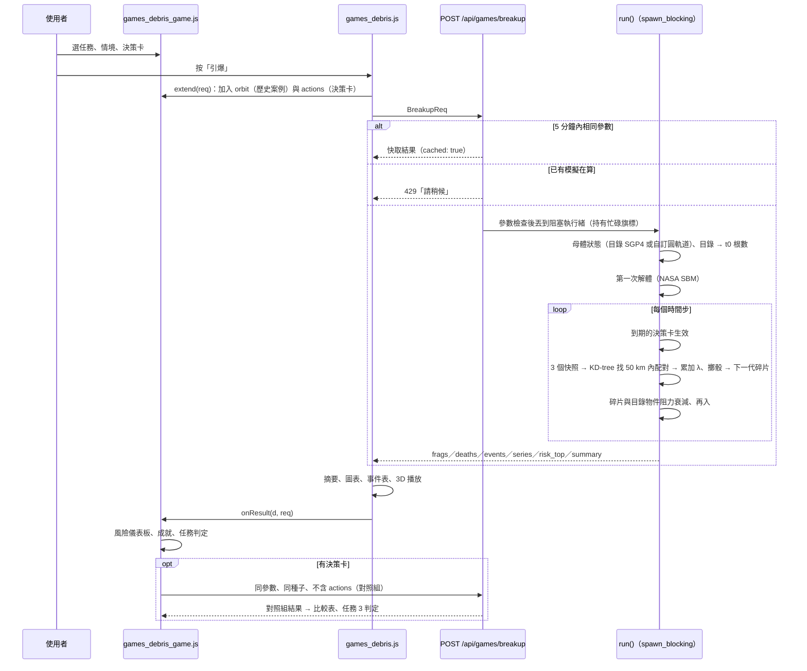

# 太空小遊戲「碎片連鎖」架構說明

> 適用版本：Rust 單機版 v0.1.15（`/games` 的 💥 碎片連鎖分頁）
> 讀者：要維護或擴充這個遊戲的開發者

## 1. 概要

使用者選一顆衛星（或一個歷史案例）讓它解體。後端依 NASA 標準解體模型產生碎片，再把碎片和整個目錄一起傳播數年到數十年，用 KD-tree 快照估計碰撞機率並擲骰。撞上時再產生下一代碎片，以此模擬凱斯勒連鎖。

玩家可以在解體後的指定時間打出**緩解決策卡**（清理、移除廢棄火箭體、避碰），系統會自動跑一次不採取決策的對照組來比較效果。另有任務模式、風險儀表板與成就。

整個模擬在**一次 HTTP 請求**內由後端算完，前端只負責播放：

- 後端回傳每個碎片的出生時刻、軌道根數、再入時刻、事件、時間序列與風險排行。
- 前端每秒 4 次用克卜勒方程算出碎片位置並畫在 3D 地球上。

| 項目 | 位置 |
|---|---|
| 後端（模擬、快取、忙碌控制） | [src/games_debris.rs](../src/games_debris.rs) |
| 路由註冊 | [src/games.rs](../src/games.rs) 的 `extend()`：`POST /api/games/breakup` |
| 前端：送出、播放、圖表、摘要 | [web/ext/games_debris.js](../web/ext/games_debris.js) |
| 前端：遊戲層（情境、任務、決策卡、對照組、儀表板、成就） | [web/ext/games_debris_game.js](../web/ext/games_debris_game.js) |
| 介面（控制項） | [web/ext/games.html](../web/ext/games.html) 的 `#tab-debris` |
| 共通體驗層 | [web/ext/games_ux.js](../web/ext/games_ux.js)：任務卡、示範、計算中提示 |
| 目錄背景（選用） | `GET /api/games/crowd/catalog` ＋ `/static/js/sat_worker.js`（瀏覽器端 SGP4） |

## 2. 資料流

## 3. API

### 請求 `BreakupReq`

| 欄位 | 型別 | 說明 | 檢查 |
|---|---|---|---|
| `norad` | u32 | 母體 NORAD 編號（須在目錄中且可傳播）；有 `orbit` 時忽略 | — |
| `orbit` | 物件？ | 自訂圓軌道母體：`alt_km`、`inc_deg`、`name`。給已不在目錄中的歷史案例用 | 高度 200–2000 km、傾角 0–180°，否則 400 |
| `mass_kg` | f64 | 母體質量 | 夾限 1 – 10⁶ |
| `n_frag` | usize | 第一次解體的碎片數 | 2 – 1000，否則 400 |
| `collision` | bool | false＝爆炸模型、true＝碰撞模型 | — |
| `years` | f64 | 模擬年數 | 夾限 0.1 – 50 |
| `accel` | f64 | 碰撞誇張倍率（放大碰撞截面） | 夾限 1 – 10⁶ |
| `seed` | u64？ | 亂數種子（同種子結果可重現） | 預設 1 |
| `actions` | 陣列 | 緩解決策：`kind`、`t_days`、`n`（見 4.6） | 最多 6 項，否則 400 |

### 回應

| 欄位 | 內容 |
|---|---|
| `t0` | 解體時刻（伺服器現在時間，RFC 3339） |
| `parent` | `norad`（自訂軌道為 null）、`name`、`alt_km`、`mass_kg`、`custom` |
| `years`、`accel`、`n_catalog` | 實際模擬年數（逾時會提早結束）、倍率、參與計算的目錄物件數 |
| `frags` | 每個碎片一列：`[id, birth_s, gen, L_m, A/M, a, e, i, Ω, ω, M0, Ω̇, ω̇, Ṁ]`（角度為弧度，a 為 km） |
| `deaths` | 與 `frags` 同索引的再入、被撞毀或被清理的時刻（秒），−1 表示期末仍在軌道 |
| `events` | 依時間排序。`kind` 為 `explosion`／`collision`（`a`←`b`、`v_rel`、`emr`、`catastrophic`、`n_new`、`pos`、`gen`），或決策事件 `cleanup`／`derelict`／`avoid`（`a` 為說明、`removed`） |
| `series` | 每個時間步：`t`、`alive`（第 0–7 代在軌數）、`expected`（累計期望碰撞）、`collisions`（累計擲中次數）、`cat_gone`（已消失的目錄物件數） |
| `risk_top` | 累計期望碰撞最高的 5 個目錄物件：`name`、`kind`、`alt_km`、`expected_real`（已除回倍率） |
| `summary` | 見下表 |
| `elapsed_s`、`cached` | 計算時間；是否為快取結果 |

`summary` 欄位：

| 欄位 | 意義 |
|---|---|
| `fragments_total`、`alive_end`、`reentered`、`capped` | 碎片總數、期末在軌、已消失（再入、被撞毀、被清理）、是否達 3 萬上限 |
| `collisions` | 擲中的碰撞次數 |
| `expected_collisions` | 累計期望碰撞（含倍率） |
| `expected_gen1_real` | **只計第一代碎片與目錄物件之間**的期望碰撞 ÷ 倍率。最接近「未加速」的寫實值，介面上的主要判讀數字 |
| `expected_linear` | 全部期望碰撞 ÷ 倍率。加速時多出的後代碎片也算進去，所以**偏高**（未補償連鎖偏差）。`expected_real` 為相容舊版的同義欄位 |
| `cat_reentered` | 已消失的目錄物件（阻力再入、被撞毀、被決策移除） |

## 4. 後端模擬管線（`run()`）

### 4.1 初始化

1. 以 `Utc::now()` 為 t0。母體狀態：
   - 目錄衛星：SGP4 算出 (r, v)，無法傳播時回 400。
   - 自訂軌道：半徑 R⊕＋高度的圓軌道，升交點赤經 0，從升交點出發。
2. 全目錄（排除母體）以 rayon 平行做 SGP4 → `El::from_rv()` 轉成 t0 的克卜勒根數。
3. 目錄物件的尺寸、質量與類別依用途取代表值（`cat_props`）：

| 類別 | 硬體半徑 | 質量 | 阻力衰減 |
|---|---|---|---|
| 有效載荷 | 1.5 m | 500 kg | 不衰減（假設會維持軌道或由同類補充） |
| 火箭體 | 2 m | 1,500 kg | 依 B* |
| 碎片 | 0.2 m | 5 kg | 依 B* |
| 其他 | 0.5 m | 50 kg | 依 B* |

4. **B* 換算面積質量比**（`parse_bstar`、`bstar_am`）：讀 TLE 第 1 行第 54–61 欄。B* = ρ₀·(Cd·A/m)/2，ρ₀ = 2.461×10⁻⁸ kg/m³（SGP4 參考密度）[8]，Cd = 2.2。負值視為 0（不衰減），上限 0.2 m²/kg。

### 4.2 NASA 標準解體模型（`breakup()`）

依 Johnson et al.（2001）的 EVOLVE 4.0 標準解體模型 [2]；ESA DELTA 的解體模組也以同一模型為基礎 [4]。

| 步驟 | 公式與作法 |
|---|---|
| 特徵長度下限 Lc | 由碎片數反推：爆炸 N = 6·Lc^−1.6；碰撞 N = 0.1·M^0.75·Lc^−1.71（M 為參考質量） |
| 尺寸 L | 依冪律在 [Lc, Lmax] 抽樣；Lmax = (m/100)^(1/3)，夾在 0.5–10 m（後續碰撞 0.1–10 m） |
| 面積質量比 A/M | `am_dist()`：L < 11 cm 用單一常態分布，其餘用模型的雙常態混合（log10 空間） |
| 面積、質量 | `area(L)`；質量 = 面積 ÷ (A/M) |
| Δv | log10(Δv) ~ N(μ, 0.4)，μ = 0.2χ + 1.85（爆炸）或 0.9χ + 2.9（碰撞），χ = log10(A/M)；方向等向 |
| 質量守恆 | 碎片質量縮放到總和等於母體質量，A/M 依面積重算 |
| 動量守恆 | 每個碎片的 Δv 扣掉質量加權平均 |

碎片速度 = 母體速度 + Δv，轉成根數加入物件表（`spawn`）。近地點低於 `REENTRY_KM`（120 km）的碎片出生即視為再入，與演化中的門檻一致。

### 4.3 傳播

- `El`：克卜勒根數加 J2 長期項（Ω̇、ω̇、Ṁ）。`rv(t)` 以 8 次牛頓迭代解克卜勒方程。
- **阻力衰減**（`decay()`，套用在所有 `am > 0` 的物件，即碎片與非有效載荷的目錄物件）：
  - 大氣密度用 Vallado 指數大氣模型（100–1000 km，19 層）[6]，取近地點高度的密度。
  - King-Hele 近似 [7]：da/dt = −2.2·(A/M)·ρ·√(μa)。偏心軌道（a·e > 尺度高度）乘上 √(H / 2πae)，並保持近地點不動、只降遠地點。
  - 每步先 `rebase()` 重設參考時刻，再改 a、e，確保位置連續。近地點低於 120 km 視為再入。

### 4.4 時間步

| 期間 | 步長 |
|---|---|
| 前 30 天 | 1 天 |
| 之後（總年數 ≤ 5） | 5 天 |
| 之後（≤ 15 年） | 10 天 |
| 之後（> 15 年） | 30 天 |

每步取 **3 個隨機快照時刻**（`ks = 3`）。整體超過 90 秒會提早結束，回傳實際模擬到的年數。

### 4.5 碰撞估計與擲骰

1. 快照時刻算出所有在軌物件位置，建 `kiddo::ImmutableKdTree`（3 維、bucket 32）。
2. **只以碎片為查詢點**，找 `SCREEN_D = 50 km` 內的鄰居。不計目錄物件之間的配對；碎片之間的配對只取一次（b < a 時跳過）。
3. 每個配對的期望碰撞數：

   λ = v_rel ÷ (4d/3) × (R₁+R₂)² ÷ d² × (dt ÷ ks) × accel（避碰生效時再 ×0.1，見 4.6）

   意義：v_rel ÷ (4d/3) 是穿過半徑 d 球的頻率（平均弦長 4d/3）；(R₁+R₂)²/d² 把半徑 d 的通量換算成合併硬體半徑的截面。這是 Kessler 與 Cour-Palais（1978）以氣體動力論（粒子箱）估計碰撞頻率的概念 [1]，差別在於這裡用實際軌道位置的快照取代均勻空間密度。
4. 所有快照的候選依 (a, b) 排序後依序處理：累加 `expected`；兩者都是第 0、1 代時另累加 `expected_g1`；b 為目錄物件時累加到該物件的風險分數。以機率 1 − e^−λ 擲骰。
5. **擲中時**：
   - 較重者為目標。能量質量比 EMR = ½·m_s·v_rel² ÷ m_b，超過 **40 J/g** 為完全解體。
   - 完全解體：兩者都毀，碎片總質量 = 兩者合計，以質心速度為基準。
   - 非完全解體：撞擊物毀、目標扣掉被打掉的質量，參考質量 = m_s·v_rel²。
   - 以碰撞模型產生下一代碎片，代數 = 兩者較大代數 + 1；每次事件最多 600 個碎片（`PER_EVENT_MAX`）。

### 4.6 緩解決策（`actions`）

依 `t_days` 排序，在時間步開頭、時刻已到時生效，並各記一筆事件：

| `kind` | 效果 | 參數 |
|---|---|---|
| `cleanup` | 移除當時最重的 n 個在軌碎片（主動清除任務） | n 預設 20，上限 200；介面固定 50 |
| `derelict` | 移除近地點到遠地點範圍與母體高度相距 100 km 內、最接近的 n 個火箭體（預防性移除） | n 預設 10，上限 100 |
| `avoid` | 之後有效載荷對 ≥ 10 cm 的碎片避碰，該配對 λ ×0.1（小於 10 cm 追蹤不到、躲不了） | — |

### 4.7 資源保護

| 機制 | 作法 |
|---|---|
| 忙碌控制 | `static BUSY: AtomicBool`。已有模擬在算時回 **429**「請稍候」；`BusyGuard` 在計算結束（含 panic）時釋放 |
| 快取 | `static CACHE`：鍵為整個請求的 JSON，以 5 分鐘分桶，最多 6 筆。命中時直接回傳並標 `cached: true` |
| 紀錄 | 每次計算以 `tracing::info!` 記錄母體、碎片數、年數、倍率、決策數、碎片總數（是否達上限）、碰撞數、期末在軌、計算時間 |

> 單機版預設只綁 127.0.0.1；以 `--host 0.0.0.0` 開放區網時，上面兩項可避免多人同時計算把 CPU 打滿。

### 4.8 上限與常數

| 常數 | 值 | 用途 |
|---|---|---|
| `MAX_FRAGS` | 30,000 | 碎片總數上限；達到後不再產生（`capped = true`） |
| `PER_EVENT_MAX` | 600 | 單次碰撞產生的碎片上限 |
| `SCREEN_D` | 50 km | KD-tree 篩選半徑 |
| `REENTRY_KM` | 120 km | 近地點低於此值移除（出生時與演化中一致） |
| EMR 門檻 | 40 J/g | 完全解體判定 |
| `CACHE_SECS`、`CACHE_MAX` | 300 秒、6 筆 | 快取分桶與容量 |
| 逾時 | 90 秒 | 提早結束模擬 |
| 亂數 | SplitMix64 | 同種子可重現 |

## 5. 前端

### 5.1 `games_debris.js`（送出與播放）

| 功能 | 作法 |
|---|---|
| 掛鉤 | `window.SDG_DEBRIS` 提供 `baseReq()`、`post()`；遊戲層掛上 `extend(req)` 與 `onResult(d, req)` |
| 送出與摘要 | `#d-run` 組請求 → `extend` → 送出；回來後依序執行 `summary()`、`chart()`、`evTable()`、`build()`、`play("3h")`、`setBadge()`、`onResult` |
| 摘要表 | 最上方標示「統計模擬，不是碰撞預報」；主要判讀數字是**第一代寫實期望碰撞**；誇張模式時另列「線性反推（偏高）」；附可展開的三段說明：看到的、接近真實的、誇張或簡化的 |
| 3D 碎片 | 兩個 `PointPrimitiveCollection`：碎片點依代數上色（`GEN_C`）；碰撞與解體閃光（決策事件不閃） |
| 位置更新 | 每 250 ms 依時鐘時刻用 `pos()` 解克卜勒方程（含 J2 漂移率），再以 GMST 轉到地固座標。出生前與 `deaths` 之後隱藏，a > 60,000 km 的逃逸碎片不畫 |
| 播放 | 「看前 3 小時」相機貼近爆炸點；「看前 90 天」「看全程」改看全球。都在約 30 秒內播完 |
| 圖表 | 對數縱軸：在軌碎片總數、各代碎片數、累計碰撞（虛線）。圖例可點擊開關；畫完存底圖，`cursor()` 只疊上目前播放時間的橘線 |
| 提示 | 誇張模式（`accel > 1`）時，地球畫面上方顯示倍率與第一代寫實期望碰撞；播放超過 1 年時，左下角提示「畫面軌道為簡化版，統計以後端模擬為準」 |

> 前端的碎片位置**不含阻力衰減**，只用後端回傳的初始根數加 J2 漂移，再依 `deaths` 移除。長期播放時低軌碎片的畫面位置會偏高，只影響畫面，不影響統計。

### 5.2 `games_debris_game.js`（遊戲層）

| 功能 | 作法 |
|---|---|
| 情境模板 | Envisat（目錄衛星）與 3 個歷史案例：風雲一號 C（865 km，98.8°，958 kg）、Iridium 33 × Cosmos 2251（789 km，86.4°，兩星合計 1,510 kg）、Cosmos 1408（480 km，82.6°，2,200 kg）。歷史案例的母體已不在目錄中，以 `orbit` 自訂圓軌道示意，並標明是近似教學設定 |
| 決策卡 | 清理任務（2 點，第 30 天／第 1 年／第 3 年）、移除廢棄火箭體（1 點，立即／第 1 年）、避碰機動（1 點，立即／第 1 年）；預算 3 點，超過預算的卡會停用 |
| 對照組 | 有選決策卡時，主結果回來後自動以同參數、同種子、不含 `actions` 再送一次，列出碰撞、碎片總數、期末在軌與第一代寫實期望的比較。遇 429 每 1.5 秒重試，最多 10 次 |
| 任務 | 任務 1「自然清除」：寫實 ×1，5 年後第一代碎片剩 ≤ 50%（≤ 25% 兩星、≤ 10% 三星）。任務 2「連鎖觸發者」：×1,000 下觸發第 3 代，初始碎片 ≤ 100 三星、≤ 300 兩星。任務 3「守護者」：Envisat ×1,000，用決策卡讓碰撞 ≤ 對照組的 50%（≤ 30% 兩星、≤ 15% 三星） |
| 風險儀表板 | 風險最高的 5 個目錄物件、碰撞熱區高度帶（事件位置每 50 km 一帶，前 5 名）、期末各代碎片比例、累計再入 |
| 成就 | 9 項（二次碰撞、連鎖反應、凱斯勒失控、大氣清道夫、守護者、歷史學家、任務 1–3），存在瀏覽器 `localStorage`（`sdg-debris-ach`），無法存取時只在本頁有效 |

## 6. 結果判讀

- **碰撞誇張倍率**只放大碰撞截面，讓連鎖在幾年內看得到；不改變軌道演化與衰減，也不是把時間加速。
- **第一代寫實期望碰撞（`expected_gen1_real`）** 是判讀真實風險的主要數字。誇張模式下第一代碎片也可能被撞毀，所以這個值會略為偏低。
- **線性反推（`expected_linear`）** 在誇張模式下明顯偏高。實測：Envisat、300 個碎片、×1,000 時，線性反推 1.71 次，第一代寫實 0.11 次。
- 寫實倍率（預設 ×1）下，兩者相同。Envisat 爆成 1,000 個碎片，10 年期望碰撞約 0.42 次。
- 碰撞次數是擲骰結果，換種子就可能不同。決策卡的比較建議多換幾個種子再下結論。

## 7. 效能（參考）

| 案例 | 計算時間 |
|---|---|
| Envisat、1,000 個碎片、10 年、×1（約 3.3 萬個目錄物件） | 約 5–6 秒 |
| Envisat、1,000 個碎片、10 年、×1,000（碎片達 3 萬上限） | 約 5–6 秒 |
| 同參數再按一次（快取命中） | < 0.1 秒 |

主要成本在每個快照的全物件傳播與 KD-tree 查詢，兩者都以 rayon 平行處理。有決策卡時會多跑一次對照組，總時間約加倍。

## 8. 已知限制

1. 目錄物件的尺寸與質量依類別取代表值，DB 沒有實際規格。
2. 有效載荷一律不衰減；B* 雜訊大的物件，衰減速度可能失真（上限 0.2 m²/kg）。
3. 不計目錄物件之間的碰撞，只計「碎片 × 任何物件」。
4. 碰撞以快照統計估計，不是逐一求解最接近時刻；每步只有 3 個快照，統計雜訊較大。
5. 大氣為靜態指數模型，不含太陽活動變化。
6. 碎片總數上限 3 萬，誇張倍率高時很快達到上限，之後的連鎖會被低估。
7. 歷史案例以單一圓軌道母體近似，不是事件重演（例如 Iridium 與 Cosmos 實際分屬不同軌道面）。
8. 決策卡效果為抽象模型（例如避碰一律降為一成），不代表實際作業能力。

## 9. 擴充指引

| 想做的事 | 修改位置 |
|---|---|
| 改解體模型參數（如 Δv 分布） | `breakup()`、`am_dist()` |
| 改大氣模型或加入太陽活動 | `ATM`、`atm()`、`decay()` |
| 加入目錄物件之間的碰撞 | `run()` 的查詢點篩選 `q`（目前只取 `map[k] >= n_cat`） |
| 新增決策卡 | 後端 `run()` 的決策 `match`、前端 `CARDS` |
| 新增情境或任務 | 前端 `TPL`、`MIS`（任務的 `setup` 與 `judge`） |
| 提高統計精度 | `ks`（快照數）或時間步長；計算時間會等比增加 |
| 調整上限 | `MAX_FRAGS`、`PER_EVENT_MAX`；前端點數與播放負擔也會增加 |
| 回傳更多欄位 | `frags` 的列格式需前後端同步修改（前端以索引存取） |

## 10. 學術定位

這個遊戲和 LEGEND（NASA）、DELTA（ESA）這類長期演化模型 [3][4] 用的是同一類元件：標準解體模型、軌道傳播、大氣衰減、碰撞率估計。差別在於：

| 面向 | LEGEND／DELTA 類模型 | 本遊戲 |
|---|---|---|
| 目的 | 研究與政策分析（50–200 年投影、緩解與主動移除情境） | 科普與教學：讓非專家操作與理解 |
| 統計 | 數百次蒙地卡羅取平均 | 單次擲骰；以同種子對照組比較決策 |
| 時間尺度 | 數十到數百年 | 1–50 年，可用碰撞誇張倍率提早看到連鎖 |
| 物件 | 完整碎片族群與發射、任務後處置的交通模型 | 現行目錄＋單一解體事件，無新發射 |

最有潛力的發展方向，是把它推進成**可重現、可量化、可教學的碎片連鎖決策實驗平台**：

1. **可重現**：已有亂數種子與快取；可再加入匯出完整參數與結果的功能。
2. **可量化**：決策比較目前只用單一種子。改成同參數跑多個種子、報告平均與信賴區間（太空兵棋已有這類蒙地卡羅框架可沿用），才能把「決策有效」說得有統計意義。
3. **可驗證**：用相同初始條件與 DELTA／LEGEND 及密度型演化模型 [5] 的已發表結果比對趨勢，例如 Cosmos 1408、風雲一號 C 碎片的衰減曲線。
4. **風險指標**：參考以「失控增長機率」量化凱斯勒風險的做法（見 [5] 下的相關文獻），把結果轉成玩家看得懂的單一風險分數。

## 11. 參考文獻

**主要文獻**

1. Kessler, D. J., & Cour-Palais, B. G. (1978). Collision frequency of artificial satellites: The creation of a debris belt. *Journal of Geophysical Research*, 83(A6), 2637–2646.
   - 對應：4.5 碰撞率（氣體動力論估計），以及「凱斯勒連鎖」概念本身。
2. Johnson, N. L., Krisko, P. H., Liou, J.-C., & Anz-Meador, P. D. (2001). NASA's new breakup model of EVOLVE 4.0. *Advances in Space Research*, 28(9), 1377–1384.
   - 對應：4.2 解體模型（碎片數冪律、A/M 分布、Δv 分布）。
3. Liou, J.-C., & Johnson, N. L. (2006). Risks in space from orbiting debris. *Science*, 311(5759), 340–341.
   - 對應：低軌碎片環境即使停止發射仍會因碰撞而增長的結論（LEGEND 投影）；遊戲中「寫實倍率下連鎖很慢，但長期累積」的說明背景。
4. ESA DELTA（Debris Environment Long-Term Analysis）：
   - Bastida Virgili, B. (2016). DELTA (Debris Environment Long-Term Analysis). *6th International Conference on Astrodynamics Tools and Techniques (ICATT)*, Darmstadt. [PDF](https://indico.esa.int/event/111/contributions/234/attachments/486/531/DELTA_paper.pdf)
   - Klinkrad, H., Martin, C., & Walker, R. (2006). Modeling of the future space debris environment. In H. Klinkrad, *Space Debris: Models and Risk Analysis*. Springer. [連結](https://link.springer.com/chapter/10.1007/3-540-37674-7_5)
   - European Space Agency. *Analysis and prediction*. ESA Space Debris Office. https://www.esa.int/Space_Safety/Space_Debris/Analysis_and_prediction（DELTA 等 ESA 碎片分析工具的官方說明）
   - 對應：半決定論長期演化、緩解與主動移除（ADR）情境分析；本遊戲的決策卡是這類情境的簡化版。
5. Giudici, L., Colombo, C., Horstmann, A., Letizia, F., & Lemmens, S. (2024). Density-based evolutionary model of the space debris environment in low-Earth orbit. *Acta Astronautica*, 219, 115–127. https://doi.org/10.1016/j.actaastro.2024.03.008
   - 對應：以密度（連續體）方式描述碎片雲的長期演化模型，可處理公分級碎片，並投影 200 年、含未來發射與任務後處置情境；可作為本遊戲「逐顆碎片＋快照統計」做法的對照，以及第 10 節驗證比對的參考。
   - 相關（風險指標）：Institute for Defense Analyses (2023). *On the Increased Risk of Kessler Syndrome by Anti-Satellite Tests*. [連結](https://www.ida.org/research-and-publications/publications/all/o/on/on-the-increased-risk-of-kessler-syndrome-by-anti-satellite-tests)（以失控增長機率 P_Exp 作為風險參數）

**模型與資料**

6. Vallado, D. A. *Fundamentals of Astrodynamics and Applications*. Microcosm Press／Springer（指數大氣模型表）。
7. King-Hele, D. (1987). *Satellite Orbits in an Atmosphere: Theory and Applications*. Blackie（阻力衰減近似）。
8. Vallado, D. A., Crawford, P., Hujsak, R., & Kelso, T. S. (2006). Revisiting Spacetrack Report #3. *AIAA/AAS Astrodynamics Specialist Conference*, AIAA 2006-6753（SGP4 與 B* 定義）。

> 歷史案例（風雲一號 C、Iridium 33 × Cosmos 2251、Cosmos 1408）的軌道高度、傾角與質量為公開資料的近似值，僅作教學設定。