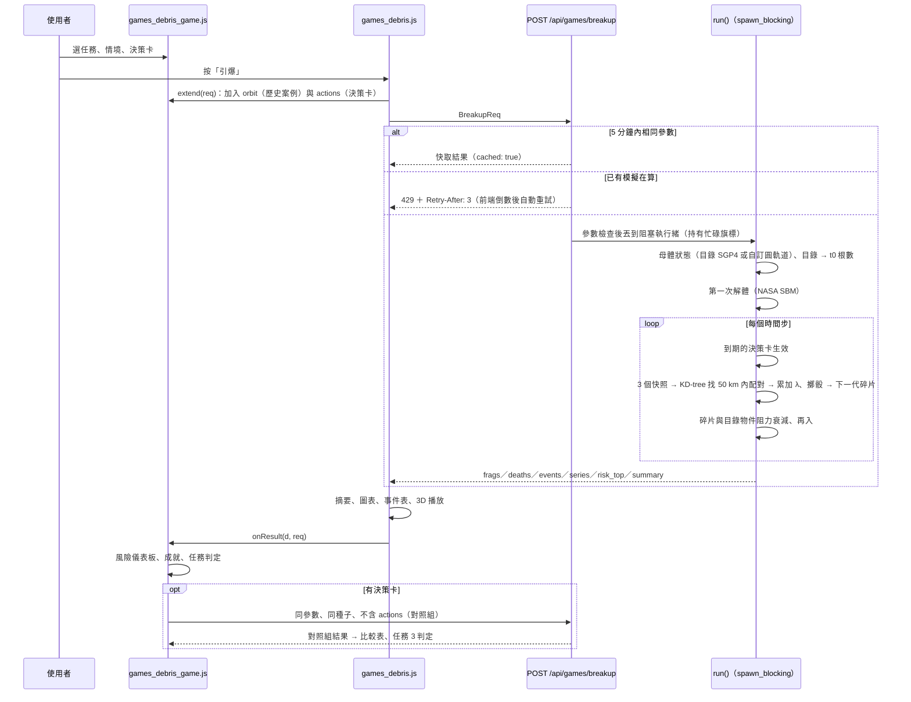

# 太空小遊戲「碎片連鎖」架構說明

> 適用版本：Rust 單機版 v0.1.18（`/games` 的 💥 碎片連鎖分頁）
> 讀者：要維護或擴充這個遊戲的開發者

## 1. 概要

使用者選一顆衛星（或一個歷史案例）讓它解體。後端依 NASA 標準解體模型產生碎片，再把碎片和整個目錄一起傳播數年到數十年，用 KD-tree 快照估計碰撞機率並擲骰。撞上時再產生下一代碎片，以此模擬凱斯勒連鎖。

玩家可以在解體後的指定時間打出**緩解決策卡**（清理、移除廢棄火箭體、避碰），系統會自動跑一次不採取決策的對照組來比較效果。另有任務模式、風險儀表板與成就。

整個模擬在**一次 HTTP 請求**內由後端算完，前端只負責播放：

- 後端回傳每個碎片的出生時刻、軌道根數、再入時刻、事件、時間序列與風險排行。
- 前端每秒 4 次用克卜勒方程算出碎片位置並畫在 3D 地球上。

| 項目 | 位置 |
|---|---|
| 後端（模擬、快取、忙碌控制） | [src/games_debris.rs](../src/games_debris.rs) |
| 路由註冊 | [src/games.rs](../src/games.rs) 的 `extend()`：`POST /api/games/breakup` |
| 前端：送出、播放、圖表、摘要 | [web/ext/games_debris.js](../web/ext/games_debris.js) |
| 前端：遊戲層（情境、任務、決策卡、對照組、儀表板、成就） | [web/ext/games_debris_game.js](../web/ext/games_debris_game.js) |
| 介面（控制項） | [web/ext/games.html](../web/ext/games.html) 的 `#tab-debris` |
| 共通體驗層 | [web/ext/games_ux.js](../web/ext/games_ux.js)：任務卡、示範、計算中提示 |
| 目錄背景（選用） | `GET /api/games/crowd/catalog` ＋ `/static/js/sat_worker.js`（瀏覽器端 SGP4） |

## 2. 資料流

## 3. API

### 請求 `BreakupReq`

| 欄位 | 型別 | 說明 | 檢查 |
|---|---|---|---|
| `norad` | u32 | 母體 NORAD 編號（須在目錄中且可傳播）；有 `orbit` 時忽略 | — |
| `orbit` | 物件？ | 自訂圓軌道母體：`alt_km`、`inc_deg`、`name`。給已不在目錄中的歷史案例用 | 高度 200–2000 km、傾角 0–180°，否則 400 |
| `mass_kg` | f64 | 母體質量 | 夾限 1 – 10⁶ |
| `n_frag` | usize | 第一次解體的碎片數 | 2 – 1000，否則 400 |
| `collision` | bool | false＝爆炸模型、true＝碰撞模型 | — |
| `years` | f64 | 模擬年數 | 夾限 0.1 – 50 |
| `accel` | f64 | 碰撞誇張倍率（放大碰撞截面） | 夾限 1 – 10⁶ |
| `seed` | u64？ | 亂數種子（同種子結果可重現） | 預設 1 |
| `actions` | 陣列 | 緩解決策：`kind`、`t_days`、`n`（見 4.6） | 最多 6 項，否則 400 |
| `solar` | 字串？ | 大氣：`series`（預設，隨實測＋預報 F10.7）、`low`／`mid`／`high`（固定 F10.7 = 70／120／200）、`static`（舊版 Vallado 靜態大氣） | — |
| `epoch` | 字串？ | 太陽活動起算日 YYYY-MM-DD：只決定 F10.7 序列的起點（歷史情境用）；**軌道目錄（背景物件位置）仍為現況**，介面也這樣標示 | 預設＝解體時刻 t0 |

### 回應

| 欄位 | 內容 |
|---|---|
| `t0` | 解體時刻（伺服器現在時間，RFC 3339） |
| `parent` | `norad`（自訂軌道為 null）、`name`、`alt_km`、`mass_kg`、`custom` |
| `years`、`accel`、`n_catalog` | 實際模擬年數（逾時會提早結束）、倍率、參與計算的目錄物件數 |
| `frags` | 每個碎片一列：`[id, birth_s, gen, L_m, A/M, a, e, i, Ω, ω, M0, Ω̇, ω̇, Ṁ]`（角度為弧度，a 為 km） |
| `deaths` | 與 `frags` 同索引的再入、被撞毀或被清理的時刻（秒），−1 表示期末仍在軌道 |
| `events` | 依時間排序。`kind` 為 `explosion`／`collision`（`a`←`b`、`v_rel`、`emr`、`catastrophic`、`n_new`、`pos`、`gen`），或決策事件 `cleanup`／`derelict`／`avoid`（`a` 為說明、`removed`） |
| `series` | 每個時間步：`t`、`alive`（第 0–7 代在軌數）、`expected`（累計期望碰撞）、`collisions`（累計擲中次數）、`cat_gone`（已消失的目錄物件數） |
| `risk_top` | 累計期望碰撞最高的 5 個目錄物件：`name`、`kind`、`alt_km`、`expected_real`（已除回倍率） |
| `summary` | 見下表 |
| `solar` | `mode`、`epoch`、`f107_mean`／`f107_min`／`f107_max`（模擬期間用到的 F10.7）、`obs_until`（實測到哪個月）、`data_until`（預報到哪個月）、`beyond_data`（是否用到週期外推）；`series` 每一步另有 `f107` |
| `model_version` | 程式版本＋太陽活動與密度表內容的雜湊（例如 `0.1.18+…`），用於快取鍵與結果追溯 |
| `elapsed_s`、`cached` | 計算時間；是否為快取結果 |

`summary` 欄位：

| 欄位 | 意義 |
|---|---|
| `fragments_total`、`alive_end`、`reentered`、`capped` | 碎片總數、期末在軌、已消失（再入、被撞毀、被清理）、是否達 3 萬上限 |
| `collisions` | 擲中的碰撞次數 |
| `expected_collisions` | 累計期望碰撞（含倍率） |
| `expected_gen1_real` | **只計第一代碎片與目錄物件之間**的期望碰撞 ÷ 倍率。介面稱「第一代碎片近似風險」：未加速情境下，第一代碎片對現有目錄的近似風險。它排除了後代碎片，但誇張模式下第一代碎片也會被撞毀、提早退出，所以**略偏低**，不是完全的未加速等效值 |
| `expected_linear` | 全部期望碰撞 ÷ 倍率。加速時多出的後代碎片也算進去，所以**偏高**（未補償連鎖偏差）。`expected_real` 為相容舊版的同義欄位 |
| `cat_reentered` | 已消失的目錄物件（阻力再入、被撞毀、被決策移除） |

## 4. 後端模擬管線（`run()`）

### 4.1 初始化

1. 以 `Utc::now()` 為 t0。母體狀態：
   - 目錄衛星：SGP4 算出 (r, v)，無法傳播時回 400。
   - 自訂軌道：半徑 R⊕＋高度的圓軌道，升交點赤經 0，從升交點出發。
2. 全目錄（排除母體）以 rayon 平行做 SGP4 → `El::from_rv()` 轉成 t0 的克卜勒根數。
3. 目錄物件的尺寸、質量與類別依用途取代表值（`cat_props`）：

| 類別 | 硬體半徑 | 質量 | 阻力衰減 |
|---|---|---|---|
| 有效載荷 | 1.5 m | 500 kg | 不衰減（假設會維持軌道或由同類補充） |
| 火箭體 | 2 m | 1,500 kg | 依 B* |
| 碎片 | 0.2 m | 5 kg | 依 B* |
| 其他 | 0.5 m | 50 kg | 依 B* |

4. **B* 換算面積質量比**（`parse_bstar`、`bstar_am`）：讀 TLE 第 1 行第 54–61 欄。B* = ρ₀·(Cd·A/m)/2，ρ₀ = 2.461×10⁻⁸ kg/m³（SGP4 參考密度）[8]，Cd = 2.2。負值視為 0（不衰減），上限 0.2 m²/kg。

### 4.2 NASA 標準解體模型（`breakup()`）

依 Johnson et al.（2001）的 EVOLVE 4.0 標準解體模型 [2]；ESA DELTA 的解體模組也以同一模型為基礎 [4]。

模型分成**爆炸**與**碰撞**兩種，物理來源與碎片特性不同，必須依事件性質選用：

| 項目 | 爆炸模型（`collision = false`） | 碰撞模型（`collision = true`） |
|---|---|---|
| 物理來源 | 內部能量：電池破裂、殘餘推進劑爆炸 | 外部撞擊：反衛星飛彈、衛星互撞、碎片撞擊 |
| 碎片數 | N = 6·Lc^−1.6（與母體質量無關） | N = 0.1·M^0.75·Lc^−1.71（M 為參考質量） |
| Δv 分布均值 | log₁₀Δv = 0.2χ + 1.85（較小） | log₁₀Δv = 0.9χ + 2.9（較大，碎片散得較開） |
| 參考質量 M | — | 第一次解體：母體質量；後續完全解體：兩者合計；非完全解體：m_s·v_rel² |
| 遊戲中的用途 | 只用在第一次解體（玩家選擇） | 第一次解體（玩家選擇）與**所有後續碰撞** |
| 適用情境 | Envisat 假想爆炸、失效衛星或火箭上節自爆 | 風雲一號 C、Cosmos 1408 反衛星試射；Iridium–Cosmos 互撞 |
| 驗證（Cosmos 1408，見 6.1） | 第 1 年存活 43.9%、第 5 年 13.8%，與觀測（25.3%、0.2%）差距大 | 第 1 年 24.8%，與觀測吻合；一年後偏慢 |

介面上兩者分開標示：選單寫明「內部能量／外部撞擊」並即時顯示公式與適用情境；情境模板的模型與玩家所選不一致時（例如反衛星試射選了爆炸模型）會跳出警告；結果摘要列出這次用的模型。

| 步驟 | 公式與作法 |
|---|---|
| 特徵長度下限 Lc | 由碎片數反推：爆炸 N = 6·Lc^−1.6；碰撞 N = 0.1·M^0.75·Lc^−1.71（M 為參考質量） |
| 尺寸 L | 依冪律在 [Lc, Lmax] 抽樣；Lmax = (m/100)^(1/3)，夾在 0.5–10 m（後續碰撞 0.1–10 m） |
| 面積質量比 A/M | `am_dist()`：L < 11 cm 用單一常態分布，其餘用模型的雙常態混合（log10 空間） |
| 面積、質量 | `area(L)`；質量 = 面積 ÷ (A/M) |
| Δv | log10(Δv) ~ N(μ, 0.4)，μ = 0.2χ + 1.85（爆炸）或 0.9χ + 2.9（碰撞），χ = log10(A/M)；方向等向 |
| 質量守恆 | 碎片質量縮放到總和等於母體質量，A/M 依面積重算 |
| 動量守恆 | 每個碎片的 Δv 扣掉質量加權平均 |

碎片速度 = 母體速度 + Δv，轉成根數加入物件表（`spawn`）。近地點低於 `REENTRY_KM`（120 km）的碎片出生即視為再入，與演化中的門檻一致。

### 4.3 傳播

- `El`：克卜勒根數加 J2 長期項（Ω̇、ω̇、Ṁ）。`rv(t)` 以 8 次牛頓迭代解克卜勒方程。
- **阻力衰減**（`decay()`，套用在所有 `am > 0` 的物件，即碎片與非有效載荷的目錄物件）：
  - **大氣密度隨太陽活動變化**（v0.1.17 起，預設）：每個時間步取中點的 F10.7，從 NRLMSISE-00 [9] 的全球平均密度表內插近地點高度的密度，並由表的局部梯度得到尺度高度。
    - **F10.7 序列**（`config/f107_monthly.csv`）：每月 81 天中心平均，1957 年起為實測，之後接 CelesTrak 日預報與月預報（到 2041-10）[11]；更晚以 11 年週期外推（平均 120、振幅 52，接在 2041 年的極小期）。逐月線性內插。
    - **密度表**（`config/msis_density.csv`）：高度 100–1000 km 每 20 km × F10.7 = 60–300 共 10 檔；全球平均為緯度 −80°～80°（cos 緯度加權）、經度每 45°（等效地方時每 3 小時）、四季各一天；F10.7 與 81 天平均取同值、Ap 固定 15。**近似說明**：NRLMSISE-00 原本分開輸入當日 F10.7 與 81 天平均；這裡以每月 81 天平均同時代入兩者，長期平均影響有限，但磁暴後或太陽活動快速變化時的密度響應會被平滑。對 ln ρ 雙線性內插（F10.7 方向用 ln F）；超出 1000 km 時沿表頂的尺度高度外推。
    - F10.7 表的檔頭記錄來源網址與來源檔 sha256，可追溯是哪一版 CelesTrak 資料。
    - 兩張表由 `scripts/gen_solar_tables.py`（numpy＋pymsis 0.13.0 [10]）產生後以 `include_str!` 內嵌，離線可用；更新太陽活動資料後重跑腳本、重新建置即可。
    - 太陽活動的影響很大：500 km 處 F10.7 = 250 時的密度約是 70 時的 25 倍（600 km 約 40 倍）。
    - `solar = static` 時沿用舊版 Vallado 指數大氣模型（100–1000 km，19 層）[6]，相當於中等偏高的太陽活動（500 km 密度約等於 F10.7 ≈ 140）。
  - King-Hele 近似 [7]：da/dt = −2.2·(A/M)·ρ·√(μa)。偏心軌道（a·e > 尺度高度）乘上 √(H / 2πae)，並保持近地點不動、只降遠地點。
  - 每步先 `rebase()` 重設參考時刻，再改 a、e，確保位置連續。近地點低於 120 km 視為再入。

### 4.4 時間步

| 期間 | 步長 |
|---|---|
| 前 30 天 | 1 天 |
| 之後（總年數 ≤ 5） | 5 天 |
| 之後（≤ 15 年） | 10 天 |
| 之後（> 15 年） | 30 天 |

每步取 **3 個隨機快照時刻**（`ks = 3`）。整體超過 90 秒會提早結束，回傳實際模擬到的年數。

### 4.5 碰撞估計與擲骰

1. 快照時刻算出所有在軌物件位置，建 `kiddo::ImmutableKdTree`（3 維、bucket 32）。
2. **只以碎片為查詢點**，找 `SCREEN_D = 50 km` 內的鄰居。不計目錄物件之間的配對；碎片之間的配對只取一次（b < a 時跳過）。
3. 每個配對的期望碰撞數：

   λ = v_rel ÷ (4d/3) × (R₁+R₂)² ÷ d² × (dt ÷ ks) × accel（避碰生效時再 ×0.1，見 4.6）

   意義：v_rel ÷ (4d/3) 是穿過半徑 d 球的頻率（平均弦長 4d/3）；(R₁+R₂)²/d² 把半徑 d 的通量換算成合併硬體半徑的截面。這是 Kessler 與 Cour-Palais（1978）以氣體動力論（粒子箱）估計碰撞頻率的概念 [1]，差別在於這裡用實際軌道位置的快照取代均勻空間密度。
4. 快照時刻用**獨立亂數流**（`rng_snap`）抽樣，擲骰與解體另用 `rng`。決策移除物件會改變擲骰次數，但不影響取樣時刻，所以同種子的決策組與對照組在相同時刻取樣（共同隨機數），比較的雜訊大幅降低。
5. 所有快照的候選依 (a, b) 排序後依序處理：累加 `expected`；兩者都是第 0、1 代時另累加 `expected_g1`；b 為目錄物件時累加到該物件的風險分數，碎片則累加到碎片風險（清理任務排序用）。以機率 1 − e^−λ 擲骰。
6. **擲中時**：
   - 較重者為目標。能量質量比 EMR = ½·m_s·v_rel² ÷ m_b，超過 **40 J/g** 為完全解體。
   - 完全解體：兩者都毀，碎片總質量 = 兩者合計，以質心速度為基準。
   - 非完全解體：撞擊物毀、目標扣掉被打掉的質量，參考質量 = m_s·v_rel²。
   - 以碰撞模型產生下一代碎片，代數 = 兩者較大代數 + 1；每次事件最多 600 個碎片（`PER_EVENT_MAX`）。

### 4.6 緩解決策（`actions`）

依 `t_days` 排序，在時間步開頭、時刻已到時生效，並各記一筆事件：

| `kind` | 效果 | 參數 |
|---|---|---|
| `cleanup` | 移除當時**累計碰撞風險最高**的 n 個在軌碎片（同分再比質量；解體初期還沒有風險資料時等同依質量） | n 預設 20，上限 200；介面固定 50 |
| `derelict` | 移除與母體**軌道面相近**（傾角差 ≤ 5°、升交點赤經差 ≤ 30°，依 J2 漂移推到當下），且近地點到遠地點範圍與母體高度相距 100 km 內、最接近的 n 個火箭體；符合的不足 n 個時全部移除並在事件中說明 | n 預設 10，上限 100 |
| `avoid` | **簡化避碰假設**：之後有效載荷對 ≥ 10 cm 的碎片避碰，該配對 λ ×0.1。實際效果取決於預警能力、燃料、協調與虛警率；小於 10 cm 追蹤不到、躲不了 | — |

三張卡都是**教學簡化**，事件訊息與介面說明都會標明。例如實際的主動清除任務還要考慮相位、交會幾何與轉移能量。

### 4.7 資源保護

| 機制 | 作法 |
|---|---|
| 忙碌控制 | `static BUSY: AtomicBool`。已有模擬在算時回 **429**，附 `Retry-After: 3` 標頭與 `retry_after: 3`；前端倒數後自動重試（最多 10 次）。`BusyGuard` 在計算結束（含 panic）時釋放 |
| 快取 | `static CACHE`：鍵為「`model_version`（程式版本＋太陽活動與密度表雜湊）＋目錄索引建立時間＋整個請求的 JSON」，以 5 分鐘分桶，最多 6 筆，LRU（命中時移到最後）。程式更新、資料表更新或目錄重建後，舊結果不會再命中。命中時直接回傳並標 `cached: true` |
| 紀錄 | 每次計算以 `tracing::info!` 記錄母體、碎片數、年數、倍率、決策數、碎片總數（是否達上限）、碰撞數、期末在軌、計算時間 |

> 單機版預設只綁 127.0.0.1；以 `--host 0.0.0.0` 開放區網時，上面兩項可避免多人同時計算把 CPU 打滿。

### 4.8 上限與常數

| 常數 | 值 | 用途 |
|---|---|---|
| `MAX_FRAGS` | 30,000 | 碎片總數上限；達到後不再產生（`capped = true`） |
| `PER_EVENT_MAX` | 600 | 單次碰撞產生的碎片上限 |
| `SCREEN_D` | 50 km | KD-tree 篩選半徑 |
| `REENTRY_KM` | 120 km | 近地點低於此值移除（出生時與演化中一致） |
| EMR 門檻 | 40 J/g | 完全解體判定 |
| `CACHE_SECS`、`CACHE_MAX` | 300 秒、6 筆 | 快取分桶與容量 |
| 逾時 | 90 秒 | 提早結束模擬 |
| 亂數 | SplitMix64 | 同種子可重現 |

## 5. 前端

### 5.1 `games_debris.js`（送出與播放）

| 功能 | 作法 |
|---|---|
| 掛鉤 | `window.SDG_DEBRIS` 提供 `baseReq()`、`post()`；遊戲層掛上 `extend(req)` 與 `onResult(d, req)` |
| 送出與摘要 | `#d-run` 組請求 → `extend` → 送出；回來後依序執行 `summary()`、`chart()`、`evTable()`、`build()`、`play("3h")`、`setBadge()`、`onResult` |
| 摘要表 | 最上方標示「統計模擬，不是碰撞預報」；主要判讀數字是**第一代碎片近似風險**（誇張模式下註明略偏低）；誇張模式時另列「線性反推（偏高）」；附可展開的三段說明：看到的、接近真實的、誇張或簡化的 |
| 忙碌重試 | `postRetry()` 依 `retry_after` 倒數並自動重試，主結果與對照組共用 |
| 3D 碎片 | 兩個 `PointPrimitiveCollection`：碎片點依代數上色（`GEN_C`）；碰撞與解體閃光（決策事件不閃） |
| 位置更新 | 每 250 ms 依時鐘時刻用 `pos()` 解克卜勒方程（含 J2 漂移率），再以 GMST 轉到地固座標。出生前與 `deaths` 之後隱藏，a > 60,000 km 的逃逸碎片不畫 |
| 播放 | 「看前 3 小時」相機貼近爆炸點；「看前 90 天」「看全程」改看全球。都在約 30 秒內播完 |
| 圖表 | 對數縱軸：在軌碎片總數、各代碎片數、累計碰撞（虛線）；**決策生效時間**以綠色虛線加圖示標出。圖例可點擊開關；畫完存底圖，`cursor()` 只疊上目前播放時間的橘線 |
| 提示 | 誇張模式（`accel > 1`）時，地球畫面上方顯示倍率與第一代碎片近似風險；播放超過 **30 天**時，左下角提示「畫面軌道為簡化版，統計以後端模擬為準」 |

> 前端的碎片位置**不含阻力衰減**，只用後端回傳的初始根數加 J2 漂移，再依 `deaths` 移除。長期播放時低軌碎片的畫面位置會偏高，只影響畫面，不影響統計。

### 5.2 `games_debris_game.js`（遊戲層）

| 功能 | 作法 |
|---|---|
| 情境模板 | Envisat（目錄衛星）與 3 個歷史情境，名稱都標「教學近似」：風雲一號 C 反衛星試驗情境（865 km，98.8°，958 kg）、Iridium–Cosmos 碰撞情境（789 km，86.4°，兩星合計 1,510 kg）、Cosmos 1408 反衛星試驗情境（480 km，82.6°，2,200 kg）。母體已不在目錄中，以 `orbit` 自訂圓軌道示意 |
| 決策卡 | 清理任務（2 點，第 30 天／第 1 年／第 3 年）、移除廢棄火箭體（1 點，立即／第 1 年）、避碰機動（1 點，立即／第 1 年）；預算 3 點，超過預算的卡會停用 |
| 對照組 | 有選決策卡時，先顯示主結果，再自動以同參數、同種子、不含 `actions` 送一次，列出累計期望碰撞、擲中次數、碎片總數、期末在軌與第一代近似風險；效果以**累計期望碰撞比**判斷 |
| 任務 | 任務 1「自然清除」：寫實 ×1，5 年後第一代碎片剩 ≤ 50%（≤ 25% 兩星、≤ 10% 三星）。任務 2「連鎖觸發者」：×1,000 下觸發第 3 代，初始碎片 ≤ 100 三星、≤ 300 兩星。任務 3「守護者」：**Envisat、1,000 個碎片、寫實 ×1**，用決策卡讓累計期望碰撞 ≤ 對照組的 85%（≤ 80% 兩星、≤ 75% 三星）。失敗時依情況說明原因（軌道太高、碎片太少、決策太晚、只靠單一措施等） |
| 風險儀表板 | 風險最高的 5 個目錄物件、碰撞熱區高度帶（事件位置每 50 km 一帶，前 5 名）、期末各代碎片比例、累計再入 |
| 成就 | 9 項（二次碰撞、連鎖反應、失控增長、大氣清道夫、守護者、歷史學家、任務 1–3），存在瀏覽器 `localStorage`（`sdg-debris-ach`），無法存取時只在本頁有效。「失控增長」的判定可解釋：模擬後 1/3 期間在軌碎片仍淨增加且期間有碰撞，即碰撞產生的碎片多於大氣清除（未達 3 萬上限時才算） |

## 6. 結果判讀

- **碰撞誇張倍率**只放大碰撞截面，讓連鎖在幾年內看得到；不改變軌道演化與衰減，也不是把時間加速。
- **第一代碎片近似風險（`expected_gen1_real`）** 是判讀真實風險的主要數字：未加速情境下，第一代碎片對現有目錄的近似風險。誇張模式下第一代碎片也可能被撞毀，所以略為偏低。
- **線性反推（`expected_linear`）** 在誇張模式下明顯偏高。實測：Envisat、300 個碎片、×1,000 時，線性反推 1.71 次，第一代寫實 0.11 次。
- 寫實倍率（預設 ×1）下，兩者相同。Envisat 爆成 1,000 個碎片，10 年期望碰撞約 0.42 次。
- 碰撞次數是擲骰結果，換種子就可能不同。決策卡的比較建議多換幾個種子再下結論。
- **誇張模式下的比較是混沌的**。實測 Envisat、1,000 個碎片、×1,000、10 年：只移除火箭體的累計期望碰撞是對照組的 139%、只清理 116%，反而上升；這不是決策有害，而是一次擲骰不同就讓整條連鎖改變。所以任務 3 改在寫實模式判定。
- **寫實模式下的初步結果**（v0.1.16 加入共同取樣時刻後）：在種子 7–9 的共同隨機數比較中，清理（第 30 天）＋避碰使累計期望碰撞降至對照組的 75–79%；只避碰 85%、只清理 90%、只移除火箭體 101%（種子 7）。即使用滿預算也只能減少兩到三成，方向上呼應文獻中「碎片一旦產生就難以收回，預防比清除有效」的結論 [3][4]。這只是 3 個種子的初步結果，正式結論需要 20–50 個種子的中位數與區間。

### 6.1 衰減驗證：Cosmos 1408 反衛星試射

完整報告：[docs/book/sim_validation/cosmos1408/驗證報告_Cosmos1408碎片衰減.md](../../docs/book/sim_validation/cosmos1408/驗證報告_Cosmos1408碎片衰減.md)（v0.1.15 後端；觀測為 CelesTrak SATCAT 編目的 1,805 件 2021 年試射碎片；模擬 480 km／82.6°、2,200 kg、1,000 個碎片、寫實 ×1、5 年，各模型 5 個種子）。

| 仍在軌比例 | 觀測 | 碰撞模型 | 爆炸模型 |
|---|---|---|---|
| 第 1 年 | 25.3% | 24.8%（18.2%–31.1%） | 43.9% |
| 第 2 年 | 4.8% | 12.8% | 28.6% |
| 第 3 年 | 0.9% | 8.2% | 20.8% |
| 第 5 年 | 0.2% | 4.5% | 13.8% |

括號為 5 個種子的範圍，不是信賴區間。

- **第一年吻合，之後衰減太慢**。不是大氣整體尺度的問題：把阻力整體乘上 k 倍，碰撞模型的最佳 k 仍是 1.00；問題在曲線形狀（剩一半的時間模擬 135 天、觀測 192 天，後期又偏慢）。
- **長尾主要來自高遠地點碎片**：模擬中活過 3 年的碎片，出生遠地點中位數 1,637 km；本機 DB 的長壽真實碎片最高只到 1,192 km。排除遠地點 > 1,200 km 的模擬碎片（8.3%）後，第 3 年降為 3.1%，差距縮小約三分之二。可能來源是 Δv 等向假設與分布尾端（真實撞擊由下而上、方向不等向）。
- **剩下的差距與靜態大氣一致**：2021–2026 年 F10.7 平均 151，高於 1996–2019 年的 108。v0.1.17 改用隨太陽活動的大氣後重跑（見下表），差距明顯縮小，支持這個推論。
- **爆炸模型不適合動能撞擊**，這次驗證直接支持兩種模型必須區分。
- **限制**：觀測只含編目碎片（約 10 cm 以上）；長壽真實碎片樣本只有 54 件且偏長壽；只驗證衰減，寫實倍率下 10 次模擬只撞 1 次，碰撞率沒有驗證到。

**v0.1.17 重跑：隨太陽活動的大氣**（同樣的母體與方法，碰撞模型、種子 1–5、`epoch = 2021-11-15`；舊版一欄與報告數字完全一致，表示重現正確）

| 仍在軌比例 | 觀測 | 舊版靜態大氣 | 隨太陽活動 | 隨太陽活動＋排除遠地點 > 1,200 km |
|---|---|---|---|---|
| 第 1 年 | 25.3% | 24.8% | 28.6%（21.0%–35.1%） | 22.0% |
| 第 2 年 | 4.8% | 12.8% | 10.9% | 5.0% |
| 第 3 年 | 0.9% | 8.2% | 4.9% | 1.4% |
| 第 5 年 | 0.2% | 4.5% | 2.9% | 0.5% |
| 剩一半的天數 | 192 | 137 | 170 | — |

- 隨太陽活動的大氣讓第 3 年的差距縮小約 45%（8.2% → 4.9%），剩一半的天數從 137 天改善到 170 天；模擬期間 F10.7 平均 148。
- 再排除高遠地點碎片後，各年都接近觀測。**剩下的偏差主要來自高遠地點長尾**（極端 Δv 或 Δv 等向假設），這是報告建議的第二項，尚未實作。
- 「排除遠地點 > 1,200 km」只是**誤差歸因測試**，用來定位偏差來源，**不是模型修正**，遊戲中也沒有這個設定：真實碎片確實可能有高遠地點。
- **比較的定義還不一致**：觀測是 CelesTrak 編目碎片（可追蹤、約 10 cm 以上），模擬是完整碎片族群（n = 1,000 時最小約 13 cm，但尺寸分布延伸到更小）。即使第 3、5 年接近，也不能宣稱模型已完整驗證。下一步應只取模擬中 L ≥ 10 cm 的「編目等效」碎片另畫一條曲線。
- **樣本數不足**：只有 5 個種子，第 1 年種子間範圍已達 21.0%–35.1%；應擴充到 20–50 個種子並報告中位數、IQR 與 bootstrap 區間。

**對遊戲的影響**：寫實倍率下第一年的碎片量級可信；**一年以上的在軌數與期望碰撞數仍偏高**，只是程度比 v0.1.16 小。介面在模擬超過 1 年時會標示這點。

## 7. 效能（參考）

| 案例 | 計算時間 |
|---|---|
| Envisat、1,000 個碎片、10 年、×1（約 3.3 萬個目錄物件） | 約 5–6 秒 |
| Envisat、1,000 個碎片、10 年、×1,000（碎片達 3 萬上限） | 約 5–6 秒 |
| 同參數再按一次（快取命中） | < 0.1 秒 |

主要成本在每個快照的全物件傳播與 KD-tree 查詢，兩者都以 rayon 平行處理。有決策卡時會多跑一次對照組，總時間約加倍。

## 8. 已知限制

1. 目錄物件的尺寸與質量依類別取代表值，DB 沒有實際規格。
2. 有效載荷一律不衰減（保守假設：10–50 年的長期風險可能偏高，模擬 5 年以上時介面會標示）；B* 雜訊大的物件，衰減速度可能失真（上限 0.2 m²/kg）。
3. 不計目錄物件之間的碰撞，只計「碎片 × 任何物件」。
4. 碰撞以快照統計估計，不是逐一求解最接近時刻；每步只有 3 個快照，統計雜訊較大。
5. 大氣密度為全球平均（不分緯度、地方時與季節），Ap 固定 15（不含磁暴）；2041 年以後的太陽活動是週期外推，不是預報。
6. 碎片總數上限 3 萬，誇張倍率高時很快達到上限，之後的連鎖會被低估。
7. 歷史案例以單一圓軌道母體近似，不是事件重演（例如 Iridium 與 Cosmos 實際分屬不同軌道面）。
8. 決策卡效果為抽象模型（例如避碰一律降為一成、清理依累計風險排序、火箭體以軌道面與高度粗略篩選），不代表實際作業能力。
9. **一年以上衰減偏慢**（6.1 驗證）：長期在軌數與期望碰撞偏高；v0.1.17 改用隨太陽活動的大氣後縮小約 45%，剩下主要來自高遠地點長尾。
10. 尚未實作（第三輪審查列出、待排程）：
    - 驗證強化：Cosmos 1408 編目等效（L ≥ 10 cm）曲線、20–50 個種子的中位數／IQR／bootstrap 區間、低／中／高太陽活動情境的單調性測試。
    - 模型改進：密度表加入 Ap 維度並以歷史 Ap 驅動（磁暴）、全球平均與沿軌跡取樣的敏感度測試、Δv 長尾修正（截斷或不等向）。
    - 遊戲機制：有效載荷任務壽命後失效衰減的可選情境、避碰能力分級、任務 3 多種子判定、後端輸出稀疏位置樣本讓前端畫出阻力衰減、「最佳 3 點組合」的機會成本提示。

## 9. 擴充指引

| 想做的事 | 修改位置 |
|---|---|
| 改解體模型參數（如 Δv 分布） | `breakup()`、`am_dist()` |
| 更新太陽活動資料或密度表 | 重跑 `scripts/gen_solar_tables.py` 後重新建置；模型在 `Solar`（`f107_at()`、`rho()`）與 `decay()` |
| 改善一年以上的長尾偏差 | `breakup()` 的 Δv 分布：截斷極端 Δv，或改用不等向分布（6.1 的建議第二項） |
| 加入目錄物件之間的碰撞 | `run()` 的查詢點篩選 `q`（目前只取 `map[k] >= n_cat`） |
| 新增決策卡 | 後端 `run()` 的決策 `match`、前端 `CARDS` |
| 新增情境或任務 | 前端 `TPL`、`MIS`（任務的 `setup` 與 `judge`） |
| 提高統計精度 | `ks`（快照數）或時間步長；計算時間會等比增加 |
| 調整上限 | `MAX_FRAGS`、`PER_EVENT_MAX`；前端點數與播放負擔也會增加 |
| 回傳更多欄位 | `frags` 的列格式需前後端同步修改（前端以索引存取） |

## 10. 學術定位

這個遊戲和 LEGEND（NASA）、DELTA（ESA）這類長期演化模型 [3][4] 用的是同一類元件：標準解體模型、軌道傳播、大氣衰減、碰撞率估計。差別在於：

| 面向 | LEGEND／DELTA 類模型 | 本遊戲 |
|---|---|---|
| 目的 | 研究與政策分析（50–200 年投影、緩解與主動移除情境） | 科普與教學：讓非專家操作與理解 |
| 統計 | 數百次蒙地卡羅取平均 | 單次擲骰；以同種子對照組比較決策 |
| 時間尺度 | 數十到數百年 | 1–50 年，可用碰撞誇張倍率提早看到連鎖 |
| 物件 | 完整碎片族群與發射、任務後處置的交通模型 | 現行目錄＋單一解體事件，無新發射 |

最有潛力的發展方向，是把它推進成**可重現、可量化、可教學的碎片連鎖決策實驗平台**：

1. **可重現**：已有亂數種子與快取；可再加入匯出完整參數與結果的功能。
2. **可量化**：決策比較目前只用單一種子。改成同參數跑多個種子、報告平均與信賴區間（太空兵棋已有這類蒙地卡羅框架可沿用），才能把「決策有效」說得有統計意義。
3. **可驗證**：第一個案例已完成（6.1，Cosmos 1408 與 CelesTrak 觀測比對）。下一步是風雲一號 C（865 km，檢驗高軌衰減），以及與 DELTA／LEGEND 及密度型演化模型 [5] 的已發表結果比對趨勢。
4. **風險指標**：參考以「失控增長機率」量化凱斯勒風險的做法（見 [5] 下的相關文獻），把結果轉成玩家看得懂的單一風險分數。

## 11. 參考文獻

**主要文獻**

1. Kessler, D. J., & Cour-Palais, B. G. (1978). Collision frequency of artificial satellites: The creation of a debris belt. *Journal of Geophysical Research*, 83(A6), 2637–2646. https://doi.org/10.1029/JA083iA06p02637
   - 對應：4.5 碰撞率（氣體動力論估計），以及「凱斯勒連鎖」概念本身。
2. Johnson, N. L., Krisko, P. H., Liou, J.-C., & Anz-Meador, P. D. (2001). NASA's new breakup model of EVOLVE 4.0. *Advances in Space Research*, 28(9), 1377–1384. https://doi.org/10.1016/S0273-1177(01)00423-9
   - DOI 查證（2026-11-21）：doi.org 導向 Elsevier（PII S0273117701004239），確認已向出版社註冊；ScienceDirect 頁面拒絕自動存取（403），卷期頁與圖書館目錄紀錄一致。
   - 對應：4.2 解體模型（碎片數冪律、A/M 分布、Δv 分布）。
3. Liou, J.-C., & Johnson, N. L. (2006). Risks in space from orbiting debris. *Science*, 311(5759), 340–341. https://doi.org/10.1126/science.1121337
   - 對應：低軌碎片環境即使停止發射仍會因碰撞而增長的結論（LEGEND 投影）；遊戲中「寫實倍率下連鎖很慢，但長期累積」的說明背景。
4. ESA DELTA（Debris Environment Long-Term Analysis）：
   - Bastida Virgili, B. (2016). DELTA (Debris Environment Long-Term Analysis). *6th International Conference on Astrodynamics Tools and Techniques (ICATT)*, Darmstadt. [PDF](https://indico.esa.int/event/111/contributions/234/attachments/486/531/DELTA_paper.pdf)
   - Klinkrad, H., Martin, C., & Walker, R. (2006). Modeling of the future space debris environment. In H. Klinkrad, *Space Debris: Models and Risk Analysis*. Springer. [連結](https://link.springer.com/chapter/10.1007/3-540-37674-7_5)
   - European Space Agency. *Analysis and prediction*. ESA Space Debris Office. https://www.esa.int/Space_Safety/Space_Debris/Analysis_and_prediction（DELTA 等 ESA 碎片分析工具的官方說明）
   - 對應：半決定論長期演化、緩解與主動移除（ADR）情境分析；本遊戲的決策卡是這類情境的簡化版。
5. Giudici, L., Colombo, C., Horstmann, A., Letizia, F., & Lemmens, S. (2024). Density-based evolutionary model of the space debris environment in low-Earth orbit. *Acta Astronautica*, 219, 115–127. https://doi.org/10.1016/j.actaastro.2024.03.008
   - 對應：以密度（連續體）方式描述碎片雲的長期演化模型，可處理公分級碎片，並投影 200 年、含未來發射與任務後處置情境；可作為本遊戲「逐顆碎片＋快照統計」做法的對照，以及第 10 節驗證比對的參考。
   - 相關（風險指標）：Liang, C. J., Fanto, P. E., & Signoracci, A. J. (2023, October). *On the increased risk of Kessler syndrome by anti-satellite tests* (IDA Document 3000896). Institute for Defense Analyses, Systems and Analyses Center.（以失控增長機率 P_Exp 作為風險參數）
     - 同作者海報：Liang, C. J., Fanto, P. E., & Signoracci, A. J. (2023). *Advanced Maui Optical and Space Surveillance Technologies Conference (AMOS)*. https://amostech.com/TechnicalPapers/2023/Poster/Liang.pdf
     - 註：書目依 IDA 出版品列表（2026-11-21 搜尋結果）；IDA 頁面的作者欄顯示「See more authors」，可能還有其他共同作者，正式引用前請以報告本文確認。原頁面網址目前回應 404。

**模型與資料**

6. Vallado, D. A. (2013). *Fundamentals of Astrodynamics and Applications* (4th ed.). Microcosm Press（Space Technology Library）.（指數大氣模型表，`solar = static` 時使用；表值源自 CIRA-72，第 2–4 版相同，本專案以第 4 版為準）
7. King-Hele, D. (1987). *Satellite Orbits in an Atmosphere: Theory and Applications*. Blackie（阻力衰減近似）。
8. Vallado, D. A., Crawford, P., Hujsak, R., & Kelso, T. S. (2006). Revisiting Spacetrack Report #3. *AIAA/AAS Astrodynamics Specialist Conference*, AIAA 2006-6753（SGP4 與 B* 定義）。
9. Picone, J. M., Hedin, A. E., Drob, D. P., & Aikin, A. C. (2002). NRLMSISE-00 empirical model of the atmosphere: Statistical comparisons and scientific issues. *Journal of Geophysical Research: Space Physics*, 107(A12), 1468. https://doi.org/10.1029/2002JA009430（v0.1.17 起的大氣密度表）
10. pymsis（NRLMSIS 的 Python 介面），版本 0.13.0。https://github.com/SWxTREC/pymsis（產生密度表）

**資料來源**

11. CelesTrak. *Space Weather Data*（SW-All.csv：Kp、Ap、F10.7 實測與預報）。https://celestrak.org/SpaceData/ 。本專案檔案 `data/space_weather_full/SW-All.csv`，擷取日期 2026-11-18；實測至 2026-10，日預報與月預報至 2041-10。
12. CelesTrak. *SATCAT records, INTDES 1982-092*（Cosmos 1408 與其試射碎片）。https://celestrak.org/satcat/records.php?INTDES=1982-092&FORMAT=CSV 。擷取日期 2026-11-21；6.1 驗證的觀測資料，CSV 存於驗證報告資料夾。

> 歷史案例（風雲一號 C、Iridium 33 × Cosmos 2251、Cosmos 1408）的軌道高度、傾角與質量為公開資料的近似值，僅作教學設定。