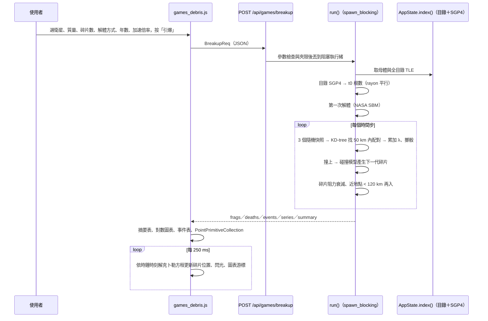

# 太空小遊戲「碎片連鎖」架構說明

> 適用版本：Rust 單機版 v0.1.14（`/games` 的 💥 碎片連鎖分頁）
> 讀者：要維護或擴充這個遊戲的開發者

## 1. 概要

使用者選一顆衛星讓它解體。後端依 NASA 標準解體模型產生碎片，再把碎片和整個目錄一起傳播數年到數十年，用 KD-tree 快照估計碰撞機率並擲骰。撞上時再產生下一代碎片，以此模擬凱斯勒連鎖。

整個模擬在**一次 HTTP 請求**內由後端算完，前端只負責播放：

- 後端回傳每個碎片的出生時刻、軌道根數、再入時刻、碰撞事件與時間序列。
- 前端每秒 4 次用克卜勒方程算出碎片位置並畫在 3D 地球上。

| 項目 | 位置 |
|---|---|
| 後端（模擬） | [src/games_debris.rs](../src/games_debris.rs)（約 500 行） |
| 路由註冊 | [src/games.rs](../src/games.rs) 的 `extend()`：`POST /api/games/breakup` |
| 前端（播放、圖表） | [web/ext/games_debris.js](../web/ext/games_debris.js) |
| 介面（控制項） | [web/ext/games.html](../web/ext/games.html) 的 `#tab-debris` |
| 共通體驗層 | [web/ext/games_ux.js](../web/ext/games_ux.js)：任務卡、示範、計算中提示 |
| 目錄背景（選用） | `GET /api/games/crowd/catalog` ＋ `/static/js/sat_worker.js`（瀏覽器端 SGP4） |

## 2. 資料流

## 3. API

### 請求 `BreakupReq`

| 欄位 | 型別 | 說明 | 夾限 |
|---|---|---|---|
| `norad` | u32 | 母體 NORAD 編號（須在目錄中且可傳播） | — |
| `mass_kg` | f64 | 母體質量 | 1 – 10⁶ |
| `n_frag` | usize | 第一次解體的碎片數 | 2 – 1000，超出回 400 |
| `collision` | bool | false＝爆炸模型、true＝碰撞模型 | — |
| `years` | f64 | 模擬年數 | 0.1 – 50 |
| `accel` | f64 | 加速倍率（放大碰撞截面） | 1 – 10⁶ |
| `seed` | u64? | 亂數種子（同種子結果可重現） | 預設 1 |

### 回應

| 欄位 | 內容 |
|---|---|
| `t0` | 解體時刻（伺服器現在時間，RFC 3339） |
| `parent` | `norad`、`name`、`alt_km`、`mass_kg` |
| `years`、`accel`、`n_catalog` | 實際模擬年數（逾時會提早結束）、倍率、參與計算的目錄物件數 |
| `frags` | 每個碎片一列：`[id, birth_s, gen, L_m, A/M, a, e, i, Ω, ω, M0, Ω̇, ω̇, Ṁ]`（角度為弧度，a 為 km） |
| `deaths` | 與 `frags` 同索引的再入或被撞毀時刻（秒），−1 表示期末仍在軌道 |
| `events` | 解體與碰撞事件，依時間排序：`t`、`kind`、`a`←`b`、`v_rel`、`emr`、`catastrophic`、`n_new`、`pos`（慣性座標 km）、`gen` |
| `series` | 每個時間步：`t`、`alive`（第 0–7 代在軌數）、`expected`（累計期望碰撞）、`collisions`（累計擲中次數） |
| `summary` | `fragments_total`、`alive_end`、`collisions`、`expected_collisions`、`expected_real`（＝期望值 ÷ 加速倍率）、`capped` |
| `elapsed_s` | 計算時間 |

## 4. 後端模擬管線（`run()`）

### 4.1 初始化

1. 以 `Utc::now()` 為 t0，SGP4 算出母體狀態 (r, v)。無法傳播時回 400。
2. 全目錄（排除母體）以 rayon 平行做 SGP4 → `El::from_rv()` 轉成 t0 的克卜勒根數。
3. 目錄物件的尺寸與質量依類別取代表值（`cat_props`）：

| 類別 | 硬體半徑 | 質量 |
|---|---|---|
| 有效載荷 | 1.5 m | 500 kg |
| 火箭體 | 2 m | 1,500 kg |
| 碎片 | 0.2 m | 5 kg |
| 其他 | 0.5 m | 50 kg |

### 4.2 NASA 標準解體模型（`breakup()`）

| 步驟 | 公式與作法 |
|---|---|
| 特徵長度下限 Lc | 由碎片數反推：爆炸 N = 6·Lc^−1.6；碰撞 N = 0.1·M^0.75·Lc^−1.71（M 為參考質量） |
| 尺寸 L | 依冪律在 [Lc, Lmax] 抽樣；Lmax = (m/100)^(1/3)，夾在 0.5–10 m（後續碰撞 0.1–10 m） |
| 面積質量比 A/M | `am_dist()`：L < 11 cm 用單一常態分布，其餘用模型的雙常態混合（log10 空間） |
| 面積、質量 | `area(L)`；質量 = 面積 ÷ (A/M) |
| Δv | log10(Δv) ~ N(μ, 0.4)，μ = 0.2χ + 1.85（爆炸）或 0.9χ + 2.9（碰撞），χ = log10(A/M)；方向等向 |
| 質量守恆 | 碎片質量縮放到總和等於母體質量，A/M 依面積重算 |
| 動量守恆 | 每個碎片的 Δv 扣掉質量加權平均 |

碎片速度 = 母體速度 + Δv，轉成根數加入物件表（`spawn`）。近地點低於 100 km 的碎片出生即視為再入。

### 4.3 傳播

- `El`：克卜勒根數加 J2 長期項（Ω̇、ω̇、Ṁ）。`rv(t)` 以 8 次牛頓迭代解克卜勒方程。
- **阻力衰減**（`decay()`，只套用在碎片上）：
  - 大氣密度用 Vallado 指數大氣模型（100–1000 km，19 層），取近地點高度的密度。
  - King-Hele 近似：da/dt = −2.2·(A/M)·ρ·√(μa)。偏心軌道（a·e > 尺度高度）乘上 √(H / 2πae)，並保持近地點不動、只降遠地點。
  - 每步先 `rebase()` 重設參考時刻，再改 a、e，確保位置連續。近地點低於 120 km 視為再入。
- 目錄物件只用 J2 長期項，不計阻力。

### 4.4 時間步

| 期間 | 步長 |
|---|---|
| 前 30 天 | 1 天 |
| 之後（總年數 ≤ 5） | 5 天 |
| 之後（≤ 15 年） | 10 天 |
| 之後（> 15 年） | 30 天 |

每步取 **3 個隨機快照時刻**（`ks = 3`）。整體超過 90 秒會提早結束，回傳實際模擬到的年數。

### 4.5 碰撞估計與擲骰

1. 快照時刻算出所有在軌物件位置，建 `kiddo::ImmutableKdTree`（3 維、bucket 32）。
2. **只以碎片為查詢點**，找 `SCREEN_D = 50 km` 內的鄰居。不計目錄物件之間的配對；碎片之間的配對只取一次（b < a 時跳過）。
3. 每個配對的期望碰撞數：

   λ = v_rel ÷ (4d/3) × (R₁+R₂)² ÷ d² × (dt ÷ ks) × accel

   意義：v_rel ÷ (4d/3) 是穿過半徑 d 球的頻率（平均弦長 4d/3）；(R₁+R₂)²/d² 把半徑 d 的通量換算成合併硬體半徑的截面。
4. 所有快照的候選依 (a, b) 排序後依序處理。累加 λ 得到 `expected`，以機率 1 − e^−λ 擲骰。
5. **擲中時**：
   - 較重者為目標。能量質量比 EMR = ½·m_s·v_rel² ÷ m_b，超過 **40 J/g** 為完全解體。
   - 完全解體：兩者都毀，碎片總質量 = 兩者合計，以質心速度為基準。
   - 非完全解體：撞擊物毀、目標扣掉被打掉的質量，參考質量 = m_s·v_rel²。
   - 以碰撞模型產生下一代碎片，代數 = 兩者較大代數 + 1；每次事件最多 600 個碎片（`PER_EVENT_MAX`）。

### 4.6 上限與常數

| 常數 | 值 | 用途 |
|---|---|---|
| `MAX_FRAGS` | 30,000 | 碎片總數上限；達到後不再產生（`capped = true`） |
| `PER_EVENT_MAX` | 600 | 單次碰撞產生的碎片上限 |
| `SCREEN_D` | 50 km | KD-tree 篩選半徑 |
| EMR 門檻 | 40 J/g | 完全解體判定 |
| 再入門檻 | 120 km（出生時 100 km） | 近地點低於此值移除 |
| 逾時 | 90 秒 | 提早結束模擬 |
| 亂數 | SplitMix64 | 同種子可重現 |

## 5. 前端（`games_debris.js`）

| 功能 | 作法 |
|---|---|
| 送出與摘要 | `#d-run` 送出請求，回來後依序執行 `summary()`（摘要表）、`chart()`（對數圖表）、`evTable()`（前 40 筆碰撞）、`build()`（建點）、`play("3h")`、`setBadge()` |
| 3D 碎片 | 兩個 `PointPrimitiveCollection`：碎片點依代數上色（`GEN_C`）；最多 3,000 個事件閃光 |
| 位置更新 | 每 250 ms 依時鐘時刻用 `pos()` 解克卜勒方程（含 J2 漂移率），再以 GMST 轉到地固座標。出生前與 `deaths` 之後隱藏，a > 60,000 km 的逃逸碎片不畫 |
| 播放 | `play()` 設定時鐘範圍與倍率：「看前 3 小時」相機貼近爆炸點；「看前 90 天」「看全程」改看全球。都在約 30 秒內播完 |
| 圖表 | 對數縱軸：在軌碎片總數、各代碎片數、累計碰撞（虛線）。圖例可點擊開關（`hidden`）；畫完存底圖，`cursor()` 只疊上目前播放時間的橘色直線 |
| 誇張模式提示 | `accel > 1` 時，在地球畫面上方顯示放大倍率與寫實等效期望碰撞；切到其他分頁時隱藏 |
| 目錄背景 | 勾選「顯示目錄背景」後，以 Web Worker 在瀏覽器端跑 SGP4，畫出灰點 |
| 衛星搜尋 | `/api/search`；質量依類別預設（火箭體 1,500 kg、有效載荷 1,000 kg、其他 10 kg） |

> 前端的碎片位置**不含阻力衰減**，只用後端回傳的初始根數加 J2 漂移，再依 `deaths` 移除。長期播放時，低軌碎片的畫面位置會比後端模擬的位置偏高。這只影響畫面，不影響統計。

## 6. 結果判讀

- **加速倍率**只放大碰撞截面，讓連鎖在幾年內看得到；不改變軌道演化與衰減。
- **`expected_real` ＝ 期望值 ÷ 倍率**，是同一組軌道下的寫實等效期望碰撞次數，**未計連鎖放大**。加速時產生的大量後代碎片，會讓後續的期望值偏高。
- 寫實倍率（預設 ×1）下，單一解體事件在 10 年內的期望碰撞通常遠小於 1（Envisat 爆成 1,000 個碎片約 0.4 次）。

## 7. 效能（參考）

| 案例 | 計算時間 |
|---|---|
| Envisat、1,000 個碎片、10 年、×1,000（約 3.3 萬個目錄物件，碎片達 3 萬上限） | 約 4–6 秒 |
| 同上、300 個碎片、1 年 | 約 1.5 秒 |

主要成本在每個快照的全物件傳播與 KD-tree 查詢，兩者都以 rayon 平行處理。

## 8. 已知限制

1. 目錄物件的尺寸與質量依類別取代表值，DB 沒有實際規格。
2. 目錄物件不計阻力，也不會被撞後產生碎片以外的變化（被撞即毀或扣質量）。
3. 不計目錄物件之間的碰撞，只計「碎片 × 任何物件」。
4. 碰撞以快照統計估計，不是逐一求解最接近時刻；每步只有 3 個快照，統計雜訊較大。
5. 大氣為靜態指數模型，不含太陽活動變化。
6. 碎片總數上限 3 萬，加速倍率高時很快達到上限，之後的連鎖會被低估。

## 9. 擴充指引

| 想做的事 | 修改位置 |
|---|---|
| 改解體模型參數（如 Δv 分布） | `breakup()`、`am_dist()` |
| 改大氣模型或加入太陽活動 | `ATM`、`atm()`、`decay()` |
| 加入目錄物件之間的碰撞 | `run()` 的查詢點篩選 `q`（目前只取 `map[k] >= n_cat`） |
| 提高統計精度 | `ks`（快照數）或時間步長；注意計算時間會等比增加 |
| 調整上限 | `MAX_FRAGS`、`PER_EVENT_MAX`；前端點數與播放負擔也會增加 |
| 回傳更多欄位 | `frags` 的列格式需前後端同步修改（前端以索引存取） |
