# 智慧化低軌通訊衛星軌道異常及太空事件偵測演算法研究
## App 操作手冊：機動偵測儀表板（R7）

### 文件說明

- 對應契約 TASA-S-1150268 §18.2-6「App 操作手冊」，以及契約「應提供與本案內容相關之教育訓練，含程式操作及技術教學」之交付要求。
- 對象程式：`maneuver_app_2026November.py`（2026 年 11 月版，報表版本 R7，2026-11-15）。
- 版本：期末 R7 版，2026-11-18。前一版為 R6 版（`App操作手冊_機動偵測儀表板_20260909.md`，2026-11-13 更新），本版不覆蓋前版。
- 對象讀者：接手操作、維護或審查本系統的技術人員。
- 畫面截圖擷取自線上正式站（2026-11-18），範例衛星為預設的 STARLINK-30273（NORAD 57681）；圖中數字為擷取當時之結果，資料更新後會改變。

### 一、本版重點

本版依現行程式更新 R6 版手冊，主要差異如下：

**表 1　R7 版與 R6 版手冊之差異**

| 項目 | R7 版內容 | 對應章節 |
|---|---|---|
| 介面模式 | 側邊欄新增第三種模式「專書線上版」，與「分析工具」「StoryMap」並列 | 三、九 |
| L1 規則判定 | 改以 P2×P5×P6 有效門檻判定（舊版取聯集，使 P5、P6 無作用）；P5 倍率上限 1.8 | 六 |
| P3 抑制規則 | 2026-11-15 起停用（消融與福衛七號精密真值驗證顯示對召回與誤報皆無作用），頁面標示「已停用」 | 六 |
| ΔΩ 標記 | 移除（大樣本驗證顯示只增加誤報）；根數一致性註記只保留 Δi、Δe | 五 |
| 證據等級 | 非 Starlink 衛星靠 ML 輔助而達 E3 者，改列 E2（ML 輔助） | 五 |
| 低置信複核項 | 合併為複核案件並加診斷標記；新增「L2 統計變點」來源，不併入候選事件、不影響證據等級 | 五 |
| 網址參數 | 新增 `mode=book` 與 `ch` | 二 |

### 二、啟動方式

#### 2.1　線上正式站

網址：https://rhynowu-maneuver-detection-i18n.hf.space

正式站部署於 HuggingFace Space `RhynoWu/maneuver-detection-i18n`（docker SDK），進入點 `app.py` 以 `runpy` 每次重跑 `maneuver_app_2026November.py`；資料來源為 HF Dataset `RhynoWu/starlink-maneuver-db`（環境變數 `HF_DATASET_REPO`）。舊版 Space `RhynoWu/maneuver-detection` 已停用，僅保留回退用。

版本庫內之 `maneuver_app_2026November.py`、`maneuver_report_builder.py` 須與 Space 上的版本一致；修改後請兩邊同步。

#### 2.2　本機執行

在專案根目錄執行 `streamlit run maneuver_app_2026November.py`。資料後端於啟動時自動判斷：

**表 2　資料後端**

| 模式 | 觸發條件 | 說明 |
|---|---|---|
| 本機全庫 | 未設 `HF_DATASET_REPO`，且本機存在 `space_db.duckdb` | 直接讀本機全庫，功能與速度最完整 |
| HF 遠端 Parquet | 設有 `HF_DATASET_REPO=<帳號>/<repo>` | 啟動時自動安裝 DuckDB httpfs extension，建立指向 `hf://datasets/...` 的輕量資料庫；免下載整庫，但首次查詢單顆衛星約需 10–16 秒，之後有快取 |

請以系統 Python（3.13＋pandas 3.x）執行；專案內 `.venv`（3.11）缺 lightgbm、pyarrow 等套件，無法執行完整流程。

#### 2.3　網址參數（深連結）

**表 3　網址參數**

| 參數 | 範例 | 作用 |
|---|---|---|
| `mode` | `tool`／`storymap`／`book` | 直接進入分析工具、StoryMap 或專書線上版 |
| `norad`、`d0`、`d1` | `norad=64199&d0=2025-05-29&d1=2026-11-12` | 預選衛星與日期區間；超出該星 TLE 範圍時自動夾到可用範圍 |
| `report` | `F1`／`F2` | 開頁後自動展開「產出 PDF 報告」並產製一次 |
| `lang` | `zh`／`ja`／`en` | 指定介面語言 |
| `case` | `case1`～`case32` | 搭配 `mode=storymap`，直接開啟指定案例 |
| `ch` | `01`～`21`、`A1`、`A2` | 搭配 `mode=book`，直接開啟指定章節（只在首次載入時讀取） |

範例：

- 分析工具並產製 F2 報告：`https://rhynowu-maneuver-detection-i18n.hf.space/?mode=tool&norad=64199&d0=2025-05-29&d1=2026-11-12&report=F2&lang=zh`（PDF 報告內之 QR code 與「在儀表板開啟」連結即為此格式）
- StoryMap 案例三：`?mode=storymap&case=case3`
- 專書英文版第 5 章：`?mode=book&lang=en&ch=05`

Streamlit 無法以網址直接回傳檔案，帶 `report` 參數時仍需在頁面上點一次下載按鈕。

### 三、介面總覽

畫面分為左側側邊欄與右側主畫面。側邊欄最上方是語言選單與模式選單，其下為查詢欄與參數滑桿；主畫面由上而下為頁首 KPI 列、分析期間、PDF 報告、結果摘要、附錄 A–F 與其他分析工具。

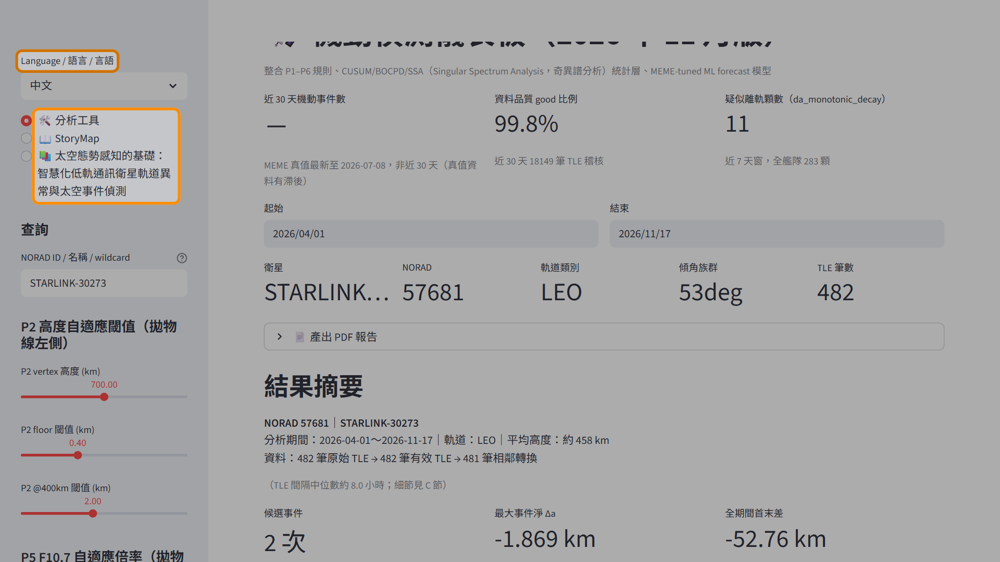

**語言選單**「Language / 語言 / 言語」可即時切換中文、日文、英文，整個畫面（含表格表頭）同步更新。唯一例外是 SSA-RAG 知識問答的回答，固定為中文（知識庫語料為中文）。

**模式選單**有三個選項：

**表 4　三種介面模式**

| 模式 | 用途 | 說明章節 |
|---|---|---|
| 🛠️ 分析工具 | 對單一衛星執行機動候選事件偵測、產出 PDF 報告 | 四至七 |
| 📖 StoryMap | 32 個研究案例的完整推導過程，以真實資料回答常見技術問題 | 八 |
| 📚 專書線上版 | 《太空態勢感知的基礎：智慧化低軌通訊衛星軌道異常與太空事件偵測》全書 21 章與附錄，三語 | 九 |

切換語言時，模式選擇會保留，不會跳回「分析工具」。

### 四、分析工具：查詢與參數

#### 4.1　頁首 KPI 列

進入分析工具即顯示三張全艦隊指標卡，不需先查詢衛星。涵蓋範圍為 MEME 真值 Starlink 名冊（`data/url_registry.csv`）。

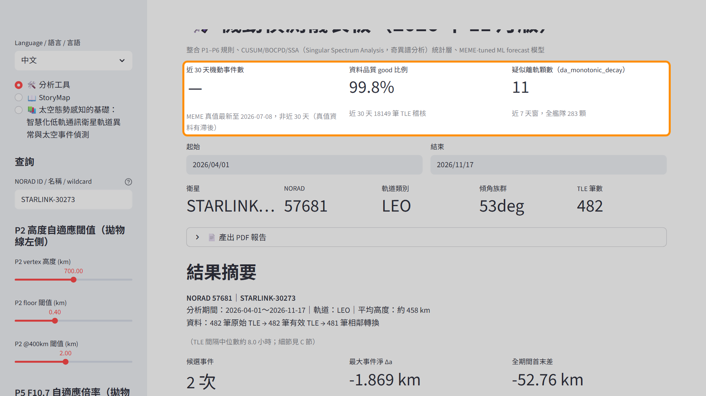

**表 5　KPI 卡片**

| 卡片 | 意義 | 注意事項 |
|---|---|---|
| 近 30 天機動事件數 | MEME 精密星曆真值中 medium／large 等級機動之事件數（同顆衛星間隔超過 48 小時才算新事件） | 真值資料滯後超過 30 天時顯示「—」，並附註真值最新日期；這不代表近期沒有機動 |
| 資料品質 good 比例 | 近 30 天艦隊 TLE 逐顆稽核後之 good 比例 | rejected 多為 checksum 或物理不可能值；suspect 常見原因為資料缺口或傾角跳變 |
| 疑似離軌顆數 | 近 7 天窗內判定為純大氣阻力衰減（非機動）之顆數 | 屬純被動衰減判定，與 SatDashboard「主動控制離軌」名單是互補的兩套指標，交集通常很小，不可互相校驗 |

三張卡片皆快取一小時。

#### 4.2　查詢衛星與設定期間

在側邊欄「查詢」欄輸入 NORAD 編號（例 `57681`）、完整衛星名稱，或萬用字元（例 `STARLINK-30*`、`SL-1?`），即換成要分析的衛星。主畫面上方可設定分析的起訖日期，其下列出衛星名稱、NORAD 編號、軌道類別、傾角族群與 TLE 筆數。

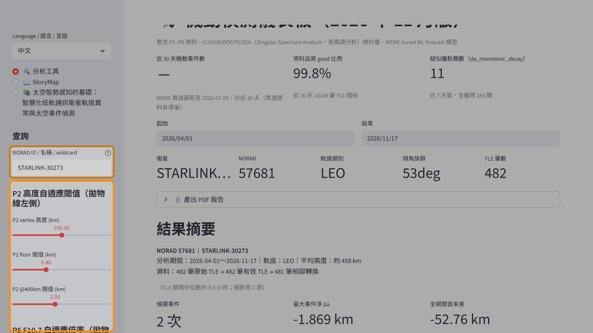

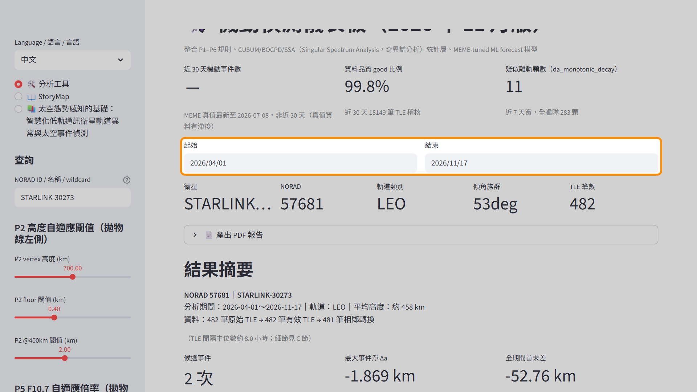

#### 4.3　P2、P5 參數滑桿

**表 6　側邊欄參數**

| 參數 | 範圍（預設） | 作用 |
|---|---|---|
| P2 vertex 高度 | 400–1000 km（700） | 與下兩項共同定義「多低的高度、多大的 Δa 才算機動」之拋物線；高度愈低（阻力愈強），容許的自然波動愈大 |
| P2 floor 閾值 | 0.1–1.0 km（0.4） | 拋物線門檻下限 |
| P2 @400km 閾值 | 0.5–4.0 km（2.0） | 400 km 高度處之門檻 |
| P5 vertex F10.7 | 50–120 sfu（70） | 太陽活動愈強，大氣阻力愈強，門檻倍率隨 F10.7 放寬，以避免太陽極大期誤報 |
| P5 @200sfu 倍率 | 1.0–3.0（1.6） | F10.7 為 200 sfu 時之倍率；R7 起實際倍率上限為 1.8 |

滑桿只用於互動檢視（附錄 D 之 P1–P6 表）。結果摘要與 PDF 報告固定使用預設門檻，以確保同一衛星、同一期間的報告可重現。

#### 4.4　SSA-RAG 設定

側邊欄下方可設定 SSA-RAG 服務位址（預設 `http://127.0.0.1:8000`，可由環境變數 `SSA_RAG_URL` 覆寫）與「執行後自動送 RAG 解說」勾選框。SSA-RAG 服務須另行啟動；線上正式站未連線時，相關功能不可用，不影響其他區塊。

### 五、分析工具：結果摘要與附錄 A–F

R6 起，分析工具的區塊順序與 F2 技術完整版 PDF 一致，頁面上看到的內容與報告逐段對應。

**表 7　頁面區塊順序**

| 順序 | 區塊 | 內容 |
|---|---|---|
| 0 | 📄 產出 PDF 報告 | F1／F2 PDF 產製與下載（見第七節） |
| 1 | 結果摘要（＝F2 第 1 頁） | 候選事件數與證據等級分布、最大事件、首末差、半長軸時序、重點複核項目、衛星基本資料 |
| 2 | A　候選事件與規則候選點清單 | 每個候選事件之時段、淨 Δa、輔助通道、證據等級、建議行動 |
| 3 | B　阻力模型殘差／融合評分器 | 輔助通道時序與候選事件 |
| 4 | C　計數口徑與判定流程 | 各計數之定義、偵測下限、抑制統計；🧭 系統偵測邏輯說明 |
| 5 | D　各層偵測器原始輸出 | 統一偵測摘要、P1–P6、CUSUM／BOCPD／SSA、ML |
| 6 | E　軌道根數連續變化與差值 | 根數與差值時序圖 |
| 7 | F　分析註記 | 規則式三段註記 |
| 8 | 其他分析工具（F2 未收錄） | MEME vs TLE、資料品質稽核、星系級異常分析、合成 TLE、SSA-RAG 問答 |

#### 5.1　結果摘要

結果摘要是最先要看的地方。上方列出衛星、分析期間、軌道與平均高度，以及「原始 TLE → 有效 TLE → 相鄰轉換」的筆數；下方三個指標為候選事件數（附各證據等級件數）、最大事件淨 Δa、全期間首末差。

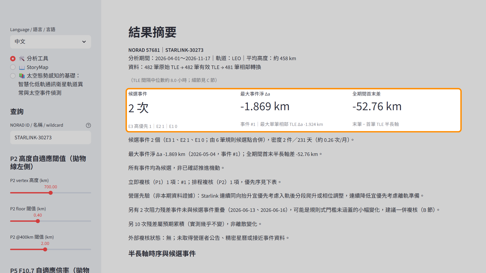

摘要文字固定提醒「所有事件均為候選，非已確認推進機動」，並列出立即複核（P1）與排程複核（P2）的項目數。另會列出未與候選事件重疊的阻力殘差事件、營運先驗（非本期資料證據）與外部複核狀態。

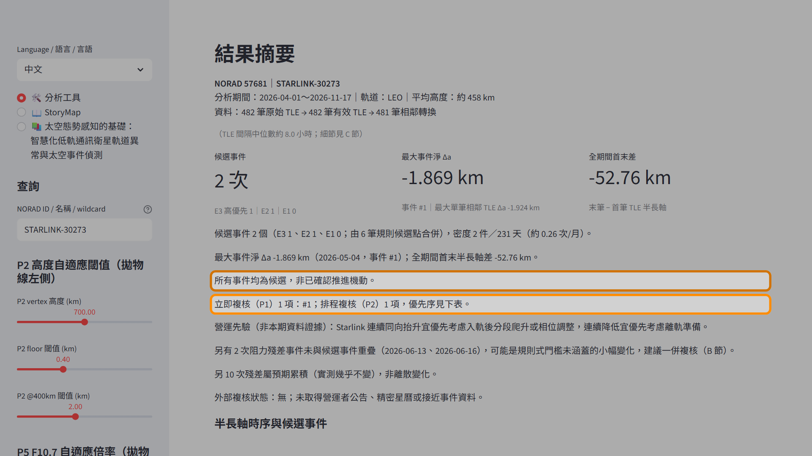

**證據等級**反映複核優先順序，不是機動發生機率：

**表 8　證據等級（R7）**

| 等級 | 條件 |
|---|---|
| E3 高優先 | 顯著性高，且符合下列之一：至少 3 類輔助通道一致並含 L3 融合或 ML；屬連續機動段；\|淨 Δa\| ≥ 10 km。非 Starlink 衛星若靠 ML 輔助才達 E3，改列 E2（ML 輔助） |
| E2 人工複核 | 顯著性中以上，且至少 2 類輔助通道一致 |
| E1 待觀察 | 其餘候選事件 |
| D 資料品質待查 | 回跳型態；先確認 TLE 資料，再看「資料確認後等級」 |

**複核優先序**：D（資料品質）→ P1 立即複核（E3、|淨 Δa| ≥ 10 km、編目疑點、高優先機動段）→ P2 排程複核（E2 或 |淨 Δa| ≥ 1 km）。

#### 5.2　半長軸時序與遠地點／近地點高度

「半長軸時序與候選事件」圖中，淡色帶是候選事件時段，上緣數字是事件編號；底部灰色三角形是未與候選事件重疊的阻力殘差事件（阻力殘差有反應、但規則沒有標記），建議一併複核。

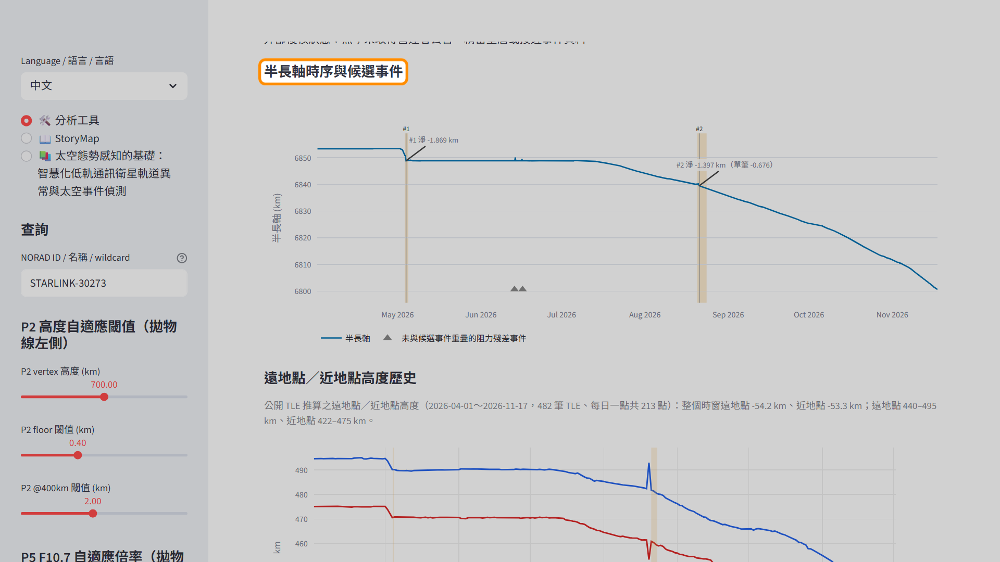

「遠地點／近地點高度歷史」呈現整段期間的高度變化。

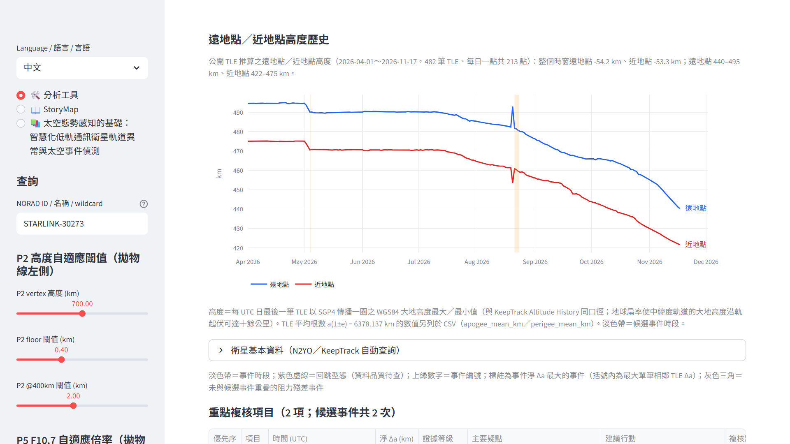

#### 5.3　重點複核項目

「重點複核項目」依優先序排列並編號，需要立即複核的事件列在最前面。展開「完整候選事件清單」可查看其餘待觀察事件。

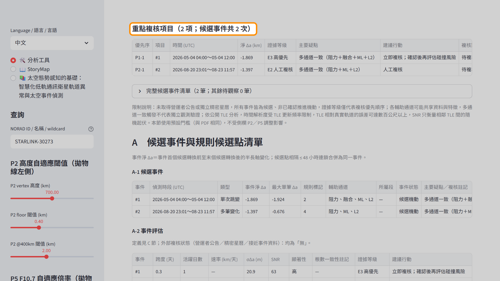

#### 5.4　A　候選事件與規則候選點清單

候選事件完全由 L1 規則（P1–P6）之規則候選點依時間合併產生：候選點相隔 48 小時以內者連鎖合併為同一事件。事件淨 Δa 為事件首個候選轉換前至末個候選轉換後之半長軸變化。

- **A-1 候選事件**：偵測時段（UTC）、類型（單次跳變／多筆變化）、事件淨 Δa、最大單筆 Δa、規則標記數、輔助通道、所屬段、事件狀態、主要疑點與複核註記。
- **A-2 事件評估**：跨度、活躍日數、速率、雜訊基線 σΔa、SNR、顯著性、根數一致性註記、證據等級、建議行動。
- 展開「規則候選點」可見 L1 逐筆標記之相鄰 TLE 轉換。

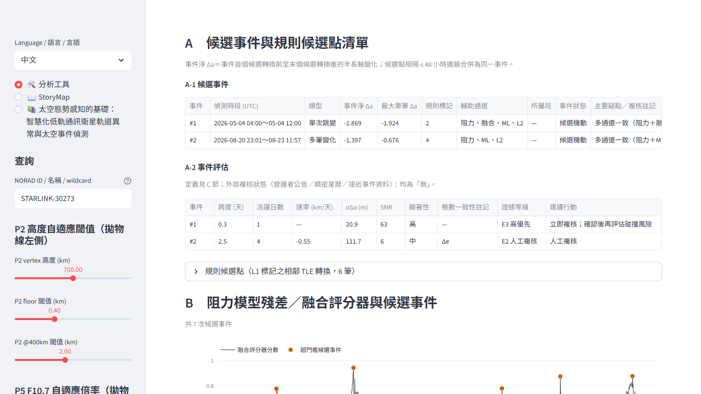

**根數一致性註記**：Δi 標★，表示伴隨平面外變化，獨立證據意義較高；Δe 與切向推進相容，不是獨立證據。R7 起不再標記 ΔΩ。

#### 5.5　B　阻力模型殘差／融合評分器

B 節對照輔助通道：Starlink 衛星顯示 L3 融合評分器分數，其他衛星顯示 NRLMSIS 阻力殘差。輔助通道只影響證據等級，不會新增或刪除事件。非 Starlink 衛星之 L3 融合超門檻時點不列入低置信複核項（R7）。

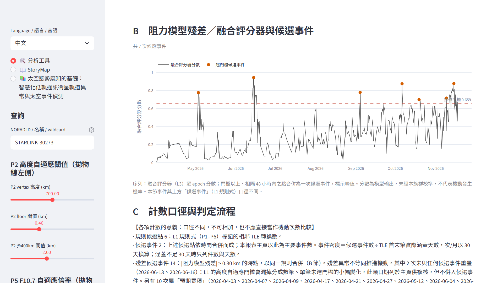

#### 5.6　C　計數口徑與判定流程

C 節說明各項計數的意義。不同口徑的數字不能相加，也不能直接當成機動次數。未偵測到事件時，請引用結果摘要之「偵測下限」，陳述為「期間無超過 X m 之機動」，而非「沒有機動」。

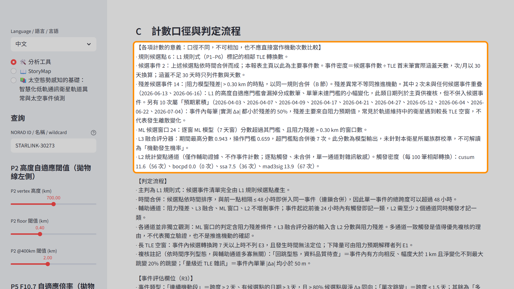

展開「🧭 系統偵測邏輯說明」，可看到各判斷屬於經驗法則、統計演算法、物理模型或 AI 模型，以及最終結果的產生方式。P3 列標示「2026-11-15 起停用（消融驗證無作用）」。

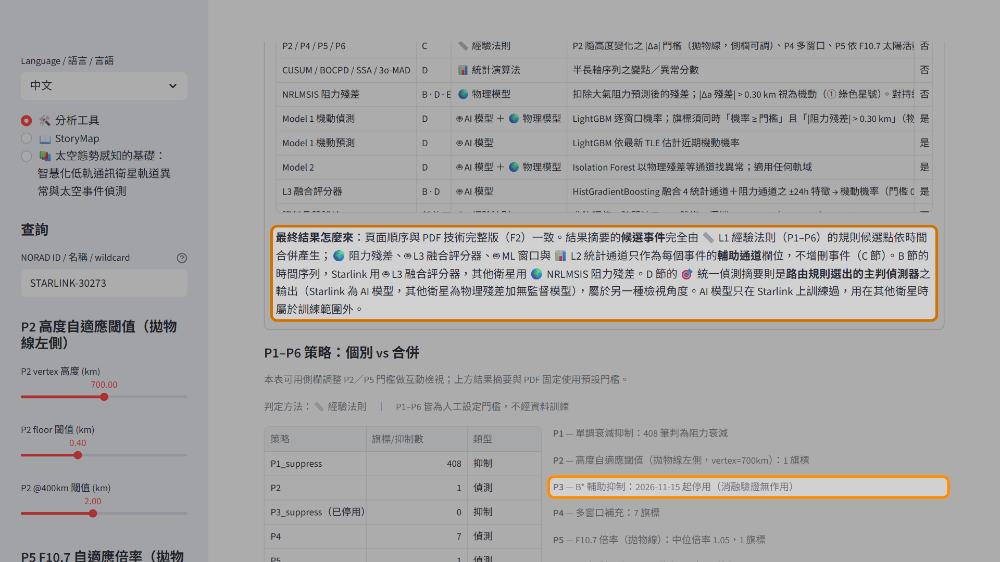

**低置信複核項**（R7）：相隔 72 小時以內者合併為同一複核案件，並加診斷標記（資料缺口：前一筆 TLE 間隔 ≥ 2 天；高阻力：B* ≥ 5×10⁻⁴；太陽活躍：F10.7 ≥ 150 sfu）。新增「L2 統計變點」來源：L1 規則未標記的時段，若 CUSUM、BOCPD、SSA、MAD3σ 中至少 2 種在 48 小時內同時觸發，且扣除背景衰減後淨 Δa 達該星 20σ 與 L1 單步門檻之較大值，列為 P2 待複核。這類項目不併入候選事件，也不影響證據等級。

#### 5.7　D　各層偵測器原始輸出

D 節為各層偵測器的原始輸出：

- **統一偵測摘要**：依軌域自動路由主判偵測器。Starlink 低軌 → Model 1（LightGBM）＋融合評分器；非 Starlink 或衰減軌 → Model 2（Isolation Forest）＋NRLMSIS 物理主判；再入狀態 → 物理閘門直接抑制。AI 模型只在 Starlink 上訓練過，用於其他衛星時屬訓練範圍外。
- **P1–P6 策略**：各策略之旗標或抑制次數。P2、P4、P5、P6 為偵測，P1 為抑制；P3 已停用，次數固定為 0。此表可用側邊欄滑桿互動調整。
- **統計層**：CUSUM（累積和）、BOCPD（貝氏線上變點偵測）、SSA（奇異譜分析）三張圖。
- **ML**：Model 1 機動偵測與 ML forecast（未來 1 天機動機率）、Model 2 異常標記。

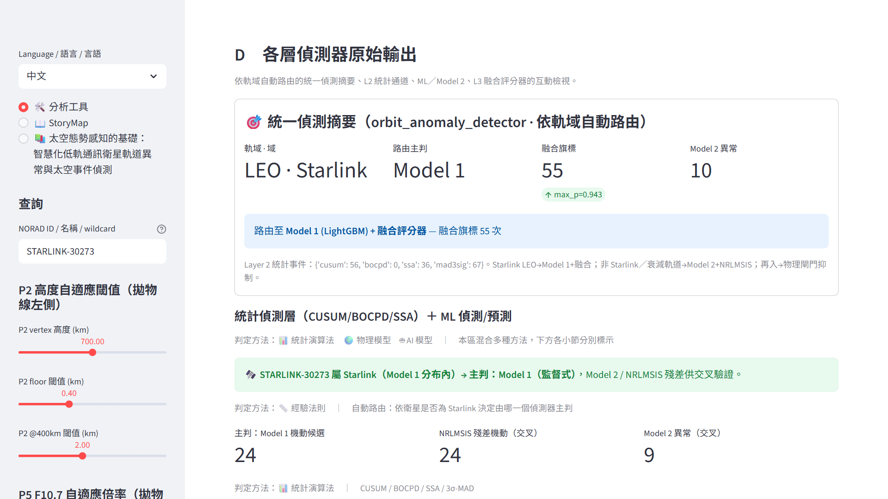

#### 5.8　E　軌道根數連續變化與差值

E 節畫出軌道根數與差值的時序。綠色星號為 NRLMSIS 阻力殘差判定之候選（|Δa 殘差| > 0.30 km），紅色叉號為 P1–P6 規則合併判定之候選。兩者都是候選，不是已確認機動。

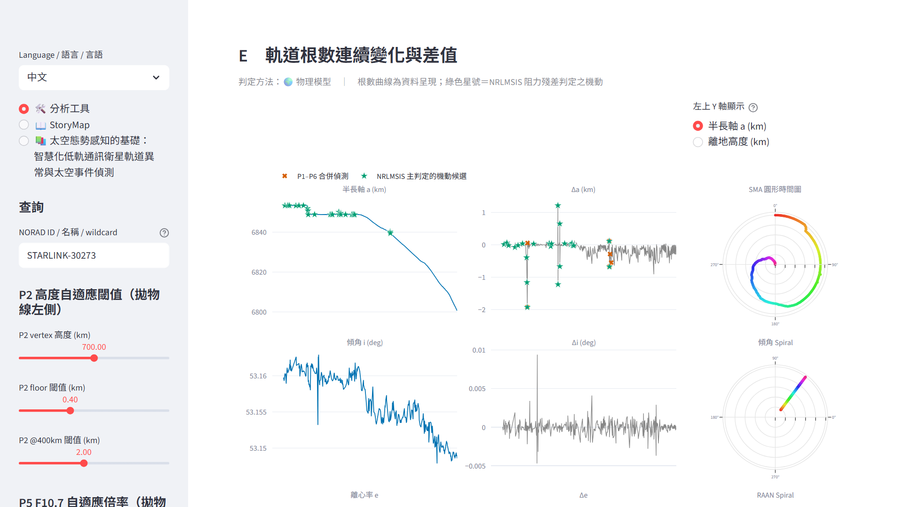

#### 5.9　F　分析註記

F 節由固定規則依本頁數字產生，不經大型語言模型，分為「可直接觀察」「待驗證解釋（未排序）」「建議複核」三段。

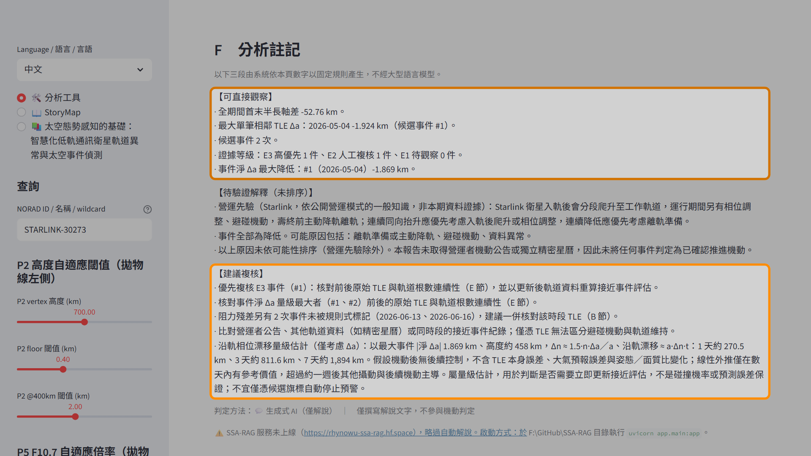

#### 5.10　判讀提醒

1. 跨長 TLE 空窗之事件標「時間無法定位」，事件時間只能確定落在空窗內，且不列 E3。
2. 偵測到偏離常態，不等於機動已確認；即使確認是機動，也不等於敵意或違規。
3. 對外呈現時延續保守用語，例如「旨在降低誤判風險」，而非「絕不會誤判」。

### 六、L1 規則（P1–P6）說明

**表 9　P1–P6 規則（R7）**

| 規則 | 角色 | 說明 |
|---|---|---|
| P1 | 抑制 | 單調衰減抑制：符合阻力衰減型態之轉換不列為機動 |
| P2 | 偵測 | 高度自適應閾值（拋物線左側，參數見表 6） |
| P3 | 已停用 | B* 輔助抑制；2026-11-15 起停用，頁面與報告標示「已停用」 |
| P4 | 偵測 | 多窗口補充 |
| P5 | 偵測 | F10.7 自適應倍率（拋物線），倍率上限 1.8 |
| P6 | 偵測 | 星座／傾角族群基準倍率（星座感知專屬閾值） |

R7 起，L1 以 P2×P5×P6 之有效門檻判定。舊版對各策略取聯集，使 P5、P6 實際上沒有作用。

### 七、產出 PDF 報告

展開「📄 產出 PDF 報告」，選擇格式後按「產生 PDF」，約需數十秒。

**表 10　報告格式**

| 格式 | 內容 | 適用對象 |
|---|---|---|
| F1 摘要版 | 一頁結果摘要 | 主管、業主、簡報 |
| F2 技術完整版 | 結果摘要＋附錄 A–F（完整事件清單、阻力殘差圖、計數口徑、各層原始輸出、根數圖、分析註記） | 分析與稽核 |

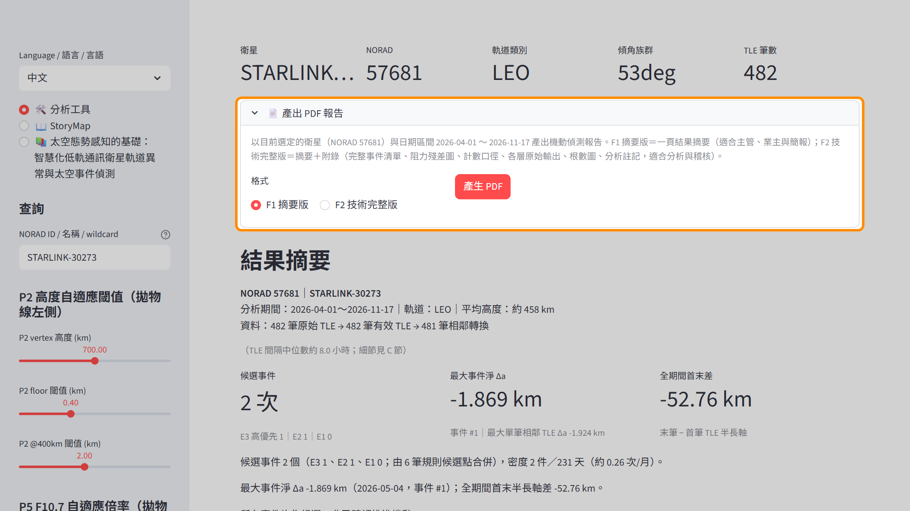

完成後可下載 PDF、CSV（事件與評估明細）與 Markdown。相同衛星、期間與格式在 48 小時內直接取用快取；需要最新結果時，請再按一次「產生 PDF」。線上資料庫持續補入晚發布之 TLE，同一期間日後重產的結果可能略有差異。

### 八、其他分析工具

#### 8.1　資料品質稽核

對目前查詢衛星的 TLE 逐筆稽核，標為 good、suspect 或 rejected：rejected 為物理不可能值（NaN、離心率越界、半長軸越界、傾角越界、checksum 錯）；suspect 為存疑（資料缺口過大、傾角單步跳變過大、B* 絕對值異常）；其餘為 good。

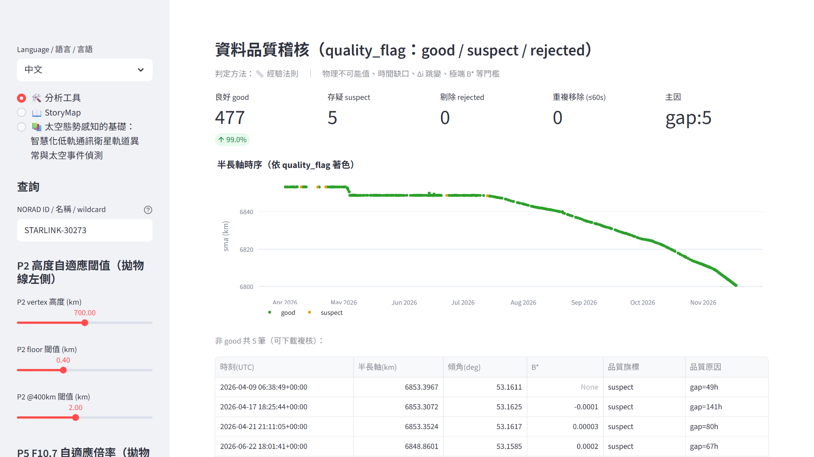

此稽核依賴同一衛星前後曆元的差分，不可直接對多顆衛星混合的資料呼叫；批次稽核須逐顆分別執行再彙總（頁首 KPI 列已如此實作）。

#### 8.2　星系級異常分析、合成 TLE 與 SSA-RAG

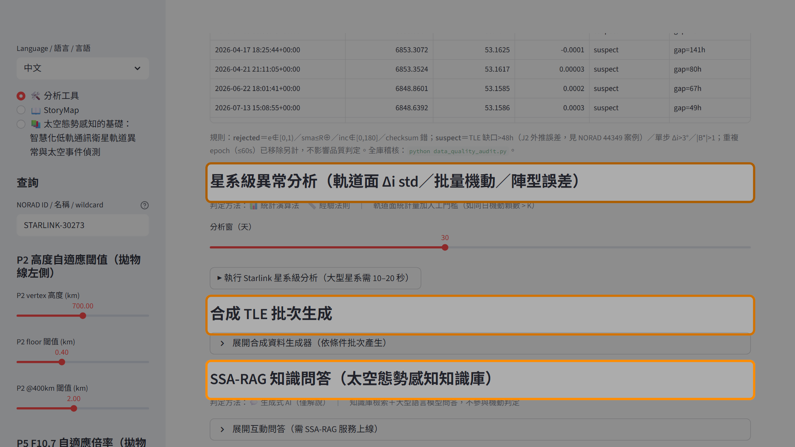

- **星系級異常分析**（`constellation_anomaly.py`）：可指定星系（Starlink、OneWeb、千帆、Yaogan、Gaofen、Jilin），計算軌道面一致性（同 RAAN 面 Δi 標準差）、批量機動識別（同天 |Δa| > 2 km 之機動衛星數）與陣型誤差（同面緯度幅角相位殘差標準差）。
- **合成 TLE 批次生成**（`synthetic_tle` 模組）：設定衛星數、天數、TLE 間隔、含機動比例、高度範圍等，批次產生含雜訊的合成 TLE，供演算法測試或訓練資料擴增。
- **SSA-RAG 知識問答**：連線 SSA-RAG 服務（需另行啟動 `scripts/ask.py --chat-listen`）後，可用自然語言詢問方法論與術語。回答固定為中文。

#### 8.3　MEME vs TLE

比對 Starlink MEME 精密星曆與公開 TLE 的差異，只做 72 小時窗內的模型，不做長時程外推（外推誤差會隨時間發散）。

### 九、StoryMap

StoryMap 以真實資料回答本專案最常被問到的技術問題，呈現可重跑、可複核的完整推導過程，共 32 個案例。首頁以卡片列出各案例，按「進入這個案例」即開啟。

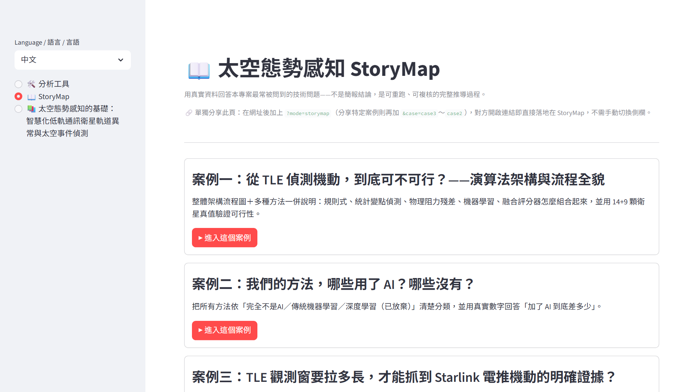

每個案例頁依序呈現問題、資料、分析圖與判讀限制。分享單一案例時，在網址後加上 `?mode=storymap&case=case3`（案例代碼為 `case1`～`case32`），對方開啟即直接進入該案例。

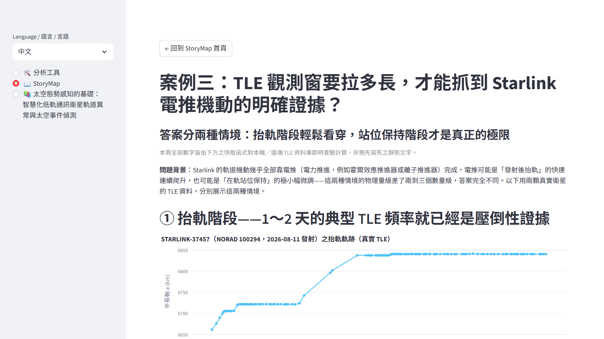

### 十、專書線上版

專書線上版收錄《從衛星軌道論國家安全——太空態勢感知的基礎：智慧化低軌通訊衛星軌道異常與太空事件偵測》全書 21 章與附錄 A1、A2（v1.2，2026-11-15）。繁體中文為原稿，英文與日文為 AI 輔助翻譯，兩者不同時以中文原稿為準。

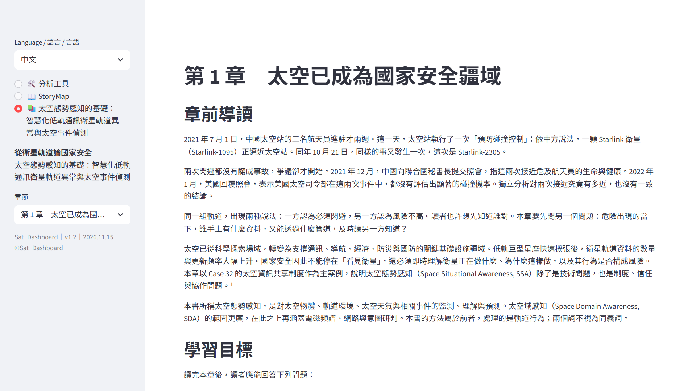

- 以側邊欄「章節」選單切換章節，頁面底部有上一章、封面、下一章按鈕。
- 切換語言後停留在同一章。
- 深連結：`?mode=book&ch=05`（英文版加 `&lang=en`）。章節參數只在首次載入時讀取，之後切換章節不會改寫網址。

### 十一、資料維護

**表 11　資料維護工作**

| 任務 | 指令 | 頻率 |
|---|---|---|
| 每日 TLE 更新與發布 | `download_tle_unified.bat publish` | 每日；依序為太空天氣 → Space-Track TLE 下載入庫並重建 slim／parquet → 營運方星曆存檔 → 發布 SatDashboard 資料集 → 同步 `starlink-maneuver-db` |
| 同步儀表板資料集 | `python ci/sync_maneuver_dataset.py`（`--dry-run` 先看筆數） | 隨每日更新；回頭比對近 30 天，補上晚發布之 TLE |
| 營運方星曆存檔（OneWeb、Amazon Kuiper） | `python ci/archive_operator_ephemeris.py`（`--dry-run` 只讀不寫） | 每日，已併入每日更新第 3 步，失敗只警告；CelesTrak 對 2 小時內重複下載回應 403，同日勿重複執行 |
| 重算全艦隊阻力殘差特徵 | `python run_drag_residual.py` | 隨每日 TLE 更新後 |
| 更新太空天氣指數 | 更新 `space_weather_ap.csv`（來源 Celestrak SW-Last5Years.csv） | 每日 |
| 重建推力弧庫 | `python run_burn_arc_daily.py` | 每日（排程掛載屬維運待辦） |

> 每日更新後，請確認輸出中有「寫入 space_db」與各日 `LAST_TLE_DATE` 更新紀錄，且結尾無 `[FAIL]`。程式已改為失敗即停，但仍應目視確認。若出現 `Corrupt database file`，立即停止寫入並保留原檔，依期末報告技術附錄 §14.1 之重建程序處理。

### 十二、技術背景：NRLMSIS 大氣阻力殘差

機動偵測須先扣除大氣阻力造成的自然軌道衰減，才能看清真正的機動訊號（`atmospheric_drag.py`）。

**表 12　阻力殘差計算**

| 步驟 | 公式 | 說明 |
|---|---|---|
| 近圓軌道阻力衰減率 | da/dt = −B·ρ·√(μa) | ρ 由 NRLMSIS 依 F10.7、Ap 逐時計算 |
| 逐衛星自我校準 | B_eff = median(−Δa_i ／ s_i) | 中位數穩健估計，排除機動離群值 |
| 阻力殘差 | resid_i = Δa_i + B_eff·s_i | 純大氣衰減時殘差約為 0；機動時殘差約等於機動 Δa |

偏心軌道以 King-Hele 幾何因子在近地點高度取密度，並以再入守門排除再入段之非線性衰減。Ap 指數採 3 小時解析度 ap(7) 陣列，密度計算之經緯度採 SGP4 解出的星下點座標。對持續以推力補償阻力的衛星，自我校準的 B 不是物理阻力係數，殘差代表「相對該星常態的偏離」，不是推力大小。

### 十三、常見問題與已知限制

1. **「近 30 天機動事件數」顯示「—」**：MEME 真值資料滯後超過 30 天，不是系統故障，也不代表近期沒有機動；請參考卡片下方之真值最新日期。
2. **HF 遠端模式首次查詢很慢（10–16 秒）**：冷讀取遠端 Parquet 的正常現象，之後有快取。
3. **「疑似離軌顆數」與 SatDashboard 離軌名單對不上**：兩套指標分別捕捉純被動衰減與快速降軌，交集本就可能很小。
4. **所有偵測結果皆為候選**：需要精密星曆或多來源交叉驗證，才能確認一次機動事件。
5. **證據等級不是機率**：E3 代表最該優先複核；D 代表資料可能有問題，不是「最不可能是機動」。
6. **PDF 內容與頁面不同**：可能為 48 小時快取所致，按「產生 PDF」重新產製即可。
7. **頁面上的 P1–P6 次數與報告不同**：側邊欄滑桿只改變頁面上的互動表，報告固定使用預設門檻。
8. **P3 次數一直是 0**：P3 自 2026-11-15 起停用，屬預期行為。
9. **SSA 一詞的歧義**：本系統之 SSA 專指統計方法「奇異譜分析」（Singular Spectrum Analysis），不是「太空態勢感知」（Space Situational Awareness）；專書與 StoryMap 中的 SSA 則指太空態勢感知，教育訓練時請主動說明。
10. **SSA-RAG 問答無法使用**：需另行啟動 SSA-RAG 服務；線上正式站未連線時，此區塊不可用。
