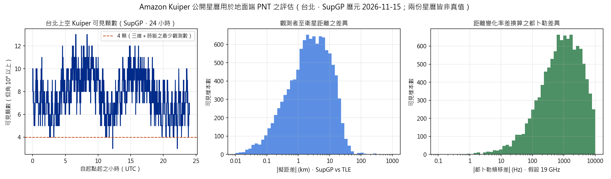

# Amazon Kuiper 公開星曆用於地面端 LEO-PNT 之評估

日期：2026-11-15　｜　比照：期末報告技術附錄第十七節（Starlink：TLE 與 MEME 星曆之定位上限）

---

## 一、結論

1. **星曆是主要限制。** Kuiper 沒有相當於 Starlink MEME 之公開精密星曆。公開可得者為 Space-Track TLE 與 CelesTrak SupGP（由營運方星曆擬合之 SGP4 根數）。兩者在台北可見時段之衛星位置差中位 6.3 km，換算距離變化率差中位 15 m/s；以 Ka 頻段 19 GHz 計，都卜勒頻移差中位約 940 Hz，比都卜勒量測本身之雜訊（Hz 級）大二至三個數量級。
2. **幾何條件充足。** 2026-11-15 之 391 顆衛星中，台北上空仰角 10° 以上可見顆數中位 8 顆（3–13 顆），99.8% 之時間至少 4 顆；單次過頂約 8 分鐘。
3. **訊號端資訊不足。** Kuiper 下行使用 Ka 頻段，訊號結構未公開，查無以 Kuiper 訊號定位之公開研究。Starlink 已有學術實證（最佳約 4.3 m 水平誤差，靜態、6 顆、約 800 秒），但係以盲估訊號結構達成。
4. **可行路徑。** 以 SupGP 為星曆時，其相對營運方星曆之擬合殘差中位約 0.24 km，為公開路線中最佳之起點；SupGP 推算數日後之精度尚待每日存檔累積後評估（已於 2026-11-15 加入資料管線）。

## 二、與 Starlink 之對照

| 項目 | Starlink | Amazon Kuiper |
|---|---|---|
| 公開精密星曆 | 有：SpaceX MEME，位置精度約 5 m，每日 3 次、預報 72 小時 | 無；Space-Track Public Files 之 Kuiper 目錄目前為空 |
| 營運方星曆衍生資料 | CelesTrak SupGP | CelesTrak SupGP（391 顆，擬合殘差中位 0.24 km） |
| TLE 誤差 | 相對 MEME：新鮮 1.5 km、24–48 小時 12.9 km（實測真值） | 相對 SupGP：0–1 天 3.2 km、2–3 天 22.6 km（非真值） |
| 誤差方向 | 沿軌主導（新鮮 TLE 沿軌 1,524 m、徑向 143 m） | 沿軌主導（推算 0 天沿軌 4.7 km、徑向 0.08 km） |
| 下行頻段 | Ku（10.7–12.7 GHz） | Ka |
| 公開訊號定位研究 | 有（都卜勒、載波相位，4–26 m 級） | 未找到 |
| 台北可見顆數 | 遠多於 Kuiper（本評估未計算） | 中位 8 顆（仰角 10° 以上） |

## 三、方法與結果

### 3.1　星曆差異（7 天推算）

以 SupGP 曆元為起點，SupGP 與最新 TLE（年齡中位 22 小時）以 SGP4 推算。詳見 `docs/compare_kuiper_supgp_tle.py`、`docs/fig_kuiper_supgp_vs_tle.png`。

| 推算天數 | 3D 差中位 | 3D 差 P90 | 沿軌中位 | 徑向中位 |
|---|--:|--:|--:|--:|
| 0 | 4.7 km | 18 km | 4.7 km | 0.08 km |
| 1 | 7.4 km | 33 km | 7.4 km | 0.08 km |
| 3 | 27.6 km | 82 km | 27.6 km | 0.15 km |
| 7 | 109 km | 373 km | 109 km | 0.82 km |

391 顆中 383 顆已位於約 630 km 工作高度，差異並非來自軌道爬升；兩份資料之 B* 中位數相同（0.00021），亦非阻力項之系統偏差。

### 3.2　對都卜勒觀測量之影響（台北，24 小時）

以台北（25.033°N, 121.565°E）為觀測點，仰角 10° 以上之 11,202 個可見樣本：

| 量 | 中位 | P90 |
|---|--:|--:|
| 衛星位置差 | 6.3 km | 25.2 km |
| 擬距差 | 2.4 km | 14.2 km |
| 距離變化率差 | 14.8 m/s | 87.0 m/s |
| 都卜勒頻移差（Ka 19 GHz，假設值） | 940 Hz | 5,513 Hz |
| 都卜勒頻移差（Ku 11.45 GHz，參考） | 566 Hz | 3,323 Hz |

約 6 km 之沿軌位置差，自約 1,000 km 外觀測，使視線方向偏轉，乘以約 7.5 km/s 之軌道速度，即得數十 m/s 量級之距離變化率差，與上表一致。程式：`docs/eval_kuiper_pnt.py`。

## 四、限制

- 兩份星曆皆非真值；上表量的是公開路線間之差異，可視為星曆不確定度之量級，不等於真實定位誤差。
- 19 GHz 為假設之代表頻率；Kuiper 實際下行頻率、訊號結構與可用於定位之訊號成分皆未公開。
- 僅一天之 SupGP；SupGP 推算精度須待存檔累積。

## 五、建議

1. **累積 SupGP 存檔**（已加入每日資料管線）：7 天後以「t 日 SupGP 推算至 t＋k 日」對照「t＋k 日新發布之 SupGP」，量化 SupGP 本身之預報精度。
2. **洽詢營運方星曆**：Kuiper 營運方星曆若可經 Space-Track（需 SSA 資料分享協議）或 Amazon 取得，即相當於 Starlink 之 MEME 路線。
3. **沿用第十七節之兩項技術**：以機動偵測標記星曆暫不可信之衛星；以阻力殘差修正 SGP4 沿軌預測。
4. **聯合估計星曆誤差**：在無精密星曆下，定位解算須同時估計衛星沿軌誤差（文獻中 Starlink 研究採此類方法），方能將星曆誤差自 km 級壓低。

## 參考

- [UT Austin 機會訊號導航報告（提及 Kuiper 使用 Ka 頻段）](https://rosap.ntl.bts.gov/view/dot/93531/dot_93531_DS1.pdf)
- [Kassas 等：Starlink 盲都卜勒頻譜定位](https://people.engineering.osu.edu/sites/default/files/2023-08/Kassas_Positioning_with_Starlink_LEO_satellites_A_blind_Doppler_spectral_approach.pdf)
- [Kassas 等：Starlink 差分都卜勒導航評估](https://people.engineering.osu.edu/sites/default/files/2023-02/Kassas_Assessment_of_differential_Doppler_navigation_with_Starlink_LEO_satellite_signals_of_opportunity.pdf)
- [Exploiting Starlink signals for navigation: first results](https://ece.osu.edu/sites/default/files/2022-09/Exploiting_Starlink_signals_for_navigation_first_results.pdf)
- [CelesTrak SupGP](https://celestrak.org/NORAD/elements/supplemental/)
