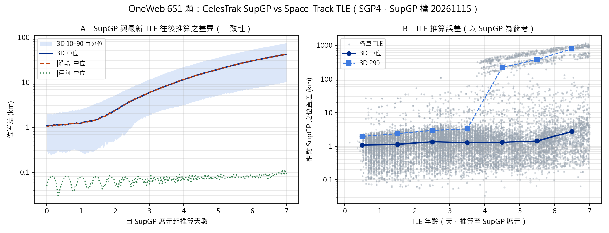
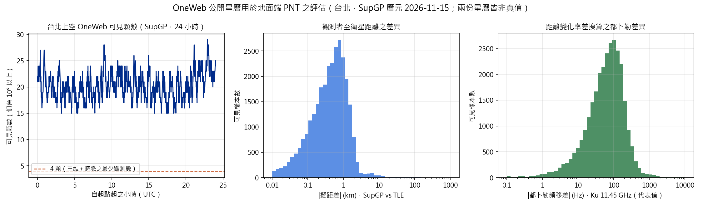

# OneWeb 公開星曆用於地面端 LEO-PNT 之評估

日期：2026-11-15　｜　比照：期末報告技術附錄第十七節（Starlink：TLE 與 MEME 星曆之定位上限）、`Kuiper_SupGP_LEO-PNT評估_20261115.md`

---

## 一、結論

1. **星曆仍是主要限制，但 OneWeb 的公開星曆一致性遠優於 Kuiper。** OneWeb 沒有相當於 Starlink MEME 之公開精密星曆；公開可得者為 Space-Track TLE 與 CelesTrak SupGP（經 OneWeb 同意，由其營運方星曆擬合之 SGP4 根數）。兩者在台北可見時段之衛星位置差中位 1.2 km，距離變化率差中位 1.75 m/s；以 Ku 頻段 11.45 GHz 計，都卜勒頻移差中位約 67 Hz。同條件下 Kuiper 為 6.3 km、15 m/s，OneWeb 約小一個數量級，但仍比都卜勒量測雜訊（Hz 級）大一至兩個數量級。
2. **幾何條件很好。** 2026-11-15 之 651 顆衛星中，台北上空仰角 10° 以上可見顆數中位 20 顆（15–29 顆），全部時間皆至少 4 顆；單次過頂中位 13 分鐘，約為 Kuiper 之 1.6 倍（軌道較高，約 1,200 km）。
3. **訊號端已有公開研究。** OneWeb 下行為 Ku 頻段。UT Austin 已發表 OneWeb 下行訊號模型與參數估計，指出其調變可產生到達時間與都卜勒觀測量；OSU 團隊已以 Starlink、OneWeb、Orbcomm、Iridium 多星系機會訊號實測導航；另有預印本以 OneWeb 加 Starlink 定位，誤差約 268 m（未經同儕審查）。Kuiper 目前查無此類研究。
4. **發現一項 TLE 資料異常。** 2026-10-28 至 11-11 間，約 190 顆 OneWeb 衛星之 Space-Track TLE 曆元落在整點（例如 08:00:02），此類 TLE 推算數天後與 SupGP 相差數百公里；11-11 起恢復一般曆元。原因未查明（見 3.3 節）。

## 二、與 Starlink、Kuiper 之對照

| 項目 | Starlink | OneWeb | Amazon Kuiper |
|---|---|---|---|
| 公開精密星曆 | 有：SpaceX MEME，位置精度約 5 m，每日 3 次、預報 72 小時 | 無；Space-Track Public Files 無 OneWeb 目錄，原始星曆推測需 SSA 協議 | 無；Space-Track Public Files 之 Kuiper 目錄目前為空 |
| 營運方星曆衍生資料 | CelesTrak SupGP | CelesTrak SupGP（651 顆） | CelesTrak SupGP（391 顆） |
| TLE 與參考之差（t0，中位） | 相對 MEME：新鮮 TLE 1.5 km（真值） | 相對 SupGP：1.07 km（非真值） | 相對 SupGP：4.7 km（非真值） |
| 推算 7 天後之差（中位） | — | 41.6 km | 109 km |
| 誤差方向 | 沿軌主導 | 沿軌主導（t0 沿軌 1.06 km、徑向 0.05 km） | 沿軌主導（t0 沿軌 4.7 km、徑向 0.08 km） |
| 軌道高度 | 約 340–570 km | 約 1,200 km | 約 630 km |
| 下行頻段 | Ku | Ku | Ka |
| 台北可見顆數（仰角 ≥ 10°） | 遠多於另兩者（本評估未計算） | 中位 20 顆 | 中位 8 顆 |
| 都卜勒頻移差（中位） | — | 67 Hz（Ku 11.45 GHz） | 940 Hz（Ka 19 GHz 假設）／566 Hz（Ku 參考） |
| 公開訊號定位研究 | 有（都卜勒、載波相位，4–26 m 級） | 有（訊號模型、多星系實測、約 268 m 之預印本） | 未找到 |

OneWeb 之 TLE 與 SupGP 一致性明顯優於 Kuiper，可能原因：OneWeb 為已營運多年之穩定星系，位於約 1,200 km、大氣阻力小；Kuiper 仍在部署初期，部分衛星尚在調整。此為推論，未逐星驗證。

## 三、方法與結果

### 3.1　星曆差異（7 天推算）

以 SupGP 曆元為起點，SupGP 與最新 TLE（年齡中位 18.1 小時）以 SGP4 推算。程式：`docs/compare_kuiper_supgp_tle.py`（依檔名自動判斷星系）。

**A　往後推算（SupGP 與最新 TLE 之一致性）**

| 推算天數 | 3D 差中位 | 3D 差 P90 | 沿軌中位 | 徑向中位 |
|---|--:|--:|--:|--:|
| 0 | 1.07 km | 1.96 km | 1.06 km | 0.05 km |
| 1 | 1.24 km | 2.60 km | 1.21 km | 0.08 km |
| 3 | 5.87 km | 11.5 km | 5.87 km | 0.06 km |
| 7 | 41.6 km | 73.7 km | 41.6 km | 0.09 km |

**B　回推比較（各年齡之 TLE 推算至 SupGP 曆元）**

| TLE 年齡 | 筆數 | 3D 差中位 | 3D 差 P90 |
|---|--:|--:|--:|
| 0–1 天 | 1,350 | 1.08 km | 1.92 km |
| 2–3 天 | 2,440 | 1.35 km | 2.91 km |
| 3–4 天 | 2,103 | 1.27 km | 3.23 km |
| 4–5 天 | 1,882 | 1.30 km | 221 km |
| 6–7 天 | 1,261 | 2.72 km | 781 km |

中位數在 7 天內維持 1–3 km；P90 自 4 天起躍升至數百公里，來自 3.3 節之異常 TLE。

### 3.2　對都卜勒觀測量之影響（台北，24 小時）

以台北（25.033°N, 121.565°E）為觀測點，2026-11-15 14:01 UTC 起 24 小時，仰角 10° 以上之 29,188 個可見樣本：

| 量 | 中位 | P90 |
|---|--:|--:|
| 衛星位置差 | 1.20 km | 2.47 km |
| 擬距差 | 0.45 km | 1.42 km |
| 距離變化率差 | 1.75 m/s | 5.54 m/s |
| 都卜勒頻移差（Ku 11.45 GHz，代表值） | 67 Hz | 212 Hz |

程式：`docs/eval_kuiper_pnt.py`（依檔名自動判斷星系）。

### 3.3　TLE 資料異常：整點曆元之 TLE

回推比較中，92 顆衛星之 4–7 天前 TLE 與 SupGP 相差 300–500 km（沿軌主導；徑向約 −15 km，為數百公里沿軌偏移在曲面上之幾何效應）。以 ONEWEB-0006（NORAD 44061）逐筆檢查：

- 2026-11-11 08:00 以前之 TLE，曆元皆在整點附近（如 08:00:02、16:00:04）；各筆推算至 11-15 與最新 TLE 相差 145–1,670 km。
- 11-11 11:12 起之 TLE 曆元恢復一般型態，推算至 11-15 之差在 3 km 以內。
- 同期半長軸維持約 1,201.8 km，無機動跡象。

全星系統計：2026-10-01 至 10-27 整點曆元 TLE 幾乎為 0；10-28 至 11-11 每日佔 8–22%，涉及約 190 顆；11-12 起為 0。整點曆元之 TLE 可能來自不同之產製流程，在曆元附近可用，但推算數天即大幅偏離。成因未查明，未向 Space-Track 查詢。

**對機動偵測之影響**：此類 TLE 若混入，相鄰 TLE 之根數差可能出現非機動之跳變。本計畫之 15 顆衛星不含 OneWeb，未受影響；日後對 OneWeb 執行機動偵測前，應先檢查並處理整點曆元之 TLE。

## 四、限制

- 兩份星曆皆非真值；上表量的是公開路線間之差異，可視為星曆不確定度之量級，不等於真實定位誤差。
- 11.45 GHz 為 Ku 下行之代表頻率；OneWeb 實際下行頻道與可用於定位之訊號成分，依公開文獻僅部分已知。
- 僅一天之 SupGP；SupGP 本身之推算精度須待存檔累積後評估。
- 3.3 節之 TLE 異常原因未查明。

## 五、建議

1. **累積 SupGP 存檔**（已加入每日資料管線，2026-11-15 起）：7 天後以「t 日 SupGP 推算至 t＋k 日」對照「t＋k 日新發布之 SupGP」，量化 SupGP 本身之預報精度。
2. **OneWeb 為台灣地面端 LEO-PNT 研究之較佳起點**：可見顆數多、過頂時間長、公開星曆一致性約 1 km、且已有公開訊號研究；可優先作為 Starlink 之外的第二個星系。
3. **沿用第十七節之兩項技術**：以機動偵測標記星曆暫不可信之衛星；以阻力殘差修正 SGP4 沿軌預測（OneWeb 高度阻力小，此項效益低於 Starlink）。
4. **TLE 品質檢查**：將「整點曆元 TLE」列入 TLE 品質稽核規則，避免其造成假性跳變。

## 參考

- [CelesTrak SupGP（OneWeb 資料由 Space-Track 上之 OneWeb 星曆衍生，經 OneWeb 同意）](https://celestrak.org/NORAD/elements/supplemental/)
- [Komodromos & Humphreys：OneWeb 訊號參數估計](https://radionavlab.ae.utexas.edu/wp-content/uploads/komodromos_oneweb_parameter_estimation.pdf)
- [Kassas 等：多星系 LEO 機會訊號導航（Starlink、OneWeb、Orbcomm、Iridium）](https://people.engineering.osu.edu/sites/default/files/2023-05/Kassas_Navigation_with_multi_constellation_LEO_satellite_signals_of_opportunity_Starlink_OneWeb_Orbcomm_and_Iridium.pdf)
- [arXiv:2602.06682（以 OneWeb 與 Starlink 定位之預印本）](https://arxiv.org/abs/2602.06682)
