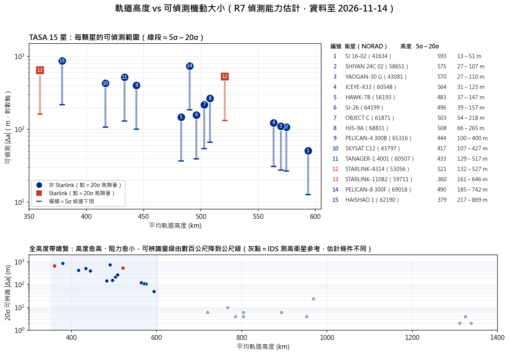

# 回覆：15 顆衛星軌道機動報告及 10 月案例研究提問（R7 更新版）

日期：2026-11-15　｜　對應報告：TASA 15 星機動偵測（R7 報表，TLE 資料至 2026-11-14）、案例研究_30顆衛星偵測總覽與單星逐層解析_20261021

> **與 2026-11-13 版之差異**：前版依 R6 報表，執行時未計入大氣阻力殘差通道。本版以 R7 報表重新執行，並計入阻力殘差通道。R7 另修正 L1 有效門檻（P2、P5、P6 由聯集改為相乘），並移除經驗證無作用之 ΔΩ 標記與 P3 抑制，候選事件由 25 件變為 23 件：SJ 16-02 之 2026-01-03（−0.37 km）與 HAISHAO 1 之 2025-04-04（+1.6 km）不再超過門檻，後者改列 L2 低置信複核項（Q13）；其餘事件相同，證據等級依 R7 規則重給。前版 Q6 對 Model 2 之說明不完整，本版更正（Q6）。另收錄後續追問之回覆（第四節）。

---

## 一、15 顆衛星報告名詞說明

### Q1. 什麼是「候選事件」？是否等於偵測到機動？和「候選機動事件」意思相同嗎？

- **候選事件**是系統找出、**值得人工複核的一段軌道變化**，並不等於已確認的機動。
- 「候選事件」和「候選機動事件」**意思相同**。報表統一寫「候選事件」，刻意不直接稱為「機動」，原因是：
  - 公開 TLE 沒有推進紀錄，系統只看得到軌道根數的變化。
  - 同樣的變化也可能來自定軌更新、TLE 擬合異常或編目交叉標記。
- 系統以「證據等級」（Q3）標示每個事件的複核優先順序。

### Q2. 「規則候選點」是什麼？和候選事件一樣嗎？

- **規則候選點**：L1 規則（P1–P6）逐筆檢查**相鄰兩筆 TLE 之間的變化**，超過門檻就標記一個點。
- 規則候選點和候選事件**不同**：一次機動通常會讓連續好幾筆 TLE 都出現跳變，留下多個候選點；系統把彼此相隔 48 小時以內的候選點**合併成一個候選事件**。
- 本次 15 顆星合計 **131 個規則候選點，合併成 23 個候選事件**。

### Q3. 證據等級是什麼意思？E3、E2、E1、D 各代表什麼？

證據等級是**示警程度**，用來提示分析人員應優先處理哪些事件，**不是機動是否存在的判定，也不是機動發生機率**。此概念與碰撞預警以碰撞機率作為判斷參考相同：機率高代表應優先處理，不等於必然發生。系統依兩項依據給等級：

1. **顯著性**：事件的軌道變化量相對於該衛星平常 TLE 雜訊的倍數（SNR）。SNR ≥ 20 為高，5–20 為中，< 5 為低。
2. **輔助通道**：事件前後 24 小時內，大氣阻力殘差、機器學習窗口模型、融合評分器、統計變點四類中，有幾類也觸發。

| 等級 | 名稱 | 判定條件 | 建議處置 |
|---|---|---|---|
| **E3** | 高優先複核 | 顯著性高，且符合以下任一項：（a）至少 3 類輔助通道一致，其中包含機器學習或融合模型（**限 Starlink**）；（b）屬於連續多日同向的「連續機動段」；（c）半長軸淨變化 ≥ 10 km | 立即複核；經人工確認後，再評估是否更新碰撞風險產品 |
| **E2** | 人工複核 | 顯著性中以上，且至少 2 類輔助通道一致，但未達 E3。非 Starlink 衛星僅因條件（a）達 E3 者，改列「**E2（ML 輔助）**」 | 排程人工複核；ML 輔助者優先 |
| **E1** | 待觀察 | 其餘事件，包括顯著性低、變化量接近 TLE 雜訊，或輔助通道不足 | 持續觀察 |
| **D** | 資料品質待查 | 出現「升了又降回去」的回跳型態，可能是 TLE 擬合異常或編目交叉標記，也可能是真實的劇烈變化 | 先核對原始 TLE 與編目 |

機器學習模型只以 Starlink 資料訓練，對非 Starlink 衛星無法以真值驗證，因此 R7 規定機器學習通道不決定非 Starlink 衛星之 E3。

### Q4. 這 15 顆衛星各自偵測到幾次機動事件？

結論：**23 個候選事件中，E3 5 件、E2 12 件（其中 9 件為「ML 輔助」）、E1 4 件、D 2 件。** 5 件 E3 皆依規則成立，與機器學習無關。15 顆中有 8 顆在整段期間內無超過偵測下限之候選事件。

| NORAD | 衛星 | 規則候選點 | 候選事件 | 等級 E3／E2〔ML 輔助〕／E1／D | 主要事件 |
|---|---|--:|--:|:-:|---|
| 53056 | STARLINK-4314 | 60 | 3 | 2／0／0／1 | 8/15–9/9 連續降軌 26 天，累計 −83.8 km；6/4 回跳型態，待查 |
| 64199 | SJ-26 | 19 | 4 | 1／3〔1〕／0／0 | 2025-05-29 −38.7 km；**2026-11-09 +9.8 km**（10/30 之後唯一新事件） |
| 58651 | SHIYAN 24C 02 | 23 | 4 | 1／2〔2〕／1／0 | 2024-03-15～20 累計 +39.8 km |
| 62190 | HAISHAO 1 | 19 | 8 | 1／4〔3〕／3／0 | 2025-04-11～22 三件上升，合計 +25.1 km；04-04 另列 L2 複核項 |
| 69018 | PELICAN-8 300F | 4 | 2 | 0／2〔2〕／0／0 | 2026-05-09 +3.3 km；10-19 −1.6 km |
| 60548 | ICEYE-X33 | 3 | 1 | 0／1〔1〕／0／0 | 2026-04-17 +1.3 km |
| 68831 | HJS-9A | 3 | 1 | 0／0／0／1 | 2026-06-15 回跳型態，待查 |
| 其餘 8 顆 | TANAGER-1 4001（60507）、PELICAN-4 300B（65316）、SKYSAT C12（43797）、HAWK-7B（56193）、OBJECT C（61871）、STARLINK-11082（59711）、YAOGAN-30 G（43081）、SJ 16-02（41634） | 0 | 0 | 0／0／0／0 | 無超過該星 5σ 偵測下限之候選事件（下限見 Q9）；不排除低於下限之小幅或長時間低推力機動 |
| **合計** |  | **131** | **23** | **5／12〔9〕／4／2** |  |

---

## 二、10 月案例研究（20261021）追問

### Q5. P.11「路由主判取決於是不是 Starlink」：判斷是否為 Starlink 是用 AI 嗎？

**不是。** 系統以固定規則判斷：Space-Track 編目名稱以「STARLINK」開頭，就屬於 Starlink。

之所以按 Starlink 分流，是因為 Model 1 與融合評分器只用 Starlink 的真值資料訓練，只有 Starlink 屬於其適用範圍；非 Starlink 衛星改以不分星系的 NRLMSIS 大氣阻力殘差主判。

### Q6. 「Model 1 有使用 AI、Model 2 沒有使用 AI」，可以這樣解釋嗎？

**就主判而言，此說法正確；系統架構未改變。** 前版回覆說明「兩者都是機器學習」，但未交代 Model 2 在非 Starlink 流程中只作佐證，造成與會議說明不一致，在此更正：

| | Starlink 衛星 | 非 Starlink 衛星 |
|---|---|---|
| 主判（決定結果） | Model 1（LightGBM，監督式機器學習）＋融合評分器（機器學習） | **NRLMSIS 大氣阻力殘差**（物理模型加門檻，**不使用機器學習**） |
| 佐證（不決定結果） | 阻力殘差、Model 2 | Model 2（Isolation Forest，非監督式機器學習） |

| | Model 1 | Model 2 |
|---|---|---|
| 方法 | LightGBM 梯度提升樹 | Isolation Forest 孤立森林 |
| 學習方式 | 監督式：以 Starlink 已知機動真值（MEME 資料）訓練 | 非監督式：不需要機動標籤，找出「與平常不同」的異常點 |
| 輸入 | TLE 軌道變化特徵 | 以 NRLMSIS 扣除阻力後的殘差 |
| 在 App 中的角色 | Starlink 主判 | 非 Starlink 之佐證 |

上述為 App 即時查詢（統一偵測摘要）之路由；本次 15 星報告採 R7 單星報表之統一流程，見 Q7。

### Q7. 這次 15 顆衛星各自用 Model 1、Model 2 或其他方法？是否用到 AI？

結論：**15 顆都用同一套流程（R7 報表），沒有依 Starlink 分流，也未使用 Model 2。事件由非 AI 的 L1 規則產生；AI 只作輔助通道，影響證據等級，且不決定非 Starlink 衛星之 E3。**

#### 1. 10 月案例研究與本次 15 星報告用的是兩種不同的輸出

| | 10 月案例研究（App「統一偵測摘要」） | 本次 15 星報告（R7 單星報表） |
|---|---|---|
| 是否依 Starlink 分流 | 是：Starlink → Model 1＋融合評分器；非 Starlink → NRLMSIS 阻力殘差（Model 2 佐證） | **否：15 顆走同一套流程** |
| 事件由誰決定 | 依路由選定之主判方法 | **L1 規則（非 AI）** |
| AI 的角色 | Starlink 主判；非 Starlink 僅佐證 | **輔助通道：只影響等級，不增刪事件；非 Starlink 不決定 E3** |
| 是否使用 Model 2 | 是（佐證） | 否 |

正式報表改採統一流程，原因有二：

- **同一顆星，舊版報表會出現多個互相對不起來的總數。** 規則、阻力殘差、融合評分器各自計算事件數，讀者無法判斷哪個才是答案。
- **非 Starlink 衛星落在 AI 的訓練範圍外。** 兩個 AI 模型都只用 Starlink 真值訓練（283 顆、高度 324–588 km）。本次 15 顆中 13 顆不是 Starlink，若由 AI 主判，結果無法驗證。

#### 2. R7 的四個步驟

| 步驟 | 做什麼 | 是否 AI |
|---|---|---|
| ① L1 規則標點 | 逐筆檢查相鄰兩筆 TLE 的半長軸變化 Δa，超過門檻就標為「規則候選點」 | 否 |
| ② 合併成事件 | 相隔 48 小時以內的候選點連鎖合併成一個「候選事件」 | 否 |
| ③ 比對輔助通道 | 在每個事件起訖前後 24 小時內，檢查哪些輔助通道也觸發 | **部分是**（見第 3 點） |
| ④ 給證據等級 | 依顯著性、輔助通道數、事件型態，給 E3／E2／E1／D；非 Starlink 之 AI 通道不決定 E3 | 否（固定規則） |

步驟 ① 的 L1 規則由 P1–P6 組成：P2 高度自適應門檻、P5 太陽活動調整、P6 族群基準倍率（三者相乘為有效門檻）、P4 相鄰窗口補充、P1 單調衰減抑制；P3 高 B\* 抑制經消融驗證無作用，2026-11-15 起停用。這些門檻與抑制條件皆為固定規則，同樣的 TLE 資料重跑得到相同結果。

此外，L1 未標記、但其他方法有反應之時點，列為「低置信複核項」，不計入候選事件（見 Q13）。

#### 3. 四類輔助通道

| 輔助通道 | 是否 AI | 方法 | 計入條件 |
|---|---|---|---|
| 機器學習窗口模型 | **是** | LightGBM 監督式模型（與 Model 1 同一類模型） | 模型機率 ≥ 0.478，且該時點阻力殘差 > 0.3 km |
| 融合評分器 | **是** | 梯度提升分類器，綜合 4 個統計通道與阻力殘差 | 分數 ≥ 0.659 |
| 大氣阻力殘差 | 否 | NRLMSIS 大氣密度物理模型，扣除阻力預期衰減後之半長軸變化 | \|殘差\| > 0.3 km |
| L2 統計變點 | 否 | CUSUM、BOCPD、SSA、MAD 3σ | 至少 2 種同時觸發 |

四類通道並非完全獨立：機器學習窗口模型含阻力殘差條件，融合評分器之輸入也含統計分數與阻力殘差。「多通道一致」代表值得優先複核，不代表經過獨立驗證，也不是推進機動的確認。

#### 4. AI 對本次 15 星結果的實際影響

- **AI 通道沒有產生或刪除任何事件。**
- **5 件 E3 皆依規則成立，與 AI 無關**：STARLINK-4314 之 2 件屬連續機動段；HAISHAO 1、SHIYAN 24C 02、SJ-26 各 1 件之半長軸淨變化 ≥ 10 km。
- **9 件非 Starlink 事件符合「至少 3 類輔助通道一致且含 AI」之 E3 條件**，依 R7 規則列為「E2（ML 輔助）」：SJ-26 1 件、HAISHAO 1 3 件、SHIYAN 24C 02 2 件、PELICAN-8 300F 2 件、ICEYE-X33 1 件。
- **低置信複核項**：15 顆共 166 項，合併為 149 個複核案件（阻力殘差 145 項、融合評分器 18 項〔皆為 Starlink〕、L2 統計變點 3 項），不計入候選事件。非 Starlink 衛星之融合評分器項依真值驗證不列入（略去 86 筆）。

各星之通道觸發情形：

| NORAD | 衛星 | Starlink | 候選事件 | 事件含阻力殘差 | 事件含 ML | 事件含融合評分器 | E2（ML 輔助） |
|---|---|:-:|--:|--:|--:|--:|--:|
| 53056 | STARLINK-4314 | 是 | 3 | 3 | 3 | 1 | — |
| 59711 | STARLINK-11082 | 是 | 0 | — | — | — | — |
| 64199 | SJ-26 | 否 | 4 | 4 | 2 | 0 | 1 |
| 58651 | SHIYAN 24C 02 | 否 | 4 | 3 | 3 | 0 | 2 |
| 62190 | HAISHAO 1 | 否 | 8 | 7 | 7 | 0 | 3 |
| 69018 | PELICAN-8 300F | 否 | 2 | 2 | 2 | 1 | 2 |
| 60548 | ICEYE-X33 | 否 | 1 | 1 | 1 | 0 | 1 |
| 68831 | HJS-9A | 否 | 1 | 1 | 1 | 0 | — |
| 其餘 7 顆 | TANAGER-1 4001、PELICAN-4 300B、SKYSAT C12、HAWK-7B、OBJECT C、YAOGAN-30 G、SJ 16-02 | 否 | 0 | — | — | — | — |
| **合計** | | | **23** | **21** | **19** | **2** | **9** |

#### 5. 範例：SJ-26 在 2026-11-09 的 +9.8 km 事件

1. **L1 規則**：11/09 前後的相鄰 TLE 出現約 +9.8 km 的半長軸跳變，遠超過該星門檻，標為規則候選點，合併成一個候選事件。
2. **輔助通道**：事件前後 24 小時內，阻力殘差與 L2 統計變點觸發，共 2 類；ML 窗口模型與融合評分器未觸發。
3. **等級**：顯著性高、2 類輔助通道一致，符合 E2；淨變化 9.76 km 未達 10 km，不屬於連續機動段，輔助通道不足 3 類，三個 E3 條件皆不符合，列 **E2 人工複核**。此事件之等級與 AI 無關。
4. **時間**：事件落於 5.3 天之 TLE 空窗內（11-04 06:51 至 11-09 14:42），變化時間只能確定落在空窗內。

#### 6. 小結

| 問題 | 回答 |
|---|---|
| 15 顆是否分別用 Model 1 或 Model 2？ | 否，15 顆都用 R7 同一套流程，不分流，也不使用 Model 2 |
| 事件由什麼方法辨識？ | L1 規則（P1–P6），非 AI |
| 是否用到 AI？ | 有，作為輔助通道：LightGBM 窗口模型與融合評分器 |
| AI 影響什麼？ | 只影響證據等級；不新增、不刪除事件；不決定非 Starlink 衛星之 E3 |

---

## 三、偵測能力

### Q8. 「衛星軌道範圍 vs 可偵測機動大小」關係圖

- **上圖**是 15 顆星各自的可偵測範圍；**下圖**是全高度帶總覽，灰點為 700–1400 km 的測高衛星參考值。
- **趨勢一：高度愈高、阻力愈小，TLE 雜訊愈小，能偵測的機動愈小。** 400 km 附近需要數百公尺的變化才能確實辨識；800 km 以上可降到公尺級。
- **趨勢二：相同高度帶內，各星的可偵測量級仍可相差 5 倍以上。** 例如 HAWK-7B（483 km）約 147 m，PELICAN-8 300F（490 km）約 742 m。差異主要來自面積質量比、姿態變化和 TLE 更新頻率。

### Q9. 這 15 顆衛星各自可偵測的上下限值

#### 下限

依各星本期實際 TLE 雜訊（σ）計算，分兩級：

- **候選下限（5σ）**：單次變化超過此值，就可能成為候選事件。
- **高顯著下限（20σ）**：單次變化超過此值，即具高顯著性。

「Δv (20σ)」是把 20σ 的半長軸變化換算成切向速度增量，約為每 1 km Δa 對應 0.55 m/s。

| NORAD | 衛星 | 高度 km | 5σ | 20σ | Δv (20σ) | 最大 \|淨Δa\| |
|---|---|--:|--:|--:|--:|--:|
| 41634 | SJ 16-02 | 593 | 13 m | 51 m | 2.7 cm/s | — |
| 58651 | SHIYAN 24C 02 | 575 | 27 m | 107 m | 5.8 cm/s | 39.8 km |
| 43081 | YAOGAN-30 G | 570 | 27 m | 110 m | 6.0 cm/s | — |
| 60548 | ICEYE-X33 | 564 | 31 m | 123 m | 6.7 cm/s | 1.3 km |
| 56193 | HAWK-7B | 483 | 37 m | 147 m | 8.2 cm/s | — |
| 64199 | SJ-26 | 496 | 39 m | 157 m | 8.7 cm/s | 38.7 km |
| 61871 | OBJECT C | 503 | 54 m | 218 m | 12.0 cm/s | — |
| 68831 | HJS-9A | 508 | 66 m | 265 m | 14.7 cm/s | 0.12 km |
| 65316 | PELICAN-4 300B | 444 | 100 m | 400 m | 22.4 cm/s | — |
| 43797 | SKYSAT C12 | 417 | 107 m | 427 m | 24.1 cm/s | — |
| 60507 | TANAGER-1 4001 | 433 | 129 m | 517 m | 29.0 cm/s | — |
| 53056 | STARLINK-4314 | 521 | 132 m | 527 m | 29.0 cm/s | 65.3 km |
| 59711 | STARLINK-11082 | 360 | 161 m | 646 m | 36.9 cm/s | — |
| 69018 | PELICAN-8 300F | 490 | 185 m | 742 m | 41.1 cm/s | 3.3 km |
| 62190 | HAISHAO 1 | 379 | 217 m | 869 m | 49.4 cm/s | 14.5 km |

#### 上限

**變化量本身沒有偵測上限，變化愈大愈容易偵測。** 本期最大之變化是 STARLINK-4314 連續 26 天降軌，累計 −83.8 km；最大之單一事件是 SHIYAN 24C 02 之 +39.8 km。實務上的限制來自以下三種情況：

1. **單筆跳變 ≥ 50 km**：仍會偵測，但系統會先提示核對原始 TLE 與編目。
2. **TLE 空窗 ≥ 7 天**：可偵測空窗前後之淨變化，但無法定位機動時間，最高列 E2。
3. **長時間、極小推力之連續機動**：每筆 TLE 之間的變化可能都低於下限，須靠「連續機動段」判定或阻力殘差累積發現。

> 註：下限值以本期資料（至 2026-11-14）估算，會隨太陽活動、大氣阻力和 TLE 品質變動，不是固定常數。

---

## 四、後續追問

### Q10. 什麼是「複核」？是指用 E3、E2、E1、D 不同方式檢查嗎？

不是。「複核」是指分析人員再檢視一次，核對原始 TLE、營運商公告、其他觀測來源或任務背景，最後由人確認是否為機動。E3、E2、E1、D 為系統自動標上之優先順序標籤，提示分析人員應先處理哪些事件，並非四種檢查方法。流程為：系統以規則找出候選事件，依證據強度自動標上等級，分析人員再依等級順序逐件複核。

### Q11. 哪一級才算「判斷出衛星機動」？

僅靠 TLE，系統無法確認機動，只能提示可能性與複核順序。若需一條作業界線，建議以 E2 以上作為「系統判定可能為機動」，其中 E3 把握較高；E1 為證據不足，D 須先查資料。本次 E3 5 件、E2 12 件，其中 9 件 E2 為「ML 輔助」，應保守看待。

### Q12. 「R6」「R7」是什麼？可以改稱 Rule6 嗎？R7 是否以 L1 為主要判斷依據？

「R」指報表程式之版本（Revision），R7 為第 7 版，不是偵測模型或規則之名稱，因此不建議改稱 Rule6。若需為方法命名，建議稱為「L1 規則主判、多通道證據分級」，報表版本另行標示。

| 版本 | 日期 | 主要變更 |
|---|---|---|
| R2 | 2026-10-29 | 事件清單只由 L1 規則產生，其他方法改為輔助通道 |
| R3 | 2026-10-30 | 新增證據等級、顯著性（SNR）、連續機動段、CSV 與 Markdown 匯出 |
| R4 | 2026-10-30 | \|淨 Δa\| ≥ 10 km 列 E3；新增重點複核項目 |
| R5 | 2026-10-30 | 新增 D 級、偵測能力、低置信複核項、複核優先順序 |
| R6 | 2026-10-31 | ML 窗口通道全數評分；跨長空窗之事件不列 E3 |
| R7 | 2026-11-15 | L1 有效門檻改為 P2 × P5 × P6，移除 ΔΩ 標記與 P3 抑制；低置信複核項新增 L2 統計變點來源並合併為複核案件；非 Starlink 之融合評分器項不列入；非 Starlink 之 ML 輔助 E3 改列 E2；E3 建議處置改為經人工確認後再評估碰撞風險 |

R1 早於版本紀錄，內容未記載。R7 以 L1 規則為唯一事件來源：候選事件只由 L1 規則產生，阻力殘差、L2 統計變點、機器學習窗口模型與融合評分器只影響證據等級。

### Q13. L1 未看到、L2 才發現之可疑變化，R7 如何處理？

L1 未標記、但其他方法有反應之時點，列為「低置信複核項」，不計入候選事件、不給證據等級，由分析人員判讀。來源有三：

1. 阻力殘差超過 0.3 km。
2. 融合評分器超過門檻（限 Starlink 衛星）。
3. 2 種以上 L2 方法同時觸發，且扣除背景衰減後之淨變化超過 L1 單步門檻（R7 新增）。

以 MEME（Starlink）與 IDS（非 Starlink 精密定軌衛星之營運方點火紀錄）真值評估：

- **Starlink**：L1 未涵蓋之真值事件約六成（33／54）會出現在低置信複核項中，主要來自融合評分器（29 件）與阻力殘差（13 件）；L2 項本身補回不到 3%。
- **非 Starlink**：融合評分器項全數落在營運方認證之安靜期內，屬誤報；阻力殘差項補回 L1 未偵測之點火 9 次，L2 項補回 1 次。非 Starlink 衛星之 L1 漏偵仍為已知限制。

依此結果，R7 已將非 Starlink 衛星之融合評分器超門檻時點自低置信複核項中移除，報表另註明略去之筆數。本次 15 顆共 3 項 L2 複核項。SHIYAN 24C 02 於 2024-05-08 單步上升 +0.55 km、離心率同時上升，單步未達 L1 門檻，由 L2 列出。HAISHAO 1 於 2025-04-04 之上升，前版曾列為候選事件；R7 修正 L1 有效門檻後各單步未達門檻，改由三種 L2 方法同時觸發列出，扣除背景衰減後淨上升約 3.5 km。

### Q14. 15 顆中有 Starlink 與電推衛星，是否全部使用同一種方式？

是，15 顆皆使用 R7 同一流程，未依衛星型態分別處理。15 顆中 2 顆為 Starlink，其餘 13 顆不是；系統內的機器學習模型只以 Starlink 資料訓練，若由機器學習主判，13 顆非 Starlink 衛星之結果無法驗證，因此正式報表對所有衛星採用一致、可逐筆重現之規則主判。

Starlink 為電力推進衛星，推力小、持續多日改變軌道。R7 之連續機動段規則可處理此類變化：連續多日同向之變化合併為一段判讀，STARLINK-4314 之 26 天、累計 −83.8 km 降軌即以此規則列為 E3。此規則對 15 顆一體適用，並非 Starlink 專用。其餘 13 顆是否為電力推進衛星，目前無可靠資料。
