# 回覆：期末報告建議事項（AI 分級、交付流程、模組組成、招標規範成果對照與維護資源）

**計畫**：TASA-S-1150268　智慧化低軌通訊衛星軌道異常及太空事件偵測演算法研究

**日期**：2026-11-25

您好：

感謝貴中心對期末報告的建議。以下依提問順序說明；第 8 題另附三類衛星之偵測案例圖，並對照招標規範工作內容三大項整理成果，補充簡報另檔提供；另以第九節補充開發單位自提之維護與擴充所需資源估算。

## 一、AI 如何做事件分級（第 1 題）

> **問：**若AI僅用於事件分級，想請教AI具體上是如何做事件分級?

**答：**

本案使用的 AI 皆為機器學習模型（期末報告 4.6 節）。在 R7 中，AI 不決定事件是否存在，只影響證據等級。R7 的判定分四個步驟（期末報告表 3）：

1. **L1 規則標點**：逐筆比較相鄰兩筆 TLE，半長軸、傾角或離心率的變化超過該衛星的門檻即標記。
2. **合併為候選事件**：相隔 48 小時內的標記合併為一件；連續多日同向者再合併為連續機動段。
3. **比對輔助通道**：檢查事件前後 24 小時內，下列四類通道中有幾類也有反應：

   | 輔助通道 | 方法 | 是否為 AI |
   |---|---|---|
   | ML 窗口模型 | Model 1（LightGBM）機率 ≥ 0.478，且軌道變化超過物理門檻 | 是 |
   | 融合評分器 | 分數 ≥ 0.659 | 是 |
   | 阻力殘差 | 實測 Δa 與 NRLMSIS 預期 Δa 之差 > 0.3 km | 否 |
   | L2 統計變點 | CUSUM、BOCPD、SSA、MAD 3σ 中至少 2 種同時觸發 | 否 |

4. **給證據等級**：依「顯著性」（變化量相對該星 TLE 雜訊的倍數）與「幾類通道一致」，以固定規則判定：

   | 等級 | 條件 |
   |---|---|
   | E3 高優先複核 | 顯著性高，且符合任一項：（a）至少 3 類通道一致，其中包含 AI 通道；（b）屬連續機動段；（c）\|淨 Δa\| ≥ 10 km |
   | E2 人工複核 | 顯著性中以上，且至少 2 類通道一致 |
   | E1 待觀察 | 其餘 |
   | D 資料品質待查 | 「升了又降回」的回跳型態 |

因此 AI 的作用是：當 ML 窗口模型或融合評分器也有反應時，事件可依條件（a）升為 E3，或與其他通道合計達到 E2。AI 不能新增或刪除事件。

非 Starlink 衛星另有限制：兩個 AI 模型只以 Starlink 資料訓練，因此非 Starlink 衛星的事件若只因條件（a）達到 E3，降列「E2（ML 輔助）」。非 Starlink 衛星的 E3 只依條件（b）或（c）成立，與 AI 無關（期末報告表 9-1）。

## 二、最終交付的流程（第 2 題）

> **問：**最終交付的版本會是哪一種流程? 會建議使用R7版本作為最終系統使用嗎?

**答：**

建議以 **R7 單星報表**作為最終系統的正式流程。App 頁面上的結果摘要與 PDF 報表都是 R7 的結果。

統一偵測摘要（先前所稱 A 流程）保留在 App 附錄 D，作為檢視各偵測方法原始反應的參考，不決定候選事件。

建議採用 R7 的理由有三：

1. **所有衛星同一標準**：可比較不同類型衛星的結果。
2. **每件事件可逐筆說明觸發原因**：每件都能說明由哪條規則、哪一筆 TLE 觸發，正式報表可以稽核與重現。
3. **大幅變化的偵測結果相同**：在 15 顆指定衛星上，R7 的 5 件 E3 事件 A 流程全數涵蓋（2026-11-19 回覆表 1）。

## 三、R7 是否使用 Model 1、Model 2 與融合評分器（第 3 題）

> **問：**想再確認是否R7版本不會使用到Model 1 (LightGBM)、Model 2 (Isolation Forest)和融合評分器嗎? 或者是R7版本也會用到Model 1 (LightGBM)、Model 2 (Isolation Forest)和融合評分器，但只是作為輔助判斷?

**答：**

三個模型在 R7 中的角色不同：

| 模型 | R7 是否使用 | 在 R7 中的角色 |
|---|---|---|
| Model 1（LightGBM，監督式） | 使用 | 輔助通道「ML 窗口模型」：影響證據等級，不決定事件 |
| 融合評分器（HistGradientBoosting，監督式） | 使用 | ① 輔助通道：影響證據等級；② 支線來源（限 Starlink）：L1 未標記、但分數過門檻的時點，列為低置信複核項 |
| Model 2（Isolation Forest，非監督式） | **不使用** | 只出現在統一偵測摘要，作為非 Starlink 衛星的佐證 |

也就是說，R7 用到 Model 1 與融合評分器，但兩者只作輔助判斷；Model 2 不在 R7 流程內。

## 四、融合評分器融合了哪幾項（第 4 題）

> **問：**承上，融合評分器是融合了哪幾項?

**答：**

融合評分器輸入五個通道，各取事件前後 ±24 小時窗內的統計量：

| 通道 | 類別 | 衡量什麼 |
|---|---|---|
| CUSUM（累積和） | L2 統計變點 | 小而持續的位移 |
| BOCPD（貝氏線上變化點偵測） | L2 統計變點 | 突發的斷點 |
| SSA（奇異譜分析） | L2 統計變點 | 緩慢漂移背景中的突兀點 |
| MAD 3σ（穩健 z 分數） | L2 統計變點 | 相對自身分布的離群值 |
| NRLMSIS 阻力殘差 | 物理模型 | 無法以大氣阻力解釋的半長軸變化 |

模型為 HistGradientBoosting 梯度提升樹，以 284 顆 Starlink 的 MEME 精密星曆機動真值訓練，輸出 0–1 的分數，門檻 0.659（期末報告 4.6 節）。它的作用是同時權衡多個單獨看來不明顯的訊號。

## 五、各模組的關係（第 5 題）

> **問：**流程圖中的各項Module，是平行的執行單元，還是有前後流程或交互的關係? 可以理解為這個專案開發出各種判斷Module，但根據不同衛星會選用不同Module和不同流程?

**答：**

各模組依前後順序串接，並非平行投票。模組分成「產生事件」與「提供證據」兩種角色：

- **產生事件**：只有 L1 規則。
- **提供證據**：ML 窗口模型、融合評分器、阻力殘差、L2 統計變點。它們在 L1 產生事件之後，被用來比對、分級；另外在 L1 未標記的時段，作為支線的補漏來源。

至於「依衛星選用不同模組與流程」，需要分開說明兩種輸出：

| 輸出 | 是否依衛星類型分流 |
|---|---|
| R7 單星報表（正式結果） | **不分流**：所有衛星同一流程。唯一的差異是兩個 AI 模型的使用限制（非 Starlink 衛星的融合評分器不列入支線，ML 不能使事件達到 E3） |
| 統一偵測摘要（App 附錄 D，參考） | **分流**：依是否為 Starlink 選主判方法 |

判斷是否為 Starlink 採固定規則：編目名稱以「STARLINK」開頭，不使用 AI。

## 六、各種流程（第 6 題）

> **問：**承上，若是根據不同衛星會選用不同Module和不同流程，請分別呈現各種流程

**答：**

共有三種流程：統一偵測摘要的兩條路徑，以及 R7 的統一流程。

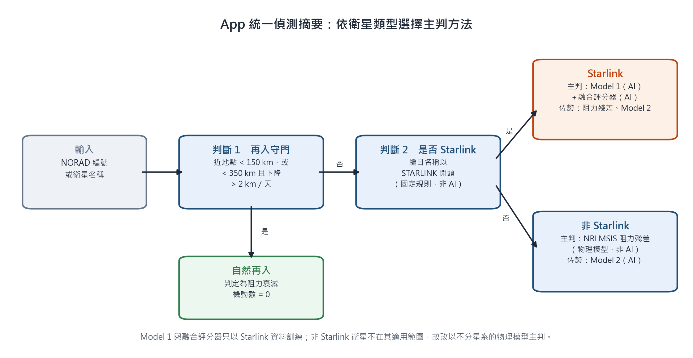

**流程 1　統一偵測摘要：Starlink 衛星**

再入守門 → Model 1 與融合評分器主判（AI）→ 輸出各方法的旗標次數與時刻。

**流程 2　統一偵測摘要：非 Starlink 衛星**

再入守門 → NRLMSIS 阻力殘差主判（物理模型，|殘差| > 0.3 km）→ Model 2 佐證（AI，不決定結果）→ 輸出旗標次數與時刻。

**流程 3　R7 單星報表：所有衛星（正式結果）**

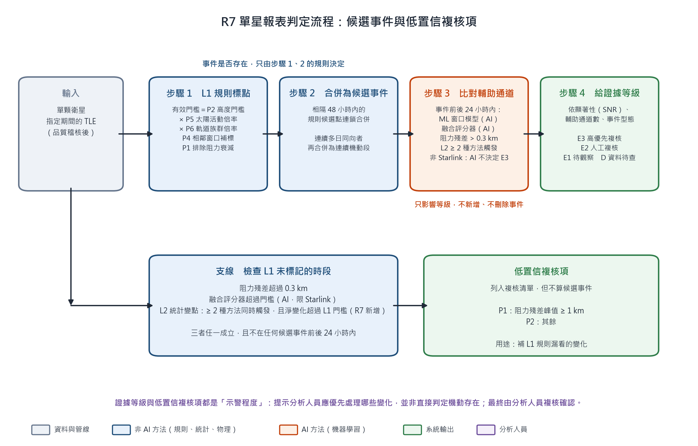

主線為 L1 規則標點 → 合併為候選事件 → 比對四類輔助通道 → 給證據等級。支線檢查 L1 未標記的時段，符合下列任一條件即列為低置信複核項：

- 阻力殘差 > 0.3 km。
- 融合評分器分數 ≥ 0.659（限 Starlink）。
- L2 統計變點至少 2 種同時觸發，且扣除背景衰減後淨變化超過門檻。

非 Starlink 衛星在 R7 中的差異只有兩點：融合評分器不列入支線；只因 AI 通道達到 E3 者降列 E2（ML 輔助）。

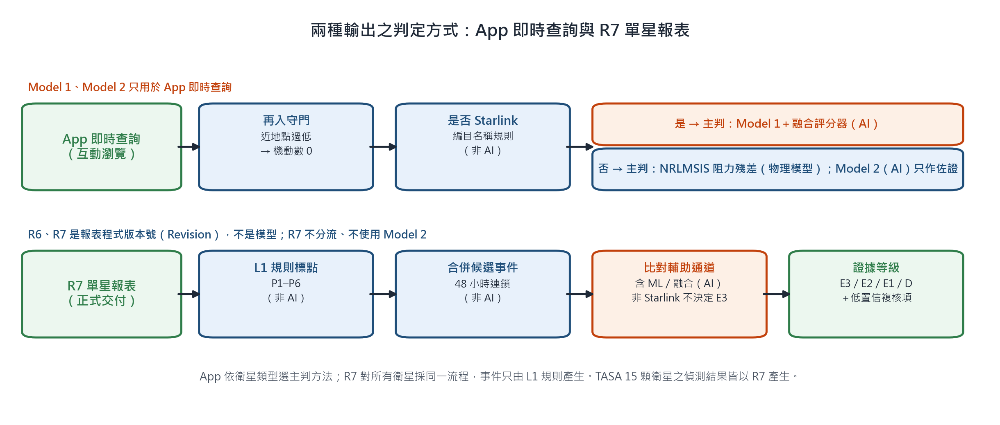

## 七、未來維護與擴充（第 7 題）

> **問：**承上，未來TASA若想要維護或拓展此系統，能否將這幾個不同的判斷Module進行重組，或改進系統新增其他判斷方法嗎?

**答：**

可以。各偵測方法在程式中是獨立的函式，門檻集中於程式常數與期末報告附錄 B，可以重組，也可以新增判斷方法。

**程式結構**（`maneuver_report_builder.py`）：

| 階段 | 函式 | 說明 |
|---|---|---|
| 各方法計算 | `compute_l1`、`compute_l2`、`compute_drag_series`、`compute_ml_detection`、`compute_fusion_detection` | 各自獨立，輸入同一組 TLE，輸出各自的旗標或分數 |
| 產生候選事件 | `build_candidate_events` | 只使用 L1 標記 |
| 比對與分級 | `assess_events` | 彙整各輔助通道在事件 ±24 小時內的反應，依等級規則判定 |
| 支線 | `low_conf_items` | L1 未標記時段之補漏 |

門檻與參數列於期末報告附錄 B，例如阻力殘差門檻 `DRAG_EVENT_KM = 0.30`、融合評分器門檻 0.659。

**新增一個判斷方法的步驟**：

1. **新增計算函式**：輸入 TLE（與太空天氣），輸出每個時點的旗標或分數。
2. **決定它的角色**：作為輔助通道（影響等級）、作為支線來源（補漏），或兩者皆是。依角色接入 `assess_events` 或 `low_conf_items`。
3. **調整等級規則**：輔助通道從四類變五類時，E3 條件（a）「至少 3 類一致」的意義會改變，須重新決定門檻。
4. **以真值重新驗證**：以 MEME（Starlink）與 IDS（非 Starlink）真值，重跑召回、誤報與複核負擔的評估。評估程式見期末報告附錄 C（例如 `three_layer_common_eval.py`、`validate_lowconf_full.py`、`eval_l1_combination.py`），確認新方法提高召回或降低誤報後再上線。
5. **更新版本**：報表版本代號遞增（例如 R8），並在報表頁尾記錄分析流程版本，使結果可追溯。

**重組的例子**：

- 期末報告 11.6 節已研討將阻力殘差門檻改為依高度調整。只需修改一個參數函式，不影響其他模組。
- 若未來取得非 Starlink 衛星的機動真值，可重新訓練 AI 模型，並解除「非 Starlink 不得因 AI 達 E3」的限制。

**須注意**：AI 模型需定期以新真值重新訓練。以 56 顆未參與訓練之 Starlink 測試時 AUC 為 0.980；以前段時間訓練、後段時間測試時降為 0.945（期末報告 7.3 節）。

## 八、對照招標規範三大項之成果與偵測案例（第 8 題）

> **問：**期末簡報是否可以針對招標規範(規格需求)內的工作內容三大項，提供相對應的簡單成果展示或說明? 請提供(1)一般衛星 (2)Starlink衛星 (3)非Starlink的電推衛星，各舉數個偵測案例(可拿先前分析過的衛星)，以圖示偵測結果 (例如 SMA變化 vs 偵測或候選事件圖) 。

**答：**

### 8.1　工作內容三大項之成果對照

| 招標規範項目 | 本案成果 | 期末報告 |
|---|---|---|
| **一、原始資料集蒐集和處理** | 以 Space-Track 公開 TLE 為唯一偵測輸入，每日自動下載、入庫並同步至線上資料集。資料清洗包括：逐筆品質稽核（good／suspect／rejected）、去除重複收錄（同一曆元相距 1 秒內視為同一筆）、每次回頭比對近 30 天補上遲發 TLE、回跳型態列 D 級先查資料，以及再入守門避免把自然再入誤判為機動。下載程式（`download_TLE_unified.py`）、品質稽核程式（`data_quality_audit.py`）與合成 TLE 產生工具（`synthetic_tle`：軌道根數、機動注入、雜訊模型與 TLE 格式輸出）隨程式碼交付 | 第三章、附錄 C |
| **二、智慧化偵測演算法開發** | 特徵提取：40 項 TLE 軌道變化特徵（Model 1）與五通道統計量（融合評分器）。AI 方法包括監督式（LightGBM、HistGradientBoosting）與非監督式（Isolation Forest）。異常辨識與分類：候選事件依證據等級（E3／E2／E1／D）與型態（單筆、多筆、連續機動段、回跳）分類 | 第四、五章 |
| **三、高靈敏度與低誤報、通用性、測試基準** | 靈敏度：微小機動原列「約 100 公尺以下機動（TBD）」，雙方於期末會議前，同意進行修約，並改為 2 公里量級機動。2 km 高於 15 顆指定衛星之 5σ 統計下限（13–537 m）；400 km 以上之衛星於太陽活動平靜時，單次 2 km 即超過 L1 單步門檻（400 km 約 2 km、700 km 以上 0.4 km）。限制：低軌 Starlink 之 1–5 km 事件召回 0.091（表 11 ②#7）；太陽活躍期 400 km 門檻最多約 3.6 km。大幅變化：無偵測上限，15 顆指定衛星中最大單一事件為 +39.8 km。星系級：Starlink、OneWeb、千帆等星系之軌道面一致性、批量機動與陣型分析。測試基準：MEME 精密星曆（283 顆 Starlink）、IDS 營運方點火紀錄（15 顆），以召回、誤報率、AUC、F1 等指標評估；與原方法（曲線法）比較見下 | 第七章、8.2 節、第九章 |

**測試基準與效能（招標規範三之 3）**：

- **工作計畫書表 8 預估效能評估值**：14 項中 12 項達到預估值（期末報告表 11）。
- **方法比較**：以 Starlink MEME 真值、誤報率 5% 以下比較，融合評分器之召回高於 L2 統計方法與 L1 規則（期末報告表 13）。
- **與原方法比較**：NASA／ILRS 標竿，以海洋測高與重力任務衛星之營運方點火紀錄為真值。與貴中心自行執行之曲線法結果比較，14 顆衛星、±1.5 天容差下，本系統平均 F1 0.496，貴中心曲線法全域最佳組態 0.330，逐星 11 勝 3 敗。此結果依賴容差設定，±1.0 天時兩者相當（期末報告 7.6 節）。
- **誤報**：15 顆非 Starlink 精密定軌衛星之營運方認證無機動期間，L1 候選事件誤報為每千安靜星日 0.85 件（期末報告表 17）。
- **可重現性**：以 App 逐顆重現交付結果，候選事件與證據等級全部一致（期末報告 10.6 節）。

### 8.2　三類衛星之偵測案例

以下各圖以 R7 計算（與 App 頁面主結果、PDF 報表同一函式）。每張圖：

- **上方**：TLE 半長軸換算的高度。
- **下方三條時間帶**：由上而下為真值、R7 候選事件（依證據等級著色）與低置信複核項。

一般衛星以營運方點火紀錄為真值；Starlink 以 MEME 精密星曆為真值。非 Starlink 電推衛星沒有公開機動真值。

**表 1　偵測案例摘要**

| 類別 | 衛星 | 期間 | 高度變化 | R7 候選事件 E3／E2／E1／D | 真值對照 |
|---|---|---|---|---|---|
| 一般 | Jason-3 | 2025 | 1,338 → 1,311 km（−26.8 km） | 5（3／2／0／0） | TLE 可見點火 20 次中 18 次落在候選事件內 |
| 一般 | SWOT | 2023-01 至 09 | 859 → 893 km（+31.2 km） | 6（1／1／4／0） | TLE 可見點火 10 次中 7 次落在候選事件內 |
| 一般 | SWOT | 2025-01 至 2026-08 | 維持 893.2 km | 0 | 26 次維持點火，淨變化 12–45 m，皆未標記（見說明） |
| Starlink | STARLINK-37471 | 2026-05 至 08 | 315 → 466 km（+151 km） | 3（3／0／0／0） | 3 件全部落在 MEME 機動段內 |
| Starlink | STARLINK-4314 | 2026-04 至 11 | 551 → 466 km（−84.0 km） | 3（2／0／0／1） | 無公開真值 |
| Starlink | V3 第二批 26 顆 | 2026-11-18 至 23 | 約 285–305 → 316–346 km（24 顆）；2 顆停留約 272 km | 30（20／10／0／0） | 無公開真值 |
| 電推 | KUIPER-00188 | 2026-04 至 11 | 450 → 630 km（+180 km） | 6（4／2／0／0） | 無公開真值 |
| 電推 | ONEWEB-0687 | 2026-04 至 11 | 維持約 1,194 km | 0 | 無公開真值（見說明） |

「落在候選事件內」以點火時刻在事件起訖前後 24 小時內計。

#### （1）一般衛星（化學推進）

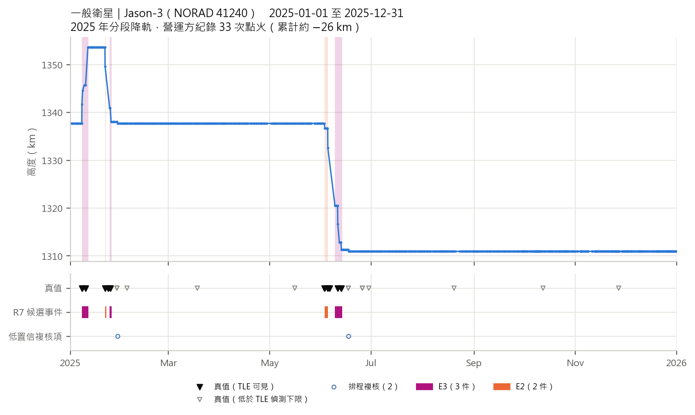

Jason-3 在 2025 年 1 月與 6 月各有一段機動。R7 產生 5 件候選事件，涵蓋 TLE 可見點火 20 次中的 18 次；最大一件淨變化 21.3 km，列 E3。其餘 13 次為例行維持點火，營運方真值檔標示其量級低於 TLE 可見門檻。

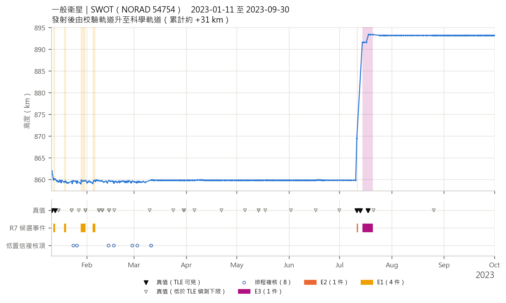

SWOT 於 2023 年 7 月由約 859 km 升至 893 km，R7 以 E3（淨 +23.8 km）與 E2 兩件標記。1 月入軌初期另有 4 件 E1，同期有營運方紀錄的點火；TLE 可見點火 10 次中有 7 次落在候選事件內。

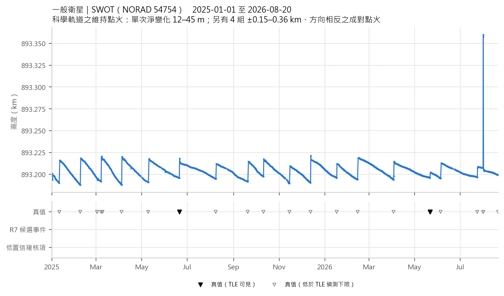

**這是低於規格範圍的維持機動案例。**（招標規範之微小機動原列約 100 公尺以下（TBD），雙方於期末會議前，同意進行修約，並改為 2 公里量級機動；本例單次僅數十公尺，在修約後之規格範圍以下。）圖中可看到高度約每月一次、20–30 m 的鋸齒狀抬升，對應營運方紀錄的維持點火。R7 沒有標記。這顆衛星的 TLE 逐筆雜訊（σ）約 1 m（已達系統設定之下限），5σ 統計下限約 5 m、20σ 高顯著下限約 20 m，維持點火（12–45 m）多已超過 5σ，部分（30–45 m）超過 20σ；但 L1 規則在 700 km 以上的半長軸門檻為 0.4 km（期末報告表 6），單次淨變化 12–45 m 遠低於此，因此不會產生候選事件。另有四組 ±0.15–0.36 km 的成對點火，間隔約 4 小時、方向相反，淨變化近乎為零，TLE 也看不出來。本例中，數十公尺的維持點火在 TLE 高度序列上可以看出，但逐筆規則不會標記；這是期末報告 7.7、10.5 節所述的偵測限制。

#### （2）Starlink 衛星

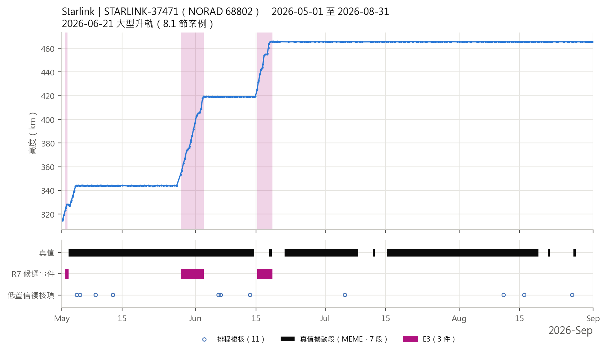

R7 產生 3 件候選事件，對應三段升軌，3 件皆為 E3（最大一件淨 +75.4 km）。另有 11 項低置信複核項（其中融合評分器 9 項，皆排程複核）；7 段 MEME 機動段中，5 段有候選事件或低置信複核項涵蓋。MEME 真值的機動段長達數十天，顯示 Starlink 在運作高度幾乎持續以電推補償阻力（期末報告表 16 解讀第 3 點）；這類持續小推力低於此星之 20σ 高顯著下限（約 1 km），只有升軌這類大幅變化會被標記。

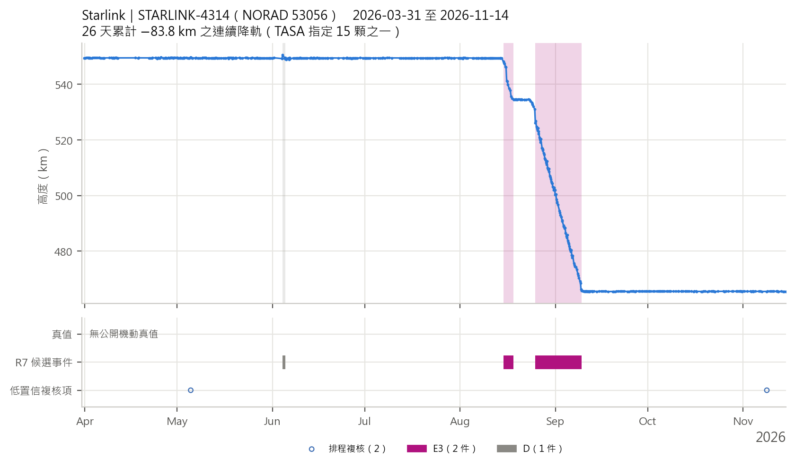

8 月起的降軌由 R7 標為兩件 E3，即期末報告 10.3 節所述歷時 26 天、累計 −83.8 km 的連續降軌。6 月初的 1 件 D 為回跳型態，須先核對原始 TLE。另有 16 項低置信複核項（其中融合評分器 14 項，皆排程複核）。

Starlink 星系級分析的案例：V3 第一批 26 顆之入軌爬升見期末報告第九章圖 20。V3 第二批於期末報告完成後公開編目，以同一程式分析如下。

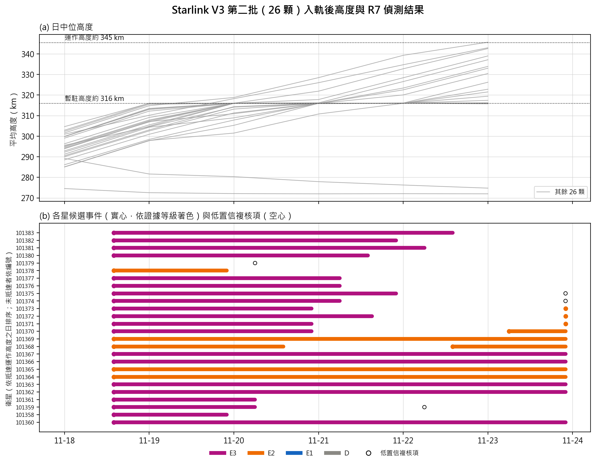

第二批為 NORAD 101358–101383，傾角 30.5°，屬 STARSHIP-15 任務，Space-Track 首筆 TLE 為 2026-11-18；至 11-23 每顆 18 筆，觀測期間僅 6 天。

- **入軌爬升**：24 顆在首筆 TLE 後 1–4 天抵達約 316 km 的暫駐高度，至 11-23 已有數顆接近 345 km 運作高度。
- **偵測結果**：R7 產生 30 件候選事件，E3 20 件全數依規則（連續機動段）成立，E2 10 件。24 顆的入軌爬升段皆有 L1 候選事件涵蓋；第一批之入軌爬升段，L1 只涵蓋約四成（期末報告 9.3 節）。
- **未爬升**：101378、101379 停留約 272 km 並緩慢下降，原因未查證。

#### （3）非 Starlink 電力推進衛星

Amazon Kuiper 與 OneWeb 衛星皆使用霍爾推進器（出處見文末）。兩者都沒有公開機動真值，因此只能呈現偵測結果，無法計算召回。

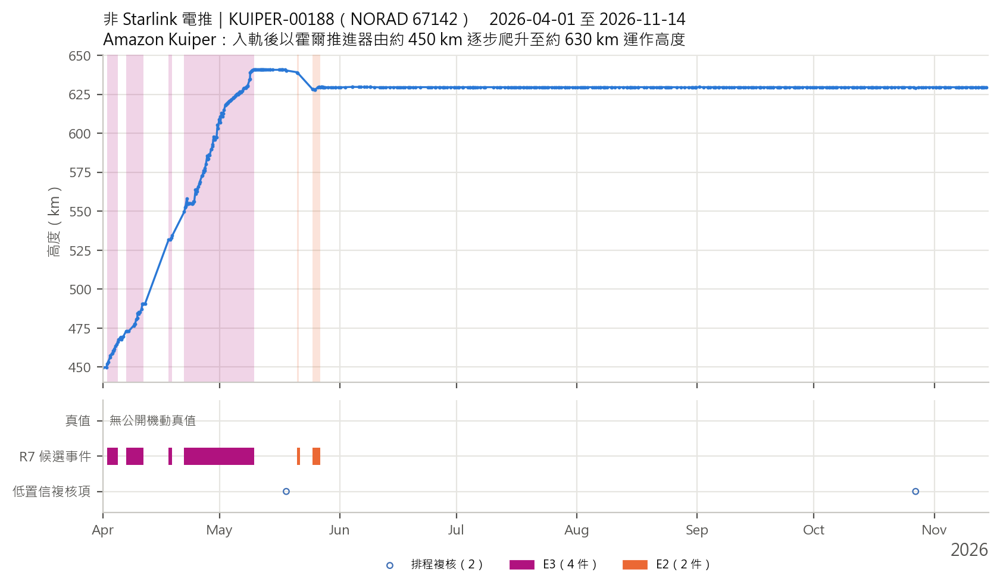

Kuiper 衛星在 4 月初至 5 月中約 6 週內爬升約 190 km，每筆 TLE 的變化數公里。R7 以 6 件候選事件標記爬升與 5 月底的高度下修。4 件 E3 皆依規則條件（連續機動段或淨變化 ≥ 10 km）成立：非 Starlink 衛星的 E3 不能只因 AI 通道成立（第一題）。

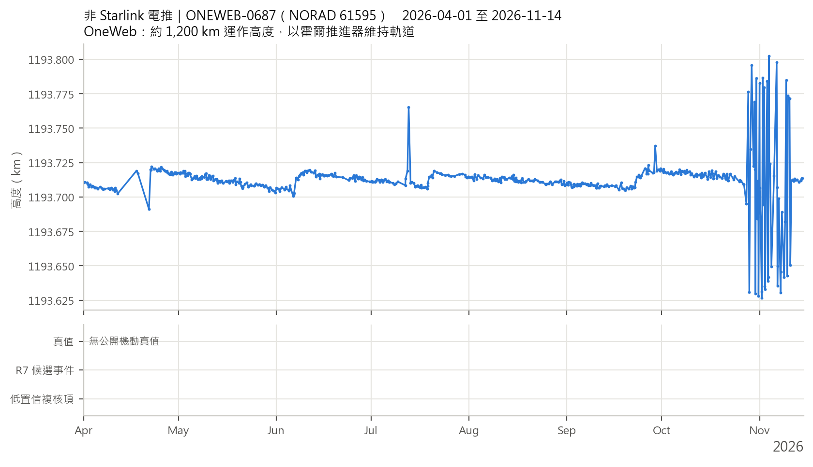

**這是電推維持機動的限制案例。** 圖中可看到數次約 10–15 m 的階梯狀抬升，可能是以霍爾推進器做的軌道維持，沒有真值可以確認。這顆衛星的 TLE 逐筆雜訊（σ）約 1.4 m，5σ 統計下限約 7 m、20σ 高顯著下限約 28 m；10–15 m 之抬升超過 5σ、低於 20σ，且遠低於 L1 規則門檻 0.4 km，R7 沒有標記。11 月的鋸齒狀起伏約 ±80 m，原因未查證；R7 未列為事件。

### 8.3　小結

1. **大幅變化**（數公里至數百公里，包括化學推進的升降軌與電推的入軌爬升）：三類衛星的案例皆產生候選事件，並依規則列為 E3；一般衛星與 Starlink 的案例並經真值確認。
2. **微小變化（修約後為 2 公里量級）**：招標規範原列約 100 公尺以下（TBD），雙方於期末會議前，同意進行修約，並改為 2 公里量級機動。2 km 高於各星 5σ 統計下限，400 km 以上之衛星於太陽活動平靜時單次 2 km 即超過 L1 門檻；限制為低軌 Starlink 之 1–5 km 事件召回 0.091（期末報告表 11 ②#7），以及太陽活躍期 400 km 門檻最多約 3.6 km（期末報告 10.5 節）。數十公尺的例行維持（SWOT、OneWeb）低於 L1 單步門檻（0.4–2 km），不會成為候選事件。
3. **真值**：一般衛星與 Starlink 有真值可量化召回；非 Starlink 電推衛星沒有公開真值，結果只能作為候選事件，須人工複核。

## 九、維護與擴充所需之硬體、軟體、網路與儲存空間（開發單位補充自提）

> **問：**未來TASA若想要維護或拓展此系統，建議的硬體、軟體、網路、儲存空間為何？假設三種情況：1. 只完整下載每天數次更新之 TLE；2. 除了 1，也要下載每日三次完整的 Starlink MEME；3. 除了 1 與 2，也要儲存與處理每日 1 至數筆 NOTSO 信件內容。（開發單位補充自提）

**答：**

本題為開發單位補充自提，不在貴中心提問之列。以下為開發團隊依現行系統實測量估算之建議，不是採購規格。三種情況逐級累加：情況 2 包含情況 1，情況 3 包含情況 1 與 2。

### 9.1　估算依據（實測量，2026-11）

| 項目 | 實測值 | 說明 |
|---|---|---|
| TLE 每日新增筆數 | 每日約 3–10 萬筆（2026-11-01 至 20 日平均約 8.3 萬筆），涵蓋約 2.9 萬個物件 | 現行為每日排程下載，並回頭比對近 30 天補發 |
| 現行本機資料庫 | 18.2 GiB（1971 年起全編目 TLE 歷史，三張 TLE 表共約 1.1 億筆） | 線上輕量資料庫約 0.2 GB |
| 資料庫成長 | 約 15 GB／年（估計：每日新增筆數 × 三張表 × 每筆約 170 位元組） | 估計值，未含索引重建之暫存空間 |
| R7 單星計算 | 1 顆衛星、1 年期間約 55 秒（含 NRLMSIS 阻力殘差） | 本機單一程序實測 |
| Starlink MEME 單檔 | 約 2.0 MB（72 小時、每分鐘一筆，含共變異數；gzip 壓縮後約 0.85 MB） | 實際檔案量測 |
| Starlink 在軌數 | 9,504 顆（近一週有 TLE 者） | 每次發布約 9,500 個檔案 |
| MEME 每日量 | 每日 3 次 × 約 9,500 檔 ≈ 2.85 萬檔；原始約 58 GB，壓縮後約 24 GB | 全數保存時，壓縮後約 8.8 TB／年 |
| NOTSO 通知 | 每日 1 至數封電子郵件，每封數 KB 至數百 KB（含附件） | 每年小於 1 GB |

### 9.2　三種情況之建議配置

| 項目 | 情況 1：只下載 TLE | 情況 2：TLE ＋每日三次完整 Starlink MEME | 情況 3：情況 2 ＋每日 NOTSO 信件 |
|---|---|---|---|
| **CPU** | 8 核心 | 16 核心以上（MEME 解析與模型定期重新訓練） | 同情況 2 |
| **記憶體** | 32 GB | 64 GB | 64 GB |
| **GPU** | 不需要（模型皆為傳統機器學習，以 CPU 執行） | 不需要 | 不需要；只有在本機部署大型語言模型做信件摘要時，才需約 24 GB 顯示記憶體之 GPU |
| **工作儲存（SSD）** | 1 TB | 4 TB（MEME 原始檔滾動保存 14 天約 0.35 TB，加上萃取後之機動標記與快照） | 4 TB，另設加密分割區存放 NOTSO |
| **備份或封存** | 2 TB（資料庫每日備份，保留多版） | 不封存原始 MEME 時 8 TB；全數封存原始 MEME 時每年約 9 TB，建議以 NAS 或物件儲存 | 同情況 2；NOTSO 另依機關資料保存規定加密備份 |
| **網路** | 50–100 Mbps；需可連 Space-Track、CelesTrak 與線上平台 | 300 Mbps 以上（每次約 20 GB，300 Mbps 約需 9 分鐘、100 Mbps 約 27 分鐘） | 同情況 2，另需連線機關郵件伺服器 |
| **5 年儲存量** | 約 0.1 TB | 不封存原始檔約 0.5 TB；全數封存約 45 TB | 同情況 2，NOTSO 增加不到 5 GB |

### 9.3　軟體

| 類別 | 情況 1 | 情況 2 增加 | 情況 3 增加 |
|---|---|---|---|
| 作業系統 | Windows 11 或 Linux | — | 郵件收取服務建議另設虛擬機 |
| 執行環境 | Python 3.13；DuckDB 1.1 以上 | — | — |
| 主要套件 | 依交付程式包 requirements：pandas、numpy、pyarrow、sgp4／skyfield、pymsis（NRLMSIS）、scipy、statsmodels；scikit-learn 1.8.0 與 lightgbm 4.6.0 須與模型檔版本一致；介面 Streamlit 1.54、報表 API FastAPI | MEME 下載與解析程式（`starlink_ephemeris/`）、機動標記建置程式（`build_meme_labels.py`） | 郵件收取（IMAP 或 Microsoft Graph API）、NOTSO 解析程式（待開發）；選用：本機大型語言模型執行環境 |
| 排程 | 每日資料管線（Windows 工作排程器或 cron） | 每日三次 MEME 下載；每月以新真值重新訓練並驗證 | 收信即觸發解析，並對通知中的衛星自動執行 R7 |
| 帳號 | Space-Track 帳號 | — | 專用郵件帳號 |

### 9.4　各情況之注意事項

**情況 1**：

- Space-Track 有查詢頻率規範（其 API 說明要求全編目 GP 查詢每小時不超過一次）。現行程式為每日排程執行，呼叫之間間隔 10 秒；改為每日多次下載時，排程間隔須符合此規範。
- pymsis 在 ARM64 Windows 上需自行編譯；x86-64 或 Linux 可直接安裝。

**情況 2**：

- 主要負擔是 MEME 的下載量與儲存量。建議只保存萃取結果，原始檔滾動保留 14 天：萃取結果包括每檔第一個狀態向量與 MEME 機動轉換。
- 以現行 283 顆約 4 個月之機動轉換檔約 210 MB 推估，萃取結果全星系每年約 20 GB。
- SpaceX 公開星曆網站的下載頻率限制未公開，大量下載前宜先小規模測試。

**情況 3**：

- **不可公開**：NOTSO 為非機密之通報產品，但其內容不宜放入現行公開之線上資料集與 HuggingFace Space。情況 3 須改為機關內部部署，或至少將 NOTSO 資料與公開服務分離。
- **處理方式**：建議以規則解析 NOTSO 的衛星編號、時間與事件類型，再與 R7 候選事件比對，不需 GPU。
- **大型語言模型**：若要以大型語言模型摘要，信件內容不宜送往外部雲端服務。應採本機部署，或先取得機關同意。
- **資安**：須設定存取權限、傳輸加密、稽核紀錄與資料保存期限。

謝謝。

---

**附註：資料與程式**

- 案例圖程式：`docs/gen_tasa_tender_case_figs.py`；圖與數值：`docs/tasa_reply_20261125/`（`cases_summary.json`）。
- 真值：IDS 營運方點火紀錄 `ids_truth_set/ids_truth.csv`；MEME 機動轉換 `data/meme_truth/transitions_full_20260918.csv`，相隔 48 小時內合併為機動段。
- 本機資料庫對多數物件只保留 2026 年 4 月以後的 TLE，電推案例因此選在此期間內入軌爬升的 Kuiper 衛星。
- 電力推進出處：
  - Busek Co.（2023 年 2 月）：BHT-350 霍爾推進器於 OneWeb 衛星在軌啟用。https://www.satellitetoday.com/technology/2023/02/07/busek-confirms-successful-in-space-debut-of-bht-350-thrusters
  - Amazon（2023 年 11 月）：Project Kuiper 衛星推進系統（自製霍爾推進器）在軌測試。https://www.aboutamazon.com/news/innovation-at-amazon/amazon-project-kuiper-satellite-propulsion-system-november-2023-update
