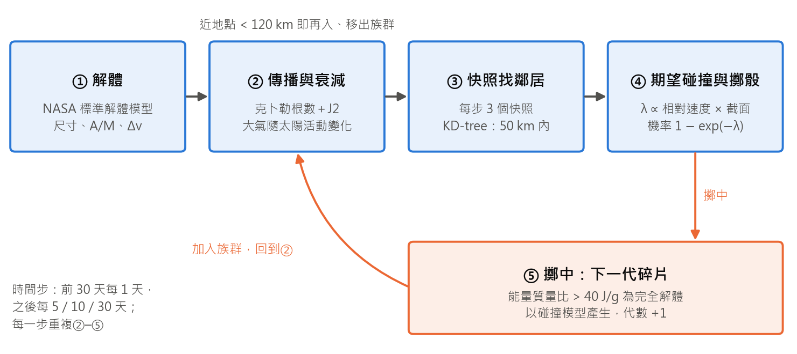
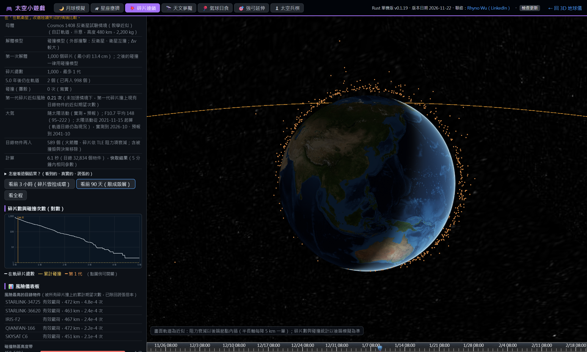
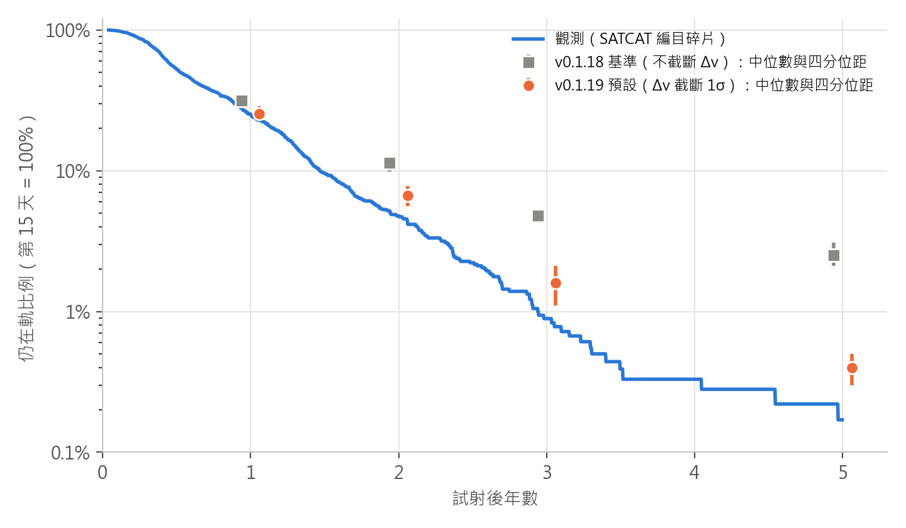
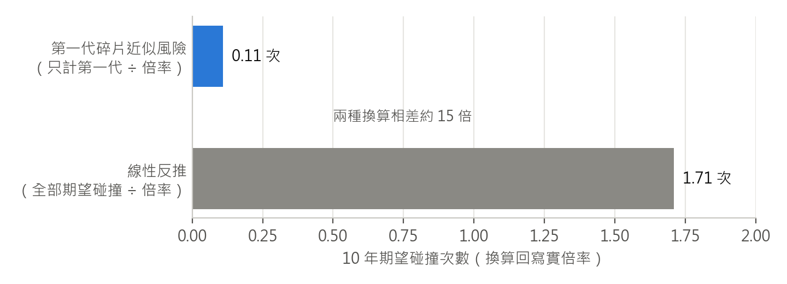

# 延伸篇 S1　碎片連鎖：一次解體會引發什麼

> **延伸模擬篇說明**：本篇不屬於送審版（v1.3），也不是國家太空中心委託研究的成果。內容取自本專案 Rust 單機版「碎片連鎖」教學模型（v0.1.19）與其驗證報告；除主案例中與 CelesTrak 觀測對照的衰減曲線外，數值一律為**教學模型示意**，不是碰撞預報，也不是政策評估。

## 章前導讀

2021 年 11 月 15 日，俄羅斯以直升式反衛星飛彈擊毀已失效的 Cosmos 1408。第 19 章提過那一天的經過：美國太空司令部初步公布逾 1,500 塊可追蹤碎片，太空站組員進入太空船避難。¹

之後的事比較少人追。CelesTrak 的衛星目錄（SATCAT）最後為這次試射編目了 1,805 件碎片。第 15 天開始有碎片再入；第 192 天，剩下一半；一年後剩四分之一；到 2026 年 11 月 21 日下載資料時，只剩 3 件還在軌道上。²

480 公里的大氣替人類收拾了這次試射。換一個高度、換一種解體方式、換一段太陽活動，結果會一樣嗎？如果碎片在消失之前撞上別的物件，會不會再生出下一代碎片？

這正是 Kessler 與 Cour-Palais 在 1978 年提出的問題：軌道上的物件多到一定程度，碰撞產生的碎片會引發更多碰撞。³ 本篇用一個可以操作的教學模型回答其中一小部分：一次解體之後，碎片怎麼散開、多快消失，以及在消失之前撞上其他物件的機會有多大。模型能回答多少，取決於它驗證過多少；本篇會把驗證過與沒驗證過的部分分開寫。

## 學習目標

- 理解 NASA 標準解體模型中，爆炸與碰撞兩種模型的差別與適用情境。
- 理解碰撞率估計的基本概念：粒子箱（氣體動力論）與 KD-tree 快照。
- 以 Cosmos 1408 主案例認識教學模型的驗證方式：對照什麼、對得上什麼、對不上什麼。
- 區分「第一代碎片近似風險」與「線性反推」，理解碰撞誇張倍率為何會誤導讀者。
- 理解緩解決策卡的比較為何需要共同隨機數與固定解體時刻，以及它能支持什麼程度的結論。

## 本篇的證據定位

送審版各章的主案例以證據等級標示來源強度，例如「A｜已獨立重算」。模擬篇沒有外部真值可以逐筆核對，若沿用同一套標示，讀者會把模擬結果讀成預報。本篇因此另設一級：

| 標示 | 意義 | 本篇用在哪裡 |
|---|---|---|
| **M｜教學模型（示意）** | 模型輸出，沒有外部真值；只能說明機制與方向 | 碰撞次數、期望碰撞數、決策卡效果 |
| **M＋｜教學模型，部分已對照觀測** | 模型的某一項輸出已與公開觀測比對，比對範圍明確寫出 | Cosmos 1408 碎片衰減曲線 |

即使是 M＋，對得上的也只是比對過的那一項。Cosmos 1408 驗證的是衰減，不是碰撞率。

## 模擬怎麼運作

### 從一次解體開始

使用者選一顆衛星，或一個歷史情境，讓它解體。模型依 NASA 標準解體模型（Johnson 等人，2001）產生碎片的尺寸、面積質量比（A/M）與速度增量（Δv）。⁴ ESA 的 DELTA 長期演化模型，解體模組也以同一模型為基礎。⁵

這個模型分成兩種，物理來源不同，不能混用：

| 項目 | 爆炸模型 | 碰撞模型 |
|---|---|---|
| 物理來源 | 內部能量：電池破裂、殘餘推進劑爆炸 | 外部撞擊：反衛星飛彈、衛星互撞 |
| 碎片數 | N = 6·Lc^−1.6，與母體質量無關 | N = 0.1·M^0.75·Lc^−1.71，M 為參考質量 |
| Δv 分布均值 | log₁₀Δv = 0.2χ + 1.85（較小） | log₁₀Δv = 0.9χ + 2.9（較大，碎片散得較開） |
| 遊戲中的用途 | 只用在第一次解體 | 第一次解體與所有後續碰撞 |
| 適用情境 | 失效衛星或火箭上節自爆 | 風雲一號 C、Cosmos 1408 試射；Iridium–Cosmos 互撞 |

表中 Lc 為特徵長度下限，χ = log₁₀(A/M)。碎片速度等於母體速度加上 Δv，換算成軌道根數後加入模擬。⁵

### 傳播與大氣

每個碎片以克卜勒根數加上 J2 長期項傳播，阻力衰減採 King-Hele 近似。大氣密度不是固定值：每個時間步依當時的太陽輻射指數 F10.7 與等效地磁指數 Ap，從 NRLMSISE-00 的全球平均密度表內插。⁶ 第 5 章說明過，太陽活動會讓同一高度的密度相差一個數量級以上；模型中，500 公里處 F10.7 = 250 時的密度約是 70 時的 25 倍。⁵

F10.7 與 Ap 序列取自 CelesTrak 的實測與預報（實測至 2026 年 10 月，預報至 2041 年 10 月），更晚則以 11 年週期外推。外推段只是情境假設，不是預報。⁵

### 碰撞率：粒子箱加快照

模型每個時間步取 3 個隨機快照，把所有在軌物件的位置放進 KD-tree，找出每個碎片 50 公里內的鄰居。每一對的期望碰撞數為：

> λ = v_rel ÷ (4d/3) × (R₁+R₂)⁵ ÷ d⁵ × (dt ÷ 3)

v_rel ÷ (4d/3) 是穿過半徑 d 球體的頻率，(R₁+R₂)⁵/d⁵ 把通量換算成兩物件合併半徑的截面。這是 Kessler 與 Cour-Palais 以氣體動力論估計碰撞頻率的概念，差別在於用實際軌道位置的快照取代均勻空間密度。³ 每一對以機率 1 − e^−λ 擲骰；擲中時依能量質量比判定是否完全解體（門檻 40 J/g），並以碰撞模型產生下一代碎片。⁵

圖 S1-1　碎片連鎖模型的計算流程。每個時間步重複②到⑤：碎片傳播並因大氣阻力下降，近地點低於 120 公里即移出；快照找出相鄰配對、累加期望碰撞並擲骰；擲中時以碰撞模型產生下一代碎片，加入族群繼續演化。來源：依碎片連鎖架構說明繪製。⁵

目錄物件的尺寸與質量依類別取代表值（例如有效載荷半徑 1.5 公尺、500 公斤），資料庫沒有實際規格。這是本篇所有碰撞數字都只能當示意的第一個原因。⁵

畫面 S1-1　碎片連鎖的 Cosmos 1408 情境（碰撞模型、1,000 個碎片、寫實 ×1、5 年、亂數種子 7）。右側是解體後約 46 天的 3D 畫面，碎片已沿 480 公里的軌道散成殼層；左側是結果摘要、在軌碎片數曲線與風險儀表板。這一次模擬 5 年後剩 2 個碎片，第一代碎片近似風險 0.21 次。這是單次模擬，不是主案例的編目等效設定（1,647 個碎片、30 個種子）。截圖：本專案 Rust 單機版（v0.1.19 工作版），2026-11-22。

## 主案例：Cosmos 1408 碎片衰減驗證

> **證據等級：M＋｜教學模型，衰減曲線已對照觀測；碰撞率未驗證**
> **資料來源**：模擬端為碎片連鎖 v0.1.19 後端，30 個亂數種子；觀測端為 CelesTrak SATCAT 國際編號 1982-092 的 1,805 件試射碎片（類型 DEB、NORAD ≥ 49000，2026-11-21 下載）。² ⁵ ⁷
> **真值依據**：SATCAT 的編目與再入日期，不是本專案自行計算。
> **主要假設**：母體為 480 公里、傾角 82.6° 的單一圓軌道，質量 2,200 公斤；碰撞模型；只計約 10 公分以上的第一代碎片（編目等效）；大氣從 2021-11-15 起依實測 F10.7 與等效 Ap 變化。
> **限制**：Δv 截斷 1σ 以同一事件校準，誤差是擬合誤差，不是預測誤差；只驗證一個事件、一個高度；碰撞率沒有驗證。
> **何時不應使用本結果**：推論其他高度（例如風雲一號 C 的 865 公里）或其他解體方式的碎片壽命；把一年以上的存活數或期望碰撞數當成寫實估計。

### 案例定位

這個案例回答的是：「教學模型算出來的碎片消失速度，跟真實事件對得上嗎？」它是整個碎片連鎖模型唯一有外部觀測可以比對的部分。比對方式是存活比例：第 t 年仍在軌的第一代碎片，除以第 15 天仍在軌者。分母取第 15 天，是為了扣掉出生後很快再入、來不及編目的碎片。²

觀測只含可追蹤的碎片，大約 10 公分以上。依碰撞模型，2,200 公斤的母體產生 10 公分以上的碎片約 1,647 個，所以模擬以 1,647 個碎片進行，只比較 10 公分以上者。⁵

### 第一版對不上

最早的版本（v0.1.15，靜態大氣、只跑 5 個種子）第一年對得上，之後越差越多：第 3 年仍有 8.2% 在軌，觀測只剩 0.9%。改用爆炸模型更糟，第 1 年 43.9%、第 5 年 13.8%，對照觀測的 25.3% 與 0.2%。這個結果直接說明，動能撞擊不能用爆炸模型設定。²

追查原因時發現，模擬中活過 3 年的碎片，出生遠地點中位數為 1,637 公里；而本機資料庫中 54 件長壽真實碎片，首筆 TLE 的遠地點最高只有 1,192 公里。排除遠地點超過 1,200 公里的模擬碎片後，第 3 年存活降為 3.1%，差距縮小約三分之二。² 這只是定位偏差來源的測試，不是修正：長尾來自標準解體模型 Δv 分布上尾的碎片，被推上了真實事件中很少出現的高遠地點。

### 逐項排除

v0.1.19 用 30 個種子，把可能的偏差來源逐一隔離：⁵

| 仍在軌比例 | 觀測 | v0.1.18 基準 | 編目等效（不截斷） | v0.1.19 預設（截斷 1σ） |
|---|---|---|---|---|
| 第 1 年 | 25.3% | 31.4% | 30.8% | **25.3%** |
| 第 2 年 | 4.8% | 11.4% | 11.5% | **6.7%** |
| 第 3 年 | 0.9% | 4.8% | 5.0% | **1.6%** |
| 第 5 年 | 0.2% | 2.5% | 2.6% | **0.4%** |
| 剩一半的天數 | 192 | 185 | 198 | **170** |
| 對數誤差 | — | 0.574 | 0.577 | **0.179** |

表中為 30 個種子的中位數。對數誤差是第 1、2、3、5 年 |log₁₀(模擬 ÷ 觀測)| 的平均；用對數，是因為觀測值從 25.3% 跨到 0.2%，絕對誤差會被第一年主導。⁵

- **尺寸定義不是主因。** 只計 10 公分以上的碎片，第 1 年從 31.4% 變成 30.8%，幾乎不變。
- **大氣不是主因。** 密度整體 ±15%（涵蓋全球平均與沿軌跡取樣的差異）讓第 3 年落在 1.1%–2.3%，小於 Δv 截斷與否的差距（1.6% 對 5.0%）。
- **Δv 長尾是主因。** 截斷點從不截斷、2σ、1.5σ 到 1σ，對數誤差依序為 0.577、0.491、0.414、0.179。

另有一個意外收穫：v0.1.18 以 30 個種子重跑，第 1 年中位數 31.4%，高於先前以 5 個種子報告的 28.6%。5 個種子的表格偏樂觀。⁵

圖 S1-2　Cosmos 1408 試射碎片的存活曲線。藍線為 SATCAT 編目碎片的觀測值（第 15 天 = 100%），點為碎片連鎖模擬 30 個種子的中位數，短線為四分位距。縱軸為對數。來源：觀測取自 CelesTrak SATCAT（2026-11-21 下載）；模擬值取自碎片連鎖驗證報告 v0.1.19 表 3.1。² ⁵

### 截斷是校準，不是發現

Δv 截斷的作法是：碰撞模型抽到的 Δv 若落在分布均值加 1 個標準差以上，就重抽，最多 50 次。約 16% 原本落在上尾的碎片因此改抽較小的 Δv。⁵

這等於假設真實撞擊的極端 Δv 碎片比標準解體模型少。可能的原因有兩個，都屬推測、尚未查證：攔截器由下往上撞擊，碎片的 Δv 方向集中而不等向；或標準解體模型的 Δv 分布對大型母體的撞擊不完全適用。⁵

更重要的是，這個參數用 Cosmos 1408 校準，又用 Cosmos 1408 評估。0.179 是擬合誤差，不能說成模型的預測誤差。截斷 1σ 之後，前幾個月反而偏快：剩一半的天數為 170 天，bootstrap 95% 區間 165–180 天沒有涵蓋觀測的 192 天。一個參數同時修正前期與後期，有它的限度。⁵

風雲一號 C（865 公里）與 Iridium–Cosmos（約 790 公里）可以作為獨立驗證，但這兩次事件的碎片壽命以數十年計，至今的衰減觀測還不足以區分模型。⁵

## 碰撞誇張倍率：讓連鎖看得見，也讓數字變大

寫實設定下，一次解體在幾年內幾乎看不到二次碰撞。Cosmos 1408 驗證的 10 次早期模擬中，只有 1 次發生碰撞。² 為了讓玩家看到連鎖，遊戲提供「碰撞誇張倍率」：把碰撞截面放大，例如 ×1,000。它不改變軌道演化與衰減，也不是把時間加速。⁵

放大之後，該怎麼把結果換算回現實？模型提供兩個數字：

| 指標 | 計算方式 | 偏差方向 |
|---|---|---|
| 第一代碎片近似風險 | 只計第一代碎片與目錄物件之間的期望碰撞，再除以倍率 | 略偏低：誇張模式下第一代碎片也會被撞毀、提早退出 |
| 線性反推 | 全部期望碰撞除以倍率 | 偏高：多出來的後代碎片也被算進去 |

差距有多大？Envisat 爆成 300 個碎片、倍率 ×1,000 時，線性反推為 1.71 次，第一代寫實值為 0.11 次，相差約 15 倍。⁵ 把誇張模式的連鎖直接除以倍率，會把一張「看得見連鎖」的教學圖，變成一個嚇人的預報數字。

圖 S1-3　同一次模擬的兩種換算。Envisat 爆成 300 個碎片、碰撞誇張倍率 ×1,000 時，換算回寫實倍率的 10 年期望碰撞：只計第一代碎片為 0.11 次，把全部期望碰撞除以倍率為 1.71 次。來源：碎片連鎖架構說明第 6 節。⁵

寫實倍率（×1）下兩者相同。Envisat 爆成 1,000 個碎片，10 年的期望碰撞約 0.42 次。⁵ 這個數字仍是教學模型示意：目錄物件的尺寸取代表值，有效載荷預設一直維持軌道，碰撞率也沒有驗證。

**誇張模式下的比較是混沌的。** 同樣是 Envisat、1,000 個碎片、×1,000、10 年，只移除火箭體的累計期望碰撞是對照組的 139%，只清理碎片是 116%，看起來比不做還糟。⁵ 這不是決策有害，而是一次擲骰不同，就讓整條連鎖改變。要比較決策，必須回到寫實倍率。

## 緩解決策：能減少多少

玩家可以在解體後打出三張「緩解決策卡」：清理風險最高的碎片、移除鄰近軌道面的廢棄火箭體、讓運作中的衛星對 10 公分以上碎片避碰。三張卡都是教學簡化。例如避碰依能力分成三級固定係數（期望碰撞乘上 0.5、0.1 或 0.02），實際效果其實取決於預警能力、燃料、協調與虛警率；小於 10 公分的碎片追蹤不到，也躲不了。⁵

### 比較方法

第一次校準時，「只移除火箭體」的累計期望碰撞中位數竟是對照組的 132%。移除物件不可能增加碰撞，追查後有兩個原因：⁵

1. **解體時刻不同步。** 對照組與決策組相隔數分鐘計算，Envisat 已移到軌道上不同位置，共同隨機數失效。
2. **後代碎片的雜訊。** 寫實模式偶爾擲中一次碰撞，後代碎片讓累計期望碰撞跳升，例如從 0.43 升到 0.57。

改成共用解體時刻、只計第一代碎片近似風險之後，各組的範圍縮到約 ±1%。這是共同隨機數的典型用法：同種子、同時刻，讓兩組的差異只來自決策本身。

### 結果

Envisat、1,000 個碎片、爆炸模型、寫實 ×1、10 年，5 個種子：⁵

| 組合（點數） | 第一代近似風險相對對照組（中位數） | 範圍 |
|---|---|---|
| 清理第 30 天＋標準避碰（3） | 75.8% | 73.2%–76.0% |
| 進階避碰＋移除火箭體（3） | 79.8% | 78.4%–81.2% |
| 進階避碰（2） | 80.5% | 78.8%–81.7% |
| 只標準避碰（1） | 82.1% | 80.5%–83.2% |
| 只清理（2） | 91.0% | 90.2%–91.7% |
| 只移除火箭體（1） | 99.5% | 99.3%–99.6% |

對照組的 10 年第一代近似風險為 0.419–0.452 次。用滿 3 點預算，最多只減少兩成多。方向上呼應 LEGEND 與 DELTA 等長期演化研究「碎片一旦產生就難以收回」的結論；⁸ ⁹ 但這只是 5 個種子、單一母體、抽象決策模型的教學判定，不是統計結論。

「只移除火箭體」幾乎沒有效果。這張卡只移除與母體軌道面相近、高度相距 100 公里內的火箭體；⁵效果這麼小，推論是因為符合條件的火箭體很少，而碎片的風險分散在與整個目錄的配對上。本篇沒有拆解驗證這個推論；換一個母體或換一套篩選條件，結果可能不同。

## 太陽活動：同一次解體，三種結局

模型能檢查的另一件事是方向是否合理。物理上，太陽活動越強，大氣越密，碎片衰減越快，存活比例與碰撞風險都應該較低。以 Cosmos 1408 情境、固定 F10.7 = 70、120、200 各跑 30 個種子：⁵

| 中位數 | 低（70） | 中（120） | 高（200） |
|---|---|---|---|
| 第 1 年存活 | 55.6% | 29.2% | 7.6% |
| 5 年後仍在軌 | 172 件 | 20 件 | 0 件 |
| 第一代碎片近似風險 | 0.580 | 0.210 | 0.066 |

逐一比對每個種子，30 個種子在三項指標上都滿足「低 ≥ 中 ≥ 高」，沒有一次違反。⁵ 同一次試射，若發生在太陽極小期，第一年後仍有一半以上的碎片在軌；發生在極大期，只剩不到一成。Cosmos 1408 試射後五年（2021-11 至 2026-10）的 F10.7 平均為 151，高於 1996–2019 年的平均 108。² 這可能是它的碎片消失得快的背景之一；這一點是推論，本篇沒有用同一事件的不同太陽活動情境做觀測比對。

## 國安意涵

本篇的啟示是：

> **教學模型能說明機制與方向，不能取代預報；能對上一條曲線，也不代表對上所有曲線。**

對國安判讀來說，有三件事值得記下：

1. **反衛星試射的代價隨高度改變。** Cosmos 1408 在 480 公里，碎片數年內幾乎清空；同樣的模型拿到 865 公里的風雲一號 C，目前沒有觀測可以驗證。不能把 Cosmos 1408 的「很快就乾淨了」推到其他高度。
2. **數字的換算方式會改變結論。** 誇張倍率下的線性反推比第一代寫實值高約 15 倍。引用模擬結果時，要問清楚是哪一種換算。
3. **事後清理效果有限。** 在本模型中，即使用滿預算，也只能讓第一代碎片近似風險減少兩成多。這呼應「預防比清除有效」的文獻結論，但不是作業能力評估。

模擬結果描述的是模型在特定假設下的行為。它不等於某國試射的實際後果，更不能直接用來評估某國的意圖或能力。

## 與本書其他章的關係

| 本書章節 | 關係 |
|---|---|
| 第 1 章 | 風雲一號 C 反衛星試驗；本篇以同一事件說明尚未驗證的高度區間 |
| 第 5 章 | 大氣阻力與太陽活動；本篇的大氣模型隨 F10.7 與 Ap 變化 |
| 第 11 章 | NRLMSIS 作為物理證人；本篇的密度表由 NRLMSISE-00 產生 |
| 第 19 章 | Iridium–Cosmos 碰撞、Cosmos 1408 碎片雲與 Pc；本篇從「接近一次」延伸到「一整個碎片族群」 |

## 已知限制

1. 目錄物件的尺寸與質量依類別取代表值，沒有實際規格。
2. 有效載荷預設不衰減，也不計任務後主動離軌與新衛星補充；10–50 年的長期風險可能偏高。
3. 只計「碎片 × 任何物件」，不計目錄物件之間的碰撞。
4. 碰撞以每步 3 個快照統計估計，不是逐一求解最接近時刻，統計雜訊較大。
5. 大氣為全球平均（與沿軌跡取樣相差 ±16% 以內）；Ap 為月尺度等效值，不重現單次磁暴後數天內的急遽衰減（例如 2022 年 2 月 Starlink 批次再入）。
6. 碎片總數上限 3 萬個；誇張倍率高時很快達到上限，之後的連鎖會被低估。
7. 歷史情境以單一圓軌道母體近似，不是事件重演。例如 Iridium 33 與 Cosmos 2251 實際分屬不同軌道面。
8. 決策卡是抽象模型，不代表實際作業能力。
9. Δv 截斷只以 Cosmos 1408 校準，沒有獨立事件驗證。
10. 碰撞率與爆炸模型的衰減都沒有驗證。

以上限制取自模型的架構說明第 8 節與驗證報告第 7 節。⁵

## 本章檢核清單

- [ ] 能說明爆炸模型與碰撞模型的物理來源，以及為何動能撞擊不能用爆炸模型。
- [ ] 能說明粒子箱碰撞率的概念，以及快照統計的限制。
- [ ] 能說明 Cosmos 1408 驗證比對了什麼（衰減曲線）、沒比對什麼（碰撞率）。
- [ ] 能說明 Δv 截斷為何是校準而非發現，以及擬合誤差與預測誤差的差別。
- [ ] 能區分第一代碎片近似風險與線性反推，並說明誇張倍率下兩者為何差約 15 倍。
- [ ] 能說明決策比較為何需要共用解體時刻與共同隨機數。
- [ ] 能區分「模型在特定假設下的行為」與「真實事件的後果」：模擬結果不等於預報，更不等於對任何國家意圖或能力的評估。

## 本章外部事件來源

- NASA. (n.d.). *NASA Administrator Statement on Russian ASAT Test*. https://www.nasa.gov/news-release/nasa-administrator-statement-on-russian-asat-test/ （存取日期 2026-11-14；本章用於：俄羅斯反衛星試驗擊毀 Cosmos 1408（2021）；沿用第 19 章來源）
- Spaceflight Now. (2021, November 15). *U.S. officials: Space station at risk from 'reckless' Russian anti-satellite test*. https://spaceflightnow.com/2021/11/15/u-s-officials-space-station-at-risk-from-reckless-russian-anti-satellite-test/ （存取日期 2026-11-14；本章用於：俄羅斯反衛星試驗擊毀 Cosmos 1408（2021）；沿用第 19 章來源）

## 資料來源

1. 見第 19 章插敘「Cosmos 1408 的碎片雲」及本章外部事件來源。
2. 本專案（2026 年 11 月 21 日）。*碎片連鎖遊戲的衰減驗證：Cosmos 1408 反衛星試射碎片*（docs/book/sim_validation/cosmos1408/，含 CelesTrak SATCAT 1982-092 原始資料，2026-11-21 下載）。未出版內部資料。
3. Kessler, D. J., & Cour-Palais, B. G. (1978). Collision frequency of artificial satellites: The creation of a debris belt. *Journal of Geophysical Research*, 83(A6), 2637–2646. https://doi.org/10.1029/JA083iA06p02637
4. Johnson, N. L., Krisko, P. H., Liou, J.-C., & Anz-Meador, P. D. (2001). NASA's new breakup model of EVOLVE 4.0. *Advances in Space Research*, 28(9), 1377–1384. https://doi.org/10.1016/S0273-1177(01)00423-9
5. 本專案（2026 年 11 月 21 日）。*太空小遊戲「碎片連鎖」架構說明*與*碎片連鎖模擬驗證報告（v0.1.19）*（RUST_SatDashboard/docs/games_debris_architecture.md、games_debris_validation_report.md）。未出版內部資料。
6. Picone, J. M., Hedin, A. E., Drob, D. P., & Aikin, A. C. (2002). NRLMSISE-00 empirical model of the atmosphere: Statistical comparisons and scientific issues. *Journal of Geophysical Research: Space Physics*, 107(A12), 1468. https://doi.org/10.1029/2002JA009430
7. CelesTrak. *SATCAT records, INTDES 1982-092*. https://celestrak.org/satcat/records.php?INTDES=1982-092&FORMAT=CSV （存取日期 2026-11-21）
8. Liou, J.-C., & Johnson, N. L. (2006). Risks in space from orbiting debris. *Science*, 311(5759), 340–341. https://doi.org/10.1126/science.1121337
9. Bastida Virgili, B. (2016). DELTA (Debris Environment Long-Term Analysis). *6th International Conference on Astrodynamics Tools and Techniques (ICATT)*, Darmstadt. https://indico.esa.int/event/111/contributions/234/attachments/486/531/DELTA_paper.pdf
