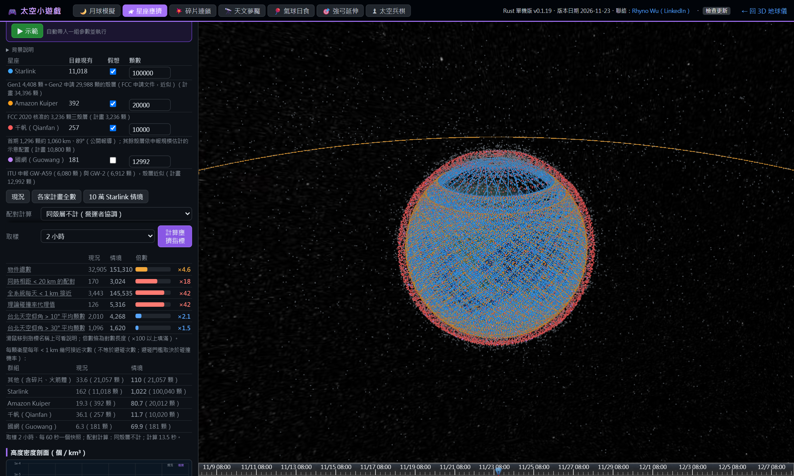
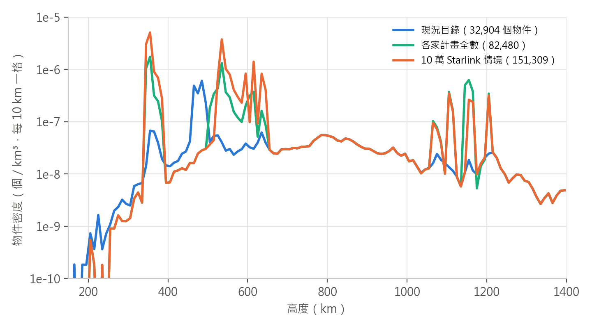
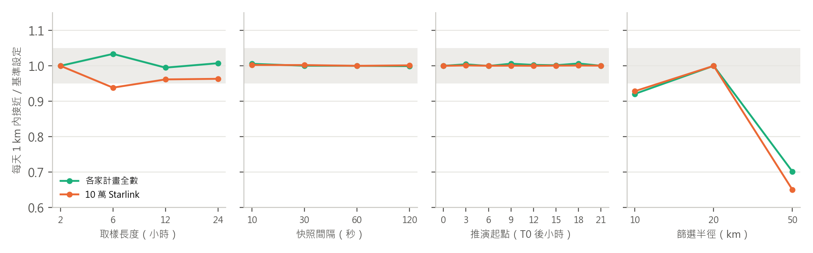
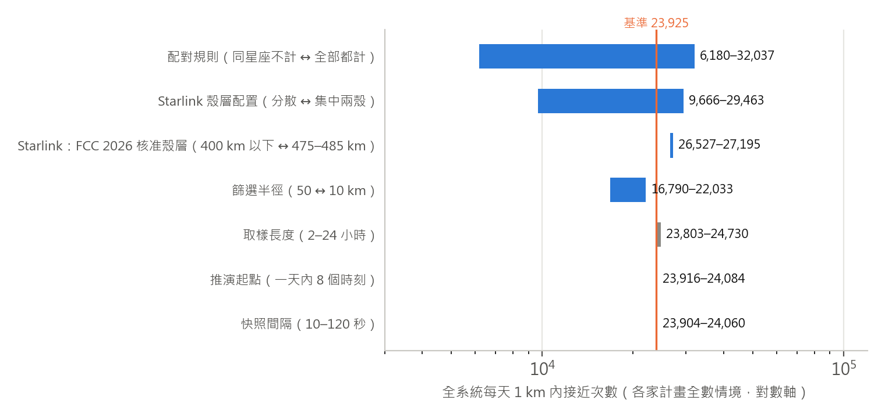
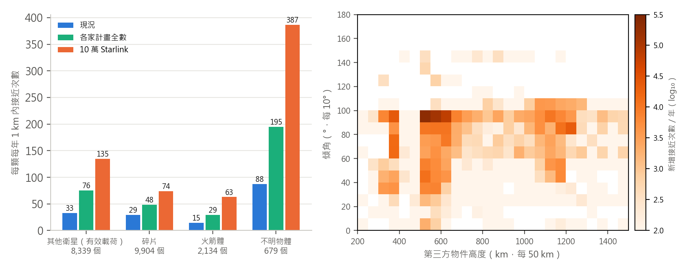
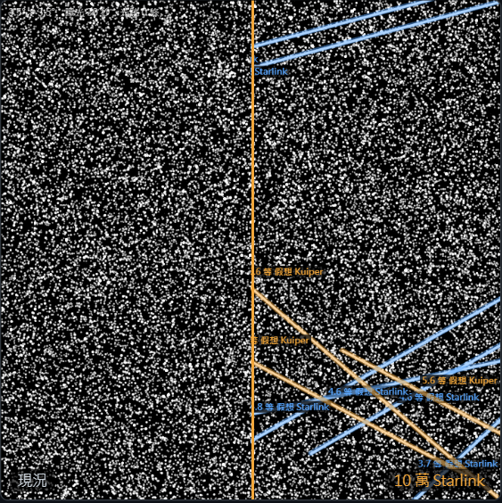
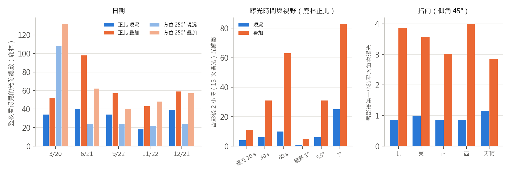

# 延伸篇 S2　巨型星座的外部成本：壅擠與光害

> **延伸模擬篇說明**：內容取自本專案 Rust 單機版「星座壅擠」與「天文夢魘」教學模型，以 2026 年 11 月 23 日的衛星目錄快照推演（結果快照編號 S2-20261123；目錄 32,904 個物件，最新 TLE 曆元 2026-11-22 23:01 UTC；壅擠推演起點固定為 2026-11-23 00:00 UTC）。數值一律為**教學模型示意**；假想星座的殼層是公開申請資料的近似，不是各公司的實際部署計畫。

## 章前導讀

2026 年 11 月 22 日傍晚 6 點 06 分，鹿林天文台的太陽沉到地平線下 13 度，天文昏影剛結束。一具視野 3.5 度的巡天望遠鏡指向正北、仰角 45 度，拍下一張 30 秒的影像。依本篇的模型，以當天的衛星目錄計算，只有 1 條被照亮的衛星光跡穿過這張影像。

當天的目錄全部保留，再加上 10 萬顆 Starlink、2 萬顆 Kuiper 與 1 萬顆千帆，同一張影像會出現 3 條光跡，其中 2 條是同一軌道面上前後相隨的假想 Starlink，約 3.6 等，比這片天空中多數肉眼可見的恆星還亮。¹

這個情境有現實基礎。McDowell（2020）回顧當時的低軌族群時指出，規劃約 12,000 顆的 Starlink 將主導 600 公里以下的低軌區域，並估算了不同緯度、季節與時刻可見的被照亮衛星數量。² 依 McDowell 網站 2026 年 11 月 22 日的統計，在軌的 Starlink 約 11,200 顆；各家申請文件中的數字更大。³

第 3 章與第 13 章看的是巨型星座做了什麼：怎麼部署、怎麼機動、整個星系有沒有異常。本篇看的是另一面：星座變大之後，其他人要付出什麼。成本有兩種，一是軌道上的接近與碰撞風險，二是地面望遠鏡影像上的光跡。兩者都不由星座營運者承擔，經濟學稱為外部成本。Lawrence 等人（2022）也指出，巨型星座正把真實成本外部化。⁴

本篇所稱的外部成本，指星座擴張後由營運者以外的主體承擔的交會風險與觀測干擾；承擔者包括其他衛星營運者、負責交會篩選的太空態勢感知單位，以及地面的天文與光學追蹤觀測。本篇只量化兩項代理指標：接近次數與光跡條數。它們沒有換算成金額，也沒有計入避碰機動的燃料與任務中斷；碎片的長期成本另見延伸篇 S1。

## 學習目標

- 理解假想星座如何從公開申請的殼層產生，以及「取代」真實衛星（壅擠）與「疊加」在目錄之上（光害）兩種比較方式。
- 理解接近頻率的一階估計：KD-tree 快照、氣體動力論的平均弦長，以及從 20 公里換算到 1 公里與 10 公尺的條件。
- 理解「營運者協調」與「殼層配置」兩個假設如何主導壅擠指標，以及為什麼第三方物件的接近次數受這兩個假設的影響小得多。
- 理解衛星光跡何時集中在昏影後、何時分散到整夜：照明幾何、地影與季節。
- 能辨認模型造成的現象，以及「看起來像錯誤、其實是星座結構」的現象，例如同一軌道面前後相隨的成對光跡。

## 本篇的證據定位

本篇沿用延伸篇 S1 的標示：

| 標示 | 意義 | 本篇用在哪裡 |
|---|---|---|
| **M｜教學模型（示意）** | 模型輸出，沒有外部真值；只能說明機制與方向 | 所有壅擠指標與光跡數 |

本篇有一項外部合理性檢查：現況 Starlink 每顆每年 1 公里內的幾何接近次數，對照 SpaceX 提交 FCC 的避碰機動次數。兩者的定義不同（見主案例一），只能檢查量級是否在同一範圍，不構成任何形式的驗證，所以本篇沒有 M＋。

## 兩種比較方式

兩個主案例使用同一套假想星座，但比較的問題不同，數字不能互相換算：

| 項目 | 主案例一：壅擠（取代） | 主案例二：光害（疊加） |
|---|---|---|
| 做法 | 選定的星座以假想衛星取代目錄中的真實衛星；其他物件沿用目錄 | 目錄全部保留，再加上假想衛星 |
| 回答的問題 | 若某星座的規模從現況變成計畫顆數，壅擠會怎麼變 | 在今天的天空上再多出這些衛星，光跡會增加多少 |
| 現況的對照 | 同一份目錄、不加假想衛星 | 同一份目錄、不加假想衛星 |
| 不可互比之處 | 取代時，目錄中已部署的真實 Starlink 會被移除（包括其實際殼層），所以部分高度的密度反而下降 | 疊加時，真實 Starlink 與假想 Starlink 同時存在，同一殼層會重複計入 |

## 假想星座怎麼來

兩個遊戲共用同一套假想星座。每個星座由幾個殼層組成，每個殼層是（高度、傾角、軌道面數、每面顆數），依 Walker 星座排列。⁵ 殼層取自程式內的設定；本次修訂逐項對照了可取得的原始文件：⁶

| 群組 | 程式設定 | 殼層 | 對照結果 | 判定 |
|---|---|---|---|---|
| Starlink Gen1 | 4,408 顆 | 550／53°、540／53.2°、570／70°、560／97.6°（兩層） | 與 FCC 21-48（2021-04-27）所列五殼逐項相符 | 已查核 |
| Starlink Gen2 | 29,988 顆 | 340–360 公里四層、525–535 公里三層、604／148°、614／115.7° | 與 FCC 22-91（2022-12-01）所列**申請**配置相符；FCC 當時只核准 525–535 公里三殼共 7,500 顆。FCC DA 26-36（2026-01-09）將核准數提高到 15,000 顆，殼層改為 340–365 公里與 475–485 公里，程式未更新 | 已查核（申請配置；已非核准配置） |
| Amazon Kuiper | 3,236 顆 | 590、610、630 公里三層 | 高度與各殼顆數與 FCC 20-102（2020-07-30）相符；三個傾角在命令內文找不到；610 公里殼的「42 面 × 36 顆」與所列 1,296 顆自相矛盾，程式取 36 × 36 | 高度與顆數已查核；傾角為近似值 |
| 千帆 | 10,800 顆 | 1,060–1,200 公里四層 | 首殼約 1,060 公里、89° 與追蹤資料相符；其餘三殼查不到申報參數；公開報導的總規劃為 15,000 顆以上，McDowell 列 16,000 顆，與程式的 10,800 顆不符 | 首殼近似值；其餘三殼為**未驗證示意配置** |
| 國網 | 12,992 顆 | 508–600 公里三層、1,145 公里四層 | 總數與 ITU 申報 GW-A59（6,080 顆）加 GW-2（6,912 顆）相符；508、590、600 公里三殼與各殼傾角查不到來源；國網與千帆的 ITU 原件都沒有取得 | 總數已查核；七個殼層皆為**未驗證示意配置** |

千帆與國網的殼層是本篇自行設定的未驗證示意配置，可信度遠低於已查核的 Starlink 與 Kuiper；凡結果涉及 1,000–1,300 公里或這兩個星座者，都應讀成「在示意配置下」的結果。

計畫顆數與在軌顆數不同。依 McDowell 網站 2026 年 11 月 22 日的統計，在軌的 Starlink 約 11,203 顆、Kuiper 392 顆、千帆 276 顆；國網一欄（McDowell 歸在「Xingwang」名下，此對應為本篇推論）約 283 顆。³ 本篇的「各家計畫全數」是假想情境，不是部署預測。

指定總數時，各殼層依比例縮放，保留軌道面數、調整每面顆數。假想衛星以圓軌道加 J2 長期項傳播，目錄物件以 SGP4 傳播。每個殼層另有固定的相位偏移，避免參數相近的殼層從同一起點排列（見「模型造成的現象」）。⁵

本篇比較三種情境：

| 情境 | 內容 | 物件總數 |
|---|---|---|
| 現況 | 2026-11-23 目錄快照 | 32,904 |
| 各家計畫全數 | 四個星座都換成計畫顆數 | 82,480 |
| 10 萬 Starlink | Starlink 10 萬、Kuiper 2 萬、千帆 1 萬；國網沿用目錄 | 151,309 |

## 主案例一：壅擠，接近次數怎麼隨星座規模變

> **證據等級：M｜教學模型（示意）**
> **資料來源**：星座壅擠後端，推演起點 2026-11-23 00:00 UTC，取樣 2 小時、每 60 秒一個快照（120 個），KD-tree 篩選半徑 20 公里；另做取樣長度、間隔、起點、篩選半徑與殼層配置的敏感度測試。¹ ⁵
> **主要假設**：接近頻率以氣體動力論估計，再依截面積與半徑平方成正比換算到 1 公里（幾何接近的代理門檻）與 10 公尺（兩顆大型衛星的合併半徑）；假想星座都是圓軌道、不機動。
> **限制**：不是逐一求最接近時刻；不計營運者的相位安排、避碰與軌道不確定性；10 公尺的數值只是理論碰撞率代理值。殼層相位偏移是示意設定。
> **何時不應使用本結果**：當成碰撞預報、推論特定衛星的實際避碰次數，或推論特定國家衛星的實際風險。

### 怎麼估計接近頻率

這個方法和延伸篇 S1 的碰撞率是同一個概念，定義如下：

| 符號 | 定義 |
|---|---|
| d | 篩選半徑。每個快照以 KD-tree 找出相距 d 以內的所有配對；本篇 d = 20 公里 |
| v_rel | 該配對在快照時刻的相對速度向量的大小（兩物件慣性座標速度相減），逐對計算，不用代表值 |
| 4d/3 | 半徑 d 的球的平均弦長：一條方向隨機、穿過球體的直線，在球內的平均長度 |
| r | 要換算的接近半徑（1 公里或 10 公尺） |

若配對的相對位置在半徑 d 的球內大致均勻分布，相對運動在穿越期間近似直線，則某一時刻球內的配對數 N 與「每秒進入球體的配對數」f 之間的關係是

\[
f = \sum_{\text{球內配對}} \frac{v_{\text{rel}}}{4d/3}
\]

這和「數密度 × 截面積 πd² × 相對速度」是同一件事：球內配對數為 n·(4/3)πd³，進入率為 n·πd²·v，兩者相除即 v/(4d/3)。進入率與截面積成正比，所以 1 公里內的接近頻率是 f × (1/20)²，10 公尺的是 f × (0.01/20)²。⁵

**數值例**：若平均每個快照有 1 對物件相距 20 公里以內、相對速度 10 km/s，則 f = 10 ÷ 26.7 ≈ 0.375 次／秒；乘上 (1/20)² 得每秒 9.4 × 10⁻⁴ 次，即每天約 81 次 1 公里內接近。

這個估計有三個適用條件：

1. **球內近似均勻**：d 必須遠小於殼層的厚度與結構尺度。d 太大時球體跨出殼層，換算會低估（見下方收斂測試，d = 50 公里時少約 30%）。
2. **相對運動近似直線**：以 10 km/s 穿越 20 公里約 2 秒，直線近似成立；同殼層同向飛行、相對速度極低的配對，對 f 的貢獻很小，但可能長時間停在球內。
3. **快照平均**：f 是 120 個快照的時間平均，不會重複計數同一次通過，也不會遺漏快速通過；但快照數不足時，結果會受取樣時刻影響。

這不是逐一求最接近時刻的交會篩選，也沒有納入速度分布的完整積分。

最大的不確定在於配對要不要全算。同一家營運者會協調自己星座內的相位，自家衛星彼此不太會真的接近。模型提供三種規則：全部都計、同殼層不計（介面預設）、同星座不計。

### 結果

介面預設（同殼層不計）下：¹

| 指標 | 現況 | 各家計畫全數 | 10 萬 Starlink |
|---|---|---|---|
| 物件總數 | 32,904 | 82,480 | 151,309 |
| 任一時刻相距 < 20 km 的配對（120 個快照平均） | 176 | 558 | 3,023 |
| 全系統每天 < 1 km 幾何接近 | 3,383 | 23,925 | 145,400 |
| 理論碰撞率代理值（10 m 合併半徑、無避碰，次／年；非預測） | 124 | 874 | 5,311 |
| 台北上空仰角 > 10° 的物件數 | 2,070 | 3,340 | 4,313 |
| 台北上空仰角 > 30° 的物件數 | 1,141 | 1,482 | 1,662 |

「理論碰撞率代理值」假設沒有任何人避碰、所有物件都是半徑合計 10 公尺的硬球，也不計軌道不確定性與失效衛星的處置。它只用來比較情境之間的倍數，不代表每年會發生的碰撞次數。台北上空的物件數不論是否被照亮，不等於肉眼看得到的衛星數。⁵

畫面 S2-1　星座壅擠的 10 萬 Starlink 情境（同殼層不計、取樣 2 小時）。右側是假想星座與目錄物件的 3D 畫面（藍：Starlink，橘：Kuiper，紅：千帆，灰：其他物件）；左側是指標、倍數與各群組每顆每年的接近次數。截圖使用同一份目錄快照，但介面以截圖當下為推演起點，數字與上表略有差異（上表推演起點固定）。截圖：本專案 Rust 單機版，2026-11-23。

圖 S2-1　三種情境的高度密度剖面（每 10 公里一格，物件數 ÷ 球殼體積），縱軸為對數。假想 Starlink 集中在 340–360 公里與 520–640 公里，千帆與國網（未驗證示意配置）集中在 1,050–1,210 公里；650–1,000 公里沿用目錄，三條線重合。來源：本篇推演。¹

### 結果穩不穩：收斂與敏感度

以「各家計畫全數、同殼層不計」與「10 萬 Starlink、同殼層不計」兩個情境，逐一改變取樣設定重跑，全系統每天 1 公里內接近次數相對基準設定（2 小時、60 秒、20 公里、起點 00:00）的比值：¹

| 測試項目 | 設定 | 各家計畫全數 | 10 萬 Starlink |
|---|---|---|---|
| 取樣長度 | 2、6、12、24 小時 | 0.99–1.03 | 0.94–1.00 |
| 快照間隔 | 10、30、60、120 秒 | 1.00–1.01 | 1.00 |
| 推演起點 | 一天內 8 個時刻（每 3 小時） | 1.00–1.01 | 1.00 |
| 篩選半徑 | 10、20、50 公里 | 0.70–1.00 | 0.65–1.00 |

圖 S2-2　收斂測試。灰帶為 ±5%。取樣長度、快照間隔與推演起點的影響都在 ±6% 以內；篩選半徑 50 公里時明顯偏低，10 公里時低約 8%。來源：本篇推演。¹

兩小時約為 1.1 到 1.3 圈（高度 1,200 到 340 公里），取樣延長到 24 小時，結果變化不到 6%；快照間隔與起點幾乎沒有影響。真正敏感的是篩選半徑：d = 50 公里時球體跨出殼層，「球內均勻」的條件不成立，換算到 1 公里會低估約 30%；d = 10 公里時球內配對只有 20 公里的四分之一，統計雜訊較大，結果低約 8%。本篇沿用 20 公里，並把「1 公里內接近次數」的不確定度讀成至少 ±10%。

現況的數值對起點較敏感：一天內 8 個起點的全系統每天 1 公里內接近為 3,383 到 3,673 次（±4%），因為現況的接近多來自少數物件的偶發通過。

### 協調假設與殼層配置決定倍數

三種配對規則的定義：

| 規則 | 不計入的配對 | 代表的假設 |
|---|---|---|
| 全部都計 | 無 | 沒有任何協調；上限 |
| 同殼層不計 | 同一殼層內的配對 | 營運者在單一殼層內維持隊形；同一家不同殼層之間仍計入 |
| 同星座不計 | 同一星座內的配對 | 營運者完全協調自家衛星；只計不同星座之間與第三方的配對；下限 |

同一組情境，換一種配對規則，倍數差很多：¹

| 全系統每天 < 1 km 接近，相對現況 | 全部都計 | 同殼層不計 | 同星座不計 |
|---|---|---|---|
| 各家計畫全數（物件 ×2.5） | ×9.5 | ×7.1 | ×5.2 |
| 10 萬 Starlink（物件 ×4.6） | ×65.8 | ×43.0 | ×7.3 |

若營運者完全協調自家星座（同星座不計），物件增加 4.6 倍，接近次數增加 7.3 倍；若協調失效（全部都計），接近次數增加約 66 倍。「同殼層不計」只排除同一殼層內的配對；同一家不同殼層之間、殼層高度相近時的交會仍然計入，所以 10 萬 Starlink 情境仍有 ×43，可以視為「同一家不同殼層之間沒有協調」時的上限。

殼層配置的影響同樣大。只改 Starlink 的 34,396 顆怎麼分布，其他不變（各家計畫全數、同殼層不計）：¹

| Starlink 殼層配置 | 全系統每天 < 1 km 接近 | 第三方物件每顆每年 < 1 km 接近 |
|---|---|---|
| 程式設定（FCC 申請配置，14 層） | 23,925 | 62 |
| FCC 2026 核准殼層，Gen2 平均分配於九殼（示意） | 20,289 | 64 |
| FCC 2026 核准殼層，Gen2 全部放在 400 公里以下六殼（極端情境） | 26,527 | 58 |
| FCC 2026 核准殼層，Gen2 全部放在 475–485 公里三殼（極端情境） | 27,195 | 80 |
| 平均分散：340–610 公里每 30 公里一層、傾角 53°（10 層） | 9,666 | 71 |
| 集中：全部放在 Gen1 的兩個 53° 殼層 | 29,463 | 74 |

圖 S2-3　各家計畫全數情境下，全系統每天 1 公里內接近次數對各項設定的敏感度（對數軸）。藍色是模型假設（配對規則、殼層配置、篩選半徑），灰色是取樣設定；「FCC 2026 核准殼層」一列為 Gen2 全部放在 475–485 公里與全部放在 400 公里以下兩個極端情境。來源：本篇推演。¹

FCC DA 26-36 只列出各殼的上限（340–365 公里各殼最多 72 面 × 144 顆、480 與 485 公里最多 56 面 × 120 顆），並允許 SpaceX 在核准殼層之間彈性部署，沒有逐殼顆數。⁶ 本篇因此以兩個極端情境為界，另列平均分配作為對照。結果顯示，平均分配不是兩個極端的中間值：Gen2 的 15,000 顆分散在九個殼層時接近次數最少，集中在 400 公里以下或 475–485 公里時都多出約三成。所以「平均分配」應讀成核准配置下接近次數偏低的情境，不是中位估計。

接近次數大致隨同一殼層內的密度平方成長：同樣的衛星數，平均分散時全系統接近次數只有集中時的三分之一。所以全系統的倍數主要由兩個假設決定：營運者怎麼協調，以及衛星塞進多少個殼層。這兩項都沒有公開的真值，本篇的倍數應讀成區間，不是單一數字。

### 第三方付出的代價

協調假設改變的是星座內部的接近。星座以外的物件，包括其他國家的衛星、火箭體與碎片，不在任何一家的協調範圍內。它們每顆每年 1 公里內的接近次數：¹

| 「其他」物件（21,056 個），每顆每年 < 1 km 接近 | 全部都計 | 同殼層不計 | 同星座不計 |
|---|---|---|---|
| 現況 | 31 | 31 | 31 |
| 各家計畫全數 | 62 | 62 | 62 |
| 10 萬 Starlink | 107 | 107 | 107 |

配對規則只作用在星座內部，所以第三方的數字不受影響；殼層配置改變時，第三方的數字在 58 到 80 次之間（上一節表），取樣設定改變時在 62 到 66 次之間。¹ 這是本篇最穩健的結果：在本篇的假設範圍內，第三方物件的接近次數約增加為現況的 2 倍（計畫全數）到 3.4 倍（10 萬 Starlink），而且營運者的協調無法消除這部分。

依物件類型與軌道族群再細分（各家計畫全數、同殼層不計）：¹

| 第三方物件類型 | 數量 | 現況 | 各家計畫全數 | 10 萬 Starlink |
|---|---|---|---|---|
| 其他衛星（有效載荷） | 8,339 | 33 | 76 | 135 |
| 碎片 | 9,904 | 29 | 48 | 74 |
| 火箭體 | 2,134 | 15 | 29 | 63 |
| 不明物體 | 679 | 88 | 195 | 387 |

表中數值為每顆每年 1 公里內接近次數。「不明物體」是目錄中尚未辨識類型的物件，多為新近發射、與星座同高度者，所以接近次數最高；其組成本篇沒有逐一查核。

圖 S2-4　第三方物件的分解。左：依類型的每顆每年 1 公里內接近次數；右：各家計畫全數相對現況，第三方物件新增的接近次數依高度（每 50 公里）與傾角（每 10°）的分布，色階為對數。來源：本篇推演。¹

新增的接近集中在兩個族群：500–700 公里的物件承擔約 83%，其中傾角 80° 以上（極軌與太陽同步軌道）占全部新增的約 69%；1,000–1,300 公里約 19%（千帆與國網的高層殼，屬未驗證示意配置）。¹ 400 公里附近的極軌物件，在「取代」情境中接近次數反而減少，因為目錄中已部署在較低高度的真實 Starlink 被移除；這是取代做法的結果（見「兩種比較方式」）。太陽同步軌道是光學與雷達遙測衛星最常用的軌道，所以受影響的主要是一般地球觀測衛星，而不是星座本身。

### 台灣的衛星

為了把「第三方」落到具體對象，本篇另以 24 小時取樣（單顆衛星在 2 小時取樣中多半是 0 次或 1 次，換算後的年率沒有統計意義），計算目錄中 20 顆台灣衛星合計的 1 公里內接近次數：¹

| 台灣衛星族群（顆數） | 現況 | 各家計畫全數 | 10 萬 Starlink |
|---|---|---|---|
| 福衛七號（6 顆，約 530–580 公里、傾角 24°） | 91 | 552 | 2,058 |
| 太陽同步軌道：福衛七號 R、福衛八號 A、PEARL-1A／1B（4 顆，約 560–610 公里、傾角約 98°） | 219 | 937 | 2,095 |
| IRIS-F2／F3（2 顆，約 475–485 公里、傾角約 97°） | 694 | 101 | 101 |
| 較高或已除役：福衛三號 6 顆、福衛五號、中華衛星二號（8 顆，約 640–890 公里） | 261 | 261 | 273 |
| 合計（20 顆） | 1,265 | 1,852 | 4,527 |

表中數值為該族群合計的每年 1 公里內幾何接近次數（同殼層不計）。即使取樣 24 小時，單顆衛星的數值仍受少數幾次通過主導，所以只按族群合計呈現。¹

結果依軌道族群差別很大。位於假想星座主要高度附近的福衛七號與 560–610 公里的太陽同步軌道衛星，接近次數增加約 4.3 到 6.1 倍（各家計畫全數）或 9.6 到 23 倍（10 萬 Starlink）；640 公里以上的福衛三號、福衛五號與中華衛星二號幾乎不受影響。IRIS-F2／F3 的接近次數反而大減，因為取代情境移除了目錄中與它們高度相近的真實 Starlink；這是取代做法的結果，不代表實際風險下降。20 顆合計，各家計畫全數情境約為現況的 1.5 倍，10 萬 Starlink 情境約 3.6 倍。

這些都是幾何接近次數，不是避碰次數，也不含軌道不確定性與營運者的實際作業；台灣衛星的實際交會負擔，須以各星的星曆精度、任務限制與篩選門檻另行評估。

### 一個外部合理性檢查

選「同星座不計」時，現況 Starlink 每顆每年約 18 次 1 公里內幾何接近。¹ SpaceX 於 2026 年 7 月 1 日提交 FCC 的半年報告列出：2025 年 12 月 1 日至 2026 年 5 月 31 日，Gen1 衛星推進式避碰機動 65,137 次、Gen2 衛星 142,015 次，換算每顆每年約 36 次（Gen1）與 46 次（Gen2）；觸發條件是碰撞機率高於 3 × 10⁻⁷，另加以距離為準的條件。⁷ Space.com 的轉述（每顆每年 40 次以上）與報告數字大致一致，但合併平均是文章自己的說法。⁸

兩組數字只能檢查量級，原因有四：

1. **定義不同**：模型計的是 1 公里內的幾何接近；SpaceX 的門檻是碰撞機率，取決於雙方的軌道協方差、物件尺寸、相對速度與傳播誤差。1 公里內的接近不一定超過門檻；軌道不確定度大時，相距數公里也可能超過門檻。
2. **計數單位不同**：避碰次數可能包含預防性機動、同一次接近的多次規劃，以及為了保持隊形而與其他目的合併的機動。
3. **母體不同**：SpaceX 的接近對象包括目錄以外、只有 SpaceX 或美國太空軍追蹤得到的物件。
4. **模型不含不確定性**：本模型的軌道沒有誤差；真實的交會篩選要處理 TLE 與星曆的誤差。

所以兩者同在每顆每年數十次的範圍，只說明模型沒有差到數量級；不能說模型被避碰紀錄驗證。

## 主案例二：光害，一次曝光被劃幾條

> **證據等級：M｜教學模型（示意）**
> **資料來源**：天文夢魘後端，2026-11-23 目錄快照，假想星座相位基準固定為 2026-11-23 00:00 UTC。主結果為 2026-11-22，鹿林天文台（2,862 公尺）與台北各兩個指向，30 秒曝光，從太陽仰角 −13° 起每 10 分鐘一次，直到天區低於仰角 20° 為止；另以四個日期、五個指向、三種曝光時間與三種視野測試敏感度。¹ ⁵
> **主要假設**：衛星被太陽照到才發光（圓柱形地影）；亮度 m = m₁₀₀₀ + 5·log₁₀(距離/1000 km) 加朗伯球相位修正，Starlink 的 m₁₀₀₀ 取 5.8。比較情境為「疊加」：當天目錄全部保留，再加上 10 萬顆假想 Starlink、2 萬顆 Kuiper 與 1 萬顆千帆（本篇稱「疊加情境」）。光跡是否看得見，以光子模型判斷：光跡在任一像素超過 3 倍天空雜訊才計入。
> **限制**：亮度每類一個代表值，沒有逐一對照觀測，也不含遮光設計；模型不含月光、大氣消光與偵測器飽和；光跡數是「看得見的光跡條數」，不等於影像品質損失或科學觀測失效。
> **何時不應使用本結果**：推論特定望遠鏡的實際影像損失比例，或推論本篇沒有測試的地點、緯度與指向的光跡數。

### 望遠鏡與光子模型的設定

「鹿林」一組借用 Vera C. Rubin 天文台的集光面積與視野作為教學設定，其餘參數是本模型的簡化，不是 Rubin 的儀器規格：¹ ⁵

| 參數 | 鹿林（巡天望遠鏡等效教學設定） | 台北（業餘望遠鏡） |
|---|---|---|
| 有效口徑 | 6.4 公尺（集光面積等效） | 0.2 公尺 |
| 視野 | 3.5° | 1° |
| 影像與像元 | 720 × 720，每像元 17.5″（Rubin 實際約 0.2″） | 720 × 720，每像元 5″ |
| 視寧度（PSF 半高全寬） | 1.5″ | 1.5″ |
| 零點與量子效率 | 0 等星每秒每平方公尺 8 × 10⁹ 光子，已含系統效率；V 波段，無濾光片細節 | 同左 |
| 讀出雜訊 | 不計（只計天空背景的泊松雜訊） | 同左 |
| 天空亮度 | 21.5 等／平方角秒；太陽高於 −18° 時每度亮 0.4 等 | 18.5 等／平方角秒；同左 |
| 30 秒曝光的點源極限星等（5σ，暗夜） | 約 21.1 等 | 約 17.2 等 |

像元比真實巡天望遠鏡粗得多，所以本模型不能用來估計光跡占去的像素比例或科學資料損失，只能判斷一條光跡在這樣的影像中是否高出天空雜訊。

### 光跡何時出現

鹿林、正北仰角 45° 的整夜統計：

圖 S2-5　鹿林天文台、正北仰角 45°，2026-11-22 晚每 10 分鐘一次 30 秒曝光看得見的光跡條數（光子模型，超過 3 倍天空雜訊）。藍色為現況目錄，橘色為疊加情境（現況目錄＋13 萬顆假想衛星）。約 00 點 20 分後天區低於仰角 20°，不再觀測。來源：本篇推演。¹

兩地兩個指向的結果：¹

| 地點、指向 | 第一小時（7 次曝光）平均條數：現況 → 疊加 | 之後的總條數：現況 → 疊加 | 整夜穿過視野：現況 → 疊加 |
|---|---|---|---|
| 鹿林，正北仰角 45° | 0.9 → 3.9 | 12 → 16（31 次曝光） | 18 → 43 |
| 鹿林，方位 250° 仰角 60° | 0.9 → 3.4 | 16 → 24（11 次曝光） | 22 → 48 |
| 台北，正北仰角 45° | 0.6 → 2.1 | 1 → 2（34 次曝光） | 5 → 17 |
| 台北，方位 250° 仰角 60° | 0 → 1.0 | 1 → 2（11 次曝光） | 3 → 11 |

表中前兩欄只計看得見的光跡。鹿林每一條穿過視野的光跡都看得見；台北的光害讓少數暗淡光跡淹沒在天空雜訊中（方位 250° 仰角 60°：整夜現況 3 條穿過、1 條看得見，疊加情境 11 條穿過、9 條看得見）。台北數字小，主要是因為 1° 視野的面積只有 3.5° 的十二分之一。在 11 月下旬的鹿林，增加的光跡大部分落在昏影後的第一個小時，之後仍有少量增加（正北 12 → 16 條）。

疊加情境中，看得見的光跡依來源分類：鹿林正北整夜 43 條中，假想星座 25 條、高軌（地球同步軌道等，距離 3 萬公里以上）7 條、其他衛星 6 條、碎片與火箭體各 2 條、目錄中的星座衛星 1 條。¹ 方位 250° 的天區接近地球同步軌道帶，高軌物件的比例隨日期與指向變動很大（見下節）。

另有一段合成影像錄影（docs/book/sim_chapters/video/s2_astro_night.mp4），以本節同一份資料（快照 S2-20261123、正北仰角 45°）製作，鹿林與台北、現況與疊加情境四格並列，只放兩地都能觀測的曝光；背景星為 Gaia DR3 的真實恆星（G 15 等以內）。⁹

原因是照明幾何。假想 Starlink 大多在 340–640 公里，太陽沉得越深，這個高度的衛星越早進入地球的影子。昏影剛結束時，低軌衛星還被照亮，地面已經夠暗；再過一小時，它們大多在地影中，只剩高度較高的物件還會發光。⁵

圖 S2-6　為什麼光跡集中在昏影後。以圓柱形地影估算，觀測者天頂方向高度 h 的衛星被照亮的條件是 h > R⊕(1/cos δ − 1)，δ 為太陽俯角。昏影結束時（δ = 13°）約 168 公里以上就被照亮，550 公里的殼層整片發光；約 1 小時後（δ = 26°）要 718 公里以上，550 公里殼層已在地影中，只剩 1,100 公里的殼層還亮。只計天頂方向；斜向視線的界線不同。來源：依天文夢魘的照明模型繪製。⁵

指向也有影響。在鹿林傍晚改指東方低空的昴宿星團（M45），兩種情境在可觀測的 4 次曝光中都沒有被照亮的光跡；疊加情境每次有 13 到 14 顆衛星穿過視野周邊，但都在地影中。¹

畫面 S2-2　天文夢魘的比較畫面：鹿林、巡天望遠鏡等效設定（視野 3.5°）、30 秒曝光、正北仰角 45°，時間設在截圖當天（2026-11-23）的天文昏影，與本節主結果（11-22）差一天，光跡不同。左半為現況目錄，右半為遊戲介面的 10 萬 Starlink 情境（遊戲以假想星座取代目錄中的 Starlink，與本節的疊加情境不同），分界線可左右拖曳；標示的光跡附有星等與名稱。影像以光子數合成，雜訊與 8 等以下的背景星是示意設定。截圖：本專案 Rust 單機版，2026-11-23（同一份目錄快照）。

### 結果穩不穩：日期、儀器與指向

光跡數對亮度假設幾乎不敏感，對觀測條件很敏感：¹

| 改變的條件 | 測試設定 | 結果 |
|---|---|---|
| Starlink m₁₀₀₀ | 4.5、5.0、5.8、6.5 等 | 四地點指向的光跡數完全相同 |
| 可見門檻 | 2、3、5 倍天空雜訊 | 只有台北方位 250° 的現況整夜數由 1 變 2（門檻 2 倍時） |
| 天空亮度 | 各地 ±0.5 等／平方角秒 | 完全相同 |
| 曝光時間（鹿林正北，昏影後 2 小時） | 10、30、60 秒 | 現況 4、6、10 條；疊加 11、31、63 條 |
| 視野（同上，30 秒） | 1°、3.5°、7° | 現況 1、6、25 條；疊加 5、31、83 條 |
| 指向（鹿林，仰角 45°，昏影後第一小時平均） | 北、東、南、西、天頂 | 現況 0.9–1.1 條；疊加 2.9–4.0 條 |
| 日期（鹿林正北，整夜） | 3/20、6/21、9/22、11/22、12/21 | 現況 18–40 條；疊加 43–98 條 |

圖 S2-7　光跡數的敏感度。左：鹿林兩個指向在五個日期的整夜總數；中：曝光時間與視野（鹿林正北，昏影後 2 小時、13 次曝光）；右：指向（仰角 45°，昏影後第一小時平均）。藍為現況，橘為疊加情境。來源：本篇推演。¹

亮度假設不影響條數，原因是被照亮的低軌衛星約 3 到 7 等，遠亮於兩具望遠鏡的極限星等（約 21 與 17 等），亮度改變 1 到 2 等仍然看得見。所以在本模型中，「看得見幾條」由照明幾何、指向、視野與曝光時間決定；亮度假設影響的是光跡多亮、會不會讓偵測器飽和，而這兩項本模型都沒有評估。

日期的影響最需要注意。11 月與 12 月的鹿林，增加的光跡集中在昏影後；6 月 21 日夏至前後夜短、太陽在午夜也沉得不深，低軌衛星整夜都可能被照亮，鹿林正北整夜的光跡由 40 條增加到 98 條，增加的部分大多落在第一小時以後（之後各小時合計 32 → 66 條）。3 月 20 日方位 250° 的天區正對地球同步軌道帶，整夜 132 條中 88 條是高軌物件，低軌星座的影響相對不明顯。所以「光跡集中在昏影後」只在本篇測試的秋冬日期成立；夏季的光害分布在整夜。

### 多亮

鹿林正北昏影後第一張（疊加情境），視野內的 3 條光跡中，2 條是假想 Starlink，約 3.6 等，距離約 460 公里；另一條是目錄中的物件（約 4.6 等、830 公里）。¹ 這兩條假想 Starlink 光跡沿同一路徑、進入視野的時間相差十幾秒，是同一軌道面上前後相隨的兩顆衛星；假想的 10 萬顆 Starlink 中，340 公里殼層每個軌道面約有 320 顆，這樣的成對光跡是星座結構的結果。這些亮度是以 m₁₀₀₀ = 5.8 的代表值推算，實際亮度還取決於衛星姿態、太陽能板角度與營運者的降亮設計。⁵

## 不確定性來源分類

本篇的數字有五類不確定性。它們的性質不同，範圍不能相加，也不能互相抵銷：

| 類別 | 性質 | 怎麼評估 | 範圍（以各家計畫全數、同殼層不計為例） | 影響哪些結果 |
|---|---|---|---|---|
| 取樣收斂 | 數值方法的誤差；可以靠更長、更密的取樣縮小 | 取樣長度、快照間隔、推演起點、篩選半徑（表「結果穩不穩」） | 取樣設定 ±6% 以內；篩選半徑換算至少 ±10% | 所有接近次數 |
| 協調規則 | 模型假設；沒有公開真值，無法靠多算幾次縮小 | 三種配對規則 | 全系統每天 1 公里內接近 6,180–32,037 次；第三方不受影響 | 全系統接近次數與倍數 |
| 星座殼層配置 | 模型假設與資料缺口；Starlink、Kuiper 部分已查核，千帆、國網為未驗證示意配置 | Starlink 六種配置（含 FCC 2026 核准殼層的兩個極端情境） | 全系統 9,666–29,463 次；第三方每顆每年 58–80 次；千帆、國網的影響未測 | 全系統接近次數、1,000–1,300 公里的結果 |
| 光害觀測條件 | 觀測情境的差異；不是誤差，而是結果本來就隨條件改變 | 日期、指向、曝光時間、視野；亮度、門檻與天空亮度 | 鹿林正北整夜：日期不同時疊加情境 43–98 條；亮度與門檻幾乎不影響 | 光跡條數 |
| 目錄快照 | 資料隨時間更新；不同日期的目錄有不同的物件與 TLE | 修訂前（2026-11-22 目錄）與修訂後（2026-11-23 快照）的比較 | 現況全系統每天 1 公里內接近 3,488 → 3,383 次（−3%）；第三方每顆每年 35 → 31 次 | 現況的絕對數字；倍數影響較小 |

協調規則、殼層配置與觀測條件三類，會隨所選的假設或情境改變結果，其範圍不能讀成「真值落在這個區間」的信賴區間；只有取樣收斂一類接近傳統意義的數值誤差。本篇最穩健的結果是第三方物件的接近次數：它不受協調規則影響，對殼層配置與取樣設定的變動約在 −10% 到 +30% 之間。

## 主要參數

「外部依據」一欄的標示：

| 標示 | 定義 |
|---|---|
| 已查核 | 已對照原始文件或觀測資料 |
| 近似值 | 有外部來源，但經簡化或內插 |
| 未驗證 | 有候選來源，尚未完成查核 |
| 示意設定 | 為教學目的選定，非實測或文件值 |
| 無外部依據 | 純程式設定或作者選定 |

| 參數 | 數值 | 來源 | 外部依據 | 敏感度 |
|---|---|---|---|---|
| 假想星座殼層（兩案例） | 見「假想星座怎麼來」 | 程式設定⁵；對照 FCC 文件⁶ | Starlink、Kuiper 高度與顆數已查核；千帆、國網多為示意設定 | 已測 Starlink 六種配置（圖 S2-3） |
| 殼層相位偏移（兩案例） | 依黃金比與塑膠數的分數排列 | 程式設定⁵ | 無外部依據 | 修正前後比較（見「模型造成的現象」） |
| 取樣長度與間隔（壅擠） | 2 小時、每 60 秒 | 本篇設定 | 無外部依據 | 已測（±6% 以內） |
| 推演起點（壅擠） | 2026-11-23 00:00 UTC | 本篇設定 | 無外部依據 | 已測（一天內 8 個起點，±1%） |
| 篩選半徑（壅擠） | 20 公里 | 程式預設⁵ | 無外部依據 | 已測（10 公里 −8%、50 公里 −30%） |
| 幾何接近門檻（壅擠） | 1 公里 | 本篇設定 | 示意設定（只與 SpaceX 避碰次數比量級，定義不同） | 未測 |
| 合併半徑（壅擠） | 10 公尺 | 程式設定⁵ | 示意設定 | 未測（代理值與半徑平方成正比） |
| m₁₀₀₀（光害） | Starlink 5.8；Kuiper 6.5；千帆、國網 6.0；OneWeb 7.5；火箭體 4.5；碎片 8.5 | 程式設定⁵ | 近似值（每類一個代表值，沒有逐一對照觀測） | 已測 Starlink 4.5–6.5（條數不變） |
| 天空亮度（光害） | 鹿林 21.5、台北 18.5 等／平方角秒 | 遊戲地點設定⁵ | 近似值（沒有逐站量測） | 已測 ±0.5（條數不變） |
| 望遠鏡（光害） | 見「望遠鏡與光子模型的設定」 | 本篇設定 | 示意設定（鹿林借用 Rubin 的集光面積與視野） | 已測曝光時間與視野 |
| 光子模型（光害） | 零點 8×10⁹ 光子／秒／平方公尺、視寧度 1.5″ | 遊戲設定⁵ | 近似值 | 未測 |
| 可見門檻（光害） | 3 倍天空雜訊 | 本篇設定 | 無外部依據 | 已測 2、5 倍（幾乎不變） |
| 背景星等（光害錄影） | Gaia DR3 G 等直接當成 V 等 | 本篇設定⁹ | 近似值（G 與 V 約差 0 到 0.5 等） | 未測（只影響錄影的背景星，不影響光跡計數） |
| 可觀測條件（光害） | 太陽仰角 ≤ −12°、天區仰角 ≥ 20° | 本篇設定 | 無外部依據 | — |

## 模型造成的現象

| 現象 | 原因 | 怎麼讀 |
|---|---|---|
| （已修正）參數相近的殼層產生並肩飛行的假想衛星 | 各殼層原本都從同一相位起點排列；例如 550 公里／53° 與 540 公里／53.2°，都是 72 面 × 22 顆 | 2026-11-22 起每個殼層加固定相位偏移。修正前後相比，相距 20 公里內的配對數少 17% 到 31%，1 公里內接近次數只少不到 5%；本篇數字為修正後 |
| 光跡成對出現，亮度相同、進入視野相差十幾秒 | 同一軌道面上前後相隨的衛星，假想 10 萬顆 Starlink 的間隔約 130 公里 | 這是星座結構，不是錯誤；真實星座的列車效應也是這樣 |
| 部分指向的光跡多數是地球同步軌道衛星 | 方位 250° 一帶接近地球同步軌道帶；望遠鏡追蹤恆星，同步軌道衛星也會拉成短線 | 不代表低軌星座的影響；本篇依來源分類計數 |
| 取代情境中，400 公里附近極軌物件的接近次數反而減少 | 取代時目錄中的真實 Starlink 被移除 | 這是取代做法的結果；光害改用疊加情境 |
| 遊戲介面選 10 萬 Starlink 時，有的曝光光跡反而比現況少 | 遊戲選「假想」時，目錄中的真實 Starlink 全部移除（取代） | 光害一節改用疊加情境，不會出現這種情形 |
| 篩選半徑太大時接近次數偏低 | 球體跨出殼層，「球內均勻」的條件不成立 | 本篇用 20 公里；50 公里的結果不採用 |

## 國安意涵

在本篇的一階教學模型與明確假設下，巨型星座規模擴張會增加星座以外物件的幾何接近次數、太空態勢感知單位的交會篩選負擔，以及特定時段的光學光跡數；實際影響取決於星座殼層配置、營運者協調、第三方軌道族群、觀測幾何與避碰機制。本篇沒有評估任何特定星座、國家或觀測站的實際風險。

對太空態勢感知與國安判讀，有三件事值得記下：

1. **交會篩選的工作量隨星座規模成長，倍數取決於兩個沒有真值的假設。** 介面預設下，全系統每天 1 公里內的接近從 3,383 次增加到 23,925 次（各家計畫全數），但依協調規則與殼層配置，可能落在 6,000 到 32,000 次之間。每一次接近都要有人判斷要不要避碰；本書第 19 章已說明，TLE 排序出的接近清單本身就不可靠。
2. **第三方承擔的接近次數，協調規則與殼層配置都改變不多。** 星座以外物件的接近次數約為現況的 2 到 3.4 倍，新增部分集中在 500–700 公里的太陽同步與極軌族群，也就是多數地球觀測衛星所在的位置。以台灣衛星為例，20 顆合計的接近次數約增加為 1.5 到 3.6 倍，增加集中在福衛七號與 560–610 公里的太陽同步軌道衛星；640 公里以上的衛星幾乎不受影響。推論：若一國的衛星位於巨型星座主要部署高度與傾角附近，其交會警報與規避決策負擔可能增加。第三方營運者仍可透過太空態勢感知資料共享、交會資訊交換、避碰協調機制與國際規範降低風險，所以接近次數增加不等於風險無法管理。
3. **光學觀測也是太空態勢感知的資料來源。** 本篇用天文觀測示範，但地面光學追蹤同樣在昏影與黎明前工作；夏季時，低軌衛星整夜都可能被照亮。推論：巨型星座會同時增加需要追蹤的物件，以及部分時段光學影像中可見的光跡條數；本篇沒有評估光跡對影像或追蹤資料的實際影響，影響程度也須依觀測站的緯度、季節與指向另行評估。

Lawrence 等人（2022）主張，從卡門線（約 80–100 公里）到地球同步軌道的軌道空間應被正式視為一個需要保護的生態系，就像海洋與大氣，而問題在低軌最急迫。⁴ 本篇的模型提供的是這個主張的一個可操作版本：在一組寫清楚的假設下，看成本落在誰身上。它不是對任何星座或國家的評估。

## 與本書其他章的關係

| 本書章節 | 關係 |
|---|---|
| 第 3 章 | 低軌巨型星座的規模與結構；本篇看星座造成的外部成本 |
| 第 13 章 | 星系級分析；本篇的假想星座同樣以軌道面與殼層描述 |
| 第 19 章 | 交會篩選與 Pc 的限制；本篇估計篩選工作量如何隨星座成長 |
| 延伸篇 S1 | 同一套氣體動力論碰撞率概念；S1 看一次解體，本篇看整個族群 |

## 已知限制

1. 假想星座的殼層只有 Starlink 與 Kuiper 的高度與顆數查核過原始文件；Starlink 用的是申請配置，不是 2026 年的核准配置；千帆與國網的多數殼層是未驗證的示意配置。都是圓軌道，沒有入軌、離軌、失效與機動。
2. 殼層相位偏移是示意設定（低差異序列），不是各公司的實際排列。
3. 壅擠指標是一階估計，以快照與氣體動力論估計，不是逐一求最接近時刻；換算到 1 公里的結果受篩選半徑影響，不確定度至少 ±10%。
4. 台灣衛星與其他第三方物件只計幾何接近，不含軌道不確定性、避碰門檻與營運者的實際作業。
5. 亮度每類一個代表值，不含姿態與降亮設計；地影為圓柱模型；不含月光與大氣消光。
6. 光子模型的像元比真實巡天望遠鏡粗得多，不含讀出雜訊與偵測器飽和；光跡條數不等於影像品質損失。
7. 光害只測試鹿林（五個日期）與台北（一個日期）兩個緯度相近的地點；其他緯度沒有測試。
8. Rust 單機版會讀入使用者自訂的 TLE；本篇推演已排除這類物件（例如測試用的 NORAD 99001），只使用目錄快照中的 32,904 個物件。

以上限制與兩個遊戲的說明文件第 5 節一致。⁵

## 本章檢核清單

- [ ] 能說明假想星座如何從殼層產生，以及「取代」與「疊加」各自回答什麼問題、為何不能互比。
- [ ] 能說明接近頻率如何從 20 公里換算到 1 公里與 10 公尺，以及篩選半徑太大時為何會低估。
- [ ] 能判斷哪些結果對協調假設與殼層配置最敏感，哪些結果不敏感。
- [ ] 能說明為何 2 小時取樣在本篇足以代表全天，以及為何單顆衛星需要更長的取樣。
- [ ] 能辨識「1 公里幾何接近」與「碰撞機率門檻」的差別，以及模型與 SpaceX 避碰次數為何只能比量級。
- [ ] 能說明「理論碰撞率代理值」為何不是碰撞預測。
- [ ] 能用照明幾何說明光跡何時集中在昏影後、何時分散到整夜。
- [ ] 能說明光跡條數為何對亮度假設不敏感，以及光跡條數不等於影像品質損失或科學觀測失效。
- [ ] 能區分「第三方物件接近增加」與「特定國家衛星風險增加」。
- [ ] 能舉出至少兩個模型造成的現象。

## 本章外部事件來源

- SpaceX（2026 年 7 月 1 日）。*SpaceX Gen 1 and Gen 2 Semi-Annual Reports*（David Goldman 致 FCC 秘書 Marlene H. Dortch 函）。https://api-prod.fcc.gov/icfs-attachment/exp/api/v1/bff0244acfb947505791bf252f851ce6 （存取日期 2026-11-23；本章用於：Starlink 推進式避碰機動次數、報告期間與觸發門檻）
- Pultarova, T. (2026, July 15). Every SpaceX Starlink satellite has to dodge a collision almost weekly, and experts fear the worst. *Space.com*. https://space.com/space-exploration/satellites/every-spacex-starlink-satellite-has-to-dodge-a-collision-almost-weekly-and-experts-fear-the-worst （存取日期 2026-11-23；本章用於：上述報告的轉述，與原報告比對）

## 資料來源

1. 本專案（2026 年 11 月 23 日）。*延伸篇 S2 推演結果，快照 S2-20261123*（docs/book/sim_chapters/s2_data/：目錄快照 snapshot/space_db_slim_20261123.duckdb；壅擠 run_s2_v2.py → v2/crowd_main.json、crowd_conv.json、crowd_shells.json、crowd_taiwan24h.json；光害 fetch_astro_v2.py → v2/astro_*.json，count_visible_v2.py → v2/astro_summary.json；光子模型見 _photon.py）。未出版內部資料。
2. McDowell, J. C. (2020). The Low Earth Orbit Satellite Population and Impacts of the SpaceX Starlink Constellation. *The Astrophysical Journal Letters*, 892, L36. arXiv:2003.07446（已核對摘要：「the proposed megaconstellation of circa 12,000 Starlink internet satellites would dominate the lower part of Earth orbit, below 600 km」，以及依緯度、季節與時刻估算被照亮衛星數）
3. McDowell, J. C. (2026). *Jonathan's Space Pages: Satellite constellation statistics*. https://planet4589.org/space/con/conlist.html （存取日期 2026-11-23，資料時間 2026-11-22；本章用於：各星座在軌顆數與規劃數）
4. Lawrence, A., Rawls, M. L., Jah, M., Boley, A., Di Vruno, F., Garrington, S., Kramer, M., Lawler, S., Lowenthal, J., McDowell, J., & McCaughrean, M. (2022). The case for space environmentalism. *Nature Astronomy*, 6, 428–435. https://doi.org/10.1038/s41550-022-01655-6 （已核對摘要，開放版本 arXiv:2204.10025；正文未讀）
5. 本專案（2026 年 11 月 23 日）。*太空小遊戲「星座壅擠」與「天文夢魘」說明*（RUST_SatDashboard/docs/games_crowd_astro.md）。未出版內部資料。
6. Federal Communications Commission. FCC 21-48（2021-04-27，Starlink Gen1 修改核准，SAT-MOD-20200417-00037）；FCC 22-91（2022-12-01，Starlink Gen2 部分核准，SAT-LOA-20200526-00055）；DA 26-36（2026-01-09，Starlink Gen2 擴大核准）；FCC 20-102（2020-07-30，Kuiper 核准，SAT-LOA-20190704-00057）。存取日期 2026-11-23。千帆與國網之 ITU 申報原件未取得，相關數字依公開報導與追蹤資料。
7. 見本章外部事件來源（SpaceX，2026-07-01）。
8. 見本章外部事件來源（Space.com，2026-07-15）。
9. Gaia Collaboration, Vallenari, A., et al. (2023). Gaia Data Release 3: Summary of the content and survey properties. *Astronomy & Astrophysics*, 674, A1. https://doi.org/10.1051/0004-6361/202243940 （資料：ESA/Gaia/DPAC，CC BY-SA 3.0 IGO；本篇查詢 gaiadr3.gaia_source，G < 15，2026-11-22）
