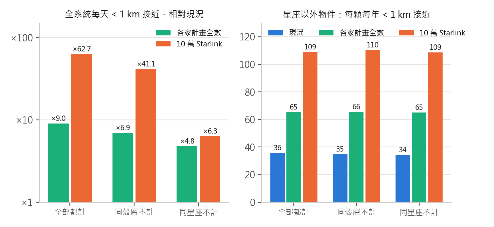
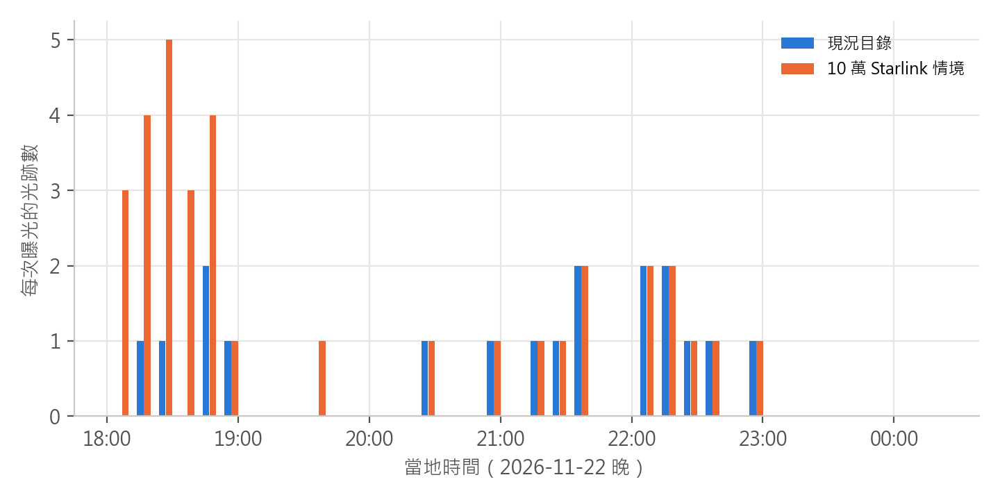
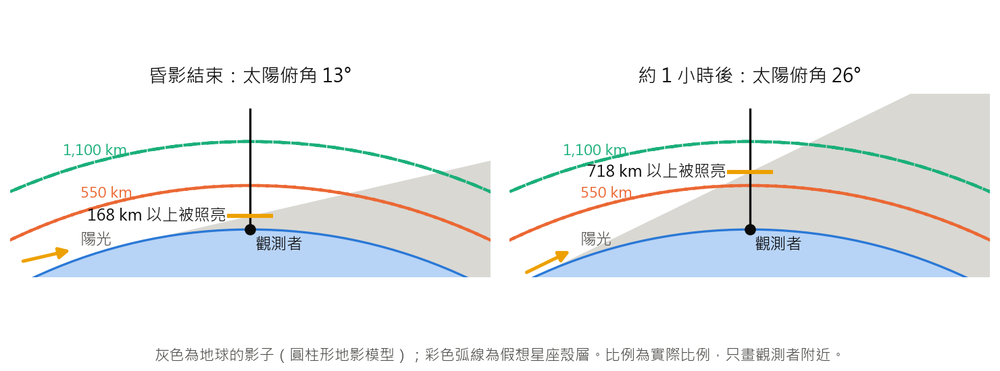

# 延伸篇 S2　巨型星座的外部成本：壅擠與光害

> **延伸模擬篇說明**：本篇不屬於送審版（v1.3），也不是國家太空中心委託研究的成果。內容取自本專案 Rust 單機版「星座壅擠」與「天文夢魘」教學模型（含 2026-11-22 的殼層相位修正），於 2026 年 11 月 22 日以當時的衛星目錄推演。數值一律為**教學模型示意**；假想星座的殼層是公開申請資料的近似，不是各公司的實際部署計畫。

## 章前導讀

2026 年 11 月 22 日傍晚 6 點 07 分，鹿林天文台的太陽沉到地平線下 13 度，天文昏影剛結束。一具視野 3.5 度的巡天望遠鏡指向正北、仰角 45 度，拍下一張 30 秒的影像。依本篇的模型，以當天的衛星目錄計算，沒有被照亮的衛星穿過這張影像。

把目錄中的 Starlink 換成 10 萬顆、另加 2 萬顆 Kuiper 與 1 萬顆千帆，同一張影像會被 3 顆衛星劃過；模型在視野周邊列出的假想衛星光跡，亮度在 3.8 到 6.6 等之間，最亮的比這片天空中多數肉眼可見的恆星還亮。¹

這不是科幻情境。McDowell（2020）回顧當時的低軌族群時已指出，規劃約 12,000 顆的 Starlink 將主導 600 公里以下的低軌區域，並估算了不同緯度、季節與時刻可見的被照亮衛星數量。² 六年後的目錄中，Starlink 已有 11,021 顆；各家申請文件中的數字更大。³ ¹

第 3 章與第 13 章看的是巨型星座做了什麼：怎麼部署、怎麼機動、整個星系有沒有異常。本篇看的是另一面：星座變大之後，其他人要付出什麼。成本有兩種，一是軌道上的接近與碰撞風險，二是地面望遠鏡影像上的光跡。兩者都不由星座營運者承擔，經濟學稱為外部成本。

## 學習目標

- 理解假想星座如何從公開申請的殼層產生，以及「取代真實衛星」的比較方式。
- 理解接近頻率的一階估計：KD-tree 快照、氣體動力論，以及從 20 公里換算到 1 公里與 10 公尺。
- 理解「營運者協調」這個假設如何主導壅擠指標，以及為什麼第三方物件的接近次數不受這個假設影響。
- 理解衛星光跡集中在昏影後的原因：照明幾何與地影。
- 能辨認模型造成的現象，以及「看起來像錯誤、其實是星座結構」的現象，例如同一軌道面前後相隨的成對光跡。

## 本篇的證據定位

本篇沿用延伸篇 S1 的標示：

| 標示 | 意義 | 本篇用在哪裡 |
|---|---|---|
| **M｜教學模型（示意）** | 模型輸出，沒有外部真值；只能說明機制與方向 | 所有壅擠指標與光跡數 |

只有一項輸出可以和外部數字比較量級：現況 Starlink 每顆衛星每年的近距離接近次數，對照 SpaceX 公開的避碰機動次數。但兩者的定義不同（見主案例一），只能說量級相近，不能算驗證，所以本篇沒有 M＋。

## 假想星座怎麼來

兩個遊戲共用同一套假想星座。每個星座由幾個殼層組成，每個殼層是（高度、傾角、軌道面數、每面顆數），依 Walker 星座排列：³

| 群組 | 計畫顆數 | 殼層 | 程式內註記 |
|---|---|---|---|
| Starlink | 34,396 | 14 層，340–614 公里 | Gen1 4,408 顆＋Gen2 申請 29,988 顆的殼層（FCC 申請文件，近似） |
| Amazon Kuiper | 3,236 | 590–630 公里，三層 | FCC 2020 核准的三殼層 |
| 千帆 | 10,800 | 1,060–1,200 公里，四層 | 首期約 1,060 公里、89°（公開報導）；其餘依申報規模估計的示意配置 |
| 國網 | 12,992 | 508–1,145 公里，七層 | ITU 申報 GW-A59 與 GW-2，殼層近似 |

殼層參數的來源只有程式內的註記，本篇沒有另行查核各申請文件。³

指定總數時，各殼層依比例縮放，保留軌道面數、調整每面顆數。選了「假想」的星座，目錄中的真實衛星會全部移除，改用假想星座；其餘物件（其他衛星、火箭體、碎片）沿用真實目錄。假想衛星以圓軌道加 J2 長期項傳播，目錄物件以 SGP4 傳播。每個殼層另有固定的相位偏移，避免參數相近的殼層從同一起點排列（見「模型造成的現象」）。³

本篇比較三種情境：

| 情境 | 內容 | 物件總數 |
|---|---|---|
| 現況 | 2026-11-22 的目錄 | 32,898 |
| 各家計畫全數 | 四個星座都換成計畫顆數 | 82,471 |
| 10 萬 Starlink | Starlink 10 萬、Kuiper 2 萬、千帆 1 萬；國網沿用目錄 | 151,300 |

## 主案例一：壅擠，接近次數怎麼隨星座規模變

> **證據等級：M｜教學模型（示意）**
> **資料來源**：星座壅擠後端，取樣 2 小時、每 60 秒一個快照（120 個），KD-tree 篩選半徑 20 公里；2026-11-22 推演。³ ¹
> **主要假設**：接近頻率以氣體動力論估計，再依通量與距離平方成正比換算到 1 公里（避碰評估的代理門檻）與 10 公尺（兩顆大型衛星的合併半徑，視為碰撞）；假想星座都是圓軌道、不機動。
> **限制**：不是逐一求最接近時刻；不計營運者的相位安排與避碰；「若都不避碰」的碰撞數只用來比較倍數。假想星座的殼層相位偏移是示意設定，不是各公司的實際排列。
> **何時不應使用本結果**：當成碰撞預報，或推論特定衛星的實際避碰次數。

### 怎麼估計接近頻率

這個方法和延伸篇 S1 的碰撞率是同一個概念。每個快照找出相距 20 公里內的所有配對，每一對累加 v_rel ÷ (4d/3)，即兩物件進入對方半徑 d 球體的頻率。通量與半徑平方成正比，所以把結果乘上 (1/20)¹，就是 1 公里內的接近頻率；乘上 (0.01/20)¹，就是合併半徑 10 公尺的碰撞頻率。³

最大的不確定在於配對要不要全算。同一家營運者會協調自己星座內的相位，自家衛星彼此不太會真的接近。模型提供三種規則：全部都計、同殼層不計（介面預設）、同星座不計。

### 結果

介面預設（同殼層不計）下：¹

| 指標 | 現況 | 各家計畫全數 | 10 萬 Starlink |
|---|---|---|---|
| 物件總數 | 32,898 | 82,471 | 151,300 |
| 任一時刻相距 < 20 km 的配對 | 185 | 576 | 3,041 |
| 全系統每天 < 1 km 接近 | 3,488 | 24,052 | 145,493 |
| 若都不避碰：每年碰撞期望值 | 127 | 879 | 5,314 |
| 台北上空仰角 > 10° 的物件數 | 1,965 | 3,270 | 4,247 |
| 台北上空仰角 > 30° 的物件數 | 1,049 | 1,400 | 1,579 |

畫面 S2-1　星座壅擠的 10 萬 Starlink 情境（同殼層不計、取樣 2 小時）。右側是假想星座與目錄物件的 3D 畫面（藍：Starlink，橘：Kuiper，紅：千帆，灰：其他物件）；左側是指標、倍數與各群組每顆每年的接近次數。截圖時重新計算，數字與上表略有不同（例如全系統每天 1 km 接近 145,357 次，上表為 145,493 次），差異來自推演時刻不同。截圖：本專案 Rust 單機版（v0.1.19 工作版），2026-11-22。

「若都不避碰」的 127 次只是假設沒有任何人做避碰機動、以 10 公尺合併半徑估計的數字，實際碰撞遠少於此；它的用途是比較倍數，不是預報。台北上空的物件數不論是否被照亮，不等於肉眼看得到的衛星數。³

圖 S2-1　三種情境的高度密度剖面（每 10 公里一格，物件數 ÷ 球殼體積），縱軸為對數。假想 Starlink 集中在 340–360 公里與 520–640 公里，千帆與國網集中在 1,050–1,210 公里；650–1,000 公里沿用目錄，三條線重合。來源：本篇推演。¹

### 協調假設決定倍數

同一組情境，換一種配對規則，倍數差很多：¹

| 全系統每天 < 1 km 接近，相對現況 | 全部都計 | 同殼層不計 | 同星座不計 |
|---|---|---|---|
| 各家計畫全數（物件 ×2.5） | ×9.0 | ×6.9 | ×4.8 |
| 10 萬 Starlink（物件 ×4.6） | ×62.7 | ×41.1 | ×6.3 |

若營運者完全協調自家星座（同星座不計），物件增加 4.6 倍，接近次數只增加 6.3 倍；若協調失效（全部都計），接近次數增加 63 倍。接近次數大致隨同一殼層內的密度平方成長，所以把大量衛星塞進少數殼層時，協調是否有效，比衛星總數更能決定風險。³

「同殼層不計」只排除同一殼層內的配對；同一家不同殼層之間、殼層高度相近時的交會仍然計入，所以 10 萬 Starlink 情境仍有 ×41，可以視為「同一家不同殼層之間沒有協調」時的上限。

### 第三方付出的代價

協調假設改變的是星座內部的接近。星座以外的物件，包括其他國家的衛星、火箭體與碎片，不在任何一家的協調範圍內。它們每顆每年 1 公里內的接近次數：¹

| 「其他」物件（21,047 個），每顆每年 < 1 km 接近 | 全部都計 | 同殼層不計 | 同星座不計 |
|---|---|---|---|
| 現況 | 36 | 35 | 34 |
| 各家計畫全數 | 65 | 66 | 65 |
| 10 萬 Starlink | 109 | 110 | 109 |

不論哪一種協調規則，第三方物件的接近次數都從約 35 次增加到約 65 次（計畫全數）或約 109 次（10 萬 Starlink）。現況各欄的小差異，來自三次推演的時刻不同。¹ 這是本篇最穩健的結果：星座營運者能協調自己的衛星，卻不能替別人避碰。其他營運者因此要處理更多交會警報，碎片也更常穿過星座所在的殼層。

圖 S2-2　同一組情境在三種配對規則下的結果。左：全系統每天 1 公里內接近次數相對現況的倍數，縱軸為對數，隨協調假設變動近十倍；右：星座以外物件每顆每年 1 公里內接近次數，三種規則下幾乎相同。來源：本篇推演。¹

### 一個量級參考

選「同星座不計」時，現況 Starlink 每顆每年約 20 到 22 次 1 公里內接近（兩次推演的時刻不同）。¹ Space.com 轉述 SpaceX 2026 年 7 月提交 FCC 的半年報告：2025 年 6 月至 2026 年 5 月，每顆 Starlink 平均每年避碰機動超過 40 次；SpaceX 的觸發門檻是碰撞機率高於千萬分之三。⁴

兩個數字量級相近，但定義不同：模型用的是距離門檻（1 公里），SpaceX 用的是碰撞機率門檻，後者還取決於軌道不確定性與物件大小。所以這只能說明模型的量級沒有離譜，不能說模型已經驗證。遊戲介面原本寫「每顆每年十幾到數十次」，比最新轉述的 40 次以上偏低；2026-11-22 已改為直接列出 SpaceX 報告的數字、期間與觸發門檻，並註明兩者只能比量級。³

## 主案例二：光害，一次曝光被劃幾條

> **證據等級：M｜教學模型（示意）**
> **資料來源**：天文夢魘後端；鹿林天文台（2,862 公尺）與台北；Rubin 級巡天望遠鏡（視野 3.5°）、30 秒曝光；從太陽仰角 −13°（鹿林 18:07、台北 18:02，當地時間）起，14 小時內每 10 分鐘一次；2026-11-22 推演。³ ¹
> **主要假設**：衛星被太陽照到才發光（圓柱形地影）；亮度 m = m₁₀₀₀ + 5·log₁₀(距離/1000 km) 加朗伯球相位修正，Starlink 的 m₁₀₀₀ 取 5.8。
> **限制**：亮度是每類一個代表值，沒有逐一對照觀測，也不含遮光設計；整夜統計只看是否穿過視野，不看亮度是否會被偵測或造成飽和。
> **何時不應使用本結果**：推論特定望遠鏡的實際影像損失比例。

### 光跡集中在昏影後

鹿林、正北仰角 45° 的整夜統計：

圖 S2-3　鹿林天文台、正北仰角 45°，每 10 分鐘一次 30 秒曝光被照亮衛星劃過的條數。藍色為現況目錄，橘色為 10 萬 Starlink 情境。20 點以後兩者相同；00 點後指向仰角低於 20°，不計。來源：本篇推演。¹

差距幾乎全部集中在昏影後的第一個小時。四組設定都是同一個模式：¹

| 地點、指向 | 第一小時（7 次曝光）平均條數：現況 → 10 萬 Starlink | 之後的總條數：現況 → 10 萬 Starlink |
|---|---|---|
| 鹿林，正北仰角 45° | 0.7 → 2.9 | 13 → 14（31 次曝光） |
| 鹿林，方位 250° 仰角 60° | 0.9 → 3.6 | 14 → 22（11 次曝光） |
| 台北，正北仰角 45° | 1.0 → 3.4 | 8 → 11（33 次曝光） |
| 台北，方位 250° 仰角 60° | 1.4 → 3.9 | 11 → 13（11 次曝光） |

原因是照明幾何。假想 Starlink 大多在 340–640 公里，太陽沉得越深，這個高度的衛星越早進入地球的影子。昏影剛結束時，低軌衛星還被照亮，地面已經夠暗；再過一小時，它們大多在地影中，只剩高度較高的物件還會發光。³ 所以巨型星座對光學觀測的衝擊，主要落在昏影與黎明前，以及靠近太陽一側的天空。

圖 S2-4　為什麼光跡集中在昏影後。以圓柱形地影估算，觀測者天頂方向高度 h 的衛星被照亮的條件是 h > R⊕(1/cos δ − 1)，δ 為太陽俯角。昏影結束時（δ = 13°）約 168 公里以上就被照亮，550 公里的殼層整片發光；約 1 小時後（δ = 26°）要 718 公里以上，550 公里殼層已在地影中，只剩 1,100 公里的殼層還亮。只計天頂方向；斜向視線的界線不同。來源：依天文夢魘的照明模型繪製。³

指向也有影響。傍晚改指東方低空的昴宿星團（M45），兩種情境整晚都沒有被照亮的光跡；10 萬 Starlink 情境下，第一次曝光有 17 顆衛星穿過視野周邊，但都在地影中。¹

畫面 S2-2　天文夢魘的比較畫面：鹿林天文台、Rubin 級巡天望遠鏡（視野 3.5°）、30 秒曝光、正北仰角 45°，時間設在當晚天文昏影。左半為現況目錄，右半為 10 萬 Starlink 情境，分界線可左右拖曳；標示的光跡附有星等與名稱。影像以光子數合成，雜訊與 8 等以下的背景星是示意設定。截圖：本專案 Rust 單機版（v0.1.19 工作版），2026-11-22。

### 多亮

鹿林正北那一張，模型在 1.3 倍視野範圍內列出 4 條假想衛星光跡：Starlink 兩條約 3.8 等（距離約 490 公里）、一條 4.8 等（約 810 公里），千帆一條 6.6 等（約 1,630 公里）。¹ 兩條 3.8 等的光跡沿同一路徑、進入視野的時間相差約 17 秒，是同一軌道面上前後相隨的兩顆衛星（間隔約 130 公里）；10 萬 Starlink 情境下，340 公里殼層每個軌道面約有 320 顆，這樣的成對光跡是星座結構的結果。這些亮度是以 m₁₀₀₀ = 5.8 的代表值推算，實際亮度還取決於衛星姿態、太陽能板角度與營運者的降亮設計。³ 模型沒有判斷這樣的光跡會不會讓偵測器飽和；介面另以光子數合成 CCD 影像示意，但影像的雜訊與背景星都是示意設定。

## 模型造成的現象

| 現象 | 原因 | 怎麼讀 |
|---|---|---|
| （已修正）參數相近的殼層產生並肩飛行的假想衛星 | 各殼層原本都從同一相位起點排列；例如 550 公里／53° 與 540 公里／53.2°，都是 72 面 × 22 顆 | 2026-11-22 起每個殼層加固定相位偏移。修正前後相比，相距 20 公里內的配對數少 17% 到 31%，1 公里內接近次數只少不到 5%（並肩飛行的相對速度很小；兩次推演時刻不同，也有 1% 到 3% 的差異）；本篇數字為修正後 |
| 光跡成對出現，亮度相同、進入視野相差十幾秒 | 同一軌道面上前後相隨的衛星，10 萬 Starlink 情境下間隔約 130 公里 | 這是星座結構，不是錯誤；真實星座的列車效應也是這樣 |
| 傍晚指向方位 250°、仰角 35° 時，多數光跡是同步軌道衛星 | 這個方向接近地球同步軌道帶；望遠鏡追蹤恆星，同步軌道衛星也會拉成短線 | 不代表低軌星座的影響；本篇的光跡比較改用仰角 60° 與正北 |
| 10 萬 Starlink 情境中，有一張曝光的光跡反而比現況少 | 選「假想」時，目錄中的真實 Starlink 全部移除 | 情境是「取代」，不是「加上」 |
| 重跑結果略有不同 | 星座壅擠以伺服器當下時刻為準；假想星座的相位也以當下為基準 | 本篇數字是 2026-11-22 一次推演的結果 |

## 國安意涵

本篇的啟示是：

> **巨型星座的成本，有一大部分落在星座以外的人身上。**

對太空態勢感知與國安判讀，有三件事值得記下：

1. **交會篩選的工作量隨星座規模急遽成長。** 介面預設下，全系統每天 1 公里內的接近從 3,488 次增加到 24,052 次（各家計畫全數）。每一次接近都要有人判斷要不要避碰；本書第 19 章已說明，TLE 排序出的接近清單本身就不可靠。
2. **第三方承擔的風險不受營運者協調影響。** 星座以外物件的接近次數增加約 2 到 3 倍。推論：沒有自建巨型星座的國家，例如以少數衛星運作的台灣，在這種環境中要處理更多交會警報，卻無法參與星座內部的協調。本篇沒有單獨計算台灣衛星的接近次數。
3. **光學觀測也是太空態勢感知的資料來源。** 本篇用天文觀測示範，但地面光學追蹤同樣在昏影與黎明前工作，也同樣會被光跡干擾。推論：巨型星座會同時增加需要追蹤的物件，並降低部分光學觀測的品質。

Lawrence 等人（2022）主張把從卡門線到地球同步軌道的軌道空間，視為需要保護與規範的環境，問題以低軌最急迫。⁵ 本篇的模型提供的是這個主張的一個可操作版本：在一組寫清楚的假設下，看成本落在誰身上。它不是對任何星座或國家的評估。

## 與本書其他章的關係

| 本書章節 | 關係 |
|---|---|
| 第 3 章 | 低軌巨型星座的規模與結構；本篇看星座造成的外部成本 |
| 第 13 章 | 星系級分析；本篇的假想星座同樣以軌道面與殼層描述 |
| 第 19 章 | 交會篩選與 Pc 的限制；本篇估計篩選工作量如何隨星座成長 |
| 延伸篇 S1 | 同一套氣體動力論碰撞率概念；S1 看一次解體，本篇看整個族群 |

## 已知限制

1. 假想星座的殼層只依程式內註記近似，沒有查核各申請文件；都是圓軌道，沒有入軌、離軌、失效與機動。
2. 殼層相位偏移是示意設定（低差異序列），不是各公司的實際排列；修正前的版本會產生並肩飛行的假想衛星。
3. 壅擠指標是一階估計，以快照與氣體動力論估計，不是逐一求最接近時刻。
4. 星座壅擠無法指定推演時刻，重跑會有小幅差異。
5. 亮度每類一個代表值，不含姿態與降亮設計；地影為圓柱模型。
6. 整夜統計只看是否穿過視野，不看亮度是否會被偵測或造成飽和。
7. 只推演一個日期（2026-11-22）、兩個地點與少數指向；季節與緯度的影響沒有測試。

以上限制取自兩個遊戲的說明文件第 5 節。³

## 本章檢核清單

- [ ] 能說明假想星座如何從殼層產生，以及「取代」與「加上」的差別。
- [ ] 能說明接近頻率如何從 20 公里換算到 1 公里與 10 公尺，以及「若都不避碰」的碰撞數為何不是預報。
- [ ] 能說明營運者協調假設如何改變倍數，以及第三方物件的接近次數為何不受影響。
- [ ] 能說明模型的 Starlink 接近次數與 SpaceX 公開的避碰次數為何只能比量級。
- [ ] 能用照明幾何說明光跡為何集中在昏影後。
- [ ] 能舉出至少兩個模型造成的現象。
- [ ] 能區分「模型在特定假設下的外部成本估計」與「對特定星座或國家的評估」。

## 本章外部事件來源

- Pultarova, T. (2026, July 15). Every SpaceX Starlink satellite has to dodge a collision almost weekly, and experts fear the worst. *Space.com*. https://space.com/space-exploration/satellites/every-spacex-starlink-satellite-has-to-dodge-a-collision-almost-weekly-and-experts-fear-the-worst （存取日期 2026-11-22；本章用於：Starlink 避碰機動次數與觸發門檻；轉述 SpaceX 2026 年 7 月 FCC 半年報告，原報告未查閱）

## 資料來源

1. 本專案（2026 年 11 月 22 日）。*延伸篇 S2 推演結果*（docs/book/sim_chapters/s2_data/：run_s2.py、s2_results.json）。未出版內部資料。
2. McDowell, J. C. (2020). The Low Earth Orbit Satellite Population and Impacts of the SpaceX Starlink Constellation. *The Astrophysical Journal Letters*, 892, L36. arXiv:2003.07446（依全書附錄〈參考文獻與延伸閱讀〉的摘要）
3. 本專案（2026 年 11 月 22 日）。*太空小遊戲「星座壅擠」與「天文夢魘」說明*（RUST_SatDashboard/docs/games_crowd_astro.md）。未出版內部資料。
4. 見本章外部事件來源（Space.com，2026-07-15）。
5. Lawrence, A., Rawls, M. L., Jah, M., Boley, A., Di Vruno, F., Garrington, S., Kramer, M., Lawler, S., Lowenthal, J., McDowell, J., & McCaughrean, M. (2022). The case for space environmentalism. *Nature Astronomy*, 6, 428. https://doi.org/10.1038/s41550-022-01655-6 （依全書附錄的摘要）
