# 延伸篇 S3　兵棋推演：海纜中斷下的太空通訊韌性

> **延伸模擬篇說明**：內容取自本專案 Rust 單機版「太空兵棋」教學模型的蒙地卡羅推演、敏感度分析與審查後的補充推演（2026-11-23）。
>
> **適用範圍**：本篇呈現的是特定遊戲規則、參數設定與 AI 行為假設下的相對比較，不代表真實戰場預測。公開資料僅提供想定背景或歷史案例；遊戲中的成功率、損害比例、出手機率、計分權重、目標選擇與海纜情境均為教學或分析用假設。結果不可直接外推至真實衝突、武器效能或特定國家的作戰意圖。
>
> **時間窗口**：除特別標示的 7 天延伸情境外，本篇所有結論只適用於 48 小時（8 回合）的遊戲窗口。7 天情境中，好幾個 48 小時的結論會反轉（見「時間窗口：48 小時與 7 天」）。
>
> **地理與政治範圍**：遊戲地圖使用公開海纜圖資中經過台灣周邊的海纜，作為教學想定的地理背景；海纜的拓撲、容量、修復能力與中斷情境都是遊戲設定，不代表實際海纜系統的狀態或戰時能力。紅方、藍方與白方是抽象角色，不代表任何特定國家、軍隊或組織；本篇不是對任何地區衝突的推演或預測。

## 章前導讀

第 1 章提過一段制度史：美軍的商業整合細胞（CIC），構想來自 2014 年 9 月的 Schriever 兵棋推演；2015 年 6 月，Intelsat、Iridium 等六家衛星業者的聯絡人員進駐聯合太空作戰中心試行。¹ 那場推演沒有預測任何一場戰爭，它留下的是一個判斷：軍方需要和商業業者在平時就坐在同一間房裡。

同一章也提過另一件事。2022 年 2 月 24 日，Viasat 的 KA-SAT 衛星寬頻網路遭到網路攻擊，烏克蘭與歐洲各地數以萬計的用戶端數據機失效。¹ 美國國防情報局（DIA）2026 年的太空安全報告把這次攻擊，和俄方宣稱商業終端是合法軍事目標、以干擾器攻擊商業星座的作法並列。²

把這類事件放進一個教學想定，會變成這樣的問題：國際海纜被拖斷三成，商用低軌終端開戰前就被惡意軟體抹掉一部分，剩下的又被干擾。防守方手上只有有限的資源，該租 GEO、部署低軌終端、派修纜船，還是強化閘道站？

兵棋推演不能回答「哪一個選擇在真實戰爭中最好」。它能回答的是：在一組寫清楚的規則與假設下，哪些選擇比較好，好多少，以及假設改變時，結論會不會跟著翻轉。本篇用四個想定、每組 500 局的蒙地卡羅推演，加上敏感度分析與替代 AI 的補充推演，示範這種回答方式，並把推演中由規則本身造成、不該解讀的現象一一標出來。

## 學習目標

- 理解兵棋推演中「想定依據」、「示意參數」、「AI 行為假設」與「計分權重」四種成分的差別。
- 理解為什麼推演比較要設對照組，以及共同亂數與配對差值如何提高比較精確度。
- 以四個想定認識三種防守難題：同一資源被攻擊、任務之間互相排擠、意圖不明，以及不可逆攻擊的長期成本。
- 能辨認「模型造成的現象」，例如固定行動點數造成的排擠與 AI 門檻效應，不把它們讀成實戰結論。
- 能說明敏感度分析、替代 AI 與時間窗口如何改變一個推演結論的適用範圍。

## 本篇的證據定位

本篇沿用延伸篇 S1 的標示：

| 標示 | 意義 | 本篇用在哪裡 |
|---|---|---|
| **M｜教學模型（示意）** | 模型輸出，沒有外部真值；只能說明機制與方向 | 所有推演結果 |

太空兵棋沒有任何一項輸出可以和觀測比對，所以全篇沒有 M＋。唯一的外部實測資料，是想定 D 引用的 Cosmos 1408 碎片衰減紀錄；那屬於延伸篇 S1 的驗證，不是兵棋的輸出。

推演中的數字有四種來源，閱讀時要分開：³

| 成分 | 例子 | 來源 |
|---|---|---|
| 想定依據 | 惡意軟體抹除商用數據機、干擾 GPS、共軌接近、直升式反衛星 | DIA 報告的公開描述（附譯本頁碼） |
| 示意參數 | 抹除 30%、SAR 成功率 80%、規避後服務降 30% | 本遊戲的教學設定，DIA 沒有提供 |
| AI 行為假設 | 紅方被監視就把出手率降到三分之一；藍方有備援紅方就換目標 | 本遊戲的規則 |
| 計分權重 | 偵察每次成功 3 分、定位授時每少 10% 扣 2 分 | 本遊戲的規則 |

DIA 只提供情境與公開事實，不提供任何效果參數。³

模型驗證有三個層次，本篇只完成前兩層：

| 層次 | 問題 | 本篇狀態 |
|---|---|---|
| 程式一致性 | 程式是否照規則執行 | 已以手算核對（想定 B 的 SAR、定位授時，想定 C 的規避次數）；引擎擴充後，預設參數下的結果與擴充前逐局相同（72 組比較） |
| 模型內敏感度 | 結論是否隨參數、AI 與時間窗口改變 | 已掃描主要參數、替代 AI 與 7 天窗口；仍有未測參數（見「主要參數」） |
| 外部效度 | 模型是否代表真實系統或對手 | 未驗證；多數參數為示意值，雙方 AI 為規則寫成 |

## 遊戲怎麼運作

太空兵棋是紅、藍、白三方的回合制推演，原始設計參考謝沛學對商用兵棋軟體的介紹。⁴ 每局 8 回合，每回合代表 6 小時，共 48 小時。紅藍雙方每回合各有 5 個行動點，同時下令、同時裁決；白方負責天候、颱風等事件。³ 8 回合、每回合 6 小時是遊戲原有的設定，沒有對應特定危機或作戰節奏的外部依據。

| 項目 | 設定 |
|---|---|
| 開場 | 16 條國際海纜中約三成，以及馬祖海纜中斷（灰色地帶「拖錨」） |
| 需求 | 頻寬需求 150 單位起，每回合 +5 |
| 藍方資源 | 國際海纜、租用 GEO、商用低軌終端、修纜船、閘道站強化、偵察 |
| 紅方手段 | 切纜、干擾低軌、網攻閘道站、雷射致盲、認知作戰；升級紅方另有反衛星試射 |
| 主要指標 | 頻寬可用率（8 回合平均），另看最低可用率、前 3 回合平均、累積未滿足需求；想定 B 另看定位授時與偵察，想定 C、D 另看遭攻擊率與偵察損失 |

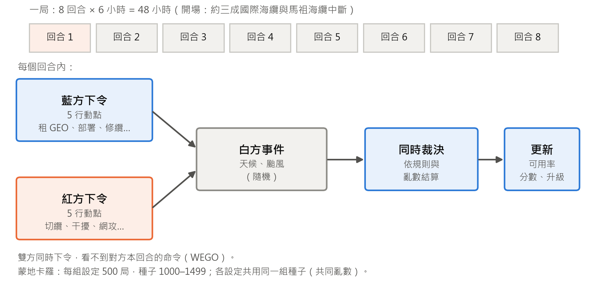

圖 S3-1　太空兵棋的回合結構。每局 8 回合、每回合 6 小時；每個回合內紅藍雙方各以 5 個行動點同時下令，加上白方的天候事件後同時裁決。蒙地卡羅每組設定 500 局，各設定共用同一組種子。來源：依想定設計說明繪製。³

海纜中斷是本遊戲原有的設定。DIA 2026 報告沒有討論海底電纜。³

### 雙方的 AI

推演時雙方都由 AI 依固定規則下令。藍方有四種基本打法：均衡、重 GEO、重低軌、重修纜；各想定另加專屬打法，例如想定 B 的「均衡＋備援」、想定 C 的「監視＋規避」。紅方有兩種：灰色地帶（切纜、干擾、網攻、致盲、認知作戰），以及升級（另以 50% 機率在中後段進行一次反衛星試射）。³

AI 不會學習，也不會依對手調整。為了檢查結論有多依賴這些規則，補充推演另加了替代 AI（見「替代 AI：結論有多依賴行為規則」）。

### 蒙地卡羅與共同亂數

共同亂數有前提：兩組設定的隨機判定要按相同順序抽取。若某組設定多出一個隨機判定，例如監視中斷或規避失敗，之後的亂數序列就會錯開，兩局不再對應同樣的天候與切纜，配對的好處跟著縮小。配對差值也只處理隨機誤差；對照組設錯時，差值仍然有偏。本篇每個配對比較都註明亂數序列是否錯開。

在這個前提下，每組設定跑 500 局，種子 1000–1499。不同設定使用同一組種子，同一局的天候、切纜機率等隨機事件盡量相同，所以兩組設定的差異主要來自設定本身。這個作法稱為共同亂數，延伸篇 S1 的緩解決策比較也用同一原理。⁵

每組 500 局是遊戲預設，不是事先依檢定力計算的樣本數。事後看，本篇主要比較的配對差值 95% 信賴區間半寬為 ±0.01 到 ±0.32 個百分點，小於文中討論的差距。判讀時本篇以「差距是否大到會改變選擇」為準，不以統計顯著性為準：配對區間很窄，代表差距的方向可信，但差距本身仍可能小到沒有實務意義。⁶

### 頻寬可用率怎麼算

頻寬以抽象「單位」計，不對應 Gbps 或使用者數。每回合結算後：³ ⁷

\[
\text{可用率}_t = \min\!\left(1,\ \frac{\text{海纜}_t + \text{GEO}_t + \text{低軌}_t}{\text{需求}_t}\right),\qquad \text{需求}_t = 150 + 5t
\]

主要指標是第 1 到第 8 回合可用率的平均。各資源的規則：

| 資源 | 容量與規則 |
|---|---|
| 海纜 | 每條國際海纜 10 單位、國內海纜 1 單位；中斷後派修纜船 3 回合修復（颱風時 4 回合）；巡邏使紅方切纜成功率由 70% 降到 30% |
| GEO | 開場 5 單位；每租一次 +15（下回合生效），上限 60；太陽風暴時 ×0.7 |
| 低軌 | 每套終端 0.02 單位（500 套 10 單位），上限 4,000 套；乘上（1 − 干擾比例）、閘道站被網攻時 ×0.5、碎片影響與太陽風暴 ×0.8 |

降級是線性的：可用率直接等於供給除以需求，沒有最低服務門檻，也沒有區分任務關鍵與非關鍵流量、沒有擁塞與優先排序；供給超過需求的部分不累積。

8 回合平均會掩蓋前期衝擊，所以本篇另列三個指標：最低可用率（8 回合中最低的一回合）、前 3 回合平均，以及累積未滿足需求（每回合「(1 − 可用率) × 需求」的總和，單位 × 回合）。

## 四個想定與 DIA 依據

| 想定 | 防守難題 | DIA 案例的原始語境 | DIA 描述（譯本頁碼） | 本遊戲加入的機制（作者假設） |
|---|---|---|---|---|
| A 灰色地帶 | 同一資源被攻擊 | 俄烏戰爭 | 俄方以干擾器攻擊商業星座，並將商業終端列為合法目標（p.4、37）；入侵前惡意軟體攻擊 Viasat 客戶，5 萬名使用者中斷（p.43） | 藍方開場有 1,000 套低軌終端；開戰前抹除 30%；開場干擾；閘道站未強化時網攻永久抹除終端 |
| B 致盲致聾 | 任務之間互相排擠 | 中國國防學界論述與 PLA 演習 | 偵察、通信、導航與預警衛星可能成為「致盲並致聾敵人」的目標（p.18）；PLA 演習例行納入衛星鏈路與 GPS 干擾（p.31–32） | 紅方干擾 GPS、干擾 SAR；藍方 SAR 全天候偵察、備援定位授時 |
| C 共軌接近 | 意圖不明 | GEO 與低軌的接近事件 | TJS-3 在 GEO 多次以不足 10 公里接近他國太空器（p.33）；Cosmos 2576 等接近美國衛星（p.44） | 紅方衛星分三級逼近藍方租用的 GEO 衛星；藍方商業太空監視、規避、分散租用 |
| D 直升式反衛星 | 不可逆與長期成本 | 2007 年中國試射、2021 年俄國試射 | 2007 年試射產生超過 3,500 塊可追蹤碎片（p.32）；2021 年 Nudol 在 470 公里摧毀退役衛星（p.44） | 紅方擊毀藍方光學衛星或一顆商用低軌衛星；藍方商業影像、業者避碰 |

頁碼為 DIA 報告非官方繁體中文譯本的頁碼。² DIA 提到某類威脅，不代表 DIA 支持本遊戲的參數、情境或地理設定；把這些案例移植到教學想定的海纜背景，是作者的推演假設，不是 DIA 對任何地區的評估。³

## 想定 A：同一資源被攻擊

> **證據等級：M｜教學模型（示意）**
> **資料來源**：太空兵棋後端蒙地卡羅，5 個想定變體 × 2 種紅方 × 4 種藍方，每組 500 局；補充推演另含 GEO 可受攻擊、替代 AI 與 7 天窗口。⁵ ⁷
> **主要假設**：藍方開場 1,000 套終端；開戰前抹除 30%；第 0 回合起干擾 25%、持續 2 回合；閘道站未強化時每次網攻永久抹除 30%；基準情境中 GEO 租用不受任何攻擊。這些數字都沒有 DIA 依據。
> **限制**：Viasat KA-SAT 是 GEO 服務，遊戲把抹除套在低軌終端上是簡化；5 萬名使用者是事件規模，不是比例。
> **何時不應使用本結果**：推論真實衝突中商用低軌的損失比例、據此判斷 GEO 比低軌安全，或外推到 48 小時以外。

### 對照組決定讀法

要量出「攻擊商用低軌的代價」，比較對象不能是原始想定。原始想定沒有預置終端，直接相減會把「多了 1,000 套終端」和「被攻擊」混在一起：重 GEO 與重修纜打法在想定 A 反而比原始想定高 2.3 到 3.2 個百分點。⁵ 所以本想定另設對照組：同樣有 1,000 套預置終端，但開戰前沒有被抹除、開場沒有被干擾。

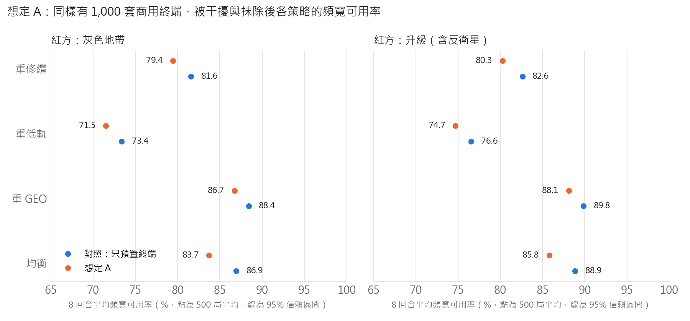

圖 S3-2　想定 A 與對照組（只預置終端）各藍方打法的頻寬可用率，500 局平均。來源：想定 A 推演報告。⁵

| 藍方打法 | 對照組 | 想定 A | 攻擊代價 | 開場干擾 | 網攻抹除 |
|---|---|---|---|---|---|
| 均衡 | 86.9% | 83.7% | −3.2 | −0.7 | −2.4 |
| 重 GEO | 88.4% | 86.7% | −1.7 | −0.3 | −1.4 |
| 重低軌 | 73.4% | 71.5% | −1.9 | −1.1 | −0.6 |
| 重修纜 | 81.6% | 79.4% | −2.1 | −0.4 | −1.6 |

紅方灰色地帶策略；後三欄單位為百分點。拆解欄以想定 A 減「去掉開場干擾」或「去掉網攻抹除」的變體計算，與總代價的差是兩種機制的交互作用（0 到 −0.2）。對照組與想定 A 只差在開戰前那一次抹除，亂數序列沒有錯開。⁵

讀這張表要注意兩件事：

1. **開戰前的抹除，強化擋不住。** 抹除發生在藍方第一次行動之前，每種打法開場都損失 300 套。從不強化閘道站的重 GEO、重修纜，之後還會被網攻繼續抹除，500 局平均累計損失 487 到 525 套；抹除約佔它們總代價的八成。⁵
2. **前期衝擊大於整局平均。** 均衡打法前 3 回合從 89.4% 掉到 85.0%，重低軌掉 5.0 個百分點，都大於 8 回合平均。⁵

### 「重 GEO 的平均最高」只在模型結構下成立

在本模型的基準設定中，GEO 租用沒有被設定為可受干擾或網攻影響，所以重 GEO 的 48 小時平均可用率最高。這個結果不能外推為 GEO 服務整體較安全：真實的 GEO 服務同樣可能受上行鏈路干擾、閘道站攻擊與業者中斷影響，Viasat KA-SAT 本身就是 GEO 服務。⁵

即使在基準設定下，「平均最高」也不等於「最穩」：⁷

| 藍方打法（灰色地帶紅方） | 8 回合平均 | 最低一回合 | 前 3 回合平均 | 累積未滿足需求 | 低於 85% 的回合數 |
|---|---|---|---|---|---|
| 重 GEO | 86.7% | 70.3% | 96.6% | 191 | 3.2 |
| 均衡 | 83.7% | 77.7% | 85.0% | 225 | 4.1 |
| 重修纜 | 79.4% | 72.4% | 75.4% | 280 | 6.4 |
| 重低軌 | 71.5% | 57.3% | 80.4% | 401 | 7.1 |

重 GEO 前期最好，但它從不修纜，紅方持續切纜，可用率逐回合下降，最低一回合比均衡低 7.4 個百分點（圖 S3-3）。

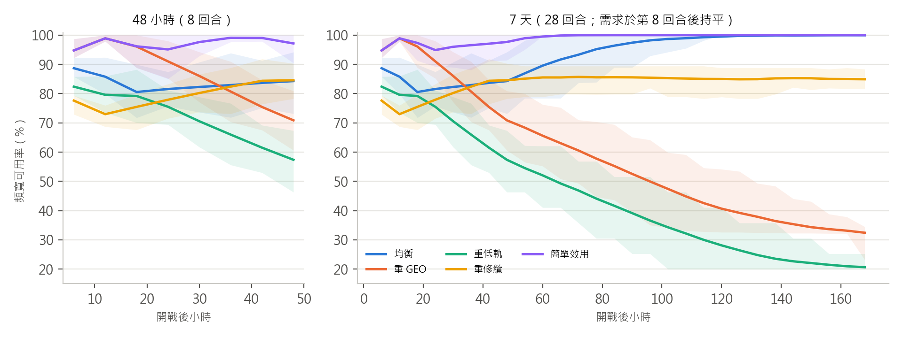

圖 S3-3　想定 A 各藍方打法每回合的頻寬可用率（灰色地帶紅方），實線為 500 局平均，色帶為第 10 到 90 百分位。左：48 小時；右：7 天延伸情境（需求於第 8 回合後持平）。來源：補充推演。⁷

### GEO 可受攻擊時

補充推演加入兩種讓 GEO 可受攻擊的機制：紅方多一個「干擾 GEO 上行鏈路」行動（2 點，GEO 容量下降 25% 或 50%、持續 2 回合，抗干擾可減半），以及每回合一定機率的 GEO 租用服務中斷（閘道站或業者端，中斷 1 回合容量減半）。⁷

| 情境（灰色地帶紅方） | 重 GEO | 均衡 | 重修纜 | 重低軌 | 四種打法中的第一 |
|---|---|---|---|---|---|
| 基準（GEO 不受攻擊） | 86.7% | 83.7% | 79.4% | 71.5% | 重 GEO |
| GEO 上行干擾 −25% | 83.2% | 91.0% | 79.4% | 71.5% | 均衡 |
| GEO 上行干擾 −50% | 75.9% | 89.4% | 79.4% | 71.5% | 均衡 |
| GEO 上行干擾 −50%，紅方依藍方配置選目標 | 75.9% | 85.5% | 79.4% | 71.5% | 均衡 |
| GEO 服務中斷，每回合 10% | 85.0% | 83.1% | 79.1% | 71.3% | 重 GEO |
| GEO 服務中斷，每回合 25% | 82.5% | 82.3% | 78.9% | 71.1% | 實質打平 |

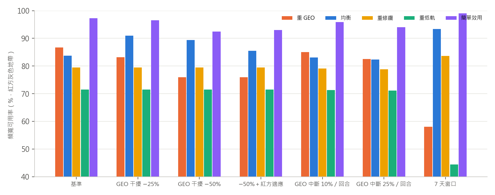

圖 S3-4　GEO 可受攻擊與 7 天窗口下，想定 A 各藍方打法的頻寬可用率（灰色地帶紅方）。來源：補充推演。⁷

只要 GEO 可以被干擾，重 GEO 就失去第一名；GEO 上行干擾 50% 時，重 GEO 少 10.8 個百分點（配對 95% 信賴區間 ±0.08；新增的紅方行動不抽亂數，序列未錯開）。均衡打法在 GEO 被干擾時反而上升，是因為紅方把點數花在干擾 GEO，就少了干擾低軌與網攻，均衡打法的 GEO 占比又小；這是固定行動點數造成的排擠，不能讀成「GEO 被干擾對均衡有利」。

### 抹除比例與手段加乘

把抹除比例改成 15%、30%、60%，重 GEO 在三種比例下都是平均可用率最高的打法。從不強化閘道站的打法，代價隨比例放大：重 GEO 依序是 −0.9、−1.7、−2.9 個百分點，重修纜是 −1.2、−2.1、−3.6。⁶

紅方三種手段會互相加乘。均衡打法在紅方不切纜、不干擾、不網攻時可用率 98.9%；三種都用時少 15.2 個百分點，而三種手段各自單獨使用的損失加起來只有 6.9。⁶ 推論（範例局佐證）是藍方的行動點數被擠爆：同時被干擾又被切纜時，藍方每回合 2 點抗干擾、3 點修纜，沒有餘力再部署終端。

### 一個不該解讀的現象

均衡打法在抹除 60% 時的代價（−2.76）比 30%（−3.21）還小。原因是藍方 AI 只在終端超過 1,000 套時才啟動抗干擾：抹除 60% 後第 1 回合只有 900 套，省下的點數拿去部署，最後終端 1,400 套，比抹除 30% 時的 1,200 套還多。100 局逐局紀錄顯示，兩者抗干擾 6.0 次對 7.0 次、部署 2.08 次對 1.08 次。⁶

這是 AI 規則的門檻效應，不能讀成「被抹除越多越好」。

## 想定 B：任務之間互相排擠

> **證據等級：M｜教學模型（示意）**
> **資料來源**：太空兵棋後端蒙地卡羅，原始想定、想定 B、想定 B＋開場颱風，每組 500 局；計分權重格點以同一批 500 局逐局重算。⁸ ⁶
> **主要假設**：GPS 被干擾時定位授時 30%，有備援 80%；SAR 每次過頂 80%；計分為偵察每次成功 3 分、定位授時平均每少 10% 扣 2 分。這些數字都不是 DIA 數據。
> **限制**：定位授時只是一個數字，沒有區分船舶、航空、金融授時；預警衛星沒有納入。
> **何時不應使用本結果**：推論真實電子戰下的定位授時可用率，或據此排定偵察、通信、導航的投資優先順序。

### 沒有一種打法三項都好

紅方灰色地帶策略下，只顧頻寬的均衡打法頻寬 92.5%，但定位授時只有 30%，偵察成功 0 次；「均衡＋備援」定位授時 73.8%、偵察成功 6.4 次，頻寬卻降到 74.2%，最低一回合 68.2%。⁸ ⁷

這些數字可以手算核對。SAR 第一次使用時紅方還不知道，成功率 80%；之後每回合被干擾，降到 40%。均衡＋備援從第 1 回合起使用 SAR，共 14 次過頂：2 × 0.8 + 12 × 0.4 = 6.4 次，與模擬值相同。定位授時 73.8% 則是 (0.3 + 7 × 0.8) ÷ 8，第 0 回合備援尚未生效。⁸ 手算對得上，屬於程式一致性的檢查：程式照規則執行，但不代表規則本身正確。

### 名次取決於權重，但只在角落翻轉

只看頻寬，均衡排第 1、均衡＋備援排第 5；用遊戲計分，名次正好倒過來。⁸ 敏感度分析把偵察權重從 0 到 6、定位授時權重從 0 到 40 掃一遍：

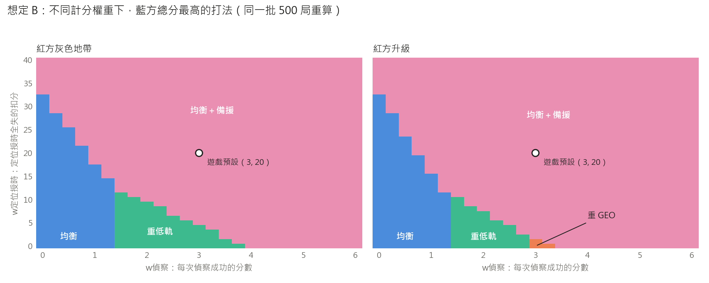

圖 S3-5　想定 B 不同計分權重下，藍方總分最高的打法。白圈為遊戲預設權重（3, 20）。權重只影響計分，不影響雙方 AI 的決策，所以用同一批 500 局逐局重算。來源：四想定敏感度分析。⁶

均衡＋備援在 80%（灰色地帶）與 83%（升級）的格點總分最高。只有偵察權重低於約 1.25 時均衡領先，定位授時權重低於約 11 時重低軌領先。⁶ 名次翻轉確實存在，但只發生在「幾乎不重視偵察」或「幾乎不在乎定位授時」的角落。替代 AI（紅方保守、激進、隨機目標、依藍方配置選目標）下，均衡＋備援在原有固定打法中仍是總分第一。⁷

### 一個反直覺的對照

紅方把點數花在 GPS 干擾、雷射致盲與 SAR 干擾之後，就沒有餘力干擾低軌：均衡打法頻寬從原始想定的 85.8% 升到 92.5%。⁸ 反過來，敏感度分析禁止紅方干擾 GPS 與 SAR，紅方省下的點數立刻轉去打通信，均衡打法頻寬少 6.8 個百分點，重低軌少 14.4。⁶

這是固定行動點數造成的排擠，只在「紅方資源有限且共用一個預算」的假設下成立。現實中，不同電子戰系統未必共用同一個預算。

## 想定 C：意圖不明

> **證據等級：M｜教學模型（示意）**
> **資料來源**：太空兵棋後端蒙地卡羅，原始想定、想定 C、想定 C 對照（紅方只接近、不攻擊），每組 500 局；補充推演另含嚇阻、歸因與誤歸因的分解。⁹ ⁷
> **主要假設**：攻擊讓藍方 GEO 頻寬與可租用上限減半（分散租用時 25%）；規避後下回合 GEO 服務降 30%；灰色地帶紅方第 4 回合起每回合 30% 機率出手，知道被監視時降到 10%；有監視時攻擊一定可歸因，歸因成功藍方聲望 +3。
> **限制**：沒有模擬軌道力學，距離分三級、一回合逼近一級都是抽象；實際 GEO 共軌接近通常要數天到數週。攻擊效果只有「衛星失效」一種。
> **何時不應使用本結果**：推論真實共軌接近的意圖、規避的燃料成本，或太空監視的嚇阻效果。

### 想定 A 平均最高的打法，在這裡最脆弱

紅方衛星在 10 公里內出手，藍方租用的那顆 GEO 衛星失效。把頻寬押在 GEO 上的重 GEO 打法損失最大：紅方升級時從 85.5% 掉到 73.1%，少 12.4 個百分點，最低一回合 55.5%；均衡打法只掉 1.5 到 1.8 個百分點。⁹ ⁷

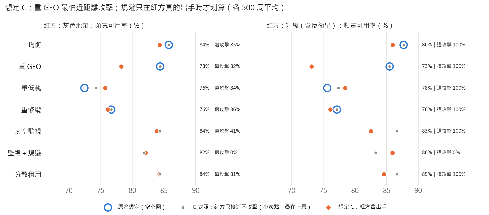

圖 S3-6　想定 C 各藍方打法的頻寬可用率與遭攻擊率，500 局平均。空心圈為原始想定，小灰點為紅方只接近、不攻擊的對照組，橘點為紅方會出手的想定 C。來源：想定 C 推演報告。⁹

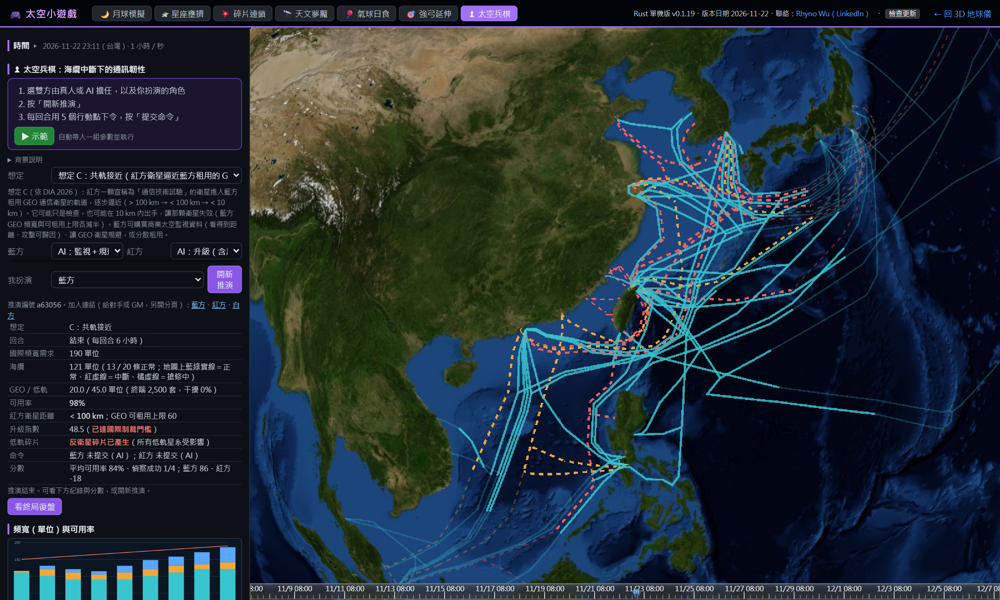

畫面 S3-1　太空兵棋想定 C 的一局（藍方 AI：監視＋規避，紅方 AI：升級）。地圖是教學想定的海纜背景：藍色實線為正常、紅色虛線為中斷、橘色虛線為搶修中；左側是局末狀態與每回合的頻寬。這一局平均可用率 84%。單一局只是示例，不代表策略優劣（見「讀推演結果的五個方法」）。截圖：本專案 Rust 單機版（v0.1.19 工作版），2026-11-22。

### 「威脅存在」本身的代價

「監視＋規避」在三種紅方下都讓攻擊完全落空，但每次規避要花 2 點，下回合 GEO 服務也會降 30%。和均衡打法相比：⁹

| 紅方 | 監視＋規避 | 均衡 | 差距 |
|---|---|---|---|
| 升級（一到位就出手） | 85.9% | 86.0% | 實質打平 |
| 灰色地帶（出手率 85%） | 82.1% | 84.3% | −2.2 |
| 只接近、不攻擊 | 81.8% | 85.8% | −4.0 |

最後一列是想定 C 最重要的數字：紅方不必出手，只要停在旁邊，藍方就得一直花點數規避。要量出這筆代價，必須有「只接近、不攻擊」的對照組。⁹

規避次數同樣可以手算：規避讓紅方衛星退回 100 公里級，紅方下回合再逼近，藍方再下一回合規避，每 2 回合循環一次，第 3、5、7 回合各一次，共 3 次，模擬值 3.0。⁹

### 嚇阻與歸因要分開

本篇的「監視」在模型中有兩種效果，定義如下：

| 效果 | 定義 | 模型中的機制 | 依據 |
|---|---|---|---|
| 嚇阻 | 紅方因預期被監視、歸因或外交後果而降低出手機率 | 灰色地帶紅方知道被監視時，出手率由每回合 30% 降到 10% | AI 行為假設；DIA 沒有提供證據 |
| 歸因 | 攻擊可被識別、記錄並歸責的能力 | 有監視時攻擊一定可歸因，藍方聲望 +3、紅方升級 +4 | 計分權重；歸因成功率與聲望加分都是示意值 |

補充推演把兩者分開：「只有歸因」讓紅方被監視時不降低出手率；「只有嚇阻」讓歸因不加分。比較「太空監視」與「均衡」的總分差距：⁷

| 設定 | 灰色地帶紅方 | 升級紅方 | 監視打法遭攻擊率（灰色地帶） |
|---|---|---|---|
| 基準（嚇阻＋歸因） | +1.8 | +1.1 | 41% |
| 只有歸因 | +2.6 | +1.1 | 81% |
| 只有嚇阻 | +0.6 | −1.9 | 41% |
| 兩者皆無 | +0.2 | −1.9 | 81% |
| 歸因成功率 50% | +1.2 | −0.2 | 41% |
| 誤歸因，每回合 10% | +1.2 | +1.4 | 41% |
| 誤歸因，每回合 30% | −1.1 | +1.0 | 41% |

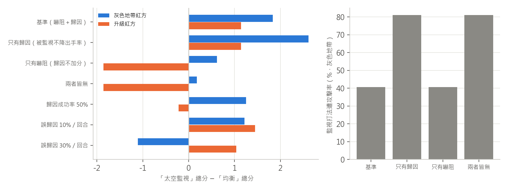

圖 S3-7　想定 C「太空監視」相對「均衡」的總分差距（左），以及灰色地帶紅方下監視打法的遭攻擊率（右）。來源：補充推演。⁷

在本模型中，監視的總分優勢主要來自歸因聲望：只保留嚇阻時，灰色地帶紅方下只剩 +0.6，升級紅方下變成 −1.9。嚇阻讓遭攻擊率由 81% 降到 41%，但頻寬只差 0.5 個百分點，因為被攻擊的那顆 GEO 衛星只占藍方頻寬的一部分。誤歸因是新的代價：紅方衛星在 10 公里內但未出手時，藍方若每回合有 30% 機率把其他異常誤指為紅方所為，監視打法的分數就低於均衡；紅方只接近、不攻擊時，差距擴大到 −4.1。升級紅方一到位就出手，幾乎沒有誤歸因的機會，所以誤歸因對升級紅方的影響很小（表中的小幅變動來自亂數序列錯開）。

「監視＋規避對升級紅方打平均衡」同樣建立在兩個假設上：監視資料每回合只有 70% 有效時，規避打法遭攻擊率從 0% 升到 48%，頻寬落後均衡 1.6 個百分點；只有 40% 有效時落後 2.9；規避成功率 50% 時落後 3.0。⁶

結論應讀成：在監視不中斷、規避必成功、且紅方被監視時會降低出手率的模型假設下，監視＋規避與均衡打法的頻寬相近；監視的總分優勢主要來自歸因聲望，嚇阻效果本身是 AI 假設。

## 想定 D：不可逆與長期成本

> **證據等級：M｜教學模型（示意）；賽後碎片為實測（取自延伸篇 S1 的 SATCAT 資料）**
> **資料來源**：太空兵棋後端蒙地卡羅，想定 D、想定 D 對照（紅方不用反衛星）、原始想定，每組 500 局；補充推演另含紅方換目標的機率與延遲。¹⁰ ⁷
> **主要假設**：碎片讓低軌容量 −10%；業者避碰讓碎片影響減半；升級紅方第 4 回合起每回合 50% 機率試射；藍方有商業影像時紅方改打商用低軌衛星；商業影像成功率與自有衛星相同。
> **限制**：遊戲只涵蓋 48 小時；藍方光學衛星的軌道高度沒有設定；沒有模擬碎片打到紅方自己或中立方的衛星。
> **何時不應使用本結果**：推論真實反衛星攻擊的頻寬影響、據此判斷避碰不重要，或把 48 小時結果當成長期成本。

### 遊戲窗口內（48 小時）：打掉的是偵察，不是頻寬

紅方擊毀藍方唯一的光學偵察衛星後，依賴光學偵察的打法每局偵察成功次數幾乎減半：重 GEO 從 4.75 次降到 2.43 次，重低軌從 4.19 次降到 1.76 次。頻寬反而略升，因為紅方把 4 點花在反衛星上，就少了切纜與干擾；這又是一次排擠。¹⁰ 同一枚飛彈打擴散星座，效果完全不同：商用低軌星座少一顆衛星，容量不變，只留下碎片。¹⁰

48 小時內，碎片對頻寬的影響很小，「均衡＋避碰」對升級紅方的頻寬 87.1%，反而低於不避碰的 87.7%。¹⁰ 這只表示避碰在 48 小時窗口與本遊戲計分下看不出好處，不表示避碰不重要。

### 商業影像的價值取決於紅方怎麼選目標

在基準規則下，商業影像讓這一擊落空：灰色地帶紅方遇到備援就不出手，出手率從 88% 降到 0%；升級紅方改打商用星座，藍方偵察幾乎不受影響。¹⁰ 這個結果主要來自「紅方遇到備援就換目標」的 AI 假設。補充推演改變這個假設：⁷

| 紅方遇到備援時 | 藍方光學衛星被擊毀率（灰色地帶，GEO＋商業影像打法） | 每局偵察成功次數（商業影像效能 100%／70%／40%） |
|---|---|---|
| 一定換目標（基準） | 0% | 4.13 |
| 一半機率換目標 | 42% | 4.14／3.84／3.51 |
| 延遲 4 回合才換目標 | 56% | 4.15 |
| 不換目標 | 88% | 4.17／3.50／2.80 |

對照：沒有商業影像的重 GEO 打法被擊毀後每局 2.43 次；紅方不用反衛星時，重 GEO 4.75 次、GEO＋商業影像 4.13 次。⁷

紅方不換目標時，商業影像效能 100%、70%、40% 分別保住約 100%、73%、43% 的偵察損失（無備援時損失 2.32 次）。結論應讀成：在紅方遇備援即改變目標的 AI 假設下，商業影像可降低藍方光學衛星被攻擊的機率；它保住多少偵察能力，取決於能替代多少，而實際的替代程度還取決於任務需求、解析度、重訪週期、資料延遲、權限、安全與業者政策，本模型都沒有納入。

### 遊戲窗口外：碎片的長期成本

碎片的成本在遊戲結束之後，必須和 48 小時的頻寬結果分開看：

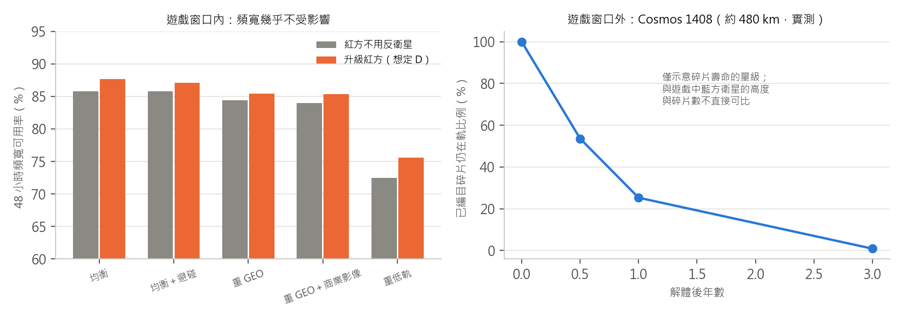

圖 S3-8　想定 D 的短期與長期分開呈現。左：48 小時頻寬，紅方用與不用反衛星幾乎相同；右：Cosmos 1408 已編目碎片仍在軌的比例（實測），只示意碎片壽命的量級，與遊戲中的藍方衛星不直接可比。來源：補充推演；CelesTrak SATCAT。⁷ ¹¹

| 經過時間 | Cosmos 1408 已編目碎片仍在軌（約 480 公里，2021 年） |
|---|---|
| 半年 | 53.6% |
| 1 年 | 25.3% |
| 3 年 | 0.9% |

資料取自 CelesTrak SATCAT，與延伸篇 S1 主案例相同。¹¹ 這組資料不是本篇兵棋輸出的驗證：Cosmos 1408 的高度（約 480 公里）、碎片數量與衰減時間，和遊戲中沒有設定高度的藍方光學衛星並不直接可比。對照 DIA 的描述：2007 年中國試射在 800 公里以上，產生超過 3,500 塊可追蹤碎片，報告撰寫時仍有超過 2,400 塊在軌。² 目標高度決定碎片是幾年內清掉，還是留幾十年。若要把長期成本納入比較，需要另建碎片壽命、碰撞風險、容量損失與避碰成本的分析（可用延伸篇 S1 的模型），本篇沒有做。

## 替代 AI：結論有多依賴行為規則

雙方 AI 是固定規則，許多結論直接來自這些規則。補充推演加入以下替代 AI，每種都跑四個想定、兩種紅方、各 500 局：⁷

| 類別 | 替代版本 | 內容 |
|---|---|---|
| 紅方風險偏好 | 保守、基準、激進 | 切纜、網攻、反衛星與想定 C、D 的出手機率乘以 0.5、1、1.5（上限 100%） |
| 紅方目標選擇 | 固定、隨機、依藍方配置 | 固定為原本的優先序；隨機為每回合隨機排列切纜、干擾 GEO、干擾低軌、網攻；依藍方配置為第 1 回合起先打藍方 GEO 與低軌中容量較大的一方（簡單適應） |
| 藍方決策規則 | 固定打法、閾值規則、簡單效用 | 閾值規則：可用率 ≥ 90% 只補低軌，否則先抗干擾、修纜，再補 GEO 與低軌中較小的一方；簡單效用：每個行動點換到的「剩餘回合容量」最大者優先（貪婪，不預測紅方） |

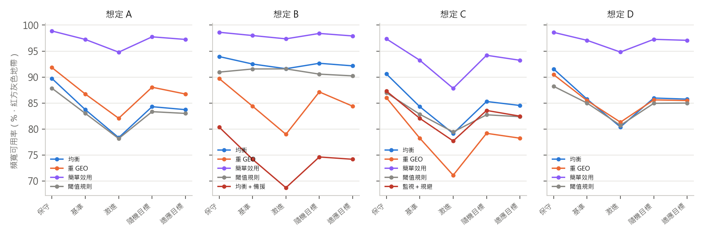

圖 S3-9　替代 AI 下，各想定主要打法的頻寬可用率（灰色地帶紅方）。來源：補充推演。⁷

結果有三點：⁷

1. **紅方風險偏好改變量級，多數不改變原有固定打法之間的名次。** 想定 A 的重 GEO 在保守、基準、激進下依序為 91.8%、86.7%、82.1%，三種都排四種固定打法的第一；想定 B 的均衡＋備援仍是總分第一。想定 C 的第一名在均衡、分散租用與監視＋規避之間輪替，與重抽名次「實質打平」的結論一致；想定 D 激進紅方下，重 GEO 小幅領先均衡（81.3% 對 80.4%）。
2. **紅方目標選擇的影響取決於紅方點數夠不夠。** 想定 A 中，紅方每回合的點數足以同時切纜、干擾與網攻，打擊順序不影響結果，依藍方配置選目標與基準完全相同；只有加入 GEO 干擾後，紅方的選擇才有作用（表「GEO 可受攻擊時」）。
3. **藍方的決策規則比資源配置更能決定結果。** 簡單效用 AI 在四個想定的頻寬都是約 89% 到 98%，遠高於所有固定打法。它的優勢主要來自不浪費點數：例如重 GEO 打法在 GEO 達到上限 60 後仍繼續續租，簡單效用則改投低軌與修纜。所以固定打法之間的名次，部分反映的是規則寫得好不好，而不只是「重 GEO」或「重低軌」這種資源配置本身的優劣。閾值規則的表現與均衡相近。

## 時間窗口：48 小時與 7 天

8 回合的窗口看不到海纜修復、替代部署與長期消耗。補充推演把窗口延長為 28 回合（7 天）；第 8 回合以後需求持平在 190 單位，因為 48 小時以後的危機流量沒有依據可推，這是作者的假設。⁷ 30 天窗口沒有測試：遊戲的紅藍行動規則是為短期危機設計的，延長到 30 天時，雙方每回合重複同樣的行動，結果主要反映規則的重複，不反映 30 天的戰略調整。

| 想定（灰色地帶紅方） | 48 小時第一（原有固定打法） | 7 天第一（原有固定打法） | 重 GEO：48 小時 → 7 天 |
|---|---|---|---|
| A | 重 GEO（86.7%） | 均衡（93.4%） | 86.7% → 58.0% |
| B | 均衡（92.5%） | 均衡（97.8%） | 84.4% → 56.6% |
| C | 均衡（84.3%） | 分散租用（93.8%） | 78.2% → 43.8% |
| D | 均衡與均衡＋避碰並列（85.8%） | 均衡與均衡＋避碰並列（94.4%） | 85.5% → 57.9% |

7 天時，不修纜的重 GEO 與重低軌在紅方持續切纜下崩落到約 44% 到 60%；有修纜的均衡打法則在海纜修復後回升到 93% 以上（圖 S3-3 右）。想定 C 升級紅方下，7 天的第一名是監視＋規避（95.7%）。所以想定 A「重 GEO 平均最高」在 48 小時以外反轉；48 小時的頻寬結果不能外推為整體韌性。

## 讀推演結果的五個方法

四個想定反覆出現同樣的閱讀問題。把它們整理成五個方法：

### 1. 設對照組，而且要設對

想定 A 的對照組有同樣的預置終端，想定 C 的對照組讓紅方只接近不攻擊，想定 D 的對照組讓紅方不用反衛星。沒有對照組，「多了資源」和「被攻擊」就會混在一起；對照組設錯，答案也會錯。⁵ ⁹ ¹⁰

### 2. 用配對差值，不要用兩個獨立區間

共同亂數下，同一個種子的兩局可以逐局相減。表中同時列出逐局差值的標準差（效應量的離散程度）與兩種信賴區間：⁶ ⁷

| 比較 | 差值（百分點） | 逐局差值標準差 | 配對半寬 | 獨立樣本半寬 | 亂數序列 |
|---|---|---|---|---|---|
| A：想定 A − 對照（均衡） | −3.21 | 0.13 | ±0.01 | ±0.63 | 未錯開 |
| A：GEO 干擾 −50% − 基準（重 GEO） | −10.81 | 0.92 | ±0.08 | — | 未錯開 |
| A：7 天 − 48 小時（重 GEO） | −28.69 | 3.70 | ±0.32 | — | 第 8 回合後新增 |
| B：紅方不干擾 − 基準（均衡） | −6.75 | — | ±0.25 | ±0.53 | 錯開 |
| C：想定 C − 只接近（重 GEO，升級） | −12.32 | 0.46 | ±0.04 | ±0.62 | 未錯開 |
| D：想定 D − 不用反衛星（重 GEO，升級） | +1.06 | 3.27 | ±0.29 | ±0.61 | 錯開 |

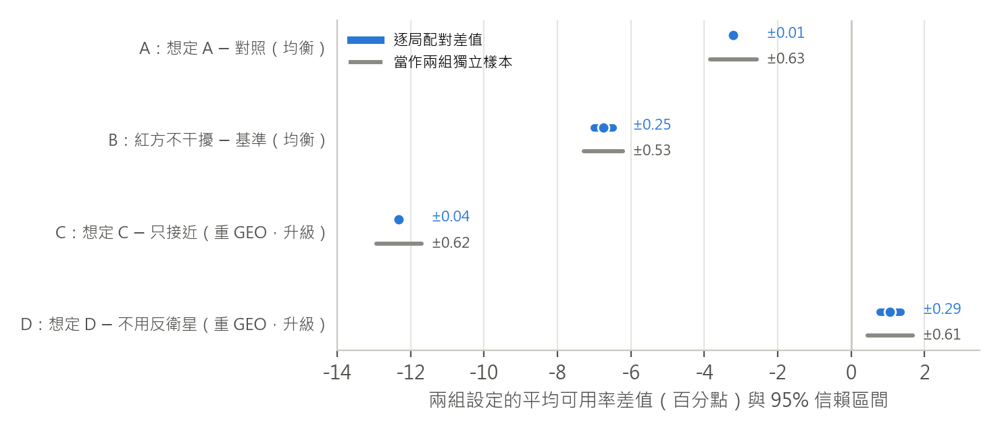

圖 S3-10　同一組差值，兩種信賴區間。藍色為逐局配對差值的 95% 信賴區間，灰色為把兩組當成獨立樣本計算的區間。想定 A 的配對區間只有 ±0.01 個百分點，在圖上幾乎看不見。來源：四想定敏感度分析。⁶

兩組設定的亂數序列越晚錯開，配對越精確。想定 A 的兩組幾乎只差在開戰前那一次抹除，所以半寬只有 0.01。反過來，加入新的隨機判定（例如監視中斷、規避失敗）會讓亂數序列提早錯開，配對優勢跟著縮小。⁶

### 3. 看分布，不要只看平均

各打法的局間差距，從第 5 到第 95 百分位約有 11 到 20 個百分點，遠大於打法之間的平均差距。⁶

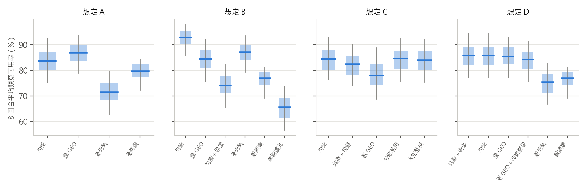

圖 S3-11　四個想定各藍方打法 8 回合平均可用率的分布（灰色地帶紅方）。粗線為中位數，色塊為第 25 到 75 百分位，細線為第 5 到 95 百分位。來源：補充推演。⁷

單一局的結果，例如一場桌上推演，不能代表策略優劣。

### 4. 看名次穩不穩

以種子為單位重抽 1,000 次，計算各打法排第一、前二與前三的比例（只比原有固定打法；逐局完全相同的打法同列名次）：⁷

| 想定、紅方 | 排第一的比例 | 判讀 |
|---|---|---|
| A、B（灰色地帶） | 第一名在 100% 的重抽中相同（A 重 GEO、B 均衡） | 名次穩定 |
| C、灰色地帶 | 均衡 53%、分散租用 47%；兩者前二皆約 100% | 實質打平 |
| C、升級 | 均衡 59%、監視＋規避 41% | 實質打平 |
| D、灰色地帶 | 均衡與均衡＋避碰並列 87%（兩者逐局相同）、重 GEO 13% | 前兩名逐局相同 |
| D、升級 | 均衡 100% | 名次穩定 |

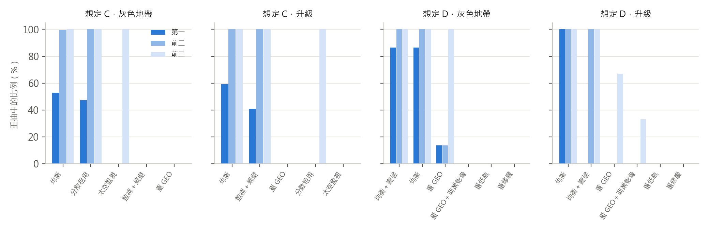

圖 S3-12　想定 C、D 的名次機率（排第一、前二、前三）。來源：補充推演。⁷

C 的前兩名實質打平，不應寫成「某打法最好」。名次差異要有行動意義，至少要在重抽中穩定排第一，而且平均差距大到會改變選擇；本篇以兩者同時成立為門檻。

### 5. 先排除模型造成的現象

| 現象 | 出現在 | 原因 |
|---|---|---|
| 紅方把點數花在別處，藍方頻寬反而上升 | B、C、D、A（GEO 干擾） | 紅方每回合固定 5 點，一種行動排擠另一種 |
| 抹除越多，均衡打法代價越小 | A（敏感度） | 藍方 AI 的抗干擾門檻（1,000 套） |
| 監視品質變差，差距反而縮小 | C（敏感度） | 新的隨機判定讓亂數序列錯開，差異在誤差內 |
| 被打掉光學衛星，藍方分數反而上升 | D | 歸因與外交的聲望加分抵掉偵察損失；計分是示意權重 |
| 簡單效用 AI 遠勝所有固定打法 | 全部 | 固定打法有浪費點數的規則（例如 GEO 已達上限仍續租） |
| 紅方依藍方配置選目標，結果與基準相同 | A | 紅方點數足以同時執行所有攻擊，順序不影響結果 |

這些現象都經過逐局或逐分量拆解確認，不是程式錯誤，而是規則與假設的直接結果。⁵ ⁸ ⁹ ¹⁰ ⁶ ⁷ 它們之所以值得列出，是因為每一個都可能被讀成一句漂亮但錯誤的實戰結論。

## 敏感度分析改變了哪些結論

| 想定 | 原本的結論 | 敏感度分析、替代 AI 與 7 天窗口之後 | 模型內穩健度 |
|---|---|---|---|
| A | 重 GEO 最穩 | 只在「GEO 不受攻擊、48 小時窗口」下平均最高；最低一回合低於均衡；GEO 可被干擾時失去第一；7 天時崩落到 58% | 低（依賴模型結構） |
| B | 計分權重決定名次，名次可以完全翻轉 | 均衡＋備援在八成以上的權重組合與四種替代紅方 AI 下都是總分第一；翻轉只發生在權重的角落 | 中高 |
| C | 監視＋規避對升級紅方打平均衡 | 只在監視不中斷、規避必成功時成立；監視的總分優勢主要來自歸因聲望，嚇阻效果是 AI 假設；誤歸因會讓監視打法落後 | 低 |
| D | 商業影像讓反衛星落空 | 「落空」來自紅方遇備援即換目標的假設；紅方不換目標時，商業影像保住的偵察取決於它的效能 | 低 |

「模型內穩健度」只表示結論對本篇掃描過的參數、AI 與窗口有多敏感，不代表結論在真實情況下的可信度。初稿把 A 評為「高」，是因為當時只掃描了抹除比例；加入 GEO 可受攻擊與 7 天窗口後，A 的結論反而最依賴模型結構。

四個結論中，沒有一個能原樣站得住，只有 B 在掃描範圍內大致維持。⁶ ⁷ 這不是推演失敗，而是推演應該做的事：把一句結論背後的假設，變成看得見、可以檢查的條件。

## 國安意涵

本篇的啟示是：

> **兵棋推演的產出是「在什麼假設下，哪個選擇比較好」，不是「哪個選擇最好」。**

以下四點都限定在本模型的假設下：

1. **沒有一種防護在所有情況下都最好。** 在本篇的模型比較中，將頻寬集中於單一資源（重 GEO）會提高特定想定下的脆弱性：GEO 被干擾、被共軌攻擊，或窗口拉長時，它都會落後。最適的分散程度、混合組合與成本限制，本篇沒有測試。
2. **意圖不明本身就有成本。** 想定 C 中，紅方只接近、不攻擊，規避打法就少 4.0 個百分點；誤把異常歸因給對方，也會付出聲望代價。這與本書第 19 章「接近不等於威脅」的判讀互相呼應。這裡量到的是規避在遊戲中的資源成本，不是真實的規避燃料成本，也不是太空監視的嚇阻效果。
3. **低成本備援的價值，要和對手的反應一起評估。** 想定 D 的商業影像，在「紅方會換目標」與「紅方照打」兩種假設下，價值完全不同；實際價值還取決於影像能替代多少自有能力。
4. **短期推演看不到長期成本與長期消耗。** 48 小時的窗口看不到碎片留在軌道上的時間；7 天窗口下，好幾個 48 小時的名次也會反轉。長期成本要用實測資料與延伸篇 S1 的模型另外補上。

推演中的紅方是規則寫成的 AI，不代表任何特定國家的作戰意圖或能力；推演結果也不能直接用來評估真實武器的效能。

## 與本書其他章的關係

| 本書章節 | 關係 |
|---|---|
| 第 1 章 | Schriever 兵棋推演與 CIC、Viasat KA-SAT 事件；本篇把這些背景轉成可量化的想定 |
| 第 19 章 | 接近不等於威脅、非合作接近事件的證據鏈；想定 C 把「意圖不明」的成本量化 |
| 延伸篇 S1 | Cosmos 1408 碎片衰減與共同亂數；想定 D 的賽後碎片資料與 S1 相同 |

## 主要參數

本篇的關鍵參數集中如下。所有效果參數、出手機率與計分權重都沒有 DIA 或其他外部依據；「敏感度分析」一欄寫「未測」，表示本篇沒有改變這個數值重跑。⁶ ⁷

| 參數 | 預設值 | 想定 | 敏感度分析 |
|---|---|---|---|
| 回合數與長度 | 8 回合，每回合 6 小時 | 全部 | 28 回合（7 天，需求於第 8 回合後持平） |
| 行動點數 | 每方每回合 5 點 | 全部 | 未測 |
| 頻寬需求 | 150 單位起，每回合 +5 | 全部 | 未測（7 天情境中第 8 回合後持平） |
| 蒙地卡羅 | 每組 500 局，種子 1000–1499 | 全部 | 以配對信賴區間與重抽名次檢查 |
| 開戰前抹除 | 30% | A | 15%、30%、60% |
| 開場干擾 | 25%，持續 2 回合 | A | 只以「去掉開場干擾」的變體拆解 |
| 網攻抹除 | 閘道站未強化時每次 30% | A | 只以「去掉網攻抹除」的變體拆解 |
| 紅方頻寬攻擊手段 | 切纜、干擾、網攻都用 | A | 只用一種、三種都不用 |
| GEO 可受攻擊 | 不受攻擊 | A、C | 上行干擾 −25%、−50%；服務中斷每回合 10%、25% |
| GPS 被干擾時定位授時 | 30%（有備援 80%） | B | 10%、30%、60% |
| SAR 成功率 | 80%（被干擾後 40%） | B | 50%、80%、95% |
| 計分權重 | 偵察每次 3 分；定位授時每少 10% 扣 2 分 | B | 偵察 0–6、定位授時 0–40 的格點 |
| 紅方干擾 GPS 與 SAR | 會 | B | 禁止干擾的對照 |
| 攻擊 GEO 的效果 | 頻寬與可租用上限減半（分散租用 25%） | C | 未測 |
| 規避後服務下降 | 30% | C | 15%、50% |
| 規避成功率 | 100% | C | 80%、50% |
| 監視資料有效率 | 100% | C | 70%、40% |
| 歸因成功率 | 100% | C | 50% |
| 歸因的聲望加分 | 3 | C | 0、1.5 |
| 誤歸因機率 | 0 | C | 每回合 10%、30% |
| 灰色地帶紅方出手率 | 第 4 回合起每回合 30%，被監視時 10% | C | 被監視時 5%、30% |
| 碎片影響 | 低軌容量 −10%，業者避碰時減半 | D | 未測 |
| 升級紅方反衛星試射 | 第 4 回合起每回合 50% | D | 未測（對照組不試射） |
| 紅方遇備援換目標 | 一定換、立即換 | D | 一半機率、延遲 4 回合、不換 |
| 商業影像效能 | 與自有衛星相同（100%） | D | 70%、40% |
| 紅方風險偏好 | 基準 | 全部 | 出手機率 ×0.5、×1.5 |
| 紅方目標選擇 | 固定優先序 | 全部 | 隨機、依藍方配置 |
| 藍方決策規則 | 固定打法 | 全部 | 閾值規則、簡單效用 |

## 已知限制

1. 所有效果參數、出手機率與計分權重都是示意值，DIA 沒有提供。
2. 雙方 AI 都是規則寫成；替代 AI 只到「簡單適應」與「貪婪效用」，沒有依預期效用推估對手行動，也沒有學習。
3. 紅方每回合固定 5 點，各種手段共用同一個預算；B、C、D 與 GEO 干擾的排擠效果都來自這個設定。
4. 頻寬「單位」與「可用率」是抽象指標，不對應實際 Gbps 或使用者數；降級為線性，沒有服務優先序。
5. 想定 C 沒有模擬軌道力學；想定 D 沒有設定衛星高度，也沒有模擬碎片打到紅方或中立方。
6. 主要結論只適用於 48 小時；7 天情境的需求曲線是假設，30 天沒有測試；碎片的長期成本沒有進入遊戲分數。
7. 太空兵棋後端以 games_war.rs 的 SHA-256 識別版本（見附錄「資料與版本」）。

外部審查提出、尚未處理的建議，依對核心結論的影響排序：

| 優先度 | 項目 | 理由 |
|---|---|---|
| 高 | 雙方 AI 改為依預期效用、會預測對手的決策 | 本篇已顯示藍方 AI 規則會主導名次 |
| 中 | 終端重新部署速率、干擾持續時間、規避可用次數上限、攻擊 GEO 的效果大小 | 影響特定想定的量級與策略比較 |
| 低 | 紅方對碎片外部性的偏好、長期碎片成本納入分數、30 天窗口 | 重要，但宜另以延伸分析處理 |

## 附錄：資料與版本

| 項目 | 內容 |
|---|---|
| 推演引擎 | `RUST_SatDashboard/src/games_war.rs`；初稿推演版本的 SHA-256 見 `sim_wargame/sensitivity/run_meta.json`，補充推演版本見 `sim_wargame/review_v2/run_meta_v2.json` |
| 規則版本 | 2026-11-22 想定 A–D 規則（`games_war_scenarios.md`）；2026-11-23 擴充 GEO 可受攻擊、替代 AI、回合數、誤歸因與換目標參數，預設值下與擴充前逐局相同（72 組比較） |
| 參數版本 | 每個實驗的參數覆寫記錄在推演程式的實驗清單（`run_sensitivity.py`、`run_review_v2.py`）與 API 回應中 |
| 結果快照 | 初稿：`sim_wargame/scenario_a`–`d`、`sensitivity/games.csv.gz`；補充：`review_v2/games_v2.csv.gz`、`summary_v2.json` |
| 逐局欄位 | exp（實驗代號）、scenario、red、blue、seed、mean_avail（8 回合平均可用率）、min_avail、early_avail（前 3 回合平均）、blue_score、red_score、isr_ok、sar_ok、pnt_avail、reputation、escalation、struck、attributed、isr_sat_dead、asat_used、cyber_lost、geo_lost、evades；補充推演另有 misattributed（誤歸因次數）與 series（每回合可用率） |
| 重跑方式 | 啟動 Rust 單機版後執行 `python docs/book/sim_wargame/sensitivity/run_sensitivity.py --server <網址>` 與 `python docs/book/sim_wargame/review_v2/run_review_v2.py --server <網址>`；不加 `--server` 時只由既有結果重算摘要 |

## 本章檢核清單

- [ ] 能區分想定依據、示意參數、AI 行為假設與計分權重，並說明 DIA 只提供哪一種。
- [ ] 能說明想定 A 為何不能直接和原始想定比較，以及對照組怎麼設。
- [ ] 能說明頻寬可用率怎麼算，以及為何還要看最低可用率與前 3 回合。
- [ ] 能說明「重 GEO 平均最高」依賴哪兩個模型條件。
- [ ] 能說明配對差值為何比兩個獨立信賴區間精確，以及新的隨機判定為何會削弱配對優勢。
- [ ] 能區分想定 C 中的嚇阻與歸因，並說明「只接近、不攻擊」對照組量到的是什麼。
- [ ] 能說明替代 AI 如何改變名次，以及為何藍方 AI 規則會主導結果。
- [ ] 能舉出至少兩個模型造成的現象，並說明為何不能讀成實戰結論。
- [ ] 能區分「規則寫成的紅方 AI」與「真實對手」：推演結果不等於任何國家的意圖或能力評估。

## 本章外部事件來源

- 美國國防情報局（DIA）. *Challenges to Security in Space 2026: Congestion, Competition, and Cooperation*（資訊截止 2026 年 7 月）。本專案使用非官方繁體中文譯本《太空安全面臨的挑戰：層疊、競逐與合作》，頁碼為譯本頁碼；原報告：www.dia.mil/Military-Power-Publications （本章用於：四個想定的背景描述）
- Schriever 兵棋推演與 CIC、Viasat KA-SAT 事件的來源見第 1 章「本章外部事件來源」。

## 資料來源

1. 見第 1 章插敘「CIC 從 2015 年的試行說起」、章前導讀的 Viasat KA-SAT 事件及第 1 章外部事件來源。
2. 美國國防情報局（DIA）（2026）。*Challenges to Security in Space 2026*，非官方繁體中文譯本（RUST_SatDashboard/web/static/docs/Challenges_Security_Space_2026_zh-TW.pdf），p.4、18、31–33、37、43–44。
3. 本專案（2026 年 11 月 22 日）。*太空兵棋想定設計說明*（RUST_SatDashboard/docs/games_war_scenarios.md）。未出版內部資料。
4. 謝沛學（2020）。從遊戲到實戰：商用兵棋軟體如何協助軍事分析與訓練。*國防安全雙週報*。
5. 本專案（2026 年 11 月 22 日修訂）。*太空兵棋想定 A：灰色地帶，海纜中斷，商用低軌也被干擾*（docs/book/sim_wargame/scenario_a/）。未出版內部資料。
6. 本專案（2026 年 11 月 22 日）。*太空兵棋四想定敏感度分析*（docs/book/sim_wargame/sensitivity/，含 summary.md、games.csv.gz、run_meta.json）。未出版內部資料。
7. 本專案（2026 年 11 月 23 日）。*太空兵棋審查補充推演*（docs/book/sim_wargame/review_v2/，含 run_review_v2.py、games_v2.csv.gz、summary_v2.json、run_meta_v2.json）。未出版內部資料。
8. 本專案（2026 年 11 月）。*太空兵棋想定 B：致盲致聾*（docs/book/sim_wargame/scenario_b/）。未出版內部資料。
9. 本專案（2026 年 11 月）。*太空兵棋想定 C：共軌接近*（docs/book/sim_wargame/scenario_c/）。未出版內部資料。
10. 本專案（2026 年 11 月）。*太空兵棋想定 D：直升式反衛星*（docs/book/sim_wargame/scenario_d/）。未出版內部資料。
11. 見延伸篇 S1 主案例；原始資料為 CelesTrak. *SATCAT records, INTDES 1982-092*. https://celestrak.org/satcat/records.php?INTDES=1982-092&FORMAT=CSV （存取日期 2026-11-21）
