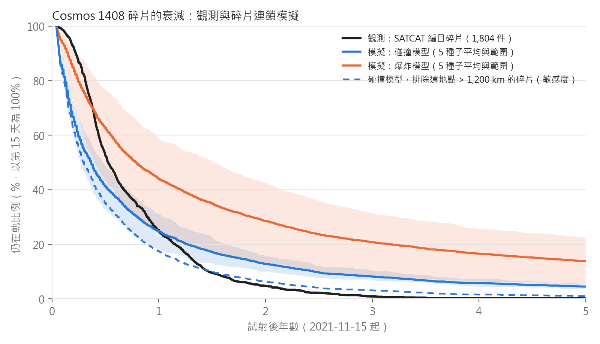

# 碎片連鎖遊戲的衰減驗證：Cosmos 1408 反衛星試射碎片

> 版本：2026-11-21｜模擬端：Rust 單機版「碎片連鎖」後端（v0.1.15，commit 4132e4c 的 `POST /api/games/breakup`）
> 用途：模擬篇新章（不入送審版）的主案例素材；也對應[架構說明](../../../../RUST_SatDashboard/docs/games_debris_architecture.md)第 10 節「可驗證」的第一項
> 重跑：`python docs/book/sim_validation/cosmos1408/validate_cosmos1408.py [--server http://127.0.0.1:<埠>]`

## 結論

1. **第一年吻合，之後模擬衰減太慢。** 碰撞模型第 1 年存活 24.8%（5 種子範圍 18.2%–31.1%），觀測 25.3%；但第 2 年 12.8% 對 4.8%，第 3 年 8.2% 對 0.9%，第 5 年 4.5% 對 0.2%。
2. **乘上單一阻力倍數也修不好。** 把密度乘面積質量比整體放大 k 倍，碰撞模型的最佳 k 仍是 1.00：前期已經偏快、後期偏慢，曲線形狀不對，不是整體尺度不對。
3. **長尾主要來自高遠地點碎片。** 模擬中活過 3 年的碎片，出生遠地點中位數 1,637 km（90 百分位 4,015 km）；本機 DB 中 54 件長壽真實碎片，首筆 TLE 的遠地點最高 1,192 km、中位數 515 km。排除遠地點超過 1,200 km 的模擬碎片（占 8.3%）後，第 3 年存活降為 3.1%，與觀測 0.9% 的差距縮小約三分之二。
4. **剩下的差距與靜態大氣一致，但未證實。** 2021-11 至 2026-10 的 F10.7 平均 151，比 1996–2019 平均 108 高；遊戲用的是不隨太陽活動變化的指數大氣。這是推論，本次沒有做隔離檢驗。
5. **爆炸模型不適合這個案例。** 第 1 年存活 43.9%、第 5 年 13.8%，種子間差異大（第 5 年 5.6%–22.5%）。動能反衛星撞擊應以碰撞模型設定。

對遊戲與新章的意義：在寫實倍率下，第一年的碎片量級可信；**超過一年的長期存活數與期望碰撞數偏高**，不能當成寫實估計。要讓長期數字可信，至少要處理兩件事：Δv 分布造成的高遠地點長尾，以及隨太陽活動變化的大氣。

## 資料

| 項目 | 觀測 | 模擬 |
|---|---|---|
| 來源 | CelesTrak SATCAT，國際編號 1982-092（[satcat_1982-092.csv](satcat_1982-092.csv)，2026-11-21 下載） | 碎片連鎖後端，另開實例執行，不影響使用者的執行程序 |
| 樣本 | 類型 DEB、NORAD ≥ 49000 的 1,805 件，也就是 2021-11-15 試射後編目的碎片；1,802 件有再入日期，3 件仍在軌。排除母體、火箭體與 1 件 2017 年的舊碎片 | 自訂圓軌道 480 km／82.6°、母體 2,200 kg、1,000 個碎片、寫實倍率 ×1、5 年；碰撞與爆炸模型各 5 個種子（1–5） |
| 時間零點 | 2021-11-15 | 解體時刻 |
| 存活基準 | 第 15 天仍在軌者為 100%（觀測第一筆再入在第 15 天） | 同左：第 15 天前消失的碎片不計入分母（碰撞模型 34%、爆炸模型 9.5%） |

模擬的母體設定沿用遊戲內建的歷史案例模板，屬於近似教學設定。

## 方法

- 存活曲線 S(t)：第 t 天仍在軌的件數 ÷ 第 15 天仍在軌的件數。
- 模擬只取第一次解體的碎片。寫實倍率下 10 次模擬只有 1 次發生碰撞（爆炸模型、種子 1），其產生的後代碎片不計入。
- **阻力尺度因子 k**：只有阻力時，da/dt 與 ρ·(A/M) 成正比，所以把 ρ·(A/M) 全體乘以 k，等於把時間軸壓縮 k 倍。以 S_sim(15 + (t − 15)·k) 擬合 S_obs(t)，在第 15 天到第 5 年之間最小化存活比例的均方根差，k 的搜尋範圍是 0.5–6。
- **遠地點敏感度**：排除出生遠地點超過 1,200 km 的模擬碎片後重算。1,200 km 取自本機 DB 長壽真實碎片首筆 TLE 的最大遠地點 1,192 km。這組樣本有偏差，限制見下文。

## 結果

| 指標 | 觀測（SATCAT） | 模擬：碰撞模型 | 模擬：爆炸模型 |
|---|---|---|---|
| 剩 50% 的天數 | 192 | 135 | 290 |
| 剩 25% 的天數 | 367 | 360 | 860 |
| 剩 10% 的天數 | 536 | 895 | 5 年內未達 |
| 剩 5% 的天數 | 710 | 1,685 | 5 年內未達 |
| 第 1 年存活比例 | 25.3% | 24.8%（18.2%–31.1%） | 43.9%（24.3%–58.6%） |
| 第 2 年存活比例 | 4.8% | 12.8%（10.1%–15.7%） | 28.6%（13.0%–42.6%） |
| 第 3 年存活比例 | 0.9% | 8.2%（7.0%–10.4%） | 20.8%（8.1%–31.4%） |
| 第 5 年存活比例 | 0.2% | 4.5%（3.7%–5.5%） | 13.8%（5.6%–22.5%） |
| 第 1 年存活，排除遠地點 > 1,200 km | 25.3% | 17.4% | 43.2% |
| 第 2 年存活，排除遠地點 > 1,200 km | 4.8% | 6.2% | 27.7% |
| 第 3 年存活，排除遠地點 > 1,200 km | 0.9% | 3.1% | 19.9% |
| 均方根差（原模型，k = 1） | — | 0.088 | 0.186 |
| 最佳 k | — | 1.00（均方根差 0.088） | 2.09（均方根差 0.123） |

括號內是 5 個種子的最小值到最大值，不是信賴區間。

**兩種長壽碎片的軌道比較**（碰撞模型，5 種子合計）

| 群組 | 每次模擬件數 | 出生近地點中位數 | 出生遠地點 10／50／90 百分位 | A/M 中位數 |
|---|---|---|---|---|
| 第 15 天到第 1 年間消失 | 494 | 443 km | 480／528／808 km | 0.075 m²/kg |
| 活過 3 年 | 54 | 474 km | 497／1,637／4,015 km | 0.111 m²/kg |
| 對照：本機 DB 長壽真實碎片（首筆 TLE，2022-04 起） | 54 件 | 425 km | 437／515／702 km，最大 1,192 km | — |

模擬中的長壽碎片，A/M 並不比較小。它們活得久，是因為近地點高、遠地點極高，而遊戲的偏心軌道衰減公式只在近地點受阻力，並乘上 √(H / 2πae) 的折減。

## 判讀

- **前期偏快**（剩 50% 為 135 天對 192 天）有兩個可能來源，本次無法區分：
  - 模擬的靜態大氣在 2022 年太陽活動中等時偏密（F10.7 平均：2021-11 至 2022-06 為 115）。
  - 觀測樣本只含後來有編目的碎片。很快再入、來不及編目的碎片不在 SATCAT 裡，會讓觀測的前期衰減看起來比較慢。
- **後期偏慢**有兩個來源：
  - 高遠地點長尾。本次已量化：排除後差距縮小約三分之二。
  - 太陽活動上升期的大氣增密。屬於推論：同期 F10.7 偏高，與方向一致，但沒有隔離檢驗。
- 真實試射是由下而上的動能撞擊，碎片 Δv 的方向不等向；遊戲的解體模型假設 Δv 等向。這也可能影響遠地點分布，但本次沒有獨立檢驗。

## 限制

1. 觀測端只有編目碎片，大約 10 cm 以上；未編目、很快再入的碎片不在樣本中。模擬端以 n = 1,000 反推的特徵長度下限約 13 cm，與編目門檻相近，但不是同一定義。
2. SATCAT 的遠地點和近地點是最後一筆數值，不是試射後初始值。長壽真實碎片的遠地點取自本機 DB，只有 54 件、首筆 TLE 從 2022-04 起，偏向長壽者，不能代表全體初始分布。1,200 km 上限是依此設定的敏感度參數，不是事實邊界。
3. 每個模型只跑 5 個種子，括號範圍不是統計信賴區間。
4. 母體以單一圓軌道（480 km）近似。真實 Cosmos 1408 試射前約為近圓軌道，高度相近，但不完全相同。
5. 阻力尺度因子 k 同時吸收密度與面積質量比的誤差，不能解讀成「大氣密度差了 k 倍」。
6. 只驗證衰減，沒有驗證碰撞率。寫實倍率下 10 次模擬只有 1 次碰撞，碰撞部分無法用這個案例檢驗。

## 對遊戲的建議（未實作）

| 優先序 | 建議 | 理由 |
|---|---|---|
| 1 | 介面與新章明確標示：寫實倍率下，**一年以上**的存活數與期望碰撞數偏高 | 本次結果直接支持 |
| 2 | 大氣改為隨 F10.7 變化，可用 `data/space_weather_full/SW-All.csv` 的實測值與預報 | 處理後期偏慢的第二個來源，之後可用本腳本重驗 |
| 3 | 檢查碰撞模型 Δv 上限或方向分布，例如截斷極端 Δv | 處理高遠地點長尾；改完以本腳本比較第 3 年存活 |
| 4 | 多種子比對加上風雲一號 C（2007，865 km）案例 | 高軌碎片衰減慢，可檢驗另一個高度區間 |

## 檔案

| 檔案 | 內容 |
|---|---|
| [validate_cosmos1408.py](validate_cosmos1408.py) | 重跑模擬（選用）、計算存活曲線、擬合 k、出圖 |
| [satcat_1982-092.csv](satcat_1982-092.csv) | CelesTrak SATCAT 原始資料 |
| [sim_deaths.csv](sim_deaths.csv) | 10 次模擬中每個第一代碎片的出生近地點、遠地點、A/M 與消失天數 |
| [survival_curves.csv](survival_curves.csv) | 逐日存活曲線（觀測、各模型平均、最小值、最大值、敏感度） |
| [summary.json](summary.json) | 摘要表與擬合結果 |
| [cosmos1408_survival.png](cosmos1408_survival.png) | 圖 |

## 資料來源

- CelesTrak. *SATCAT records, INTDES 1982-092*. https://celestrak.org/satcat/records.php?INTDES=1982-092&FORMAT=CSV（存取日期 2026-11-21）
- 太陽與地磁指數：CelesTrak *SW-All.csv*（本專案 `data/space_weather_full/`）。
- 模型：Johnson et al. (2001) NASA 標準解體模型；King-Hele (1987) 阻力衰減近似；Vallado 指數大氣。出處見[架構說明](../../../../RUST_SatDashboard/docs/games_debris_architecture.md)第 11 節。
