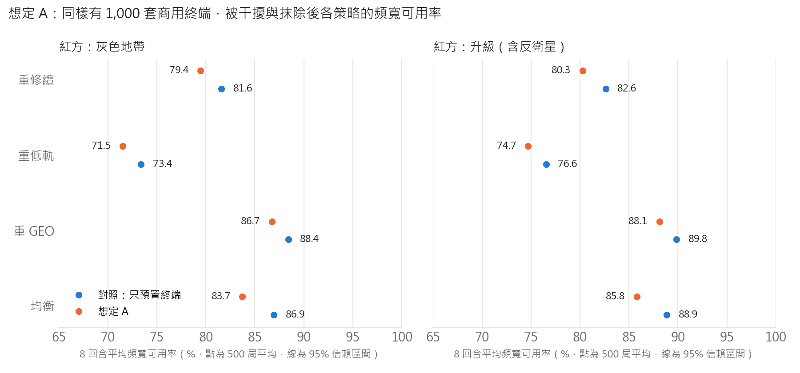

# 太空兵棋想定 A：灰色地帶，海纜中斷，商用低軌也被干擾

> 版本：2026-11-21（2026-11-22 修訂：統一 A 系列紅方干擾門檻，`a_nojam` 重跑）｜模擬端：Rust 單機版「太空兵棋」後端（v0.1.17 工作版，未 commit）`POST /api/games/war/mc`
> 用途：模擬篇新章（暫定第 23 章「兵棋推演」）的素材，不入送審版
> 想定設計與 DIA 頁碼對照：[games_war_scenarios.md](../../../../RUST_SatDashboard/docs/games_war_scenarios.md)
> 重跑：`python docs/book/sim_wargame/scenario_a/run_scenario_a.py [--server http://127.0.0.1:<埠>] [--runs 500]`

## 適用範圍

本推演呈現的是特定遊戲規則、參數設定與 AI 行為假設下的相對比較，不代表真實戰場預測。公開資料僅提供想定背景或歷史案例；遊戲中的成功率、損害比例、出手機率、計分權重、目標選擇與台灣周邊情境均為教學或分析用假設。結果不可直接外推至真實衝突、武器效能或特定國家的作戰意圖。

## 結論

1. **攻擊商用低軌，讓藍方平均可用率下降 1.7 到 3.2 個百分點。** 比較基準是同樣有 1,000 套商用終端、但開戰前沒有被抹除、開場沒有被干擾的對照組。每組 500 局，95% 信賴區間約 ±0.4 個百分點，差異都明顯大於誤差。
2. **越依賴低軌的打法，損失越大；開場三回合最明顯。** 均衡打法損失 3.2 個百分點，前 3 回合從 89.4% 掉到 85.0%；重低軌打法前 3 回合掉 5.0 個百分點。重 GEO 打法損失最小（1.7），在兩種紅方策略下都是最佳打法。
3. **開戰前的抹除，強化擋不住。** 抹除發生在藍方第一次行動之前，所以每種打法開場都損失 300 套。之後才看有沒有強化：均衡、重低軌在第 0 回合強化，總損失停在 300 套；重 GEO、重修纜從不強化，500 局平均累計損失 487 到 525 套。
4. **攻擊代價主要來自網攻抹除；只有重低軌打法是開場干擾比較傷。** 均衡打法的 3.2 個百分點中，網攻抹除約佔 2.4，開場干擾約 0.7；重 GEO、重修纜也以抹除為主。重低軌打法第 0 回合就強化閘道站，抹除只發生在開戰前那一次，但它手上的終端多，開場干擾反而佔 1.1。這組拆解是 2026-11-22 統一紅方干擾門檻後的結果；修正前「A 去掉開場干擾」誤用 800 套門檻，數字偏高（見「模型造成的現象」）。
5. **效果量級取決於藍方有多依賴商用低軌。** 本遊戲中低軌最多 4,000 套終端（80 單位），需求 150 到 185 單位，國際海纜仍提供大部分容量，所以總體損失只有幾個百分點。如果把預置終端或抹除比例調高，代價會跟著放大；本次沒有做這組敏感度分析。

對新章的意義：這個想定能示範兩件事。一是 DIA 描述的手法（開戰前網攻商用服務、宣稱商用終端是合法目標並加以干擾）在推演中如何轉成可量化的代價。二是推演的結論如何受到假設與對手規則影響，需要對照組和拆解才能讀對。

## 想定依據

| DIA 描述 | 譯本頁碼 |
|---|---|
| 俄方以干擾器攻擊商業星座，並將支援烏克蘭的商業終端與衛星列為合法軍事目標 | p.4、37 |
| 商業太空服務自衝突初期便為烏克蘭軍方提供耐久通信 | p.37 |
| 2022-02-24 入侵前，惡意軟體攻擊 Viasat 客戶，50,000 名使用者服務中斷 | p.43；尾註 621（數據機遭 AcidRain 抹除） |
| 俄方消息來源宣稱曾以 Tirada 干擾 Starlink | p.43；尾註 786 |
| 網路威脅可造成暫時或永久效果；不可逆網路效果可能永久損害系統 | p.15–16、68 |

DIA 2026 報告沒有討論海底電纜。海纜中斷是本遊戲原有的設定；把俄烏案例移植到台灣周邊，是推演假設，不代表 DIA 對台海的評估。

## 推演設定

| 項目 | 設定 |
|---|---|
| 共同規則 | 8 回合（每回合 6 小時）；每方每回合 5 行動點；開場約三成國際海纜與馬祖海纜中斷；需求 150 單位起每回合 +5 |
| 想定 A 加入的機制 | 藍方開場有 1,000 套商用低軌終端；開戰前抹除 30%；第 0 回合起干擾 25%（2 回合）；紅方 AI 只要藍方有終端就干擾（A 系列四組相同）；閘道站未強化時，每次網攻永久抹除 30% 已部署終端 |
| 示意假設 | 1,000 套、30%、25% 都沒有 DIA 依據，是本遊戲的教學設定 |
| 比較組 | 原始想定（無預置終端）；對照組 `a_pre`（有 1,000 套預置終端，其餘同原始想定）；想定 A；A 去掉開場干擾；A 去掉網攻抹除 |
| 藍方 AI | 均衡、重 GEO、重低軌、重修纜 |
| 紅方 AI | 灰色地帶（切纜、干擾、網攻、致盲、認知作戰）；升級（另在第 3 回合後以 50% 機率進行一次反衛星試射） |
| 局數 | 每組 500 局，共同亂數（種子 1000–1499），所以組間差異不受運氣影響 |

「攻擊代價」以想定 A 減對照組計算。不直接拿原始想定比較，因為原始想定沒有預置終端，那樣會把「多了終端」和「被攻擊」混在一起：直接比較時，重 GEO 與重修纜打法在想定 A 反而比原始想定高 2.3 到 3.2 個百分點。

## 結果

### 紅方：灰色地帶

| 藍方策略 | 原始想定 | 對照：只預置終端 | 想定 A | A 去掉開場干擾 | A 去掉網攻抹除 | 攻擊代價（A − 對照） |
|---|---|---|---|---|---|---|
| 均衡 | 85.8% | 86.9% | 83.7% | 84.4% | 86.1% | −3.2 個百分點 |
| 重 GEO | 84.4% | 88.4% | 86.7% | 87.0% | 88.1% | −1.7 個百分點 |
| 重低軌 | 72.4% | 73.4% | 71.5% | 72.6% | 72.1% | −1.9 個百分點 |
| 重修纜 | 76.7% | 81.6% | 79.4% | 79.8% | 81.1% | −2.1 個百分點 |

| 藍方策略 | 前 3 回合（對照 → A） | 最差 10%（對照 → A） | 曾低於 50%（對照 → A） | 網攻累計抹除（A） | 升級指數（對照 → A） |
|---|---|---|---|---|---|
| 均衡 | 89.4% → 85.0% | 80.5% → 77.2% | 0.0% → 0.0% | 300 套 | 46.5 → 48.5 |
| 重 GEO | 98.2% → 96.6% | 82.5% → 80.5% | 0.2% → 0.2% | 525 套 | 48.9 → 50.9 |
| 重低軌 | 85.4% → 80.4% | 66.4% → 64.7% | 14.0% → 14.0% | 300 套 | 46.7 → 48.7 |
| 重修纜 | 78.2% → 75.4% | 76.1% → 74.1% | 0.0% → 0.0% | 502 套 | 49.6 → 51.6 |

### 紅方：升級（含反衛星）

| 藍方策略 | 原始想定 | 對照：只預置終端 | 想定 A | A 去掉開場干擾 | A 去掉網攻抹除 | 攻擊代價（A − 對照） |
|---|---|---|---|---|---|---|
| 均衡 | 87.7% | 88.9% | 85.8% | 86.4% | 88.1% | −3.1 個百分點 |
| 重 GEO | 85.5% | 89.8% | 88.1% | 88.4% | 89.6% | −1.7 個百分點 |
| 重低軌 | 75.6% | 76.6% | 74.7% | 75.8% | 75.3% | −1.9 個百分點 |
| 重修纜 | 77.1% | 82.6% | 80.3% | 80.6% | 82.1% | −2.3 個百分點 |

各格 95% 信賴區間為 ±0.3 到 ±0.4 個百分點，完整數值見 [results.csv](results.csv) 與 [summary.md](summary.md)。

### 攻擊代價拆解

以想定 A 減各拆解變體，得到單一機制的貢獻（單位：個百分點）。三組用同一組種子，所以可以直接相減；兩項相加和總代價的差，是兩種機制的交互作用。

| 藍方打法 | 總代價（A − 對照） | 開場干擾（A − 去掉開場干擾） | 網攻抹除（A − 去掉網攻抹除） | 交互作用 |
|---|---|---|---|---|
| 均衡 | −3.2 | −0.7 | −2.4 | −0.2 |
| 重 GEO | −1.7 | −0.3 | −1.4 | 0.0 |
| 重低軌 | −1.9 | −1.1 | −0.6 | −0.2 |
| 重修纜 | −2.1 | −0.4 | −1.6 | −0.1 |

表中是紅方灰色地帶策略的結果；升級策略下各項相差在 0.2 個百分點以內。開場干擾只持續 2 回合，抹除卻是永久的，所以從不強化的重 GEO、重修纜，抹除約佔總代價的八成（77% 到 84%）。

### 一局範例（種子 1001，藍方均衡、紅方灰色地帶）

| 回合 | 0 | 1 | 2 | 3 | 4 | 5 | 6 | 7 | 8 |
|---|---|---|---|---|---|---|---|---|---|
| 對照組可用率 | 90.7% | 99.0% | 95.9% | 93.0% | 90.3% | 87.7% | 85.3% | 88.4% | 91.3% |
| 想定 A 可用率 | 84.3% | 92.3% | 92.4% | 89.9% | 87.5% | 85.1% | 82.7% | 85.9% | 88.9% |
| 想定 A 低軌終端 | 700 | 1,200 | 1,200 | 1,200 | 1,200 | 1,200 | 1,200 | 1,200 | 1,200 |

想定 A 開場：8 條海纜中斷，惡意軟體抹除 300 套終端，商用低軌同時被干擾。藍方第 0 回合強化閘道站、租用 GEO、部署 500 套終端；之後每回合都用 2 點啟動抗干擾、3 點派修纜船，所以 8 回合都沒有餘力再部署終端或做偵察。紅方每回合都干擾低軌，並在第 3 到 5 回合各切斷一條國際海纜。完整紀錄見 [example_game_seed1001.json](example_game_seed1001.json)。

## 判讀

- **前期衝擊大於整局平均。** 抹除和開場干擾都集中在第 0 到 2 回合，藍方新部署的終端要下回合才生效，所以前 3 回合的落差（均衡 −4.4、重低軌 −5.0 個百分點）大於 8 回合平均。這與 Viasat 事件「入侵前立即準備戰場」的時序意義一致：攻擊選在防守方還來不及反應的時間點。
- **抗干擾佔用行動點數。** 範例局中藍方整局每回合都花 2 點在抗干擾。干擾的代價不只是容量下降，也包括排擠其他行動；這一點在平均可用率中看不出來。
- **重 GEO 打法最穩，是因為它不依賴被攻擊的資源。** 這是模型結構的直接結果：本遊戲中 GEO 租用不受干擾與網攻影響。真實 GEO 服務同樣可能被攻擊，Viasat KA-SAT 本身就是 GEO 服務，所以不能把這個結果讀成「GEO 比較安全」。
- **紅方升級策略下，藍方可用率反而較高**（原始想定與想定 A 的各打法，高 0.4 到 3.2 個百分點）。原因是反衛星試射花掉 4 個行動點，那一回合紅方切纜與干擾的次數變少。這是原始模型就有的特性，不是想定 A 造成的。

## 模型造成的現象

| 現象 | 原因 | 怎麼讀 |
|---|---|---|
| （已修正）A 去掉開場干擾，比對照組還好 | 2026-11-22 以前，`a_pre`、`a_nojam` 的紅方干擾門檻誤用 800 套：抹除讓終端掉到 700 套，紅方反而延後干擾 | 已統一為 0 套並重跑；修正後均衡 88.5% → 84.4%，四種打法都低於對照組 |
| 升級指數在 A 比對照組固定多 2.0 | A 多了開場那次干擾（升級 +2）；之後兩組紅方的干擾行為相同 | 差在開場 |
| 均衡打法 8 回合沒有偵察 | AI 的行動點數優先順序：抗干擾與修纜吃滿 5 點 | 偵察分數不適合拿來比較想定 A 的打法 |

## 限制

1. 效果參數（1,000 套、30%、25%）是示意值，DIA 沒有提供；5 萬名使用者是事件規模，不是比例。
2. 抹除效果套在低軌終端上，是簡化；Viasat 案例的對象是 GEO 服務的使用者數據機。
3. 雙方 AI 都是固定規則，不會學習或依對手調整；結果是「這組規則下」的比較。
4. 只跑一組參數，沒有做預置終端數、抹除比例、干擾強度的敏感度分析。
5. 頻寬「單位」與「可用率」是抽象指標，不對應實際 Gbps 或使用者數。

## 敏感度分析（2026-11-22）

完整結果、方法與限制見 [敏感度分析_四想定.md](../sensitivity/敏感度分析_四想定.md)。所有測試值都是示意假設。

- **抹除比例 15%／30%／60%**：重 GEO 在三種比例下都是可用率最高的打法。從不強化閘道站的打法，代價隨比例放大：重 GEO 是 −0.9、−1.7、−2.9 個百分點，重修纜是 −1.2、−2.1、−3.6。
- **均衡打法抹除 60% 的代價反而比 30% 小**（−2.8 對 −3.2）。這是藍方 AI「終端超過 1,000 套才抗干擾」的門檻效應：抹除 60% 後第 1 回合不到 1,000 套，省下的點數拿去部署，最後終端反而比較多。
- **單一手段基準**：重 GEO 最怕切纜（−8.6），重低軌最怕干擾低軌（−15.1）。均衡與重低軌在三種手段一起出現時，損失比三種單項加總多 6 到 8 個百分點。推論（範例局佐證）：藍方的行動點數被抗干擾與修纜吃滿。
- **配對差值**：攻擊代價的逐局配對 95% 信賴區間半寬只有 ±0.01 到 ±0.05 個百分點。本報告各格的「±0.4」是各組各自的區間，用來比較兩組差異時偏保守。

## 下一步（未執行）

| 優先序 | 項目 | 理由 |
|---|---|---|
| 1 | 預置終端 1,000／2,000／4,000 套 | 結論 5：量級取決於藍方對商用低軌的依賴程度 |
| 2 | 終端重新部署速率；首次與後續網攻不同損害 | 審查意見；目前部署固定每次 500 套 |

已完成：紅方干擾門檻統一（2026-11-22）；想定 B、C、D；抹除比例 15%／30%／60% 與單一手段基準（2026-11-22，見上一節）。

## 檔案

| 檔案 | 內容 |
|---|---|
| [run_scenario_a.py](run_scenario_a.py) | 呼叫蒙地卡羅端點、產生摘要表與圖 |
| [results.csv](results.csv) | 5 個想定變體 × 2 種紅方 × 4 種藍方的蒙地卡羅結果 |
| [summary.md](summary.md) | 腳本產生的摘要表 |
| [example_game_seed1001.json](example_game_seed1001.json) | 對照組與想定 A 各一局的完整紀錄 |
| [scenario_a_avail.png](scenario_a_avail.png) | 圖 |

## 資料來源

- 美國國防情報局（DIA）. *Challenges to Security in Space 2026: Congestion, Competition, and Cooperation*（資訊截止 2026 年 7 月）；本專案使用非官方繁體中文譯本 `RUST_SatDashboard/web/static/docs/Challenges_Security_Space_2026_zh-TW.pdf`，頁碼為譯本頁碼。原報告：www.dia.mil/Military-Power-Publications
- 尾註 621：Bleeping Computer, 31 March 2022, "VIASat confirms modems were wiped with AcidRain malware"。
- 尾註 786：Rossiyskaya Gazeta, 15 October 2022, "Satellite Communications Killers: What Is Known About the Tirada and Rudolph Complexes"。
- 兵棋模型：謝沛學〈從遊戲到實戰：商用兵棋軟體如何協助軍事分析與訓練〉（國防安全雙週報，2020）為原始遊戲設計參考。
