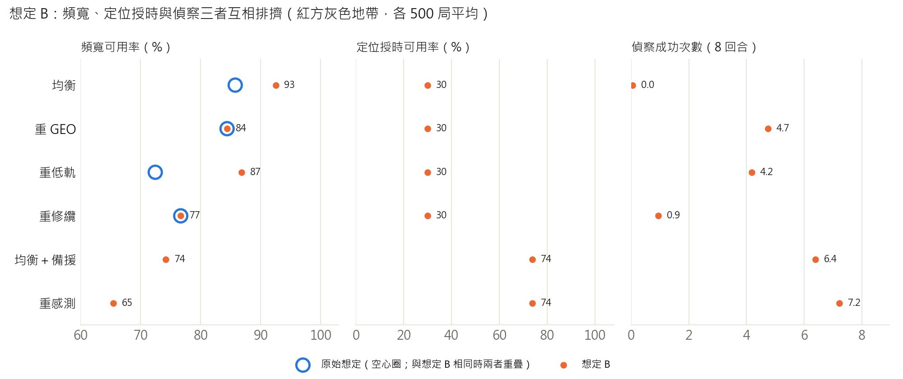

# 太空兵棋想定 B：致盲致聾

> 版本：2026-11-21｜模擬端：Rust 單機版「太空兵棋」後端（v0.1.17 工作版，未 commit）`POST /api/games/war/mc`
> 用途：模擬篇新章（暫定第 23 章「兵棋推演」）的素材，不入送審版
> 想定設計與 DIA 頁碼對照：[games_war_scenarios.md](../../../../RUST_SatDashboard/docs/games_war_scenarios.md)｜實作紀錄：[想定B實作.MD](想定B實作.MD)
> 重跑：`python docs/book/sim_wargame/scenario_b/run_scenario_b.py [--server http://127.0.0.1:<埠>] [--runs 500]`

## 適用範圍

本推演呈現的是特定遊戲規則、參數設定與 AI 行為假設下的相對比較，不代表真實戰場預測。公開資料僅提供想定背景或歷史案例；遊戲中的成功率、損害比例、出手機率、計分權重、目標選擇與台灣周邊情境均為教學或分析用假設。結果不可直接外推至真實衝突、武器效能或特定國家的作戰意圖。

## 結論

1. **頻寬、定位授時、偵察三者互相排擠，沒有一種打法三項都好。** 在紅方灰色地帶策略下：
   - 只顧頻寬的「均衡」打法，頻寬 92.5%，但定位授時只有 30%，偵察成功 0 次。
   - 「均衡＋備援」打法，定位授時 73.8%，偵察成功 6.4 次，但頻寬降到 74.2%。
2. **哪種打法「最好」取決於計分權重。** 只看頻寬，均衡排第 1、均衡＋備援排第 5。用遊戲計分（偵察每次成功 3 分；定位授時平均每少 10% 扣 2 分），名次正好倒過來，均衡＋備援 84.3 分排第 1，均衡 70.7 分排第 5。偵察每次成功的價值低於約 0.9 分時，均衡打法會重新領先。
3. **紅方致盲致聾，通信壓力就變小。** 紅方每回合只有 5 點，花在 GPS 干擾、雷射致盲與 SAR 干擾後，就沒有餘力干擾低軌或網攻。依賴低軌的打法因此頻寬上升：均衡 85.8% → 92.5%，重低軌 72.4% → 86.8%；不用低軌的重 GEO、重修纜完全不變。這是固定行動點數造成的結果，不能直接推論到現實。
4. **SAR 不怕雲和雷射，但紅方發現後會干擾。** 光學偵察每次過頂的成功率約 28% 到 30%，大致等於「雲量 40%、再被雷射致盲減半」的 30%。SAR 第一次使用時成功率 80%，之後紅方每回合干擾 SAR，降到 40%，整局平均約 45%。開場颱風讓光學偵察成功次數減少約 15%（重 GEO 4.7 → 3.9 次），SAR 不受影響。
5. **定位授時只有建立備援的打法守得住。** 紅方每回合都干擾 GPS。沒有備援的打法，定位授時每回合都是 30%；建立備援後，第 1 回合起是 80%，8 回合平均 73.8%（第 0 回合備援尚未生效）。

對新章的意義：想定 A 示範的是「同一資源被攻擊」的代價；想定 B 示範的是「攻擊面變寬之後，防守方必須在不同任務之間取捨」。兵棋推演能把這個取捨量化，但結論會隨計分權重改變。所以推演報告必須寫明權重，並說明權重改變時名次會怎麼變。

## 想定依據

| DIA 描述 | 譯本頁碼 |
|---|---|
| 他國的偵察、通信、導航與預警衛星，可能成為「致盲並致聾敵人」的攻擊目標（中國國防學界的論述） | p.18 |
| PLA 演習例行納入上下行鏈路干擾，可能用以拒止天基通信、雷達系統與 GPS 導航 | p.31–32 |
| 中國商業組織為 PLA 開發針對 SAR 的干擾器 | p.32 |
| 中國有可干擾、降低或損壞 LEO 衛星的地面雷射；致眩列為雷射用途之一 | p.32 |
| 電子攻擊針對 PNT（例如 GPS），常干擾鄰近地區的民用 | p.15 |
| 俄方在波羅的海周邊干擾 GPS；Sentinel-1 SAR 在克里米亞上空遭干擾 | p.43 |
| 中國以 SAR 取得全天候、晝夜覆蓋 | p.28 |

把這些描述寫成紅方 AI 的行動優先順序，是本遊戲的推演假設，不代表 DIA 對台海的評估。

## 推演設定

| 項目 | 設定 |
|---|---|
| 共同規則 | 同原始想定：8 回合、每方 5 行動點、開場約三成國際海纜與馬祖海纜中斷、需求 150 單位起每回合 +5 |
| 紅方新增行動 | 干擾 GPS（1 點，當回合定位授時 30%，有備援時 80%）；干擾 SAR（1 點，SAR 成功率減半）；升級各 +1 |
| 藍方新增行動 | SAR 全天候偵察（2 點，2 次過頂，每次 80%）；備援定位授時（2 點，下回合起永久生效） |
| 紅方 AI | 切纜（70% 機率）→ 干擾 GPS → 雷射致盲 → 藍方用過 SAR 後干擾 SAR → 剩餘點數干擾低軌、網攻、認知作戰 |
| 藍方 AI | 原有 4 種（均衡、重 GEO、重低軌、重修纜，不會使用新行動），加上 2 種新打法：均衡＋備援、重感測 |
| 計分（只限想定 B） | 藍方 = 頻寬 × 100 + 偵察成功 × 3 + 聲望 − （1 − 定位授時）× 20；紅方對稱計入定位授時與偵察 |
| 比較組 | 原始想定；想定 B；想定 B＋開場颱風（第 0 到 1 回合） |
| 局數 | 每組 500 局，共同亂數（種子 1000–1499） |
| 示意假設 | 30%、80%（定位授時）、80%（SAR）、計分權重 20 與 3，都不是 DIA 數據 |

## 結果

### 紅方：灰色地帶

| 藍方打法 | 頻寬：原始 | 頻寬：B | 頻寬：B＋颱風 | 定位授時（B） | 偵察成功次數（B；其中 SAR） | 偵察成功次數（B＋颱風） | 升級指數（原始 → B） |
|---|---|---|---|---|---|---|---|
| 均衡 | 85.8% | 92.5% | 91.8% | 30.0% | 0.0（0.0） | 0.0（0.0） | 43.2 → 42.3 |
| 重 GEO | 84.4% | 84.4% | 84.4% | 30.0% | 4.7（0.0） | 3.9（0.0） | 38.4 → 40.9 |
| 重低軌 | 72.4% | 86.8% | 86.8% | 30.0% | 4.2（0.0） | 3.7（0.0） | 45.4 → 42.9 |
| 重修纜 | 76.7% | 76.7% | 75.2% | 30.0% | 0.9（0.0） | 0.9（0.0） | 39.3 → 41.6 |
| 均衡＋備援 | — | 74.2% | 73.4% | 73.8% | 6.4（6.3） | 6.4（6.3） | — → 44.7 |
| 重感測 | — | 65.4% | 64.7% | 73.8% | 7.2（7.2） | 7.2（7.2） | — → 45.6 |

頻寬的 95% 信賴區間為 ±0.3 到 ±0.5 個百分點。均衡＋備援、重感測只在想定 B 有意義，原始想定欄留空。

| 藍方打法（想定 B） | 只看頻寬：名次 | 遊戲計分 | 遊戲計分：名次 | 紅方分數 |
|---|---|---|---|---|
| 均衡 | 1 | 70.7 | 5 | 0.2 |
| 重 GEO | 3 | 76.6 | 4 | −5.1 |
| 重低軌 | 2 | 77.4 | 3 | −6.8 |
| 重修纜 | 4 | 59.2 | 6 | 13.7 |
| 均衡＋備援 | 5 | 84.3 | 1 | −10.4 |
| 重感測 | 6 | 78.7 | 2 | −4.6 |

### 紅方：升級（含反衛星）

| 藍方打法 | 頻寬：原始 | 頻寬：B | 定位授時（B） | 偵察成功次數（B） | 遊戲計分（B） | 遊戲計分名次 |
|---|---|---|---|---|---|---|
| 均衡 | 87.7% | 93.0% | 30.0% | 0.1 | 72.3 | 5 |
| 重 GEO | 85.5% | 85.5% | 30.0% | 5.3 | 80.5 | 3 |
| 重低軌 | 75.6% | 87.1% | 30.0% | 4.8 | 80.4 | 4 |
| 重修纜 | 77.1% | 77.1% | 30.0% | 1.1 | 61.1 | 6 |
| 均衡＋備援 | — | 75.5% | 73.8% | 7.2 | 88.4 | 1 |
| 重感測 | — | 66.9% | 73.8% | 8.1 | 83.2 | 2 |

升級策略的趨勢與灰色地帶相同。完整數值見 [results.csv](results.csv) 與 [summary.md](summary.md)。

### 一局範例（種子 1001，紅方灰色地帶）

| 對局 | 8 回合平均頻寬 | 定位授時 | 偵察成功／嘗試 | 藍方分數 | 紅方分數 |
|---|---|---|---|---|---|
| 原始想定，藍方均衡 | 90.2% | 100% | 0／0 | 87.2 | −12.2 |
| 想定 B，藍方均衡 | 97.9% | 30.0% | 0／0 | 75.9 | −4.9 |
| 想定 B，藍方均衡＋備援 | 78.1% | 73.7% | 6／14 | 86.9 | −11.9 |

想定 B 的均衡打法，從第 4 回合起頻寬維持 100%，但定位授時從第 1 回合起一直是 30%，整局沒有任何偵察。均衡＋備援在第 0 回合建立備援、租 GEO、強化閘道站；第 1 回合 SAR 2 次全部成功，之後紅方開始干擾 SAR。完整紀錄見 [example_game_seed1001.json](example_game_seed1001.json)。

## 判讀

- **偵察數字可以手算驗證。** SAR 第一次使用時，紅方還不知道藍方有 SAR，成功率 80%；之後每回合被干擾，降到 40%。均衡＋備援從第 1 回合起使用 SAR，共 14 次過頂：2 × 0.8 + 12 × 0.4 = 6.4 次，與模擬值相同。重感測從第 0 回合起使用，16 次過頂：1.6 + 14 × 0.4 = 7.2 次，也相同。定位授時 73.8% 是 (0.3 + 7 × 0.8) ÷ 8。
- **紅方的 SAR 干擾讓 SAR 的價值減半。** 這是攻防互相調整的簡化版：防守方換用新感測器，攻擊方跟著換干擾目標。
- **升級指數變化不大。** 紅方把升級 +2 的低軌干擾與網攻，換成升級 +1 的 GPS、SAR 干擾與雷射致盲，總升級幅度相近。
- **颱風的影響比預期小。** 颱風只有開場 2 回合，而且多數藍方 AI 原本就很少做光學偵察；颱風造成的頻寬損失（均衡 −0.7、重修纜 −1.5 個百分點）來自修纜船延後。

## 模型造成的現象

| 現象 | 原因 | 怎麼讀 |
|---|---|---|
| 紅方致盲致聾後，藍方頻寬反而上升 | 紅方每回合固定 5 點，點數用在 GPS、雷射與 SAR 干擾，就排擠掉低軌干擾與網攻 | 只在「紅方資源有限且共用」的假設下成立；現實中不同電子戰系統未必共用預算 |
| 原有 4 種藍方打法的定位授時都是 30% | 這些 AI 不會使用新行動 | 這是 AI 規則，不是「這些打法無法建立備援」 |
| 計分名次大幅翻轉 | 偵察與定位授時的權重是本遊戲自訂的 | 名次只在這組權重下成立；報告已給出均衡打法重新領先的權重門檻（偵察每次成功約 0.9 分） |

## 限制

1. 定位授時 30%／80%、SAR 80%、計分權重都是示意值，DIA 沒有提供。
2. 定位授時只是一個數字，沒有區分船舶、航空、金融授時等使用者；GPS 干擾波及民用，只寫在紀錄文字裡，沒有另計代價。
3. 預警衛星（DIA p.18 列出的第四類目標）沒有納入。
4. 雙方 AI 都是固定規則，紅方對 SAR 的反應（看到一次就一直干擾）是簡化。
5. 只跑一組參數，沒有做備援效果、SAR 成功率或計分權重的敏感度分析。

## 敏感度分析（2026-11-22）

完整結果、方法與限制見 [敏感度分析_四想定.md](../sensitivity/敏感度分析_四想定.md)。所有測試值都是示意假設。

- **計分權重**：在偵察權重 0 到 6、定位授時權重 0 到 40 的格點中，均衡＋備援在 80%（灰色地帶）與 83%（升級）的格點總分最高。只有偵察權重 ≤ 1.25 時均衡領先，定位授時權重 ≤ 11 時重低軌可能領先。結論 2 的名次翻轉確實存在，但只發生在權重的角落。
- **紅方不干擾 GPS／SAR 的對照**：紅方省下的點數轉去干擾低軌與網攻，均衡打法頻寬少 6.8 個百分點，重低軌少 14.4。想定 B 的頻寬結果有一部分反映紅方點數的分配。
- **SAR 成功率**：50% 時均衡＋備援的偵察次數（3.98）低於只用光學的重 GEO（4.75），「誰偵察最多」會隨這個參數改變。
- **定位授時**：有備援的打法在 GPS 干擾後 10%／30%／60% 三種設定下都維持 71% 到 78%。
- 各指標分開排名（不合成總分）見敏感度分析的 summary.md（B-3）。

## 下一步（未執行）

| 優先序 | 項目 | 理由 |
|---|---|---|
| 1 | 紅方行動點數敏感度：5 點對 7 點 | 結論 3 的排擠效果來自固定點數 |
| 2 | 干擾持續時間；紅方依藍方備援調整行動優先序 | 審查意見；紅方 AI 仍是固定優先序 |

已完成：想定 C、D；計分權重敏感度、紅方不干擾對照、定位授時與 SAR 參數低／中／高（2026-11-22，見上一節）。

## 檔案

| 檔案 | 內容 |
|---|---|
| [run_scenario_b.py](run_scenario_b.py) | 呼叫蒙地卡羅端點、產生摘要表與圖 |
| [results.csv](results.csv) | 3 個想定 × 2 種紅方 × 4 或 6 種藍方的蒙地卡羅結果 |
| [summary.md](summary.md) | 腳本產生的摘要表 |
| [example_game_seed1001.json](example_game_seed1001.json) | 原始想定均衡、想定 B 均衡、想定 B 均衡＋備援各一局的完整紀錄 |
| [scenario_b_tradeoff.png](scenario_b_tradeoff.png) | 圖 |

## 資料來源

- 美國國防情報局（DIA）. *Challenges to Security in Space 2026: Congestion, Competition, and Cooperation*（資訊截止 2026 年 7 月）；本專案使用非官方繁體中文譯本 `RUST_SatDashboard/web/static/docs/Challenges_Security_Space_2026_zh-TW.pdf`，頁碼為譯本頁碼。原報告：www.dia.mil/Military-Power-Publications
- 兵棋模型：謝沛學〈從遊戲到實戰：商用兵棋軟體如何協助軍事分析與訓練〉（國防安全雙週報，2020）為原始遊戲設計參考。
