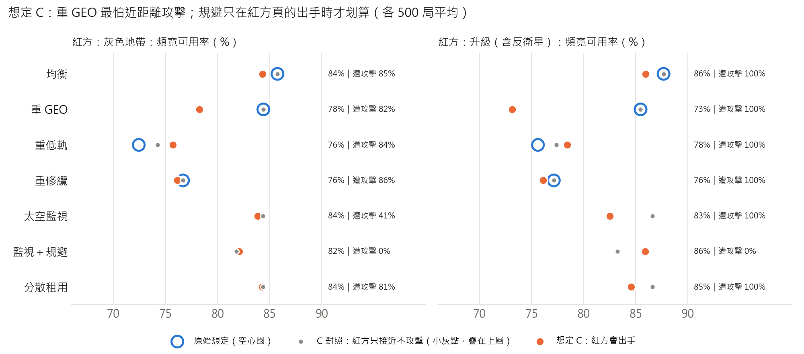

# 太空兵棋想定 C：共軌接近

> 版本：2026-11-21｜模擬端：Rust 單機版「太空兵棋」後端（v0.1.19 之上的工作版，未 commit）`POST /api/games/war/mc`
> 用途：模擬篇新章（暫定第 23 章「兵棋推演」）的素材，不入送審版
> 想定設計與 DIA 頁碼對照：[games_war_scenarios.md](../../../../RUST_SatDashboard/docs/games_war_scenarios.md)｜實作紀錄：[想定C實作.MD](想定C實作.MD)
> 重跑：`python docs/book/sim_wargame/scenario_c/run_scenario_c.py [--server http://127.0.0.1:<埠>] [--runs 500]`

## 適用範圍

本推演呈現的是特定遊戲規則、參數設定與 AI 行為假設下的相對比較，不代表真實戰場預測。公開資料僅提供想定背景或歷史案例；遊戲中的成功率、損害比例、出手機率、計分權重、目標選擇與台灣周邊情境均為教學或分析用假設。結果不可直接外推至真實衝突、武器效能或特定國家的作戰意圖。

## 結論

1. **想定 A 裡最穩的重 GEO，到了想定 C 最脆弱。** 紅方衛星在 10 km 內出手，藍方租用的那顆 GEO 衛星失效，頻寬和可租用上限都減半。重 GEO 打法把頻寬押在 GEO 上，損失最大：
   - 紅方灰色地帶：84.4% → 78.2%（−6.1 個百分點）。
   - 紅方升級：85.5% → 73.1%（−12.4）。
   - 均衡打法只掉 1.5 到 1.8 個百分點。
2. **規避只在紅方真的會出手時才划算。** 「監視＋規避」在三種情況下都讓攻擊完全落空（遭攻擊 0%），但每次規避要花 2 點，下回合 GEO 服務也會降 30%。和均衡打法相比：
   - 紅方升級（一到位就出手）：85.9% 對 86.0%，打平。
   - 紅方灰色地帶（出手機率 85%）：82.1% 對 84.3%，少 2.2 個百分點。
   - 紅方只接近、不攻擊：81.8% 對 85.8%，少 4.0 個百分點。這 4 個百分點是「威脅存在」本身讓藍方付出的代價：紅方不必出手，只要停在旁邊，藍方就得一直花點數。
3. **太空監視便宜，價值主要在嚇阻與歸因。** 監視只花 1 點（一次購買）。在「知道會被歸因就收手」的 AI 假設下，灰色地帶紅方的出手率從 85% 降到 41%，而且每次攻擊都可歸因（紅方升級再 +4、藍方聲望 +3）。頻寬幾乎不受影響（84.3% → 83.8%）。對手若是不在乎歸因的升級紅方，監視就擋不住攻擊。
4. **分散租用的效果大約等於它的成本。** 分散後每次攻擊的損失減半，每局平均 GEO 損失由 8.5 降到 4.0 單位，但要多花 1 點，頻寬和均衡打法一樣（84.3%）。
5. **沒有一種防護在所有情況下都最好。** 最佳選擇取決於藍方對紅方意圖的判斷。這正是 DIA 描述的困境：近距離接近「大多與衛星宣稱任務不一致」，但從外部看不出是檢查還是攻擊。

對新章的意義：想定 A 談「同一資源被攻擊」，想定 B 談「攻擊面變寬後的取捨」，想定 C 談的是「意圖不明」。接近本身不違法，防守方卻要在不確定中付出代價。兵棋推演可以把這筆代價拆成兩部分，一是紅方真的出手造成的損失，二是光是有威脅就付出的成本，前提是要設對照組（本想定的 `c_loiter`）。

## 想定依據

| DIA 描述 | 譯本頁碼 |
|---|---|
| 中國將宣稱為實驗通信衛星的 TJS-3 發射至 GEO；2023 年多次接近其他國家在 GEO 的太空器，距離不足 10 公里。這些近距離接近大多與宣稱任務不一致，顯示中國可能掩飾其真正任務 | p.33 |
| 具機械臂的實踐十七號等系統可用於抓取其他衛星；實踐二十一號曾將廢棄北斗衛星移至墓地軌道 | p.33 |
| Cosmos 2543 跟蹤一顆美國國家安全衛星，多次以足以造成潛在危險的距離接近；2020 年離開後向軌道發射投射物，作為天基 ASAT 測試的一部分。Cosmos 2576 被送入與另一顆美國國家安全衛星相同的軌道 | p.44 |
| 天基武器可攻擊其他太空器、造成暫時或永久損害；衛星服務與碎片清除的機器人技術同時具和平用途與 ASAT 應用 | p.71 |
| 沒有先進太空追蹤感測器的國家，可透過購買商業資料獲得基本 SDA | p.64 |
| 地基 ASAT 飛彈與其他反太空武器不同，較容易歸因 | p.70 |

DIA 的案例是中國、俄羅斯衛星接近美國或他國衛星，沒有說明攻擊效果。紅方衛星「可能在 10 km 內出手」、讓藍方租用的 GEO 衛星失效，以及把案例移到台灣周邊情境，都是本遊戲的推演假設，不代表 DIA 對台海的評估。

## 推演設定

| 項目 | 設定 |
|---|---|
| 共同規則 | 同原始想定：8 回合、每方 5 行動點、開場約三成國際海纜與馬祖海纜中斷、需求 150 單位起每回合 +5 |
| 開場 | 紅方一顆宣稱為「通信技術試驗」的衛星進入藍方租用 GEO 通信衛星的軌道，距離 > 100 km |
| 紅方新增行動 | 共軌逼近（2 點，距離進一級：> 100 km → < 100 km → < 10 km，升級 +0.5）；近距離攻擊（3 點，< 10 km 才有效，藍方 GEO 頻寬與可租用上限減半，升級 +6） |
| 藍方新增行動 | 購買商業太空監視資料（1 點，之後持續看得到距離，攻擊可歸因）；GEO 衛星規避（2 點，距離退一級，同回合攻擊落空，下回合 GEO −30%）；分散租用（1 點，攻擊損失降為 25%） |
| 歸因 | 藍方有監視時，攻擊後紅方升級再 +4、藍方聲望 +3 |
| 紅方 AI | 先逼近到 < 10 km。灰色地帶紅方第 4 回合起每回合 30% 機率出手，知道藍方在監視時降到 10%；升級紅方一到位就出手。其餘點數照原規則切纜、干擾、網攻 |
| 藍方 AI | 原有 4 種（不會使用新行動）；新增 3 種，都以均衡打法為底，只把第 1 回合的閘道站強化換成新行動（強化延到第 2 回合）：太空監視、監視＋規避、分散租用 |
| 比較組 | 原始想定；想定 C；C 對照（紅方只接近、不攻擊） |
| 局數 | 每組 500 局，共同亂數（種子 1000–1499） |
| 回合編號 | 本報告從 1 起算，與介面「回合 1 / 8」一致 |
| 示意假設 | 損失 50%／25%、規避 −30%、升級 +6／+4、聲望 +3、出手機率 30%／10%，都不是 DIA 數據 |

## 結果

### 紅方：灰色地帶

| 藍方策略 | 頻寬：原始 | 頻寬：C | 頻寬：C 對照 | GEO 遭攻擊 | 可歸因 | GEO 損失（單位） | 規避次數 | 升級指數（原始→C） |
|---|---|---|---|---|---|---|---|---|
| 均衡 | 85.8% ± 0.4% | 84.3% ± 0.5% | 85.8% ± 0.4% | 85% | 0% | 8.5 | 0.0 | 43.2 → 46.9 |
| 重 GEO | 84.4% ± 0.4% | 78.2% ± 0.5% | 84.4% ± 0.4% | 82% | 0% | 24.7 | 0.0 | 38.4 → 41.8 |
| 重低軌 | 72.4% ± 0.4% | 75.7% ± 0.4% | 74.2% ± 0.4% | 84% | 0% | 2.1 | 0.0 | 45.4 → 47.2 |
| 重修纜 | 76.7% ± 0.3% | 76.1% ± 0.3% | 76.7% ± 0.3% | 86% | 0% | 2.1 | 0.0 | 39.3 → 42.6 |
| 太空監視 | — | 83.8% ± 0.5% | 84.4% ± 0.4% | 41% | 41% | 4.1 | 0.0 | — → 45.1 |
| 監視＋規避 | — | 82.1% ± 0.4% | 81.8% ± 0.4% | 0% | 0% | 0.0 | 3.0 | — → 38.1 |
| 分散租用 | — | 84.3% ± 0.4% | 84.4% ± 0.4% | 81% | 0% | 4.0 | 0.0 | — → 44.9 |

| 藍方策略 | 相對均衡：C（百分點） | 相對均衡：C 對照（百分點） | 藍方分數（C） | 藍方分數名次（C） | 紅方分數（C） |
|---|---|---|---|---|---|
| 均衡 | 0.0 | 0.0 | 82.5 | 5 | −7.7 |
| 重 GEO | −6.1 | −1.4 | 89.8 | 1 | 0.8 |
| 重低軌 | −8.6 | −11.5 | 87.9 | 2 | 0.7 |
| 重修纜 | −8.2 | −9.1 | 77.2 | 7 | 2.6 |
| 太空監視 | −0.5 | −1.4 | 84.3 | 3 | −6.4 |
| 監視＋規避 | −2.2 | −4.0 | 82.3 | 6 | −1.1 |
| 分散租用 | 0.0 | −1.4 | 83.6 | 4 | −6.8 |

### 紅方：升級（含反衛星）

| 藍方策略 | 頻寬：原始 | 頻寬：C | 頻寬：C 對照 | GEO 遭攻擊 | 可歸因 | GEO 損失（單位） | 規避次數 |
|---|---|---|---|---|---|---|---|
| 均衡 | 87.7% | 86.0% | 87.7% | 100% | 0% | 10.0 | 0.0 |
| 重 GEO | 85.5% | 73.1% | 85.5% | 100% | 0% | 30.0 | 0.0 |
| 重低軌 | 75.6% | 78.4% | 77.4% | 100% | 0% | 2.5 | 0.0 |
| 重修纜 | 77.1% | 76.1% | 77.1% | 100% | 0% | 2.5 | 0.0 |
| 太空監視 | — | 82.5% | 86.6% | 100% | 100% | 10.0 | 0.0 |
| 監視＋規避 | — | 85.9% | 83.2% | 0% | 0% | 0.0 | 2.2 |
| 分散租用 | — | 84.6% | 86.6% | 100% | 0% | 5.0 | 0.0 |

95% 信賴區間都在 ±0.4 個百分點左右。完整數值見 [results.csv](results.csv) 與 [summary.md](summary.md)。

### 一局範例（種子 1001）

| 對局 | 8 回合平均頻寬 | 紅方是否出手 | 規避次數 | 藍方分數 | 紅方分數 |
|---|---|---|---|---|---|
| 紅方灰色地帶，藍方均衡 | 92.3% | 否 | 0 | 90.3 | −14.8 |
| 紅方灰色地帶，藍方太空監視 | 93.7% | 否 | 0 | 90.7 | −12.2 |
| 紅方灰色地帶，藍方監視＋規避 | 89.1% | 否 | 3 | 86.1 | −4.3 |
| 紅方升級，藍方均衡 | 94.1% | 是（第 3 回合，無法歸因） | 0 | 94.1 | −30.6 |

這個種子裡，灰色地帶紅方在三局都沒有出手，所以前三局的差別全是防護成本。監視＋規避在第 3、5、7 回合規避，下一回合的 GEO 頻寬就從 20 降到 14（服務降 30%），紅方衛星則在 < 100 km 與 < 10 km 之間來回。升級紅方在第 3 回合出手，藍方 GEO 從 20 降到 10，紀錄只寫「無法證明是人為攻擊」，因為藍方沒有購買監視資料。完整紀錄見 [example_game_seed1001.json](example_game_seed1001.json)。

## 判讀

- **出手率可以手算驗證。** 灰色地帶紅方第 1 回合逼近到 < 100 km、第 2 回合到 < 10 km，第 4 到 8 回合共 5 次出手機會：
  - 沒有監視時，每次 30%：1 − 0.7⁵ = 83.2%，模擬值 85%（500 局的抽樣誤差約 ±1.7 個百分點）。
  - 有監視時，每次 10%：1 − 0.9⁵ = 41.0%，模擬值 41%。
- **規避次數也可以手算。** 規避讓紅方衛星退回 < 100 km，紅方下回合再逼近，藍方再下一回合規避，每 2 回合循環一次。藍方第 2 回合結束時看到紅方在 10 km 內，從第 3 回合開始規避，第 3、5、7 回合各一次，共 3 次，模擬值 3.0。
- **GEO 損失的大小取決於押了多少在 GEO。** 升級紅方第 3 回合出手。均衡打法當時 GEO 20 單位、損失 10；重 GEO 已到上限 60、損失 30。以剩下 6 回合、需求約 175 單位估算，分別約占可用率 4.1 與 12.4 個百分點，與拆解出的 GEO 分量一致（見下節）。
- **歸因有代價也有好處。** 「太空監視」對升級紅方的升級指數最高（61.2），因為每次攻擊都被歸因，多 +4。紅方分數因此多扣 2 分，藍方聲望 +3。

## 模型造成的現象

| 現象 | 原因 | 怎麼讀 |
|---|---|---|
| 重低軌在想定 C 頻寬反而上升（72.4% → 75.7%） | 紅方每回合固定 5 點，逼近（2 點）與出手（3 點）排擠了低軌干擾 | 同想定 B，只在「紅方資源有限且共用」的假設下成立 |
| 升級紅方出手時，「太空監視」掉得比均衡多（C 對照 → C：−4.1 對 −1.7） | 兩者 GEO 損失相同（都是 −4.1 個百分點）。差別在低軌：紅方出手那一回合沒有點數干擾低軌，均衡打法那時終端較多，因此多拿回 +2.3；太空監視第 2 回合要補做閘道站強化，少部署一批終端，拿不到這個好處 | 200 局逐分量拆解確認，不是程式錯誤；是排擠效果與部署時程的交互作用 |
| 太空監視讓灰色地帶紅方收手 | 紅方 AI 被寫成「知道會被歸因就把出手機率降到三分之一」 | 嚇阻效果是假設，DIA 沒有提供證據；應做出手機率的敏感度分析 |
| 藍方分數名次第 1 是重 GEO | 重 GEO 每回合用 4 點租 GEO，剩下 1 點做光學偵察，偵察每次成功 +3 分；這在原始想定就存在（重 GEO 93.4 分） | 分數名次主要反映既有計分對偵察的權重，不是想定 C 的結論；本報告以頻寬與遭攻擊率為主 |

200 局逐分量拆解（C − C 對照，可用率百分點，各分量未截頂）：

| 紅方 | 藍方 | 海纜 | GEO | 低軌 | 可用率 |
|---|---|---|---|---|---|
| 灰色地帶 | 均衡 | −0.2 | −1.9 | +0.8 | −1.3 |
| 灰色地帶 | 太空監視 | +0.1 | −0.8 | +0.3 | −0.3 |
| 灰色地帶 | 重 GEO | −0.5 | −5.6 | 0.0 | −6.1 |
| 升級 | 均衡 | 0.0 | −4.1 | +2.3 | −1.8 |
| 升級 | 太空監視 | 0.0 | −4.1 | 0.0 | −4.1 |
| 升級 | 重 GEO | 0.0 | −12.4 | 0.0 | −12.4 |

## 限制

1. 損失比例、規避代價、升級與聲望的加減、紅方出手機率，都是示意值，DIA 沒有提供。
2. 沒有模擬軌道力學。距離分三級、一回合逼近一級都是抽象；實際的 GEO 共軌接近通常要數天到數週，規避也要耗燃料，業者未必願意。
3. 攻擊效果只有一種（衛星失效）。DIA p.71 列出的干擾器、動能、雷射、機械裝置、化學噴灑與高功率微波，效果與可逆性各不相同，本想定沒有區分。
4. 藍方只能看到「距離」，看不到紅方衛星的能力；現實中的太空監視還能觀察姿態、機動模式與射頻活動，對判斷意圖的幫助可能更大。
5. 雙方 AI 都是固定規則。規避打法只要看到 10 km 內就規避，沒有「判斷紅方是否真的要出手」的機制。
6. 只跑一組參數，沒有做敏感度分析。

## 敏感度分析（2026-11-22）

完整結果、方法與限制見 [敏感度分析_四想定.md](../sensitivity/敏感度分析_四想定.md)。所有測試值都是示意假設。

- **「監視＋規避」對升級紅方打平均衡，建立在監視不中斷、規避必成功上。** 監視資料每回合有效 70% 時，規避打法遭攻擊率 48%、頻寬落後均衡 1.6 個百分點；有效 40% 時落後 2.9；規避成功率 50% 時落後 3.0。
- **紅方風險偏好**：被監視時出手率 5%／10%／30%，監視打法遭攻擊率 22%／41%／81%，但頻寬只差 0.3 到 1.0 個百分點。監視的嚇阻效果換成頻寬很小。
- **監視在總分上的好處主要來自歸因聲望**：對升級紅方，歸因成功率降到 50% 時，監視打法的分數優勢由 +1.1 變為 −0.2。
- **誤規避的成本**：紅方只接近、不攻擊時，規避打法頻寬比均衡少 4.0 到 4.4 個百分點，是所有設定中最大的損失。
- **規避成本**：次回合服務 85% 時規避打法對升級紅方比均衡好 0.4，50% 時差 0.6，影響不大。

## 下一步（未執行）

| 優先序 | 項目 | 理由 |
|---|---|---|
| 1 | 未監視時的紅方出手機率掃描（0% 到 100%），找出規避開始划算的門檻 | 結論 2：規避是否划算取決於紅方意圖；本次只改了被監視時的出手率 |
| 2 | 規避可用次數或資源上限 | 審查意見 |

已完成：想定 D；嚇阻效果（紅方風險偏好）、監視品質、歸因、規避成功率與規避代價（2026-11-22，見上一節）。

## 檔案

| 檔案 | 內容 |
|---|---|
| [run_scenario_c.py](run_scenario_c.py) | 呼叫蒙地卡羅端點、產生摘要表與圖 |
| [results.csv](results.csv) | 3 個想定 × 2 種紅方 × 4 或 7 種藍方的蒙地卡羅結果 |
| [summary.md](summary.md) | 腳本產生的摘要表 |
| [example_game_seed1001.json](example_game_seed1001.json) | 種子 1001 的 4 局完整紀錄 |
| [scenario_c_avail.png](scenario_c_avail.png) | 圖 |

## 資料來源

- 美國國防情報局（DIA）. *Challenges to Security in Space 2026: Congestion, Competition, and Cooperation*（資訊截止 2026 年 7 月）；本專案使用非官方繁體中文譯本 `RUST_SatDashboard/web/static/docs/Challenges_Security_Space_2026_zh-TW.pdf`，頁碼為譯本頁碼。原報告：www.dia.mil/Military-Power-Publications
- 兵棋模型：謝沛學〈從遊戲到實戰：商用兵棋軟體如何協助軍事分析與訓練〉（國防安全雙週報，2020）為原始遊戲設計參考。
