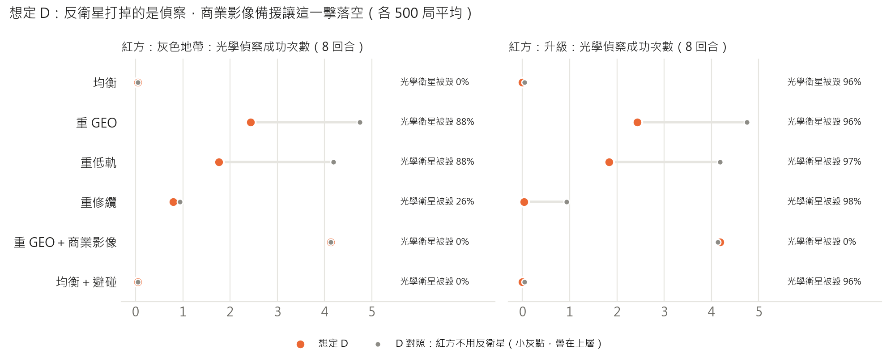

# 太空兵棋想定 D：直升式反衛星

> 版本：2026-11-21｜模擬端：Rust 單機版「太空兵棋」後端（v0.1.19 之上的工作版，未 commit）`POST /api/games/war/mc`
> 用途：模擬篇新章（暫定第 23 章「兵棋推演」）的素材，不入送審版
> 想定設計與 DIA 頁碼對照：[games_war_scenarios.md](../../../../RUST_SatDashboard/docs/games_war_scenarios.md)｜實作紀錄：[想定D實作.MD](想定D實作.MD)
> 重跑：`python docs/book/sim_wargame/scenario_d/run_scenario_d.py [--server http://127.0.0.1:<埠>] [--runs 500]`；賽後碎片：`python docs/book/sim_wargame/scenario_d/debris_after_game.py`

## 適用範圍

本推演呈現的是特定遊戲規則、參數設定與 AI 行為假設下的相對比較，不代表真實戰場預測。公開資料僅提供想定背景或歷史案例；遊戲中的成功率、損害比例、出手機率、計分權重、目標選擇與台灣周邊情境均為教學或分析用假設。結果不可直接外推至真實衝突、武器效能或特定國家的作戰意圖。

## 結論

1. **反衛星真正打掉的是偵察，不是頻寬。** 紅方擊毀藍方唯一的光學偵察衛星後，依賴光學偵察的打法每局偵察成功次數幾乎減半：重 GEO 從 4.75 次降到 2.43 次，重低軌從 4.19 次降到 1.76 次。頻寬反而略升（重 GEO 84.4% → 85.5%），因為紅方把 4 點花在反衛星上，就少了切纜與干擾。
2. **同一枚飛彈，打單一衛星和打擴散星座的效果天差地別。** 打藍方自有的光學衛星，藍方直接失去這項能力；打商用低軌星座的一顆衛星，星座還有數百顆，容量不變，只留下碎片。
3. **商業影像備援讓這一擊落空，也讓紅方不出手。** 「重 GEO＋商業影像」只多花 1 點（第 1 回合少做一次光學偵察）：
   - 灰色地帶紅方：出手率從 88% 降到 0%（AI 設定為藍方有備援就不出手），偵察成功 4.13 次。
   - 升級紅方：仍有 96% 的局試射，但改打商用星座，藍方光學衛星沒有被毀，偵察成功 4.18 次，幾乎不受影響。
4. **在 48 小時的遊戲窗口內，碎片對頻寬的影響很小，避碰不划算。** 「均衡＋避碰」對升級紅方的頻寬是 87.1%，低於不避碰的均衡 87.7%。省下的碎片損失，不夠抵 1 點的成本。
5. **碎片的成本在遊戲結束之後。** Cosmos 1408（約 480 km）的 1,805 件已編目碎片，試射後第 2 天全部仍在軌，半年後剩 53.6%，1 年後剩 25.3%，3 年後剩 0.9%。2007 年中國試射的高度在 800 km 以上，3,500 塊以上的碎片約 19 年後仍有 2,400 塊以上在軌（DIA p.32）。遊戲的 8 回合只看得到這段成本的開頭。

對新章的意義：想定 A 到 C 的攻擊都可逆或難以歸因；想定 D 的反衛星不可逆、一定被歸因，碎片還會留很久。兵棋推演在這裡能呈現兩件事。一是目標的價值不對稱：單一衛星很脆弱，擴散星座有韌性。二是低成本的備援（商業影像）能同時降低損失、降低對方出手的誘因。遊戲窗口太短，碎片的長期代價要另外用實測資料補上。

## 想定依據

| DIA 描述 | 譯本頁碼 |
|---|---|
| PLA 準則多將 ASAT 飛彈描述為威懾外部介入區域衝突、或管理衝突升高的手段 | p.32 |
| 2007 年中國以 ASAT 飛彈摧毀 800 km 以上的退役氣象衛星，產生超過 3,500 塊可追蹤碎片，超過 2,400 塊仍在軌；若在衝突中使用，碎片會威脅中國自身與中立方的系統 | p.32 |
| 俄羅斯 Nudol 2021 年 11 月在 470 km 摧毀退役衛星，產生超過 1,700 塊可追蹤碎片與數萬塊無法追蹤的碎片 | p.44 |
| ASAT 飛彈的碎片可在軌道上停留數十年甚至數世紀 | p.15 |
| 碎片越多，避碰越困難、任務成本越高；碎片壽命取決於尺寸與高度 | p.56 |
| 地基 ASAT 飛彈的發射可被偵測、會產生碎片，比其他反太空武器容易歸因 | p.70 |
| 商業衛星影像的可得性提高 | p.57 |

DIA 的兩個案例都是擊毀自己退役衛星的試射。把反衛星用在衝突中打藍方衛星，以及移到台灣周邊情境，都是本遊戲的推演假設，不代表 DIA 對台海的評估。

## 推演設定

| 項目 | 設定 |
|---|---|
| 共同規則 | 同原始想定：8 回合（每回合 6 小時，共 48 小時）、每方 5 行動點、開場約三成國際海纜與馬祖海纜中斷、需求 150 單位起每回合 +5 |
| 紅方行動 | 擊毀藍方光學衛星（4 點）；擊毀商用低軌衛星（4 點，原有的「反衛星試射」）；兩者共用「限一次」。共同效果：碎片 +1（低軌容量 −10%）、升級 +15、紅方分數 −10、一定可歸因（藍方聲望 +3） |
| 藍方新增行動 | 商業影像合約（1 點，一次有效，自有光學衛星被毀後仍可偵察）；業者避碰（1 點，2 回合內碎片影響減半） |
| 紅方 AI | 升級紅方第 4 回合起每回合 50% 機率試射，藍方沒有備援時打光學衛星，有備援時打商用低軌衛星。灰色地帶紅方只在藍方光學衛星正在偵察、沒有備援時，第 3 回合起每回合 30% 機率擊毀它 |
| 藍方 AI | 原有 4 種；新增「重 GEO＋商業影像」與「均衡＋避碰」。光學衛星已毀又沒有備援時，AI 不再下光學偵察 |
| 比較組 | 想定 D；D 對照（紅方不用反衛星）；原始想定（升級紅方本來就有反衛星，打低軌、沒有目標選擇） |
| 局數 | 每組 500 局，共同亂數（種子 1000–1499） |
| 回合編號 | 從 1 起算，與介面一致 |
| 示意假設 | 碎片 −10%／−5%、聲望 +3、出手機率 30%／50%、目標選擇，都不是 DIA 數據 |

## 結果

### 紅方：灰色地帶

| 藍方策略 | 頻寬：D 對照 | 頻寬：D | 反衛星試射 | 光學衛星被毀 | 偵察成功：D 對照 → D | 升級指數：D 對照 → D |
|---|---|---|---|---|---|---|
| 均衡 | 85.8% | 85.8% | 0% | 0% | 0.05 → 0.05 | 43.2 → 43.3 |
| 重 GEO | 84.4% | 85.5% | 88% | 88% | 4.75 → 2.43 | 38.4 → 49.7 |
| 重低軌 | 72.4% | 75.0% | 88% | 88% | 4.19 → 1.76 | 45.4 → 55.8 |
| 重修纜 | 76.7% | 76.7% | 26% | 26% | 0.94 → 0.79 | 39.3 → 42.0 |
| 重 GEO＋商業影像 | 84.0% | 84.0% | 0% | 0% | 4.13 → 4.13 | 38.5 → 38.5 |
| 均衡＋避碰 | 85.8% | 85.8% | 0% | 0% | 0.05 → 0.05 | 43.2 → 43.3 |

均衡打法每回合的點數都用在 GEO、低軌與修纜，幾乎不做光學偵察，所以灰色地帶紅方沒有理由出手。

### 紅方：升級

| 藍方策略 | 頻寬：D 對照 | 頻寬：D | 反衛星試射 | 光學衛星被毀 | 偵察成功：D 對照 → D | 升級指數：D 對照 → D |
|---|---|---|---|---|---|---|
| 均衡 | 85.8% | 87.7% | 96% | 96% | 0.05 → 0.00 | 43.2 → 53.2 |
| 重 GEO | 84.4% | 85.5% | 96% | 96% | 4.75 → 2.43 | 38.4 → 50.3 |
| 重低軌 | 72.4% | 75.5% | 97% | 97% | 4.19 → 1.83 | 45.4 → 56.8 |
| 重修纜 | 76.7% | 77.2% | 98% | 98% | 0.94 → 0.04 | 39.3 → 50.1 |
| 重 GEO＋商業影像 | 84.0% | 85.3% | 96% | **0%** | 4.13 → 4.18 | 38.5 → 49.3 |
| 均衡＋避碰 | 85.8% | 87.1% | 96% | 96% | 0.05 → 0.00 | 43.2 → 53.6 |

升級紅方「D 對照」的數字與灰色地帶相同：在這個遊戲裡，兩種紅方 AI 只差在會不會用反衛星。95% 信賴區間都在 ±0.4 個百分點左右。原始想定（升級紅方打低軌）的數字與想定 D 的頻寬欄幾乎相同，差別只在偵察：原始想定重 GEO 偵察 4.78 次，想定 D 只有 2.43 次。完整數值見 [results.csv](results.csv) 與 [summary.md](summary.md)。

### 賽後：碎片還會留多久（實測，不是遊戲模擬）

| 經過時間 | Cosmos 1408（約 480 km，2021 年）已編目碎片仍在軌 |
|---|---|
| 第 2 天（遊戲結束時） | 1,805 件（100%） |
| 第 30 天 | 1,789 件（99.1%） |
| 第 180 天 | 968 件（53.6%） |
| 1 年 | 456 件（25.3%） |
| 2 年 | 86 件（4.8%） |
| 3 年 | 16 件（0.9%） |
| 5 年 | 3 件（0.2%） |

資料：CelesTrak SATCAT 國際編號 1982-092、類型 DEB、NORAD ≥ 49000（2021-11-15 試射後編目的碎片），與 [Cosmos 1408 驗證](../../sim_validation/cosmos1408/驗證報告_Cosmos1408碎片衰減.md)共用同一份資料。對照：2007 年中國試射在 800 km 以上，3,500 塊以上碎片約 19 年後仍有 2,400 塊以上在軌，約 69%（DIA p.32）。目標高度決定碎片是幾年內清掉，還是留幾十年。藍方衛星的軌道高度，本遊戲沒有設定。

### 一局範例（種子 1001）

| 對局 | 平均頻寬 | 偵察成功／嘗試 | 光學衛星 | 藍方分數 | 紅方分數 |
|---|---|---|---|---|---|
| 灰色地帶紅方，藍方重 GEO | 87.6% | 2／8 | 第 5 回合被毀 | 93.6 | −22.8 |
| 升級紅方，藍方重 GEO | 87.6% | 3／12 | 第 7 回合被毀 | 94.6 | −24.3 |
| 灰色地帶紅方，藍方重 GEO＋商業影像 | 92.8% | 1／14 | 未被攻擊 | 87.8 | −7.8 |
| 升級紅方，藍方重 GEO＋商業影像 | 96.2% | 2／14 | 未被攻擊（紅方第 8 回合改打商用低軌衛星） | 99.2 | −27.7 |

這個種子裡，有商業影像的兩局偵察運氣不好（14 次過頂只成功 1 到 2 次）；500 局平均才看得出備援的效果。完整紀錄見 [example_game_seed1001.json](example_game_seed1001.json)。

## 判讀

- **出手率可以手算驗證。** 灰色地帶紅方從第 3 回合起、每回合 30%，共 6 次機會：1 − 0.7⁶ = 88.2%，模擬值 88%。升級紅方從第 4 回合起、每回合 50%，共 5 次：1 − 0.5⁵ = 96.9%，模擬值 96% 到 98%（500 局的抽樣誤差約 ±1.5 個百分點）。
- **偵察損失也大致可以推算。** 重 GEO 每回合 2 次過頂、每次成功率約 30%，8 回合約 4.8 次。灰色地帶紅方平均在第 4 到 5 回合出手，之後的過頂全部失去，剩下約一半，與 2.43 次相符。
- **重修纜在灰色地帶只被打 26%。** 灰色地帶紅方只在藍方「正在偵察」時出手；重修纜大部分回合沒有餘力做光學偵察，被當成低價值目標。
- **反衛星讓紅方付出升級代價。** 每次試射升級 +15、紅方分數 −10，以灰色地帶紅方對重 GEO 為例，紅方分數從 −3.6 降到 −19.1。

## 模型造成的現象

| 現象 | 原因 | 怎麼讀 |
|---|---|---|
| 紅方用了反衛星，藍方頻寬反而上升（例如重低軌 72.4% → 75.0%） | 反衛星要 4 點，紅方那一回合就沒有點數切纜或干擾；碎片的 −10% 低軌損失被蓋過 | 同想定 B、C 的排擠效果，只在「紅方點數固定且共用」時成立 |
| 被打掉光學衛星後，藍方分數不降反升（重 GEO 93.4 → 93.8） | 攻擊可歸因，藍方聲望 +3；之後每回合省下的偵察點數改做外交，每回合聲望再 +1。這兩項抵掉了少約 2.3 次偵察（−7 分） | 計分把國際同情算得很重，這是示意權重；本報告以偵察次數與光學衛星被毀率為主要指標 |
| 避碰不划算 | 遊戲只有 48 小時，碎片只讓低軌少 10%；避碰省下的不到 1 點的價值 | 不代表現實中避碰不重要；DIA p.56 指出碎片讓任務成本長期上升，那發生在遊戲窗口之外 |
| 灰色地帶紅方遇到商業影像就不出手 | AI 被寫成「藍方有備援就不打」 | 阻絕式嚇阻的效果是假設；應做出手條件的敏感度分析 |

## 限制

1. 碎片 −10%、避碰 −5%、聲望 +3、出手機率與目標選擇都是示意值或 AI 假設，DIA 沒有提供。
2. 遊戲只涵蓋 48 小時；碎片的長期影響改用實測資料呈現，沒有與遊戲數值整合。
3. 藍方光學衛星的軌道高度沒有設定，所以無法在遊戲內比較「打低軌道」與「打高軌道」的碎片代價。
4. 沒有模擬碎片打到紅方自己或中立方的衛星（DIA p.32），紅方只承擔原有的 −10 分。
5. 商業影像被設定為「成功率不變」；現實中商業影像的時效、解析度與供應商意願（是否願意在衝突中提供）都不確定。
6. 只跑一組參數，沒有做敏感度分析。

## 敏感度分析（2026-11-22）

完整結果、方法與限制見 [敏感度分析_四想定.md](../sensitivity/敏感度分析_四想定.md)。所有測試值都是示意假設。

- **基準規則下，商業影像的效能不影響結果**：效能從 100% 降到 40%，數字完全相同，因為紅方遇到備援就不打光學衛星。結論 3 的「讓這一擊落空」應讀成「在紅方會改變目標的假設下」。
- **紅方一律打光學衛星時**，商業影像仍有價值，保住多少取決於效能。灰色地帶紅方下，沒有備援時每局少 2.32 次偵察；影像效能 100%、70%、40% 時分別少 0.05、0.78、1.54 次，約保住 98%、66%、34%。
- **遊戲內與遊戲外分開看**：敏感度分析報告把 48 小時內的頻寬、避碰結果，與 Cosmos 1408、2007 年試射的長期碎片數據分成兩張表。「避碰不划算」只適用於 48 小時窗口與本遊戲計分。

## 下一步（未執行）

| 優先序 | 項目 | 理由 |
|---|---|---|
| 1 | 灰色地帶紅方遇到備援時的出手機率掃描（0% 到 30% 之間） | 本次只測了兩端（不出手、照樣 30%），見上一節 |
| 2 | 聲望權重敏感度（0 到 +3） | 「被打反而加分」的計分現象 |
| 3 | 把藍方衛星高度做成參數，用碎片連鎖模組估算賽後碎片 | 讓結論 5 的長期成本進入同一套模型（注意 Cosmos 1408 驗證指出 1 年以上的存活數偏高） |
| 4 | 四個想定的整合比較 | 新章需要一張總表 |

## 檔案

| 檔案 | 內容 |
|---|---|
| [run_scenario_d.py](run_scenario_d.py) | 呼叫蒙地卡羅端點、產生摘要表與圖 |
| [debris_after_game.py](debris_after_game.py)、[debris_after_game.json](debris_after_game.json) | 由 SATCAT 計算 Cosmos 1408 碎片在第 2 天到第 5 年的在軌數 |
| [results.csv](results.csv) | 3 個想定 × 2 種紅方 × 4 或 6 種藍方的蒙地卡羅結果 |
| [summary.md](summary.md) | 腳本產生的摘要表 |
| [example_game_seed1001.json](example_game_seed1001.json) | 種子 1001 的 4 局完整紀錄 |
| [scenario_d_isr.png](scenario_d_isr.png) | 圖 |

## 資料來源

- 美國國防情報局（DIA）. *Challenges to Security in Space 2026: Congestion, Competition, and Cooperation*（資訊截止 2026 年 7 月）；本專案使用非官方繁體中文譯本 `RUST_SatDashboard/web/static/docs/Challenges_Security_Space_2026_zh-TW.pdf`，頁碼為譯本頁碼。原報告：www.dia.mil/Military-Power-Publications
- CelesTrak SATCAT，國際編號 1982-092（2026-11-21 下載，存於 `docs/book/sim_validation/cosmos1408/satcat_1982-092.csv`）。
- 兵棋模型：謝沛學〈從遊戲到實戰：商用兵棋軟體如何協助軍事分析與訓練〉（國防安全雙週報，2020）為原始遊戲設計參考。
