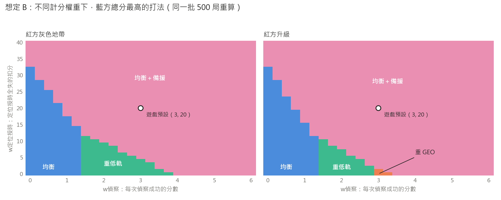

# 太空兵棋四想定敏感度分析

> 版本：2026-11-22｜回應外部審查意見第二階段（P1）｜模擬端：Rust 單機版「太空兵棋」後端（v0.1.19 之上的工作版，未 commit），`POST /api/games/war/mc` 新增參數覆寫 `params` 與每局輸出 `per_game`
> 用途：模擬篇新章（暫定第 23 章「兵棋推演」）的素材，不入送審版
> 完整數字：[summary.md](summary.md)（由腳本產生）｜每局原始資料：[games.csv.gz](games.csv.gz)｜執行紀錄：[run_meta.json](run_meta.json)｜實作紀錄：[第二階段實作.MD](第二階段實作.MD)
> 重跑：`python docs/book/sim_wargame/sensitivity/run_sensitivity.py --server http://127.0.0.1:<埠>`

## 適用範圍

本推演呈現的是特定遊戲規則、參數設定與 AI 行為假設下的相對比較，不代表真實戰場預測。公開資料僅提供想定背景或歷史案例；遊戲中的成功率、損害比例、出手機率、計分權重、目標選擇與台灣周邊情境均為教學或分析用假設。結果不可直接外推至真實衝突、武器效能或特定國家的作戰意圖。

本分析中的低／中／高參數值同樣是示意假設，用來看結論在多大範圍內成立，不是對真實數值的估計。

## 結論

1. **想定 A：「重 GEO 最穩」在抹除比例 15%、30%、60% 下都成立，但代價大小隨抹除比例放大，而且紅方三種手段會互相加乘。**
   - 從不強化閘道站的打法，代價隨抹除比例上升。重 GEO 是 −0.9、−1.7、−2.9 個百分點，重修纜是 −1.2、−2.1、−3.6。
   - 紅方遊戲中的切纜、干擾、網攻全部拿掉時，均衡打法可用率 98.9%。三種都用時掉 15.2 個百分點，但三種手段各自單獨使用的損失加起來只有 6.9。
   - 推論（範例局佐證）：差距來自藍方行動點數被擠爆。同時被干擾又被切纜時，藍方每回合 2 點抗干擾、3 點修纜，沒有餘力再部署終端。
2. **想定 B：「均衡＋備援」在大多數計分權重下都是總分第一，不是只在遊戲預設權重下才成立。**
   - 在偵察權重 0 到 6、定位授時權重 0 到 40 的格點中，均衡＋備援在 80%（灰色地帶）與 83%（升級）的格點拿第一。
   - 只有偵察權重低於約 1.25 時，均衡打法才會領先。定位授時權重低於約 11 時，重低軌會領先。
   - 「紅方不干擾 GPS／SAR」不是對藍方有利的對照：紅方省下的點數會轉去打通信，均衡打法頻寬反而少 6.8 個百分點，重低軌少 14.4。
3. **想定 C：「監視＋規避」對升級紅方打平均衡，是建立在「監視不中斷、規避必成功」這兩個假設上。**
   - 監視資料每回合只有 70% 有效時，規避打法遭攻擊率從 0% 升到 48%，頻寬落後均衡 1.6 個百分點。只有 40% 有效時，落後 2.9。
   - 規避成功率 50% 時，落後 3.0。
   - 監視對紅方的嚇阻效果，換成頻寬只值 0.3 到 1.0 個百分點。監視在總分上的好處幾乎全部來自歸因帶來的聲望：歸因成功率降到 50% 時，對升級紅方的分數優勢就消失（+1.1 → −0.2）。
4. **想定 D：「商業影像讓反衛星落空」主要來自紅方 AI 的目標選擇，不是影像本身的效能。**
   - 在基準規則下，藍方有備援時紅方不打光學衛星，所以商業影像效能降到 40% 結果也完全一樣。
   - 改成紅方不論有無備援都打光學衛星時，商業影像仍有價值，但效能決定保住多少。灰色地帶紅方下，沒有備援時每局少 2.32 次偵察。完全替代時幾乎不少（−0.05）；效能 70% 時少 0.78；效能 40% 時少 1.54。
5. **共同亂數下用逐局配對差值，比較的精確度大幅提高。** 想定 A 的攻擊代價，配對差值的 95% 信賴區間半寬是 ±0.01 個百分點；把兩組當獨立樣本會算成 ±0.63。所以第一輪報告的「± 0.4」高估了組間差異的不確定性。
6. **這一輪又找到兩個 AI 規則造成的現象，判讀時要排除。** 一是想定 A 抹除 60% 時，均衡打法的代價反而比抹除 30% 小（藍方抗干擾門檻）。二是設定加入新的隨機判定時，配對優勢會縮小（亂數序列錯開）。兩者詳見「模型造成的現象」。

## 方法

| 項目 | 設定 |
|---|---|
| 參數覆寫 | `POST /api/games/war/mc` 的 `params` 欄位；省略時與修改前逐值相同（四想定 2,464 個數值、8 局範例紀錄回歸檢查全部相同） |
| 局數 | 每組 500 局，共同亂數（種子 1000–1499） |
| 配對差值 | 同一種子、同一紅方，兩組設定逐局相減；95% 信賴區間 = 1.96 × 差值標準差 ÷ √500 |
| 分布 | 每局 8 回合平均可用率的第 5、50、95 百分位與最差一局 |
| 名次穩定度 | 以種子為單位重抽 1,000 次（同一組種子的各打法一起抽），計算各打法平均可用率排第一的比例；完全相同的打法平分 |
| 計分權重 | 權重只影響計分、不影響雙方 AI 決策，所以用同一批 500 局逐局重算；重算值與遊戲分數逐局相符（誤差 < 0.001） |
| 版本識別 | `run_meta.json` 記錄執行時間、git HEAD、`games_war.rs` 的 SHA-256（工作版未 commit，以雜湊識別） |

### 參數與依據類型

| 參數 | 基準值 | 測試值 | 依據類型 |
|---|---|---|---|
| A：抹除比例 | 30% | 15%、60% | 教學用示意參數 |
| A：紅方遊戲中的頻寬攻擊手段 | 切纜、干擾、網攻 | 三種都不用、只用一種 | AI 行為假設（替代 AI） |
| B：GPS 被干擾後的定位授時 | 30% | 10%、60% | 教學用示意參數 |
| B：SAR 每次過頂成功率 | 80% | 50%、95% | 教學用示意參數 |
| B：紅方干擾 GPS、SAR | 會 | 不會（點數改用在其他行動） | AI 行為假設（替代 AI） |
| B：計分權重（偵察、定位授時） | 3、20 | 0–6、0–40 | 遊戲既有機制（計分） |
| C：被監視時灰色地帶紅方出手率（風險偏好） | 10% | 5%、30% | AI 行為假設 |
| C：監視資料每回合有效機率 | 100% | 70%、40% | 教學用示意參數 |
| C：有效追蹤下歸因成功率 | 100% | 50% | 教學用示意參數 |
| C：規避成功率 | 100% | 80%、50% | 教學用示意參數 |
| C：規避次回合服務比例 | 70% | 85%、50% | 教學用示意參數 |
| D：紅方目標偏好 | 依藍方備援調整 | 一律打光學衛星 | AI 行為假設（替代 AI） |
| D：商業影像替代效能 | 100% | 70%、40% | 教學用示意參數 |

DIA 報告只提供想定背景（各想定推演報告的「想定依據」一節），上表所有數值都不是 DIA 數據。

## 想定 A：灰色地帶

### 抹除比例

攻擊代價（想定 A − 對照組，逐局配對差值，百分點；紅方灰色地帶）：

| 藍方打法 | 抹除 15% | 抹除 30%（基準） | 抹除 60% | 累計抹除終端（套） |
|---|---|---|---|---|
| 均衡 | −2.01 | −3.21 | −2.76 | 150／300／600 |
| 重 GEO | −0.89 | −1.68 | −2.92 | 299／525／819 |
| 重低軌 | −1.56 | −1.86 | −2.46 | 150／300／600 |
| 重修纜 | −1.23 | −2.14 | −3.59 | 282／502／800 |

各格配對信賴區間半寬 ≤ 0.05 個百分點。升級紅方的結果相近（見 summary.md）。

- 均衡、重低軌在第 0 回合就強化閘道站，所以只承受開戰前那一次抹除；重 GEO、重修纜從不強化，每次網攻都再抹一次，代價隨比例放大。審查意見所說「累積損失逼近初始部署量一半以上」在抹除 60% 時成立（重 GEO 累計 819 套）。
- 重 GEO 的可用率在三種比例下都最高（灰色地帶紅方：抹除 60% 時重 GEO 85.5%、均衡 84.2%），所以「重 GEO 最穩」不依賴 30% 這個值。但這仍是模型結構的結果：遊戲中 GEO 不會被干擾或網攻。
- 均衡打法抹除 60% 比 30% 損失小，是藍方 AI 規則造成的，見「模型造成的現象」。

### 單一手段基準

紅方遊戲中只能用一種頻寬攻擊手段（開戰前抹除與開場干擾照常），與「三種都不用」逐局相減（百分點；紅方灰色地帶）：

| 藍方打法 | 三種都不用：可用率 | 只切纜 | 只干擾低軌 | 只網攻閘道站 | 單項加總 | 三種都用 |
|---|---|---|---|---|---|---|
| 均衡 | 98.9% | −3.1 | −3.7 | 0.0 | −6.9 | −15.2 |
| 重 GEO | 99.2% | −8.6 | −1.6 | −1.8 | −12.0 | −12.5 |
| 重低軌 | 98.8% | −6.2 | −15.1 | 0.0 | −21.3 | −27.3 |
| 重修纜 | 89.0% | −4.6 | −4.4 | −3.7 | −12.8 | −9.6 |

- 每種打法最怕的手段不同：重 GEO 最怕切纜（−8.6），重低軌最怕干擾（−15.1）；有強化閘道站的打法不怕網攻。
- 均衡、重低軌是「加乘」：三種一起用比單項加總多損失 6 到 8 個百分點。推論（範例局佐證）：被干擾又被切纜時，藍方每回合 2 點抗干擾加 3 點修纜就用完 5 點，無法部署新終端；只面對一種手段時沒有這種排擠。
- 重修纜是「互抵」：三種都用（−9.6）比單項加總（−12.8）損失小。推論：紅方點數有限，三種手段分攤之後每種的強度都下降。
- 被擋下的網攻也會占用紅方點數，所以「只網攻」對有強化的打法是 0。

## 想定 B：致盲致聾

### 計分權重

| 區域 | 灰色地帶紅方 | 升級紅方 |
|---|---|---|
| 均衡＋備援拿第一的格點比例 | 80% | 83% |
| 均衡拿第一 | 偵察權重 ≤ 1.25，且定位授時權重 ≤ 32 | 同左 |
| 重低軌拿第一 | 偵察權重 1.5–3.75，且定位授時權重 ≤ 11 | 偵察權重 1.5–2.75，且定位授時權重 ≤ 10 |
| 重 GEO 拿第一 | 無 | 偵察權重 3–3.25，且定位授時權重 ≤ 1（3 個格點） |

- 偵察權重維持 3 時，定位授時權重只要 ≥ 5（灰色地帶）或 ≥ 2（升級），均衡＋備援就是第一。第一輪報告的「偵察每次約 0.9 分以下名次反轉」與本圖一致（格點 0.75 仍是均衡、1.0 起換成均衡＋備援）。
- 所以名次確實取決於權重，但翻轉只發生在「幾乎不重視偵察」或「幾乎不在乎定位授時」的角落。

### 紅方不干擾的對照與效果參數

| 藍方打法（紅方灰色地帶） | 基準可用率 | 紅方不干擾 GPS／SAR：可用率差 | 定位授時：GPS 干擾後 10%／30%／60% | 偵察次數：SAR 50%／80%／95% |
|---|---|---|---|---|
| 均衡 | 92.5% | −6.8 | 10%／30%／60% | 0.05（不用 SAR） |
| 重 GEO | 84.4% | 0.0 | 10%／30%／60% | 4.75（不用 SAR） |
| 重低軌 | 86.8% | −14.4 | 10%／30%／60% | 4.19（不用 SAR） |
| 重修纜 | 76.7% | 0.0 | 10%／30%／60% | 0.94（不用 SAR） |
| 均衡＋備援 | 74.2% | 0.0 | 71%／74%／78% | 3.98／6.39／7.64 |
| 感測優先 | 65.4% | 0.0 | 71%／74%／78% | 4.51／7.22／8.53 |

- **紅方不干擾時，點數流向通信攻擊。** 想定 B 的紅方 AI 先下 GPS、SAR 干擾，剩下點數才打通信。禁用這兩項後，紅方改下低軌干擾與網攻，有大量低軌終端、又沒強化的打法頻寬下降。這表示想定 B 的頻寬結果，有一部分反映的是「紅方把點數花在哪裡」。
- **有備援的打法，定位授時對 GPS 干擾強度不敏感**（71% 到 78%），沒有備援的打法則完全等於干擾後的值。
- **SAR 成功率會改變「誰偵察最多」。** SAR 50% 時，均衡＋備援的偵察次數（3.98）低於只用光學的重 GEO（4.75）。

各指標分開排名（不合成總分）見 summary.md 的 B-3：頻寬最佳是均衡（92.5%），定位授時最佳是兩種有備援的打法（74%），偵察最多是感測優先（7.22 次），聲望最高是感測優先（−3.1）。

## 想定 C：共軌接近

數字是對同一設定下「均衡」打法的逐局配對差值（百分點），負值代表比均衡差。

| 設定 | 紅方 | 太空監視 | 監視＋規避 | 監視：遭攻擊／歸因 | 監視＋規避：遭攻擊 |
|---|---|---|---|---|---|
| 基準 | 灰色地帶 | −0.5 | −2.2 | 41%／41% | 0% |
| 紅方低風險偏好（被監視時出手 5%） | 灰色地帶 | −0.3 | −2.4 | 22%／22% | 0% |
| 紅方高風險偏好（被監視也照樣 30%） | 灰色地帶 | −1.0 | −1.9 | 81%／81% | 0% |
| 監視資料每回合有效 40% | 灰色地帶 | −0.1 | −2.2 | 41%／15% | 13% |
| 保守組合 | 灰色地帶 | −0.7 | −2.3 | 81%／29% | 29% |
| 基準 | 升級 | −3.4 | 0.0 | 100%／100% | 0% |
| 監視資料每回合有效 70% | 升級 | −3.1 | −1.6 | 100%／70% | 48% |
| 監視資料每回合有效 40% | 升級 | −3.1 | −2.9 | 100%／39% | 74% |
| 規避成功率 80% | 升級 | −3.4 | −1.3 | 100%／100% | 38% |
| 規避成功率 50% | 升級 | −3.4 | −3.0 | 100%／100% | 74% |
| 規避次回合服務 85% | 升級 | −3.4 | +0.4 | 100%／100% | 0% |
| 規避次回合服務 50% | 升級 | −3.4 | −0.6 | 100%／100% | 0% |
| 保守組合 | 升級 | −3.2 | −2.2 | 100%／34% | 66% |
| 紅方只接近、不攻擊 | 灰色地帶 | −1.4 | −4.0 | 0%／0% | 0% |
| 紅方只接近、不攻擊 | 升級 | −1.1 | −4.4 | 0%／0% | 0% |

保守組合：監視有效 70%、歸因 50%、規避成功 80%、紅方高風險偏好。

- **規避的價值高度依賴監視品質與規避成功率。** 規避打法只在看到紅方衛星進到 10 km 內時才規避；監視資料缺一回合，就可能錯過那一回合。
- **監視的嚇阻效果換成頻寬很小。** 紅方從低風險到高風險偏好，監視打法遭攻擊率 22% → 81%，但頻寬只差 0.3 到 1.0 個百分點。監視在總分上的好處主要是歸因聲望：對升級紅方，歸因成功率 50% 時分數優勢由 +1.1 變為 −0.2，保守組合下為 −0.8。
- **誤規避的成本**：紅方只接近、不攻擊時，規避打法每次看到 10 km 內就規避，頻寬比均衡少 4.0 到 4.4 個百分點，是所有設定中最大的損失。
- 規避成本（次回合服務比例）影響較小：85% 時規避打法對升級紅方反而比均衡好 0.4，50% 時差 0.6。

## 想定 D：直升式反衛星

偵察損失：該設定的偵察成功次數減「紅方不用反衛星」對照，逐局配對差值（次／局）。

| 設定 | 紅方 | 重 GEO：光學衛星被毀／偵察損失 | 重 GEO＋商業影像：光學衛星被毀／偵察損失 |
|---|---|---|---|
| 基準：紅方依備援調整目標，影像完全替代 | 灰色地帶 | 88%／−2.32 | 0%／0.00 |
| 紅方依備援調整目標，影像效能 40% | 灰色地帶 | 88%／−2.32 | 0%／0.00 |
| 紅方一律打光學衛星，影像完全替代 | 灰色地帶 | 88%／−2.32 | 88%／−0.05 |
| 紅方一律打光學衛星，影像效能 70% | 灰色地帶 | 88%／−2.32 | 88%／−0.78 |
| 紅方一律打光學衛星，影像效能 40% | 灰色地帶 | 88%／−2.32 | 88%／−1.54 |
| 基準 | 升級 | 96%／−2.32 | 0%／+0.05 |
| 紅方一律打光學衛星，影像效能 70% | 升級 | 96%／−2.32 | 96%／−0.68 |
| 紅方一律打光學衛星，影像效能 40% | 升級 | 96%／−2.32 | 96%／−1.42 |

- 基準規則下，商業影像的效能完全不影響結果，因為紅方根本不打光學衛星。第一輪的「讓這一擊落空」應讀成「在紅方會改變目標的假設下」。
- 紅方不理會備援時，商業影像保住的偵察與它的效能大致成比例：灰色地帶紅方下，效能 100%、70%、40% 分別保住約 98%、66%、34% 的損失。
- 商業影像打法的頻寬與重 GEO 相差在 1.5 個百分點以內（簽約用掉 1 點）。

### 遊戲內短期效應與遊戲外長期效應分開看

| 時間尺度 | 指標 | 數值 | 來源 |
|---|---|---|---|
| 遊戲內（48 小時） | 碎片對低軌容量 | 每單位碎片 −10%（示意） | 遊戲規則 |
| 遊戲內（48 小時） | 均衡＋避碰對均衡（升級紅方） | 87.1% 對 87.7%，避碰不划算 | 想定 D 推演 |
| 遊戲外（實測） | Cosmos 1408（約 480 km）碎片仍在軌比例 | 第 2 天 100%、1 年 25.3%、3 年 0.9% | CelesTrak SATCAT |
| 遊戲外（公開報告） | 2007 年中國試射（800 km 以上） | 3,500 塊以上，約 19 年後仍有 2,400 塊以上在軌 | DIA 2026 p.32 |

「避碰不划算」只適用於 48 小時窗口與本遊戲計分；長期碎片成本沒有進入遊戲分數，不能用遊戲結果推論長期避碰的價值。

## 跨想定

### 配對差值

| 比較 | 差值（百分點） | 配對半寬 | 當作獨立樣本的半寬 |
|---|---|---|---|
| A：想定 A − 對照（均衡，灰色地帶） | −3.21 | ±0.01 | ±0.63 |
| A：想定 A − 對照（重 GEO，灰色地帶） | −1.68 | ±0.04 | ±0.55 |
| B：不干擾 − 基準（均衡，灰色地帶） | −6.75 | ±0.25 | ±0.53 |
| C：想定 C − 只接近（重 GEO，升級） | −12.32 | ±0.04 | ±0.62 |
| D：想定 D − 不用反衛星（重 GEO，升級） | +1.06 | ±0.29 | ±0.61 |

兩組設定的亂數序列越晚錯開，配對越精確。A 的兩組幾乎只差在開戰前那一次抹除，所以半寬只有 0.01。

### 分布與名次穩定度

以各想定基準設定、紅方灰色地帶為例（完整表見 summary.md）：

| 想定 | 平均可用率最高的打法 | 排第一的比例 | 該打法 P5／P95 | 最差一局（全部打法） |
|---|---|---|---|---|
| A | 重 GEO 86.7% | 100% | 79.0%／93.8% | 重低軌 58.2% |
| B | 均衡 92.5% | 100% | 85.9%／97.9% | 感測優先 52.1% |
| C | 均衡 84.3%、分散租用 84.3% | 53%、47% | 76.4%／93.0% | 重 GEO 62.5% |
| D | 均衡與均衡＋避碰並列 85.8% | 各 44%（重 GEO 13%） | 77.3%／94.6% | 重低軌 62.9% |

- A、B 的頻寬第一名非常穩定；C、D 的前兩名實質上打平，不應寫成「某打法最好」。
- 各打法的局間差距（P5 到 P95 約 11 到 20 個百分點）遠大於打法之間的平均差距，單一局的結果不能代表策略優劣。

## 模型造成的現象

| 現象 | 原因 | 怎麼讀 |
|---|---|---|
| 想定 A 均衡打法：抹除 60% 的代價（−2.76）比 30%（−3.21）小 | 藍方 AI 只在終端超過 1,000 套時才抗干擾。抹除 60% 後第 1 回合只有 900 套，省下 2 點改去部署，最後終端 1,400 套，比抹除 30% 的 1,200 套還多（100 局實測：抗干擾 6.0 次對 7.0 次、部署 2.08 次對 1.08 次） | 藍方 AI 的門檻效應；不能讀成抹除越多越好 |
| 想定 C 監視品質降低後，監視打法對均衡的差距反而縮小（−0.5 → −0.1），信賴區間變寬（±0.3 → ±0.5） | 新增的隨機判定讓監視打法的亂數序列與均衡打法錯開，配對優勢消失 | 差異在誤差內，不解讀為監視品質越差越好 |
| 想定 B 紅方不干擾時，藍方頻寬下降 | 紅方 AI 依固定優先序用完 5 點；禁用干擾後點數轉向通信攻擊 | 這是「點數重新分配」的結果，不是不干擾對紅方有利 |
| 想定 D 的商業影像效能在基準規則下沒有影響 | 紅方 AI 遇到備援就不打光學衛星 | 結論依賴紅方目標選擇的假設 |

## 未處理的審查建議

| 建議 | 狀態 |
|---|---|
| A：終端重新部署速率、首次與後續攻擊不同損害 | 未做；目前部署速率固定每次 500 套 |
| B：干擾持續時間、紅方依藍方備援調整行動優先度 | 未做；紅方 AI 仍是固定優先序 |
| C：規避可用次數或資源上限 | 未做；以規避成功率與服務降級代替 |
| D：紅方對碎片外部性與歸因風險的偏好 | 部分處理（目標偏好兩種）；碎片外部性沒有進入紅方決策 |
| 長期碎片成本納入遊戲分數 | 未做；本文改以分表呈現 |
| 雙方 AI 改為依預期效用決策 | 未做；替代 AI 只測了單一手段、紅方風險偏好、目標偏好 |

## 檔案

| 檔案 | 內容 |
|---|---|
| [run_sensitivity.py](run_sensitivity.py) | 實驗清單、呼叫 API、統計與作圖 |
| [games.csv.gz](games.csv.gz) | 每局結果（32 組實驗 × 紅方 × 藍方 × 500 局，共 159,000 列） |
| [run_meta.json](run_meta.json) | 執行時間、git HEAD、`games_war.rs` 雜湊、實驗與參數清單 |
| [summary.md](summary.md) | 腳本產生的全部表格 |
| [b_weight_map.png](b_weight_map.png) | 想定 B 計分權重圖 |
| [第二階段實作.MD](第二階段實作.MD) | 程式修改與驗證紀錄 |
