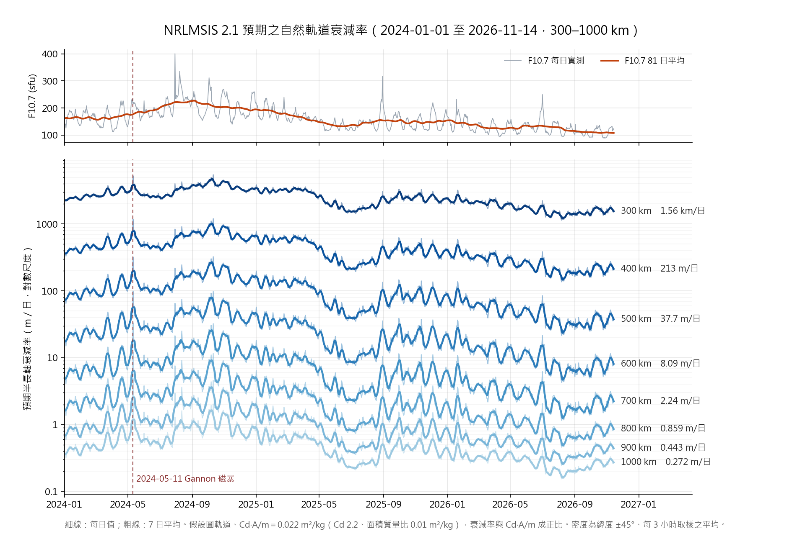

# 以 425 顆被動低軌衛星與福衛七號精密軌道驗證 NRLMSIS 2.1 衰減率預測：兼論阻力殘差篩檢門檻之高度相依性

**Validating NRLMSIS 2.1 Orbital-Decay Predictions with 425 Passive LEO Satellites and FORMOSAT-7 Precise Orbits: Implications for Altitude-Dependent Drag-Residual Screening Thresholds**

作者：（待填）　　機構：（待填）　　通訊：（待填）
目標期刊：（見論文規劃文件）　　主題領域：熱層密度模型／軌道衰減／太空態勢感知

---

## 摘要

以公開兩行軌道根數（TLE）篩檢低軌衛星機動時，常以大氣密度模型預測「僅受阻力時」之半長軸變化，再以實測與預測之差（阻力殘差）判斷是否存在阻力以外之變化。此作法之前提為密度模型能正確描述自然衰減，但該前提少以大樣本被動衛星與獨立精密軌道同時檢驗。本研究以 NRLMSIS 2.1 搭配實測 F10.7 與 3 小時 ap 指數，對 2024 年 1 月至 2026 年 11 月之三組資料進行檢驗：(1) 依近地點 300–1000 km 每 50 km 分檔、共 425 顆衛星之 TLE；(2) 其中 270 顆全期被動且 TLE 完整之衛星，檢驗衰減率隨太陽活動之時間起伏；(3) 福衛七號五顆衛星之 leoOrb 精密軌道。

以 55,879 個 7 日窗計，TLE 實測衰減率與 NRLMSIS 預期之對數 Pearson 相關係數為 0.976。由於等效彈道係數逐星以全期中位數校準，量級吻合主要反映校準結果，模型之檢驗以時間相關為準：309 顆全期被動衛星之逐星時間相關中位數為 0.923，有抬升紀錄之 116 顆僅 0.215；四個高度帶之週中位數序列相關為 0.931–0.953，NRLMSIS 重現 2024 年太陽活動高峰與 2025 年低點之衰減率起伏。福衛七號精密軌道與 NRLMSIS 之時間相關為 0.962，TLE 與精密軌道之 7 日窗衰減率相關為 0.996、逐星差異 RMS 1.9–2.7 m／日，顯示在約 540–585 km 之高度，TLE 之 7 日窗衰減率可代表真實衰減。2024 年底太陽活動高峰期間，NRLMSIS 預期之福衛七號衰減率較精密軌道高約 20%，其成因尚未查證。

以 309 顆被動衛星、877,567 筆相鄰 TLE（約 30.4 萬星日）檢查固定 0.3 km 殘差門檻之誤報率：300–450 km 為每千星日 2.52 件，600–1000 km 為 0.064 件，300 km 檔達 43.9 件。依等誤報率擬合之高度公式 log10（門檻／km）= 0.822 − 2.222 × 高度／1000 km 可使 700 km 以上之 90% 可偵測下限由約 0.31 km 降至 0.05–0.20 km，但於樣本內仍未使所有高度檔之誤報率低於目標值。此門檻研討為樣本內分析，尚未於作業系統實施。

**關鍵詞**：NRLMSIS、熱層密度、軌道衰減、兩行軌道根數（TLE）、精密定軌、福衛七號、阻力殘差、機動篩檢

---

## 1. 前言

低軌衛星之半長軸變化以大氣阻力為最大之非保守攝動。以 TLE 偵測機動之方法，若不扣除阻力，低軌衛星之自然衰減即可能超過固定門檻而產生誤報；若以密度模型扣除阻力，則偵測之可靠度取決於模型對自然衰減之描述能力。NRLMSIS 系列經驗模型 [1–3] 以 F10.7 太陽輻射通量與地磁 ap 指數為輸入，提供全球中性大氣密度，為此類阻力殘差方法常用之密度來源。

以軌道衰減資料檢驗密度模型已有先例 [4]（相關文獻回顧待補）。本研究之問題較為具體：在機動篩檢所用之資料條件下（公開 TLE、逐星自我校準之等效彈道係數、7 日時間尺度），NRLMSIS 2.1 能否描述 300–1000 km 被動衛星之衰減率隨高度與隨太陽活動之變化；若能，現行固定之阻力殘差門檻在各高度之誤報與靈敏度如何。

驗證之難處在於區分「校準」與「檢驗」。阻力殘差方法以每顆衛星自身之歷史資料校準等效彈道係數 B_eff，故各星衰減率之量級吻合係校準所致，不足以證明模型正確。本研究將 B_eff 固定為逐星全期單一常數，以衰減率之時間起伏檢驗模型：起伏完全來自模型密度隨太陽與地磁活動之變化，非逐段擬合。另以 TLE 為實測時，TLE 本身之擬合誤差亦可能與阻力相關；為此以福衛七號之精密軌道作為不依賴 TLE 之衰減實測。

本研究之貢獻有三：

1. 以近地點 300–1000 km、425 顆衛星之分檔樣本，量化 NRLMSIS 2.1 預期衰減率與 TLE 實測之跨高度一致性，並以全期被動衛星之逐星時間相關檢驗模型對太陽活動起伏之描述能力（§3.1–3.3）。
2. 以福衛七號 leoOrb 精密軌道檢驗 NRLMSIS 預期，並確認 TLE 之 7 日窗衰減率於該高度可代表真實衰減，使以 TLE 為實測之大樣本結論有獨立依據（§3.4）。
3. 以被動衛星之殘差分布量化固定阻力殘差門檻之高度相依誤報率，並比較等誤報率查表與高度公式兩種調整方案之誤報與可偵測下限（§3.5）。

TLE 半長軸雜訊底之量測與機動偵測器之感度模型分別見另文 [5, 6]；本文僅處理阻力模型之驗證與其對阻力殘差門檻之意涵。

## 2. 資料與方法

### 2.1 NRLMSIS 2.1 與太空天氣輸入

大氣密度以 NRLMSIS 2.1 [3] 計算，計算套件見 [7]。輸入如下：

- **F10.7**：CelesTrak 太空天氣檔 [8] 之 10.7 cm 太陽輻射通量 [9] 每日觀測值（F10.7_OBS）與 81 日中心平均值（F10.7_OBS_CENTER81），取 TLE 曆元 UTC 當日之值，不做日內插值；缺值時以 120 sfu 代入。
- **ap**：3 小時解析度之 ap 陣列，以 NRLMSIS 2.1 之暴時 ap 模式使用；3 小時值不存在時改用每日平均 Ap。
- **位置**：以 SGP4 [10, 11] 由 TLE 解出星下點經緯度。近圓軌道（中位偏心率 < 0.01）且有 TLE 原文時，密度以每小時之軌道平均值積分；跨越 7 天以上空窗之轉換仍用近地點單點值。

NRLMSIS 慣例使用前一日之 F10.7，本研究使用當日值，此差異之影響未評估（§4.5）。

### 2.2 預期衰減率

近圓軌道之半長軸衰減率為 [12]

$$\frac{\mathrm{d}a}{\mathrm{d}t}=-\rho\,B\,\sqrt{\mu a},\qquad B=\frac{C_D A}{m}\tag{1}$$

其中 ρ 為軌道平均密度、μ 為地球重力常數。作為代表值之預期衰減曲線（圖 1），逐日於 300–1000 km 每 100 km 計算密度，於緯度 −45° 至 45°（每 15°）、經度 0° 與 180°、每 3 小時取樣平均以近似軌道平均，B 取 0.022 m²/kg（C_D = 2.2、面積質量比 0.01 m²/kg）。衰減率與 B 成正比，圖 1 僅表示量級；以下各節之預期值皆以逐星校準之 B_eff 計算。

### 2.3 近地點分檔樣本

依最新 TLE 之近地點，每 50 km 一檔（300、350 … 1000 km，共 15 檔），每檔至多選 30 顆衛星，共 425 顆。選星條件為：近地點與檔位相差 5 km 以內（候選不足時依序放寬至 10 km、20 km）；近圓軌道（e < 0.005，放寬時 < 0.01）；物件類別為酬載；排除碎片、火箭殘骸，以及 Starlink、OneWeb、Kuiper、千帆、國網、Iridium 等以推力維持高度之星系；近 120 天無抬升跡象；同系列每檔至多 3 顆。300 km 與 1000 km 檔之合格候選僅 17 與 18 顆。

本機資料庫缺 2024-01 至 2026-04 期間之 248 顆衛星資料，以 Space-Track [13] 歷史 TLE 補齊（約 54.7 萬筆）；補齊後 335 顆之 TLE 涵蓋 2024 年 1 月起。選星依據為 2026 年 11 月之近地點，低檔位衛星於 2024 年時多半較高，故以下以期間平均高度表示各星位置（期間平均高度 306–1000 km）。

### 2.4 阻力殘差與等效彈道係數

對每筆相鄰 TLE 轉換，阻力殘差定義為

$$r_{\mathrm{drag}}=\Delta a_{\mathrm{obs}}-\Delta a_{\mathrm{model}},\qquad \Delta a_{\mathrm{model}}=-B_{\mathrm{eff}}\,\rho\,\sqrt{\mu a}\,\Delta t\tag{2}$$

B_eff 以分析期間內全部轉換之「實測 Δa ÷ 模型阻力形狀項 ρ√(μa)Δt」比值取中位數校準，每顆衛星為全期單一常數。中位數使少數機動或異常轉換對校準之影響有限。阻力係數、姿態、面積質量比之變化與密度模型誤差均併入 B_eff 與殘差，無法彼此分離。

### 2.5 7 日窗衰減率與被動判定

逐星將轉換彙整為 7 日窗之實測與預期衰減率（m／日）。窗內轉換涵蓋不足 4 日、任一轉換跨 3 日以上，或任一轉換 |r_drag| 超過 1 km 者排除。期間內任一相鄰 TLE 之 Δa > +0.3 km 者視為有抬升紀錄，其餘為「全期被動」（309 顆）。此判定無法排除抬升幅度更小之推力（§4.5）。

相關分析包括：(a) 全部 7 日窗之 log10 實測與 log10 預期衰減率之 Pearson 相關；(b) 逐星之高度與 log10 衰減率之 Spearman 相關；(c) 逐星實測與預期衰減率之時間相關（Pearson）；(d) 逐星之高度與殘差 RMS、相對殘差（殘差 RMS ÷ 預期衰減率中位數）之 Spearman 相關。

### 2.6 衰減率隨太陽活動之時間相關

取全期被動且 TLE 自 2024 年 1 月起完整之 270 顆衛星。每顆衛星之實測與預期 7 日窗衰減率皆除以該星預期衰減率之中位數，以消去高度與面積質量比之差異；再依選星檔位分為四個高度帶（350–550 km 帶涵蓋 300–550 km 檔位；另為 600–700、750–850、900–1000 km），逐週取各星之中位數，計算週中位數序列之相關，並列出帶內逐星相關之中位數。

### 2.7 福衛七號精密軌道

福衛七號（FORMOSAT-7／COSMIC-2）[14] 之 leoOrb 精密軌道由 TACC 以 SP3-c 格式 [15] 公開 [16]，取樣 60 秒。取 FORMOSAT7-1、7-2、7-4、7-5、7-6 五顆（FORMOSAT7-3 於 2025 年 5 月後停止維持，未納入），期間 2024 年 1 月至 2026 年 11 月。SP3 地固座標至慣性座標之轉換與弧段合併沿用另文之處理 [6]。

處理步驟為：(1) 於 60 秒網格計算瞬時半長軸，以一個軌道週期之滑動平均消去 J2 短週期項；(2) 每 UTC 日取中位數，當日涵蓋須達 18 小時；(3) 以 7 日窗內每日半長軸之線性斜率為衰減率。窗內相鄰有效日之變化率大於 +20 m／日（推進抬升）或小於 −150 m／日、線性擬合殘差大於 40 m，或有效日少於 5 日者排除。NRLMSIS 預期依當日平均高度，於緯度 −24° 至 24°（對應約 24° 之軌道傾角）、經度 0° 與 180°、每 3 小時取樣平均得軌道平均密度，B 逐星以全期中位數校準（與 §2.4 同法）。同五顆衛星之 TLE 以相同 7 日窗計算衰減率作為對照。五顆衛星於期間之高度約 538–585 km。FORMOSAT7-4 之精密軌道於 2026-10-16 後停止更新。

### 2.8 阻力殘差門檻研討

對象為 309 顆全期被動衛星之逐筆轉換，轉換間隔不超過 3 日，共 877,567 筆、約 303,735 星日。被動衛星不應有推進，殘差超過門檻者視為誤報；48 小時內之超門檻轉換合併為一次，誤報率以每千星日之次數表示。比較三種門檻：

- **A（現行）**：|r_drag| > 0.30 km。
- **B（等誤報率查表）**：各 50 km 高度檔於 0.03–3.0 km 之格點中，取使誤報率不超過目標值之最小門檻。目標值取每千星日 0.43 件，即同一系統之 TLE 規則式候選事件於 IDS 認證安靜期之誤報率 [17]。
- **C（高度公式）**：以轉換數不少於 3,000 筆之檔位，對 log10（B 門檻）與高度作線性擬合，門檻依每筆轉換之高度計算，下限 0.03 km。

可偵測下限以注入測試估計：每檔隨機抽取至多 3,000 筆轉換，於殘差加上隨機正負號之步階 s（0.02–3.0 km，間隔 0.01 km），取超門檻比例達 90% 之最小 s。注入作用於殘差層級，未重新校準 B_eff。

## 3. 結果

### 3.1 預期自然衰減率之量級

圖 1 為 B = 0.022 m²/kg 之代表衰減率。2024-01-01 至 2026-11-14 之中位數為：300 km 約 2.45 km／日、400 km 約 410 m／日、600 km 約 21 m／日、1000 km 約 0.44 m／日，跨越約四個數量級。最近 7 日（2026-11-08 至 11-14）之 400 km 中位數約 237 m／日，F10.7 之 81 日平均為 108 sfu，低於全期中位數 153 sfu，反映 2024 年太陽活動高峰後衰減率之下降。全期 F10.7 之 81 日平均最大值約 227 sfu，出現於 2024 年 9 月初。

### 3.2 近地點分檔之跨高度一致性

表 1 列出全樣本之相關係數，表 2 列出各檔之統計。log10 實測衰減率與 log10 預期之 Pearson r 為 0.976（55,879 個 7 日窗）。逐星之高度與 log10 衰減率之 Spearman ρ，實測為 −0.926、預期為 −0.959；300 km 檔之實測衰減率中位數約 167 m／日，1000 km 檔約 0.49 m／日。如 §1 所述，量級吻合係逐星校準 B_eff 之結果，不作為模型驗證之證據。

殘差之絕對值隨高度下降（高度與殘差 RMS 之 ρ = −0.701），但占預期衰減之比例隨高度上升（高度與相對殘差之 ρ = +0.473）。逐窗之預期衰減率與 |殘差| 之 Spearman ρ 為 0.804，即衰減越快之窗殘差越大。

**表 1　近地點分檔 425 顆衛星之相關係數（2024-01 至 2026-11）**

| 相關分析 | 係數 | 樣本 |
|---|--:|---|
| log10 實測 vs log10 NRLMSIS 衰減率（Pearson） | 0.976 | 55,879 個 7 日窗 |
| 高度 vs log10 衰減率（Spearman，實測／NRLMSIS） | −0.926／−0.959 | 425 顆 |
| 逐星時間相關中位數（全部） | 0.904 | 425 顆 |
| 逐星時間相關中位數（全期被動／有抬升紀錄） | 0.923／0.215 | 309／116 顆 |
| 全期被動衛星中逐星 r > 0.5 之比例 | 0.88 | 309 顆 |
| 高度 vs 殘差 RMS／相對殘差（Spearman） | −0.701／+0.473 | 425 顆 |
| NRLMSIS 預期 vs \|殘差\|（Spearman） | 0.804 | 逐窗 |

**表 2　各近地點檔之衰減率與逐星時間相關**

| 檔位 (km) | 衛星數 | 全期被動 | 實測衰減中位 (m／日) | NRLMSIS 預期中位 (m／日) | 被動衛星逐星 r 中位 | 相對殘差中位 |
|--:|--:|--:|--:|--:|--:|--:|
| 300 | 17 | 14 | 166.5 | 167.8 | 0.982 | 0.18 |
| 350 | 30 | 23 | 145.0 | 142.8 | 0.871 | 0.21 |
| 400 | 30 | 23 | 104.1 | 106.7 | 0.923 | 0.13 |
| 450 | 30 | 17 | 63.4 | 64.9 | 0.930 | 0.20 |
| 500 | 30 | 16 | 36.7 | 39.5 | 0.903 | 0.28 |
| 550 | 30 | 20 | 22.5 | 23.8 | 0.913 | 0.28 |
| 600 | 30 | 21 | 8.68 | 9.31 | 0.952 | 0.24 |
| 650 | 30 | 21 | 7.50 | 8.25 | 0.946 | 0.27 |
| 700 | 30 | 19 | 3.47 | 4.14 | 0.943 | 0.61 |
| 750 | 30 | 26 | 2.54 | 2.69 | 0.941 | 0.30 |
| 800 | 30 | 27 | 1.90 | 2.00 | 0.931 | 0.32 |
| 850 | 30 | 29 | 1.21 | 1.35 | 0.900 | 0.37 |
| 900 | 30 | 21 | 0.94 | 1.16 | 0.678 | 0.83 |
| 950 | 30 | 17 | 0.52 | 0.63 | 0.887 | 5.04 |
| 1000 | 18 | 15 | 0.49 | 0.52 | 0.908 | 0.34 |

註：檔位依 2026-11 之近地點；衰減率與相對殘差為各檔逐星中位數之中位數。

逐星時間相關在全期被動衛星與有抬升紀錄者之間差異明顯（0.923 對 0.215）。主動控制軌道之衛星，其衰減率受推進支配，不適用阻力模型，須先排除。被動衛星之逐星相關於 300–850 km 各檔皆在 0.87 以上；900 km 檔降至 0.678，950 km 檔之相對殘差中位數達 5.04，該高度之 7 日窗衰減僅數公尺，接近 TLE 半長軸雜訊（§4.2）。

### 3.3 衰減率隨太陽活動之起伏

表 3 列出四個高度帶之時間相關。週中位數序列之相關為 0.931–0.953，帶內逐星相關中位數為 0.893–0.946。以對數表示之週序列相關為 0.935–0.967。依圖 3 判讀，2024 年 10 月前後太陽活動高峰時，正規化衰減率約為中位數之 2–3 倍，2025 年 7 月之低點約為 0.5 倍；四個高度帶中，NRLMSIS 均重現此起伏與約 27 日之太陽自轉週期擾動。B_eff 為逐星全期單一常數，曲線起伏完全來自模型密度。

**表 3　各高度帶之時間相關（全期被動且 TLE 自 2024-01 起完整之 270 顆）**

| 高度帶 | 衛星數 | 週數 | 週中位數序列 r | 週序列 r（對數） | 逐星 r 中位 |
|---|--:|--:|--:|--:|--:|
| 350–550 km | 79 | 148 | 0.931 | 0.935 | 0.929 |
| 600–700 km | 58 | 148 | 0.953 | 0.967 | 0.946 |
| 750–850 km | 82 | 149 | 0.947 | 0.961 | 0.923 |
| 900–1000 km | 51 | 148 | 0.945 | 0.956 | 0.893 |

### 3.4 福衛七號精密軌道驗證

表 4 列出五顆衛星之結果。精密軌道衰減率與 NRLMSIS 預期之時間相關，合併 616 個 7 日窗為 0.962，逐星為 0.958–0.967（Spearman ρ 0.969–0.972）；以 TLE 為實測時為 0.942–0.965。TLE 與精密軌道之 7 日窗衰減率相關為 0.994–0.998，差異 RMS 為 1.9–2.7 m／日；精密軌道與 NRLMSIS 之差異 RMS 為 8.2–10.0 m／日。在此高度，TLE 之 7 日窗衰減率可代表真實衰減，§3.2–3.3 以 TLE 為實測之結論有獨立依據。

五顆衛星校準所得之 B 為 0.0216–0.0219 m²/kg，彼此一致。2024 年 11 月前後之太陽活動高峰期，NRLMSIS 預期之五星中位衰減率約 145 m／日，精密軌道實測約 120 m／日，模型偏高約 20%（依圖 4 中圖之五星中位數時序判讀）；2025 年 7 月以後之低活動期兩者幾乎重合。可能原因包括模型於高活動期之偏差，以及姿態改變使面積質量比隨時間變化，目前尚未查證。

**表 4　福衛七號精密軌道之時間相關（7 日窗）**

| 衛星 | NORAD | 7 日窗 | 精密 vs NRLMSIS r | TLE vs NRLMSIS r | TLE vs 精密 r | TLE − 精密 RMS (m／日) | 校準 B (m²/kg) | 衰減中位 (m／日) |
|---|--:|--:|--:|--:|--:|--:|--:|--:|
| FORMOSAT7-1 | 44349 | 122 | 0.966 | 0.963 | 0.996 | 2.6 | 0.0217 | 36.4 |
| FORMOSAT7-2 | 44351 | 129 | 0.958 | 0.959 | 0.997 | 1.9 | 0.0219 | 31.2 |
| FORMOSAT7-4 | 44350 | 121 | 0.958 | 0.942 | 0.994 | 2.7 | 0.0218 | 35.2 |
| FORMOSAT7-5 | 44358 | 115 | 0.967 | 0.965 | 0.997 | 2.2 | 0.0217 | 30.0 |
| FORMOSAT7-6 | 44353 | 129 | 0.963 | 0.962 | 0.998 | 2.0 | 0.0216 | 32.3 |
| 合併 | | 616 | 0.962 | 0.958（待補） | 0.996（待補） | | | |

註：合併列之精密 vs NRLMSIS r 為 616 窗合併計算；TLE 兩欄之合併值等於逐星平均，是否為合併計算待補。

### 3.5 阻力殘差門檻之高度相依性

表 5 列出各高度檔之結果。固定 0.3 km 門檻（A）之全樣本誤報率為每千星日 0.65 件，但分布高度不均：300–450 km 為 2.52 件，600–1000 km 為 0.064 件；300 km 檔達 43.9 件、350 km 檔 8.8 件、400 km 檔 3.6 件。低軌每筆轉換之預期阻力 Δa 本身即達數十至數百公尺（300 km 檔中位 0.27 km），模型誤差 15–25% 即可超過門檻。600 km 以上則相反：被動衛星殘差之 99 百分位僅 3–19 m，可偵測下限卻固定在約 0.31 km。

等誤報率查表（B）之全樣本誤報率為 0.34 件；300 km 檔於格點上限 3.0 km 仍為 2.93 件，未達目標。由轉換數不少於 3,000 筆之檔位擬合之高度公式（C）為

$$\log_{10}\left(\frac{\mathrm{thr}}{\mathrm{km}}\right)=0.822-2.222\times\frac{h}{1000\ \mathrm{km}},\qquad \mathrm{thr}\ge 0.03\ \mathrm{km}\tag{3}$$

於 300、500、700、1000 km 分別為 1.43、0.51、0.19、0.04 km。C 之全樣本誤報率為 0.52 件，高於 0.43 件之目標；300、350、400 km 檔分別為 5.85、1.22、0.64 件，750 km 檔為 1.22 件，亦高於目標。C 使 700 km 以上之 90% 可偵測下限降至 0.05–0.20 km，代價為 400 km 以下僅能偵測約 0.9–1.5 km 以上之變化。B 於 650、900、1000 km 等檔之門檻由少數衛星決定、起伏較大，C 之高度變化較平滑。

**表 5　各高度檔之殘差分布、誤報率與門檻**

| 檔位 (km) | 被動衛星 | 轉換數 | 預期 \|Δa\| 中位 (km) | 殘差 P99 (km) | A 誤報 | B 門檻 (km) | B 誤報 | C 門檻中位 (km) | C 誤報 | 90% 下限 A／B／C (km) |
|--:|--:|--:|--:|--:|--:|--:|--:|--:|--:|---|
| 300 | 14 | 785 | 0.265 | 1.033 | 43.9 | 3.0* | 2.93 | 1.33 | 5.85 | 0.39／—／1.52 |
| 350 | 37 | 8,070 | 0.096 | 0.319 | 8.82 | 1.35 | 0.30 | 1.04 | 1.22 | 0.33／1.38／1.18 |
| 400 | 60 | 42,701 | 0.038 | 0.118 | 3.61 | 1.10 | 0.43 | 0.82 | 0.64 | 0.32／1.12／0.93 |
| 450 | 76 | 90,817 | 0.027 | 0.066 | 1.00 | 0.45 | 0.42 | 0.64 | 0.26 | 0.31／0.46／0.73 |
| 500 | 92 | 96,550 | 0.016 | 0.074 | 1.50 | 0.70 | 0.26 | 0.52 | 0.80 | 0.31／0.71／0.58 |
| 550 | 34 | 65,681 | 0.007 | 0.039 | 0.82 | 0.45 | 0.38 | 0.39 | 0.48 | 0.31／0.46／0.44 |
| 600 | 32 | 61,969 | 0.003 | 0.019 | 0.09 | 0.17 | 0.38 | 0.30 | 0.09 | 0.31／0.18／0.33 |
| 650 | 23 | 70,237 | 0.002 | 0.014 | 0.00 | 0.10 | 0.37 | 0.24 | 0.00 | 0.31／0.11／0.25 |
| 700 | 21 | 57,040 | 0.001 | 0.014 | 0.34 | 0.27 | 0.39 | 0.18 | 0.74 | 0.31／0.28／0.20 |
| 750 | 26 | 75,125 | 0.001 | 0.007 | 0.00 | 0.23 | 0.33 | 0.14 | 1.22 | 0.31／0.24／0.16 |
| 800 | 28 | 80,881 | 0.001 | 0.005 | 0.07 | 0.17 | 0.43 | 0.11 | 0.85 | 0.31／0.18／0.12 |
| 850 | 29 | 88,435 | 0.000 | 0.003 | 0.00 | 0.08 | 0.30 | 0.09 | 0.27 | 0.31／0.09／0.10 |
| 900 | 23 | 56,765 | 0.000 | 0.004 | 0.05 | 0.03 | 0.23 | 0.07 | 0.05 | 0.31／0.04／0.08 |
| 950 | 18 | 47,024 | 0.000 | 0.003 | 0.06 | 0.12 | 0.23 | 0.05 | 0.86 | 0.31／0.13／0.06 |
| 1000 | 16 | 35,487 | 0.000 | 0.003 | 0.06 | 0.03 | 0.19 | 0.04 | 0.19 | 0.31／0.04／0.05 |

註：誤報為每千星日之次數（48 小時內合併）。檔位之被動衛星數為該檔有轉換資料之衛星，衛星可因高度變化跨檔，故各檔加總大於 309。C 門檻為依每筆轉換高度計算後之檔內中位數，與以檔位中心代入式 (3) 之值略有差異（如 300 km 檔 1.33 km 對 1.43 km）。* 300 km 檔於格點上限 3.0 km 仍未達目標誤報率；其 90% 下限超出注入範圍。

## 4. 討論

### 4.1 校準與檢驗之區分

表 1 之 0.976 與跨高度之 Spearman 相關，顯示模型與 TLE 在量級與高度趨勢上一致，但 B_eff 逐星以全期中位數校準，任何形狀合理之密度模型皆可能在此項目得到高相關。本研究以時間相關作為模型檢驗之主要依據：B_eff 固定後，衰減率之週起伏僅能由模型密度隨 F10.7 與 ap 之變化產生。全期被動衛星之逐星相關中位數 0.923、四高度帶之週序列相關 0.931–0.953，以及精密軌道之 0.962，三者一致支持 NRLMSIS 2.1 在 7 日時間尺度上描述 2024–2026 年太陽活動起伏之能力。此結論不涵蓋小時至日尺度之磁暴響應（磁暴期間之阻力變化可參見 [18]），亦不涵蓋絕對密度之偏差，後者已被 B_eff 吸收。

### 4.2 高軌之檢驗力

衰減率低於約 1 m／日時（約 850 km 以上），7 日窗內之半長軸變化僅數公尺，與 TLE 半長軸雜訊同一量級 [5, 19]。900 km 檔之被動衛星逐星相關降至 0.678、950 km 檔相對殘差中位數達 5.04，應解讀為訊噪比不足，而非 NRLMSIS 失準；900–1000 km 帶之週中位數序列相關仍有 0.945，顯示多星合併可回復訊號。高軌之模型檢驗需更長之窗或精密軌道。

### 4.3 高活動期之偏差

福衛七號之精密軌道顯示，2024 年底太陽活動高峰期 NRLMSIS 預期較實測高約 20%，低活動期則幾乎重合。由於 B 為全期單一常數，若模型偏差或面積質量比隨活動程度改變，偏差即表現為高、低活動期之相對差異。本研究之資料不足以區分兩者；以滾動窗校準 B 或取得福衛七號姿態資料，可作為後續檢驗之方向。此偏差之量級與 §3.5 中低軌固定門檻之誤報機制（模型誤差 15–25% 即超過 0.3 km）相當，兩者可能相關，但尚未驗證。

### 4.4 與 TLE 雜訊底及偵測感度模型之關係

本研究與兩篇另文共用相同之 TLE 資料來源，但問題不同。TLE 半長軸雜訊底之研究 [5] 以 IDS 認證安靜期量測 719–1338 km 之 TLE 雜訊，並觀察到低軌雜訊隨高度之指數衰減與熱層密度標高相符；本研究則直接檢驗密度模型對衰減率之預測，並以被動衛星殘差描述模型誤差之高度分布。福衛七號偵測感度模型 [6] 以精密軌道之機動事件為真值，將阻力引起之 TLE 間模糊度以經驗係數納入偵測機率；本研究使用同一精密軌道產品，但只取無機動之 7 日窗計算衰減率，不涉及機動事件。

### 4.5 門檻研討之意涵與限制

固定 0.3 km 門檻在 400 km 以下誤報偏多，在 600 km 以上過於保守，此方向在三種方案之比較中一致。然而門檻研討有下列限制，故僅作為後續研究之建議，未修改作業偵測程式：

1. B 方案之門檻與誤報率以同一資料選定與評估，為樣本內結果；C 方案之擬合亦使用同一資料，且於樣本內仍有多個檔位之誤報率高於目標值。兩者皆需以獨立期間或獨立衛星檢驗。
2. 「全期被動」以相鄰 TLE Δa > +0.3 km 判定，低軌電力推進立方衛星之小推力可能未被排除，使低軌誤報率高估、所需門檻偏高。
3. 注入測試作用於殘差層級，未模擬機動對 B_eff 中位數校準之影響，亦未模擬 TLE 擬合對步階之平滑。
4. 誤報目標值 0.43 件／千星日取自規則式偵測器於 IDS 安靜期之誤報率，兩者之母體（測高衛星與本研究之被動衛星）不同。
5. F10.7 使用曆元當日值，未採 NRLMSIS 慣用之前一日值；此差異對殘差分布之影響未評估。

## 5. 結論

以 2024 年 1 月至 2026 年 11 月之資料檢驗 NRLMSIS 2.1 之衰減率預測，得到以下結果：

1. 近地點 300–1000 km、425 顆衛星之 TLE 實測衰減率與 NRLMSIS 預期之對數相關為 0.976；此一致性含逐星校準之貢獻。以時間相關檢驗，309 顆全期被動衛星之逐星相關中位數為 0.923，四個高度帶之週序列相關為 0.931–0.953；有抬升紀錄之衛星僅 0.215，須於阻力殘差分析前排除。
2. 福衛七號精密軌道與 NRLMSIS 之時間相關為 0.962，TLE 與精密軌道之 7 日窗衰減率相關為 0.996，支持以 TLE 為實測之大樣本結論。高活動期模型偏高約 20%，原因未查證。
3. 固定 0.3 km 阻力殘差門檻之誤報率於 300–450 km 為每千星日 2.52 件、600–1000 km 為 0.064 件。依高度調整門檻可降低高軌之可偵測下限至 0.05–0.20 km，但樣本內尚未使所有高度之誤報率低於目標值，需以獨立資料驗證後方可用於作業。

## 參考文獻

1. Picone, J. M., Hedin, A. E., Drob, D. P., Aikin, A. C. (2002). "NRLMSISE-00 empirical model of the atmosphere: Statistical comparisons and scientific issues." *Journal of Geophysical Research: Space Physics*, 107(A12), 1468.
2. Emmert, J. T., et al. (2021). "NRLMSIS 2.0: A whole-atmosphere empirical model of temperature and neutral species densities." *Earth and Space Science*, 8, e2020EA001321.
3. （待補）NRLMSIS 2.1 之原始文獻。
4. Pardini, C., Anselmo, L. (2001). 以衛星軌道衰減資料比較大氣密度模型準確度之研究，*Journal of the Astronautical Sciences*, 49。（題名與卷期頁碼待核對）
5. （作者待填）. 以 DORIS 認證安靜期實測 TLE 反演半長軸雜訊及其於福衛系列機動分析之應用。準備中。
6. （作者待填）. "An Empirical Sensitivity Model for Maneuver Detection from Public Two-Line Elements: Calibration Against Precise Orbit Determination Truth." 投稿準備中（目標期刊 *Advances in Space Research*）。
7. （待補）NRLMSIS 2.1 計算套件之引用。
8. （待補）CelesTrak 太空天氣資料檔之正式引用。
9. Tapping, K. F. (2013). "The 10.7 cm solar radio flux (F10.7)." *Space Weather*, 11(7), 394–406.
10. Hoots, F. R., Roehrich, R. L. (1980). *Spacetrack Report No. 3: Models for Propagation of NORAD Element Sets*. Aerospace Defense Command, U.S. Air Force.
11. Vallado, D. A., Crawford, P., Hujsak, R., Kelso, T. S. (2006). "Revisiting Spacetrack Report #3." *AIAA/AAS Astrodynamics Specialist Conference*, AIAA 2006-6753.
12. Vallado, D. A. (2013). *Fundamentals of Astrodynamics and Applications*, 4th ed. Microcosm Press.
13. 18th Space Defense Squadron. Space-Track.org. U.S. Space Command.
14. Schreiner, W. S., et al. (2020). "COSMIC-2 radio occultation constellation: First results." *Geophysical Research Letters*, 47, e2019GL086841.
15. Hilla, S. (2010). *The Extended Standard Product 3 Orbit Format (SP3-c)*. National Geodetic Survey / International GNSS Service.
16. Taiwan Analysis Center for COSMIC (TACC). *FORMOSAT-7/COSMIC-2 data products (leoOrb precise orbit files)*. https://tacc.cwa.gov.tw.
17. 本研究計畫期末報告（2026-11）：《智慧化低軌通訊衛星軌道異常及太空事件偵測演算法研究》，TASA-S-1150268（7.5、7.9、10.6 節）。
18. Parker, W. E., Linares, R. (2024). "Satellite drag analysis during the May 2024 Gannon geomagnetic storm." *Journal of Spacecraft and Rockets*, 61(5). doi:10.2514/1.A36164.
19. Flohrer, T., Krag, H., Klinkrad, H. (2008). "Assessment and Categorization of TLE Orbit Errors for the US SSN Catalogue." *AMOS Conference*.

（文獻回顧待補：以軌道衰減或加速度計資料評估 NRLMSIS 系列之既有研究。）

---

## 圖表說明

| 編號 | 檔案 | 內容 | 資料來源 |
|---|---|---|---|
| 圖 1 | `fig_nrlmsis_decay_expect.png` | NRLMSIS 2.1 代表衰減率（300–1000 km）與 F10.7 | `data/benchmark/nrlmsis_decay_expect.csv` |
| 圖 2 | `fig_perigee_drag_corr_x30.png` | 425 顆衛星之實測 vs 預期、逐星時間相關、殘差 vs 高度 | `perigee_drag_corr_global_x30.csv`、`_bins_x30.csv`、`_persat_x30.csv` |
| 圖 3 | `fig_nrlmsis_solar_tracking_x30.png` | 四高度帶正規化衰減率週中位數 | `nrlmsis_solar_tracking_bands_x30.csv` |
| 圖 4 | `fig_fs7_precise_nrlmsis.png` | 福衛七號精密軌道 vs NRLMSIS vs TLE | `fs7_precise_nrlmsis_corr.csv`、`fs7_precise_decay_windows.csv` |
| 圖 5 | `fig_drag_resid_threshold.png` | 殘差分布、各高度誤報率、90% 可偵測下限 | `drag_thr_by_alt_x30.csv`、`drag_thr_summary_x30.csv` |
| 表 1 | — | 全樣本相關係數 | `perigee_drag_corr_global_x30.csv` |
| 表 2 | — | 各近地點檔統計 | `perigee_drag_corr_bins_x30.csv` |
| 表 3 | — | 高度帶時間相關 | `nrlmsis_solar_tracking_bands_x30.csv` |
| 表 4 | — | 福衛七號逐星結果 | `fs7_precise_nrlmsis_corr.csv` |
| 表 5 | — | 門檻研討 | `drag_thr_by_alt_x30.csv`、`drag_thr_summary_x30.csv` |

## 資料與程式

選星 `docs/select_perigee_bins.py`；歷史 TLE 補齊 `docs/backfill_perigee_tle.py`；相關分析 `docs/analyze_perigee_drag_corr.py`（`TAG=x30`）；太陽活動時間相關 `docs/gen_fig_nrlmsis_solar_tracking.py`；預期衰減率 `docs/gen_fig_nrlmsis_decay_expect.py`；福衛七號 `docs/gen_fig_fs7_precise_nrlmsis.py`；門檻研討 `docs/study_drag_resid_threshold.py`（亂數種子 20261116）。阻力殘差之作業實作見 `atmospheric_drag.py`，現行門檻 `maneuver_report_builder.py` 之 `DRAG_EVENT_KM = 0.30`。Space-Track 原始 TLE 依其使用者協議不再散布。
