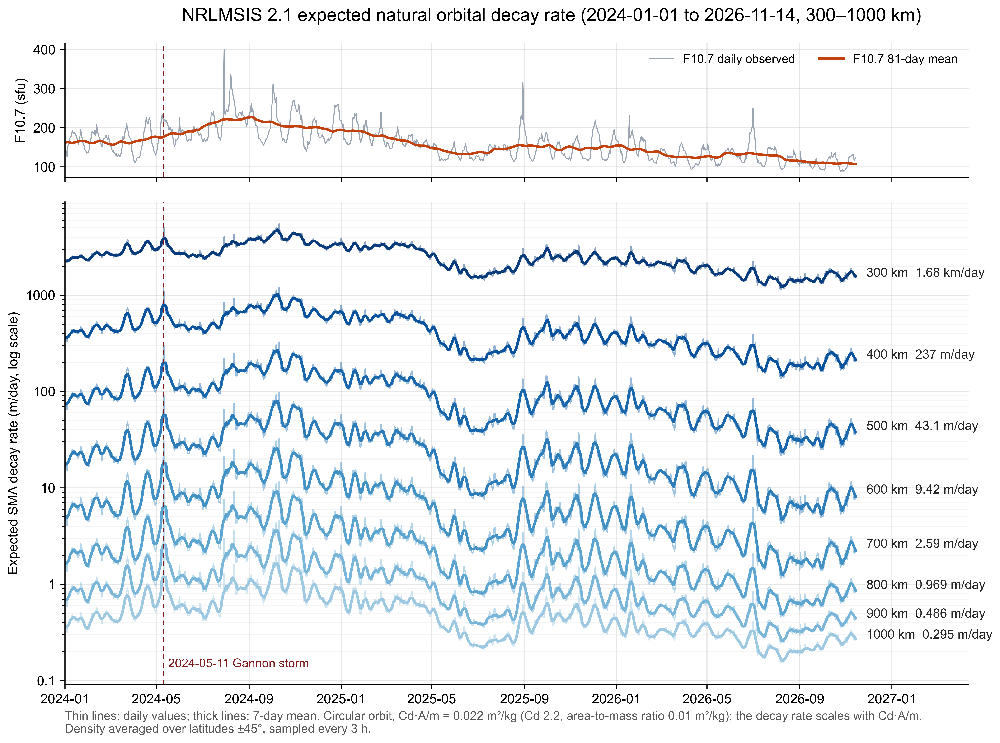
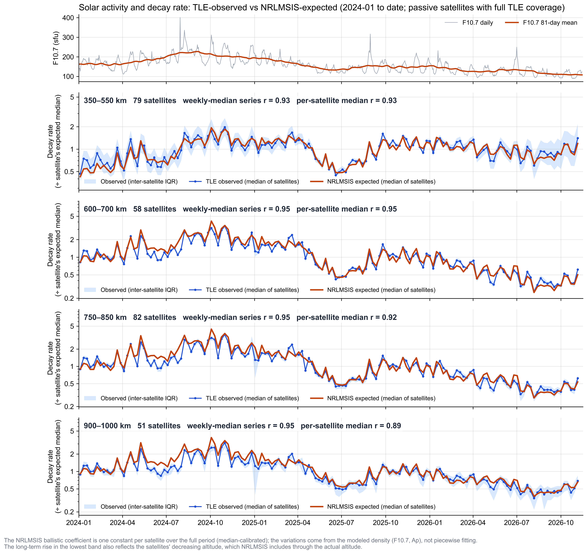
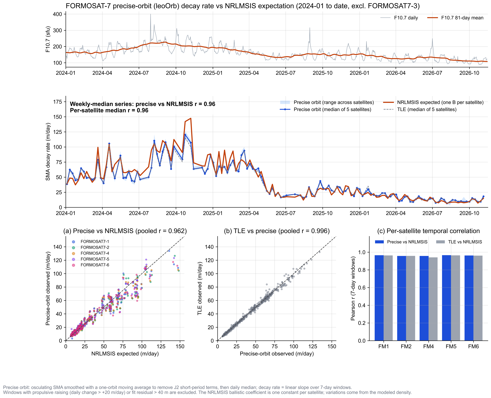
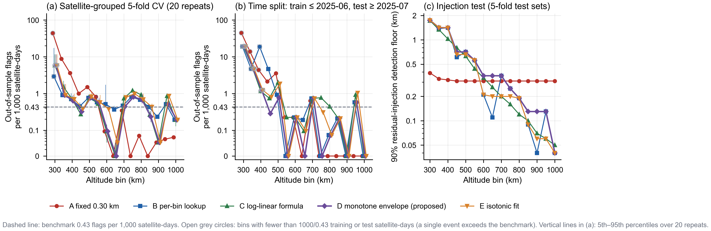

# Validating NRLMSIS 2.1 Orbital-Decay Predictions With 425 Passive LEO Satellites and FORMOSAT-7 Precise Orbits: Activity-Dependent Bias and Implications for Drag-Residual Screening Thresholds

**Authors:** [Author 1]¹, [Author 2]¹, [Author 3]²

¹ [Affiliation, city, country]
² [Affiliation, city, country]

**Corresponding author:** [Name] ([e-mail])

## Key Points

- NRLMSIS 2.1 reproduces the 2024–2026 solar-cycle variation of passive-satellite decay at 300–1000 km (median correlation 0.92).
- With one ballistic coefficient per satellite, the model overpredicts decay at high solar flux relative to low flux by about 17%.
- A fixed drag-residual threshold over-alarms below 450 km and is insensitive above 600 km; altitude-tuned thresholds do not fully generalize.

## Abstract

Drag-residual methods screen satellites for maneuvers by subtracting the decay predicted by an atmospheric density model from the decay observed in Two-Line Element (TLE) sets. We test whether NRLMSIS 2.1 supports this use under the conditions of such screening — public TLEs, one self-calibrated ballistic coefficient per satellite, and 7-day decay rates — from January 2024 to November 2026. Because per-satellite calibration forces agreement in magnitude, the model is judged by the temporal correlation of decay. For 309 passive satellites at 300–1000 km, the median per-satellite correlation between TLE-observed and predicted decay is 0.92, and weekly band-median series correlate at 0.93–0.95. FORMOSAT-7 precise orbits confirm the result independently of TLEs (r = 0.962; TLE versus precise decay r = 0.996). With a constant ballistic coefficient, the ratio of predicted to observed decay rises with solar flux: for 265 passive satellites it is 1.17 times higher at F10.7 above 160 sfu than below 120 sfu (95% CI 1.16–1.19), with the same sign for 89% of them and in FORMOSAT-7 precise orbits (1.18–1.32). A fixed 0.3 km residual threshold produces 2.5 false alarms per 1,000 satellite-days at 300–450 km but leaves a 0.31 km detection floor where passive residuals are only metres. Altitude-dependent thresholds tuned on the same satellites fail to meet the target false-alarm rate out of sample; a monotone envelope comes closest. False alarms concentrate on a few satellites with undetected small station-keeping, so the passive labelling, not only the model, limits threshold design.

## Plain Language Summary

Satellites in low orbit slowly lose altitude because of the thin upper atmosphere. To tell whether a satellite has fired its engines, analysts predict this natural loss with an atmosphere model and look for changes the model cannot explain. We checked one widely used model, NRLMSIS 2.1, against the observed altitude loss of 425 satellites without propulsion activity and against precise orbits of the Taiwanese FORMOSAT-7 satellites over 2024–2026, a period that includes a strong solar maximum. The model follows the rise and fall of solar activity well. However, when each satellite is described by one fixed drag coefficient, the model predicts about 17% more decay, relative to quiet periods, than is observed when the Sun is very active. We also show that a single fixed alarm threshold produces many false alarms for low satellites and misses small changes for high ones. Thresholds adjusted for altitude help, but none reached the desired false-alarm rate on satellites they had not been tuned on, partly because some supposedly passive satellites make small, unannounced orbit corrections.

---

## 1. Introduction

Atmospheric drag is the largest non-conservative perturbation on the semi-major axis of satellites in low Earth orbit (LEO). Maneuver screening based on Two-Line Element (TLE) sets (Hoots & Roehrich, 1980; Vallado et al., 2006; Kelecy & Jah, 2010; Lemmens & Krag, 2014) therefore either tolerates false alarms from natural decay or subtracts the decay predicted by a thermospheric density model and examines the residual. The empirical NRLMSIS models (Picone et al., 2002; Emmert et al., 2021, 2022), driven by the F10.7 solar radio flux (Tapping, 2013) and the geomagnetic ap index, are a common density source for such drag residuals.

Orbital decay has long been used to assess and calibrate density models: TLE-derived decay underlies calibrated density corrections (Picone et al., 2005; Doornbos et al., 2008; Storz et al., 2005), accelerometer-derived densities quantify model errors along individual orbits (Mehta et al., 2017), and reviews document systematic model biases over the solar cycle (Emmert, 2015; Vallado & Finkleman, 2014). Storm-time drag has received particular attention, including the May 2024 storm (Oliveira & Zesta, 2019; Parker & Linares, 2024). The question addressed here is narrower and operational: under the data conditions of drag-residual screening — public TLEs, one self-calibrated effective ballistic coefficient per satellite, and 7-day time scales — does NRLMSIS 2.1 describe how the decay of passive satellites varies with altitude and solar activity, and what does that imply for residual thresholds?

The central difficulty is separating calibration from validation. Because the effective ballistic coefficient B_eff is calibrated on each satellite's own history, agreement in decay magnitude is enforced and does not validate the model. We therefore hold B_eff constant over the whole period for each satellite and test the model through the temporal variation of decay, which then arises only from the modelled density response to solar and geomagnetic activity. Because TLE fitting errors may themselves correlate with drag, we also use FORMOSAT-7 precise orbits as a decay measurement independent of TLEs.

The contributions are:

1. A cross-altitude and temporal test of NRLMSIS 2.1 decay predictions on 425 satellites with perigees of 300–1000 km, using the per-satellite temporal correlation of passive satellites as the validation metric (Sections 3.1–3.3).
2. An independent test on FORMOSAT-7 precise orbits, which also establishes that 7-day TLE decay rates represent true decay at 540–585 km (Section 3.4).
3. A quantification of the activity dependence of the predicted-to-observed decay ratio under constant B_eff, across altitude bands and in precise orbits (Section 3.5).
4. A quantification of the altitude-dependent false-alarm rate of a fixed drag-residual threshold, and an out-of-sample evaluation of altitude-dependent alternatives (Section 3.6).

TLE noise floors and the detection sensitivity of TLE-based maneuver detectors are addressed in companion studies ([Authors], 2026a, 2026b).

## 2. Data and Methods

### 2.1 NRLMSIS 2.1 and Space-Weather Inputs

Densities are computed with NRLMSIS 2.1 (Emmert et al., 2022) through the pymsis package (version 0.13.0). Inputs are the daily observed F10.7 and its 81-day centred mean from the CelesTrak space-weather file (Kelso, 2026; downloaded 18 November 2026), and the 3-hourly ap array in the storm-time mode of NRLMSIS, with the daily Ap used where 3-hourly values are unavailable. For the orbit-averaged densities of the TLE-based analyses, the F10.7 of the day before the TLE epoch is used, following the NRLMSIS convention (the perigee-point fallback of Section 2.4 uses the same-day value); for the FORMOSAT-7 precise-orbit analysis and the representative curves of Figure 1, the same-day value is used. Section 3.4 shows that this choice changes correlations by less than 0.011. The 81-day centred mean of the last ~40 days of the record is provisional in the space-weather file and is revised as observations accumulate; values in that interval are therefore subject to small revision.

### 2.2 Expected Decay Rate

For a near-circular orbit the semi-major-axis decay rate is (Vallado, 2013)

$$\frac{\mathrm{d}a}{\mathrm{d}t}=-\rho\,B\,\sqrt{\mu a},\qquad B=\frac{C_D A}{m}, \tag{1}$$

where ρ is the orbit-averaged density and μ the gravitational parameter. Representative curves (Figure 1) are computed daily at 300–1000 km in 100 km steps, averaging density over latitudes −45° to 45° (15° steps), longitudes 0° and 180°, and 3-hour intervals, with B = 0.022 m² kg⁻¹ (C_D = 2.2, A/m = 0.01 m² kg⁻¹). Decay scales with B, so Figure 1 indicates magnitude only; all subsequent predictions use per-satellite calibrated values.

### 2.3 Perigee-Binned Sample

Satellites are selected by their latest perigee in 50 km bins from 300 to 1000 km (15 bins), up to 30 per bin, for a total of 425. Selection requires a perigee within 5 km of the bin centre (relaxed to 10 and 20 km where candidates were insufficient), eccentricity below 0.005 (0.01 when relaxed), payload object type, no indication of orbit raising in the last 120 days, and at most three satellites of the same series per bin. Debris, rocket bodies, and constellations that maintain altitude by thrust (Starlink, OneWeb, Kuiper, Qianfan, Guowang, Iridium) are excluded. The 300 and 1000 km bins contain only 17 and 18 qualifying candidates. Missing TLE histories for January 2024 to April 2026 were retrieved from Space-Track for the 248 satellites lacking them (241 returned data; 547,282 TLEs), after which 335 satellites have TLEs from January 2024. Because the selection uses November 2026 perigees, satellites in low bins were higher in 2024; positions are therefore reported as period-mean altitudes (306–1000 km).

### 2.4 Drag Residual and Effective Ballistic Coefficient

For each pair of adjacent TLEs, the drag residual is

$$r_{\mathrm{drag}}=\Delta a_{\mathrm{obs}}-\Delta a_{\mathrm{model}},\qquad \Delta a_{\mathrm{model}}=-B_{\mathrm{eff}}\,\rho\,\sqrt{\mu a}\,\Delta t, \tag{2}$$

with ρ the orbit-averaged density along the SGP4-propagated orbit (hourly sampling for near-circular orbits; perigee point value for transitions across gaps longer than 7 days). B_eff is calibrated as the median, over all transitions of the analysis period, of the ratio of observed Δa to the model shape term ρ(μa)^{1/2}Δt, giving one constant per satellite. The median limits the influence of occasional maneuvers. Variations of drag coefficient, attitude, area-to-mass ratio, and density-model error are all absorbed into B_eff and the residual and cannot be separated.

### 2.5 Seven-Day Decay Rates and Passive Classification

Transitions are aggregated per satellite into 7-day windows of observed and predicted decay rate (m day⁻¹). Windows with less than 4 days of coverage, any transition spanning more than 3 days, or any |r_drag| above 1 km are excluded. A satellite with any adjacent-TLE Δa > +0.3 km during the period is classified as having raised its orbit; the remaining 309 are "passive". This classification cannot exclude thrusting with smaller steps (Section 4.4). Correlation measures are: (a) Pearson correlation of log₁₀ observed and log₁₀ predicted decay over all windows; (b) Spearman correlation between satellite altitude and log₁₀ decay; (c) per-satellite Pearson correlation of observed and predicted decay over time; and (d) Spearman correlations between altitude and residual RMS and relative residual (residual RMS divided by median predicted decay).

### 2.6 Temporal Correlation With Solar Activity

For the 270 passive satellites with TLEs from January 2024, observed and predicted 7-day decay rates are divided by the satellite's median predicted decay to remove differences in altitude and area-to-mass ratio, grouped into four altitude bands (350–550 km, covering the 300–550 km bins; 600–700; 750–850; 900–1000 km), and reduced to weekly band medians.

### 2.7 FORMOSAT-7 Precise Orbits

The leoOrb precise orbits of FORMOSAT-7/COSMIC-2 (Schreiner et al., 2020), distributed by the Taiwan Analysis Center for COSMIC (TACC, 2026) in SP3-c format (Hilla, 2010) at 60 s sampling, are used for FORMOSAT7-1, -2, -4, -5 and -6 from January 2024 to November 2026. FORMOSAT7-3 stopped orbit maintenance in May 2025, but its precise orbits end on 27 May 2025, 12 days after its last raise, so its free-decay period has only TLEs; it is analysed separately. Instantaneous semi-major axes are smoothed with a one-orbital-period running mean to remove J2 short-period terms, reduced to daily medians (at least 18 h of coverage), and differenced by a 7-day linear fit. Windows containing a day-to-day change above +20 m day⁻¹ (orbit raising) or below −150 m day⁻¹, a fit residual above 40 m, or fewer than 5 valid days are excluded. Predicted decay uses the daily mean altitude, density averaged over latitudes −24° to 24°, longitudes 0° and 180° and 3-hour intervals, and a per-satellite B calibrated as in Section 2.4. TLE decay rates are computed over the same windows. The five satellites span 538–585 km. FORMOSAT7-4 precise orbits end on 16 October 2026.

### 2.8 Activity Dependence of the Decay Ratio

The ratio of predicted to observed 7-day decay is grouped by the 81-day mean F10.7 (<120, 120–160, >160 sfu). For FORMOSAT-7, the median ratio per group is reported with 95% confidence intervals from a week-clustered bootstrap (all satellites of a week resampled together; 5,000 replicates). For the 270 passive satellites, the per-satellite ratio of the high-flux to the low-flux group is summarized by band.

### 2.9 Drag-Residual Thresholds

All transitions of the 309 passive satellites with intervals of at most 3 days are used (877,567 transitions; 303,735 satellite-days). Passive satellites should not maneuver, so residuals above a threshold are counted as false alarms, merged within 48 h, and expressed per 1,000 satellite-days. The target false-alarm rate is 0.43 per 1,000 satellite-days, the rate of TLE rule-based candidate events in operator-certified quiescent arcs of altimetry satellites in the screening system that motivated this study ([Authors], 2026c). Five schemes are compared: **A**, the fixed threshold |r_drag| > 0.30 km; **B**, for each 50 km bin, the smallest threshold on a 0.03–3.0 km grid meeting the target; **C**, a linear fit of log₁₀ of the B thresholds against altitude for bins with at least 3,000 transitions, evaluated at each transition's altitude with a 0.03 km floor; **D**, the monotone non-increasing upper envelope of the B thresholds over altitude; and **E**, a weighted isotonic regression of the B thresholds. D and E use bins with at least 1,000/0.43 training satellite-days and, elsewhere, the larger of the C value and the threshold of the nearest higher bin. The 90% detection floor is estimated by injecting steps of random sign (0.02–3.0 km, 0.01 km resolution) into the residuals of up to 3,000 transitions per bin and taking the smallest step exceeding the threshold in 90% of cases; injections act at the residual level without recalibrating B_eff.

Out-of-sample performance is evaluated by (i) satellite-grouped 5-fold and 2-fold cross-validation stratified by selection bin (20 repetitions, fixed seed) and (ii) a temporal split at 1 July 2025 in both directions, with B_eff either kept from the full period or recalibrated on the training period only.

## 3. Results

### 3.1 Magnitude of Natural Decay

For B = 0.022 m² kg⁻¹, the median decay rates from 1 January 2024 to 14 November 2026 are 2.45 km day⁻¹ at 300 km, 410 m day⁻¹ at 400 km, 21 m day⁻¹ at 600 km and 0.44 m day⁻¹ at 1000 km, spanning almost four orders of magnitude (Figure 1). Over the last 7 days (8–14 November 2026) the 400 km median is 237 m day⁻¹ with an 81-day mean F10.7 of 108 sfu, below the period median of 153 sfu; the 81-day mean peaked at 227 sfu on 4 September 2024.

**Figure 1.** NRLMSIS 2.1 expected natural decay rate for B = 0.022 m² kg⁻¹, January 2024 to November 2026, 300–1000 km. Top: daily and 81-day mean F10.7. Bottom: semi-major-axis decay rate (logarithmic scale); labels give the median of the last 7 days.

### 3.2 Cross-Altitude Consistency

Over 55,879 seven-day windows, log₁₀ observed and log₁₀ predicted decay correlate at r = 0.976 (Table 1). The Spearman correlation between altitude and log₁₀ decay is −0.926 observed and −0.959 predicted; the median observed decay of the 300 km bin is about 167 m day⁻¹ and that of the 1000 km bin 0.49 m day⁻¹ (Table 2). This agreement in magnitude is a consequence of the per-satellite calibration of B_eff and is not used as evidence of model validity. Residual magnitude decreases with altitude (Spearman ρ = −0.701 between altitude and residual RMS), but its share of the predicted decay increases (ρ = +0.473 for the relative residual); windows with faster predicted decay have larger residuals (ρ = 0.804).

**Table 1.** Correlation summary for the 425 perigee-binned satellites (January 2024 to November 2026).

| Measure | Value | Sample |
|---|--:|---|
| log₁₀ observed vs log₁₀ predicted decay (Pearson) | 0.976 | 55,879 windows |
| Altitude vs log₁₀ decay (Spearman, observed / predicted) | −0.926 / −0.959 | 425 satellites |
| Median per-satellite temporal r (all) | 0.904 | 425 satellites |
| Median per-satellite temporal r (passive / raised) | 0.923 / 0.215 | 309 / 116 satellites |
| Share of passive satellites with temporal r > 0.5 | 0.88 | 309 satellites |
| Altitude vs residual RMS / relative residual (Spearman) | −0.701 / +0.473 | 425 satellites |
| Predicted decay vs \|residual\| (Spearman) | 0.804 | windows |

**Table 2.** Decay rates and temporal correlation by perigee bin.

| Bin (km) | Satellites | Passive | Observed decay (m day⁻¹) | Predicted decay (m day⁻¹) | Passive temporal r (median) | Relative residual (median) |
|--:|--:|--:|--:|--:|--:|--:|
| 300 | 17 | 14 | 166.5 | 167.8 | 0.982 | 0.18 |
| 350 | 30 | 23 | 145.0 | 142.8 | 0.871 | 0.21 |
| 400 | 30 | 23 | 104.1 | 106.7 | 0.923 | 0.13 |
| 450 | 30 | 17 | 63.4 | 64.9 | 0.930 | 0.20 |
| 500 | 30 | 16 | 36.7 | 39.5 | 0.903 | 0.28 |
| 550 | 30 | 20 | 22.5 | 23.8 | 0.913 | 0.28 |
| 600 | 30 | 21 | 8.68 | 9.31 | 0.952 | 0.24 |
| 650 | 30 | 21 | 7.50 | 8.25 | 0.946 | 0.27 |
| 700 | 30 | 19 | 3.47 | 4.14 | 0.943 | 0.61 |
| 750 | 30 | 26 | 2.54 | 2.69 | 0.941 | 0.30 |
| 800 | 30 | 27 | 1.90 | 2.00 | 0.931 | 0.32 |
| 850 | 30 | 29 | 1.21 | 1.35 | 0.900 | 0.37 |
| 900 | 30 | 21 | 0.94 | 1.16 | 0.678 | 0.83 |
| 950 | 30 | 17 | 0.52 | 0.63 | 0.887 | 5.04 |
| 1000 | 18 | 15 | 0.49 | 0.52 | 0.908 | 0.34 |

*Note.* Bins by November 2026 perigee. Decay rates are medians over all 7-day windows of the bin; the relative residual is the median of per-satellite medians.

The per-satellite temporal correlation separates passive satellites (median 0.923) from those with raising records (0.215): the decay of actively controlled satellites is dominated by thrust and must be excluded from drag-residual analyses. For passive satellites the correlation is 0.87 or higher in every bin from 300 to 850 km; it drops to 0.678 at 900 km, and the relative residual reaches 5.04 at 950 km, where 7-day decay amounts to a few metres, comparable to TLE semi-major-axis noise (Section 4.2).

**Figure 2.** The 425 perigee-binned satellites (January 2024 onward). (a) Observed versus predicted 7-day decay rate. (b) Per-satellite temporal correlation by bin (boxes: passive satellites; red crosses: satellites with raising records). (c) Drag residual versus period-mean altitude.

### 3.3 Temporal Variation With Solar Activity

Weekly band-median series correlate at 0.931–0.953 (0.935–0.967 in logarithmic form), and the median per-satellite correlation within bands is 0.893–0.946 (Table 3). Normalized decay peaked in the week of 31 October 2024 at 2.0–3.6 times its median and reached a minimum of about 0.4–0.5 in June–July 2025 (week of 19 June 2025 in three bands, 3 July 2025 at 900–1000 km). NRLMSIS reproduces this variation and the ~27-day solar-rotation modulation in all bands (Figure 3). Because B_eff is a single constant per satellite, the predicted variation arises entirely from the modelled density.

**Table 3.** Temporal correlation by altitude band (270 passive satellites with TLEs from January 2024).

| Band | Satellites | Weeks | Weekly-median r | Weekly-median r (log) | Median per-satellite r |
|---|--:|--:|--:|--:|--:|
| 350–550 km | 79 | 148 | 0.931 | 0.935 | 0.929 |
| 600–700 km | 58 | 148 | 0.953 | 0.967 | 0.946 |
| 750–850 km | 82 | 149 | 0.947 | 0.961 | 0.923 |
| 900–1000 km | 51 | 148 | 0.945 | 0.956 | 0.893 |

**Figure 3.** Normalized decay rate versus solar activity: weekly medians of TLE-observed (blue) and NRLMSIS-predicted (orange) decay by altitude band; top panel F10.7.

### 3.4 FORMOSAT-7 Precise Orbits

Precise-orbit decay correlates with the NRLMSIS prediction at r = 0.962 over 616 pooled windows (week-clustered bootstrap 95% CI 0.950–0.974) and at 0.958–0.967 per satellite (Table 4). With TLEs as the measurement, the pooled correlation is 0.958 (0.945–0.970). TLE and precise-orbit decay correlate at 0.996 (0.995–0.997), with per-satellite RMS differences of 1.9–2.7 m day⁻¹, compared with 8.2–10.0 m day⁻¹ between precise orbits and NRLMSIS. At this altitude, 7-day TLE decay rates represent true decay, which supports the TLE-based results of Sections 3.2–3.3. The calibrated B values of the five satellites agree closely (0.0216–0.0219 m² kg⁻¹). Using the previous-day instead of the same-day F10.7 raises the pooled correlation from 0.962 to 0.964; for a 40-satellite subset of the TLE analysis, per-satellite correlations change by −0.011 to +0.002.

FORMOSAT7-3, analysed separately, gives r = 0.914 between precise orbits and NRLMSIS over 56 windows from January 2024 to May 2025 (other five satellites over the same period: 0.843–0.885), and r = 0.891 between TLE and NRLMSIS over 75 windows of its TLE-only free-decay period from May 2025 (other satellites: 0.911).

**Table 4.** FORMOSAT-7 temporal correlation of 7-day decay rates.

| Satellite | NORAD | Windows | Precise vs NRLMSIS r | TLE vs NRLMSIS r | TLE vs precise r | TLE − precise RMS (m day⁻¹) | Calibrated B (m² kg⁻¹) | Median decay (m day⁻¹) |
|---|--:|--:|--:|--:|--:|--:|--:|--:|
| FORMOSAT7-1 | 44349 | 122 | 0.966 | 0.963 | 0.996 | 2.6 | 0.0217 | 36.4 |
| FORMOSAT7-2 | 44351 | 129 | 0.958 | 0.959 | 0.997 | 1.9 | 0.0219 | 31.2 |
| FORMOSAT7-4 | 44350 | 121 | 0.958 | 0.942 | 0.994 | 2.7 | 0.0218 | 35.2 |
| FORMOSAT7-5 | 44358 | 115 | 0.967 | 0.965 | 0.997 | 2.2 | 0.0217 | 30.0 |
| FORMOSAT7-6 | 44353 | 129 | 0.963 | 0.962 | 0.998 | 2.0 | 0.0216 | 32.3 |
| Pooled | | 616 / 581ᵃ | 0.962 [0.950, 0.974] | 0.958 [0.945, 0.970] | 0.996 [0.995, 0.997] | | | |

*Note.* Brackets: week-clustered bootstrap 95% CI. ᵃ 616 windows with precise orbits; 581 with both precise orbits and TLEs.

**Figure 4.** FORMOSAT-7 precise-orbit decay versus NRLMSIS prediction (January 2024 onward; FORMOSAT7-3 excluded). Middle: five-satellite median time series. Bottom: precise versus NRLMSIS, TLE versus precise, and per-satellite temporal correlation.

### 3.5 Activity Dependence of the Predicted-to-Observed Ratio

With a constant B per satellite, the ratio of predicted to observed decay increases with solar flux (Table 5). For FORMOSAT-7 precise orbits the median ratio is 0.85 (95% CI 0.78–0.96) at F10.7 below 120 sfu, 0.97 (0.93–1.00) at 120–160 sfu, and 1.07 (1.02–1.15) above 160 sfu; the high-to-low ratio is 1.18–1.32 per satellite. TLE-based decay over the same windows gives the same pattern, so it is not a TLE artefact. Over September–December 2024 the five-satellite weekly median predicted decay averaged 96.3 m day⁻¹ against 84.0 m day⁻¹ observed (+15%), with the largest weekly difference on 7 November 2024 (147.5 against 107.2 m day⁻¹); after July 2025 the model is 6.6% lower (17.8 against 19.0 m day⁻¹).

The pattern is general. For 265 passive satellites with sufficient windows in both groups, the per-satellite high-to-low ratio has a median of 1.17 (95% CI 1.16–1.19), exceeding unity for 89% of satellites, with band medians of 1.09 (350–550 km), 1.20 (600–700 km), 1.19 (750–850 km) and 1.14 (900–1000 km). The F10.7 grouping is partly confounded with time: the low-flux group consists of the last 13 weeks of 2026, during which the low-perigee satellites were also at their lowest altitudes. The timing of F10.7 does not change the result (FORMOSAT-7 high-to-low ratio 1.255 with same-day and 1.267 with previous-day F10.7).

**Table 5.** Median ratio of NRLMSIS-predicted to observed 7-day decay by 81-day mean F10.7 (constant B per satellite).

| Data | <120 sfu | 120–160 sfu | >160 sfu |
|---|--:|--:|--:|
| FORMOSAT-7 precise (5 satellites, 538–585 km) | 0.845 [0.783, 0.961] | 0.971 [0.925, 1.005] | 1.074 [1.018, 1.149] |
| Passive TLE, 350–550 km | 0.938 [0.911, 0.963] | 0.983 [0.969, 0.993] | 1.029 [1.016, 1.041] |
| Passive TLE, 600–700 km | 0.904 [0.889, 0.919] | 0.986 [0.980, 0.996] | 1.087 [1.073, 1.103] |
| Passive TLE, 750–850 km | 0.922 [0.910, 0.948] | 0.995 [0.988, 0.998] | 1.095 [1.085, 1.112] |
| Passive TLE, 900–1000 km | 1.045 [0.973, 1.109] | 1.054 [1.025, 1.141] | 1.100 [1.089, 1.145] |

*Note.* Brackets: week-clustered bootstrap 95% CI.

### 3.6 Drag-Residual Thresholds

The fixed 0.3 km threshold (A) gives 0.65 false alarms per 1,000 satellite-days overall, but 2.52 at 300–450 km and 0.064 at 600–1000 km, with 43.9, 8.8 and 3.6 in the 300, 350 and 400 km bins (Table 6). At low altitude the predicted drag Δa per transition is itself tens to hundreds of metres (median 0.27 km at 300 km), so modest relative model errors exceed the threshold. Above 600 km the 99th percentile of passive residuals is only 3–19 m, yet the 90% detection floor stays at about 0.31 km.

Within the sample, B meets the target except at 300 km (2.93 at the 3.0 km grid limit), with an overall rate of 0.34; C,

$$\log_{10}\left(\frac{\mathrm{thr}}{\mathrm{km}}\right)=0.822-2.222\,\frac{h}{1000\ \mathrm{km}},\qquad \mathrm{thr}\ge 0.03\ \mathrm{km}, \tag{3}$$

gives 1.43, 0.51, 0.19 and 0.04 km at 300, 500, 700 and 1000 km and lowers the 90% detection floor above 700 km to 0.05–0.20 km, but its overall rate of 0.52 exceeds the target, with nine bins above it (300–400, 500, 550, 700–800 and 950 km; up to 1.22 at 350 and 750 km above 300 km); D gives an overall rate of 0.24 with all bins except 300 km at or below the target (Table 7, Figure 5).

Out of sample, no scheme meets the target in every bin (Table 8, Figure 6). In satellite-grouped 5-fold validation, B rises to 0.58 overall and C to 0.55, and C exceeds the target in all designs at 700, 750, 800 and 950 km (0.45–1.69), above the fixed threshold A there. D is closest to the target: 0.44 overall in 5-fold and 2-fold validation, 0.36–0.45 for the early-to-late temporal split and 0.39 for late-to-early, with the worst evaluable bin at 0.74–1.48 and three to eight bins above the target depending on the design. Recalibrating B_eff on the training period raises false-alarm rates by 15–30%, indicating that full-period calibration leaks information into in-sample results. D's 90% detection floor is 1.1–1.8 km at 300–400 km; out of sample it is 0.36 km at 700 km, 0.25 km at 750 km and 0.13–0.19 km at 800–950 km, so it improves on the fixed threshold (0.31 km) only from 750 km upward. The 300 km bin (342 satellite-days) cannot be validated by any design, and the temporal split has no training data below 400 km.

False alarms are concentrated on few satellites. In the 750 km bin, 20 of 33 in-sample C alarms come from SMOS and 13 from KazEOSat-1; in the 800 km bin, 16 of 24 come from GCOM-C; Sentinel-1A, Landsat 9, RADARSAT-2 and HAWK-C also contribute. These satellites carry propulsion and perform small maintenance maneuvers that the Δa > +0.3 km passive criterion does not detect.

**Table 6.** Residual distribution and false-alarm rate of the fixed 0.3 km threshold (A) by altitude bin.

| Bin (km) | Passive satellites | Transitions | Predicted \|Δa\| median (km) | Residual P99 (km) | A rate | A 90% floor (km) |
|--:|--:|--:|--:|--:|--:|--:|
| 300 | 14 | 785 | 0.265 | 1.033 | 43.9 | 0.39 |
| 350 | 37 | 8,070 | 0.096 | 0.319 | 8.82 | 0.33 |
| 400 | 60 | 42,701 | 0.038 | 0.118 | 3.61 | 0.32 |
| 450 | 76 | 90,817 | 0.027 | 0.066 | 1.00 | 0.31 |
| 500 | 92 | 96,550 | 0.016 | 0.074 | 1.50 | 0.31 |
| 550 | 34 | 65,681 | 0.007 | 0.039 | 0.82 | 0.31 |
| 600 | 32 | 61,969 | 0.003 | 0.019 | 0.09 | 0.31 |
| 650 | 23 | 70,237 | 0.002 | 0.014 | 0.00 | 0.31 |
| 700 | 21 | 57,040 | 0.001 | 0.014 | 0.34 | 0.31 |
| 750 | 26 | 75,125 | 0.001 | 0.007 | 0.00 | 0.31 |
| 800 | 28 | 80,881 | 0.001 | 0.005 | 0.07 | 0.31 |
| 850 | 29 | 88,435 | 0.000 | 0.003 | 0.00 | 0.31 |
| 900 | 23 | 56,765 | 0.000 | 0.004 | 0.05 | 0.31 |
| 950 | 18 | 47,024 | 0.000 | 0.003 | 0.06 | 0.31 |
| 1000 | 16 | 35,487 | 0.000 | 0.003 | 0.06 | 0.31 |

*Note.* Rates are false alarms per 1,000 satellite-days (merged within 48 h). Satellites can change bins as they decay, so bin counts sum to more than 309.

**Table 7.** In-sample thresholds, false-alarm rates and 90% detection floors of schemes B, C and D.

| Bin (km) | B thr (km) | B rate | C thr median (km) | C rate | C 90% floor (km) | D thr (km) | D rate | D 90% floor (km) |
|--:|--:|--:|--:|--:|--:|--:|--:|--:|
| 300 | 3.0ᵃ | 2.93 | 1.33 | 5.85 | 1.53 | 1.43 | 5.85 | 1.53 |
| 350 | 1.35 | 0.30 | 1.04 | 1.22 | 1.18 | 1.35 | 0.30 | 1.38 |
| 400 | 1.10 | 0.43 | 0.82 | 0.64 | 0.93 | 1.10 | 0.43 | 1.12 |
| 450 | 0.45 | 0.42 | 0.64 | 0.26 | 0.73 | 0.70 | 0.19 | 0.71 |
| 500 | 0.70 | 0.26 | 0.52 | 0.80 | 0.58 | 0.70 | 0.26 | 0.71 |
| 550 | 0.45 | 0.38 | 0.39 | 0.48 | 0.44 | 0.45 | 0.38 | 0.46 |
| 600 | 0.17 | 0.38 | 0.30 | 0.09 | 0.33 | 0.27 | 0.09 | 0.28 |
| 650 | 0.10 | 0.37 | 0.24 | 0.00 | 0.25 | 0.27 | 0.00 | 0.28 |
| 700 | 0.27 | 0.39 | 0.18 | 0.74 | 0.20 | 0.27 | 0.39 | 0.28 |
| 750 | 0.23 | 0.33 | 0.14 | 1.22 | 0.16 | 0.23 | 0.33 | 0.24 |
| 800 | 0.17 | 0.43 | 0.11 | 0.85 | 0.12 | 0.17 | 0.43 | 0.18 |
| 850 | 0.08 | 0.30 | 0.09 | 0.27 | 0.10 | 0.12 | 0.17 | 0.13 |
| 900 | 0.03 | 0.23 | 0.07 | 0.05 | 0.08 | 0.12 | 0.05 | 0.13 |
| 950 | 0.12 | 0.23 | 0.05 | 0.86 | 0.06 | 0.12 | 0.23 | 0.13 |
| 1000 | 0.03 | 0.19 | 0.04 | 0.19 | 0.05 | 0.03 | 0.19 | 0.04 |

*Note.* C thresholds are bin medians of per-transition values. ᵃ The 300 km bin does not meet the target at the 3.0 km grid limit.

**Table 8.** Out-of-sample overall false-alarm rate (per 1,000 satellite-days; target 0.43).

| Evaluation | A | B | C | D | E |
|---|--:|--:|--:|--:|--:|
| In sample | 0.65 | 0.34 | 0.52 | 0.24 | 0.44 |
| Satellite 5-fold | 0.65 | 0.58 | 0.55 | 0.44 | 0.57 |
| Satellite 2-fold | 0.65 | 0.68 | 0.59 | 0.44 | 0.65 |
| Time, early → late (B_eff full period) | 1.08 | 2.05 | 0.59 | 0.36 | 0.51 |
| Time, early → late (B_eff training period) | 1.27 | 2.63 | 0.72 | 0.45 | 0.63 |
| Time, late → early (B_eff full period) | 0.23 | 0.97 | 0.70 | 0.39 | 0.84 |

*Note.* Cross-validation values are medians over 20 repetitions.

**Figure 5.** In-sample drag-residual threshold study. (a) Residual distribution of passive satellites and the A, B and C thresholds. (b) False-alarm rate by altitude bin. (c) 90% detection floor from residual-level injections.

**Figure 6.** Out-of-sample evaluation of threshold schemes. (a) False-alarm rate by bin in satellite-grouped 5-fold cross-validation. (b) Temporal split. (c) 90% detection floor.

## 4. Discussion

### 4.1 Calibration Versus Validation

The cross-altitude correlation of 0.976 shows agreement in magnitude and altitude trend, but because B_eff is calibrated per satellite, any density model of reasonable shape could achieve it. The validation rests on the temporal correlation: with B_eff fixed, weekly variations of predicted decay can only come from the modelled density response to F10.7 and ap. The median per-satellite correlation of 0.923 for passive satellites, the band correlations of 0.931–0.953, and the precise-orbit correlation of 0.962 consistently indicate that NRLMSIS 2.1 describes the 2024–2026 solar-activity variation of orbital decay on 7-day time scales. This conclusion does not extend to the hours-to-days response to geomagnetic storms (Oliveira & Zesta, 2019; Parker & Linares, 2024) or to absolute density, whose bias is absorbed into B_eff.

### 4.2 Test Power at High Altitude

Where decay is below about 1 m day⁻¹ (around 900 km and above), 7-day semi-major-axis changes are a few metres, comparable to TLE noise ([Authors], 2026a). The lower per-satellite correlation at 900 km (0.678) and the large relative residual at 950 km (5.04) therefore reflect insufficient signal rather than model failure; combining satellites recovers the signal (weekly band correlation 0.945 at 900–1000 km). Model testing at high altitude requires longer windows or precise orbits.

### 4.3 Activity-Dependent Ratio

A constant B combined with a model whose density response to solar flux is too strong, or with an effective area-to-mass ratio that varies with activity (attitude, drag coefficient changes with atmospheric composition), would both produce a ratio that rises with F10.7. The present data cannot separate these causes; the consistency of the effect across 89% of passive satellites of diverse shapes and in FORMOSAT-7 precise orbits points to a common origin in the density response, but satellite-specific drag-coefficient variations with composition may also scale with activity. For drag-residual screening the practical consequence is the same: a residual threshold set in a moderate-activity period will over-alarm during high activity and lose sensitivity during low activity unless B_eff is recalibrated over a rolling window. At 400 km during solar maximum, a 17% change in predicted decay amounts to tens of metres per day or more, the same order as the fixed 0.3 km threshold over typical TLE intervals.

### 4.4 Thresholds and the Limits of Passive Labelling

The direction of the threshold results is robust: the fixed 0.3 km threshold over-alarms below 450 km and is insensitive above 600 km in every evaluation. Converting this into an operational altitude-dependent threshold is harder than the in-sample results suggest. Per-bin thresholds (B) overfit, because each is set by about ten alarms; a single exponential (C) cannot represent the flat residual distribution above 700 km; the monotone envelope (D) generalizes best but still exceeds the target in several bins and gives up sensitivity at 600–700 km. The concentration of alarms on a few satellites with small station-keeping indicates that a substantial part of the apparent false-alarm rate reflects contamination of the passive label rather than model error. A cleaner reference population — for example, satellites with operator-confirmed absence of propulsion, or residual-based screening of the training set itself — is a prerequisite for threshold calibration. The target rate of 0.43 per 1,000 satellite-days is taken from a different population (altimetry satellites) and serves as a benchmark rather than a requirement.

### 4.5 Limitations

(i) Injections act at the residual level and do not model the effect of maneuvers on the median calibration of B_eff or the smoothing of steps by TLE fitting. (ii) The activity grouping is partly confounded with time and altitude change. (iii) The passive criterion (Δa > +0.3 km) does not exclude small thrusting, which inflates low-altitude and some high-altitude false-alarm rates. (iv) The FORMOSAT-7 test covers 538–585 km and one orbit inclination (24°). (v) The space-weather file used is a snapshot; provisional 81-day means at the end of the record will be revised.

## 5. Conclusions

From January 2024 to November 2026, NRLMSIS 2.1 decay predictions were tested on 425 perigee-binned satellites and FORMOSAT-7 precise orbits under drag-residual screening conditions.

1. With one ballistic coefficient per satellite, the model reproduces the solar-activity variation of passive-satellite decay at 300–1000 km (median per-satellite correlation 0.923; weekly band correlations 0.931–0.953). Satellites with raising records (median 0.215) must be excluded beforehand.
2. FORMOSAT-7 precise orbits confirm the result independently of TLEs (r = 0.962) and show that 7-day TLE decay rates represent true decay at 540–585 km (r = 0.996).
3. Under a constant ballistic coefficient, the predicted-to-observed decay ratio rises with solar flux: 1.17 times higher above 160 sfu than below 120 sfu across 265 passive satellites, and 1.18–1.32 for FORMOSAT-7.
4. A fixed 0.3 km residual threshold produces 2.5 false alarms per 1,000 satellite-days at 300–450 km and a 0.31 km detection floor at 600–1000 km. Altitude-dependent thresholds improve the balance in sample but do not meet the target out of sample; a monotone envelope comes closest. Contamination of the passive reference by small station-keeping is a primary limitation for threshold calibration.

## Open Research

The derived data needed to reproduce the tables and figures — per-satellite and per-window decay rates, residual summaries, threshold evaluations, FORMOSAT-7 decay windows and expected-decay curves — are available at [Zenodo DOI to be assigned] ([Authors], 2026d). Raw TLEs were obtained from Space-Track.org and are not redistributed under its user agreement; the data package lists the NORAD identifiers and periods required to retrieve them. FORMOSAT-7 leoOrb precise orbits are publicly available from TACC (2026). The CelesTrak space-weather file (Kelso, 2026) was downloaded on 18 November 2026. Densities were computed with pymsis version 0.13.0 (SWx TREC, 2025). Analysis code is available at [repository / Zenodo DOI to be assigned].

## Acknowledgments

[Funding statement to be completed.] The authors thank TACC for public distribution of FORMOSAT-7/COSMIC-2 precise orbits, CelesTrak for space-weather data, and the 18th Space Defense Squadron for TLE data distributed through Space-Track.org. [Generative AI statement, if required by the journal: the authors used (tool name) to assist with code development, verification of reported numbers, and language editing, and take full responsibility for the content.]

## References

[Authors] (2026a). Empirical characterization of TLE-derived semi-major-axis noise from DORIS-certified quiescent arcs and its application to FORMOSAT maneuver analysis. Manuscript submitted to *Acta Astronautica*.

[Authors] (2026b). An empirical sensitivity model for maneuver detection from public two-line elements: Calibration against precise orbit determination truth. Manuscript submitted to *Advances in Space Research*.

[Authors] (2026c). *Intelligent detection of orbital anomalies and space events for LEO communication satellites: Final report* (Taiwan Space Agency contract TASA-S-1150268).

[Authors] (2026d). Data for "Validating NRLMSIS 2.1 orbital-decay predictions with 425 passive LEO satellites and FORMOSAT-7 precise orbits" [Dataset]. Zenodo. [DOI to be assigned]

Doornbos, E., Klinkrad, H., & Visser, P. (2008). Use of two-line element data for thermosphere neutral density model calibration. *Advances in Space Research*, 41(7), 1115–1122.

Emmert, J. T. (2015). Thermospheric mass density: A review. *Advances in Space Research*, 56(5), 773–824.

Emmert, J. T., Drob, D. P., Picone, J. M., Siskind, D. E., Jones, M., Jr., Mlynczak, M. G., et al. (2021). NRLMSIS 2.0: A whole-atmosphere empirical model of temperature and neutral species densities. *Earth and Space Science*, 8, e2020EA001321.

Emmert, J. T., Jones, M., Jr., Siskind, D. E., Drob, D. P., Picone, J. M., Stevens, M. H., et al. (2022). NRLMSIS 2.1: An empirical model of nitric oxide incorporated into MSIS. *Journal of Geophysical Research: Space Physics*, 127, e2022JA030896.

Hilla, S. (2010). *The extended standard product 3 orbit format (SP3-c)*. National Geodetic Survey / International GNSS Service.

Hoots, F. R., & Roehrich, R. L. (1980). *Models for propagation of NORAD element sets* (Spacetrack Report No. 3). Aerospace Defense Command, U.S. Air Force.

Kelecy, T., & Jah, M. (2010). Detection and orbit determination of a satellite executing low thrust maneuvers. *Acta Astronautica*, 66(5–6), 798–809.

Kelso, T. S. (2026). *CelesTrak space weather data* [Dataset]. https://celestrak.org/SpaceData/

Lemmens, S., & Krag, H. (2014). Two-line-elements-based maneuver detection methods for satellites in low Earth orbit. *Journal of Guidance, Control, and Dynamics*, 37(3), 860–868.

Mehta, P. M., Walker, A. C., Sutton, E. K., & Godinez, H. C. (2017). New density estimates derived using accelerometers on board the CHAMP and GRACE satellites. *Space Weather*, 15, 558–576.

Oliveira, D. M., & Zesta, E. (2019). Satellite orbital drag during magnetic storms. *Space Weather*, 17, 1510–1533.

Parker, W. E., & Linares, R. (2024). Satellite drag analysis during the May 2024 Gannon geomagnetic storm. *Journal of Spacecraft and Rockets*, 61(5). https://doi.org/10.2514/1.A36164

Picone, J. M., Emmert, J. T., & Lean, J. L. (2005). Thermospheric densities derived from spacecraft orbits: Accurate processing of two-line element sets. *Journal of Geophysical Research*, 110, A03301.

Picone, J. M., Hedin, A. E., Drob, D. P., & Aikin, A. C. (2002). NRLMSISE-00 empirical model of the atmosphere: Statistical comparisons and scientific issues. *Journal of Geophysical Research*, 107(A12), 1468.

Schreiner, W. S., Weiss, J. P., Anthes, R. A., Braun, J., Chu, V., Fong, J., et al. (2020). COSMIC-2 radio occultation constellation: First results. *Geophysical Research Letters*, 47, e2019GL086841.

Storz, M. F., Bowman, B. R., Branson, M. J. I., Casali, S. J., & Tobiska, W. K. (2005). High accuracy satellite drag model (HASDM). *Advances in Space Research*, 36(12), 2497–2505.

SWx TREC (2025). *pymsis* (Version 0.13.0) [Software]. https://github.com/SWxTREC/pymsis

TACC (2026). *FORMOSAT-7/COSMIC-2 data products: leoOrb precise orbit files* [Dataset]. Taiwan Analysis Center for COSMIC. https://tacc.cwa.gov.tw

Tapping, K. F. (2013). The 10.7 cm solar radio flux (F10.7). *Space Weather*, 11(7), 394–406.

Vallado, D. A. (2013). *Fundamentals of astrodynamics and applications* (4th ed.). Microcosm Press.

Vallado, D. A., Crawford, P., Hujsak, R., & Kelso, T. S. (2006). Revisiting Spacetrack Report #3. In *AIAA/AAS Astrodynamics Specialist Conference* (AIAA 2006-6753).

Vallado, D. A., & Finkleman, D. (2014). A critical assessment of satellite drag and atmospheric density modeling. *Acta Astronautica*, 95, 141–165.
