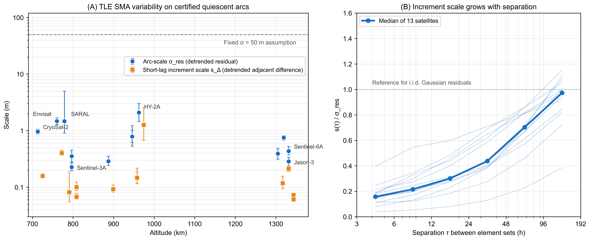
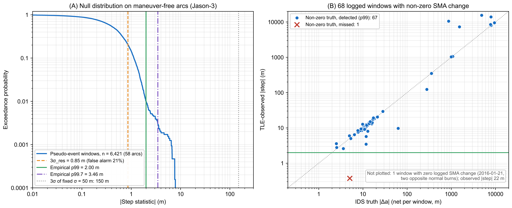
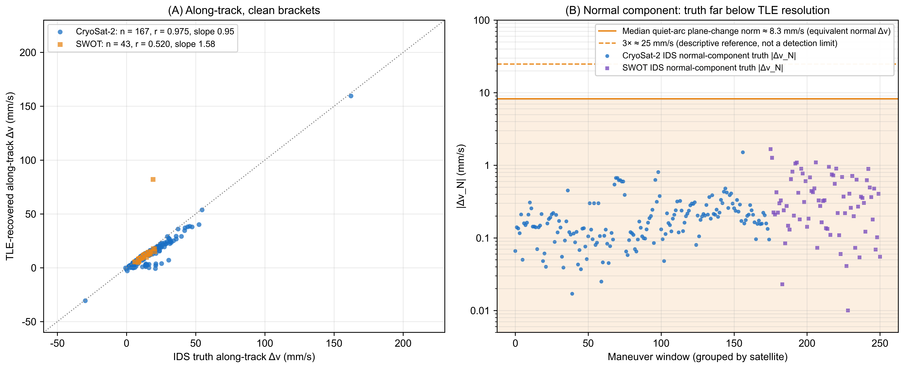

# TLE-Derived Semi-Major-Axis Variability on Operator-Logged Maneuver-Free Arcs: Residual Dependence and Empirical Maneuver Thresholds, with Application to FORMOSAT

**Authors:** [Author 1]ᵃ*, [Author 2]ᵃ, [Author 3]ᵇ

ᵃ [Affiliation, address, country]
ᵇ [Affiliation, address, country]

\* Corresponding author. E-mail: [address]

## Highlights

- TLE semi-major-axis variability is measured on operator-logged maneuver-free arcs.
- Arc-scale variability is 0.23–2.08 m (median 0.75 m) for 13 altimetry satellites.
- Adjacent detrended SMA residuals are strongly persistent across element sets.
- In-sample null-calibrated step thresholds are 2–57 m, not 3× the arc-scale value.
- Along-track Δv agrees with operator values on clean brackets, satellite-dependently.

## Abstract

Maneuver screening from public Two-Line Element (TLE) sets thresholds the change in the TLE-derived semi-major axis (SMA), but the variability behind such thresholds is rarely measured on intervals known to be free of maneuvers. We measure it on maneuver-free arcs defined by the operator logs of thirteen International DORIS Service altimetry satellites at 719–1338 km. The detrended arc-scale variability is 0.23–2.08 m (median 0.75 m). Adjacent detrended residuals are strongly persistent (median lag-one Spearman correlation 0.81), so differences between consecutive element sets (median scale 0.12 m) describe short-timescale increments, not absolute orbit error. On 61,923 pseudo-event windows, the median-bracket step statistic is biased by natural decay and wider than the arc-scale value: a 3σ threshold gives a median false-alarm probability of 0.24 per window, and in-sample empirical 99th percentiles are 2.0–57 m. Random arc-grouped validation gives near-nominal exceedance for twelve satellites but not SARAL; chronological validation reveals substantial nonstationarity for three. For Jason-3, a 2.0 m threshold flags 67 of 68 logged windows with non-zero SMA change in a known-window evaluation. Against operator Δv for SWOT and CryoSat-2, TLE-recovered along-track Δv agrees on clean brackets (r = 0.942, slope 0.95) with strong satellite dependence; the logged normal components (median 0.2 mm s⁻¹) are too small to assess normal-component recovery. For FORMOSAT, we identify four candidate FORMOSAT-5 maneuvers and a FORMOSAT-7 orbit raise, and show that apparent constellation-wide FORMOSAT-7 negative differences span multi-day gaps in the retrieved TLE series; trend correction removes most of three of four clusters.

**Keywords:** two-line elements; semi-major axis; residual dependence; maneuver detection; false-alarm calibration; DORIS; space situational awareness

---

## 1. Introduction

Space situational awareness for satellites without cooperative data relies on the public Two-Line Element (TLE) catalog. TLEs are mean elements fitted for the SGP4 propagator [1, 2]; their errors vary with orbit regime, tracking coverage and fit span and are not distributed with the elements [3–5]. A common maneuver-detection approach thresholds the change |Δa| in the TLE-derived semi-major axis (SMA) across a candidate window [6–8]. Whether a step can be attributed to propulsion rather than to fitting or modelling error depends on the variability of the TLE-derived SMA and on the distribution of the step statistic in the absence of maneuvers.

Two limitations affect current practice. First, the variability is often assumed rather than measured: rule-based screening commonly uses fixed values of tens of metres above 700 km — for example, σ = 50 m in the baseline of the screening system that motivated this study [9] — and such values have rarely been checked against maneuver-free observations. Second, thresholds are usually expressed as a multiple of a single-sample scale, k·σ, without checking that the decision statistic actually has standard deviation σ. If consecutive TLE errors are correlated, or if the statistic compares window medians rather than single samples, the false-alarm rate implied by k·σ can differ greatly from the nominal one.

The altimetry missions supported by the International DORIS Service (IDS) [10] allow both points to be tested. Their operators publish maneuver histories and thrust logs [11], and their precise orbits are maintained to centimetre level [12, 13]. We call the intervals between logged maneuvers *maneuver-free arcs*. Because these labels are produced independently of the TLE series, the variability estimates do not depend on a detector's own classification of the data.

This paper does not claim sub-metre absolute TLE accuracy. It quantifies the within-arc variability of a specified TLE-derived SMA quantity on operator-logged maneuver-free arcs, and examines what that variability implies for maneuver-screening thresholds and for Δv recovery. The contributions are:

1. We measure the arc-scale variability and the short-lag increment scale of the TLE-derived SMA for thirteen IDS altimetry satellites, quantify the persistence of adjacent detrended residuals and its dependence on time separation, and test sensitivity to processing choices (Sections 2.2–2.4, 3.1–3.2).
2. We calibrate the null distribution of the actual step statistic on pseudo-event windows placed in maneuver-free arcs, test their transfer to held-out arcs, and evaluate them on Jason-3 logged maneuver windows (Sections 2.5, 3.3–3.4).
3. We test TLE-recovered along-track and normal Δv against operator three-component values for SWOT and CryoSat-2, using the near-circular geometry for normal impulses, and state where the test lacks power (Sections 2.6, 3.5).
4. We describe the altitude dependence of a related self-consistency scale over 463–1338 km and its uncertainty (Sections 2.7, 3.6), and apply the framework to the FORMOSAT series (Section 5).

Continuous blind screening performance under realistic update cadence and drag, calibrated against FORMOSAT-7 precise orbits, is addressed in a companion study [14]; the present paper evaluates thresholds only on known windows and on maneuver-free arcs.

## 2. Data and Methods

### 2.1 Maneuver-free arcs and TLE data

Maneuver-free arcs are the intervals between consecutive maneuvers in the IDS maneuver histories and operator thrust logs [11]. The logs are given in TAI and are converted to UTC with the TAI − UTC offset valid at each epoch (32–37 s over 2001–2026 [21]). To exclude pre- and post-maneuver transients, each arc is trimmed inward by 0.75 d at both ends; an arc is retained if it contains at least 12 usable TLEs spanning at least 3 d. TLE histories were obtained from Space-Track (gp_history). All results in this paper are computed on a single archive snapshot (retrieval completed 18 November 2026 00:29 UTC; latest element-set epoch 17 November 2026 20:19 UTC; 166,226 element sets for the thirteen satellites). The FORMOSAT series come from the same retrieval (40,518 element sets for the thirteen FORMOSAT satellites; latest epoch 17 November 2026 20:30 UTC). Annual FORMOSAT intervals are written as [2025-11-17T00:00Z, 2026-11-18T00:00Z) with an exclusive upper bound. For the variability estimators, duplicate and near-duplicate epochs are removed by thinning each series to a minimum spacing of 3 h; the step statistic of Section 2.5 uses the unthinned series, as in the detector.

**SMA definition.** Three quantities are often called "TLE SMA": (i) the value obtained from the TLE (Kozai) mean motion n through Kepler's third law, a = (μ/n²)^{1/3}; (ii) the Brouwer mean SMA recovered internally by SGP4; and (iii) the osculating SMA computed from a propagated position and velocity. Throughout Sections 2.2–2.6 and 5, *a* denotes quantity (i) with μ = 398,600.4418 km³ s⁻², verified element by element in the archive. It is used as a proxy whose changes, not its absolute value, are of interest. Only the Starlink comparison of Section 3.7 uses quantity (iii), on both sides of the comparison.

### 2.2 Variability estimators

Within an arc the SMA contains a slow drag- and perturbation-driven trend. We fit a polynomial within each arc (degree 1 for spans < 10 d, degree 2 for < 40 d, degree 3 otherwise) and denote the residuals r_i = a_i − â_i. The **arc-scale variability** is the centred robust scale of the pooled residuals,

$$\sigma_{\text{res}} = 1.4826\cdot\mathrm{median}\big(|r_i-\mathrm{median}(r)|\big). \tag{1}$$

The **short-lag increment scale** is computed from the differences of the detrended residuals within each arc, d_i = r_{i+1} − r_i,

$$s_\Delta = \frac{1.4826\cdot\mathrm{median}\big(|d_i-\mathrm{median}(d)|\big)}{\sqrt{2}}. \tag{2}$$

The constant 1.4826 = 1/Φ⁻¹(3/4) converts the median absolute deviation to a Gaussian-equivalent standard deviation [15]. For a stationary error series with variance σ² and lag-one correlation ρ₁,

$$\mathrm{Var}(\epsilon_{i+1}-\epsilon_i) = 2\sigma^2(1-\rho_1), \tag{3}$$

so s_Δ equals the single-sample scale only if ρ₁ = 0. We therefore treat s_Δ as an increment scale. Temporal dependence is measured directly by the Spearman rank correlation of adjacent residual pairs within arcs (lag-one rank persistence). As a supplementary diagnostic we report the scale-ratio persistence index P = 1 − (s_Δ/σ_res)². P would equal ρ₁ only for stationary, homogeneous Gaussian residuals at a common lag, but with robust scales, heavy tails and differing arc scales it is a distribution-dependent proxy, not an autocorrelation estimate. Without per-epoch truth, all three quantities describe the dependence of detrended TLE-derived SMA residuals, which may include unremoved orbital dynamics, not a separated TLE error series.

To characterize the dependence on time separation, the increment scale s(τ) = 1.4826·MAD(r_j − r_i)/√2 is computed for all residual pairs within an arc, binned by actual separation τ (3–6, 6–12, 12–24, 24–48, 48–96 and 96–192 h) and normalized by σ_res. For independent, identically distributed Gaussian residuals, s(τ)/σ_res = 1 at every lag. Independence alone does not fix this MAD-based ratio (for independent Laplace residuals it is about 1.17), so the lag curve is interpreted together with the rank persistence, not as a correlation estimate.

**Estimation hierarchy.** (i) *Arc*: a polynomial is fitted per arc, so each arc's residuals have zero mean. (ii) *Satellite*: residuals of all qualifying arcs are pooled and Eq. (1) is applied to the pooled set, re-centred on its median; differences d_i are formed only within arcs and pooled in the same way; lag pairs are pooled over all within-arc pairs of the satellite. Point pooling gives long, densely sampled arcs more weight; equal-arc-weight medians are reported as a check. (iii) *Cohort*: the median over the thirteen satellites, each weighted equally. Within-satellite uncertainties are 95% percentile intervals from 2,000 bootstrap resamples of arcs with replacement, an arc drawn twice contributing all its points and differences twice. The interval of the cohort median obtained from the per-satellite resamples is a fixed-cohort measurement interval. A satellite-level bootstrap, which resamples the thirteen satellites, gives the interval relevant to similar satellites.

For comparison, Table 1 also gives the uncentred raw adjacent-difference scale σ_raw = 1.4826·median|a_{i+1} − a_i|/√2, a form used in the screening baseline [9]; it includes the trend contribution over each sampling interval and is not used further.

### 2.3 Sensitivity analysis

The thinning interval, the trimming window and the polynomial degree are processing choices. We repeat the estimation on a 3 × 3 × 3 grid — thinning 1.5, 3 and 6 h; trimming 0.5, 0.75 and 1.0 d; polynomial degree rule shifted by −1, 0 and +1 (minimum degree 1) — and report the range of the medians of σ_res, s_Δ and P.

### 2.4 Step statistic

For a candidate window [t_s, t_e] the step statistic is

$$\Delta a_{\text{obs}} = \mathrm{median}\{a_i : t_e+0.3\,\mathrm{d}\le t_i\le t_e+3\,\mathrm{d}\} - \mathrm{median}\{a_i : t_s-3\,\mathrm{d}\le t_i\le t_s-0.3\,\mathrm{d}\}, \tag{4}$$

computed on the unthinned TLE series with at least three element sets in each bracket. No drift correction is applied; multiple burns within one logged window are treated as one window, and the truth SMA change is the net change of all burns in the window. A window is flagged when |Δa_obs| exceeds a threshold. Because Eq. (4) compares two medians over brackets separated by at least 0.6 d plus the window length, its null distribution cannot be derived from σ_res alone. Eq. (4) is the statistic of the screening baseline [9] and was fixed before this analysis; the drift-corrected variant of Section 2.5 was examined afterwards on the same events, so the comparison between the two is a development-set result.

### 2.5 Null calibration with pseudo-event windows

To calibrate thresholds, pseudo-event windows of 2.5 h are placed every 12 h inside each trimmed maneuver-free arc wherever both brackets of Eq. (4) lie entirely within the arc. The logged windows are shorter than or comparable to 2.5 h for most events (Jason-3: median 0 h, 90th percentile 2.9 h, maximum 3.3 h; SWOT: maximum 0.23 h; CryoSat-2: median 0.05 h, maximum 9.8 h), and the sensitivity of the null to window durations of 0, 2.5, 12 and 24 h and to a random start offset is reported. The distribution of |Δa_obs| over these windows is the empirical null distribution of the detector. We report its signed median, robust scale, the false-alarm probability per window at a threshold of 3σ_res, and the 99th and 99.7th percentiles as empirical thresholds. Overlapping pseudo-windows are correlated; intervals are therefore obtained by resampling arcs, and the false-alarm probability is also reported for a non-overlapping subset in which the full bracket supports of retained windows do not overlap (spacing ≥ 6.1 d). The percentiles estimated on all windows are in-sample calibrations. Their transfer is tested in two ways: (a) five-fold cross-validation with whole arcs as folds, each fold's threshold estimated from the other folds only; and (b) a chronological split in which the earlier half of each satellite's arcs, by count rather than elapsed time, calibrates the threshold and the later half validates it. For (b), intervals come from a nested arc bootstrap that resamples the calibration arcs and re-estimates the threshold in each replicate, and resamples the validation arcs. When no validation window exceeds the threshold, the empirical interval degenerates at zero; such intervals are not read as bounds on future false-alarm probability. As a sensitivity check, a drift-corrected variant fits a straight line in each bracket and differences the two fits at the window midpoint.

### 2.6 Δv recovery

IDS provides per-burn three-component Δv (radial, along-track, normal) for the impulsively maneuvering SWOT and CryoSat-2. For each logged window, the along-track component is recovered from Eq. (4) through the near-circular Gauss relation Δv_t = nΔa/2 (n: mean motion) [20]. For a normal impulse Δv_N applied at argument of latitude u, the near-circular relations are [20]

$$\Delta i \simeq \frac{\cos u}{v}\,\Delta v_N,\qquad \sin i\,\Delta\Omega \simeq \frac{\sin u}{v}\,\Delta v_N, \tag{5}$$

so the inclination alone recovers Δv_N only near the nodes. We compute u at each logged burn epoch by propagating the last TLE before the window with SGP4; because the burn epochs come from the operator logs, the normal-component test is a reference-assisted diagnostic rather than a TLE-only recovery. The observed Δi and ΔΩ are obtained by fitting a straight line to each bracket and differencing the fits at the window midpoint, which removes the background nodal precession. For single-burn windows, Δv_N is recovered with the unweighted least-squares estimator v(cos u·Δi + sin u·sin i·ΔΩ). For multi-burn windows a net plane change does not determine the algebraic sum of the normal impulses; we therefore compare the observed (Δi, sin i·ΔΩ) with the operator-predicted plane-change vector Δi_ref = Σ_k cos u_k Δv_N,k / v_k and (sin i·ΔΩ)_ref = Σ_k sin u_k Δv_N,k / v_k. The null distribution of the Δi and sin i·ΔΩ step estimators is measured with the pseudo-event windows of Section 2.5.

A bracket is *clean* if no other logged maneuver window overlaps [t_s − 3 d, t_e + 3 d]. This rule uses only the log timings and is fixed before, and independently of, the recovery. For each satellite and for the pooled set we report the correlation, the ordinary least-squares slope and intercept of recovered on logged Δv, the median signed error, the median absolute error and the RMSE, with bootstrap intervals for the correlation and slope. The bootstrap unit is the logged window (multiple burns within a window are already merged); neighbouring windows may share element sets, which the clean-bracket rule limits but does not remove.

### 2.7 Altitude dependence: data and estimator

No maneuver-free arcs exist below 700 km in the IDS set. To describe the altitude dependence, we use a separate data set and estimator: per-satellite self-consistency scales for 56 satellites at 463–1338 km (altitude a − 6378.137 km) in four groups — 14 IDS altimetry satellites, 9 hold-out altimetry and gravity satellites (SPOT, GRACE, GRACE-FO, Sentinel-6B), 6 FORMOSAT-7 satellites and 27 Starlink satellites. Each scale is the robust spread within sliding 40-TLE windows after linear detrending, excluding steps larger than 0.3 km. The source table is rounded to 0.01 m; the three values below 0.02 m are set to 0.02 m, and floors of 0.01 and 0.005 m are tested. This estimator does not use maneuver logs and behaves like a short-lag increment scale (Jason-3: 0.06 m, compared with s_Δ = 0.07 m and σ_res = 0.28 m in Table 1). We fit

$$\sigma_{th}(h) = \sqrt{\sigma_0^2 + \left(A\,e^{-(h-400)/H}\right)^2} \tag{6}$$

in log space with a soft-L1 loss. Parameter intervals come from 2,000 bootstrap resamples of satellites. Sensitivity is tested by leaving out each group. For model comparison, Eq. (6), a constant model and a per-group-mean model are re-estimated by ordinary least squares in log space, which is maximum likelihood under independent Gaussian errors with a common variance, and compared by the Akaike information criterion (AIC) with the variance counted as a parameter. The 56-satellite list is given in Supplementary Table S10.

### 2.8 Lower-altitude reference

Starlink satellites perform near-continuous station-keeping and have no maneuver-free arcs. As a lower-altitude reference we use a different quantity: the difference between the osculating SMA computed from the SGP4-propagated TLE state and that computed from SpaceX's publicly distributed precise ephemerides [16]. The TLE state is propagated with SGP4 (Skyfield, GCRS output) directly to each ephemeris epoch, so no ephemeris interpolation is involved; the ephemeris states are in EME2000. The scalar SMA, a = (2/|r| − |v|²/μ)⁻¹, depends only on the norms of position and velocity and is invariant to the fixed axis rotation between the two frames, so no component alignment is needed. Both SMAs are computed from position–velocity vectors with the same gravitational parameter and no orbital averaging, and the reported statistic is the absolute difference |a_TLE − a_eph|, for 283 Starlink satellites (1 May to 20 September 2026, daily sampling, 35,460 comparisons). This is a TLE prediction error against an independent truth, not a quiescent-arc variability, and is reported only as an order-of-magnitude comparison.

## 3. Results

### 3.1 Arc-scale variability and residual dependence

Table 1 lists the estimates. The arc-scale variability σ_res ranges from 0.23 m (Sentinel-3A) to 2.08 m (HY-2A), with a median of 0.75 m (fixed-cohort 95% interval 0.53–0.80 m). The short-lag increment scale s_Δ has a median of 0.12 m (0.10–0.15 m). For every satellite s_Δ is smaller than σ_res, by factors of 1.7 (HY-2A) to 18 (SARAL). This is the signature of persistent residuals. The lag-one Spearman correlation of adjacent residuals has a median of 0.81 (range 0.23–0.96; 0.76 or higher for twelve satellites), at median spacings of 6.7–22.5 h between thinned element sets. The scale-ratio persistence index P has a median of 0.93 (range 0.63–1.00); it is reported only as a diagnostic. The satellite-level bootstrap interval of the cohort median is 0.35–0.96 m for σ_res and 0.08–0.16 m for s_Δ. With equal weight per arc, the medians are 0.82 m and 0.17 m: the qualitative separation persists, although the numerical increment scale depends on the weighting.

Fig. 1B shows the increment scale as a function of separation. The median ratio s(τ)/σ_res rises from 0.16 at 3–6 h to 0.22, 0.30, 0.44 and 0.70 at 6–12, 12–24, 24–48 and 48–96 h, and reaches 0.97 at 96–192 h. Each lag bin contains all thirteen satellites, 894–1,044 arcs and 19,238–759,013 pairs (Supplementary Table S3). Differences of element sets a few hours apart thus understate the arc-scale variability by a factor of about six; differences over several days approach it. The polynomial detrending limits the variance that can appear at the longest lags, so these ratios describe the time scale of the correlation rather than a closed error model.

**Table 1 — TLE-derived SMA variability on operator-logged maneuver-free arcs** (ordered by σ_res; brackets: 95% within-satellite arc-bootstrap intervals; P: scale-ratio persistence index; σ_raw: uncentred raw adjacent-difference scale, for comparison; NORAD numbers, arc periods and identifiers in Supplementary Table S7).

| Satellite | Alt. (km) | Arcs | TLEs | Δt (h) | σ_res (m) | s_Δ (m) | ρ₁ Spearman | P | σ_raw (m) |
|---|--:|--:|--:|--:|--:|--:|--:|--:|--:|
| Sentinel-3A | 803 | 140 | 11,973 | 6.7 | 0.23 [0.20, 0.27] | 0.07 [0.06, 0.08] | 0.81 | 0.91 | 0.16 |
| Jason-3 | 1338 | 59 | 7,963 | 9.4 | 0.28 [0.24, 0.34] | 0.07 [0.07, 0.08] | 0.86 | 0.93 | 0.09 |
| SWOT | 893 | 50 | 2,853 | 8.6 | 0.29 [0.24, 0.35] | 0.09 [0.08, 0.11] | 0.78 | 0.90 | 0.26 |
| Sentinel-3B | 803 | 115 | 5,411 | 10.1 | 0.35 [0.28, 0.46] | 0.10 [0.09, 0.12] | 0.76 | 0.92 | 0.31 |
| Jason-2 | 1311 | 54 | 5,688 | 15.5 | 0.39 [0.31, 0.49] | 0.12 [0.09, 0.16] | 0.79 | 0.91 | 0.14 |
| Sentinel-6A | 1338 | 23 | 3,975 | 11.2 | 0.43 [0.37, 0.53] | 0.06 [0.06, 0.07] | 0.96 | 0.98 | 0.07 |
| Jason-1 | 1325 | 67 | 4,451 | 22.5 | 0.75 [0.68, 0.83] | 0.21 [0.19, 0.24] | 0.82 | 0.92 | 0.24 |
| HY-2D | 952 | 45 | 5,639 | 6.9 | 0.79 [0.53, 1.23] | 0.15 [0.12, 0.22] | 0.78 | 0.97 | 0.26 |
| HY-2C | 952 | 47 | 6,518 | 6.9 | 0.80 [0.62, 1.01] | 0.15 [0.12, 0.19] | 0.81 | 0.97 | 0.24 |
| CryoSat-2 | 719 | 201 | 9,949 | 9.9 | 0.96 [0.87, 1.06] | 0.16 [0.14, 0.17] | 0.88 | 0.97 | 0.34 |
| SARAL | 785 | 47 | 8,994 | 10.1 | 1.47 [0.91, 5.01] | 0.08 [0.06, 0.19] | 0.87 | 1.00 | 0.24 |
| Envisat | 766 | 140 | 9,431 | 7.8 | 1.47 [1.29, 1.69] | 0.40 [0.36, 0.45] | 0.82 | 0.93 | 0.45 |
| HY-2A | 968 | 56 | 8,449 | 7.0 | 2.08 [1.44, 3.02] | 1.26 [0.67, 2.58] | 0.23 | 0.63 | 1.24 |
| **Median** | | | | | **0.75** | **0.12** | **0.81** | **0.93** | **0.24** |

The raw adjacent-difference scale has a median of 0.24 m, twice s_Δ, because raw differences retain the trend over each sampling interval (by up to 0.21 m for SARAL). Within 719–1338 km, neither σ_res nor s_Δ shows a clear altitude trend (Spearman ρ = −0.30 and −0.21, n = 13). The satellite-to-satellite spread, with HY-2A, Envisat and SARAL highest, exceeds any altitude effect in this range.

**Fig. 1.** (A) Arc-scale variability σ_res (circles) and short-lag increment scale s_Δ (squares) of the TLE-derived SMA versus altitude for the thirteen IDS altimetry satellites, with 95% within-satellite arc-bootstrap intervals; the dashed line marks a fixed σ = 50 m assumption. (B) Increment scale s(τ) normalized by σ_res as a function of the separation τ between element sets; thin lines: individual satellites; thick line: median. The reference at 1 corresponds to independent, identically distributed Gaussian residuals; independence alone does not fix this MAD-based ratio. Pairs are pooled within each lag bin.

### 3.2 Sensitivity to processing choices

Over the 27 processing configurations, the median σ_res ranges from 0.56 to 0.89 m and depends mainly on the polynomial degree (0.86, 0.74 and 0.60 m for degree rules −1, 0 and +1), as expected for a scale that absorbs slow residual structure. The median s_Δ ranges only from 0.11 to 0.12 m. It increases slightly with the thinning interval (0.110, 0.117 and 0.123 m for 1.5, 3 and 6 h), consistent with the lag dependence of Fig. 1B. The median P stays between 0.87 and 0.97. The strong persistence of adjacent residuals and the factor-of-several gap between σ_res and s_Δ are therefore not artefacts of the processing choices (Supplementary Table S1).

### 3.3 Null distribution of the step statistic

Table 2 summarizes 61,923 pseudo-event windows on the thirteen satellites. The null distribution of Eq. (4) has a negative median for every satellite (−0.29 to −2.50 m), reflecting natural decay over the bracket separation, which the statistic does not remove. Its robust scale is 0.71–4.7 times σ_res (median 1.39). Consequently, a threshold of 3σ_res is exceeded by chance in a median of 24% of maneuver-free windows (range 3–96%). The in-sample empirical 99th percentile of |Δa_obs| ranges from 2.0 m (Jason-3) to 57 m (SWOT) with a median of 12.6 m, or 4.8–199 times σ_res (median 15.5). The upper tails are heavier than Gaussian and differ between satellites; SWOT's tail is dominated by arcs in early 2023, during its commissioning period, and its 99th percentile varies between 29 and 47 m with the random start offset, whereas that of Jason-3 changes by less than 0.01 m.

The non-overlapping subsets (165–697 windows per satellite) lead to the same qualitative conclusion — 4–96% false alarms at 3σ_res — although satellite-specific estimates change (Jason-2 from 8% to 16%, CryoSat-2 from 34% to 40%) because the subset reweights arcs and epochs; at the all-window 99th percentile the subsets give 0.3–3.5% (Supplementary Table S8). In arc-grouped five-fold cross-validation, the pooled held-out exceedance of the fold-specific 99th percentile is 1.0–1.5% for twelve satellites but 3.2% for SARAL, where one fold contributes 222 of 241 exceedances; a second random fold assignment gives 1.0–1.3% and 3.6%. In several satellites the exceedances concentrate in a few arcs. In the chronological split (cut dates 2007–2024; Table S8), the exceedance in the later arcs is 0–2.6% for ten satellites but 15% for CryoSat-2 (459 of 2,998 windows; nested-bootstrap interval 7–25%), 15% for Sentinel-3A (195 of 1,303; 5–39%) and 20% for Sentinel-3B (220 of 1,119; 12–41%). Three satellites have no exceedance in their later arcs, so their empirical intervals degenerate at zero. Random arc-grouped validation thus gives near-nominal exceedance for twelve satellites, whereas chronological validation reveals substantial nonstationarity for three; monitoring the null distribution for change, and potentially recalibration, is needed, but no update schedule is evaluated here. For Jason-3 the 99th percentile is 1.96, 2.00, 2.18 and 2.46 m for window durations of 0, 2.5, 12 and 24 h, and 2.00 m at 3.3 h, the longest logged Jason-3 window; the tested sensitivity suggests limited duration dependence over the short Jason-3 windows. For the longest CryoSat-2 window (9.8 h) the 99th percentile would be about 10% higher.

The drift-corrected variant removes the bias (median signed step within ±0.03 m) and narrows the core of the distribution (robust scale median 0.59σ_res). However, the linear extrapolation lengthens the tails (99th percentile 0.65–102 m) and lowers known-window detection (Section 3.4). We therefore keep Eq. (4) and calibrate it empirically (Supplementary Tables S2–S3).

**Table 2 — Null distribution of the step statistic (Eq. 4) on pseudo-event windows in maneuver-free arcs** (ordered by σ_res; FAP: false-alarm probability per window, with 95% arc-bootstrap interval).

| Satellite | Windows | Arcs | Median (m) | Robust scale (m) | 3σ_res (m) | FAP at 3σ_res | p99 (m) | p99.7 (m) |
|---|--:|--:|--:|--:|--:|--:|--:|--:|
| Sentinel-3A | 5,465 | 131 | −1.21 | 0.75 | 0.68 | 0.91 [0.87, 0.94] | 12.6 | 18.9 |
| Jason-3 | 6,421 | 58 | −0.43 | 0.40 | 0.85 | 0.21 [0.14, 0.28] | 2.0 | 3.5 |
| SWOT | 1,661 | 52 | −2.50 | 1.35 | 0.86 | 0.96 [0.92, 0.99] | 57.2 | 92.2 |
| Sentinel-3B | 3,960 | 111 | −1.60 | 1.37 | 1.06 | 0.64 [0.55, 0.76] | 14.2 | 21.1 |
| Jason-2 | 5,279 | 54 | −0.33 | 0.40 | 1.17 | 0.08 [0.06, 0.11] | 3.2 | 5.4 |
| Sentinel-6A | 3,646 | 22 | −0.29 | 0.31 | 1.30 | 0.03 [0.01, 0.05] | 2.4 | 3.6 |
| Jason-1 | 4,183 | 68 | −0.38 | 0.72 | 2.26 | 0.06 [0.04, 0.07] | 6.5 | 10.5 |
| HY-2D | 3,055 | 45 | −1.80 | 1.14 | 2.36 | 0.33 [0.26, 0.42] | 14.9 | 23.7 |
| HY-2C | 3,433 | 47 | −1.75 | 1.30 | 2.41 | 0.33 [0.25, 0.41] | 12.5 | 16.1 |
| CryoSat-2 | 7,138 | 199 | −1.98 | 1.98 | 2.89 | 0.34 [0.28, 0.41] | 17.1 | 21.6 |
| SARAL | 7,598 | 46 | −1.27 | 1.07 | 4.41 | 0.24 [0.04, 0.58] | 17.3 | 22.4 |
| Envisat | 4,960 | 129 | −1.76 | 1.77 | 4.42 | 0.21 [0.17, 0.26] | 25.6 | 34.4 |
| HY-2A | 5,124 | 54 | −0.75 | 1.75 | 6.25 | 0.06 [0.03, 0.08] | 10.1 | 13.5 |

### 3.4 Known-window evaluation on Jason-3

Jason-3 (1338 km) is nearly drag-free. Its operator log provides 69 maneuver windows with sufficient TLE coverage. In 68 of them the logged SMA change is non-zero (net 2.5 m to 9.5 km). The remaining window, on 21 January 2016, four days after launch, consists of two opposite normal burns of 0.38 m s⁻¹ with no net SMA change. The detector uses the SMA alone and is evaluated only at these logged windows; the result is a known-window detection rate, not the performance of continuous blind screening.

At 3σ_res = 0.85 m, 67 of the 68 windows with non-zero SMA change are flagged, but this threshold has a false-alarm probability of 0.21 (0.14–0.28) per maneuver-free window (Table 2). At the empirical 99th percentile (2.0 m; arc-bootstrap interval 1.7–2.8 m), the same 67 windows are flagged (proportion 0.985; Clopper–Pearson 95% interval 0.92–1.00, assuming independent windows). The single miss has a logged change of 5.0 m and an observed step of 0.37 m. At the 99.7th percentile (3.5 m), 64 of 68 are flagged (0.86–0.98; 63 of the 66 windows whose logged change exceeds the threshold). For the 68 windows, observed and logged steps correlate at r = 0.84 (Fig. 2B). The zero-SMA window of January 2016 consists of two logged normal burns of opposite sign with no net logged tangential change, yet the TLE SMA shows an observed step of 22 m, flagged at every threshold. It is a specificity challenge, not a detection of an SMA maneuver; it occurred four days after launch, and its cause is not established here. The drift-corrected variant flags only 54 of the 68 windows at its own 99th percentile (2.7 m); because this comparison uses the same events, it is a development-set result.

The 3σ threshold implied by a fixed σ = 50 m (150 m) is 75 times the Jason-3 99th-percentile threshold. Of the 55 windows with logged changes between 0.85 m and 150 m, 54 are flagged at 0.85 m and 54 at 2.0 m.

**Fig. 2.** Jason-3. (A) Exceedance probability of |Δa_obs| on 6,421 pseudo-event windows in 58 maneuver-free arcs, with thresholds at 3σ_res (0.85 m), the empirical 99th (2.0 m) and 99.7th (3.5 m) percentiles, and 3σ of a fixed σ = 50 m (150 m). (B) TLE-observed versus logged |Δa| (net per window) for the 68 logged windows with non-zero SMA change; the window with zero logged SMA change is described in the panel and not plotted. The horizontal line marks the 99th-percentile threshold.

### 3.5 Δv recovery (SWOT and CryoSat-2)

**Along-track.** Of 267 windows with a logged along-track component, 210 have clean brackets (Table 3, Fig. 3A). On all windows the pooled correlation is r = 0.54 (0.42–0.68). On clean brackets it is r = 0.942 (0.77–0.99), with slope 0.95 (0.80–0.98), median signed error −2.3 mm s⁻¹, median absolute error 2.3 mm s⁻¹ and RMSE 7.0 mm s⁻¹, against a median logged magnitude of 14.0 mm s⁻¹. The agreement is strongly satellite-dependent. CryoSat-2 gives r = 0.975 and slope 0.95. SWOT gives r = 0.52 with slope 1.58 and wide intervals. Leave-one-window-out analysis shows that a single single-burn window on 27 January 2023, during SWOT's commissioning period (logged 19.2 mm s⁻¹, recovered 82.0 mm s⁻¹), controls this result: without it, r = 0.949 and slope 0.84, while omitting any other window gives r = 0.51–0.53. The window is retained in all reported statistics. The negative median error is consistent with the uncorrected decay in Eq. (4). The along-track Δv equivalent of the null step scale is 0.7 mm s⁻¹ (SWOT) and 1.0 mm s⁻¹ (CryoSat-2).

**Table 3 — Along-track Δv recovery on clean brackets** (brackets: 95% bootstrap intervals; errors in mm s⁻¹).

| Set | n | r | Slope | Intercept | Median error | Median abs. error | RMSE | Median logged |Δv_t| |
|---|--:|--:|--:|--:|--:|--:|--:|--:|
| Pooled | 210 | 0.942 [0.77, 0.99] | 0.95 [0.80, 0.98] | −2.5 | −2.3 | 2.3 | 7.0 | 14.0 |
| CryoSat-2 | 167 | 0.975 [0.89, 0.99] | 0.95 [0.79, 0.98] | −3.3 | −2.7 | 2.7 | 6.1 | 15.6 |
| SWOT | 43 | 0.52 [0.48, 0.97] | 1.58 [0.77, 3.07] | −7.7 | −1.4 | 1.4 | 9.8 | 12.0 |

**Normal component.** The logged normal components of these maneuvers are parasitic and small. Of 251 windows with a non-zero normal component (238 single-burn, 13 multi-burn), the magnitudes have a median of 0.20 mm s⁻¹ and a maximum of 1.7 mm s⁻¹. The operator-predicted plane changes are at most 1.3 × 10⁻⁵ deg in Δi and 0.8 × 10⁻⁵ deg in sin i·ΔΩ, that is, at most 0.13 and 0.08 of the 10⁻⁴ deg output resolution of the TLE inclination field and of the RAAN field scaled by sin i (0.98–1.00 × 10⁻⁴ deg). On quiet arcs, the vector norm of the bracket-fit plane change |(Δi, sin i·ΔΩ)|, multiplied by v to express it as an equivalent normal Δv, has a median of 7.9–8.6 mm s⁻¹ and a heavy-tailed distribution, with 99th percentiles of 155 mm s⁻¹ (CryoSat-2) and 985 mm s⁻¹ (SWOT). For the 238 single-burn windows, the recovered and logged Δv_N do not correlate (r = 0.06; −0.26 to 0.34). For the 13 multi-burn windows, the observed Δi and sin i·ΔΩ do not correlate significantly with the operator-predicted plane-change vector (r = −0.29 and 0.41, both intervals including zero). Burns were not concentrated at the nodes (|cos u| > 0.9 for 26% of windows), so the node-only relation Δv_N = vΔi would be geometrically inappropriate even for larger impulses; it also gives r = 0.00. The available logged normal components are too small relative to the estimator's quiet-arc variability to assess recovery performance for operationally significant out-of-plane impulses. Three times this median norm, about 24–26 mm s⁻¹, is noted only as a descriptive reference, not as a calibrated detection limit.

**Fig. 3.** Δv recovery from TLEs versus operator three-component values. (A) Along-track, clean brackets, by satellite. (B) Magnitudes of the logged normal components per window, compared with the median vector norm of the TLE-derived plane-change estimator on quiet arcs, expressed as an equivalent normal Δv (shaded), and three times that median (dashed; descriptive reference only).

All events evaluated here are impulsive chemical burns. Continuous low-thrust maneuvers spread over many revolutions produce no single step and are outside the scope of this test.

### 3.6 Altitude dependence

Fitting Eq. (6) to the 56 self-consistency scales gives σ₀ = 0.045 m (0.029–0.069), A = 22.3 m (15.1–33.2) and H = 77 km (64–90), with log-space R² = 0.89. Lowering the 0.02 m floor to 0.01 or 0.005 m changes σ₀ to 0.038 or 0.036 m and leaves H at 77 km. Evaluated at 800 km, inside the fitted range, Eq. (6) gives 0.14 m (0.08–0.21 m). That is of the same order as s_Δ of the 785–803 km altimetry satellites (0.07–0.10 m) and below their σ_res (0.23–1.47 m), as expected for a short-lag scale. Leaving out one group at a time changes H to between 63 km (without the hold-out group) and 111 km (without Starlink). Re-estimated by ordinary least squares (H = 79 km), Eq. (6) and a model with one mean per group have practically equal AIC (−118.4 and −117.9; constant model −0.8). Altitude and satellite population are therefore confounded in this sample, and Eq. (6) is an empirical description, not a separable altitude law.

The fitted H overlaps the neutral-density scale heights computed with NRLMSIS 2.0 [17, 18] for 350–550 km: 51–54 km at F10.7 = 70 sfu, 67–70 km at 150 sfu and 78–81 km at 220 sfu (solar flux index [19]). This is compatible with unmodelled drag contributing to TLE variability at low altitude, but does not establish it: drag environment, satellite design, tracking coverage and maneuver practice all vary with altitude in this sample.

### 3.7 Lower-altitude comparison: Starlink

For 283 Starlink satellites at 351–578 km (1st–99th percentile of sample altitudes), the TLE-propagated osculating SMA differs from that of the SpaceX precise ephemerides by a median absolute difference of 57.0 m (interquartile range 23.6–110.8 m; 90th percentile 191.6 m). The median increases with propagation age, from 47.7 m at 0–6 h to 60.8, 67.9, 101.2 and 117.4 m at 6–12, 12–24, 24–48 and 48–72 h. This comparison includes station-keeping thrust between the TLE epoch and the comparison time. Restricting it to 152 satellites with net SMA change below 10 km, and to samples whose truth SMA rate is below 2,000, 1,000 or 500 m d⁻¹, lowers the median to 33.2, 35.0 and 36.7 m, but retains only 2.85% of the samples at the loosest limit. This filter is not a propulsion-free label: day-to-day changes of the osculating ephemeris SMA are dominated by aliased J2 short-period terms, whose amplitude is of order J2·R_E²/a ≈ 6.4 km at a = 6850 km (about 6.2 km for (3/2)J2(R_E²/a)sin²i at 53° inclination), rather than by thrust (median day-to-day truth change 6.5 km d⁻¹ for the 152 satellites). Self-consistency estimates obtained from the TLEs alone range from 3 to 30 m and depend on the estimator, the window length and the snapshot date (Supplementary Section S3). The weekly median prediction error correlates with F10.7 (Spearman ρ = 0.56, p = 0.008, 21 weeks), but the point-wise correlation is only 0.06, so the data do not establish solar activity as the dominant driver. Whatever the estimator, the Starlink-altitude values exceed the variability of the altimetry satellites by one to two orders of magnitude.

## 4. Implications for Threshold Design

Three implications follow. First, a threshold must be calibrated on the decision statistic itself. Multiplying a single-sample scale by k ignores both the correlation of adjacent errors and the structure of the statistic. For Eq. (4), 3σ_res corresponds to false-alarm probabilities of 3–96% per window, depending on the satellite. Second, the null distribution of a median-bracket step is biased by natural decay and has satellite-specific heavy tails. In-sample empirical percentiles on maneuver-free arcs give thresholds of 2–57 m at 719–1338 km, approximately 2.6–75 times lower than the 150 m implied by σ = 50 m, with substantial satellite dependence; random arc-grouped validation gives near-nominal exceedance for twelve of thirteen satellites, and chronological validation shows drift for three. Third, increment scales such as s_Δ, or any estimator built from consecutive element sets, describe short-timescale changes. They should not be used as the error of a single TLE, nor to set thresholds for statistics that compare element sets days apart.

Thresholds are therefore better expressed per satellite or per population, as empirical quantiles of the actual statistic, than as one absolute value or as a fixed multiple of a single-sample scale, with their null distribution monitored for change over time. Where maneuver-free arcs are unavailable, Eq. (6) gives the order of magnitude of a short-lag scale, but the step-statistic quantiles of Table 2 are 5–200 times larger than σ_res and cannot be inferred from it. How thresholds behave under realistic update cadence and drag variability is quantified in the companion study [14]; a rule-based screening system built on these principles is documented in [9].

## 5. Application to the FORMOSAT Series

No operator maneuver logs are available for FORMOSAT; the results of this section are interpretations of TLE signatures, not confirmed maneuvers. Table 4 summarizes the satellites analysed. Arc-scale variability is computed with the estimators of Section 2.2 over [2026-10-18T00:00Z, 2026-11-18T00:00Z), a selected 31-day step-screened window without adjacent steps larger than 50 m on any of the satellites, treated as a single arc. For the propulsive satellites, the absence of large steps does not confirm the absence of small maneuvers, and these values are not equivalent to the operator-logged arcs of Section 3.

**Table 4 — FORMOSAT satellites analysed.**

| Satellite | NORAD | Altitude (km) | Propulsion | σ_res (m) | s_Δ (m) |
|---|---|--:|---|--:|--:|
| FORMOSAT-3 A, B, C, E, F | 29047–29049, 29051–29052 | 786–787 | none | 0.62–1.38 | 0.16–0.28 |
| FORMOSAT-3D | 29050 | 670 | none | 2.73 | 0.56 |
| FORMOSAT-5 | 42920 | 723 | yes | 0.62 | 0.10 |
| FORMOSAT-7-1, -2, -4, -5, -6 | 44349, 44351, 44350, 44358, 44353 | 576 | yes | 4.0–6.6 | 1.1–1.5 |
| FORMOSAT-7-3 | 44343 | 534 | yes (not maintained since May 2025) | 14.8 | 2.1 |

### 5.1 FORMOSAT-3: non-propulsive satellites

The six FORMOSAT-3 (COSMIC) satellites have no propulsion and decay naturally. The five satellites at 786–787 km give σ_res = 0.62–1.38 m (median 0.81 m) and s_Δ = 0.16–0.28 m. These values are within the range of the altimetry satellites at 766–803 km (σ_res 0.23–1.47 m). Their raw adjacent-difference scale is larger (0.90–1.27 m) because it is dominated by the decay over each sampling interval. FORMOSAT-3D, now at 670 km, gives σ_res = 2.73 m. These values describe this population and window; they are not a regional noise floor for other satellites at the same altitude.

### 5.2 FORMOSAT-5: candidate impulsive maneuvers

FORMOSAT-5 (723 km, Sun-synchronous) shows four steps exceeding 50 m in adjacent TLEs in [2025-11-17, 2026-11-18) (Table 5). Over the same year, adjacent |Δa| has a median of 0.28 m and a 99th percentile of 2.20 m, and the 31-day σ_res is 0.62 m. As descriptive amplitude ratios, not calibrated significance, the largest step is about 1,300 times the 31-day σ_res and 360 times the annual 99th percentile of adjacent |Δa|. Assuming a single tangential impulse on a near-circular orbit, the tangential-equivalent Δv is Δv_t ≈ (v/2a)Δa with v = (μ/a)^{1/2}; for FORMOSAT-5 (a = 7100.9 km, v = 7.492 km s⁻¹),

$$\Delta v_t \approx \frac{7.492}{2 \times 7100.9} \times 0.798 \approx 0.42\ \text{m s}^{-1} \tag{7}$$

for the largest step. The four candidate maneuvers correspond to tangential-equivalent values of −0.27 to +0.42 m s⁻¹. These magnitudes are consistent with routine orbit maintenance of a Sun-synchronous satellite. They are estimates of one component under an impulsive assumption, not complete burn vectors.

**Table 5 — FORMOSAT-5 candidate steps exceeding 50 m** ([2025-11-17, 2026-11-18); signed values).

| Date (UTC) | Δa (m) | Δv_t (m s⁻¹) |
|---|--:|--:|
| 2025-12-16 | +797.7 | +0.42 |
| 2026-03-23 | +411.2 | +0.22 |
| 2026-04-14 | −519.0 | −0.27 |
| 2026-07-21 | +51.4 | +0.03 |

### 5.3 FORMOSAT-7: orbit raising and constellation-wide steps

The six FORMOSAT-7 satellites show, over [2025-11-17, 2026-11-18), a median adjacent |Δa| of 4.6–8.6 m and 99th percentiles of 35–53 m. These raw adjacent values include decay over the sampling interval. The detrended 31-day values of Table 4 are σ_res = 4.0–6.6 m (14.8 m for FORMOSAT-7-3 at 534 km), five to ten times those of FORMOSAT-3 and FORMOSAT-5. Between 19 and 27 January 2026, five satellites raised their orbits by a cumulative 9.2–9.4 km in steps of 2.5–9.4 km; FORMOSAT-7-3, which has not maintained its orbit since May 2025, did not take part.

Adjacent-difference screening also flags negative differences clustered within four periods — 30 December 2025 to 1 January 2026, 28 March to 1 April, 11 to 18 April and 1 to 6 June 2026 — on all six satellites. Every one of these 24 differences spans a gap of 1.2–6.8 d in the retrieved TLE series that is common to the six satellites (Supplementary Table S9). The gaps are archive-wide in our retrieval: element sets with epochs from 12 to 17 April 2026 exist for 973 objects, against about 29,000 in comparable intervals, and the first post-gap element sets were downloaded on 2 May 2026. Whether they reflect gaps in catalog publication or in our retrieval cannot be determined from the archive. The raw differences range from −40 to −127 m; in June, two satellites (FORMOSAT-7-4 and -5) stay below the 50 m threshold (−40 and −41 m). As a retrospective diagnostic, we subtract the decay predicted over the gap, R = Δa_raw − ½(ȧ_pre + ȧ_post)Δt, where ȧ_pre and ȧ_post are the linear SMA rates over the 10 days before and after the gap (−16 to −41 m d⁻¹). The median |R| is 18, 15 and 7 m for the January, March/April and June clusters, against raw medians of 64, 72 and 72 m; a variant usable in real time, with ȧ_pre only, gives 18, 20 and 6 m. For the April cluster, which has the longest gap, R remains +38 to +80 m (median |R| 51 m; 71 m with ȧ_pre only) and is unresolved: inaccurate trend extrapolation over a long gap, a change in fitting or dynamics, and a real orbit change cannot be distinguished. The raw negative differences are therefore confounded by multi-day gaps and accumulated decay and cannot be interpreted as instantaneous maneuvers. Without a gap-aware statistic, 22 of the 24 exceed a 50 m threshold and would be flagged by an amplitude test alone; the constellation-wide TLE-only false alarms found against precise-orbit truth in [14] are consistent with this mechanism. Per-satellite statistics and the list of steps are given in Supplementary Tables S5–S6.

## 6. Discussion

**What the measured values represent.** The arc-scale variability σ_res (median 0.75 m) and the short-lag increment scale s_Δ (median 0.12 m) describe a specified TLE-derived SMA proxy on maneuver-free arcs of altimetry satellites. Neither is an absolute orbit accuracy. TLE errors relative to the true orbit include components that are constant or slowly varying over an arc and are invisible to within-arc estimators. The strong persistence of adjacent detrended residuals means that consecutive element sets are not independent samples of the proxy; without per-epoch truth, it cannot be attributed to the TLE error alone. Variability estimates and thresholds must therefore state the time scale they refer to.

**Threshold calibration.** Calibrating on the actual step statistic changes the conclusion more than refining σ does. For Jason-3, the nominal 3σ_res threshold of 0.85 m flags one maneuver-free window in five. The empirical 99th-percentile threshold of 2.0 m keeps the known-window detection of 67 of 68 SMA maneuvers. For the other satellites the empirical thresholds are higher (Table 2), approximately 2.6–75 times lower than the 150 m implied by a fixed σ = 50 m. These are in-sample thresholds: random arc-grouped validation gives near-nominal exceedance for twelve satellites but not for SARAL, and chronological validation shows drift for three. These results support calibration of the decision statistic itself and monitoring for temporal changes in its null distribution; they do not establish a universal threshold or a validated recalibration schedule.

**Independent labels.** All variability and null distributions are estimated on intervals defined by operator logs, independently of the TLE series. This avoids the circularity of estimating variability on intervals labelled quiet by a detector.

**Δv components.** Along-track Δv recovered from TLE steps agrees with operator values on clean brackets, but with satellite-dependent slope and scatter; per-satellite validation is advisable before applying a recovery to another satellite. The normal component could not be tested because the logged normal impulses were far below the TLE resolution; larger out-of-plane maneuvers, such as inclination-control burns, would be needed to assess it.

**Limitations.** (i) Maneuver-free arcs cover 719–1338 km and thirteen satellites of similar class; below 700 km the altitude dependence rests on a different estimator and population-confounded data (Section 3.6), and the Starlink comparison uses a different quantity. (ii) The pseudo-event null distributions assume that logged arcs are free of unlogged events; unlogged small maneuvers or operational anomalies would widen the tails. The thresholds are in-sample calibrations whose temporal transfer is limited. Adjacent differences across gaps in the retrieved TLE series accumulate decay, as the FORMOSAT-7 case shows; one of its four clusters remains unresolved. (iii) The Jason-3 evaluation is restricted to logged windows and does not measure false alarms in continuous screening, which depend on the number of windows tested per unit time. (iv) Satellite-specific factors such as area-to-mass ratio, attitude mode and tracking coverage are not modelled, and explain part of the spread in Tables 1–2. (v) The FORMOSAT results are not confirmed by operator logs. (vi) The normal-component test has no power for the logged impulses.

## 7. Conclusion

On operator-logged maneuver-free arcs of thirteen IDS altimetry satellites, the TLE-derived SMA shows arc-scale variability of 0.23–2.08 m (median 0.75 m) and a short-lag increment scale of 0.06–1.26 m (median 0.12 m). The gap between the two reflects strong persistence of adjacent detrended residuals (median lag-one Spearman correlation 0.81). The variability supports satellite- and condition-specific calibration of maneuver-screening thresholds, but does not establish sub-metre absolute orbit accuracy. Thresholds must be calibrated on the decision statistic: for a median-bracket step, 3σ_res gives false-alarm probabilities of 3–96% per window, and in-sample empirical 99th percentiles are 2–57 m, near-nominal on randomly held-out arcs for twelve satellites but nonstationary over mission time for three. A 2.0 m threshold flags 67 of 68 logged Jason-3 SMA maneuvers in known windows. Along-track impulse estimates show satellite-dependent agreement with operator values on clean brackets (pooled r = 0.942). The logged normal impulses were too small relative to the estimator's quiet-arc variability for normal-component recovery to be assessed. Applied to FORMOSAT, the framework identifies four candidate FORMOSAT-5 maneuvers and a FORMOSAT-7 orbit raise, and shows that apparent constellation-wide FORMOSAT-7 negative differences span multi-day gaps in the retrieved TLE series, three of four clusters being mostly accumulated decay.

## Declaration of competing interest

The authors declare that they have no known competing financial interests or personal relationships that could have appeared to influence the work reported in this paper. [To be confirmed by all authors.]

## Funding

[To be completed: funding source and grant number, or "This research did not receive any specific grant from funding agencies in the public, commercial, or not-for-profit sectors."]

## CRediT authorship contribution statement

[Author 1]: Conceptualization, Methodology, Software, Formal analysis, Writing – original draft. [Author 2]: [roles]. [Author 3]: [roles]. [To be completed.]

## Declaration of generative AI and AI-assisted technologies in the writing process

During the preparation of this work the authors used [tool name] to assist with code development, verification of reported numbers against the analysis outputs, and language editing. After using this tool, the authors reviewed and edited the content as needed and take full responsibility for the content of the published article. [To be confirmed or revised by the authors.]

## Acknowledgements

The authors thank the International DORIS Service and the mission operators for the publication of maneuver histories and thrust logs, the 18th Space Defense Squadron for TLE data distributed through Space-Track.org, and SpaceX for the public distribution of Starlink ephemerides.

## Data and code availability

IDS maneuver histories are public [11]; the maneuver-log files used, their download date and the derived arc boundaries (TAI and UTC) are listed in the release. TLE histories were obtained from Space-Track; per the Space-Track user agreement, raw TLEs are not redistributed. The release includes NORAD identifiers, arc boundaries, per-window identifiers, exclusion reasons and retrieval scripts that reconstruct the data set under the user's own credentials, together with the snapshot identifier of Section 2.1. All numbers in Sections 2–5 are reproduced by `paperA_reviewV1_analysis.py` (variability, residual dependence, null calibration and held-out tests, Jason-3 and Δv analyses, altitude model, FORMOSAT variability and gap analysis) and `paperA_numbers.py` (Starlink comparison, FORMOSAT step lists), with fixed output tables for each table and figure. [Repository release and commit identifier to be inserted.]

## References

1. F. R. Hoots, R. L. Roehrich, *Models for Propagation of NORAD Element Sets*, Spacetrack Report No. 3, Aerospace Defense Command, U.S. Air Force, 1980.
2. D. A. Vallado, P. Crawford, R. Hujsak, T. S. Kelso, "Revisiting Spacetrack Report #3," AIAA/AAS Astrodynamics Specialist Conference, Keystone, CO, 2006, AIAA 2006-6753.
3. T. Flohrer, H. Krag, H. Klinkrad, "Assessment and categorization of TLE orbit errors for the US SSN catalogue," Advanced Maui Optical and Space Surveillance Technologies (AMOS) Conference, 2008.
4. T. S. Kelso, "Validation of SGP4 and IS-GPS-200D against GPS precision ephemerides," AAS/AIAA Space Flight Mechanics Conference, 2007, AAS 07-127.
5. D. A. Vallado, *Fundamentals of Astrodynamics and Applications*, 4th ed., Microcosm Press, 2013.
6. S. Lemmens, H. Krag, "Two-line-elements-based maneuver detection methods for satellites in low Earth orbit," *Journal of Guidance, Control, and Dynamics*, 37(3), 860–868, 2014.
7. R. P. Patera, "Space event detection method," *Journal of Spacecraft and Rockets*, 45(3), 554–559, 2008.
8. T. Kelecy, D. Hall, K. Hamada, D. Stocker, "Satellite maneuver detection using two-line element (TLE) data," Advanced Maui Optical and Space Surveillance Technologies (AMOS) Conference, 2007.
9. [Authors], *Intelligent detection of orbital anomalies and space events for LEO communication satellites: final report*, Taiwan Space Agency contract TASA-S-1150268, 2026.
10. P. Willis et al., "The International DORIS Service (IDS): toward maturity," *Advances in Space Research*, 45(12), 1408–1420, 2010.
11. International DORIS Service, *Satellite maneuver histories*, https://ids-doris.org, accessed 2026. [Specific file names and download date to be inserted.]
12. L. Cerri et al., "Precision orbit determination standards for the Jason series of altimeter missions," *Marine Geodesy*, 33(S1), 379–418, 2010.
13. A. Couhert et al., "Towards the 1 mm/y stability of the radial orbit error at regional scales," *Advances in Space Research*, 55(1), 2–23, 2015.
14. [Authors], "An empirical sensitivity model for maneuver detection from public two-line elements: calibration against precise orbit determination truth," submitted to *Advances in Space Research*, 2026.
15. P. J. Rousseeuw, C. Croux, "Alternatives to the median absolute deviation," *Journal of the American Statistical Association*, 88(424), 1273–1283, 1993.
16. SpaceX, *Starlink public ephemeris data*, distributed through Space-Track.org, accessed 2026.
17. J. T. Emmert et al., "NRLMSIS 2.0: a whole-atmosphere empirical model of temperature and neutral species densities," *Earth and Space Science*, 8, e2020EA001321, 2021.
18. J. M. Picone, A. E. Hedin, D. P. Drob, A. C. Aikin, "NRLMSISE-00 empirical model of the atmosphere: statistical comparisons and scientific issues," *Journal of Geophysical Research: Space Physics*, 107(A12), 1468, 2002.
19. K. F. Tapping, "The 10.7 cm solar radio flux (F10.7)," *Space Weather*, 11(7), 394–406, 2013.
20. O. Montenbruck, E. Gill, *Satellite Orbits: Models, Methods and Applications*, Springer, 2000.
21. International Earth Rotation and Reference Systems Service, *Bulletin C* (leap second announcements), https://www.iers.org, accessed 2026.
