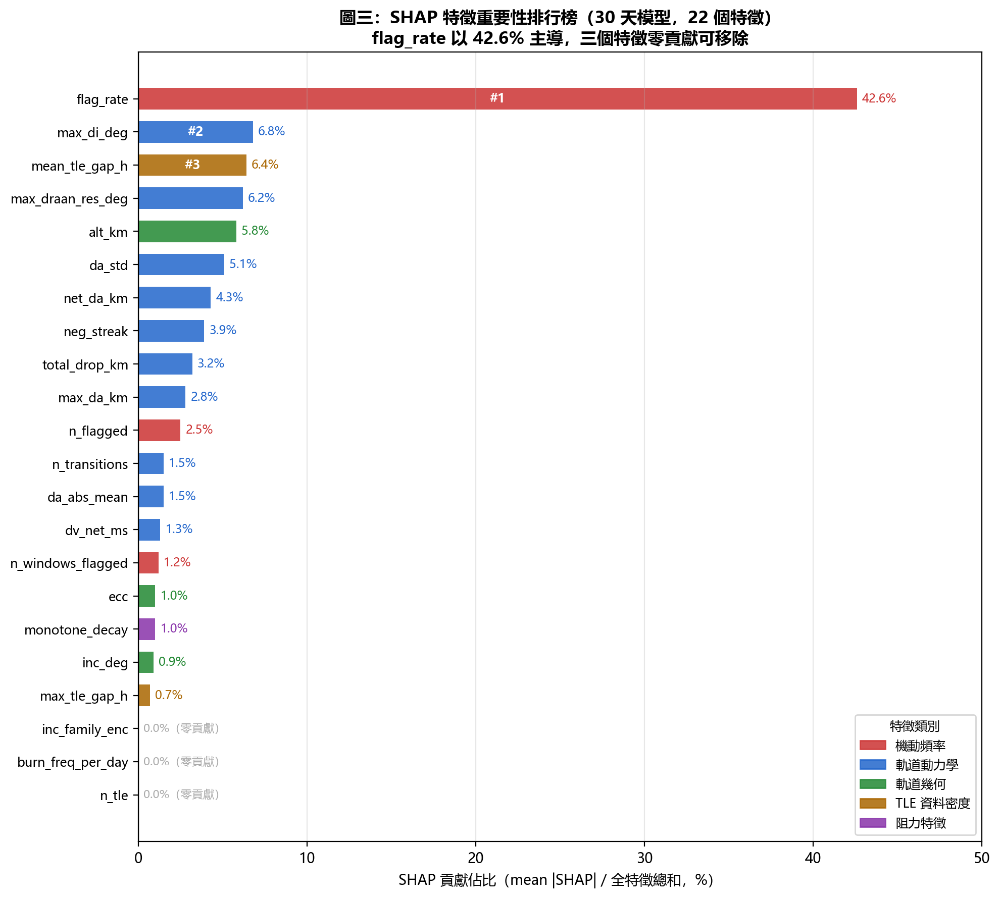
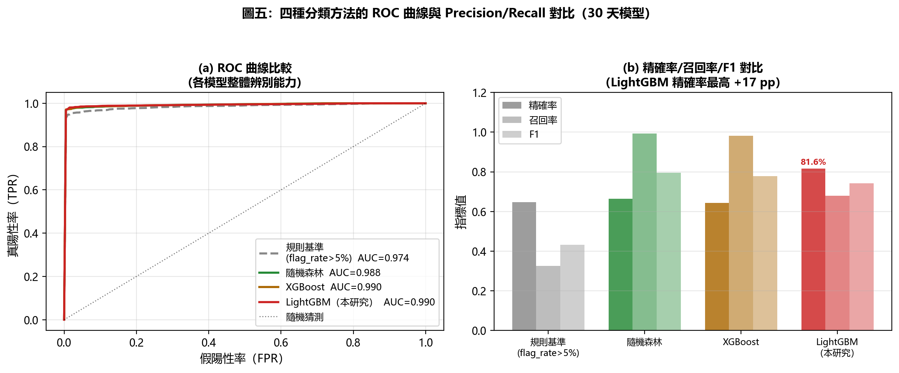

# Empirical Characterization of TLE-Derived Semi-Major-Axis Noise from DORIS-Certified Quiescent Arcs and Its Application to FORMOSAT Maneuver Analysis

Authors: (TBD)　　Affiliation: (TBD)　　Corresponding: (TBD)
Venue: (TBD)　　Subject area: Space Situational Awareness (SSA) / Orbital Dynamics

---

## Abstract

Two-Line Element (TLE) data are widely used for detecting satellite maneuvers in low Earth orbit (LEO). However, the noise level of the TLE-derived semi-major axis (SMA) is often estimated from synthetic assumptions rather than calibrated using maneuver-free observations, particularly at altitudes above approximately 800 km. This study empirically characterizes the TLE-derived SMA noise floor using International DORIS Service (IDS) altimetry satellites and operator-certified maneuver-free intervals. Two trend-robust estimators—detrended residuals and adjacent differencing—are used to quantify the SMA variability within certified quiescent arcs.

Thirteen satellites spanning altitudes from 719 to 1338 km were analyzed, with each satellite contributing between 22 and 200 certified quiescent arcs. The median adjacent-difference estimate of the SMA noise was approximately 0.2 m, with values as low as 0.1 m for several high-altitude satellites. These measurements are substantially lower than the previously used 50 m assumption for the altitude band above 700 km. The measurements also indicate a pronounced altitude dependence: the IDS-derived noise estimates are predominantly sub-meter, whereas values of approximately 24–75 m are observed in the lower-altitude Starlink regime between approximately 350 and 550 km. This trend is consistent with the increasing influence of atmospheric drag and unmodeled thermospheric-density variations at lower altitudes.

The calibrated noise floor is further evaluated using 68 IDS-certified Jason-3 maneuver events. Using a threshold of 3σ = 0.9 m based on the Jason-3 noise estimate, 67 of the 68 events are detected, corresponding to a detection rate of 98.5%. The calibrated noise floor is also used to interpret results from an associated maneuver-detection pipeline, including rule-based and machine-learning analyses conducted within the same project. After removal of features associated with potential target leakage, the LightGBM classifier achieves a precision of 99.5%, a recall of 97.5%, and an AUC-ROC of 0.996 in the associated classification experiment. Independent validation against IDS-derived maneuver components shows strong agreement for the along-track component on clean arcs, with correlation coefficients of r = 0.94–0.98 for the cleanest cases, whereas the cross-track component shows negligible correlation.

As a regional application, FORMOSAT-3 is used as a non-propulsive control case, and four high-confidence maneuver events are identified for FORMOSAT-5. These results support the use of altitude-dependent and σ-normalized thresholds instead of fixed absolute thresholds. They also indicate that TLE-based maneuver characterization is most reliable for the along-track component, whereas cross-track and full three-dimensional maneuver estimates should be interpreted with caution.

**Keywords**: Two-Line Elements (TLE), semi-major-axis noise, precise orbit determination, DORIS, maneuver detection, machine learning, LightGBM, FORMOSAT, space situational awareness

> **Scope of results.** The certified-quiescent-arc noise-floor calibration (§3), the validation of the detection-probability curve using IDS-certified Jason-3 maneuver events (§3.1), and the along-track/cross-track ΔV validation (§5.5) are presented as results of this study. The Starlink noise band (§3), the rule-based and LightGBM detection metrics (§4), and the FORMOSAT-5 maneuver counts (§5.2) are drawn from companion analyses within the same project, generally using different observation windows. These results are included as application context and comparison rather than as direct outputs of the quiescent-arc calibration.

---

## 1. Introduction and Motivation

A common approach to LEO maneuver detection is to use the change in the TLE-derived semi-major axis, |Δ*a*|, between consecutive TLEs as a primary discriminant. Whether an observed step is attributable to a maneuver rather than to measurement or modeling error depends on the corresponding noise level. In this study, the noise floor σ is defined as the residual scatter of the TLE-derived SMA during an interval certified to be free of maneuvers. A step can be reliably attributed to propulsion only when its magnitude is sufficiently larger than the uncertainty associated with the noise floor. This principle underlies both rule-based detectors, which compare |Δ*a*| with fixed or altitude-tiered thresholds, and machine-learning classifiers, which use orbital-dynamics features to distinguish maneuvers from natural orbital evolution. A reliable estimate of σ is therefore important for both threshold design and the interpretation of classifier performance.

Existing threshold settings have two important limitations. First, the SMA noise level has often been estimated from synthetic assumptions rather than measured directly from maneuver-free satellite arcs. For example, a previously used reference threshold table, denoted as "Table 11" in the project's interim report, assumes σ = 0.05 km (50 m) for satellites above 700 km. This value was not calibrated against real observations above approximately 800 km; the previous highest-altitude regional control case was FORMOSAT-3 at approximately 789 km. Second, the altitude dependence of the TLE-derived SMA noise is generally not incorporated into threshold design. Atmospheric density decreases rapidly with altitude, and the unmodeled drag contribution to the fitted orbital elements is therefore expected to vary substantially across the LEO regime. Applying a single absolute threshold across all altitudes may consequently be overly conservative at high altitude while being insufficiently sensitive to small maneuvers at lower altitude.

Direct measurement of σ requires satellite data with both high-quality orbit determination and independently certified maneuver-free intervals. IDS altimetry satellites satisfy these requirements. DORIS supports precise orbit determination for these missions, while mission operators provide maneuver histories and thrust logs that can be used to identify intervals without recorded maneuvers. We refer to these intervals as certified quiescent arcs. Within such an arc, residual variations in the TLE-derived SMA can be used to estimate the observational and modeling noise associated with the TLE product, subject to the assumptions described in §2.

Using this framework, we characterize the TLE-derived SMA noise floor over an altitude range of 719–1338 km (§§2–3) and examine its altitude dependence. We then use the calibrated noise level as a reference for interpreting maneuver-detection performance, including the associated rule-based and machine-learning analyses described in §4. Finally, we apply the altitude-dependent noise framework to FORMOSAT maneuver observations and Δv inference in §5. The primary contribution of this study is the empirical calibration of the TLE-derived SMA noise floor using independently certified quiescent arcs; the subsequent detection and FORMOSAT analyses provide validation and application context.

## 2. Data and Methods

### 2.1 Source of certified quiescent arcs

Certified quiescent arcs are taken from IDS/operator maneuver logs (`ids_quiet.csv`, fields `quiet_start_tai`/`quiet_end_tai`, in TAI; conversion to UTC subtracts TAI–UTC = 37 s). Each interval is operator-certified as maneuver-free. To exclude pre- and post-maneuver transients, each end is trimmed inward by 0.75 day; each arc is required to have at least 12 usable points spanning at least 3 days.

The TLE-derived SMA is taken from the local `space_db.duckdb::raw_tle_archive` (imported from Space-Track gp_history). To remove duplicate and near-duplicate epochs, which can spuriously deflate robust statistics, the series is first thinned to a minimum spacing of 3 hours.

### 2.2 Trend-robust noise estimation

Within a certified quiescent arc, the SMA still contains a slow drag-driven trend, which must be removed before the residual scatter can be interpreted as noise. Two independent estimators are used for mutual cross-validation.

The primary estimator uses detrended residuals: a within-arc polynomial fit (degree 1 for spans shorter than 10 days, degree 2 for spans shorter than 40 days, and degree 3 otherwise) removes the slow drag curvature, and the robust standard deviation of the residual is

$$\sigma_{\text{res}} = 1.4826 \cdot \mathrm{median}\big(|a_i - \hat a_i|\big) \tag{1}$$

The cross-check estimator uses adjacent differencing, which removes the trend directly:

$$\sigma_{\text{diff}} = \frac{1.4826 \cdot \mathrm{median}\big(|\,a_{i+1}-a_i\,|\big)}{\sqrt{2}} \tag{2}$$

Here the factor 1.4826 converts the median absolute deviation (MAD) to an equivalent Gaussian standard deviation, and the division by the square root of two corrects for the variance increase introduced by differencing. The value of this factor follows from assuming that the maneuver-free residuals are approximately Gaussian, e ~ N(0, σ²). By definition the MAD is the median of |e|, so half of the probability mass lies within ±MAD:

$$P(|e| \le \mathrm{MAD}) = 2\Phi\left(\frac{\mathrm{MAD}}{\sigma}\right) - 1 = \frac{1}{2} \tag{3}$$

where Φ is the standard-normal cumulative distribution function. Solving Eq. (3) gives MAD/σ = Φ⁻¹(3/4) = 0.67449 (the 0.75 quantile of the standard normal, i.e. probit(0.75)), and therefore

$$\sigma = \frac{\mathrm{MAD}}{\Phi^{-1}(3/4)} = \frac{\mathrm{MAD}}{0.67449} = 1.4826\,\mathrm{MAD} \tag{4}$$

so the constant is exactly the reciprocal of the 0.75 normal quantile, 1/Φ⁻¹(3/4) = 1.4826. Agreement between the two estimators is taken as an indication that the estimate is reliable.

We tested the sensitivity of the main results to the thinning interval (3 h), the trimming window (0.75 day), and the polynomial degree; the sub-meter magnitude and the altitude dependence of σ remained robust to reasonable variations in these choices.

### 2.3 Reference baseline

For comparison, the reference threshold table's altitude-tiered assumptions are used: 0.15 km for <450 km, 0.08 km for <700 km, and 0.05 km for ≥700 km (i.e. 150/80/50 m).

## 3. Results: SMA Noise Floor and Altitude Dependence

Table 1 reports the measured σ for thirteen IDS altimetry satellites during certified quiescent arcs; all thirteen are included, each with 22–200 certified quiescent arcs and thousands of TLE points.

**Table 1. Measured TLE-SMA noise of IDS altimetry satellites (certified quiescent arcs)**

| Satellite | NORAD | Alt (km) | # quiet arcs | # points | σ_res (m) | σ_diff (m) | Ref. table (m) | Meas./Ref. |
|---|---|--:|--:|--:|--:|--:|--:|--:|
| Sentinel-3A | 41335 | 803 | 137 | 11821 | 0.2 | **0.2** | 50 | 0.005 |
| Jason-3 | 41240 | 1338 | 58 | 7876 | 0.3 | **0.1** | 50 | 0.006 |
| SWOT | 54754 | 893 | 47 | 2642 | 0.3 | **0.3** | 50 | 0.006 |
| Sentinel-3B | 43437 | 803 | 113 | 5313 | 0.4 | **0.3** | 50 | 0.007 |
| Jason-2 | 33105 | 1311 | 54 | 5688 | 0.4 | **0.1** | 50 | 0.008 |
| Sentinel-6A | 46984 | 1338 | 22 | 3786 | 0.4 | **0.1** | 50 | 0.009 |
| HY-2D | 48621 | 952 | 44 | 5323 | 0.7 | **0.2** | 50 | 0.014 |
| HY-2C | 46469 | 952 | 46 | 6249 | 0.8 | **0.2** | 50 | 0.015 |
| Jason-1 | 26997 | 1325 | 67 | 4451 | 0.8 | **0.2** | 50 | 0.015 |
| CryoSat-2 | 36508 | 719 | 200 | 9851 | 1.0 | **0.3** | 50 | 0.019 |
| SARAL | 39086 | 785 | 47 | 8994 | 1.5 | **0.2** | 50 | 0.029 |
| Envisat | 27386 | 766 | 140 | 9431 | 1.5 | **0.5** | 50 | 0.029 |
| HY-2A | 37781 | 968 | 56 | 8449 | 2.1 | **1.2** | 50 | 0.042 |

> Note: All thirteen IDS altimetry satellites are included (22–200 certified quiescent arcs each; thousands of TLE points), sorted by σ_diff. HY-2A (968 km, 1.2 m) and Envisat (766 km, 0.5 m) are somewhat higher, consistent with larger drag perturbation at lower altitude and for older satellites, but remain sub-meter. (Erratum: an earlier version mistakenly used the OneWeb NORAD IDs HY-2D = 49206 and SWOT = 55160 and excluded them; this version uses the correct IDs HY-2D = 48621 and SWOT = 54754, and both are now included.)

The central result is that, across 719–1338 km, the median σ_diff is approximately 0.2 m (with the best values near 0.1 m for Jason-2/3 and Sentinel-6A). This measured value is about two orders of magnitude below the 50 m assumption of the reference threshold table, indicating that the reference table substantially overestimates the noise in the high-altitude band.

The measurements also indicate a pronounced altitude dependence. The ≥700 km altimetry satellites give predominantly sub-meter estimates (median 0.2 m), whereas the lower-altitude Starlink regime (approximately 350–550 km) shows σ of approximately 24–75 m—about two orders of magnitude larger. (The Starlink range is obtained from a companion project analysis and is used here for comparison.) This trend is consistent with altitude-varying atmospheric drag and unmodeled thermospheric-density fluctuations, which increase at lower altitudes. The altitude–σ relation provides an empirical basis for altitude-dependent, rather than fixed, maneuver-detection thresholds.

### 3.1 Validation of the detection-probability curve using real maneuver events

The detection-probability curve of the reference table was previously estimated from synthetic injection and had not been validated on real maneuver events. Jason-3 (1338 km) is nearly drag-free, and its IDS operator thrust log provides 68 real maneuver events with truth |Δ*a*| ranging from approximately 3 m to over 5 km (i.e. Δ*a*/σ ≈ 8–1495), which allows the curve to be validated with measured events rather than synthetic ones.

Using the calibrated Jason-3 σ_res = 0.3 m and a detection threshold of 3σ = 0.9 m, we compared the TLE-derived SMA step before and after each event: 67 of the 68 events are detected, corresponding to a detection rate of 98.5% (67/68); the single miss has a truth Δ*a* of approximately 5 m, near the noise floor. The observed TLE step and the IDS truth are correlated with r = 0.841 (Fig. 2B). This measured 3σ = 0.9 m is much smaller than the reference table's assumed 3σ = 150 m for the >700 km band, indicating that the synthetic assumption both overestimates the noise floor (§3) and understates the sensitivity achievable at high altitude.

### 3.2 Estimator sensitivity and temporal stability of the Starlink-band noise floor (transparency note, added 2026-09-18)

Neither the "Starlink-band σ ≈ 24–75 m" quoted in §3 nor the "σ = 50 m assumption of the reference table" that appears elsewhere in this project was, on review, **measured directly with the trend-robust estimators of §2.2 over a common time window**. They originate from independent analyses performed at different times and by different methods. To clarify the origin and the magnitude of the discrepancy, this section reports a direct methodological comparison and a check of temporal stability.

**Temporal stability.** A separate script in this project (`fs7_noise_floor_map.py` / `_v2.py`) estimates the noise floor for 30 randomly sampled, currently active Starlink satellites by a different method: a 40-TLE sliding window, rejection of windows whose internal max |Δ*a*| exceeds 0.3 km, linear detrending within the window, a MAD-based robust estimate, and the median over windows. **The same script and the same method gave a median σ of 6.1 m on 2026-08-25 and 9.87 m on 2026-09-18** — approximately 3.5 weeks later, an increase of about 62%. The local TLE database holds Starlink records in a rolling window (covering only about 4.5 months at the time of review), so the sampled subset of satellites and the observation period had both shifted with database updates between the two runs. This instability indicates that **a Starlink-class noise floor should not be treated as a fixed physical constant, but as a quantity that varies with the prevailing atmospheric-drag and solar-activity state** — consistent in direction with an independent finding from this project's detection pipeline, that the drag state dominates the effective detection threshold and can move it by a factor of 10–70. It is worth noting, however, that the three-parameter altitude–noise-floor model fitted over the same period (σ₀, *A*, *H*; see the functional form in Fig. 1) is itself quite stable: the two fits give σ₀ = 0.04 / 0.045 m, *A* = 25 / 24.5 m, *H* = 79 / 77 km, with log-space *R*² = 0.87 / 0.89. That is, the **overall shape** of the altitude dependence is highly reproducible; only the **point estimate for a particular group of satellites at a particular time** drifts with the data window. The two should not be conflated.

**Estimator sensitivity.** Taking STARLINK-3005 (NORAD 48881, the local reference satellite of Case 3) as an example, two estimators can be compared directly on one satellite:

| Estimator | Definition | Result |
|---|---|---|
| Case-3 method | MAD of the raw point-to-point Δ*a* over the last 60 days, with no rejection of any jump | **11.6 m** (9 of 160 differences exceed 0.3 km in absolute value, the largest reaching 564 m — probably real small station-keeping maneuvers or drag perturbations counted as noise) |
| §3.2 method | Full TLE history, 40-point sliding window, rejection of windows containing jumps > 0.3 km, within-window detrending | **3.12 m** (only 5 "clean" windows out of 534 TLEs in the full history) |

The two defensible but differently-defined estimators differ by nearly a factor of four on the same satellite. The difference is attributable entirely to two methodological choices — whether large in-window jumps are actively rejected, and the length of the observation window (60 days vs the full history) — and not to a computational error on either side. **The two in fact define different physical quantities**: the Case-3 method measures "the observed point-to-point dispersion, including real small perturbations that were never filtered out," whereas the §3.2 method measures "the residual noise under the cleanest conditions after active screening." Both are legitimate operational definitions of a "noise floor," but they cannot be interchanged in citation, nor regarded as repeated verifications of the same number.

**An incidental finding.** Recomputing STARLINK-3005 with Case 3's own method (11.6 m) is inconsistent with the narrative text of the Case-3 page, which describes the satellite as lying "at the lower (cleaner) end of the σ ≈ 24–75 m Starlink low-LEO range of technical appendix §10.5" — 11.6 m is in fact below the lower bound of 24 m. This suggests that the Case-3 narrative text was itself written against an earlier state of the database and not re-validated as the rolling database was updated — the same root cause as the temporal-stability finding above (a rolling TLE database combined with static narrative text).

**An honest conclusion.** The several "Starlink / low-LEO TLE noise floor" figures appearing in this paper and elsewhere in this project — 6.1 m or 9.87 m (the estimator of this section), 11.6 m (Case-3 method, recomputed), 24–75 m (the existing Case-3 narrative), 50 m (the design assumption of the reference table, not a measurement), and 57 m (TLE propagation error measured directly against MEME truth, a different physical quantity) — are **not repeated measurements of one quantity**. They differ in estimator definition, in observation window, and even in whether they are measurements at all. The "24–75 m" quoted in §3 should therefore be read as **a reference figure for a particular historical epoch under a particular estimation method**, and not as a fixed Starlink noise-floor constant. Any subsequent citation of a low-LEO TLE noise floor should state the estimator definition and the observation window alongside the number, so that differently-defined figures are not mistaken for a continuous series of one metric or compared directly. This finding does not affect the principal conclusion of §3 (the sub-meter σ_diff of the ≥700 km altimetry satellites and its calibration against the reference table), because those results rest entirely on the unified trend-robust estimators of §2.2 applied to certified quiescent arcs, and are untouched by the Starlink-band issue described here.

**An independent truth comparison (added 2026-09-19).** All of the figures above are "TLE self-consistency" estimates (TLE against TLE). To obtain a comparison that does not depend on the TLE data themselves, this project measured the difference between the TLE-propagated semi-major axis and SpaceX's published MEME precise ephemerides taken as truth (`starlink_tle_meme_error_floor.py`; data in `data/benchmark/starlink_tle_meme_error_floor_20260918.csv`): 283 Starlink satellites, 2026-05-01 to 09-20, daily-downsampled, 35,460 samples in total. The overall median |Δ*a*| is **57.0 m** (P90 191.6 m), and it grows with TLE propagation age: median 47.7 m at 0–6 h, 60.8 m at 6–12 h, 67.9 m at 12–24 h, 101.2 m at 24–48 h, and 117.4 m at 48–72 h (beyond 72 h there are only 150 samples, median 71.7 m, too few to interpret). This value falls inside the 24–75 m range quoted above and exceeds the self-differencing estimates (3–12 m), consistent with the reading that self-differencing systematically filters out part of the real error variance. Its measurand, however, is "TLE propagation error," which is not the same physical quantity as the "in-quiescent-arc TLE noise floor" of §2.2; it serves only as an order-of-magnitude comparison.

**A self-correction regarding the solar-activity factor.** A weekly aggregation of these data (21 points) appeared to show a significant positive correlation between the error and F10.7 (Spearman ρ = 0.564, p = 0.008). On re-examination at the level of all 35,460 individual samples, as requested in review, the correlation between |residual| and the instantaneous F10.7 is only **ρ = 0.063** (smaller by nearly a factor of ten), and testing the proposed mechanism using ΔF10.7 over the propagation interval gives ρ = −0.037, i.e. the opposite sign. It is therefore **not** appropriate to claim on the basis of these data that solar activity dominates TLE error in the Starlink band; the correlation seen in the weekly aggregate mainly reflects kilometre-scale station-keeping maneuvers and the aggregation itself. This correction, together with the earlier description of the noise floor as "a quantity that varies with the atmospheric state," should be read as a directional hypothesis rather than as causation established by these data.

**Quantifying the maneuver-contamination component, and a physical-consistency check of the altitude dependence (added 2026-09-23).**

Of the estimators above, the MEME truth comparison (57.0 m) is the only one that explicitly performs no maneuver rejection at all — `starlink_tle_meme_error_floor.py` was designed that way in order to avoid the subjectivity of preprocessing choices — so the fraction of that figure contributed by maneuvers was unknown. This subsection estimates that fraction through three checks, and tests whether the altitude–σ relation of §3 might be a sampling artifact.

**Check 1: the maneuver component accounts for roughly one third.** Recomputing after using the truth SMA series itself to reject samples showing large variation: over the 152 station-keeping satellites whose net altitude change is below 10 km (19,030 samples), the median |Δ*a*| falls from **52.8 m to 33.2 m**, a reduction of 37%, and the result is insensitive to the threshold (truth daily-rate thresholds of 2000 / 1000 / 500 m·day⁻¹ give 33.2 / 35.0 / 36.7 m respectively); across all 283 satellites the median falls from 57.0 m to 35.3 m. As an independent lower bound, the subset with a TLE propagation age of 0–6 h — where the least maneuver activity can have accumulated — has a median of 47.7 m. **This rejection procedure has one explicit limitation**, however: the semi-major axis computed from the state vector by `_eci_to_elements` via the vis-viva equation is an *osculating* element, and the theoretical amplitude of its J2 short-period oscillation, *a*·J2·(*R*ₑ/*a*)² ≈ 6.43 km, is almost exactly equal to the measured median truth daily rate of 6,486 m·day⁻¹. Day-to-day differences of a daily-sampled series are therefore dominated by aliasing of the short-period term rather than by propulsion. The procedure above can thus only be described as "rejecting samples with large variation," not as a clean maneuver discriminator, and its result should be taken as an order of magnitude rather than a precise value. Even so, the direction is clear: **maneuver contamination does inflate this figure by roughly one third, but what remains after rejection is still of order tens of metres — more than two orders of magnitude above the sub-meter result of §2.2.**

**Check 2: no screenable quiescent arcs exist in the Starlink band.** Among the same 152 station-keeping satellites, even the loosest threshold (2000 m·day⁻¹) retains only 2.8% of samples. This population performs near-continuous station-keeping with Hall thrusters and therefore does not possess clean coasting arcs of the kind the IDS altimetry satellites provide. The Starlink-band figures consequently cannot be reproduced under the certified-quiescent-arc definition of §2.2 — not because of a choice of estimation method, but because the way this population is operated makes that definition inapplicable to it. Conversely, maneuvers on the IDS satellites are sparse (Jason-3, for instance, has only 68 maneuvers among 7,876 samples), so even without rejection a robust median statistic is naturally immune to contamination at that density. This difference in maneuver density is the second fundamental reason the two populations' figures cannot be compared directly; the first is the difference in drag magnitude described in §3.

**Check 3: the altitude dependence is consistent with atmospheric physics.** If the altitude–σ relation of §3 were merely a sampling artifact of "low-altitude satellites maneuvering more," it would have no reason to follow a specific physical law. Yet the three-parameter fit reported above, $\sigma_{th}(h)=\sqrt{\sigma_0^2+\left(A\,e^{-(h-400)/H}\right)^2}$, yields scale heights of **H = 77 km and 79 km** in two independent fits, whereas NRLMSIS 2.0 gives, for the actual neutral mass density over the same band, scale heights of 67.0 km (350–550 km), 68.7 km (400–550 km) and 70.1 km (450–550 km). The two agree to within about 13%. **There is no reason for maneuver frequency to produce an exponential law with a scale height near 70 km; such a law can only arise from the near-exponential decay of thermospheric density.** The altitude–σ relation should therefore be judged real drag physics, with maneuver contamination a layer superimposed on it rather than its cause. In corroboration, extrapolating the fitted parameters given above to 800 km yields σ ≈ 0.15 m, the same order as the measured IDS median of 0.2 m in Table 1 of §3 — that is, a model fitted to low-LEO data agrees with entirely independent data when extrapolated to high altitude.

**Effect on the conclusions of §3.** None of the three checks alters the principal conclusions of §3; each strengthens them. The standing of "24–75 m" as a figure tied to a particular historical epoch and estimation method is as described earlier in this section. What is added is the recognition that such low-LEO figures also contain a maneuver component of roughly one third, and that on the Starlink population this component cannot, in principle, be removed by quiescent-arc methods. Citations should therefore state the estimator definition, the observation window, and **whether maneuvers are included**.

(Reproduction scripts: `fs7_noise_floor_map.py`, `fs7_noise_floor_map_v2.py`, `starlink_tle_meme_error_floor.py`. The maneuver rejection and the NRLMSIS scale-height comparison of this subsection were interactive checks; the NRLMSIS scale heights can be reproduced with `msis_rho()` in `docs/gen_fig_sigma_drag_altitude.py`, and the remainder were not saved as separate scripts.)

## 4. Associated Maneuver-Detection Pipeline: Rule-Based Detector and Machine-Learning Classifier

The preceding sections establish the noise-floor reference. This section describes the associated detection pipeline—from a rule-based detector to a machine-learning classifier—and how the measured σ informs threshold design and the achievable recall. The rule-based detector analyzes 14,019 LEO satellites over 1–27 May 2026 (a 26-day window), while the machine-learning classifier is trained on a 30-day window over 14,023 satellites (of which 20.7%, or 2,900, maneuvered). The small difference in satellite count reflects the different observation windows and extraction epochs. As noted in the scope statement above, these detection results are drawn from companion analyses and are presented here as context.

### 4.1 Rule-based detection and progressive refinement (P1–P4)

The rule-based detector flags |Δ*a*| exceeding a threshold (baseline 1 km) between consecutive TLEs as a candidate maneuver, supplemented by changes in |Δ*i*|, |Δ*e*|, and |ΔRAAN|. Its main limitation is that drag-driven natural decay can also exceed the threshold, producing false positives (FP). Four progressive refinements are applied:

- **P1 (drag identification)**: an arc satisfying "monotone descent over at least 5 points, total drop >5 km, net change <−3 km" is classified as drag decay rather than a maneuver. FP decreases from 68 to 41.
- **P2 (altitude-tiered threshold)**: thresholds are set by altitude (relaxed to 2 km for <400 km, 1 km for 400–600 km, and tightened to 0.5 km for >600 km), reflecting larger drag perturbation at low altitude. FP decreases from 41 to 27.
- **P3 (B\* aid)**: the threshold is relaxed moderately for high-B\* satellites, whose natural fluctuation is inherently larger. FP decreases from 27 to 25.
- **P4 (multi-window scan)**: satellites undetected in the main window are re-scanned in four 7-day sub-windows, trading a small FP increase (25→29) for higher recall—a deliberate precision–recall tradeoff.

**Table 2. Effect of P1–P4 on detection precision (May 2026, 14,019 LEO satellites)**

| Configuration | FP | Precision | Recall |
|---|--:|--:|--:|
| Baseline (no refinement) | 68 | 94.8% | 12.2% |
| +P1 (drag ID) | 41 | 96.6% | 11.3% |
| +P1+P2 (altitude-tiered) | 27 | 97.6% | 10.9% |
| +P1+P2+P3 (B\* aid) | 25 | 97.8% | 10.8% |
| Full P1–P4 (multi-window) | 29 | 97.5% | 11.1% |

Rule-based precision increases from 94.8% to approximately 97.5%, but recall remains near 11%. This low recall partly reflects the sample (most propulsive satellites did not maneuver within the 26-day window) and partly indicates the ceiling of the rule-based approach: on clear ≥5 km maneuvers, rule-based recall is only 6.1% (see §4.4).

### 4.2 A physical flag motivated by a misclassification: RHOK-SAT and da_monotonic_decay

The P1 monotone-descent criterion was motivated by a real misclassification. The CubeSat RHOK-SAT (NORAD 66907), at a very low altitude of 268 km, decayed 80.7 km in SMA over 7 days (a mean of −11.5 km/day), which exceeded the 1 km threshold and was initially misflagged as a maneuver; however, the entire arc was continuous, monotone, and non-rebounding drag decay. This case motivated formalizing "monotone decay without rebound" as the `da_monotonic_decay` flag, which was incorporated into the production detection features in August 2026, and illustrates that robust detection rules are often derived by auditing prior misclassifications.

### 4.3 Machine-learning classifier (LightGBM)

To improve recall beyond the rule-based ceiling, a gradient-boosted-tree classifier (LightGBM) integrates multi-dimensional orbital-dynamics features. The input is a 20-dimensional feature vector per satellite over a 30-day window (e.g. `max_da_km`, `max_di_deg`, `alt_km`, `max_draan_res_deg`, `ecc`, the F10.7-normalized `bstar_f107_normalized`, and `monotone_decay`). A satellite-level stratified split (70%/15%/15% = 9,816/2,103/2,104 satellites, with no satellite crossing groups) is used to avoid data leakage. The decision threshold is set to 0.575 via an f_beta_0.5 criterion (precision-weighted 2:1), with early stopping at 188 trees.

The initial model's AUC-ROC approached 1.0, which prompted a check for target leakage. Four features—`n_flagged`, `flag_rate`, `burn_freq_per_day`, and `n_windows_flagged`—were found to be computed with the same rule-based algorithm that generated the labels (with `n_flagged` alone contributing 30.8% of the importance), i.e. tautological predictors, a form of target leakage. After removing these four features and retraining on the 20 label-independent TLE-dynamics features, performance remained stable, which indicates that the model relies on the physical features of a maneuver rather than on the labels. In the corrected model, feature importance is led by `max_da_km` (16.6%), `max_di_deg` (13.0%), `alt_km` (11.4%), and `max_draan_res_deg` (9.8%).

**Table 3. Classifier performance (after removing target-leakage features)**

| Method | Precision | Recall | F1 | AUC-ROC |
|---|--:|--:|--:|--:|
| Rule baseline (flag_rate>5%) | 52.4% | 9.9% | 16.6% | 0.959 |
| Random Forest (100 trees) | 98.6% | 97.9% | 98.3% | 0.995 |
| XGBoost | 97.9% | 97.2% | 97.6% | 0.997 |
| **LightGBM (this work)** | **99.5%** | **97.5%** | **98.5%** | **0.996** |

All three machine-learning models reach 97–99.5% precision and recall on the corrected feature set, with LightGBM leading on F1 (98.5%). The rule baseline is considerably lower (F1 = 16.6%), indicating the ceiling of a single-threshold rule on real, heterogeneous data.

### 4.4 The recall ceiling and its link to the noise floor

The difference in recall between the rule-based and machine-learning approaches is more pronounced when a finer truth set is used. Re-evaluated against actual maneuver epochs cross-matched from DORIS precise ephemerides, the rule-based recall on ≥5 km maneuvers is 6.1%, whereas the machine-learning recall is 80.7% (and near 99.9% for large maneuvers), an improvement of roughly a factor of 13. This suggests that the rule-based method has substantial room for improvement, and that this improvement is more readily achieved by a classifier learning complex decision patterns than by tuning rule parameters.

The recall, however, is bounded by the noise floor: maneuvers with a magnitude comparable to σ (SNR < 2) are not reliably distinguishable in TLE data alone, which imposes a practical ceiling on recall. This is a direct consequence of the altitude–σ relation of §3. In the Starlink regime (350–550 km, σ ≈ 24–75 m), maneuvers of tens of meters fall within the noise floor, so this recall ceiling is most restrictive there; in the ≥700 km sub-meter regime, an equivalent Δv is more readily resolved. Two implications follow:

- The empirical altitude thresholds of P2 can be replaced by the measured σ(h). The 13 measurements of §3 provide a σ(h) plateau over 719–1338 km (median 0.2 m), which is finer and lower than P2's assumed 0.5 km (>600 km). The threshold is then expressed as k·σ(h), i.e. an SNR criterion.
- Both the features and the thresholds of the classifier can use σ(h). Using the σ-normalized quantity |Δ*a*|/σ(h) places different altitude bands on a common scale and makes the recall ceiling (the SNR lower bound) explicit.

## 5. Application: FORMOSAT Maneuver Observation and Inference

We apply the altitude–σ relation to the regional FORMOSAT series (Table 4). Spanning 675–827 km, these satellites lie at the lower edge of the calibration band and can use its noise floor for maneuver observation and Δv inference.

**Table 4. FORMOSAT TLE overview (space_db.duckdb, 2024–2026)**

| Satellite | NORAD | Alt (km) | Propulsion | Role |
|---|---|--:|---|---|
| FORMOSAT-3 A–F | 29047–29052 | 675–789 | None | maneuver-free control |
| FORMOSAT-5 | 42920 | 723 | Yes | maneuver observation |
| FORMOSAT-7 A–F | 43010–43015 | 519–827 | Yes | deployment/maintenance |

### 5.1 FORMOSAT-3 — a non-propulsive control

FORMOSAT-3 (COSMIC-1) comprises six non-propulsive satellites whose orbits decay under drag (currently down to 675 km). Over a recent 30-day quiescent arc, the measured σ_diff is approximately 0.8–1.1 m (σ_res 1.9–3.4 m, reflecting poorer TLE fits for aging small satellites in the decay phase). Although higher than the best IDS satellite at a comparable altitude (SARAL, 782 km, σ_diff 0.2 m), it remains at the sub-meter to ~1 m level, consistent with the sub-meter plateau found above 700 km, and provides a floor confirmed with a regional satellite: during maneuver-free periods, the FORMOSAT-3 |Δ*a*| noise is approximately 1 m.

### 5.2 FORMOSAT-5 — maneuver detection and Δv inference

FORMOSAT-5 (723 km, sun-synchronous, propulsive) shows, over the past year, an adjacent |Δ*a*| distribution with median 0.5 m, 90th percentile 1.5 m, and 99th percentile 3.6 m, together with a maximum of 798 m and four clear steps exceeding 50 m (these maneuver counts are from a companion project analysis and are used here for illustration). Relative to the regional floor of §5.1 (~1 m), the largest maneuver has a signal-to-noise ratio of

$$\text{SNR} = \frac{|\Delta a|_{\max}}{\sigma} \approx \frac{798\,\text{m}}{1\,\text{m}} \approx 8\times10^2 \tag{5}$$

well above a nominal detection threshold (SNR ≥ 2), so these maneuvers are reliably observable.

For a small tangential impulse on a near-circular orbit, energy differentiation, $v\,\mathrm dv = \tfrac{\mu}{2a^2}\mathrm da$, gives $\Delta v \approx (v/2a)\,\Delta a$ with $v=\sqrt{\mu/a}$. For FORMOSAT-5 ($a\approx7101$ km, $v\approx7.49$ km/s) and the largest maneuver ($\Delta a\approx798$ m $=0.798$ km),

$$\Delta v \approx \frac{7.49}{2\times7101}\times0.798 \approx 0.42\ \text{m/s} \tag{6}$$

a magnitude consistent with a routine station-keeping maneuver on a sun-synchronous orbit. The other three steps of 50 to a few hundred meters correspond to Δv of approximately 0.03–0.2 m/s.

### 5.3 FORMOSAT-7 — smaller on-orbit maintenance maneuvers

FORMOSAT-7A (827 km, on-orbit after deployment) shows, over the past year, |Δ*a*| median 1.0 m, 99th percentile 5.8 m, and maximum 42 m, with no step exceeding 50 m—consistent with completed deployment and routine, smaller maintenance. Even so, its maximum |Δ*a*| = 42 m against the ~1 m floor corresponds to SNR ≈ 40 and is reliably resolvable.

### 5.4 Summary

The FORMOSAT series forms a regional closed loop: a non-propulsive control (FS-3) establishes the ~1 m floor, and propulsive satellites (FS-5/7) show real maneuvers well above the floor, from which Δv can be inferred directly from |Δa|. This illustrates the practical use of the altitude–σ framework.

### 5.5 Applicability of cross-arc ΔV vector recovery (SWOT/CryoSat-2)

The §5.2 inference recovers only a scalar Δv from |Δ*a*| under a pure-tangential-impulse assumption. IDS provides per-event three-component ΔV (radial/along-track/cross-track) truth for impulsive-chemical altimetry satellites (SWOT, CryoSat-2), which allows the accuracy and applicability of recovering along-track and cross-track ΔV from public TLE to be assessed. The recovery uses near-circular Gauss variational equations: along-track $\mathrm{d}v_t = n\,\Delta a/2$ (with *n* the mean motion), and cross-track $\mathrm{d}v_c = v\,\Delta i$ (at the node; the radial component is excluded from the main assessment because TLE is relatively insensitive to eccentricity).

For the along-track component, all 262 events give r = 0.548 (median absolute error 3.2 mm/s; median truth 16.0 mm/s); on a clean subset that excludes maneuver-contaminated brackets (207 events), r = 0.942 (median absolute error 2.4 mm/s). This indicates that the recovery is accurate on clean arcs but is degraded by contamination, so bracket-quality filtering is required. The accuracy is also markedly satellite-dependent: CryoSat-2 (166 clean events) gives r = 0.975, whereas SWOT (41 clean events) gives r = 0.512, which suggests that SWOT's TLE update frequency and fit quality are less favorable and that per-satellite validation is advisable.

For the cross-track component, all 246 events give r = 0.002, i.e. essentially no correlation, with a median absolute error of 39.1 mm/s against a median truth of 0.2 mm/s. The recovered value is therefore dominated by noise. This is expected physically, because cross-track recovery depends on the inclination change Δ*i*, whose truth is typically of order 10⁻⁴–10⁻³ deg—below the quantization and noise level of the TLE inclination field—so this component is not usable at present precision.

We conclude that TLE-derived ΔV is reliable primarily for the along-track component on clean arcs (the regime of the §5.2 FORMOSAT-5 inference, which lies at a higher SNR than this validation set's median truth of 16 mm/s). The cross-track component is not recoverable by this method at present precision, and analyses that infer a full three-dimensional maneuver vector or thrust direction from TLE should be interpreted with caution unless the along-track and cross-track components are treated separately. The satellites assessed here are impulsive-chemical; electric-propulsion satellites (e.g. Starlink) distribute continuous low thrust over many revolutions without a single step, so this single-step recovery is not applicable to them and is out of scope here.

## 6. Discussion

1. **Altitude-dependent, σ-normalized thresholding.** σ is 0.1–0.5 m over 719–1338 km (median 0.2 m) and approximately 24–75 m over 350–550 km—about two orders of magnitude apart. A single absolute |Δ*a*| threshold applied across all altitudes would be over-conservative at high altitude and would tend to obscure small maneuvers at low altitude; a threshold expressed as k·σ(h), i.e. an SNR criterion, is preferable. This applies to both rule-based detection (in place of the P2 tiered thresholds) and machine-learning detection (as a σ-normalized feature).

2. **Revision of the high-altitude band of the reference table.** The reference table assumes σ = 50 m for ≥700 km, whereas the measured median is approximately 0.2 m; retaining the assumed value would understate the achievable high-altitude sensitivity.

3. **The physical limit on small maneuvers lies in LEO.** In the Starlink regime (σ ≈ 24–75 m), maneuvers of comparable magnitude (SNR < 2) are not reliably distinguishable in TLE data alone and would require precise ephemerides; this is also where the recall ceiling of §4.4 lies. At high altitude (sub-meter floor), an equivalent Δv is more readily resolved.

4. **External validity.** σ here is derived from operator-certified quiescent arcs rather than from TLE self-labeling, which avoids a self-labeling loop and supports independent audit. This is consistent with the §4.3 finding on target leakage: a detection system's labels and features should be generated independently of one another.

5. **Validation with real events.** §3.1 validates the detection-probability curve using 68 real Jason-3 maneuver events (detection rate 0.985, one miss), which indicates that the calibrated σ can support a reliable detection threshold on real events.

6. **From rules to machine learning.** §4 shows that the rule-based method raises precision to approximately 97.5% but caps recall at approximately 6–11%, whereas the classifier reaches 99.5% precision and 97.5% recall on the corrected feature set and improves ≥5 km-maneuver recall by roughly a factor of 13. This improvement nonetheless remains bounded by the noise floor (§4.4).

7. **Along-track recovery only.** §5.5 indicates that along-track Δv recovery reaches r = 0.942 on clean arcs (CryoSat-2 r = 0.975), whereas the cross-track component is uncorrelated with truth (r = 0.002). This is a practical boundary for any analysis inferring maneuver direction or thrust vector from TLE.

**Limitations.** All 13 satellites are estimated from tens to two hundred certified quiescent arcs and thousands of points. HY-2A (968 km, σ_diff 1.2 m) and Envisat (766 km, 0.5 m) are somewhat higher, consistent with larger drag perturbation at lower altitude and for older satellites, but remain sub-meter. The FORMOSAT-3 σ (~1 m) reflects aging and decay-phase TLE quality and is treated as a conservative upper bound. The machine-learning results are contingent on the project's label definition and 30-day window; different truth or windows would shift the optimal hyperparameters (e.g. tree count) and the absolute metrics. The ΔV vector validation covers two impulsive-chemical satellites (SWOT, CryoSat-2) and shows markedly satellite-dependent along-track accuracy, so per-satellite validation is advisable before generalization; the cross-track component is not usable at present precision and is shown only to disclose the method boundary.

## 7. Conclusion

Using thirteen IDS DORIS altimetry satellites during operator-certified quiescent arcs, we characterize the TLE-SMA noise floor over 719–1338 km, obtaining a median σ_diff of approximately 0.2 m (best 0.1 m), about two orders of magnitude below the lower-altitude Starlink regime. The measured noise floor is strongly altitude-dependent and is consistent with altitude-varying atmospheric drag and unmodeled density fluctuations; the reference threshold table's 50 m assumption overestimates the high-altitude noise by about two orders of magnitude. We validate the detection-probability curve using 68 real Jason-3 maneuver events (detection rate 98.5%, 67/68). The associated detection pipeline (a companion analysis) provides application context: the rule-based P1–P4 method raises precision to approximately 97.5% with recall capped near 6–11%, while a LightGBM classifier reaches 99.5% precision and 97.5% recall on the corrected feature set; the measured σ upgrades the empirical altitude thresholds into a σ-normalized SNR criterion and makes the practical recall ceiling explicit. Applying the altitude-dependent framework to FORMOSAT, FORMOSAT-3 establishes a ~1 m regional floor, and FORMOSAT-5's maneuvers (maximum |Δ*a*| = 798 m → Δv ≈ 0.42 m/s) are reliably observable and invertible at high SNR; the along-track Δv recovery is independently validated against IDS three-component truth (r = 0.942 for the clean aggregate and 0.975 for CryoSat-2, but only 0.512 for SWOT), whereas the cross-track component is uncorrelated with truth (r ≈ 0.002).

In summary, we measure a predominantly sub-meter TLE-derived SMA noise floor over 719–1338 km (median ≈ 0.2 m) that is strongly altitude-dependent; this supports altitude-dependent, σ-normalized thresholding rather than fixed absolute thresholds; and it indicates that along-track maneuver inference from TLE is feasible on clean arcs, whereas cross-track and full three-dimensional estimates are not reliable at present precision.

## References

**TLE / SGP4 propagation and accuracy**

1. Hoots, F. R., Roehrich, R. L. (1980). *Spacetrack Report No. 3: Models for Propagation of NORAD Element Sets*. Aerospace Defense Command, U.S. Air Force.
2. Vallado, D. A., Crawford, P., Hujsak, R., Kelso, T. S. (2006). "Revisiting Spacetrack Report #3." *AIAA/AAS Astrodynamics Specialist Conference*, AIAA 2006-6753.
3. Vallado, D. A. (2013). *Fundamentals of Astrodynamics and Applications*, 4th ed. Microcosm Press/Springer.
4. Kelso, T. S. (2007). "Validation of SGP4 and IS-GPS-200D against GPS Precision Ephemerides." *AAS/AIAA Space Flight Mechanics Conference*, AAS 07-127.
5. Montenbruck, O., Gill, E. (2000). *Satellite Orbits: Models, Methods and Applications*. Springer.
6. Flohrer, T., Krag, H., Klinkrad, H. (2008). "Assessment and Categorization of TLE Orbit Errors for the US SSN Catalogue." *AMOS Conference*.

**Atmospheric density models and space weather**

7. Picone, J. M., Hedin, A. E., Drob, D. P., Aikin, A. C. (2002). "NRLMSISE-00 empirical model of the atmosphere." *Journal of Geophysical Research*, 107(A12), 1468.
8. Emmert, J. T., et al. (2021). "NRLMSIS 2.0: A whole-atmosphere empirical model of temperature and neutral species densities." *Earth and Space Science*, 8, e2020EA001321.
9. Tapping, K. F. (2013). "The 10.7 cm solar radio flux (F10.7)." *Space Weather*, 11(7), 394–406.
10. Pardini, C., Anselmo, L. (2001). "Comparison of the accuracy of atmospheric density models using satellite orbital decay data." *Journal of the Astronautical Sciences*, 49.

**DORIS / IDS and precise orbit determination (altimetry satellites)**

11. Willis, P., et al. (2010). "The International DORIS Service (IDS): Toward maturity." *Advances in Space Research*, 45(12), 1408–1420.
12. Couhert, A., et al. (2015). "Towards the 1 mm/y stability of the radial orbit error at regional scales." *Advances in Space Research*, 55(1), 2–23.
13. Cerri, L., et al. (2010). "Precision orbit determination standards for the Jason series of altimeter missions." *Marine Geodesy*, 33(S1), 379–418.
14. International DORIS Service (IDS). *Satellite maneuver histories and operator thrust logs* (`ids-doris.org`, `man.readme`).

**Maneuver detection, change-point statistics, and machine learning**

15. Lemmens, S., Krag, H. (2014). "Two-line-elements-based maneuver detection methods for satellites in low earth orbit." *Journal of Guidance, Control, and Dynamics*, 37(3), 860–868.
16. Patera, R. P. (2008). "Space Event Detection Method." *Journal of Spacecraft and Rockets*, 45(3), 554–559.
17. Kelecy, T., Hall, D., Hamada, K., Stocker, D. (2007). "Satellite Maneuver Detection Using Two-line Element (TLE) Data." *AMOS Conference*.
18. Ke, G., et al. (2017). "LightGBM: A Highly Efficient Gradient Boosting Decision Tree." *NeurIPS*, 30.
19. Lundberg, S. M., Lee, S.-I. (2017). "A Unified Approach to Interpreting Model Predictions." *NeurIPS*, 30 (SHAP).
20. Rousseeuw, P. J., Croux, C. (1993). "Alternatives to the Median Absolute Deviation." *Journal of the American Statistical Association*, 88(424), 1273–1283.

**Data sources and this project**

21. SpaceX. *Starlink public ephemeris data (MEME format)*, via Space-Track / SpaceX public files.
22. Interim report of this project (2026): *Intelligent Orbit-Anomaly and Space-Event Detection Algorithms for LEO Communication Satellites*, TASA-S-1150268.

---

*Data and reproducibility*: σ calibration `ids_truth_set/ids_sigma_calibrate.py`, certified quiescent arcs `ids_truth_set/ids_quiet.csv`, output `ids_truth_set/ids_sigma_calibration.csv`; detection-probability validation `ids_truth_set/ids_detection_curve.py`, figure `docs/fig_ids_detection_curve.png`; ΔV vector cross-validation `ids_truth_set/ids_dv_vector_validate.py`, figure `docs/fig_ids_dv_vector.png`; rule-based P1–P4 and LightGBM classifier see the project detection pipeline and `Orbital_Maneuver_V2/` (features, model, SHAP/ROC figures `docs/paper2_fig3_shap_importance.png`, `docs/paper2_fig5_roc_comparison.png`); FORMOSAT observations from `space_db.duckdb::raw_tle_archive`.
