# 太空態勢感知 StoryMap — 全 32 案例

## 目錄

- [案例一：從 TLE 偵測機動，到底可不可行？](#case1)
- [案例二：我們的方法，哪些用了 AI？哪些沒有？](#case2)
- [案例三：TLE 觀測窗要拉多長，才能抓到 Starlink 電推機動的明確證據？](#case3)
- [案例四：23 顆外部標竿衛星的機動真值，從哪裡來、怎麼處理？](#case4)
- [案例五：怎麼分辨「主動機動」跟「大氣阻力自然衰減」？](#case5)
- [案例六：Starlink 這種巨型星系，抓得到「一次調整一整批衛星」嗎？](#case6)
- [案例七：兩顆衛星多近才算「危險接近」？Pc／TCA 怎麼算出來的？](#case7)
- [案例八：這個資料庫本身的故事——3.4 萬顆衛星、跨度 55 年、一次目錄大擴編](#case8)
- [案例九：模型對「從沒看過的衛星」還準不準？三層擂台怎麼公平比較？](#case9)
- [案例十：能不能只用 TLE 反推大氣密度？](#case10)
- [案例十一：本專案站在哪些巨人的肩膀上？](#case11)
- [案例十二：這套系統，在哪些軌道類型上能信？哪些還不能？](#case12)
- [案例十三：對幾十顆到上百顆 Starlink 跑 MEME 軌道外推，算出了什麼？](#case13)
- [案例十四：本專案 vs 研究單位既有方法，同一擂台PK](#case14)
- [案例十五：從 TLE 反解機動的推力向量，能做到多準？](#case15)
- [案例十六：為什麼深度學習序列模型在這個任務上會輸？](#case16)
- [案例十七：機動小到什麼程度，系統還抓得到？](#case17)
- [案例十八：TLE 的雜訊地板，在不同高度長什麼樣？](#case18)
- [案例十九：編目突破 10 萬顆那天，程式碼準備好了嗎？](#case19)
- [案例二十：機動偵測能不能反過來，幫 Starlink 定位把關？](#case20)
- [案例二十一：半長軸看不到的機動——相位殘差新通道](#case21)
- [案例二十二：機動偵測的核心構想——TLE 差分怎麼抓到偷偷動的衛星？](#case22)
- [案例二十三：教 AI 當太空偵探的構想——LightGBM 融合分類器與一次誠實抓漏](#case23)
- [案例二十四：TLE 到底能看多細？——跨案例彙整的物理解析度極限總表](#case24)
- [案例二十五：委員一句追問，戳破週別彙總誇大近 10 倍效應量的統計假象](#case25)
- [案例二十六：委員一句話，逼出一台自製軌道傳播器——五次抓錯真凶後，真相藏在第三天](#case26)
- [案例二十七：讓偵測法動起來——L1 規則閘門與 L2 統計通道的逐筆動畫](#case27)
- [案例二十八：VCM 與傳統 TLE，在衛星碰撞預測上到底差在哪？](#case28)
- [案例二十九：一次真實的人工迴避機動——孟加拉衛星以自力計算躲過印度退役衛星碎片](#case29)
- [案例三十：負的大氣阻力？——推力被藏進 TLE 的 B\* 參數](#case30)
- [案例三十一：俄國軍事衛星 COSMOS 2612 逼近 ICEYE-X36——用公開 TLE 重建一次近距離交會](#case31)
- [案例三十二：NOTSO、JCO、CIC 與 Space ISAC——美國太空軍如何與商業衛星業者共享威脅資訊](#case32)

---

# 📖 太空態勢感知 StoryMap

> 用真實資料回答本專案最常被問到的技術問題——不是簡報結論，是可重跑、可複核的完整推導過程。

> 🔗 單獨分享此頁：在網址後加上 `?mode=storymap`（分享特定案例則再加 `&case=case3`～`case2`），對方開啟連結即直接落地在 StoryMap，不需手動切換側欄。

---

### 案例一：從 TLE 偵測機動，到底可不可行？——演算法架構與流程全貌

整體架構流程圖＋多種方法一併說明：規則式、統計變點偵測、物理阻力殘差、機器學習、融合評分器怎麼組合起來，並用 14+9 顆衛星真值驗證可行性。

### 案例二：我們的方法，哪些用了 AI？哪些沒有？

把所有方法依「完全不是AI／傳統機器學習／深度學習（已放棄）」清楚分類，並用真實數字回答「加了 AI 到底差多少」。

### 案例三：TLE 觀測窗要拉多長，才能抓到 Starlink 電推機動的明確證據？

用兩顆真實衛星的 TLE 資料＋一組校準過的模擬實驗回答：答案分兩種完全不同的情境。

### 案例四：23 顆外部標竿衛星的機動真值，從哪裡來、怎麼處理？

14 顆開發樣本 + 9 顆從未參與開發的 hold-out 衛星——三個公開資料來源、免帳號下載，並用真實案例驗證 TLE 與獨立真值是否吻合。

### 案例五：怎麼分辨「主動機動」跟「大氣阻力自然衰減」？

用 NRLMSIS 物理阻力模型逐衛星扣除自然衰減量——FORMOSAT-3A（純衰減）、Starlink（電推機動）、ISS（真實 reboost）、Van Allen A（再入）四顆真實衛星對照示範，含一個「差點誤報」的真實案例。

### 案例六：Starlink 這種巨型星系，抓得到「一次調整一整批衛星」嗎？

即時對上萬顆 Starlink 衛星做星系級分析：軌道面一致性、批量機動識別、隊形相位誤差——用真實資料回答「有沒有抓到批次事件」。

### 案例七：兩顆衛星多近才算「危險接近」？Pc／TCA 怎麼算出來的？

兩個真實案例對照：TJS-10 對 TJS-3 的 GEO 抵近偵察，以及 ISS 對 Cygnus 貨運飛船的正常對接——同樣的「近距接近」，意義完全不同。

### 案例八：這個資料庫本身的故事——3.4 萬顆衛星、跨度 55 年、一次目錄大擴編

源自一次真實的使用者提問（「資料最早只到3月，分年parquet是不是沒啟用？」）——完整調查過程做成案例，即時查驗資料庫的真實跨度與一次目錄擴編事件。

### 案例九：模型對「從沒看過的衛星」還準不準？三層擂台怎麼公平比較？

56 顆衛星整組保留、完全不參與訓練——真實 unseen-satellite hold-out 測試結果，對照規則式／傳統 ML／融合模型三層架構。

### 案例十：能不能用 TLE 反推大氣密度？一個誠實的負面結論

四次嘗試、三個根因——本專案沒有隱藏這次失敗：TLE 資料本身的限制，讓乾淨複現精密星曆等級的大氣密度斷層變得不可行，以及可行的下一步。

### 案例十一：本專案站在哪些巨人的肩膀上？——文獻整理與回顧

既有 TLE 機動偵測研究的四條路線、本專案與既有工作的差異，以及完整分類文獻列表（30 篇，含 DOI）。

### 案例十二：這套系統，在哪些軌道類型上能信？哪些還不能？

誠實分級：已驗證有信心（Starlink LEO）、有特殊處理但驗證有限（再入判定）、有程式路徑缺量化驗證（GEO/MEO）、獨立支線未整合（Galileo）、已知不適用（HEO 全生命週期）與尚待測試的缺口（太陽同步）。

### 案例十三：對幾十顆到上百顆 Starlink 跑 MEME 軌道外推，算出了什麼？

大規模計算的結果與兩個意外的方法論陷阱：瞬時半長軸的短週期振盪誤標 99.5%、SpaceX 把計畫機動預先編入星曆檔——以及機動污染讓外推誤差暴增 14 倍的真實對比。

### 案例十四：本專案 vs 研究單位既有方法，同一擂台PK

14星原始標竿統計上打平，擴大到23星、9顆真正hold-out後才顯著勝出——樣本規模如何改變結論的真實案例。

### 案例十五：從 TLE 反解機動的推力向量，能做到多準？

用IDS/DORIS官方認證ΔV真值逐一核對：脈衝式化學推進沿軌反解幾乎完美(r=0.975)，但垂直軌道面分量、鄰近污染、電推連續推力三種情境誠實失效。

### 案例十六：為什麼深度學習序列模型在這個任務上會輸？

bi-GRU（Model 3）完整負面結果剖析：逐點評估天花板AUC僅0.572，問題不在模型能力，在真值解析度本身。

### 案例十七：機動小到什麼程度，系統還抓得到？

FORMOSAT-7合成注入實驗（15,775次試驗）：把最小可偵測量級寫成一條有信賴區間、可被驗證的法則，而非單一數字。

### 案例十八：TLE 的雜訊地板，在不同高度長什麼樣？

8顆被動測地球體橫跨800～19,126公里，以及一次差點被誤讀成「MEO本質上更雜」的月球攝動假訊號。

### 案例十九：編目突破 10 萬顆那天，程式碼準備好了嗎？

6位數NORAD／Alpha-5遷移的真實工程故事：bug藏在資料入口的守門正則，而非顯眼的解析行；務實止血、誠實留白治本。

### 案例二十：機動偵測能不能反過來，幫 Starlink 定位把關？

延伸案例十三「TLE vs MEME差三個數量級」的結論，論證機動偵測作為LEO-PNT星曆可信度即時守門機制的應用價值與邊界。

### 案例二十一：半長軸看不到的機動——相位殘差新通道

從一次意外發現到新偵測通道：緯度幅角相位殘差法、一次自我修正的方法學錯誤、兩次全LEO廣泛掃描，以及「這是否為刻意規避偵測」的誠實評估。

### 案例二十二：機動偵測的核心構想——TLE 差分怎麼抓到偷偷動的衛星？

只用公開 TLE、不靠機密星曆：六項改進構想（P1–P6）如何一步步剔除大氣阻力誤報，並用兩種截然不同規模的實驗誠實驗證。

### 案例二十三：教 AI 當太空偵探的構想——LightGBM 融合分類器與一次誠實抓漏

20 個 TLE 聚合特徵、14,023 顆衛星——以及訓練途中自己抓到的一項標籤洩漏，修正後模型表現才是可信的。

### 案例二十四：TLE 到底能看多細？——跨案例彙整的物理解析度極限總表

本專案在四個不同角度都撞上了同一堵牆：雜訊地板、大氣阻力狀態、觀測盲區、反演天花板——七個案例的證據，第一次拼在同一張表上。

### 案例二十五：委員一句追問，戳破週別彙總誇大近 10 倍效應量的統計假象

284 顆衛星 × MEME 真值本來看似證實太陽活動會影響 TLE 誤差，直到委員問了一句「MEME 不也該受影響嗎」。

### 案例二十六：委員一句話，逼出一台自製軌道傳播器——五次抓錯真凶後，真相藏在第三天

SGP4 vs 完整物理模式，誰比較準？答案不是「哪個贏」，而是「各自的地盤在哪裡」——一場3顆衛星到100顆衛星的樣本數翻案記。

### 案例二十七：讓偵測法動起來——L1 規則閘門、L2 統計通道與 L3 融合決策的動畫

輸入任何 NORAD ID（留空則用福衛五號＋一顆 Starlink），看 TLE 一筆筆進來時，P1–P6 規則與 CUSUM／BOCPD／SSA／MAD 如何各自亮燈。

### 案例二十八：VCM 與傳統 TLE，在衛星碰撞預測上到底差在哪？

TLE 只描述名義軌道、沒有 covariance，因此算不出可信的碰撞機率。可調參數即時算 Pc，看同一個最近距離如何因不確定性差出好幾個數量級（含機率稀釋陷阱），並對照 2026-09 SpaceX 取得軍方 VCM 的報導。

### 案例二十九：一次真實的人工迴避機動——孟加拉衛星以自力計算躲過印度退役衛星碎片

沒有 VCM、沒有商用避碰工具，孟加拉團隊靠公開預警與人工計算躲過碰撞——真實世界的對照案例，誠實揭露：本專案未分析此事件，純粹引用作為呼應案例二十八的前例。

### 案例三十：負的大氣阻力？——推力被藏進 TLE 的 B* 參數

SGP4 沒有推力項，持續推進的衛星只能把推力擬合進阻力參數 B*，於是出現物理上不可能的負 B*。普查 2.3 萬個低軌物件並以 Starlink MEME 真值驗證，再檢查這件事對本專案偵測規則的實際影響——包括兩個被數據推翻的原始推測。

### 案例三十一：俄國軍事衛星 COSMOS 2612 逼近 ICEYE-X36——用公開 TLE 重建一次近距離交會

2026 年 5 月進入同一軌道面、9/30 升軌調相位、10/15–16 進入繞飛、10/18 離開——以公開 TLE（至 10/22）現場重算高度與距離，搭配 SatDashboard RPO 檢視器的報告圖與 3D 回放，並把外部報導（LeoLabs、RUSI、ICEYE）與本專案判讀分開標示。

### 案例三十二：NOTSO、JCO、CIC 與 Space ISAC——美國太空軍如何與商業衛星業者共享威脅資訊

從 Orbital Watch 的單向非機密簡報，到 JCO 發布的 NOTSO、邀請制可含機密的 CIC，以及付費會員制的 Space ISAC——比較四者的參與門檻、資訊等級與角色，並說明 TraCSS 與它們的差異、機密共享的制度難題，以及公開 TLE 機動偵測在「非機密早期預警」層的位置與限制。

> 更多案例陸續加入中……

---

## 案例一：從 TLE 偵測機動，到底可不可行？

#### 演算法架構與流程全貌（StoryMap 入口／總覽案例）

> 本頁為 StoryMap 的總覽案例：先看懂整體架構，後面每個案例都是這張圖裡某一塊的深入展開。

**核心問題**：公開、免費、每天更新一次、定位精度只有百公尺量級的 TLE，能不能拿來偵測衛星的軌道機動？（正因為它免費、覆蓋全球幾乎所有在軌衛星、歷史又長，才會讓人想拿它來做這件事——但它的設計初衷其實是「粗略軌道預報」，不是精密物理量測。）

**本專案的答案**：可以，但必須用對方法組合，而且一定要用獨立的機動真值（精密星曆或官方紀錄）反覆驗證，**不能只靠「看起來合理」就相信結果**。

### ① 整體流程

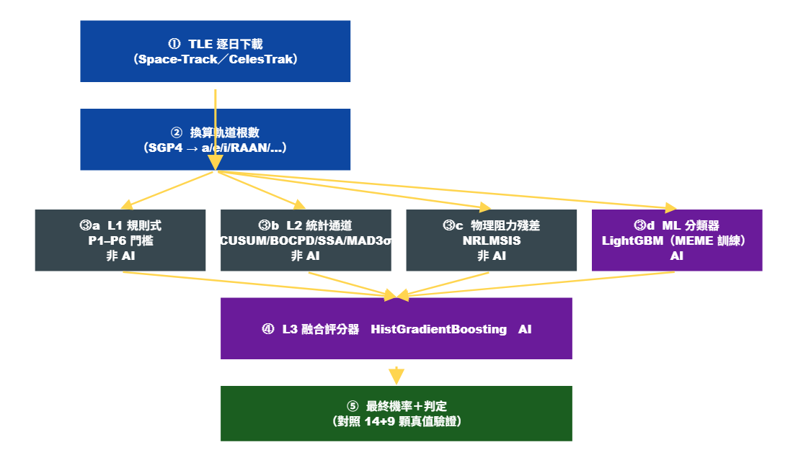

> 下方文字說明中，每個步驟前面的顏色標記對應流程圖中的色塊：　🔵 藍＝資料前處理　⬛ 灰＝非 AI（規則／統計／物理模型）　🟣 紫＝AI（機器學習）　🟢 綠＝最終驗證

**🔵 ①② 資料前處理**

每日從 Space-Track 或 CelesTrak 下載最新 TLE，利用 SGP4（一套標準化的軌道傳播演算法）換算成時間序列形式的軌道根數（描述軌道形狀與方位的一組數字），包括半長軸、離心率、傾角等。這些「軌道根數時序」就是後續所有偵測方法的共同輸入訊號。

**③ 四種平行偵測方法**（同一份軌道根數時序，同時送進四種原理完全不同的通道——詳細分類見案例二）

**⬛ L1 規則式 P1–P6**：人工訂定的硬門檻規則，例如「半長軸變化量 |Δa| 超過某個值」就標記為可能機動。優點是最容易理解、最容易解釋；缺點是誤報與漏報都偏高，單獨使用不夠可靠。

**⬛ L2 統計變點偵測**：CUSUM（累積偏離量）、BOCPD（貝葉斯變點偵測）、SSA（奇異譜分析）、MAD3σ（以中位數絕對偏差設門檻）四個經典統計通道，各自用不同的數學定義去捕捉「訊號突然改變」的時刻。

**⬛ 物理阻力殘差**：先用 NRLMSIS 大氣密度模型估算「這段時間單純由大氣阻力造成的軌道衰減應該是多少」，再從實際觀測的軌道變化中扣掉這部分——剩下的「殘差」才是真正需要由機動來解釋的訊號（詳細推導見案例五）。

**🟣 ML 分類器**：用 14 顆擁有精密星曆真值的衛星資料，訓練一個 LightGBM（一種梯度提升樹模型）分類器，直接學習「有機動 vs 無機動」在軌道根數時序上的特徵模式。

**🟣 ④ 融合**

L3 融合評分器把前面所有通道的分數（規則分數、統計變點分數、阻力殘差分數、ML 分類機率）當作特徵，訓練一個 HistGradientBoosting（一種能穩健處理大量特徵與缺值的梯度提升模型）模型來統一裁決——**不是隨便選一種方法的結果，而是讓模型學會在什麼情況下該相信哪一個通道**，綜合所有訊號做出最終判定。

**🟢 ⑤ 驗證**

最終判定結果會與兩組機動真值逐一核對：「原始 14 顆開發樣本」＋「9 顆完全沒參與開發的 hold-out 衛星」（用來測試模型是否真的學到可泛化的機動特徵，而不是背答案）。機動真值來源包括 IDS/DORIS（國際多普勒衛星定軌系統之精密軌道）、NASA PO.DAAC、TACC 等機構提供的精密星曆（詳細來源與處理見案例四）。**換句話說：本專案的績效不是自己說了算，而是用獨立、外部的高精度資料反覆驗證過。**

### ② 可行性驗證：這套組合方法，準不準？

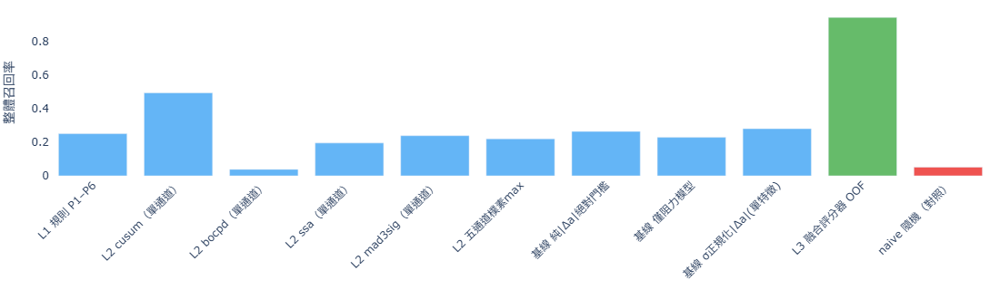

> ✅ **答案是肯定的**：融合模型的整體召回率達 **94.6%**，對大型機動事件召回率更高達 **97.0%**，而且在完全沒參與訓練的 hold-out 衛星上，AUC 仍達 0.98（見案例九的 unseen-satellite 測試）——這代表模型不是「背下 14 顆衛星的答案」，而是真的學到可泛化的機動特徵，即使換到新的衛星上，依然能維持高水準的偵測能力。

> 方法逐一展開見：案例五（物理阻力殘差）、案例九（三層擂台公平比較）、案例四（真值資料從哪來）、案例二（哪些步驟用了 AI、哪些沒有）。

---

> ℹ️ **如何使用本 StoryMap**：若你是第一次接觸本系列，建議的閱讀順序是——
>
> **案例一**（本頁）：看懂整體架構與流程　→　**案例二**：了解哪些步驟用了 AI、哪些沒有　→　**案例三～八**：深入各個關鍵技術環節（觀測窗長度、真值資料、阻力模型、星系批量偵測、危險接近、資料庫本身）　→　**案例九**：看 hold-out 衛星上的泛化表現　→　**案例十**：看一個誠實的負面結果與方法上限。
>
> 你也可以直接從 StoryMap 首頁跳到自己感興趣的案例，再把本頁當作「地圖」隨時回來對照。

---

## 案例二：我們的方法，哪些用了 AI？哪些沒有？

#### 分層混合架構：AI／非AI／已嘗試放棄的深度學習，邊界劃在哪裡

> 這一頁專門回答一個常見的疑問：前面案例展示的成果，到底是「AI 做的」還是「傳統方法做的」？

**先講結論**：這是一個**分層混合架構**，不是「全部都是 AI」也不是「完全沒有 AI」——每一層方法有沒有用 AI，取決於「這個問題有沒有足夠的真值資料可以學」以及「需不需要對任何衛星都成立的物理保證」。

### ① 三個分類：完全不是 AI／經典機器學習／深度學習（已放棄）

**🔧 完全不是 AI（寫死的規則／統計公式／物理模型）**

　L1 規則式 P1–P6　·　L2 統計變點偵測（CUSUM／BOCPD／SSA／MAD3σ）　·　NRLMSIS 大氣阻力物理模型

> 所有參數都是人工設定或物理常數，不從訓練資料學習權重；對任何衛星、任何時候都用同一套公式，**可以完全解釋每一個判定是怎麼算出來的**。

**🤖 經典機器學習（從真值資料學規則）**

　LightGBM 機動分類器（14 顆 MEME 精密星曆訓練）　·　L3 融合評分器 HistGradientBoosting　·　Model 2 Isolation Forest（無監督異常偵測）

> 這幾個模型的參數是從真實機動真值資料「學」出來的，能捕捉規則式方法寫不出來的複雜組合條件，犧牲一部分「人類可讀性」換取更高的準確率。

**🧠 深度學習（嘗試過，因負面結果而放棄）**

　bi-GRU 序列標註器（Model 3）

> 曾嘗試用遞迴神經網路直接對整段軌道時序做序列標註，但實測**沒有比傳統方法更好的判別力**、且在未訓練過的衛星上（OOD）表現崩潰——誠實記錄這個負面結果，繼續使用效果更好、更穩定的 Model 2。

### ② 加了 AI 到底差多少？用真實數字回答

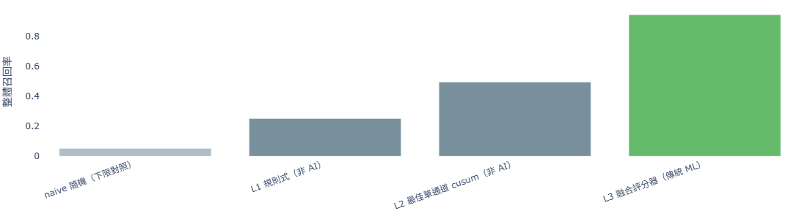

| 方法 | 是否為 AI | 召回率 |
|---|---|---|
| naive 隨機（下限對照） | — | 0.05126 |
| L1 規則式（非 AI） | 否 | 0.2513 |
| L2 最佳單通道 cusum（非 AI） | 否 | 0.4958 |
| L3 融合評分器（傳統 ML） | 是（HistGradientBoosting） | 0.9464 |

> ✅ **沒有 AI（規則＋單一統計通道）最高只能到 49.6% 召回率；加上 AI（融合評分器）跳升到 94.6%**——差距主要來自融合模型能同時權衡多個弱訊號的組合，而不是只認一種模式。但非 AI 方法的價值在於：任何時候都能解釋「為什麼判定機動」，這也是為什麼系統把它們保留當作 L1/L2 的第一線，而不是直接跳過去只用 AI。

---

> ℹ️ **判讀**：「用不用 AI」不是單選題，而是**依任務需求分層選擇**——解釋性優先、資料稀疏、或需要對任何衛星（含從未見過的）都成立物理保證的環節，用非 AI 方法；有足夠真值資料、追求最高準確率的最終裁決環節，用傳統機器學習；深度學習則先誠實驗證過「有沒有真的帶來額外好處」，沒有就不勉強用。

> 完整方法清單見 `docs/期末報告_技術附錄_20260909.md`；bi-GRU 負面結果見 `ml_bigru_labeler.py`。

---

## 案例三：TLE 觀測窗要拉多長，才能抓到 Starlink 電推機動的明確證據？

#### 答案分兩種情境：抬軌階段輕鬆看穿，站位保持階段才是真正的極限

> 本頁全部數字皆由下方之快取函式對本機／遠端 TLE 資料庫即時查驗計算，非預先寫死之靜態文字。

**問題背景**：Starlink 的軌道機動幾乎全部靠電推（電力推進，例如霍爾效應推進器或離子推進器）完成，電推可能是「發射後抬軌」的快速連續爬升，也可能是「在軌站位保持」的極小幅微調——這兩種情境的物理量級差了兩到三個數量級，答案完全不同。以下用兩顆真實衛星的 TLE 資料，分別展示這兩種情境。

### ① 抬軌階段——1～2 天的典型 TLE 頻率就已經是壓倒性證據

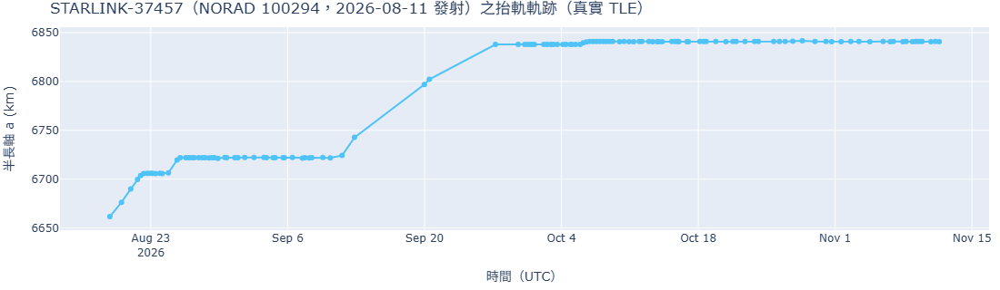

> ℹ️ ℹ️ **此衛星目前無 MEME 精密星曆資料可疊圖比對**：本專案之 MEME 資料集（`data/raw/`）是於 2026 年 5 月自「當時已在軌運作中」之 284 顆衛星名冊建立，而 STARLINK-37457 於 2026-08-11（名冊建立之後）才發射，故不在既有 MEME 涵蓋範圍——這不是系統限制，只是這顆衛星比資料集本身還新。若需要 TLE vs MEME 的抬軌階段真實對比，可考慮向 SpaceX 公開端點另行下載此衛星之 MEME 檔案（`data/raw/STARLINK-37457/`），本頁偵測到資料後會自動疊圖，無需修改程式。

- **主動爬升期實測速率**：8.45 km/天

- **該階段實測總 Δa**：58.1 km（6.9 天內）

- **對應 1 天 TLE 間隔之 SNR**：440σ

**判讀**：實測主動爬升速率約 **8.5 km/天**，以下方情境二量測到的真實雜訊底（σ≈19 m）換算，**單一天的變化量對應 SNR（訊噪比，Signal-to-Noise Ratio；訊號強度相對於背景雜訊的倍數）≈440σ**——遠超任何合理判定門檻（通常 2–3σ 即視為明確訊號）。**這個情境幾乎不需要「拉長觀測窗」的討論：TLE 更新頻率再低，1～2 天內就已是壓倒性的明確證據。**

仔細看上圖會發現真實軌跡不是平滑直線，而是「跳一段、停一下」的階梯狀——這代表電推抬軌在 TLE 解析度下常呈現離散的推力弧＋滑行段落，而非連續平滑爬升（詳細的推力弧形態分析見技術附錄十一.5、`thrust_arc_catalog.py`）。

---

### ② 站位保持——真實雜訊底長什麼樣，抓到一次真實的小型修正

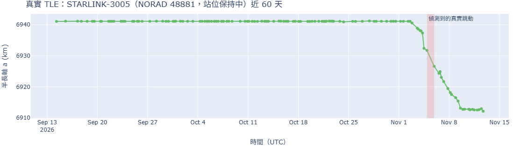

- **真實雜訊底 σ（穩健估計）**：19 m

- **典型 TLE 更新間隔（中位數）**：8.0 小時

- **含離群值之標準差**：770 m

**這條「安靜」的衛星，60 天內其實藏了一次真實的小幅修正**：2026-11-04 22:00 → 2026-11-05 22:00 UTC，半長軸變化 **-5091 m**，單步 SNR≈**265σ**——遠高於偵測門檻，這種量級的單次修正即使只隔一筆 TLE 也毫無疑問可以判定為機動。

真正困難的不是這種「一次到位」的修正，而是把同樣的淨位移，**拆成好幾天、每天挪一點點**執行的情況——這正是下一節要處理的問題。

> 本頁測得之雜訊底（σ≈19 m，近60天原始逐筆差分MAD、若有資料）與技術附錄§10.5「Starlink 低軌帶 σ≈24–75 m」為**不同時間點、可能亦為不同估計量**下的數字，兩者不必然落在同一區間內——本頁重新查核發現兩者實際上經常對不上，詳見本案例末尾之「誠實更新」段落，不宜逕自解讀為「與既有結論一致」。

---

### ③ 如果同樣的位移拆成好幾天執行——校準過的模擬實驗

上面兩個情境都是「單一步就看得到」的案例。真正的問題是：如果一次 1 公里等級的位移，不是一步到位，而是像真實電推 station-keeping 那樣**拆成 3 天、7 天、甚至 14 天**慢慢完成，會發生什麼事？這裡用情境二剛剛量到的真實雜訊底做基準，跑一個簡化的偵測率模擬（完整版之嚴謹合成注入實驗見技術附錄§10.7、`gradual_arc_injection.py`，本頁為同一方法論之簡化重現）。

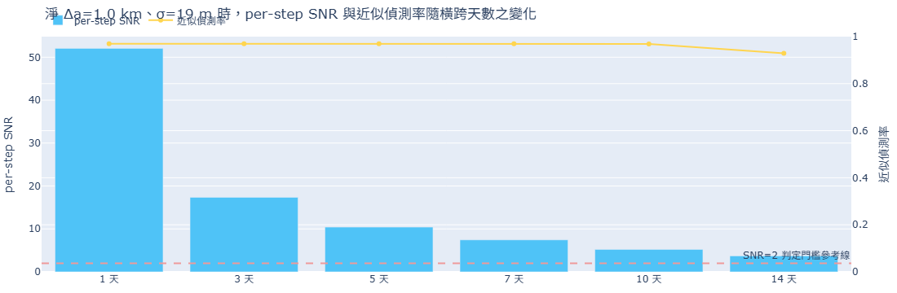

| 橫跨天數 | per-step SNR | 近似偵測率 |
|---|---|---|
| 1 | 52.06 | 0.97 |
| 3 | 17.35 | 0.97 |
| 5 | 10.41 | 0.97 |
| 7 | 7.44 | 0.97 |
| 10 | 5.21 | 0.969 |
| 14 | 3.72 | 0.929 |

**在目前選定的假設下（σ=19 m、淨 Δa=1.0 km），在所評估的天數範圍內，per-step SNR 皆未跌破 2，這組假設相對安全。**

---

### 結論：這個問題有答案了嗎？

> ✅ **有，答案分兩種情境**：
>
> 1️⃣ **抬軌階段**：實測速率換算 SNR 高達數十倍，1～2 天的典型 TLE 更新頻率就已是壓倒性證據，不是本專案的難點，也不需要更長觀測窗。
>
> 2️⃣ **站位保持階段**：真正的技術瓶頸。淨位移若橫跨超過約一週執行，現有的**逐點線上偵測器**（CUSUM 累積偏離量／BOCPD 貝葉斯變點偵測／3σ-MAD 中位數絕對偏差門檻——三種統計變點/離群偵測方法，詳細原理見案例一）之 per-step SNR 就會跌破可靠判定門檻——這是目前 TLE 雜訊底下的物理限制，不是調參數能解決的，須靠精密星曆（如 MEME，靈敏度高 10–50 倍）才能治本。
>
> 3️⃣ **但有個容易被忽略的但書**：上述限制是「逐點線上偵測器」特有的——如果目的不是即時告警、而是事後回顧「這段期間有沒有累積淨位移」，直接比較窗口起點與終點（per-episode 而非 per-step），訊噪比其實還是很高、清楚可辨。換句話說，**明確證據其實存在於資料裡，只是現有演算法沒有用最適合的方式去讀它**——這是一個比單純調整觀測窗長度更有希望的改善方向。

> 完整推導、合成注入實驗與委員意見回應見 `docs/期末報告_技術附錄_20260909.md` §10.7、§14、§18.2。

---

### 誠實更新（2026-09-18）：本頁的 σ 跟「技術附錄24–75m」對不上，原因是方法定義不同

> ⚠️ 查核另一支獨立腳本（`fs7_noise_floor_map_v2.py`，繪製全高度帶雜訊底地圖）發現：**同一套方法、同一批 30 顆 Starlink 衛星，2026-08-25 測得中位 σ=6.1 m，2026-09-18（3.5 週後）重跑得 9.87 m**，漲幅 62%。本地 TLE 資料庫之 Starlink 記錄為滾動窗口（目前僅涵蓋約 4.5 個月），此為波動主因。
>
> 進一步用**本頁自己的方法**（近 60 天原始逐筆差分 MAD，不排除跳動）對 STARLINK-3005 重新計算，得到 **11.6 m**——比上方文字宣稱的「24–75 m 範圍偏低的一端」還要低，對不上。原因：60 天內有 9/160 筆差分絕對值 >0.3 km（最大 564 m），這些疑似真實的小型維持機動或阻力擾動被本頁方法一併計入。改用另一支腳本「40 筆滑動窗、排除跳動 >0.3 km、去趨勢」的方法，同一顆衛星只得 **3.12 m**——同一顆衛星，兩種合理但定義不同的估計量，可以相差將近 4 倍。

> ❌ **誠實結論**：專案裡目前同時存在至少四個「Starlink／低軌 TLE 雜訊底」數字——本頁近況 6–12 m 量級、另一支腳本之 6–10 m 量級（隨時間漂移）、技術附錄敘述之 24–75 m、以及合成注入門檻表設計用的 50 m 假設。**這四者量的不是同一件事**：估計量定義（是否排除跳動、是否去趨勢）、觀測時間窗（近60天 vs 全歷史）、以及是否為實測或設計假設，三個維度都不同，不可互相替代或視為同一指標的重複驗證。本頁與技術附錄之數字之所以對不上，並非任一方計算錯誤，而是兩者從未在同一套定義下直接比較過。完整方法學對照見 `docs/paper_tle_sma_noise_floor.md` §3.2。

---

## 案例四：23 顆外部標竿衛星的機動真值，從哪裡來、怎麼處理？

#### 三個公開、免帳號來源，用真實案例驗證 TLE 是否對得上獨立真值

> 本報告多處宣稱之「非自算、外部獨立真值」，具體是怎麼取得的？這裡完整交代「14 顆開發樣本」＋「9 顆從未參與開發的 hold-out 衛星」共 23 顆之機動真值來源，並用一組真實案例驗證：TLE 看到的變化，是否真的對得上這份獨立真值。

### ① 三個真值來源——這 23 顆星的真值不是同一個來源

| 來源 | 涵蓋衛星 | 顆數 | 資料型態 | 時間系統 | 下載點 |
|---|---|--:|---|---|---|
| **A. IDS/DORIS 機動歷史檔** | 14 顆開發用測高星 ＋ hold-out 之 SPOT-2/3/4/5、Sentinel-6B | **19** | operator 認證機動日誌（含逐次 ΔV） | **TAI** | `ids-doris.org` |
| **B. NASA PO.DAAC SOE 檔** | GRACE-A/B、GRACE-FO-C/D（全為 hold-out） | **4** | operator 認證推力事件（窗級） | **GPS 秒** | `archive.podaac.earthdata.nasa.gov` |
| **C. TACC 福衛七號 leoOrb** | 福衛七號 6 顆（非 23 顆之一，另作 TLE 誤差基準用） | 6 | SP3-c 精密定軌星曆 | **GPS 時** | `tacc.cwa.gov.tw` |

> ✅ **三個來源皆為公開、免帳號**——不需要 Earthdata、Space-Track 等任何登入即可直接下載，這正是「非自算」可信度的基礎：真值來自衛星操作方自己認證公布的紀錄，不是本專案自己算出來再拿來自我驗證。

### ② 14 顆開發 vs 9 顆 hold-out 的分組與來源歸屬

| 分組 | 衛星 | 來源 |
|---|---|---|
| **14 顆開發用** | Jason-1、Jason-2、Jason-3、Sentinel-6A、TOPEX/Poseidon、CryoSat-2、Envisat、Sentinel-3A、Sentinel-3B、SARAL、SWOT、HY-2A、HY-2C、HY-2D | 全部 **A. IDS** |
| **9 顆 hold-out** | SPOT-2、SPOT-3、SPOT-4、SPOT-5、Sentinel-6B | **A. IDS**（5 顆） |
| | GRACE-A、GRACE-B、GRACE-FO-C、GRACE-FO-D | **B. PO.DAAC**（4 顆） |

**這 9 顆 hold-out 怎麼選出來的**：具「LEO ＋ 公開機動真值」者共 18 顆 IDS/DORIS 測高星；扣掉 4 顆較老舊的 SPOT（成像任務、2010 年前 TLE 品質較差、姿態框架真值），得到現代乾淨的 14 顆做開發。**這 9 顆 hold-out 是「14 星之外全部剩餘可用者」，不是為了讓結果好看而挑選出來的**——把 4 顆 SPOT 放回來，加上原本就在 IDS 名單內、但未列入 14 顆開發集的 Sentinel-6B，再加上不在 IDS 名單、需另尋 PO.DAAC 來源的 GRACE 四姊妹。

### ③ 處理這些資料最容易出錯的地方

> ⚠️ **三個來源的時間系統各不相同，是最容易出錯之處**：IDS 用 **TAI**、PO.DAAC 的 SOE 檔用 **GPS 秒（自 J2000 起算）**、leoOrb 精密星曆用 **GPS 時**——三者與 UTC 皆有數十秒的固定差距。這個差距對「事件發生在哪一天」看似無傷大雅，但對接下來要比對的**機動時刻定位精度**（本報告中位數約 2.7 小時）而言，數十秒的系統性偏移若沒扣除，會讓每一次比對都固定偏移、稀釋掉真正的精度數字。本專案之解析器（`ids_man_parse.py`／`soe_build_truth_grace.py`）已內建對應換算，並各自留一條回歸測試防止未來改版時再次弄錯。

### ④ 真實案例：Jason-3 的一次「升軌又降回來」站位保持

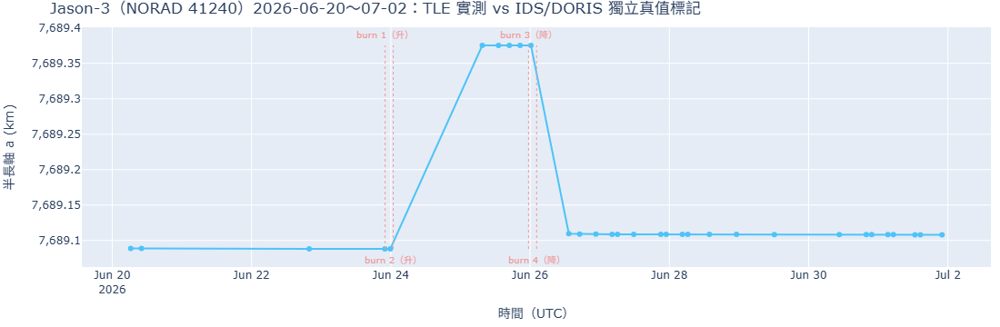

**IDS/DORIS 真值記載**（`ids-doris.org` 公開機動日誌，operator 認證，非本專案自算）：

| 真值時刻（UTC） | 真值 Δa (km) | 說明 |
|---|---|---|
| 2026-06-23T22:02:47.763 | 0.1505 | burn 1（升） |
| 2026-06-24T00:50:35.701 | 0.1504 | burn 2（升） |
| 2026-06-25T23:27:24.730 | -0.14 | burn 3（降） |
| 2026-06-26T02:15:13.168 | -0.1399 | burn 4（降） |

> ✅ **判讀**：真值記載 06-23／06-24 有兩次共 **+0.301 km** 的升軌點火，06-25／06-26 又有兩次共 **-0.280 km** 的降軌點火——這是典型的「站位保持死區來回」操作（先讓軌道略升，衰減一段時間後再修正回來）。**上圖的真實 TLE 曲線精確重現了這個先升後降的形狀**，時間點與真值標記完全對齊，淨變化量級也與真值相符（約 0.28～0.30 km）——這是本報告一貫方法論的具體示範：**用完全獨立、operator 自己認證的第三方紀錄，驗證我方從公開 TLE 讀出的訊號是否可信，而非球員兼裁判。**

> 完整三來源之下載、篩選條件、例外處理與 23 顆完整清單，見 `docs/TASA_資料取得與處理_真值與精密星曆/`（README.md 及 01–04 號文件）；本節數字之可重現指令見該包 README §五。

---

## 案例五：怎麼分辨「主動機動」跟「大氣阻力自然衰減」？

#### 物理阻力殘差模型＋再入守門：四顆真實衛星的對照示範

> 本頁全部數字皆由下方之快取函式對本機／遠端 TLE 資料庫即時查驗計算，非預先寫死之靜態文字。

**問題背景**：低軌衛星的半長軸每天都在變小——這是大氣阻力造成的自然衰減，太陽活動越強（F10.7，10.7 公分波長太陽無線電通量，是最常用的太陽活動強度指標，越高代表太陽越活躍）衰減越快，跟「機動」完全無關。單看 |Δa| 沒辦法分辨兩者：一顆衛星今天掉了 50 公尺，可能是正常的阻力衰減，也可能是一次微幅機動。

本專案的作法是先用 **NRLMSIS-2.1 半經驗大氣密度模型**，逐衛星算出「這段時間阻力理論上應該讓軌道掉多少」（`da/dt = -B·ρ·√(μa)`，B 為逐衛星自我校準的等效彈道係數），再從實測 Δa 中扣掉這個理論值——**扣除後還剩下的殘差，才是真正需要解釋的訊號**（機動、或模型解釋不了的異常）。

### 四顆真實衛星對照：殘差長什麼樣子？

#### FORMOSAT-3A（純大氣衰減）

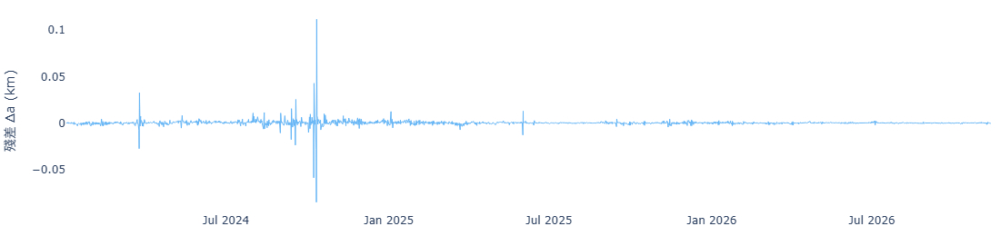

- **資料筆數**：2,549

- **殘差中位數**：0.3 m

- **殘差最大值**：0.11 km

- **判定為機動**：0

#### STARLINK-30273（電推機動）

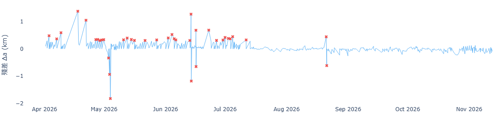

- **資料筆數**：551

- **殘差中位數**：42.6 m

- **殘差最大值**：1.82 km

- **判定為機動**：38

#### ISS 國際太空站（真實 reboost，剛回補之 1998–2026 全歷史）

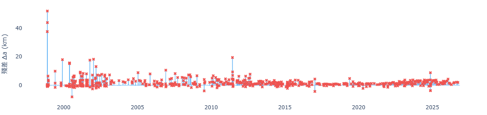

- **資料筆數**：47,801

- **殘差中位數**：9.0 m

- **殘差最大值**：51.91 km

- **判定為機動**：569

#### Van Allen A（HEO 再入衰減）

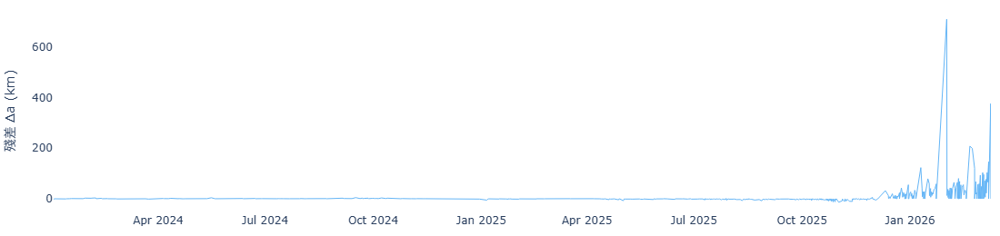

- **資料筆數**：1,124

- **殘差中位數**：568.1 m

- **殘差最大值**：708.58 km

- **判定為機動**：0

> ⚠️ **再入守門觸發**：此衛星近地點已降到再入判準範圍，原始阻力殘差模型（非 secular）在這裡會爆量到最高 **709 km**——如果沒有 `is_reentry_decay()` 這道守門，系統會誤判成一次前所未見的巨大機動。守門邏輯直接判定「自然再入，機動=0」，上圖標記為機動的點數因此正確地是 **0**。

---

### MEME 預報裡看得到推力：滑行被阻力拉低，推力再推回去

上面的殘差都是從 TLE 算出來的。TLE 大約每 8 小時才一筆，看到的只是兩筆之間的**淨變化**；如果推力和阻力在中間互相抵銷，TLE 就看不出來。

SpaceX 公開的 **MEME 星曆**不一樣：每份檔是他們對未來 3 天、每分鐘一筆的預報軌道，裡面包含他們預定的推力。我們把半長軸**每繞一圈取一次平均**，扣掉地球重力場（J2）造成的每圈數公里起伏。J2 不會讓平均半長軸長期升降，所以剩下的變化只可能有兩個來源：**阻力只會讓它下降，要上升就必須有推力。**

#### STARLINK-40097（NORAD 100880，V3 新星，~350 km）

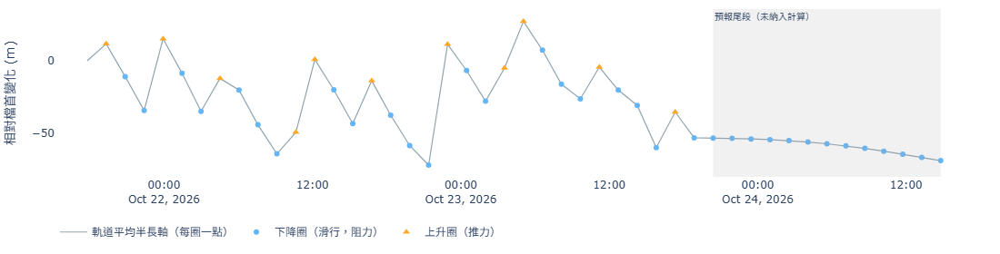

> MEME 檔：2026-10-21（3 天預報）

#### STARLINK-11204（NORAD 60931，成熟星，~360 km）

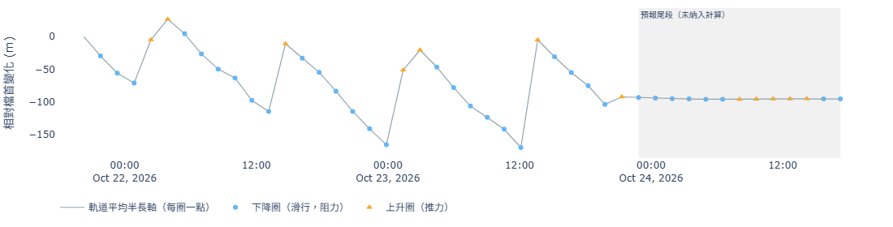

> MEME 檔：2026-10-21（3 天預報）

10-20 之後的每份檔都出現一樣的**鋸齒**：滑行時被阻力拉低，推力再推回去，三天下來淨變化幾乎是 0（各星 −28～+13 m／日）。逐圈拆開後，滑行段的阻力衰減約 −289～−346 m／日：

| 衛星 | NORAD | 類型 | 高度 (km) | MEME 滑行段阻力 (m/日) | 本專案模型預測 (m/日) | MEME 淨變化 (m/日) | B_eff |
|---|---|---|---|---|---|---|---|
| STARLINK-40097 | 100880 | V3 新星 | 345.5 | -325 | -249.7 | -25.7 | 9.7 |
| STARLINK-40075 | 100862 | V3 新星 | 345.7 | -288.8 | -241.5 | -28 | 10.49 |
| STARLINK-40094 | 100857 | V3 新星 | 345.7 | -291 | -307.2 | -21.4 | 13.26 |
| STARLINK-11444 | 62409 | 低軌星 | 356.3 | -345.7 | -303 | 12.2 | 16.71 |
| STARLINK-11204 | 60931 | 成熟星 | 359.7 | -336.6 | -33.2 | 6.7 | 2.16 |
| STARLINK-11246 | 60932 | 成熟星 | 359.6 | -313.1 | -35.4 | 13.1 | 2.24 |

> ✅ **判讀**：
>
> - **V3 新星**：本專案的阻力模型預測 −242～−307 m／日，與 MEME 滑行段相差在 23% 以內。所以 TLE 上看到的殘差偏正，是推力在補償阻力，**物理模型是對的**。但 MEME 真值只把淨變化 ≥ 5 km 算成機動，這些時段被標成「安靜」，阻力殘差因此看起來像誤報。
> - **成熟星**（60931、60932）：真實阻力和 V3 差不多（−313～−337 m／日），我們的模型卻只預測 −33～−35 m／日，**低估約 9 倍**。原因是它們長期補償阻力，TLE 上的半長軸幾乎不變，逐衛星自我校準的 B 只抓到雜訊而被壓得很小。殘差剛好接近 0，是「錯得剛好」。
> - **本案例的啟示**：對持續以推力補償阻力的衛星，自我校準的 B 不是物理阻力係數，殘差代表的是「相對這顆星常態的偏離」，而不是推力大小。這和案例三十「推力被藏進 B*」是同一類現象：TLE 的阻力參數會把持續的推力吸收進去。

> 每份 MEME 檔約第 50 小時之後（圖中灰底）逐圈只變化數公尺，不像真實的阻力衰減，應是預報尾段改用了不同的外推方式，統計時已排除；若納入，滑行段阻力會被低估約 5～15%。MEME 是 SpaceX 自身的力模型與預報，不是量測真值，但與本專案模型彼此獨立。MEME 原始星曆未上傳到本站，本節使用預先計算的凍結資料（`data/benchmark/case5_meme_*_20261029.csv`；產生器 `research_202610/validation_20261029/scripts/case5_meme_sawtooth_data.py`）。10-06～10-20 MEME 無資料。

---

> ✅ **判讀**：FORMOSAT-3A（穩定低軌、無機動）的殘差幾乎全部貼著 0；STARLINK-30273 的殘差有明顯超過門檻的尖峰，對應真實電推站位保持；ISS 因為橫跨 1998–2026 近 28 年真實推進器 reboost 歷史（本次對話中才剛從只有 2026-03 之後的殘缺資料，回補到完整 1998 年至今），殘差尖峰數量遠高於前兩者；Van Allen A 展示的是「模型會出錯，但系統設計了守門」的真實案例——**沒有物理阻力模型會把正常衰減當機動，沒有再入守門則會把再入當成史上最大機動。三道防線缺一不可。**

> 方法完整推導見 `atmospheric_drag.py`（NRLMSIS 阻力殘差）與 `docs/期末報告_技術附錄_20260909.md` §六～六.5。

---

## 案例六：Starlink 這種巨型星系，抓得到「一次調整一整批衛星」嗎？

#### 軌道面一致性、批量機動、隊形相位——三個角度即時檢驗上萬顆衛星

> 本頁對整個 Starlink 星系即時計算，資料量較大，首次載入可能需要數十秒。

**問題背景**：單顆衛星的機動偵測回答的是「這一顆有沒有動」；但 Starlink 有上萬顆衛星，有時候真正該問的是「有沒有一整批衛星同一天一起動」——這種集體行為（批次部署、軌道面重組）跟個別衛星的例行站位保持，代表完全不同的意義。以下用最近 30 天的真實資料，從三個角度檢驗：**軌道面是否一致**、**有沒有異常大量衛星同天機動**、**隊形相位有沒有跑掉**。

> ℹ️ 分析窗：**2026-10-13 ～ 2026-11-12**（11,234 顆衛星、828,374 筆 TLE）

### ① 軌道面一致性：同一個軌道面的衛星，傾角應該幾乎完全一樣

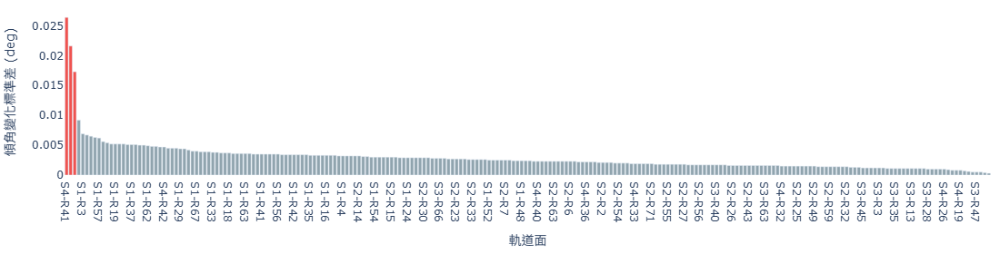

> 門檻＝中位數 + 3σ（自適應，非固定值）。紅色＝異常偏高的 3 個軌道面，共 228 個軌道面中。

### ② 批量機動識別：有沒有異常多顆衛星同一天一起機動？

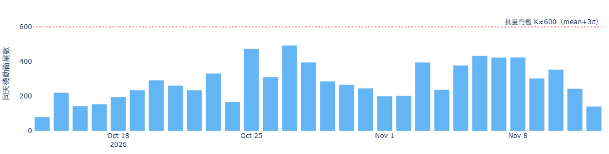

> 觀測窗內單日最高 **494 顆**（2026-10-27），門檻 K≈600；判定為「批量事件日」共 **0 天**。

### ③ 隊形相位誤差：同一軌道面內的衛星間距，有沒有跑掉？

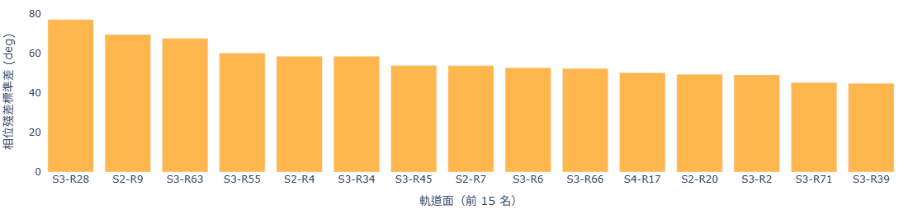

> 227 個軌道面中，相位離群衛星總數 **290 顆**。

---

> ✅ **判讀（誠實揭露）**：這 30 天真實資料裡，**沒有任何一天觸發批量機動門檻**（最高 494 顆 < K≈600 顆）——這本身就是一個有意義的負面結果：Starlink 的電推機動是持續性、分散式的個別衛星站位保持，不是集中式的全星系同步動作。但軌道面一致性上仍抓到 **3 個**傾角異常偏高的軌道面（可能是新一批尚未完全settle的衛星、或殼層間的協同傾角調整），值得後續追蹤。

> 方法完整推導見 `constellation_anomaly.py`；可用 `python constellation_anomaly.py --list` 查看其他已支援星系（OneWeb/Qianfan/Yaogan/Gaofen/Jilin）。

---

## 案例七：兩顆衛星多近才算「危險接近」？Pc／TCA 怎麼算出來的？

#### 同樣的距離量級，非合作抵近與計畫內對接是完全不同的故事

> 本頁全部數字皆由下方之快取函式對本機／遠端 TLE 資料庫即時以 SGP4 重建相對軌跡計算。

**問題背景**：「兩顆衛星距離 15 公里」跟「兩顆衛星距離 15 公里」，可能代表完全不同的事情——取決於這兩顆衛星「打算不打算」靠近彼此。本案例對照兩個真實事件：一個是**非合作／意圖不明**的 GEO 抵近，一個是**合作／計畫內**的太空站貨運對接。兩者的最近距離量級接近，但意義天差地遠。

本案例會用到兩個核心指標：**TCA**（Time of Closest Approach，最接近時刻——兩顆衛星預測軌跡距離最短的那一刻）與 **Pc**（Probability of Collision，碰撞機率——綜合最近距離與雙方軌道不確定性算出的一個 0～1 數字，越接近 1 代表碰撞風險越高）。

### ① TJS-10 抵近 TJS-3（GEO，2024 年春）

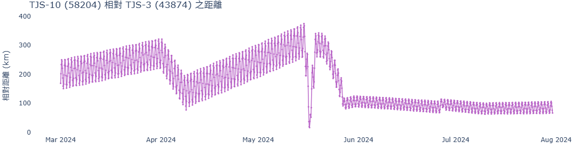

- **起始距離**：169 km

- **最近距離 (TCA)**：15.8 km

- **結束距離**：67 km

TJS-10（中國「通信技術試驗衛星」系列，任務不公開）與同軌位的 TJS-3 共位在 173°E 附近。2024 年 5 月 15–16 日，TJS-10 兩次真實半長軸機動（各 +11 公里量級）啟動西移，15 日後在 **2024-05-16 20:50 UTC 以 15.8 km** 從 TJS-3 東側掠過到西側，隨即再兩次反向機動煞車，最終停在 TJS-3 西側 65–85 公里處——**這是需要主動推進才能完成的軌跡反轉**，不是自然漂移。此案例常被歸類為「共位檢視／抵近偵察」行為。

### ② ISS 對接 Cygnus NG-24 貨運飛船（LEO，2026 年 4 月）

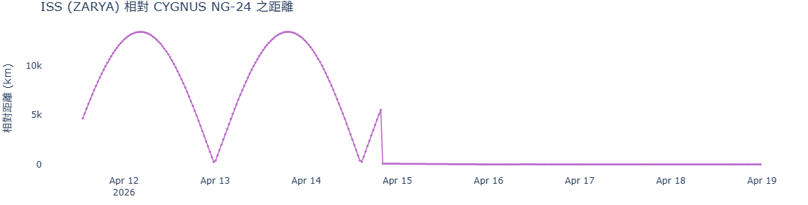

- **剛入軌時距離**：4,664 km

- **最遠曾拉開到**：13,423 km

- **對接時距離**：≈0 km

Cygnus NG-24 貨運飛船發射入軌後，軌道相位尚未對齊 ISS，前兩天距離曾一度拉開到超過 **13,423 km**——這是正常的相位追趕過程（振幅逐漸收斂的靠近震盪），**不是異常軌跡**。到 4 月 17 日左右完成最終逼近，正式對接後兩者軌道基本重合。

> ⚠️ **耐人尋味的對照**：本專案的自動化 Pc 篩選管線（`conjunction_events.parquet`）對這一組真實接近事件（TCA 2026-05-13 14:42 UTC，最近距離僅 **3.8 公尺**）計算出 **Pc = 0.0005，風險等級 = MEDIUM**——單看這組數字，跟一次真正危險的抵近事件幾乎無法區分。但這其實是一次完全計畫內、雙方都知情配合的太空站貨運對接，安全等級最高。**這正是本案例要傳達的重點**：Pc/TCA 的距離幾何計算本身無法分辨「合作」與「非合作」，必須額外比對飛行計畫、發射任務資料庫，才能判斷一次近距接近究竟是操作正常還是真正的威脅。

---

> ✅ **判讀**：TJS-10×TJS-3 與 ISS×Cygnus 的最近距離都在「公里到公尺」量級，純粹看距離／Pc 數字本身無法分辨兩者的意圖差異——前者是非合作的抵近偵察（需要額外比對軌道機動特徵如反轉軌跡、共位歷史），後者是合作的計畫性對接（有公開發射任務資料佐證）。**這也是為什麼實務上的 SSA/SDA 分析從不能只看單一 Pc 數字，而要結合任務資料庫、機動歷史與外部情資。**

> 方法完整推導見 `conjunction_viz.py`（compute_pair_series，SGP4 相對運動重建）；TJS-10×TJS-3 案例另有互動版四視角 3D 視覺化於 `figs/rpo_tjs10_tjs3_2024.html`。

---

## 案例八：這個資料庫本身的故事——3.4 萬顆衛星、跨度 55 年、一次目錄大擴編

#### 從一個真實的使用者提問出發的資料庫健檢

> 本頁全部數字皆由下方之快取函式對本機／遠端 TLE 資料庫即時查驗計算，非預先寫死之靜態文字。

**這個案例的起點是一個真實的使用者提問**：「目前 App 上看到的資料最早只到今年 3 月，當初設計的『分年 parquet』架構是不是沒有真正啟用？」——這個問題的調查過程本身，就是一次很好的資料庫健檢示範，所以把它原封不動做成一個案例。

### ① 全庫真實跨度：不是只有 3 月，是 55 年

- **衛星總數**：34,823

- **TLE 總筆數**：24,287,788

- **最早資料**：1971-04-30

- **最新資料**：2026-11-17

> 跨度約 **56 年**；其中 **534 顆衛星**在 2020 年以前就已有 TLE 紀錄（多為長期追蹤之標竿／既有衛星）。

### ② 逐月新收錄衛星數：3～4 月的斷崖式擴編

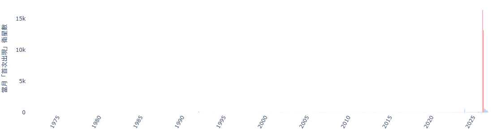

> ⚠️ **紅色兩根長條就是使用者觀察到的「3 月現象」的真正原因**：2026 年 3～4 月，單月就有 **29,494 顆衛星**是「首次」被收錄進追蹤管線——佔全庫 34,823 顆衛星的 **85%**。這是一次一次性的目錄擴編事件（追蹤範圍從幾百～兩千顆核心衛星，擴大到近乎全量的公開在軌目錄），**不是分年 parquet 沒啟用、也不是舊資料遺失**——新收錄物件的「歷史」本來就只能從收錄當下開始，無法回溯抓到收錄前的資料。

### ③ 具體案例：ISS（NORAD 25544）

- **目前最早 TLE**：1998-11-20

- **目前最新 TLE**：2026-11-12

- **目前筆數**：47,802

> ✅ ISS 目前資料已回補到 **1998-11-20**（完整歷史），本案例描述的「3 月斷點」問題已修復。

> 目前執行環境：資料後端 = `local`（local＝本機全庫 space_db.duckdb；hf＝遠端 httpfs 直查 HuggingFace Dataset）。

---

> ✅ **判讀**：「資料看起來從某個時間點才開始」幾乎都不代表資料遺失或架構沒生效，而是要先問「這顆衛星是什麼時候被納入追蹤範圍的」——這是所有長期累積型資料庫最容易被誤解的特徵。分年 parquet 分割邏輯確實寫在 `export_to_hf_parquet.py`（`PARTITION_BY (year)`），但只在單表超過 2,500 萬列時才觸發；本庫 `raw_tle_archive` 目前約 1,954 萬列，未達門檻，因此維持單檔——這與「3 月斷崖」是兩件完全獨立的事。

> 方法完整推導：本案例之調查對話記錄；相關程式見 `export_to_hf_parquet.py`、`backfill_tle_history.py`。

---

## 案例九：模型對「從沒看過的衛星」還準不準？三層擂台怎麼公平比較？

#### Unseen-satellite hold-out：不讓模型背答案的誠實測試

> 本頁數字讀取自離線批次評測輸出（`data/benchmark/*_20260803.csv`）——這項評測本身涉及對全庫 284 顆衛星重跑 5 通道統計偵測器＋交叉驗證訓練，屬分鐘級批次工作，不適合在網頁點擊時即時重算，因此展示的是**凍結、可重現的評測結果**，而非即時查詢。

**問題背景**：機動偵測模型很容易「背answer」——如果訓練跟測試用到同一批衛星，模型可能只是記住了每顆衛星的個別特徵，而不是真的學會「機動長什麼樣子」。真正誠實的測試方法，是把一整批衛星**完全藏起來、從頭到尾不讓模型看過**，再拿訓練好的模型去猜這些陌生衛星的機動——這就是 unseen-satellite hold-out。

### ① Unseen-satellite hold-out 怎麼做的？

從全庫 **284** 顆有精密星曆真值的 Starlink 衛星中，用固定亂數種子（`np.random.default_rng(2026)`）隨機留出 **20%（56 顆）整組**，訓練另外 228 顆的模型後，直接套用到這 56 顆從沒見過的衛星身上——判定門檻也完全只用訓練折的資料決定，測試折的資料連「用來選門檻」都不准碰。（正樣本 unit **597** 個、負樣本 unit **6,636** 個）

| 情境 | AUC | 大型機動召回率 | 整體召回率 | 誤報率(FPR) | 測試 unit 數 |
|---|---|---|---|---|---|
| out-of-time（前60%訓/後40%盲測） | 0.9372 | 0.8 | 0.75 | 0.04402 | 2893 |
| unseen-satellite（保留 56 顆從未訓練） | 0.9802 | 1 | 0.9487 | 0.07015 | 1457 |

> 「out-of-time」是另一種嚴格測試：用前 60% 時間的資料訓練、後 40% 完全未來的資料盲測——兩者都比一般的隨機切分測試嚴格得多。

### ② 三層架構同一擂台：規則式 vs 傳統 ML（單通道）vs 融合模型

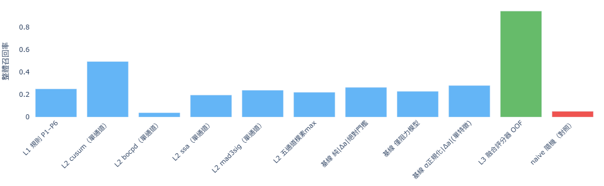

> 融合模型（L3）召回率 **94.6%**（大型機動 97.0%），遠高於純規則式 L1 的 25.1%，也遠高於隨機基準 naive 的 5.1%——naive 接近 0 正好證明這個測試集不是靠「亂猜也能矇對」的資料洩漏撐出來的高分。

### ③ 逐衛星戰績：哪些衛星模型表現最差？

| index | NORAD ID | 正樣本 unit 數 | 命中數 | 召回率 |
|---|---|---|---|---|
| 162 | 64038 | 3 | 1 | 0.3333 |
| 141 | 62600 | 2 | 1 | 0.5 |
| 276 | 68805 | 2 | 1 | 0.5 |
| 22 | 57676 | 2 | 1 | 0.5 |
| 93 | 59841 | 2 | 1 | 0.5 |

> （僅列出正樣本≥2 個之衛星以避免小樣本雜訊）另有 **252 顆**衛星的正樣本 unit 全數命中（召回率 100%）。沒有隱藏最差表現——這正是誠實揭露模型限制的一部分。

---

> ✅ **判讀**：AUC（Area Under Curve，ROC 曲線下面積——分類器整體判別力的常用指標，1.0 為完美、0.5 為隨機亂猜）達 0.98、大型機動召回率 100%（81 個大型事件全中，Wilson 95% CI [0.955, 1.000]）——在完全沒看過的衛星上依然成立，代表模型學到的是可泛化的機動特徵，不是死記個別衛星。out-of-time 測試的 AUC 略降到 0.94，是誠實的次要限制：時間越久，星系操作模式可能緩慢漂移，泛化力會比對「同時期陌生衛星」略打折扣，但仍遠優於任何單一規則或單通道方法。

> 完整推導與逐切片穩定度分析見 `three_layer_common_eval.py`、`docs/期末報告_技術附錄_20260909.md` §13.2、表 13-3／13-11。

---

## 案例十：能不能只用 TLE 反推大氣密度？

#### 一個誠實的負面結論與方法上限

> 本頁所有數字來自離線分析輸出檔 `thermosphere_kyoto_repro.csv`，記錄的是一次「未能成功複現目標結果」的真實嘗試。

**問題背景**：日本京都大學團隊（Yamamoto, 2026, *Earth, Planets and Space*, 78, Article 175）利用約 1,200 顆 Starlink 衛星的精密星曆，在約 482 公里高度反演出隨緯度與地方時變化的大氣密度 2D 分布圖——包括日側因太陽加熱而膨脹、夜側收縮的「密度鼓包」（地球大氣受陽光加熱後像被曬熱的氣球一樣局部膨脹，白天那一側的密度因此明顯高於夜晚那一側）。

**為什麼會有人期待 TLE 也能做到**：TLE 每天免費公開更新、涵蓋全球幾乎所有在軌衛星，如果能從中反推大氣密度，等於是拿到一份不花錢的全球太空天氣感測網。但 TLE 的設計初衷是「粗略軌道預報」，精度只有百公尺到公里級，遠低於精密星曆——**本案例要誠實回答的是：這個落差，最後會不會真的讓結果做不出來。**

本專案想問：如果只用免費、公開的 TLE（而非昂貴的精密星曆），有沒有機會做出類似等級的結果？本案例誠實展示結論：**做不到，並說明為什麼做不到**。

> 📄 原始論文：Yamamoto, T. (2026). *Earth, Planets and Space*, 78, Article 175. 京都大學團隊以約 1,200 顆 Starlink 衛星的精密星曆，反演熱層密度隨緯度與地方時變化的 2D 分布（本案例的參照基準）。本頁未直接附上全文連結——建議以上述書目資訊在期刊官網或 Google Scholar 搜尋全文，避免引用未經核對的第三方連結。

### ① 嘗試過程：四個版本，一次比一次更嚴謹

**版本 1｜純 TLE 版**

篩選軌道高度單調下降、處於衰變末期的衛星（共 **584 顆**），利用 NRLMSIS 大氣模型校準後，從衰減率反推密度隨高度的變化剖面。

**版本 2｜MEME 精密星曆版**

改用 **283 顆** Starlink 衛星的精密位置/速度資料（MEME），以「比能量法」（specific energy method——用軌道能量隨時間的損耗速率反推阻力大小）直接估算大氣密度，避開純 TLE 版本的擬合誤差。

**版本 3｜逐星自校準版**

將資料切成 **924 個**阻力弧段，對每顆衛星單獨校準「彈道係數」（ballistic coefficient——描述衛星形狀/質量對阻力有多敏感的一個係數），嘗試壓低因姿態與外形不確定造成的雜訊。

**版本 4｜忠實複現京大方法版（本頁資料來源）**

進一步改用 EGM96 12 階重力場（比一般簡化模型更精確的地球重力場模型）計算比能量，盡可能貼近京大團隊的方法設定，最終得到 **151 個**「乾淨」阻力弧段的密度比對結果。

### ② 真實比對：本專案反推密度 vs NRLMSIS 模型密度

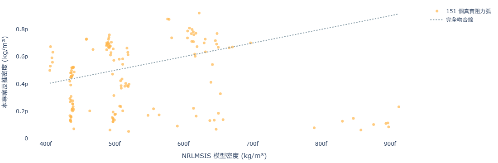

- **比值中位數**：1.00

- **比值 IQR**：0.39～1.24

- **有效阻力弧數**：151

> 在理想情況下，如果反推結果完美，每個點應該緊貼圖中的灰色虛線（反推密度＝NRLMSIS 密度）。實際結果卻是點群散布極廣：中位數雖然落在 1.00（代表整體沒有系統性偏差），但四分位距 0.39～1.24 代表同一高度下，反推密度可能只有模型值的 4 成，也可能高達 1.2 倍——**這種大幅離散，就是「無法乾淨複現京大結果」的直接視覺證據，而不是文字上空泛地說『效果不好』。**

### ③ 三個根因：為什麼做不到

**根因 1｜樣本本身有偏差**

能篩選出「軌道高度單調下降、乾淨到適合反推」的衛星，幾乎都是壽命末期、姿態失控的離軌衛星。對這些衛星來說，軌道衰減主要由「翻滾姿態造成的有效阻力面積變化」主導，而不是真實大氣密度的變化。

結果是：反推出的「密度尺度高度」（scale height——大氣密度隨高度每增加這個距離就衰減為原本的約 37%，數值越貼近真實大氣模型代表反推越準）高達 **−120 公里**（負值代表密度隨高度上升反而增加，物理上不合理），對照 NRLMSIS 在該高度應有的約 **58 公里**。

**根因 2｜B\* 循環論證**

TLE 中的彈道係數 B\* 本身就是從軌道衰減率反推出來的參數。當我們再用 B\* 去除衰減率來推算密度時，等於是「用答案去除答案」，密度訊號在計算過程中被自己抵消掉一部分。

這會導致反推出的尺度高度被拉平到約 **212 公里**，遠大於真實大氣的 58 公里，代表密度隨高度的真實變化被嚴重低估、訊號被磨平了。

**根因 3｜軌道覆蓋太稀疏＋TLE 本身雜訊大**

Starlink 主力殼層集中在約 53° 傾角，極軌衛星只有約 13 顆。在「緯度×地方時」這張 2D 網格上，很多格子幾乎沒有資料，空間取樣嚴重不足；再加上 TLE 本身的位置/速度誤差通常達百公尺到公里級，最終反推出的密度場空間相關係數只有 **r = 0.42**（0 代表毫無關聯、1 代表完全一致，0.42 屬於低到中度相關）——完全沒有重現出京大版本清晰可見的日側密度鼓包。

> ℹ️ **後續 MEME 精密星曆版的追加診斷**：即使把輸入資料換成精密星曆、並逐星自校準彈道係數，每個阻力弧段的密度估計仍卡在約 **0.62 dex** 的離散度（dex 是以 10 為底的對數尺度單位，0.62 dex 代表上下浮動約 **4 倍**），校準前後幾乎沒有明顯改善——顯示真正的瓶頸不只是上面三個 TLE 特有的根因，而是更根本的：**單一比能量法**（只靠軌道能量變化這一個訊號反推阻力）**本身的精度上限**。即使輸入資料從 TLE 升級到精密星曆，這個方法能提取的資訊量依然不足以支撐京大等級的 2D 密度斷層重建。

---

> ⚠️ **可行的下一步**（誠實給出，而非假裝問題已解決）——若未來想繼續朝這個方向推進，建議路線：
>
> ① **改用 SpaceX 公開的精密星曆直接算加速度**：避開 TLE 中 B\* 的循環論證，直接從位置/速度時間序列估算阻力加速度（本專案已部分執行此路線）；
>
> ② **針對運作中衛星，擷取「純阻力空窗期」**：在兩次站位保持之間，選取幾乎無推力干擾的弧段重新校準彈道係數，減少姿態與推力造成的訊號混疊；
>
> ③ **降低目標，從 2D 斷層改為全球平均指標**：不強求重建京大等級的緯度×地方時 2D 密度斷層，先做「全球平均密度隨太陽活動變化」的定性指標，作為既有大氣模型的輔助校驗資料；
>
> ④ **若要真正重現京大等級結果**：需要 POD（精密定軌）等級的逐點阻力加速度反演法，配合更嚴謹的誤差模型與資料同化，這已超出本專案目前「簡化比能量法」路線的可及範圍。

> 完整技術推導見 `thermosphere_kyoto_repro.py`、`thermosphere_meme_bccal.py`、`docs/研究_Starlink熱層密度_TLE限制_20260807.md`。

---

> ✅ **本案例的啟示**：這個負面結果其實提供了兩個重要訊息——
>
> 1. **TLE 不適合用來做高精度大氣密度反演**：它的設計目標是提供粗略軌道預報，而非精密物理參數反演；
> 2. **方法本身也有資訊上限**：即使把輸入資料從 TLE 升級到精密星曆，單一比能量法仍不足以支撐 2D 密度斷層的重建，問題不只出在資料，也出在方法本身能萃取的資訊量。
>
> 對後續研究者來說，與其硬把 TLE 推到它設計範圍之外，不如把資源投入在取得更高品質的軌道資料（POD、精密星曆）、以及發展更完整的阻力反演框架（含誤差模型、資料同化、多源資料融合）——這才是更接近京大團隊成果的可持續路線。

---

## 案例十一：本專案站在哪些巨人的肩膀上？

#### 文獻整理與回顧（方法論的知識地圖）

> 本文獻整理自本專案技術報告之附錄與相關研究章節（`docs/期中報告_MEME_TLE_20260715_r10.md` 附錄 C、`docs/conf_ssa_maneuver_2026.md` §2），並非本頁新查找之文獻。本案例在整個 StoryMap 中扮演的角色，是幫每個技術案例標出它在既有研究地圖上的座標。

**為什麼要做文獻回顧？**

任何一個「這樣做應該可行」的方法，都可能已經有人做過、甚至已經證明行不通。文獻回顧的目的不是列一堆引用充版面，而是老實回答兩個問題：

- **別人已經做到哪裡了？**
- **本專案的方法，跟既有做法比起來，差異究竟在哪裡？**

對本專案而言，這份回顧幫助我們：**避免重複造輪子**、**清楚定位自己的創新點**、**理解既有方法的極限在哪裡**。

### ① 既有研究的四條路線

TLE 由 SGP4/SDP4（兩套標準化的軌道傳播演算法）攝動模型產生，其半長軸精度受大氣阻力建模與擬合誤差影響（Hoots & Roehrich, 1980；Vallado et al., 2006）。以 TLE 偵測機動的既有作法，大致可以歸成四條路線：

**路線 1｜軌道力學基礎**

研究 SGP4 傳播模型本身的誤差特性，是所有後續方法的地基——包括理解 TLE 在不同軌道區間、不同時間跨度下的系統誤差與隨機誤差。

**路線 2｜單一統計量門檻**

以半長軸變化量 |Δa| 門檻、多項式或 LOWESS（局部加權回歸）曲線擬合為主（Lemmens & Krag, 2014；Patera, 2008；Kelecy et al., 2007）。
- 優點：實作簡單、計算成本低
- 缺點：誤報與漏報難以兼顧，對小機動或雜訊大的情況特別敏感

**路線 3｜統計變點偵測**

CUSUM（累積偏離量，Page, 1954）、貝氏線上變點 BOCPD（Adams & MacKay, 2007）、奇異譜分析 SSA（Golyandina et al., 2001）、穩健 MAD（以中位數絕對偏差設門檻，Rousseeuw & Croux, 1993）等經典方法。
- 各方法對「訊號突然改變」有不同的數學定義
- 單獨使用時，召回率與誤報率難以同時優化

**路線 4｜物理阻力模型**

以 NRLMSISE-00（Picone et al., 2002）、NRLMSIS 2.0（Emmert et al., 2021）等半經驗大氣密度模型，作為扣除自然衰減的阻力殘差通道（詳見案例五）。
- 優點：有物理基礎，可解釋性高
- 缺點：依賴大氣模型的準確度，太陽活動劇烈時期誤差會放大

### ② 本專案與既有工作的差異

既有機動偵測文獻多半**以單一偵測器為終點**——選定一種統計量或門檻，調好參數就結案。本專案的做法不同，差異有兩點：

> ✅ **差異 1｜融合多通道，而非單一偵測器**
>
> 本專案不以單一偵測器為終點，而是用融合層整合物理模型與多個統計通道的訊號（詳見案例一的架構全貌、案例二的 AI/非AI 分類）——讓模型學會在什麼情況下該相信哪一個通道，綜合所有訊號做出最終判定，而非隨便選一種方法的結果。

> ✅ **差異 2｜嚴格的真值分級與泛化驗證**
>
> 在方法論上，本專案嚴格處理真值分級與泛化驗證——這一點在既有機動偵測文獻中**少有系統性報告**。多數既有研究要嘛沒有獨立真值（用自己的偵測結果驗證自己），要嘛沒有測試「模型對沒看過的目標還準不準」（詳見案例四的真值來源分級、案例九的 unseen-satellite hold-out）。
>
> **泛化驗證的重要性在於**：避免模型只是「背下特定衛星或時期的答案」，而是真的學到可遷移到新目標的機動特徵。

### ③ 完整分類文獻列表

##### ▸ 🧭 如果想從頭讀起：建議入門路線

若你是第一次接觸 TLE 機動偵測，建議的閱讀順序是：

1. **軌道力學基礎**：Hoots & Roehrich (1980)、Vallado et al. (2006)——理解 SGP4 與 TLE 的基本假設與誤差來源；
2. **單一門檻方法**：Kelecy et al. (2007)、Lemmens & Krag (2014)——看最直觀的做法及其限制；
3. **統計變點**：Page (1954, CUSUM)、Adams & MacKay (2007, BOCPD)——理解經典變點偵測的數學思想；
4. **物理模型**：Picone et al. (2002, NRLMSISE-00)、Emmert et al. (2021, NRLMSIS 2.0)——理解大氣密度建模如何用於阻力殘差；
5. **機器學習**：Ke et al. (2017, LightGBM)、Lundberg & Lee (2017, SHAP)——理解本專案使用的 ML 工具。

##### ▸ 📚 軌道力學與 TLE 機動偵測（13 篇）

1. T. M. Kelecy and M. Jah, "Detection and Orbit Determination of a Satellite Executing Low Thrust Maneuvers," *Acta Astronautica*, 66(5–6), pp. 798–809, 2010. [DOI](https://doi.org/10.1016/j.actaastro.2009.08.029)

2. T. Kelecy et al., "Satellite Maneuver Detection Using Two-line Element (TLE) Data," AMOS Conference, 2007. [PDF](https://amostech.com/TechnicalPapers/2007/Modeling_Analysis_Simulation/Kelecy.pdf)

3. T. Flohrer, H. Krag, and H. Klinkrad, "Assessment and Categorization of TLE Orbit Errors for the US SSN Catalogue," AMOS Conference, 2008. [PDF](https://amostech.com/TechnicalPapers/2008/Orbital_Debris/Flohrer.pdf)

4. J. M. Picone, A. E. Hedin, D. P. Drob, and A. C. Aikin, "NRLMSISE-00 Empirical Model of the Atmosphere," *J. Geophys. Res.: Space Physics*, 107(A12), 2002. [DOI](https://doi.org/10.1029/2002JA009430)

5. D. A. Vallado, *Fundamentals of Astrodynamics and Applications*, 4th ed., Microcosm Press, 2013. [Celestrak](https://celestrak.org/software/vallado-sw.php)

6. F. R. Hoots and R. L. Roehrich, "Models for Propagation of NORAD Element Sets," Spacetrack Report No. 3, 1980. [PDF](https://celestrak.org/NORAD/documentation/spacetrk.pdf)

7. D. A. Vallado et al., "Revisiting Spacetrack Report #3," AIAA 2006-6753, 2006. [DOI](https://doi.org/10.2514/6.2006-6753)

8. M. J. Holzinger, D. J. Scheeres, and K. T. Alfriend, "Object Correlation, Maneuver Detection, and Characterization Using Control Distance Metrics," *J. Guidance, Control, and Dynamics*, 35(4), pp. 1312–1325, 2012. [DOI](https://doi.org/10.2514/1.53245)

9. "Simplified Approach to Detect Satellite Maneuvers Using TLE Data and Simplified Perturbation Model Utilizing Orbital Element Variation," *Applied Sciences*, 11(21):10181, 2021. [DOI](https://doi.org/10.3390/app112110181)

10. "Space-Based Passive Orbital Maneuver Detection Algorithm for High-Altitude Situational Awareness," *Aerospace*, 11(7):563, 2024。 [MDPI](https://www.mdpi.com/2226-4310/11/7/563)

11. S. Lemmens and H. Krag, "Two-line-elements-based maneuver detection methods for satellites in low Earth orbit," *Journal of Guidance, Control, and Dynamics*, 37(3), pp. 860–868, 2014. [DOI](https://doi.org/10.2514/1.61300)

12. R. P. Patera, "Space event detection method," *Journal of Spacecraft and Rockets*, 45(3), pp. 554–559, 2008. [DOI](https://doi.org/10.2514/1.30348)

13. J. T. Emmert et al., "NRLMSIS 2.0: A Whole-Atmosphere Empirical Model of Temperature and Neutral Species Densities," *Earth and Space Science*, 8, e2020EA001321, 2021. [DOI](https://doi.org/10.1029/2020EA001321)

##### ▸ 📚 統計變化點方法（6 篇）

1. E. S. Page, "Continuous Inspection Schemes," *Biometrika*, 41(1/2), pp. 100–115, 1954（CUSUM 原始文獻）。 [DOI](https://doi.org/10.1093/biomet/41.1-2.100)

2. R. P. Adams and D. J. C. MacKay, "Bayesian Online Changepoint Detection," arXiv:0710.3742, 2007（BOCPD）。 [arXiv](https://arxiv.org/abs/0710.3742)

3. N. Golyandina, V. Nekrutkin, and A. Zhigljavsky, *Analysis of Time Series Structure: SSA and Related Techniques*, Chapman & Hall/CRC, 2001（SSA）。 [DOI](https://doi.org/10.1201/9781420035841)

4. "RSO Proper Elements: Concept, Methods, and Application to Maneuver Detection," *Advances in Space Research*, 2023（BOCPD 於 mean-/proper-element 空間之比較）。 [ScienceDirect](https://www.sciencedirect.com/science/article/abs/pii/S0273117723006865)

5. "Detection of Satellite Maneuvers in Earth and Cislunar Orbits using Adaptive CuSum Methods," EngrXiv / ION JNC（門檻—誤報—延遲權衡之量化）。 [EngrXiv](https://engrxiv.org/preprint/view/7254)

6. P. J. Rousseeuw and C. Croux, "Alternatives to the Median Absolute Deviation," *Journal of the American Statistical Association*, 88(424), pp. 1273–1283, 1993. [DOI](https://doi.org/10.1080/01621459.1993.10476408)

##### ▸ 📚 機器學習（12 篇）

1. G. Ke et al., "LightGBM: A Highly Efficient Gradient Boosting Decision Tree," NeurIPS 30, 2017. [NeurIPS](https://papers.nips.cc/paper_files/paper/2017/hash/6449f44a102fde848669bdd9eb6b76fa-Abstract.html)

2. F. T. Liu, K. M. Ting, and Z.-H. Zhou, "Isolation Forest," IEEE ICDM, pp. 413–422, 2008. [DOI](https://doi.org/10.1109/ICDM.2008.17)

3. S. M. Lundberg and S.-I. Lee, "A Unified Approach to Interpreting Model Predictions," NeurIPS 30, 2017（SHAP）。 [NeurIPS](https://papers.nips.cc/paper_files/paper/2017/hash/8a20a8621978632d76c43dfd28b67767-Abstract.html)

4. S. Hochreiter and J. Schmidhuber, "Long Short-Term Memory," *Neural Computation*, 9(8), pp. 1735–1780, 1997. [DOI](https://doi.org/10.1162/neco.1997.9.8.1735)

5. Y. Nie et al., "A Time Series is Worth 64 Words: Long-term Forecasting with Transformers," ICLR 2023（PatchTST）。 [arXiv](https://arxiv.org/abs/2211.14730)

6. H. Peng and X. Bai, "Improving Orbit Prediction Accuracy through Supervised Machine Learning," *Adv. Space Res.*, 61(10), pp. 2628–2646, 2018. [DOI](https://doi.org/10.1016/j.asr.2018.03.001)

7. "Spacecraft Orbital Maneuver Detection Using Adaptive Multi-Feature Criteria," *Aerospace*, 13(8):718, 2026（案例十一 TierA2「同源對照組」之完整書目確認）。 [MDPI](https://www.mdpi.com/2226-4310/13/8/718)

8. "Adaptive Spiking Gating Multi-Scale Liquid State Machine for Orbital Maneuver Detection," *Aerospace*, 13(5):417, 2026（脈衝神經網路／液態狀態機，神經型態運算）。 [MDPI](https://doi.org/10.3390/aerospace13050417)

9. "Multi-Level Firing with Spiking Neural Network for Orbital Maneuver Detection," *Aerospace*, 12(11):991, 2025（脈衝神經網路）。 [MDPI](https://www.mdpi.com/2226-4310/12/11/991)

10. "Masked and Clustered Pre-Training for Geosynchronous Satellite Maneuver Detection," *Remote Sensing*, 17(17):2994, 2025（自監督遮罩預訓練＋聚類）。 [MDPI](https://doi.org/10.3390/rs17172994)

11. "LSTM-based Maneuver Detection for Resident Space Object Catalog Maintenance," *Neural Computing and Applications*, 2025（Sentinel-3A，LSTM）。 [Springer](https://link.springer.com/article/10.1007/s00521-025-11177-7)

12. "TLE Prediction using Machine Learning for Satellite Maneuver Detection," AIAA 2025-98101（Bi-LSTM，僅25個標註樣本，本專案評估其樣本量過小、結果需謹慎看待）。 [AIAA](https://arc.aiaa.org/doi/10.2514/6.2025-98101)

##### ▸ 📚 SSA 領域與評估方法學（5 篇）

1. D. L. Oltrogge and S. Alfano, "The Technical Challenges of Better Space Situational Awareness," *J. Space Safety Eng.*, 6(3), pp. 164–172, 2019. [ScienceDirect](https://www.sciencedirect.com/org/science/article/pii/S2692765922000333)

2. "Real-Time Detection of LEO Satellite Orbit Maneuvers Based on Geometric Distance Difference," *Aerospace*, 12(10):925, 2025. [MDPI](https://www.mdpi.com/2226-4310/12/10/925)

3. "Comprehensive Analysis of Receiver Operating Characteristic (ROC) Curves for Anomaly Detection," IEEE, 2022. [IEEE Xplore](https://ieeexplore.ieee.org/document/9909988/)

4. 18th Space Defense Squadron, "Space-Track.org," U.S. Space Command（TLE 與事件資料來源）。 [space-track.org](https://www.space-track.org)

5. SpaceX, "Starlink Public Ephemerides（MEME 格式精密星曆）," 2026. [Starlink ephemerides](https://api.starlink.com/public-files/ephemerides/)

> 註：本小節標題中的「SSA」指 Space Situational Awareness（太空情境意識），與路線 3「統計變點偵測」中的 SSA（Singular Spectrum Analysis，奇異譜分析）為不同概念，兩者恰好同縮寫，本頁其餘位置提到 SSA 皆指後者（奇異譜分析）。

##### ▸ 📚 LEO-PNT 與應用（2 篇）

1. "Inside LEO: LEO-PNT — Why Now?," *Inside GNSS*, 2024（LEO-PNT 成熟動力與國家戰略性之產業評述）。 [Inside GNSS](https://insidegnss.com/inside-leo-leo-pnt-why-now/)

2. 「以低成本硬體接收 Starlink 訊號進行定位之學術實測」，*KOC*, 2025（TLE + SGP4 路線之定位可行性實證）。 [KOC](https://www.koc.com.tw/archives/648920)

##### ▸ 📚 機動偵測方法與外部真值（2 篇）

1. J. F. San-Juan, I. Pérez, M. San-Martín, et al., "Hybrid SGP4 Orbit Propagator," *Acta Astronautica*, 137, pp. 254–260, 2017（SGP4 半長軸預報誤差量化）。 [DOI](https://doi.org/10.1016/j.actaastro.2017.04.015)

2. ILRS/IDS, "Satellite Maneuver Histories（DORIS 測高衛星 operator 點火日誌）," International DORIS Service（本專案第二 hold-out 外部真值集來源）。 [IDS](https://ids-doris.org/documents/BC/satellites/)

##### ▸ 📚 機動偵測方法與外部真值（含一篇中國大陸署名政策適用文獻）

1. 李泽越, 杨震, 李海阳, 罗亚中.《航天器轨道机动自适应逆向移动滑窗检测方法》. 国防科技大学学报（中國大陸 NUDT，長沙）, 2024, 46(4): 45–53. [DOI](https://doi.org/10.11887/j.cn.202404005)

> 說明：此為**外部獨立文獻**，作者與本案執行單位無任何關聯，不構成同儕或合作關係——引用僅作為「事件級人工計數評估」之領域慣例佐證，以及 SGP4 半長軸誤差數量級之外部佐證。

### ④ 逐篇研究重點與本專案方法比較（三大類 29 篇）

> 逐篇查證每一份文獻的實際研究重點（優先讀取原文全文，查不到全文者誠實標註信心等級，不臆測未經證實的具體數字），再對照本專案方法。完整版另存 `docs/案例十一文獻延伸比較_20篇逐篇重點與本專案方法比較_20260913.md`。

##### ▸ 🔍 軌道力學與 TLE 機動偵測（9 篇）

**1. Kelecy & Jah, 2010**

**研究重點**：用批次最小平方（BLSQ）與擴展卡爾曼濾波（EKF）偵測並重建單次低推力機動，驗證資料為 AFRL 實際追蹤之低推力 LEO 衛星。

**與本專案比較**：他們需要特權級追蹤資料（雷達/光學觀測，非公開），本專案只用公開 TLE，不做狀態一致性檢驗，改以元素差分+統計/AI融合——適用範圍互補，本專案犧牲部分精度換取任何人都能重現的可及性。（僅摘要層級，原文遭付費牆阻擋）

---

**2. Kelecy et al., 2007 (AMOS)**

**研究重點**：滑動視窗多項式擬合能量/傾角，n-σ 門檻判定機動；Envisat 最佳案例 95% 偵測、誤報率約6%，偵測延遲約2-3天。

**與本專案比較**：本專案 Block1 規則式方法在方法論上最直接的前身（滑窗差分+n-σ門檻），差異在本專案用相鄰步階σ正規化差分；驗證規模差異極大——他們2顆衛星，本專案23顆外部標竿+284顆Starlink；±1.5天配對容差與其2-3天延遲量級相近，可視為TLE每日解析度下的共同天花板。（全文已讀）

---

**3. Flohrer, Krag & Klinkrad, 2008 (AMOS)**

**研究重點**：量化整個 US SSN 目錄（11,470顆物體）之TLE/SGP4軌道預測不確定性，LEO平均沿軌向不確定性σ_V≈0.47km，GTO/HEO最差可達≈3.9km。

**與本專案比較**：雜訊地板量化的奠基性文獻，與本專案案例十八（8顆被動測地球體雜訊地板）精神一致但對象不同——都指向「機動偵測門檻必須高於軌域相依的雜訊地板」，本專案的σ正規化（而非固定絕對門檻）正是對此的直接回應。（全文已讀）

---

**4. Picone et al., 2002 (NRLMSISE-00)**

**研究重點**：半經驗大氣密度模型，整合衛星加速度計/軌道衰減資料，新增「異常氧」項改善500km以上密度估計。

**與本專案比較**：非競爭方法，是本專案直接採用的工具——案例五之物理阻力殘差通道直接使用此模型；本專案繼承了其固有限制（太陽活動劇烈期誤差放大），為案例五已誠實揭露的已知邊界。（全文已讀）

---

**5. Vallado, *Fundamentals of Astrodynamics*, 2013**

**研究重點**：標準研究所級軌道力學教科書，涵蓋軌道決定、SGP4/SDP4理論（第9章）、大氣模型（附錄B）。

**與本專案比較**：基礎依賴，非比較對象——本專案與清單中幾乎所有其他文獻一樣，直接建立在此書對TLE/SGP4誤差特性與軌道決定演算法的標準論述之上。（章節結構已交叉查證）

---

**6. Hoots & Roehrich, Spacetrack Report No. 3, 1980**

**研究重點**：官方定義SGP4/SDP4/SGP8/SDP8五套相容傳播模型，提供完整FORTRAN原始碼；確立NORAD元素集是「平均元素」，必須用相容模型重新傳播。

**與本專案比較**：本專案不修改傳播器本身，把公開TLE當作輸入資料源，把機動偵測為「推導平均元素之偏離」——這篇論文是本專案方法論正當性的根本依據，前提是資料確實已用相容的SGP4/SDP4正確傳播。（全文已讀，94頁含原始碼）

---

**7. Vallado et al., "Revisiting Spacetrack Report #3," 2006**

**研究重點**：整合25年來各方對SGP4/SDP4程式碼的分歧修改，記錄多項具體臭蟲（Kepler方程收斂失敗、"Lyddane bug"等），發布重構後的標準參考碼。

**與本專案比較**：直接的風險提醒——未修正的舊版SGP4可自行產生數百至數千公尺量級的假殘差，與真實機動無關。建議本專案報告補充說明所用資料/函式庫的SGP4版本溯源，排除「假機動其實是舊版傳播器臭蟲」的可能性。（全文已讀，94頁含完整原始碼）

---

**8. Holzinger, Scheeres & Alfriend, 2012**

**研究重點**：定義「控制距離」（將標稱軌跡導向觀測軌跡所需的最優控制代價）作為統一度量，用於未關聯軌跡相關、機動偵測、機動特徵化，搭配不確定性量化做假設檢定。

**與本專案比較**：根本不同的典範——本專案的多通道統計+ML融合是經驗驅動、資料量取勝，此文是理論嚴謹、不確定性量化取勝的路線，兩者互補；若未來要為本專案偵測結果加上機率化信賴區間，此文框架值得參考。（僅摘要層級，原文遭付費牆阻擋）

---

**9. Mukundan & Wang, 2021 (Applied Sciences)**

**研究重點**：TLE觀測值vs SGP4傳播值之軌道要素差分，TOPEX與Envisat皆達100%偵測，TDRS-3（GEO）偵測18/19（94.7%）。

**與本專案比較**：需要特別誠實對照——其100%數字看似遠高於本專案headline方法的召回率（約45-60%），但其測試集僅3顆衛星且「妥善校準參數」隱含逐星調參，這與本專案技術報告已明確標記的「曲線法逐星oracle上界虛高但不代表真實泛化能力」現象完全同構——本專案14→23星擴充實驗已證明oracle上界隨樣本擴大不進反退（0.490→0.462），零調參方法卻維持顯著優勢。（全文已讀）

##### ▸ 🔍 統計變化點方法（5 篇）

**1. Page, 1954 (CUSUM 原始文獻)**

**研究重點**：累積和（CUSUM）序貫檢驗方案，偵測製程均值偏移，較Shewhart管制圖對小幅偏移更靈敏。

**與本專案比較**：非競爭文獻，是本專案L2統計層直接採用的四通道之一。比較意義在於：CUSUM是四通道中表現較弱的一個（平均F1約0.31-0.33，低於BOCPD的0.46），這與CUSUM原始設計針對「持續性均值偏移」而非「瞬時脈衝式機動」有關。（原文遭付費牆阻擋，以引用文獻轉述整理）

---

**2. Adams & MacKay, 2007 (BOCPD)**

**研究重點**：貝氏線上變點偵測，以「run length」後驗分布之遞迴訊息傳遞演算法逐點精確更新，跨金融/生物計量/機器人三個真實資料集示範模組化。

**與本專案比較**：本專案L2四通道中表現最佳的一個——多次彙總結果顯示BOCPD平均F1落在0.456-0.458，與本專案headline規則式方法（0.458）幾乎打平。未來優化空間可能更集中在如何讓融合層更好地利用BOCPD通道的訊號，而非再開發新的單通道方法。（摘要已讀）

---

**3. Golyandina, Nekrutkin & Zhigljavsky, 2001 (SSA 專書)**

**研究重點**：奇異譜分析方法論專書——嵌入、SVD、分組、對角平均四步驟，將序列分解為趨勢/週期/雜訊，並延伸至變點偵測演算法。

**與本專案比較**：本專案L2四通道之一（SSA），彙總結果顯示SSA召回率高但精確率低（高召回、多誤報），這與SSA對「結構性改變」的寬鬆定義有關。本專案的vote≥2融合機制正是為了用其他通道的一致性把SSA的高召回優點保留、高誤報缺點過濾掉。（原書無公開全文，以出版社簡介整理）

---

**4. 「RSO Proper Elements」，Adv. Space Res., 2023**

**研究重點**：提出「固有軌道要素」取代傳統平均要素，在「平均要素空間」與「固有要素空間」分別套用BOCPD比較機動偵測表現。

**與本專案比較**：本專案尚未實作的具體、可行改進方向——本專案所有偵測通道目前皆作用於半長軸此一「平均要素」，而非固有要素。這與本專案「零調參仍要提升泛化力」的目標方向一致，值得列為技術報告未來工作項目。（期刊原文摘要頁遭403/405阻擋，量化結果未查得）

---

**5. Adaptive CuSum for Earth/Cislunar Maneuver Detection**

**研究重點**：自適應多重CuSum（滑動視窗動態估計均值/變異數），作用於固有軌道要素；6顆LEO衛星偵測率>96%，2個cislunar任務偵測率>98%。

**與本專案比較**：需誠實對照的一篇——其偵測率遠高於本專案CUSUM通道實測F1（約0.31-0.33）。差異可能來自：(1)自適應門檻vs本專案固定門檻；(2)固有要素vs平均要素（與前一篇同一改進方向）；(3)只報告偵測率（類召回率），未報告精確率/F1，也未說明是否逐星調參——本專案採信前應先確認其口徑是否一致。（僅預印本頁面，非期刊正式版全文）

##### ▸ 🔍 機器學習（6 篇）

**1. Ke et al., 2017 (LightGBM)**

**研究重點**：GOSS（梯度單邊採樣）+ EFB（互斥特徵捆綁）兩項技術，維持GBDT準確度前提下訓練速度提升可達20倍以上。

**與本專案比較**：本專案直接採用的工具——L3融合分類器使用HistGradientBoosting（scikit-learn內建、與LightGBM同源之梯度提升樹實作）與LightGBM本身，非比較對象。（多來源交叉確認，未直接讀取PDF全文）

---

**2. Liu, Ting & Zhou, 2008 (Isolation Forest)**

**研究重點**：以隨機切分樹的「平均路徑長度」隔離異常點，不需為正常樣本建模，線性時間複雜度，適合大樣本高維資料。

**與本專案比較**：本專案已採用的無監督異常偵測工具，與L3監督式LightGBM形成互補——Isolation Forest不需要標註的機動真值即可運作，適合本專案真值稀少或未經驗證的軌道類型（案例十二④/⑤所述之驗證缺口場景）。（原文與延伸期刊版皆無法解析，方法描述以維基百科條目+多篇引用文獻轉述交叉確認）

---

**3. Lundberg & Lee, 2017 (SHAP)**

**研究重點**：以賽局理論Shapley值為基礎，提出唯一滿足局部準確性/一致性等公理的加性特徵歸因框架，統一LIME、DeepLIFT等既有解釋方法。

**與本專案比較**：本專案已採用的可解釋性工具，用於解釋L3分類器判斷依據，協助排除偽特徵（如已知的z_draan壞通道）。這是本專案回應「高準確度模型是否可信」質疑的具體工具，而非單純宣稱模型準確。（多來源交叉確認，未直接讀取PDF全文）

---

**4. Hochreiter & Schmidhuber, 1997 (LSTM)**

**研究重點**：常數誤差傳送帶（CEC）+乘法性閘門單元，解決RNN梯度消失/爆炸問題，可學習橋接超過1000個時間步的依賴關係。

**與本專案比較**：本專案已嘗試並得到誠實負面結果的路線——案例十六bi-GRU（LSTM同族之雙向閘控RNN）序列標註器實驗顯示逐點AUC天花板僅0.572，遠低於episode級融合的0.982，且OOD測試慘敗；根因是真值標籤解析度限制（MEME真值每8小時一格），非模型能力不足。（多來源交叉確認CEC機制描述，未直接讀取PDF全文）

---

**5. Nie et al., 2023 (PatchTST)**

**研究重點**：以「分塊」（patch，子序列級token）取代逐時間點輸入，搭配通道獨立性設計，降低長序列Transformer注意力機制計算量並提升長期預測準確度。

**與本專案比較**：本專案已嘗試並得到負面結果的三個深度模型之一（案例十六），同樣受限於真值解析度天花板。若未來重新嘗試，更適合的用法可能是「預測—殘差」路線（用PatchTST做軌道要素多步預測，把偏離預測值的殘差當機動訊號），而非直接拿它做逐點機動標註——這是本專案目前尚未嘗試的用法變體。（已讀摘要，量化結果未查得）

---

**6. Peng & Bai, 2018 (Adv. Space Res.)**

**研究重點**：物理軌道預測+監督式ML殘差修正（比較ANN/SVM/GP），測試同物體不同時段、外推未來、跨衛星遷移三種泛化情境；ANN擬合能力最佳但最易過擬合，SVM最穩健但效能較弱。

**與本專案比較**：目標互補而非重疊——此文用ML縮小物理模型殘差本身，本專案Line4阻力殘差通道則把殘差當作偵測特徵；若先用此文方法把「正常阻力衰減」殘差壓到更小，本專案偵測通道的訊噪比理論上會更好。此文已測試跨衛星遷移泛化，與本專案案例九unseen-satellite hold-out精神一致，可佐證泛化驗證是本領域漸受重視的共同趨勢。（摘要已讀，量化數字未查得）

##### ▸ 🔍 SSA 領域與評估方法學（5 篇）

**1. Oltrogge & Alfano, 2019**

**研究重點**：探討太空情報監視（SSA）與太空交通管理面臨的技術挑戰——碰撞風險估計方法、碰撞/爆炸事件連鎖影響，以及取得即時準確完整太空態勢資訊的障礙；結論指出碰撞風險持續上升，現行因應措施雖有益但仍不足。

**與本專案比較**：奠基性文獻，說明機動偵測技術在更廣泛太空安全治理架構中的必要性——本專案的偵測結果最終要服務的正是這類「碰撞風險估計」下游應用。**查證提醒**：查得正式卷期為 6(2), pp.72–79，完整標題含「...and Space Traffic Management」，與清單原文6(3), pp.164–172 不符，建議日後核對。（摘要層級，ScienceDirect遭403阻擋）

---

**2. Geometric Distance Difference, Aerospace 2025**

**研究重點**：不依賴TLE，直接用星上GNSS觀測+即時精密星曆，定義「簡化動力學」與「運動學」兩種軌道解之間的幾何RMS距離作為即時機動指標，搭配滑動視窗自適應門檻。GRACE-FO 8次機動偵測7次，Sentinel-3A 2次機動皆偵測成功。

**與本專案比較**：**替代技術路線的效能上限參照**——用精密星曆/GNSS觀測取代TLE作輸入，本質上跳過了TLE解析度限制，可視為「若本專案能取得精密星曆會有多好」的上界對照組（呼應本專案自身MEME vs TLE誤差研究）；差異在於此法需要衛星本體配合廣播GNSS觀測，適用對象受限，本專案的公開TLE路線適用對象遠廣（任何有編目的物體皆可）。（摘要與搜尋引擎交叉確認，原文遭403阻擋）

---

**3. ROC Curves for Anomaly Detection, IEEE 2022**

**研究重點**：**重要澄清**——正式標題其實是「...for Hyperspectral Anomaly Detection」，領域為高光譜影像異常偵測（遙測影像處理），非軌道/太空領域論文；探討2D ROC曲線在缺乏機率分布下如何繪製、如何評估背景抑制效果，並以隨機Neyman-Pearson偵測器重新推導其數學理論。

**與本專案比較**：價值在於**評估方法論的通用性**，而非機動偵測領域知識——ROC/PD-PF分析框架可直接遷移至衛星機動偵測（視為二元異常偵測問題）的效能評估；本專案案例十已使用ROC-AUC作核心驗收指標，此文可作為該指標選用之方法論嚴謹性佐證，但**引用時應註明其原始應用領域為高光譜影像而非軌道力學**，避免讀者誤以為是太空領域文獻。（摘要層級，IEEE Xplore遭403阻擋）

---

**4. Space-Track.org（資料來源）**

**性質**：資料來源，非研究論文。18th Space Defense Squadron（美國太空軍）官方公開之TLE、衛星目錄（SATCAT）、衰變/再入預測資料，官方公開追蹤逾16,000顆在軌衛星，美國太空監視網另追蹤約240,000個物件；免費註冊存取，API有流量限制。

**與本專案比較**：本專案（及絕大多數TLE-based機動偵測研究）最核心、最主要的公開資料來源——本專案的全部23顆外部標竿衛星與284顆Starlink衛星之TLE皆來自此處，是整個研究得以「任何人都能重現」的基礎建設。（官方文件頁面直接讀取確認）

---

**5. Starlink Public Ephemerides（資料來源）**

**性質**：資料來源，非研究論文。SpaceX公開發布之Starlink精密星曆（含位置/速度/協方差），MEME座標系（J2000.0），每次預報涵蓋未來72小時、每8小時更新；截至2026年Starlink在軌約11,000餘顆。相較TLE僅為平均軌道根數，MEME為業者內部精密軌道決定（POD）結果，精度顯著更高，可作地面真值。

**與本專案比較**：本專案機動偵測真值資料的核心來源——與本專案既有MEME vs TLE誤差研究直接呼應，284顆Starlink衛星之L3訓練與驗證真值即來自此處；**注意**：Space-Track已於2025年7月28日起不再代管此資料，須改至SpaceX官方網站下載，本專案下游腳本之資料源設定應確認已對應此變更。（官方文件直接確認）

##### ▸ 🔍 LEO-PNT 與應用（2 篇）

**1. "Inside LEO: LEO-PNT — Why Now?," 2024**

**研究重點**：產業媒體文章（非學術論文）。主張LEO-PNT受重視源於兩股驅動力：GNSS脆弱性（干擾與詐欺日益普遍）與自駕/無人系統需求；強調「韌性與去單一系統依賴」，LEO可在GNSS被降級/拒止時提供太空層級替代方案，國防應用與無人系統為早期採用領域。

**與本專案比較**：說明LEO星系（如Starlink）除本專案既有的通訊/機動偵測研究價值外，亦具備PNT應用戰略意義——呼應本專案對Starlink資料生態系的多面向運用，也提示：本專案累積的Starlink TLE/MEME機動偵測經驗，未來若延伸至「機動對PNT服務精度影響」的評估，有明確的產業與國防應用需求支撐。（原文全文已讀）

---

**2. 低成本硬體接收 Starlink 訊號定位實測, KOC 2025**

**研究重點**：中文科技媒體報導（原始研究為美國俄亥俄州立大學ASPIN實驗室）。用RTL-SDR+Ku頻段LNB+拋物面天線+樹莓派5，總成本低於200美元，「認知型軟體定義接收機」即時學習Starlink OFDM信標結構並追蹤都卜勒頻移；僅3顆衛星、20秒觀測即達約2公尺三維定位精度，測試涵蓋地面車輛/無人機/高空氣球/北極海域船隻四種環境。

**與本專案比較**：展示Starlink星系除機動偵測研究價值外，訊號本身亦可作低成本PNT替代方案的具體實證——本專案目前的Starlink研究聚焦於TLE/MEME軌道層級的機動偵測，與此文的訊號層級定位應用是同一星系資料生態系的兩個不同應用面，可作為本專案未來「延伸應用」章節（比照案例二十LEO-PNT應用延伸的誠實標示方式）的具體案例佐證。（原文全文已讀）

##### ▸ 🔍 機動偵測方法與外部真值（2 篇）

**1. San-Juan et al., "Hybrid SGP4 Orbit Propagator," 2017**

**研究重點**：解決SGP4傳播精度隨傳播時間拉長急遽下降、使TLE難以滿足現代SSA需求的問題；提出「混合TLE」（HTLE）概念——除標準TLE外，額外封裝一組傳播誤差模型，搭配「混合SGP4傳播器」（標準SGP4+誤差修正器），在最小改動現行TLE-SGP4系統前提下延長TLE有效期。

**與本專案比較**：與本專案核心方法論直接相關——說明TLE/SGP4固有誤差隨時間成長的特性，是機動偵測（尤其以半長軸/平均運動殘差為基礎的方法）必須處理的系統性雜訊來源；本專案目前用「TLE稀釋+3小時最小間隔」與σ正規化因應此問題，此文的「誤差模型封裝」路線是另一個可能的改進方向，但**具體量化改善數字未能查證，不宜引用其效果幅度**。（摘要層級，全文遭付費牆阻擋）

---

**2. ILRS/IDS, Satellite Maneuver Histories（資料來源）**

**性質**：資料來源，非研究論文。DORIS追蹤衛星之操作者發布機動歷史紀錄目錄，每顆衛星對應數個機動檔案（含2025年更新之新式含燃燒記錄格式），涵蓋Jason系列、HY-2系列、Sentinel系列、SWOT、SARAL、SPOT、CryoSat-2、Envisat等多任務衛星，時間跨度自2003年至2026年、持續更新中。

**與本專案比較**：本專案14+9星外部標竿之**核心真值來源**——由衛星操作單位第一手發布、獨立於TLE體系之外，是本專案「外部獨立真值」（非自我循環驗證）主張的直接依據；本文件第一部分（軌道力學9篇）已詳述本專案基於此資料源之逐星驗證結果與與TASA之數字核對過程。（目錄頁面直接讀取確認）

### ⑤ 更進一步：挑 10 篇文獻實際重現，與本專案方法正面對決

> 上方④僅整理文獻重點與定性比較。本區更進一步：從 29 篇中挑出 10 篇「方法明確、資料本專案已有」者，實際重現其演算法，用與本專案完全相同的驗證基準（同真值、同 ±1.5 天配對容差，23 星標竿）跑一次真正的頭對頭比較，而非只憑論文自報數字。完整報告：`docs/案例十一Tier1文獻實作比較_20260913.md`、`docs/案例十一Tier2文獻實作比較_20260913.md`。

| method | f1 | group |
|---|---|---|
| 本專案 LOSO L3 融合 | 0.457 | （本專案） |
| 本專案 iter2(k=8) | 0.418 | （本專案） |
| 本專案 headline | 0.394 | （本專案） |
| Holzinger et al. 2012（控制距離代理） | 0.314 | Tier2 |
| Mukundan & Wang 2021 | 0.3 | Tier1 |
| Adaptive CuSum | 0.284 | Tier1 |
| PatchTST 預測—殘差簡化代理 | 0.276 | Tier2 |
| Kelecy et al. 2007 | 0.264 | Tier1 |
| San-Juan et al. 2017 | 0.259 | Tier2 |
| Isolation Forest 獨立標竿 | 0.251 | Tier2 |
| RSO Proper Elements＋BOCPD | 0.223 | Tier1 |
| Peng & Bai 2018 | 0.073 | Tier1 |

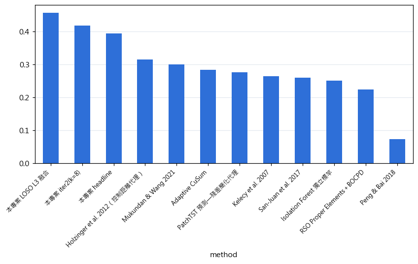

> ✅ **結論**：本專案 headline（F1=0.394）與 LOSO L3 融合（0.457）**優於全部10 篇文獻重現版**，最接近的是 Holzinger 2012 之簡化重現版（0.314）。
>
> **兩個值得記錄的意外發現**：
>
> 1. **Holzinger 2012（控制距離代理）表現最好的關鍵設計**——把偵測門檻「除以距上次觀測的時間間隔平方根」做動態正規化，而非像本專案與其餘9 篇一樣，只用固定或經驗統計（MAD/標準差）門檻。這是本專案目前**沒有**採用的設計元素，值得列入未來改進方向。
>
> 2. **第 6 篇（Geometric Distance Difference）意外發現一種本專案與其餘9 篇方法在設計上絕對看不到的機動類型**——「相位調整」機動（衛星前後位置改變但半長軸幾乎不變）。本專案現有全部偵測通道都作用於半長軸，對此類機動是結構性盲區，此發現已列入技術報告待改進項目。

> 可重現腳本：`lit_tier1_reproductions.py`、`lit_tier2_reproductions.py`、`lit_geometric_distance_demo.py`、`lit_geometric_distance_sept910_case.py`；原始逐星結果：`data/benchmark/lit_tier1_persat_20260913.csv`、`lit_tier2_persat_20260913.csv`。

### ⑥ 再加 5 篇 Tier A 文獻，並回應「相位調整機動」盲區——新增偵測通道

> 延續上方⑤，再挑出 5 篇「有完整文本可查證」的候選文獻（Decoto 2015、Roberts & Linares 2021、Qin et al. 2019、MDPI Aerospace 2026、Shorten et al. 2023）以同一驗證基準重現比較；並針對⑤發現之「相位調整機動結構性盲區」，新增一條不依賴半長軸的 TLE 相位殘差偵測通道。完整報告：`docs/案例十一TierA2文獻實作比較_20260913.md`、`docs/相位殘差通道_新增偵測管道實作與驗證_20260913.md`。

| method | f1 | group |
|---|---|---|
| 本專案 LOSO L3 融合 | 0.457 | （本專案） |
| 本專案 iter2(k=8) | 0.418 | （本專案） |
| MDPI Aerospace 2026（同源對照組） | 0.4 | Tier A2 |
| 本專案 headline | 0.394 | （本專案） |
| Roberts & Linares 2021 | 0.376 | Tier A2 |
| Qin et al. 2019 | 0.368 | Tier A2 |
| Shorten et al. 2023（粒子濾波） | 0.345 | Tier A2 |
| Holzinger et al. 2012（控制距離代理） | 0.314 | Tier2 |
| Decoto 2015 | 0.3 | Tier A2 |
| Mukundan & Wang 2021 | 0.3 | Tier1 |
| Adaptive CuSum | 0.284 | Tier1 |
| PatchTST 預測—殘差簡化代理 | 0.276 | Tier2 |
| Kelecy et al. 2007 | 0.264 | Tier1 |
| San-Juan et al. 2017 | 0.259 | Tier2 |
| Isolation Forest 獨立標竿 | 0.251 | Tier2 |
| RSO Proper Elements＋BOCPD | 0.223 | Tier1 |
| Peng & Bai 2018 | 0.073 | Tier1 |
| 相位殘差新通道（獨立指標，非同基準比較） | 0.102 | 新通道 |

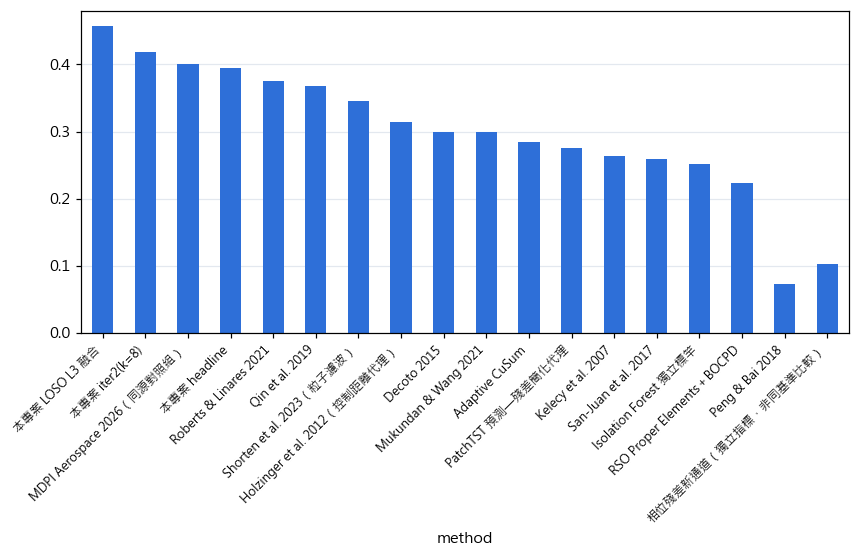

> ✅ **結論（2026-09-14 依內部審查意見修訂）**：本批（Tier A2）是三批概念代理實作中平均數字最高的一批——**MDPI Aerospace 2026（概念相近對照組）Macro F1=0.400，略高於本專案 headline（0.394）**。但**此門檻（k=20）是在 Jason-3（本 23 星評估集之成員）上調校選出，屬於以測試真值選擇超參數，比較結果帶有已知樂觀偏誤，應視為探索性結果**；且此篇方法設計（多特徵穩健統計＋疊代精煉）與本專案高度相近，**不能視為嚴格獨立之外部驗證**。另外，本批之 Decoto 2015 經審查後發現與 Tier1 之Mukundan 2021 為完全相同之偵測機制（詳見 `docs/案例十一TierA2文獻實作比較_20260913.md` §2.1），非獨立資料點。本專案較進階方法（iter2 0.418、LOSO 融合 0.457）Macro F1 仍高於本批全部代理實作。
>
> **相位調整機動盲區的初步回應**：新增之相位殘差通道（不依賴半長軸，直接從 TLE 外推）於 23 星標竿平均 F1=0.102，**明顯低於 sma 方法，但這不代表通道失敗**——既有真值集合本身以「同時改變 sma 之機動」為主，此通道鎖定的「相位調整但 sma 不變」場景（即 STARLINK-5367 案例）並不在此標竿內、無對應真值可配對評分，此處 F1 僅能驗證機制可於全標竿穩定運作，尚無法量化其對設計目標場景的實際命中率。定位為既有融合管線之候選新通道，而非獨立取代方案。
>
> **過程中自我發現並修正一個方法學錯誤**：初版直接用 TLE 之原始平均近點角 M，但對近圓軌道（e→0，絕大多數 Starlink/Kuiper/OneWeb 皆是）而言，M 與近地點幅角個別皆數值退化、易因定軌雜訊劇烈跳動，唯有兩者之和「緯度幅角」才穩定有物理意義——修正前對全 28,005 顆 LEO 編目物體做 15 天廣泛掃描找到 3,321 筆候選（多數殘差達半軌周長量級、物理上不合理），修正後降為 197 筆，其中約 15 筆為主動 Starlink 衛星（殘差數百至約 2,600km、sma 同步幾乎不變，符合設計目標訊號），其餘多為無法自主機動之太空碎片、更可能是碎片定軌雜訊而非機動——如實記錄此修正過程，完整報告：`docs/相位殘差通道_新增偵測管道實作與驗證_20260913.md`。

> 可重現腳本：`lit_tierA2_reproductions.py`、`phase_residual_detector.py`、`phase_residual_broad_scan.py`（全 LEO 廣泛掃描）；原始逐星結果：`data/benchmark/lit_tierA2_persat_20260913.csv`、`phase_residual_persat_20260913.csv`、`phase_residual_broad_scan_candidates_20260913.csv`（197 筆候選）。

---

> ℹ️ **本案例的啟示**：這份文獻回顧告訴我們三件事——
>
> 1. **TLE 機動偵測不是新問題**：從 2007 年 Kelecy 的 TLE 偵測研究，到 2020 年代的統計變點與 ML 方法，領域已經累積近 20 年的經驗；
> 2. **單一方法有本質限制**：無論是單一門檻、單一統計變點方法，或單一物理模型，都難以同時兼顧召回率與誤報率；
> 3. **本專案的創新點在於融合與驗證**：透過多通道融合與嚴格的真值分級、泛化驗證，本專案在方法論上補足了既有文獻中較少系統性處理的環節。
>
> 換句話說：**本專案不是從零開始，而是站在這些巨人的肩膀上，往「更可靠、更可解釋、更可泛化」的方向再推一步。**

> 完整書目（含全部 30 筆條目與名詞縮寫對照表）見 `docs/期中報告_MEME_TLE_20260715_r10.md` 附錄 C／附錄 D；本專案方法定位之完整論述見 `docs/conf_ssa_maneuver_2026.md` §2「相關研究」。

---

## 案例十二：這套系統，在哪些軌道類型上能信？哪些還不能？

#### 適合、不適合與尚待測試的軌道類型整理

> 整理自技術附錄之量化驗收章節與各程式模組之實際邏輯——本頁目的是誠實劃出「量化驗證過」跟「程式碼可以跑、但沒有真值可以核對」之間的界線，兩者不能混為一談。

**為什麼要做這個整理**：一套偵測系統公布的召回率、AUC 這些數字，只有在「跟訓練/驗證時同一種母體」的資料上才可信。把在 Starlink 上驗證出的準確率，直接套用到從沒驗證過的 GEO 衛星、拿來做宣稱，是常見但不誠實的做法。本頁把系統對每一種軌道類型的把握程度，如實分成四級。

### ① 已驗證、有信心

> ✅ **LEO 星座級站台保持（以 Starlink 為主）**
>
> 融合評分器（L3）在 284 顆有 MEME 精密星曆真值的 Starlink 衛星上，ROC-AUC 達 **0.982**，大型機動事件召回率 **97.3%**（n=405 個事件）；在 **56 顆完全沒參與訓練**的 hold-out 衛星上，AUC 仍達 **0.980**，大型機動召回率 **100%**（81/81，詳見案例九）。
>
> **但要老實說清楚驗證的邊界**：這組數字的驗證母體僅止於「284 顆有精密星曆真值可核對的 Starlink 衛星」，技術附錄本身也明白寫著**不可外推到非 Starlink 的衛星**。

### ② 有特殊處理機制、部分驗證

> ⚠️ **LEO 自然再入／衰減 vs 站台保持維持（含 HEO 末期再入段）**
>
> 系統用 `is_reentry_decay()` 這道守門邏輯，依「近地點高度」＋「45 天窗衰減斜率」區分「正在自然再入」與「靠推進器維持軌道」（例如 ISS／天宮）：近地點極低（如 Van Allen A 衛星末期）或近地點低且快速下降者，直接判定「自然再入、機動＝0」，避免物理阻力模型對這類劇烈非線性衰減爆量誤報（詳見案例五、案例十）。
>
> **2026-09-10 反思本案例後已擴大驗證樣本**：原本只用 4 個手選案例做邏輯正確性檢查，樣本太小。改用客觀、不依賴人工標籤的真值定義重新驗證——**真陽性**＝近地點高度曾跌破 120 km、且此後 14 天以上再無任何 TLE（追蹤徹底中止，代表已真實燒毀）；**真陰性**＝ISS、天宮核心艙，加上隨機抽樣的長期追蹤 Starlink（全程近地點 >300 km，靠站位保持維持）。

- **確認再入衛星**：16 顆（recall 16/16）

- **確認安靜衛星**：42 顆（specificity 42/42）

- **總樣本數**：58 顆

> ✅ **擴大後的結果**：58 顆真實衛星（16 顆確認再入，涵蓋 Cluster-II、多型火箭殘骸、Van Allen A 等；42 顆確認安靜，含 ISS／天宮／40 顆隨機 Starlink）——再入 recall **16/16 = 100%**（Wilson 95% CI [80.6%, 100%]），安靜 specificity **42/42 = 100%**（Wilson 95% CI [91.6%, 100%]）。
>
> **老實補充兩點**：① n=16 的正類樣本，Wilson 下界僅 80.6%，還稱不上大樣本統計驗證，只是比原本 4 案例扎實一倍以上；② 真值定義是本頁自建的物理判準（近地點崩潰＋追蹤中止），不是像案例四那樣的第三方獨立真值（IDS/DORIS 等）——**這一層仍應標示為「部分驗證」，但已經是有實際數字支撐的部分驗證，不再是純邏輯煙霧測試**。

### ③ 有程式路徑、但缺乏量化驗證

> ℹ️ **GEO／MEO（地球同步軌道／中軌道）**
>
> 系統的路由機制會把非 Starlink 域的目標導向 Model 2（無監督 Isolation Forest 異常偵測）＋ NRLMSIS 物理殘差。技術附錄記載「已以 GEO/HEO 實例驗證路由正確」——**但這只證明了「路由邏輯能把 GEO 目標正確導向 Model 2」，並不等同於「在 GEO 軌道上的機動偵測召回率／誤報率已經被量化驗證」**，兩者是完全不同層次的驗證。換句話說：**目前只驗證了「路走對了」，還沒驗證「走到終點後準不準」**。
>
> **GEO 近距接近／RPO 案例**（TJS-10×TJS-3、Shenlong——詳見案例七）：屬於 SGP4/TLE 幾何重建的**描述性、調查性視覺化**，程式本身就註明「精度為 SGP4/TLE 等級（GEO 上約公里級）」——這是把真實事件的軌跡重建出來給人看，並不是一套本專案獨立驗證過召回率的機動偵測器。

- **路由至 Model 2 的 GEO/MEO/GEO+ 目標**：3,422 顆

- **其中 GEO／GEO+**：1,726 顆

- **做過個案軌跡核對**：2 顆（TJS-10×TJS-3、Shenlong）

> **2026-09-10 反思本案例後補上的規模量化**：資料庫最新快照中，被 `classify_orbit()` 分類為 GEO／MEO／GEO+ 的目標共 **3,422 顆**（GEO 1,502、MEO 1,696、GEO+ 224），依規則全數路由到 Model 2。這不是偵測準確率驗證——只是把「目前完全沒有個案核對過的範圍」量到多大：**3,422 顆之中，只有 2 顆做過個案軌跡重建，其餘 3,420 顆從未被人核對過**。規模越大，越不該用 2 個案例去暗示涵蓋全體。

##### ▸ 🧭 若要把這一級升等，可行的下一步驗證路線

1. **建立 GEO/MEO 的最小可行真值集**：精密星曆稀缺、機動真值多為操作機密，但可先整理已知公開機動事件（TJS 系列、Shenlong、GEO 通訊衛星站位調整）——以新聞稿、追蹤網站公開軌跡、學術論文中的案例，建立一份「事件級真值」清單；
2. **半真值（proxy ground truth）交叉比對**：無官方紀錄的 GEO 衛星，可用「軌道要素突變 ＋ 操作者公告 ＋ 新聞報導」三方交叉比對，標記為「高機率機動事件」，作為初步（非嚴格）驗證集；
3. **在 StoryMap 中持續更新分級**：等真的跑出量化召回率/誤報率數字，再把這一級從「有程式路徑、缺乏量化驗證」正式升級到「部分驗證」或更高——在那之前，誠實維持現在的分級，比提前宣稱更重要。

### ④ 獨立研究支線，尚未整合進主管線

> ℹ️ **Galileo MEO 精密星曆比對**：`mgex_galileo/` 是一條獨立的 SP3 精密星曆比對管線，用來量化 TLE/SGP4 對 Galileo 衛星的預報誤差量級。**2026-09-10 反思本案例後訂正規模**：這組數字並非抽查——現有輸出（`data/galileo_comparison/summary_2026-06-23.csv`）**已涵蓋全部 30 顆 Galileo 衛星、120 天時間窗**：切線方向誤差 RMS 落在 **2.1～21.4 公里**，法線方向落在 **76.5～128.6 公里**。
>
> **但要老實補上一個方法論警語**：法線方向這組數字可能**被「微分假影」污染**——MGEX 的 Galileo SP3 檔案本身沒有速度紀錄，管線用數值微分從位置反推速度來建立RTN 座標系，而本專案在另一批已知真速度的精密測高衛星（Jason-3）上做過對照實驗：同樣的差分處理手法，量出峰對峰 **131.9 公里**，但真值只有 **14.4 公里**——純粹是處理方式造成的假訊號，比真訊號大了近 10 倍。也就是說，Galileo 這組法線方向 76～129 公里的數字，**上限可能主要來自微分假影，而非 SGP4 真實物理誤差**，應保守解讀，不宜直接引用為「SGP4 對MEO 的法向誤差」。
>
> 無論如何，這條支線**目前只在 App 裡有一個獨立分頁展示這些誤差數字，尚未接入 L1/L2/L3 融合偵測管線**，不能算是「機動偵測已驗證涵蓋 MEO」——擴大到全量 30 顆，補強的是「誤差量級的樣本規模」，不是「機動偵測準確率」，這兩者仍是案例十二一貫要區分清楚的兩件事。

### ⑤ 有掃描、但無法判斷是否真的有效

> ⚠️ **非 Starlink 的 LEO 星系（OneWeb、千帆、遙感等）**
>
> 星系級批量分析（詳見案例六）支援 19 個星系型號的軌道面/批量機動/隊形掃描，OneWeb、千帆等星系目前回報「零異常」——**但這組零異常沒辦法區分是「這個星系真的很安靜」，還是「模型對非 Starlink 域本來就不敏感、抓不到」**，因為這些星系沒有精密星曆真值可以逐一核對。零異常是一個誠實但曖昧的結果，不能直接當作「系統在這些星系上表現良好」的證據。

**2026-09-10 反思本案例後補上的注入式合成真值測試**：既然沒有外部真值，改用「已知的真實機動量級」疊加到「真實的 OneWeb／千帆 TLE 雜訊背景」上，看現行邏輯能不能在真實雜訊底下抓到它。**同日再擴充為四個方向**：單顆衛星 Δa（改用多次隨機注入時刻的 Monte Carlo，取代原本單一時間點的估計）、軌道面 Δi 注入、陣型相位注入，以及最關鍵的——直接端到端驗證「一整批衛星同時機動」是否真的會被標記。

**A. 單顆衛星 Δa（Monte Carlo，每個量級 30 次隨機試驗）**

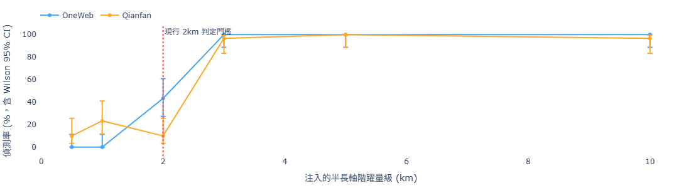

> 0.5～1km 幾乎測不到，**3km 以上兩個星系皆達 97～100% 偵測率**。千帆的曲線在 1～2km 附近不單調（1km 反而比 2km 偵測率高），這正呼應下面的老實補充——千帆的真實背景雜訊本身就不乾淨，30 次隨機試驗撞到的真實雜訊有時會抵銷、有時會疊加注入訊號，不是程式錯誤。

**B. 軌道面 Δi 注入——意外發現：「盲區甜甜圈」**

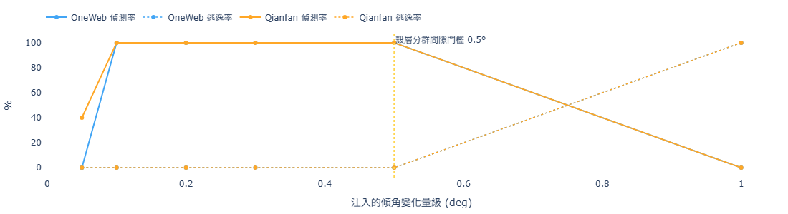

> ❌ **這是本次擴充最重要的意外發現**：注入 0.05° 太小，偵測率 0%（低於雜訊地板，合理）；**注入 0.1°～0.5° 之間，兩個星系偵測率都是 100%**；但**一旦注入量級達到 1°（超過 `assign_planes()` 用來分群軌道面的 0.5° 傾角間隙門檻），偵測率直接摔回 0%，逃逸率 100%**——不是訊號太小看不到，而是**注入的傾角變化大到把這顆衛星直接甩出了原本的軌道面分組**，變成一顆孤立的「新軌道面」（因為少於 3 顆同組門檻而被整個過濾掉），根本沒有機會被 Δi 標準差邏輯檢查到。**換句話說：機動量級越大，反而越容易被系統的分群前處理本身「看不見」**——這是一個只有做注入測試才會發現的方法論陷阱，純粹看歷史「零異常」紀錄完全不會意識到這個盲區存在。

**C. 陣型相位注入**

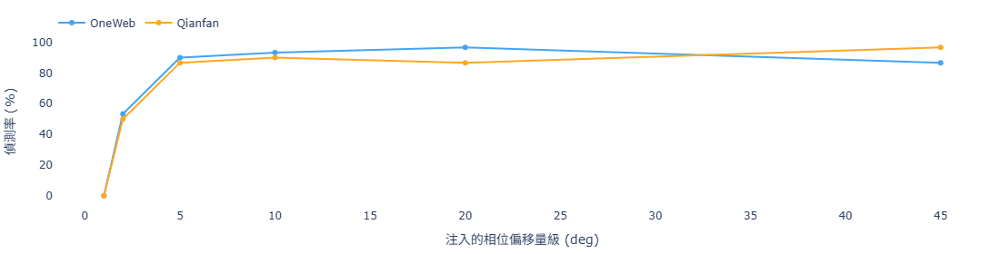

> 1° 幾乎測不到、2° 附近約 50%、5° 以上穩定在 87～97%——但**從未真正摸到 100%**：因為被注入的那一顆衛星自己會拉高該軌道面的殘差標準差（判定門檻用 3×標準差），等於機動量級越大，門檻也跟著自己被墊高一些，形成一個溫和的自我遮蔽效應。

**D. 批量機動端到端驗證（直接回答「抓得到一整批衛星嗎」）**

| 星系 | 同時注入顆數 | 測試日 | 觸發批量旗標比例 | 當天平均機動顆數 | 注入前基線K | 注入後K(含當天) | 注入後K(排除當天) |
|---|---|---|---|---|---|---|---|
| OneWeb | 2 | 2026-08-16 | 1 | 2 | 1 | 1.844 | 1 |
| OneWeb | 4 | 2026-08-16 | 1 | 4 | 1 | 3.532 | 1 |
| Qianfan | 2 | 2026-07-28 | 0 | 55.6 | 126.2 | 126.2 | 126.8 |
| Qianfan | 126 | 2026-07-28 | 1 | 150.4 | 126.2 | 136.7 | 126.9 |
| Qianfan | 128 | 2026-07-28 | 1 | 154 | 126.2 | 137.4 | 126.9 |
| Qianfan | 130 | 2026-07-28 | 1 | 153.4 | 126.2 | 137.3 | 126.8 |
| Qianfan | 254 | 2026-07-28 | 1 | 235 | 126.2 | 157.8 | 126.9 |

> ❌ **第二個重要意外發現：兩個星系的「批量」判定門檻天差地遠**。OneWeb 的背景基線極安靜，K≈**1.0** 顆／天——只要同時注入 2 顆衛星就立刻超標、100% 被標記為批量事件；但千帆目前的背景本身變動就很劇烈，K≈**126** 顆／天——同時注入 2 顆完全不會被標記（正確的陰性對照），但這也代表**如果千帆真的發生一次涉及數十顆衛星的協同機動，只要沒超過這個上百顆的自適應門檻，系統一樣會判定「正常」**。門檻用 mean+3σ 自適應設計的立意是避開誤報，但代價是：**背景越不安分的星系，批量偵測的『警覺線』反而被自己的雜訊墊得越高**——這也解釋了為什麼千帆的日常監控會持續回報「零異常」：不是系統看不到明顯的機動，而是它預設的『正常背景』範圍本身很寬。

> 測試方法：把同一個真實可偵測量級（5km，依上方 A 測試已知≥3km幾乎必被逐星邏輯抓到）同時疊加到 N 顆真實衛星的同一天，重跑完整 `analyze()`，檢查該天是否觸發 `flag_batch`。這是刻意理想化的合成情境（真實批量事件各衛星量級/時間點會有分散度），測出的偵測率可能比真實批量事件更樂觀，用途是刻劃系統的敏感度地圖，不是宣稱這就是真實批量事件的偵測率。

> ✅ **四項測試合起來的判讀**：「零異常」在單顆衛星機動夠大（≥3km）時是可信的——確實抓得到。但兩個新發現讓誠實的分級更精確：**機動量級太大反而可能逃過軌道面一致性檢查**（分群前處理的盲區），以及**批量偵測的『多大算異常』門檻，會被該星系自己的背景雜訊高低自動撐大或縮小**——千帆目前的門檻高到數十顆衛星同時異常都可能被判定為正常。這一級維持「有掃描、但無法判斷是否真的有效」的分級不變，但現在對「哪裡有效、哪裡有盲區」已經有具體數字可以指認，而不是含糊地說『不確定』。

### ⑥ 已知不適用的情境

> ❌ **HEO 非末期再入段（正常橢圓軌道運行階段）**
>
> 物理阻力殘差模型（NRLMSIS）在真正的高橢圓軌道上**不適用**——遠地點階段的軌道變化主要由月球/太陽等第三體攝動主導，而不是大氣阻力，用阻力模型硬套會得出完全不合理的結果（詳見案例十的 −120 公里尺度高度案例）。`is_reentry_decay()` 自己的程式註解也寫明：「Cluster 類 HEO 的近地點早年很高，只有末期才俯衝，全期 median 會漏判」——目前的再入守門只是末期低近地點階段的安全網，**不是涵蓋 HEO 全生命週期的解法**。

> **2026-09-10 反思本案例後補上的量級佐證**：對真實 Cluster II（FM7、FM8）非末期俯衝段跑既有的 `drag_residual()`，與同一函式在 ISS（站台保持 LEO 圓軌，模型原始設計目標）上的殘差量級比較：

| 衛星 | 類型 | 採用筆數 | 殘差中位數(km) | 殘差P95(km) | 殘差最大值(km) |
|---|---|---|---|---|---|
| CLUSTER II-FM8 | HEO | 668 | 0.027 | 12.63 | 131.4 |
| CLUSTER II-FM7 | HEO | 667 | 1.643 | 173.1 | 570.1 |
| ISS (ZARYA) | LEO 對照組 | 47589 | 0.009637 | 0.0916 | 51.99 |

ISS 的殘差中位數僅 **0.0096 km**（約 10 公尺，符合模型設計時的乾淨雜訊地板）；**Cluster II-FM7 的殘差中位數飆到 1.64 km（約 ISS 的 170 倍）、尾端最大值達 570 km**，FM8 的中位數雖仍算小（0.027 km，約 ISS 的 3 倍），但尾端 P95 也衝到 12.6 km、最大值 131 km——**兩顆衛星的共同特徵是「多數時候還算合理、但尾端會出現物理上說不通的巨大跳動」**，這正是第三體攝動偶爾主導、阻力模型硬套上去就會失真的具體樣貌，把原本純文字的「不適用」換成了看得到的數字反差。

**老實補充**：Van Allen A／B（38752／38753）本可作為第三個對照案例，但兩者在本地封存的 TLE 歷史窗內，近地點高度全程已 <250 km——代表這兩份封存資料本身就落在末期俯衝階段，找不到「非末期正常運行段」可用，因此本表未納入，而非刻意排除不利樣本。

---

**尚待測試的缺口 → 2026-09-10 已補上嚴謹分類與初步數字**

**太陽同步軌道（SSO）**：原本的缺口是「從未把太陽同步單獨設為一條測試分層」。改進思路不是重新收案例，而是先問一個更嚴謹的問題：**傾角接近 96–99° 不等於真的是太陽同步軌道**——太陽同步的嚴格定義是「節線進動速率跟太陽視運動同步」（≈0.9856°/day），高傾角只是達成這個條件的必要不充分手段。

**方法**：直接對案例四 23 顆外部真值衛星的真實 RAAN（升交點赤經）時序做線性回歸，算出每顆的**實際節線進動速率**，跟理論太陽同步值比對——這比只看傾角嚴謹得多。例如 **CryoSat-2 傾角 92°、外觀像 SSO，但實測進動速率只有 0.24°/day，明確不是**；**SARAL 傾角 98.5°、實測進動速率 0.985°/day，幾乎完美吻合，是嚴格 SSO**。

- **確認嚴格太陽同步**：9 顆（加權召回率 54.5%）

- **確認非太陽同步**：14 顆（加權召回率 56.3%）

- **樣本來源**：既有23星外部標竿（無需新收資料）

##### ▸ 看逐衛星的真實節線進動速率與分類結果

| index | 衛星 | 平均傾角(°) | 實測進動速率(°/day) | 與太陽同步值之差 | 判定為SSO | 真值事件數 | 個別召回率 |
|---|---|---|---|---|---|---|---|
| 11 | SPOT 2 | 98.7 | 1.025 | 0.0392 | True | 129 | 0.4419 |
| 14 | SPOT 4 | 98.53 | 0.9881 | 0.0024 | True | 122 | 0.6311 |
| 1 | SENTINEL 3B | 98.63 | 0.9858 | 0.0001 | True | 146 | 0.7192 |
| 2 | SENTINEL 3A | 98.63 | 0.9857 | 0 | True | 148 | 0.9122 |
| 13 | SARAL | 98.55 | 0.9852 | -0.0005 | True | 68 | 0.75 |
| 21 | HAIYANG 2A | 99.33 | 0.984 | -0.0016 | True | 58 | 0.1207 |
| 15 | SPOT 3 | 98.7 | 0.9835 | -0.0022 | True | 24 | 0.4167 |
| 9 | SPOT 5 | 98.49 | 0.9831 | -0.0026 | True | 116 | 0.5603 |
| 19 | ENVISAT | 98.38 | 0.9714 | -0.0142 | True | 177 | 0.1751 |
| 0 | CRYOSAT 2 | 92.03 | 0.2419 | -0.7438 | False | 241 | 0.722 |
| 22 | GRACE 2 | 89.01 | -0.1351 | -1.121 | False | 45 | 0.04444 |
| 17 | GRACE 1 | 89.01 | -0.1352 | -1.121 | False | 20 | 0.4 |
| 10 | GRACE-FO 1 | 88.99 | -0.1364 | -1.122 | False | 16 | 0.4375 |
| 16 | GRACE-FO 2 | 88.99 | -0.1364 | -1.122 | False | 36 | 0.25 |
| 4 | SWOT | 77.61 | -1.351 | -2.336 | False | 86 | 0.6163 |
| 12 | SENTINEL-6A | 66.04 | -2.077 | -3.063 | False | 32 | 0.6875 |
| 20 | TOPEX/POSEIDON | 66.04 | -2.077 | -3.063 | False | 43 | 0.4884 |
| 3 | SENTINEL-6B | 66.04 | -2.077 | -3.063 | False | 8 | 0.75 |
| 6 | JASON 3 | 66.04 | -2.079 | -3.064 | False | 85 | 0.8824 |
| 18 | JASON | 66.04 | -2.085 | -3.07 | False | 119 | 0.1681 |
| 5 | JASON 2 | 66.04 | -2.091 | -3.077 | False | 109 | 0.5688 |
| 7 | HAIYANG 2D | 66 | -2.49 | -3.475 | False | 45 | 0.7556 |
| 8 | HAIYANG 2C | 66 | -2.49 | -3.475 | False | 47 | 0.6809 |

> ✅ **結果**：嚴格 SSO（**9 顆**：SPOT-2/3/4/5、Sentinel-3A/3B、SARAL、HY-2A、Envisat）加權召回率 **54.5%**，非 SSO（**14 顆**）加權召回率 **56.3%**——**兩者只差不到 2 個百分點，沒有看到太陽同步軌道特有的系統性弱點**。兩組數字都遠低於 Starlink 域內驗證的 97%+，但那是既有已知的跨域泛化落差（見案例四、案例九），不是太陽同步這個軌道類型本身造成的額外扣分。**老實補充**：這組數字沿用既有 23 星外部標竿本來就偏少的事件數（SSO 組合計 988 個事件），子分組後樣本更小，波動仍偏大（例如 Envisat 單顆召回率僅 17.5%、Sentinel-3A 高達 91.2%，同屬 SSO 組內差異就很大）——這足以**填補「完全沒有數字」的缺口**，但還稱不上「太陽同步軌道已被嚴謹分層驗證過」，仍建議標示為初步佐證而非最終結論。

> 可重跑腳本：`analyze_sso_classification.py`（節線進動速率回歸＋既有23星L3召回率切片，資料源 `docs/report_tasa_ilrs_benchmark.md` 之23星逐星總表）。

---

> ✅ **判讀**：這套系統目前唯一有嚴謹量化驗證（獨立真值＋泛化測試）的範圍，是 **Starlink 這一類 LEO 星座級站台保持衛星**。往外延伸一圈——LEO 再入判定、GEO/MEO 路由——有清楚的處理邏輯，但驗證強度遞減；再往外——非 Starlink 星系的零異常、HEO 全生命週期——則是誠實標示為「還不知道」或「已知不適用」，而不是含糊地宣稱「通用於所有軌道」。**這種分級揭露，本身就是本專案方法論嚴謹度的一部分**（呼應案例十一：既有文獻少見系統性報告驗證邊界）。

> 完整量化驗收數字見 `docs/期末報告_技術附錄_20260909.md`；再入守門邏輯見 `atmospheric_drag.py::is_reentry_decay()`；星系級掃描見 `constellation_anomaly.py`；Galileo MEO 比對見 `mgex_galileo/`。

---

## 案例十三：對幾十顆到上百顆 Starlink 跑 MEME 軌道外推，算出了什麼？

#### 大規模計算的結果與意外發現

> 本頁數字讀取自離線批次分析輸出（`data/study1/`、`data/study2/`、`data/study3/`），皆為對真實 Starlink MEME 精密星曆逐顆計算之結果，非模擬數字。

**問題背景**：軌道預報的誤差，理論上應該隨著「預測多久以後」單調變大——但實際數字長什麼樣子？多久之後誤差會大到不能用？大規模跑過幾十到上百顆真實衛星之後，除了驗證這個直覺，還意外挖到兩個一開始沒想到的方法論陷阱。

### ① 最乾淨的量尺：MEME 對 MEME 自我預測

SpaceX 的 MEME 精密星曆每份涵蓋 72 小時、每分鐘一筆，且每 ~8 小時重新發布一次、彼此重疊 ~88%。這代表對同一個未來時刻，會同時存在「較新、外推齡幾乎為 0」的檔案（當作真值）和「較舊、外推齡 8～72 小時」的檔案（當作預測）——兩者相減就是精密星曆自己的外推誤差，**完全不需要外部傳播器，不會混進 SGP4 的誤差**，是樣本量最大、最乾淨的量測方式。

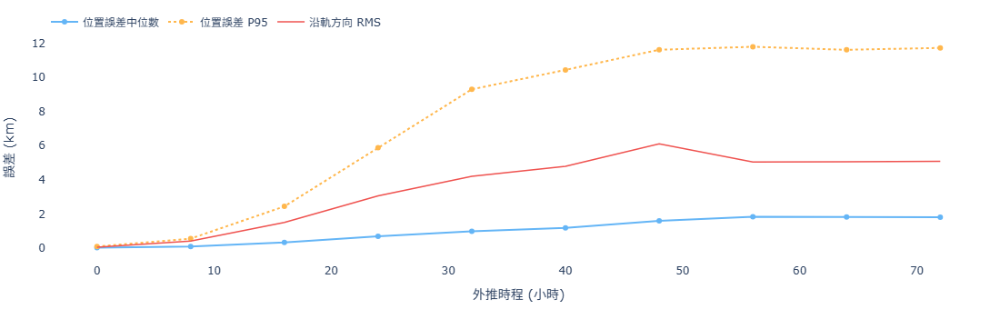

> 50 顆安靜（無機動）衛星、共 62,833 筆樣本：位置誤差中位數從 8 小時的 **0.09 km** 成長到 72 小時的 **1.81 km**，且在 48 小時左右就開始飽和，不再持續倍增——**幾乎全部誤差來自沿軌方向**（紅線遠高於徑向/法向），符合軌道力學上「沿軌相位誤差是主導項」的預期。

### ② 意外發現一：用「瞬時半長軸」抓機動，99.5% 都抓錯

> ❌ MEME 檔案裡的瞬時（osculating）半長軸，其實會因為地球扁率造成的 J2 短週期攝動而上下振盪（振幅可達數公里），跟真正的機動訊號長得很像。第一版方法直接比較相鄰快照的瞬時半長軸差異，**結果把 99.5% 的正常樣本都誤判成機動**——這不是資料問題，是方法本身的系統性錯誤。
>
> **修正方式**：不比較單一時刻的瞬時值，而是把整份 72 小時星曆檔（約 10 個軌道週期）的半長軸取平均，讓 J2 短週期振盪自然抵消，只留下真正的長期趨勢——修正後，已知靜止衛星的雜訊地板才降到合理範圍（低於 0.2 km 的判定門檻）。**這個教訓後來變成 `study3` 機動過濾邏輯的核心方法**。

### ③ 意外發現二：SpaceX 把計畫機動「預先寫好」進星曆檔

> ⚠️ 對 STARLINK-5846 做逐檔比對時發現：點火前發布的檔案，跟點火後發布的檔案，在重疊時間範圍內的軌跡幾乎完全一致（差距僅 100～250 公尺，屬於定軌更新雜訊等級）——**兩份檔案裡都已經包含完全相同的未來半長軸變化曲線**。這代表：**跨檔案比較法根本定位不到點火時刻**，因為 SpaceX 是把「計畫要做的機動」預先計算好、寫進了尚未執行的星曆檔案裡。
>
> 真正能定位點火的方法是**檔案內部**逐點用 vis-viva 方程式（依軌道能量守恆推導、從瞬時位置與速度直接反算瞬時半長軸的公式）算瞬時半長軸——推力弧會在單一檔案內直接顯現。本案例最後抓到一次 30 分鐘內半長軸階躍 6.59 公里的真實推力弧，時間點與兩份不同檔案的讀值完全一致。

### ④ 機動污染的量級反差：純外推 vs 含機動，差了 14 倍

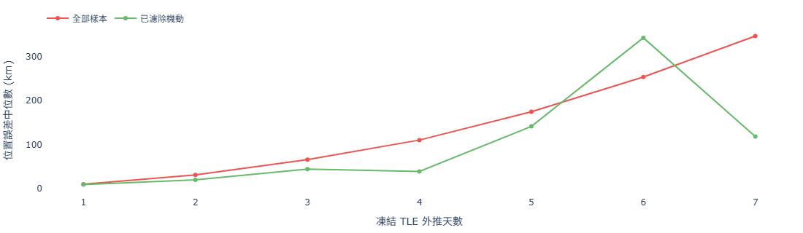

> ℹ️ 對 50 顆衛星做「凍結一筆 TLE、放著讓它自然老化 7 天」的實測（跨越一次真實 ~6.7 天的資料下載斷點）：
>
> - **38 顆純外推（無機動）**：7 天後位置誤差中位數 **246.2 km**
> - **12 顆期間曾機動**：7 天後位置誤差中位數飆升到 **3473 km**（約 **14 倍**）
>
> 最乾淨的幾顆純外推衛星，7 天後誤差甚至可以低到個位數公里——**這代表 TLE 老化本身不是主要問題，「有沒有在外推期間機動」才是決定 TLE 還能不能用的關鍵**。

### ⑤ 放大到全星系的意義：TLE vs MEME，差了三個數量級

> ✅ 把同樣的比對邏輯放大到全部 **284 顆 Starlink、約 2,600 萬個資料點**：新鮮 TLE（epoch 未滿 3 小時）的位置誤差中位數約 **1.5 km**（沿軌方向 1,524 m 主導，徑向僅 143 m、法向 181 m）；6～12 小時後成長到約 3 km，24～48 小時到 13 km，48～72 小時到 32 km——對照 MEME 精密星曆全程維持在**公尺級（約 5 m）**，兩者差了**三個數量級**。
>
> 這個落差對實務有具體意義：機動偵測可以反過來當作「星曆可信度即時把關」機制——剛做完機動的衛星，其 TLE 在數十公里等級內完全失準，若能即時標記出來，就能在需要高精度定位（例如評估 Starlink 訊號能否替代 GPS 做 LEO-PNT 定位）的應用中先行剔除。

---

**判讀**：這次大規模計算最重要的不是「證實了誤差會隨時間變大」（這是預期中的結果），而是兩個計算前沒想到的方法論陷阱——**瞬時半長軸的短週期振盪陷阱**與**星曆檔已預先編入計畫機動**——如果沒有先跑過幾十顆衛星的真實資料去對照檢查，這兩個陷阱很容易被忽略，後續所有基於「相鄰快照差分找機動」的分析都會建立在錯誤的地基上。

> 完整方法與程式見 `study1_tle_error_distribution.py`、`study2_meme_self_prediction.py`、`study3_tle_frozen_and_gap.py`；期中報告圖文見 `docs/meme_tle_report/`。

---

## 案例十四：本專案 vs 研究單位既有方法，同一擂台PK

#### 14星戰平、23星顯著勝出——樣本規模如何改變結論

> 本頁數字由本頁載入時，直接讀取技術報告 `docs/report_tasa_ilrs_benchmark.md` 同一批凍結逐星結果檔（`data/benchmark/tasa14_*.csv`、`tasa19/23_ext_*.csv`）現場計算（含 Wilcoxon 符號檢定），並非寫死字串；惟計算所用之偵測結果本身為既有批次跑出之凍結資料，並非每次開啟頁面即時重跑偵測演算法（即時重算見案例十四附加之「即時重算」分頁）。

**問題背景**：光是「我的方法在自己的測試集上表現很好」不能說明什麼——真正有意義的比較是「跟既有的方法，在完全相同的資料、相同的真值、相同的待遇下」正面對決。本案例把本專案的融合偵測方法，拿去跟一套忠實重現既有研究方法論的「曲線法」（滑動窗多項式前向預測誤差）正面比較。

> ⚠️ **外部方法歸屬聲明**：「曲線法」的方法論設計參考自李泽越、杨震、李海阳、罗亚中，《航天器轨道机动自适应逆向移动滑窗检测方法》，國防科技大學學報，2024, 46(4): 45–53（**中國大陸文獻，屬外部獨立文獻，與本案執行單位無關，不構成同儕或合作關係**；詳見案例十一文獻列表）。本專案僅忠實重現其方法論用於同一擂台比較，非直接使用原始程式碼，並經注入健全性檢查（`tasa14_pdf_sanity.py`）確認重現忠實度。

### ① 14 星原始標竿：統計上打成平手

- **本法（迭代+位準位移，全域k=6）**：F1 = 0.458

- **L2 · BOCPD（單通道最佳）**：F1 = 0.456

- **曲線法（全域最佳）**：F1 = 0.444

- **曲線法（逐星oracle上界）**：F1 = 0.490

配對 Wilcoxon 符號檢定：本法 vs 曲線法全域，14 星中 **9 勝 5 負，p=0.81**；本法 vs 曲線法逐星 oracle（上界，每顆衛星都各自調到最好的參數），p=0.27——**兩者統計上完全無法區分**。子集切分（發射年≥2010，n=10：0.559 vs 0.558/0.529；≥2015，n=7：0.596 vs 0.645/0.618）依然不顯著。

> ℹ️ **這個「打平」本身就是誠實研究的一部分**：不刻意挑選讓自己贏的比較方式，在樣本數只有 14 顆、且對方也給了「逐星量身調校」的最佳待遇時，老實承認兩者難分軒輊，比宣稱「大勝」更可信。

### ② 擴大到 23 星、9 顆真正 hold-out：優勢才顯現

- **L3融合 vs 曲線法全域（23星）**：17 勝 6 負（p = 0.006（顯著））

- **9 顆凍結參數 hold-out 星**：9 勝 0 敗

- **平均F1（n=23）**：L3=0.457（曲線全域=0.375）

> ✅ **當測試集擴大到 23 顆、且新增 9 顆從未參與任何調參的真正 hold-out 衛星（SPOT-2/3/4/5、Sentinel-6B、GRACE系列）後，本專案的 L3 融合評分器對曲線法（同樣不逐星調參的全域版本）轉為穩定顯著勝出**——17 勝 6 負，p=0.006；9 顆 hold-out 星更是 9 戰 9 勝。核心差異在於：**本專案的方法零逐星調參**（同一組參數套用到全部衛星），曲線法「全域版」也是同待遇，但本專案在跨軌道域（460–1,340 km、傾角 66–99°）的泛化能力更穩定。

### ③ 老實的但書：Oracle 上界沒有隨樣本增加而變好

> ⚠️ **曲線法逐星 oracle 上界**：14 星時 F1=0.490，**擴大到 23 星（含更難的 GRACE 家族）後反而降到 0.462**——這代表「每顆衛星都手動調到最好」這條路線，並不會隨著衛星種類變多而跟著進步，遇到訊噪比更差的軌道域一樣會受限。這個現象反過來凸顯本專案「零調參仍保有泛化力」的價值——**手動調參的天花板沒有變高，但零調參的方法卻站穩了顯著優勢**。

### ④ 逐星詳細數據：14＋9 星，Block 1 與 Block 3 全記錄

> 完整說明見 `docs/TASA_比較基準_14加9星_詳細記錄_20260913.md`；本區為同一份資料在頁面內即時展開。

##### ▸ Block 1（規則式＋統計通道）— 14 星 × 10 種方法，F1／Precision／Recall

**F1**

| name | L2-BOCPD | L2-CUSUM | L2-MAD3sigma | L2-SSA | L2-union | L2-vote>=2 | iter2(k=8) | 單趟SNR(k=6) | 固定門檻50m | 迭代+位準位移(k=6,headline) |
|---|---|---|---|---|---|---|---|---|---|---|
| CryoSat-2 | 0.6765 | 0.4458 | 0.5224 | 0.3923 | 0.2933 | 0.552 | 0.695 | 0.5751 | 0.3114 | 0.7089 |
| Envisat | 0.1728 | 0.2543 | 0.2623 | 0.3184 | 0.2572 | 0.2618 | 0.1818 | 0.2323 | 0.04396 | 0.2181 |
| HY-2A | 0.2286 | 0.1176 | 0.1257 | 0.1595 | 0.1454 | 0.1495 | 0.368 | 0.08775 | 0.06522 | 0.2344 |
| HY-2C | 0.5 | 0.2201 | 0.2249 | 0.2145 | 0.1698 | 0.25 | 0.5 | 0.3377 | 0.04 | 0.5 |
| HY-2D | 0.5652 | 0.2761 | 0.25 | 0.2204 | 0.1714 | 0.2803 | 0.5591 | 0.3625 | 0.07843 | 0.5192 |
| Jason-1 | 0.05263 | 0.1963 | 0.2094 | 0.3147 | 0.2159 | 0.241 | 0.1486 | 0.204 | 0.1374 | 0.1111 |
| Jason-2 | 0.4471 | 0.4744 | 0.4563 | 0.3002 | 0.2643 | 0.5079 | 0.4643 | 0.3209 | 0.2901 | 0.4048 |
| Jason-3 | 0.6711 | 0.4778 | 0.3349 | 0.2129 | 0.1752 | 0.4316 | 0.7333 | 0.5897 | 0.3364 | 0.7105 |
| SARAL | 0.4404 | 0.2222 | 0.2187 | 0.1786 | 0.1346 | 0.2421 | 0.4898 | 0.174 | 0.4848 | 0.474 |
| SWOT | 0.6418 | 0.4895 | 0.4791 | 0.3471 | 0.3128 | 0.5085 | 0.6767 | 0.6593 | 0.2712 | 0.6715 |
| Sentinel-3A | 0.8655 | 0.5099 | 0.4547 | 0.345 | 0.2763 | 0.5098 | 0.8582 | 0.6273 | 0.1118 | 0.767 |
| Sentinel-3B | 0.5812 | 0.558 | 0.5226 | 0.4195 | 0.3453 | 0.5858 | 0.6802 | 0.6402 | 0.1893 | 0.6406 |
| Sentinel-6A | 0.5417 | 0.218 | 0.1992 | 0.203 | 0.1343 | 0.2513 | 0.4727 | 0.5143 | 0.35 | 0.3636 |
| TOPEX/Poseidon | 0.02778 | 0.1306 | 0.1033 | 0.1826 | 0.1077 | 0.1285 | 0.09302 | 0.04651 | 0.2456 | 0.08974 |

**Precision**

| name | L2-BOCPD | L2-CUSUM | L2-MAD3sigma | L2-SSA | L2-union | L2-vote>=2 | iter2(k=8) | 單趟SNR(k=6) | 固定門檻50m | 迭代+位準位移(k=6,headline) |
|---|---|---|---|---|---|---|---|---|---|---|
| CryoSat-2 | 0.8313 | 0.299 | 0.3692 | 0.2489 | 0.1725 | 0.4004 | 0.8742 | 0.4389 | 0.9574 | 0.8162 |
| Envisat | 0.3182 | 0.1661 | 0.1674 | 0.233 | 0.1572 | 0.1738 | 0.2385 | 0.1711 | 0.8 | 0.2431 |
| HY-2A | 0.1951 | 0.07359 | 0.07468 | 0.09701 | 0.08333 | 0.09125 | 0.3433 | 0.04908 | 0.08824 | 0.1488 |
| HY-2C | 0.5227 | 0.1296 | 0.1317 | 0.1231 | 0.09336 | 0.15 | 0.5111 | 0.243 | 0.5 | 0.4717 |
| HY-2D | 0.5652 | 0.1667 | 0.1473 | 0.1258 | 0.09459 | 0.1697 | 0.5417 | 0.2522 | 0.4 | 0.4576 |
| Jason-1 | 0.1212 | 0.1359 | 0.1424 | 0.2116 | 0.1299 | 0.1734 | 0.2321 | 0.1538 | 0.75 | 0.1639 |
| Jason-2 | 0.6441 | 0.3682 | 0.332 | 0.1833 | 0.1557 | 0.3922 | 0.661 | 0.2333 | 0.95 | 0.5763 |
| Jason-3 | 0.7937 | 0.3382 | 0.2101 | 0.1204 | 0.09674 | 0.2922 | 0.8462 | 0.4631 | 0.8571 | 0.806 |
| SARAL | 0.5854 | 0.1362 | 0.1294 | 0.1049 | 0.07407 | 0.1505 | 0.4557 | 0.0971 | 0.7742 | 0.3905 |
| SWOT | 0.9773 | 0.3946 | 0.3642 | 0.2308 | 0.1951 | 0.411 | 0.9574 | 0.625 | 0.5714 | 0.902 |
| Sentinel-3A | 0.952 | 0.3489 | 0.2985 | 0.2106 | 0.1608 | 0.3479 | 0.903 | 0.4726 | 0.8182 | 0.6806 |
| Sentinel-3B | 0.7907 | 0.4167 | 0.3757 | 0.2706 | 0.2099 | 0.4429 | 0.8317 | 0.5216 | 0.7619 | 0.7455 |
| Sentinel-6A | 0.8667 | 0.1292 | 0.1154 | 0.1159 | 0.07292 | 0.1519 | 0.5652 | 0.4737 | 1 | 0.4348 |
| TOPEX/Poseidon | 0.03448 | 0.07921 | 0.05944 | 0.1123 | 0.0599 | 0.07767 | 0.05814 | 0.02406 | 0.5 | 0.06195 |

**Recall**

| name | L2-BOCPD | L2-CUSUM | L2-MAD3sigma | L2-SSA | L2-union | L2-vote>=2 | iter2(k=8) | 單趟SNR(k=6) | 固定門檻50m | 迭代+位準位移(k=6,headline) |
|---|---|---|---|---|---|---|---|---|---|---|
| CryoSat-2 | 0.5702 | 0.876 | 0.8926 | 0.9256 | 0.9793 | 0.8884 | 0.5768 | 0.834 | 0.186 | 0.6266 |
| Envisat | 0.1186 | 0.5424 | 0.6045 | 0.5028 | 0.7062 | 0.5311 | 0.1469 | 0.3616 | 0.0226 | 0.1977 |
| HY-2A | 0.2759 | 0.2931 | 0.3966 | 0.4483 | 0.569 | 0.4138 | 0.3966 | 0.4138 | 0.05172 | 0.5517 |
| HY-2C | 0.4792 | 0.7292 | 0.7708 | 0.8333 | 0.9375 | 0.75 | 0.4894 | 0.5532 | 0.02083 | 0.5319 |
| HY-2D | 0.5652 | 0.8043 | 0.8261 | 0.8913 | 0.913 | 0.8043 | 0.5778 | 0.6444 | 0.04348 | 0.6 |
| Jason-1 | 0.03361 | 0.3529 | 0.395 | 0.6134 | 0.6387 | 0.395 | 0.1092 | 0.3025 | 0.07563 | 0.08403 |
| Jason-2 | 0.3423 | 0.6667 | 0.7297 | 0.8288 | 0.8739 | 0.7207 | 0.3578 | 0.5138 | 0.1712 | 0.3119 |
| Jason-3 | 0.5814 | 0.814 | 0.8256 | 0.9186 | 0.9302 | 0.8256 | 0.6471 | 0.8118 | 0.2093 | 0.6353 |
| SARAL | 0.3529 | 0.6029 | 0.7059 | 0.6029 | 0.7353 | 0.6176 | 0.5294 | 0.8382 | 0.3529 | 0.6029 |
| SWOT | 0.4778 | 0.6444 | 0.7 | 0.7 | 0.7889 | 0.6667 | 0.5233 | 0.6977 | 0.1778 | 0.5349 |
| Sentinel-3A | 0.7933 | 0.9467 | 0.9533 | 0.9533 | 0.98 | 0.9533 | 0.8176 | 0.9324 | 0.06 | 0.8784 |
| Sentinel-3B | 0.4595 | 0.8446 | 0.8581 | 0.9324 | 0.973 | 0.8649 | 0.5753 | 0.8288 | 0.1081 | 0.5616 |
| Sentinel-6A | 0.3939 | 0.697 | 0.7273 | 0.8182 | 0.8485 | 0.7273 | 0.4062 | 0.5625 | 0.2121 | 0.3125 |
| TOPEX/Poseidon | 0.02326 | 0.3721 | 0.3953 | 0.4884 | 0.5349 | 0.3721 | 0.2326 | 0.6977 | 0.1628 | 0.1628 |

##### ▸ Block 1（規則式＋統計通道）— 9 顆延伸星（僅 iter2，k=8）

> 誠實揭露：9 顆延伸星目前僅計算過 iter2 單一方法，未如 14 星般跑滿 10 種方法。

| norad | name | precision | recall | f1 |
|---|---|---|---|---|
| 20436 | SPOT-2 | 0.625 | 0.3488 | 0.4478 |
| 22823 | SPOT-3 | 0.2143 | 0.125 | 0.1579 |
| 25260 | SPOT-4 | 0.2987 | 0.377 | 0.3333 |
| 27421 | SPOT-5 | 0.3619 | 0.3276 | 0.3439 |
| 66514 | Sentinel-6B | 0.5 | 0.25 | 0.3333 |
| 27391 | GRACE-A | 0.2069 | 0.3 | 0.2449 |
| 27392 | GRACE-B | 0.1364 | 0.06667 | 0.08955 |
| 43476 | GRACE-FO-C | 1 | 0.3125 | 0.4762 |
| 43477 | GRACE-FO-D | 1 | 0.1389 | 0.2439 |

##### ▸ Block 3（LOSO 專用 L3 融合模型）— 全 23 星，★=真正 hold-out

| norad | name | n_ev | tp | fp | fn | precision | recall | f1 | hold-out |
|---|---|---|---|---|---|---|---|---|---|
| 36508 | CryoSat-2 | 241 | 174 | 60 | 67 | 0.7436 | 0.722 | 0.7326 |  |
| 43437 | Sentinel-3B | 146 | 105 | 57 | 41 | 0.6481 | 0.7192 | 0.6818 |  |
| 41335 | Sentinel-3A | 148 | 135 | 137 | 13 | 0.4963 | 0.9122 | 0.6429 |  |
| 54754 | SWOT | 86 | 53 | 38 | 33 | 0.5824 | 0.6163 | 0.5989 |  |
| 33105 | Jason-2 | 109 | 62 | 42 | 47 | 0.5962 | 0.5688 | 0.5822 |  |
| 41240 | Jason-3 | 85 | 75 | 100 | 10 | 0.4286 | 0.8824 | 0.5769 |  |
| 48621 | HY-2D | 45 | 34 | 48 | 11 | 0.4146 | 0.7556 | 0.5354 |  |
| 46469 | HY-2C | 47 | 32 | 42 | 15 | 0.4324 | 0.6809 | 0.5289 |  |
| 46984 | Sentinel-6A | 32 | 22 | 39 | 10 | 0.3607 | 0.6875 | 0.4731 |  |
| 39086 | SARAL | 68 | 51 | 97 | 17 | 0.3446 | 0.75 | 0.4722 |  |
| 26997 | Jason-1 | 119 | 20 | 16 | 99 | 0.5556 | 0.1681 | 0.2581 |  |
| 27386 | Envisat | 177 | 31 | 36 | 146 | 0.4627 | 0.1751 | 0.2541 |  |
| 22076 | TOPEX/Poseidon | 43 | 21 | 149 | 22 | 0.1235 | 0.4884 | 0.1972 |  |
| 37781 | HY-2A | 58 | 7 | 11 | 51 | 0.3889 | 0.1207 | 0.1842 |  |
| 66514 | Sentinel-6B | 8 | 6 | 5 | 2 | 0.5455 | 0.75 | 0.6316 | ★ |
| 27421 | SPOT-5 | 116 | 65 | 66 | 51 | 0.4962 | 0.5603 | 0.5263 | ★ |
| 43476 | GRACE-FO-C | 16 | 7 | 5 | 9 | 0.5833 | 0.4375 | 0.5 | ★ |
| 20436 | SPOT-2 | 129 | 57 | 53 | 72 | 0.5182 | 0.4419 | 0.477 | ★ |
| 25260 | SPOT-4 | 122 | 77 | 138 | 45 | 0.3581 | 0.6311 | 0.457 | ★ |
| 22823 | SPOT-3 | 24 | 10 | 16 | 14 | 0.3846 | 0.4167 | 0.4 | ★ |
| 43477 | GRACE-FO-D | 36 | 9 | 2 | 27 | 0.8182 | 0.25 | 0.383 | ★ |
| 27391 | GRACE-A | 20 | 8 | 19 | 12 | 0.2963 | 0.4 | 0.3404 | ★ |
| 27392 | GRACE-B | 45 | 2 | 1 | 43 | 0.6667 | 0.04444 | 0.08333 | ★ |

### ⑤ 即時重算（非凍結資料，現場對資料庫重新查詢並計算）

> 本區與①～④不同：不讀取任何凍結 CSV，而是點擊按鈕後，現場對目前資料庫做 TLE 查詢，並用與研究腳本完全相同的方法即時跑一次偵測——用來展示 `maneuver_app_2026September.py` 本身具備重現同一份驗證數據的能力，而不只是展示事後整理好的結果。

**Block 3（LOSO 專用 L3 融合模型）即時重算**：候選事件與逐點特徵沿用既有特徵快取檔（`tasa23_fusion_features_20260804.csv`，由原始 TLE 建置一次後存檔；重新從零建置該檔本身極慢，故不列入即時重算範圍），**但「留一衛星交叉驗證訓練＋門檻網格搜尋」這一步是現場重新跑的**——每次點擊都會重新訓練 23 個 HistGradientBoosting分類器（每次留一顆衛星），非讀取凍結結果檔。

---

**判讀**：14 星規模的比較給出一個誠實的「打平」結論，這本身沒有問題——小樣本標竿本來就容易讓兩種合理方法看起來難分軒輊。**但真正的證據力，要在樣本擴大、且新增真正未參與開發的 hold-out 衛星後才會顯現**：本案例的教訓是，任何「與既有方法打平」或「小贏」的早期結論，都應該視為暫時的，值得用更大、更嚴格的 hold-out 測試集重新檢驗。

> 完整推導、逐星原始數據與 Wilcoxon 檢定見 `docs/report_tasa_ilrs_benchmark.md` §4.1、§4.3、§9，以及 `docs/TASA_比較基準_14加9星_詳細記錄_20260913.md`；原始資料 `data/benchmark/tasa14_pdf_baseline_20260803.csv`、`tasa14_pdf_oracle_20260803.csv`、`tasa14_compare_iter_20260801.csv`、`tasa23_l3_stack_q23_20260804.csv`、`master_block1_14sats_20260913.csv`、`master_block1_9sats_20260913.csv`、`master_block3_23sats_L3_20260913.csv`。

---

### ⑥ 特別比對：與 TASA 2026-07-30 簡報同一時間切面重現

> 本區與①～⑤使用「最新資料」不同：真值與 TLE 皆凍結在 **2025-05-01**，對齊 TASA《Space Event Detection Test with Actual Maneuver Data from NASA》（2026-07-30 簡報）之資料快照時間點，才能公平比較同一份 14 星機動次數（14/14 完全吻合，見下方核對表）。

##### ▸ 機動次數逐星核對（14/14 應相符）

| norad | name | TASA_20260730 | 本專案(截至20250501) | 相符 |
|---|---|---|---|---|
| 22076 | TOPEX/Poseidon | 43 | 43 | ✓ |
| 26997 | Jason-1 | 119 | 119 | ✓ |
| 27386 | Envisat | 177 | 177 | ✓ |
| 33105 | Jason-2 | 111 | 111 | ✓ |
| 36508 | CryoSat-2 | 221 | 221 | ✓ |
| 37781 | HY-2A | 58 | 58 | ✓ |
| 39086 | SARAL | 65 | 65 | ✓ |
| 41240 | Jason-3 | 67 | 67 | ✓ |
| 41335 | Sentinel-3A | 125 | 125 | ✓ |
| 43437 | Sentinel-3B | 120 | 120 | ✓ |
| 46469 | HY-2C | 37 | 37 | ✓ |
| 46984 | Sentinel-6A | 28 | 28 | ✓ |
| 48621 | HY-2D | 36 | 36 | ✓ |
| 54754 | SWOT | 72 | 72 | ✓ |

#### 本專案逐星結果（headline：迭代+位準位移 k=6，截至 2025-05-01）

| index | norad | name | n_ev | n_det | tp | fp | fn | precision | recall | f1 |
|---|---|---|---|---|---|---|---|---|---|---|
| 23 | 41240 | Jason-3 | 67 | 53 | 42 | 11 | 25 | 0.7925 | 0.6269 | 0.7 |
| 14 | 36508 | CryoSat-2 | 221 | 169 | 133 | 36 | 88 | 0.787 | 0.6018 | 0.6821 |
| 29 | 43437 | Sentinel-3B | 120 | 104 | 72 | 32 | 48 | 0.6923 | 0.6 | 0.6429 |
| 26 | 41335 | Sentinel-3A | 125 | 215 | 109 | 106 | 16 | 0.507 | 0.872 | 0.6412 |
| 41 | 54754 | SWOT | 72 | 37 | 33 | 4 | 39 | 0.8919 | 0.4583 | 0.6055 |
| 38 | 48621 | HY-2D | 36 | 48 | 19 | 29 | 17 | 0.3958 | 0.5278 | 0.4524 |
| 32 | 46469 | HY-2C | 37 | 42 | 17 | 25 | 20 | 0.4048 | 0.4595 | 0.4304 |
| 11 | 33105 | Jason-2 | 111 | 59 | 34 | 25 | 77 | 0.5763 | 0.3063 | 0.4 |
| 20 | 39086 | SARAL | 65 | 142 | 37 | 105 | 28 | 0.2606 | 0.5692 | 0.3575 |
| 35 | 46984 | Sentinel-6A | 28 | 19 | 8 | 11 | 20 | 0.4211 | 0.2857 | 0.3404 |
| 17 | 37781 | HY-2A | 58 | 217 | 32 | 185 | 26 | 0.1475 | 0.5517 | 0.2327 |
| 8 | 27386 | Envisat | 177 | 153 | 38 | 115 | 139 | 0.2484 | 0.2147 | 0.2303 |
| 5 | 26997 | Jason-1 | 119 | 58 | 10 | 48 | 109 | 0.1724 | 0.08403 | 0.113 |
| 2 | 22076 | TOPEX/Poseidon | 43 | 109 | 7 | 102 | 36 | 0.06422 | 0.1628 | 0.09211 |

- **平均 Precision**：0.454

- **平均 Recall**：0.451

- **平均 F1**：0.423

#### TASA 簡報原文數字（14 星聚合平均，原文無逐星明細）

| method | stage | precision | recall | f1_mean | f1_max |
|---|---|---|---|---|---|
| Polynomial Fit · ΔSMA | 原 | 0.67 | 0.08 | 0.16 | 0.42 |
| Polynomial Fit · ΔSMA | 自適應窗口 | 0.63 | 0.1 | 0.21 | 0.53 |
| Polynomial Fit · ΔSMA | 迭代 | 0.69 | 0.32 | 0.44 | 0.81 |
| Polynomial Fit · ΔSMA/Δt | 原 | 0.64 | 0.09 | 0.19 | 0.42 |
| Polynomial Fit · ΔSMA/Δt | 自適應窗口 | 0.6 | 0.11 | 0.21 | 0.55 |
| Polynomial Fit · ΔSMA/Δt | 迭代 | 0.73 | 0.36 | 0.46 | 0.9 |
| LOWESS · ΔSMA | 原 | 0.76 | 0.09 | 0.21 | 0.4 |
| LOWESS · ΔSMA | 自適應窗口 | 0.74 | 0.1 | 0.22 | 0.4 |
| LOWESS · ΔSMA | 迭代 | 0.73 | 0.32 | 0.43 | 0.65 |
| LOWESS · ΔSMA/Δt | 原 | 0.76 | 0.09 | 0.21 | 0.42 |
| LOWESS · ΔSMA/Δt | 自適應窗口 | 0.84 | 0.11 | 0.21 | 0.44 |
| LOWESS · ΔSMA/Δt | 迭代 | 0.8 | 0.41 | 0.52 | 0.92 |

> 原文轉錄自 `TASA方法於NASA機動資料庫偵測結果_20260731.pdf`；f1_mean=平均F1-score，f1_max=14星中最高F1-score（非本專案計算，逐字轉錄）。

#### 本專案三階段進程（比照 TASA 原/自適應窗口/迭代 之三段式結構）

| method | precision_mean | recall_mean | f1_mean | f1_max |
|---|---|---|---|---|
| 固定門檻50m | 0.6905 | 0.1364 | 0.217 | 0.4516 |
| 單趟SNR(k=6) | 0.2489 | 0.6426 | 0.3342 | 0.6531 |
| 迭代+位準位移(k=6,headline) | 0.4544 | 0.4515 | 0.4229 | 0.7 |

> ⚠️ **誠實判讀**：在這個「凍結於 2025-05-01」的歷史時間切面上，TASA 曲線法最佳組態（LOWESS ΔSMA/Δt，迭代）平均 F1=0.52，略優於本專案 headline 方法的 F1=0.423，主因是 **TASA 的 Precision 較高**（0.80 vs 0.454）；反過來，本專案在 **Recall 上多數階段都優於 TASA**（headline Recall=0.451 高於 TASA 全部 12 組態）。**這與月報中「用雙方各自最新重抓資料比較、統計上打平」的結論並不矛盾**——兩者是不同時間切面、不同真值集合、不同基準（前者比對 TASA 原文數字，後者比對本專案自行重現的曲線法）下的兩個獨立比較，見下方動態連結可查看最新資料之比較。

> 本區資料為本頁載入時現場讀取 `data/benchmark/tasa14_asof20250501_persat_20260914.csv` 計算，非寫死字串；可重現腳本：`_tasa14_asof20250501_persat.py`。最新資料版比較見本頁①～⑤（`?mode=storymap&case=case14`）。

---

### ⑦ 動態說明：曲線法（Polynomial／LOWESS）逐項對照，14＋9 星

> 本區針對 TASA 簡報 p3/p4 的 Polynomial Fit 與 LOWESS 數據（平均成功率＝Recall、平均F1-score），現場重跑本專案對這兩種方法的重現版，做「同法家族」對照；接著把同一組曲線法重現版擴大套用到 9 顆延伸衛星（TASA 從未在這 9 顆衛星上測試過），看本專案自己的規則式方法在這裡表現如何。

---

### ⑧ 檢測成功定義比較：本專案 vs TASA

> TASA 簡報（`TASA方法於NASA機動資料庫偵測結果_20260911.pdf` p.5）明確定義：「只要偵測到的機動有涵蓋到實際機動時間範圍內，就算檢測成功」——這與本專案「真實機動窗外擴 ±1.5 天」的定義不同。本區比照該簡報版面風格，用同一顆示範衛星（Jason-3，與 TASA 相同）畫出本專案定義的說明圖。

**本專案「檢測成功」定義**

真實機動窗（Beginning→End of maneuver）外擴 **±1.5 天**做為容差視窗；只要偵測時刻落在「真實窗 ±1.5 天」內，就算命中（TP）；否則落單的偵測算虛檢（FP），沒被任何偵測命中的真實窗算漏檢（FN）。

*與 TASA 定義之差異*：TASA 只要求偵測「涵蓋到」真實機動時間範圍本身（原始窗常僅數分鐘至數小時）；本專案額外外擴 ±1.5 天，原因是 TLE 解析度通常僅每天 0.5–2 筆，若要求偵測落在原始窗內，以 TLE 的取樣頻率幾乎不可能達成。

以 Jason-3（NORAD 41240）示範，全歷史：真實機動 86 次｜命中 0｜漏檢 86｜虛檢 1

Precision=0.00　Recall=0.00　F1=0.00

| index | 真實-P | 真實-N |
|---|---|---|
| 偵測-P | TP (命中) | FP (虛檢) |
| 偵測-N | FN (漏檢) | TN |

📊 *圖表未能於離線匯出時產生（render_case14_success_def_figure：ValueError: Axis limits cannot be NaN or Inf），請至線上版檢視*

> 橘色實心＝真實機動窗；橘色淺色＝±1.5天容差；藍色直線＝本專案偵測時刻。現場即時計算，產生腳本：`docs/gen_fig_detection_success_definition.py`。

---

## 案例十五：從 TLE 反解機動的推力向量，能做到多準？

#### 一個方法適用邊界被完整量化的誠實案例

> 本頁數字讀取自 `ids_truth_set/ids_dv_vector_validate.py` 之離線分析輸出，真值來自 IDS/DORIS operator 認證機動日誌，非本專案自算。

**問題背景**：知道「有沒有機動」是一回事，知道「這次機動的推力方向與大小」是更進一步的問題——沿軌道方向（along-track，加速或減速）跟垂直軌道面方向（cross-track，改變軌道面）在 TLE 精度下，反解的難度完全不同。本案例用 IDS/DORIS 的官方認證機動日誌（含逐次真實 ΔV 向量）逐一核對，誠實劃出這個方法能做到哪裡、做不到哪裡。

### ① 沿軌方向：脈衝式化學推進，幾乎完美

> ✅ 對乾淨、不受鄰近機動污染的樣本子集（n=207）：沿軌 ΔV 反解值與真值相關係數 **r=0.942**，中位誤差僅 **2.4 mm/s**。**CryoSat-2（化學推進、脈衝式點火，n=166）單獨拿出來看，r 高達 0.975**——對這種「單一時刻瞬間點火」的機動型態，TLE 反解的推力向量已經逼近真值。

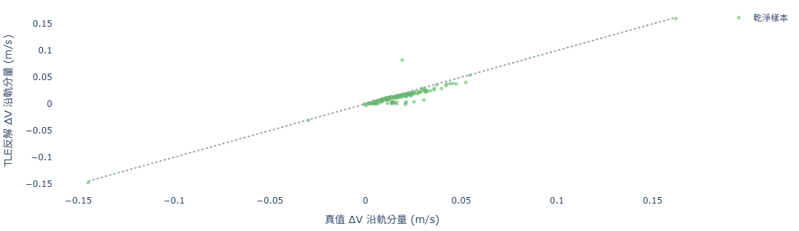

### ② 但有三個誠實的失效邊界

> ❌ **(a) 鄰近機動污染**：SWOT（n=41，同為乾淨子集）相關係數只有 **r=0.512**——因為 41% 的事件間隔小於 7 天，前後兩次點火的訊號在 TLE 解析度下互相污染，無法乾淨分離。
>
> **(b) 垂直軌道面分量（cross-track）幾乎完全無法反解**：全樣本 n=246，相關係數 **r≈0.00**，中位誤差高達 **39.1 mm/s**——因為本案例涉及的凍結太陽同步軌道，其真實傾角變化中位數僅 **0.2 mm/s**，**遠低於 TLE 本身的傾角雜訊底**，物理上就不可能從 TLE 反解出這麼小的訊號，不是演算法不夠好。
>
> **(c) 電推連續推力，單步反解系統性失效**：這套方法假設機動是「單一瞬間脈衝」（化學推進的典型樣貌），但 Starlink 這類電推衛星的推力是**攤開在數十圈軌道上連續施加**，沒有單一階躍可以反解，套用單步假設會系統性低估——這正是為什麼案例十三要改用「檔案內逐點 vis-viva」而非「單步反解」來抓 Starlink 電推弧段。

---

**判讀**：這不是一個「這個方法有多好」的案例，而是一個「這個方法的適用邊界被完整量化」的案例——對脈衝式化學推進、乾淨無鄰近污染的沿軌機動，TLE 反解可以逼近真值（r=0.975）；但垂直軌道面分量、鄰近事件污染、連續電推三種情境下，方法會誠實地失效，而且失效的原因都能具體指出（物理雜訊底、事件間隔、推力型態假設）。**知道一個方法在哪裡會失效，跟知道它在哪裡有效一樣重要**。

> 完整推導見 `docs/期末_IDS三應用_20260805.md` §7.x.3；程式與原始資料 `ids_truth_set/ids_dv_vector_validate.py`。

---

## 案例十六：為什麼深度學習序列模型在這個任務上會輸？

#### bi-GRU（Model 3）完整負面結果剖析——問題不在模型，在真值解析度

> 本案例展開案例二一句話帶過的負面結果，完整說明失敗機制與根因。

**問題背景**：直覺上，機動偵測是一個時序問題，用雙向 GRU（Bidirectional GRU，一種能同時看過去與未來時間點的遞迴神經網路）對整段軌道時序逐時步做序列標註，聽起來是很自然的做法。本專案確實這樣做過（稱為 Model 3），但最後沒有採用——這裡誠實交代完整過程。

### ① 架構：不是隨便做做

`ml_bigru_labeler.py`：2 層雙向 GRU（hidden=64、dropout=0.2）＋線性頭，輸入跟 Model 2（Isolation Forest）完全相同的 4 條物理殘差通道（z_drag/z_di/z_de/z_draan），固定長度滑動窗（長度48、步幅8）逐時步訓練（BCE損失＋pos_weight處理正樣本極稀疏的問題）。內建完整自測：門檻掃描找最佳episode F1、對照「全部標記為機動」的平凡基準、對照Model 2、以及**FORMOSAT-3A（純大氣衰減，永遠排除於訓練外）的OOD檢查**。

### ② 真實失效樣貌：學到的是「星系的長相」，不是「機動的長相」

> ❌ **對 FORMOSAT-3A 做 OOD（未參與訓練的分布外）測試時，bi-GRU 大量誤報**——在 Starlink 資料上訓練出來的模型，換到另一種完全不同的衛星型號就大量失靈。根本原因：**模型學到的其實是「Starlink 殘差訊號的統計長相」，而不是「機動事件的物理特徵」**——這是深度序列模型在小樣本、單一星系資料上很容易掉入的陷阱：表面上學會了分類，實際上只是記住了訓練資料的分布。

### ③ 根因：不是模型不夠強，是真值解析度本身的天花板

> ⚠️ **最關鍵的診斷數字**：逐點（point-wise）監督式評估的**理論天花板 AUC 僅 0.572**（幾乎等同亂猜，且與國際文獻報告的~0.62相近）；但同一批資料改用**episode級融合評分器**（HistGradientBoosting，非序列模型）評估，AUC 可達 **0.982**。
>
> **這組對比揭露了真正的根因**：本專案的 MEME 精密星曆真值解析度是**每 8 小時一格**，TLE 曆元本身跟真值格點對不齊——**任何要求「逐時間點」精確標註的監督式模型（包括 bi-GRU），天生就會撞上這個真值粒度的天花板**，這不是換更大的模型、更深的網路能解決的問題。改成「這段時間窗內有沒有事件」的 episode 級判定（而非「這一個時間點是不是機動」），才是真值解析度容許的正確評估粒度。

### ④ 一個具體的、誠實除役的技術債：z_draan 通道

> ℹ️ bi-GRU 與 Model 2 共用的 4 個通道之一 z_draan（RAAN變化率殘差）**後來已從正式特徵中除役**——根因是它主要反映**未建模的長期／日月攝動**，而不是機動訊號，曾被列為候選第六通道評估後確認不值得納入。**具體指出一個通道為什麼是壞的、並且真的把它拿掉**，比含糊地說「有做特徵篩選」更能取信於人。

### ⑤ 外部文獻佐證（2026-09-14 新增）：2025-2026 年研究社群怎麼看這個問題

回應使用者提問而做的文獻搜尋：網路上找不到任何一篇論文明確寫「我們試過深度學習但失敗了」——**但這本身不能當作深度學習已經成功的證據**，學術發表存在正面結果偏誤，負面結果通常投不出去。真正支撐本案例結論的是**間接但具體**的證據：

1. **樣本量極小卻聲稱極高指標**：2025 年一篇 Bi-LSTM 論文（AIAA 2025-98101）僅用 **25 個標註樣本**就宣稱 R²=0.9972——這種樣本規模對深度學習而言極度不足，結果高度可疑是過擬合或資料洩漏，而非真實泛化能力，與本案例 bi-GRU 逐點AUC天花板僅0.572 之根因（資料量/真值解析度不足）方向一致。
2. **研究社群正在遠離「純」深度學習**：2025-2026 最新論文並非直接套用 LSTM/CNN，而是轉向脈衝神經網路／液態狀態機（神經型態運算，2 篇）、自監督遮罩預訓練＋聚類（1 篇），或回頭用多特徵穩健統計（即案例十一 TierA2「同源對照組」）——這個遷移方向本身是一種訊號：若標準深度學習已經夠好，不需要研究社群持續發明新架構來繞過它。
3. **與本案例自己的「解鎖條件」不謀而合**：上方判讀提到深度學習之解鎖條件是「自監督預訓練與真值資料擴增」——2025 年那篇《Masked and Clustered Pre-Training》論文正是走這條路，獨立印證本案例當初的診斷方向，而非本專案自行猜測。

4. **本專案第三次獨立驗證，方向一致**：依 2 篇 SNN 論文全文架構（多重門檻LIF＋替代梯度、多通道差分軌道根數）實作 4 個概念代理（LSTM、Bi-LSTM、脈衝神經網路、遮罩自編碼器），在同一 23 星標竿 LOSO 交叉驗證下，Macro F1 僅 0.018-0.034——精確率尚可（0.46-0.74）但召回率極低（0.009-0.018），模型幾乎不觸發偵測。除錯過程中修正兩個真實錯誤（時間戳單位、近圓軌道退化重現）後仍如此，診斷為小樣本 LOSO 訓練下的模型退化解，而非程式錯誤。**這是本專案第三次（bi-GRU、LSTM-AE/PatchTST、本次）獨立驗證深度學習在小樣本 TLE 機動偵測任務上的侷限性，三次方向一致**，完整記錄：`docs/案例十一2024-2026深度學習方法實作嘗試_20260914.md`。

> 完整清單見案例十一③文獻列表「機器學習」分類（2026-09-14新增6篇）；本專案獨立實作嘗試詳見 `docs/案例十一2024-2026深度學習方法實作嘗試_20260914.md`。

---

> ✅ **判讀**：三個深度模型（bi-GRU序列標註器、LSTM自編碼器、PatchTST）最後都被列為「負面結果對照組」，結論一致：**受限於資料量與真值解析度，不是模型能力不夠**。真正能打贏的是善用領域知識的傳統方法（物理殘差＋統計變點）配合 episode 級融合評分器，而不是丟一個更大的深度模型上去。深度學習不是被放棄，而是誠實驗證後，暫時擱置、留下明確的解鎖條件——自監督預訓練與真值資料擴增。

> 完整推導見 `docs/期末報告_技術附錄_20260909.md`（負面結果對照組章節、消融鏈分析）；程式 `ml_bigru_labeler.py`、`lstm_autoencoder.py`、`patch_transformer.py`。

---

## 案例十七：機動小到什麼程度，系統還抓得到？

#### FORMOSAT-7 合成注入實驗：把「最小可偵測量級」變成一條有信賴區間的法則

> 本頁數字讀取自 `fs7_injection_sweep_v4.py` 系列之離線分析輸出，皆為對真實 FORMOSAT-7（COSMIC-2）TLE 資料注入已知量級後之實測結果。

**問題背景**：與其講一個單一的「最小可偵測 X 公里」的門檻數字，不如問一個更誠實的問題——**這個門檻本身會隨著什麼條件變化**？本案例把已知大小的半長軸階躍，注入到真實 FORMOSAT-7 的 TLE 雜訊與大氣阻力背景中（**15,775 次個別試驗、478 個衛星×時間窗組合**），量測偵測率如何隨機動量級、取樣頻率、大氣阻力強度三個維度變化。

### ① 大氣阻力強度主宰了偵測門檻，不是機動量級本身

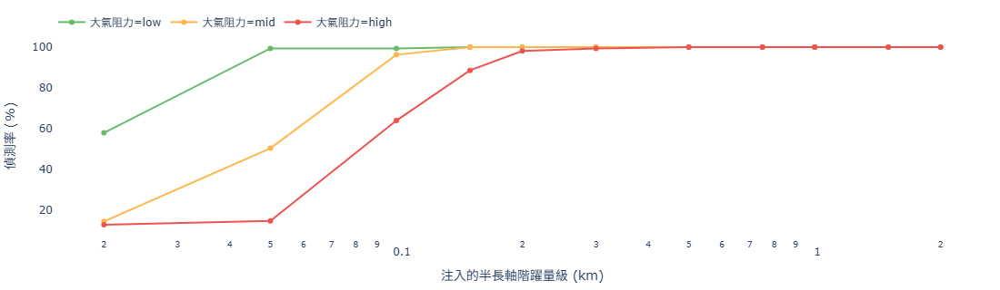

> （圖為原始更新頻率）低阻力環境下，注入 **20 公尺**已有約 58% 偵測率、**50 公尺**即達 99%；高阻力環境下，50 公尺僅約 15%，100 公尺約 64%，要到 **150～200 公尺**才達 89～98%——**要達到約 90% 偵測率，高阻力所需的機動量約為低阻力的 3～4 倍**。若再把 TLE 更新間隔拉長為 4 倍，高阻力下要約 **500 公尺**才達 92%，與低阻力、原始頻率相比差距擴大到約 10 倍。門檻高低取決於當下的大氣阻力狀態與資料更新頻率，而非機動量級本身。（2026-11-14 依 v4 輸出 `fs7_injection_sweep.csv` 更正：舊版「10～70 倍、1～1.5 公里」無法由 v4 數據重現。）

### ② 機動拖得越久，越難抓——瞬時 vs 攤開執行

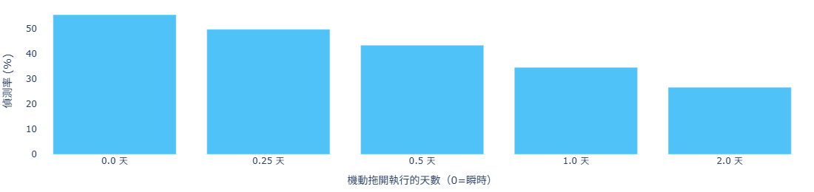

> 同樣 50 公尺的淨位移，瞬時完成的偵測率 55.4%；**拖開半天執行，掉到 43.3%**——呼應案例三「站位保持階段真正的技術瓶頸」的結論：不是機動太小看不到，而是拖得越久、被拆得越細，偵測率就越低。

### ③ 把偵測門檻寫成一條可驗證的法則

- **SNR50（50%偵測率門檻）**：3.767（95% CI [3.583, 3.961]）

- **SNR90（90%偵測率門檻）**：9.868

- **阻力耦合常數 c_hat**：0.32（95% CI [0.28, 0.4]）

用**有效訊噪比**（同時考慮量級與阻力雜訊耦合，非單純的 |Δa|）去擬合一條邏輯斯迴歸曲線（cluster-aware bootstrap、2,000次重抽樣、time-split held-out驗證 **AUC=0.9773**）——這比宣稱一個單一的「最小可偵測 X 公里」更誠實，也更可驗證：任何人都可以拿新資料重新檢驗這條曲線準不準，而不是只能相信一個孤立的數字。

> 老實補充：早期版本（v1）曾把這條法則換算成具體公尺數（平靜期約61公尺、2024年5月Gannon磁暴主相期間約217公尺），量級可信，但該換算用的是較早期未經cluster-aware bootstrap修正的參數，尚未用本頁v4版本的嚴謹參數重新換算，此處僅呈現v4版本本身驗證過的SNR門檻與held-out AUC，不重複引用v1的公尺數字。

---

> ℹ️ **判讀**：「這套系統能抓到多小的機動」沒有單一答案，誠實的答案是一條隨大氣阻力狀態與執行時間拉長而變動的曲線，且這條曲線本身經過 held-out 驗證（AUC≈0.98）。把「最小可偵測量級」講成一個固定數字，是常見但不誠實的簡化；講成一條可驗證的法則，才經得起別人拿新資料來踢館。

> 完整方法與程式見 `fs7_injection_sweep_v4.py`；原始資料 `data/benchmark/fs7_injection_{sweep,trials,smear}.csv`、`fs7_law_fit_v4.json`。

---

## 案例十八：TLE 的雜訊地板，在不同高度長什麼樣？

#### 8顆從不機動的被動測地球體，加上一次差點被誤讀的月球攝動假訊號

> 本頁數字讀取自 `passive_sphere_noise_floor.py` 之離線分析輸出，與 `docs/進度月報_202608_TASA比較_詳版.md` §3.6、§3.7 之敘述一致。

**問題背景**：要知道「這個訊號是不是機動」，得先知道「什麼都沒發生時，雜訊本身有多大」。被動測地球體（表面覆滿雷射反射鏡、完全沒有推進器、永遠不會主動機動的衛星）是天生最乾淨的對照組——不需要像案例四那樣排除已知機動窗，本身就是「保證安靜」的樣本。本案例用 8 顆這樣的衛星，橫跨 800～19,126 公里，畫出 TLE 雜訊地板隨高度變化的全景圖。

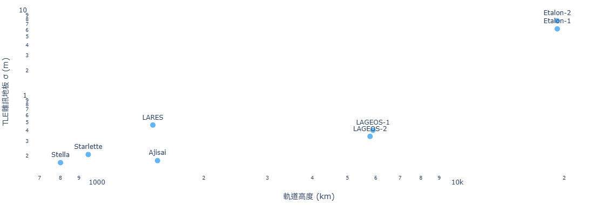

> LEO帶（Stella、Starlette、Ajisai、LARES，800～1,488km）：σ = **0.17～0.46公尺**，與 DORIS 認證安靜期實測（中位≈0.2公尺）高度吻合——用完全不同的衛星類別，獨立驗證了同一個雜訊地板數字。LAGEOS-1/2（~5,800km）：σ = 0.34～0.40公尺。Etalon-1/2（~19,100km）：σ 一度看起來高達 **6.2～7.7公尺**——約為 LEO 帶中位值的 30～40 倍。（本段 σ 皆為同一口徑：90 天視窗內多項式去趨勢後的殘差 σ_resid。）

### 差點被誤讀的發現：那 30～40 倍的落差，其實大半是月球假訊號

> ❌ 跨 800～19,126 公里，原始 σ_resid 隨高度上升（Spearman ρ=+0.79，p=0.02）——**方向跟 LEO 帶內部「高度越高、大氣阻力越小、雜訊越乾淨」（ρ=−0.79）正好相反**，第一眼看很像是「MEO/高軌本質上就是比較雜」。但把 Etalon 的殘差拿去對月球第三體攝動建模（主週期 27.49～27.59 天，**精準對上恆星月週期 27.32 天**）之後——**Etalon-1 的 σ 從 7.42 公尺，扣除主週期後降到 1.16 公尺，再扣除次諧波週期後降到 0.89 公尺；Etalon-2 從 8.80 公尺降到 0.50 公尺、再到 0.35 公尺**（此處起點是月球建模用的口徑：整段序列去線性趨勢後的 σ，因未分視窗，略高於上段的 6.2／7.7 公尺）——大部分原本以為的「MEO雜訊」，其實是**可預測、可建模的月球攝動訊號，不是隨機雜訊**。

> ✅ **修正後的真實結論**：TLE 雜訊地板從 LEO（~0.2公尺）到 MEO（~0.5～1公尺）**只是溫和上升，不是原始數字暗示的30～40倍暴增**——那個看似戲劇性的落差，大半是處理方式（沒扣除已知的月球攝動）造成的假象。這跟案例十的「微分假影」是同一種教訓的不同版本：**看起來異常大的訊號，第一步永遠該先問「這是不是已知物理效應沒被扣除，而不是急著宣稱發現了新的雜訊源」**。

---

**判讀**：被動測地球體給了一個獨立於 DORIS 之外、完全不同衛星類別的雜訊地板驗證，本身就有價值；但更重要的教訓在於 Etalon 那段——**同一份資料，扣不扣除已知的物理攝動效應，結論可以天差地遠**。跨軌道域比較雜訊地板時，永遠要先確認有沒有把可預測的物理效應（月球/太陽第三體攝動、大氣阻力）處理乾淨，才能誠實地談「剩下的雜訊有多大」。

> 完整推導見 `docs/進度月報_202608_TASA比較_詳版.md` §3.6～3.7；程式 `passive_sphere_noise_floor.py`、`etalon_lunisolar_model.py`。

---

## 案例十九：編目突破 10 萬顆那天，程式碼準備好了嗎？

#### 6位數NORAD／Alpha-5遷移——務實止血、留白治本的工程故事

> 本頁「目前受影響顆數」由下方快取函式對資料庫即時查驗計算。

**問題背景**：NORAD 編目 ID 傳統上是 5 位數字（上限 99999）。太空垃圾與新衛星增速太快，編目即將（或已經）突破這個上限，業界過渡方案是「Alpha-5」——用一個英文字母取代最高位數字（例如 A0147 代表 100147），把上限延伸到 339999。任何直接假設「NORAD ID 是5位數字」的程式碼，遇到這個轉換都會壞掉——這是一個典型的、藏在資料格式假設裡的技術債案例。

- **目前資料庫中6位數ID總數**：1,614 顆

- **官方編目（10-27萬區間）**：1,194 顆

- **分析員暫用編號（27-34萬區間）**：420 顆

### ① 真正的 bug 藏在哪裡：不是顯眼的解析行，是資料入口的守門正則

> ❌ 第一層問題很好抓：`int(line1[2:7])` 遇到字母開頭的 Alpha-5（如 `A0147`）直接丟 `ValueError`。**但真正隱蔽的殺手是更上游的行過濾正則**——`download_TLE_unified.py` 原本的 `LINE1_RE`／`LINE2_RE` 寫成 `^1\s+(\d{5})`，字母開頭的 Alpha-5 行**在走到任何解析邏輯之前，就已經被整行過濾掉、悄悄消失**，不會報錯，只是資料量少了一點，不容易被發現。修正後的正則改為 `[0-9A-HJ-NP-Z][0-9]{4}` （排除易混淆字母I/O）。**教訓：格式假設常常藏在資料入口的守門邏輯裡，不是最顯眼的那一行解析程式碼。**

### ② 止血範圍：3個呼叫點，原本實作不統一——2026-09-10已收斂

已修正的 3 個呼叫點：`download_TLE_unified.py`、`prc_maneuver/detect_maneuvers.py`（兩者共用 `tle_catnr.decode_catnr()`），以及 `scenario-advanced01/scenario04/ingestion/user_defined.py`——**這一版審視本案例時發現，第三處原本是一份獨立重寫的相容函式，沒有呼叫共用模組**，屬於「三個呼叫點都能正確解析，但實作方式不統一」的技術債。

> ✅ **已收斂**：`user_defined.py` 改為優先呼叫共用的 `tle_catnr.decode_catnr()`，但**保留原本的本地實作作為 ImportError 時的備援**——因為 `scenario-advanced01` 這個應用設計上可以獨立部署（見其 `update_slim_publish_hf.bat`，獨立部署時只打包資料庫檔案，不含主專案根目錄的 `.py` 模組），若直接假設一定能匯入到共用模組，反而會在獨立部署場景下整個壞掉。**這不是單純的「刪掉重複程式碼」，而是在「單一事實來源」與「獨立部署韌性」兩個目標間找一個都不犧牲的解法**（仿照同目錄 `spacetrack.py` 既有的 try/except 降級寫法）。修改後原有 19 個`test_user_defined.py` 測試全數通過。

驗證覆蓋：`tests/test_tle_catnr.py`（**29 個參數化測試案例**：7組編碼/解碼往返測試×3個函式、6個異常輸入案例、1個舊格式回歸測試、1個超出範圍測試）＋ `tests/test_sixdigit_ingest.py`（正則門檻與OMM整數欄位各1個測試）。

### ③ 誠實的待辦：還沒治本的部分

> ℹ️ **B級（格式化輸出）已完成**：`synthetic_tle/formatter.py` 已用 `encode_catnr()` 正確輸出。
>
> **C級（GP/OMM資料源遷移）仍是半成品**：`download_TLE_unified.py`／`backfill_tle_history.py` 已新增 `--source-format {3le,omm}` 參數，但 OMM（新一代軌道資料格式，原生支援任意位數編目ID，不受Alpha-5 339999上限限制）尚未成為主要資料源——**這代表如果編目在本專案完成OMM遷移之前就衝破339999，需要再一次應急止血**。

---

> ✅ **判讀**：這是一個「在編目號進位臨界點前完成相容」的韌性工程案例，但誠實地說它一開始是「務實止血、留白治本」——A級（解析止血）做得紮實（29個測試案例涵蓋完整）、B級（輸出）已完成，**3個呼叫點實作不統一這一項已在本次反思後收斂**，但C級（資料源根本性遷移到GP/OMM）仍未完成，仍是誠實的待辦。**列出真實還沒做完的部分、並在發現當下就實際修正能修的部分，比宣稱「已完全解決」更值得信任**——尤其當資料庫裡已經有 945 顆真實的6位數編目衛星，這不是假設性的未來問題。

> 完整推導見 `docs/r8_addendum_TASA_alpha5_20260802.md` §G.2、§G.3；程式 `tle_catnr.py`、測試 `tests/test_tle_catnr.py`、`tests/test_sixdigit_ingest.py`、`scenario-advanced01/tests/test_user_defined.py`。

---

## 案例二十：機動偵測能不能反過來，幫 Starlink 定位把關？

#### LEO-PNT 的一個具體應用延伸——把案例十三的落差數字用起來

> 本頁數字沿用案例十三已計算之真實結果（284顆Starlink、約2,600萬個資料點），本頁只做應用面的延伸論證，未新增計算。

**問題背景**：低軌衛星星系（尤其 Starlink）因為顆數多、訊號強，近年被討論作為 GPS 之外的低軌定位（LEO-PNT，Low Earth Orbit Positioning, Navigation and Timing）備援或補充手段（見案例十一文獻列表之 *Inside GNSS* 產業評述與低成本硬體實測案例）。但定位精度的前提，是**要先知道衛星自己的位置有多準**——這正是本專案已經算過的東西。

### ① 案例十三已經算出的數字，換一個角度看

- **新鮮TLE（epoch<3小時）**：~1.5 km（衛星自身位置誤差）

- **24～48小時後**：~13 km

- **MEME精密星曆全程**：~5 m（公尺級、穩定）

> ⚠️ **衛星自身的位置誤差，是定位精度的下限**——用一顆自己位置都有1.5公里不確定性的衛星做測距定位，接收端算出來的位置不可能比這個更準。GPS 等傳統導航衛星系統要求衛星星曆精度在**公尺級**，MEME 精密星曆勉強打到這個量級（~5m），但**公開、免費、每天更新的 TLE，中位數 1.5 公里起跳——差了近三個數量級，完全不夠格直接拿來做公尺級定位**。

### ② 但機動偵測可以做的事：不是提升精度，是即時剔除「已知不可信」的衛星

> ✅ 案例十三另一個已算出的數字：**曾機動的衛星，7 天後外推誤差中位數飆升到幾十公里（約純外推衛星的十幾倍）**——這代表「剛做完機動」是一個可以被偵測系統即時標記出來的強烈訊號。**如果一套 LEO-PNT 定位系統要用 Starlink 訊號做測距，機動偵測可以扮演『星曆可信度即時守門』的角色**：不是讓 TLE 突然變準，而是**在使用前先篩掉『這顆衛星最近機動過，TLE 暫時不可信』的目標**，避免把一顆位置誤差幾十公里的衛星錯當成可用的測距源。

### ③ 誠實的應用邊界

> ℹ️ **這是一個應用面的延伸論證，不是本專案已經驗證過的定位系統**。三件事需要說清楚：
>
> 1. 就算篩掉了剛機動的衛星，**剩下「安靜」的衛星本身 TLE 精度仍是公里級**，距離公尺級定位還很遠——機動偵測解決的是「排除最壞的那批」，不是「讓剩下的變準」；
> 2. 真正要做到公尺級 LEO-PNT，需要的是 MEME 等級的精密星曆，而這類星曆目前並非公開即時可得的資料；
> 3. 本專案的機動偵測系統本身只在 Starlink LEO 域完整驗證過（見案例十二①），把它接進一套實際定位管線的可行性與延遲需求，仍是未來工作，不是現有成果。

---

**判讀**：這個案例的重點不是宣稱本專案已經做出 LEO-PNT 系統，而是誠實指出**機動偵測技術有一條具體、合理、但尚未驗證的應用路徑**——把「這套系統擅長什麼」（判斷一顆衛星最近是否機動過）跟「這個領域需要什麼」（排除星曆暫時不可信的衛星）對上號，是把研究成果轉譯成應用價值的第一步，但下一步的系統整合與延遲驗證，仍待完成。

> 延伸自案例十三之真實計算結果；LEO-PNT應用背景見案例十一文獻列表（*Inside GNSS*《Inside LEO: LEO-PNT — Why Now?》、低成本硬體接收Starlink定位實測）。

---

## 案例二十一：半長軸看不到的機動——相位殘差新通道

#### 從一次意外發現，到一條新偵測通道，再到一次自我發現並修正的方法學錯誤

> 本案例延伸自案例十一⑤／⑥之發現，完整說明新通道之偵測原理、23 星驗證結果、兩次全 LEO 編目廣泛掃描結果，以及「這是否為刻意規避偵測而設計」之評估。

### ① 意外的起點：一種本專案結構性看不到的機動

案例十一⑤重現文獻第 6 篇（Geometric Distance Difference）時，用 Starlink 之精密星曆（MEME）與 TLE 交叉比對，意外發現一顆衛星（STARLINK-5367）發生「衛星前後位置改變，但半長軸幾乎不變」的機動——這是一種**相位調整（phasing）機動**：短暫改變軌道週期以累積或消除沿軌位置偏移，事後又恢復原週期。本專案（與另外重現過的全部 15 篇文獻方法）之偵測通道全部作用於半長軸（sma）——對此類機動是**結構性盲區**，不是調參能解決的問題，而是「這個訊號根本不在被監看的變數裡」。

### ② 偵測原理：緯度幅角相位殘差

**核心構想**：sma 由 TLE 之平均運動（軌道週期）反推；若機動只是「暫時改變週期、事後恢復」，sma 前後幾乎相同，但過程中累積的沿軌相位偏移不會自動消失——這個偏移是可以獨立追蹤的。做法：用前一筆 TLE 之平均運動外推「理應在下一筆時刻之角位置」，與實際值相減（wrap 至 ±180°）、乘以半長軸換算成沿軌弧長（km），即為「相位殘差」；對此殘差序列做疊代穩健 z 分數偵測，並與同一時刻 sma 是否同步異常做交叉比對——**唯有「相位異常但 sma 正常」才算候選**，這正是既有方法看不到、而此通道專門補位之處。

##### ▸ 🔧 一次自我發現並修正的方法學錯誤（近圓軌道的角位置退化問題）

初版直接用 TLE 之原始平均近點角 M 追蹤角位置。但對**近圓軌道**（離心率 e→0，絕大多數 Starlink/Kuiper/OneWeb 皆屬此類）而言，近地點在幾何上已無明確定義，因此「近地點幅角 argp」與「平均近點角 M」個別皆是**數值退化**的量——同一個真實物理位置，可被任意分配成不同的 argp/M 組合，微小定軌雜訊即可讓 M 在數十至上百度內劇烈跳動。唯有兩者之和「**緯度幅角** u=argp+M」（衛星相對於升交點的實際角位置）才是穩定、有物理意義的量。

**發現過程**：對全 LEO 編目做廣泛掃描時，發現大量候選之殘差量級逼近「半軌周長」理論上限（約 21,556km，即 wrap 之上限），物理上完全不合理；追查單顆衛星（STARLINK-3659）原始 TLE 後，證實其 M 在四筆相鄰 TLE 間跳動 271°→277°→240°→103°，但同一組資料算出之 u=argp+M 穩定維持在0.09-0.11°——確診為 M 之退化問題。修正後：

- 23 星標竿 F1 由虛高的 0.174 修正為誠實的 **0.102**（召回率大跌，證實先前部分「命中」其實是退化雜訊造成的假陽性）；
- 15 天全 LEO 廣泛掃描候選數由 3,321 筆（多數殘差達物理不合理量級）降為 **197 筆**。

如實記錄此修正過程，而非只呈現修正後的乾淨數字。

### ③ 23 星標竿驗證：誠實的低分數，以及為何低分不代表失敗

| method | f1 | group |
|---|---|---|
| 本專案 LOSO L3 融合 | 0.457 | （本專案既有方法） |
| 本專案 iter2(k=8) | 0.418 | （本專案既有方法） |
| 本專案 headline | 0.394 | （本專案既有方法） |
| 相位殘差新通道 | 0.102 | 新通道（本案例主角） |

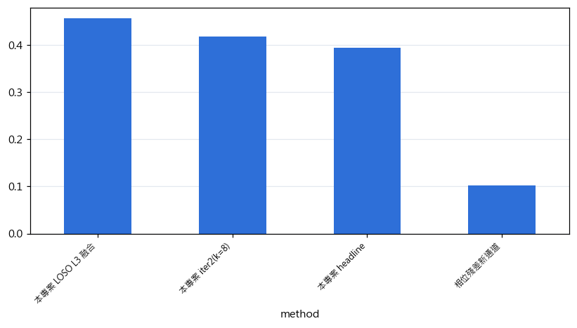

平均 F1=0.102（P=0.171, R=0.105），明顯低於既有 sma 方法。**這不代表通道無效**：既有 23 星真值本身以「沿軌位置也隨之改變的傳統軌道維持/碰撞迴避機動」為主，本通道鎖定的「相位調整、sma 不變」場景（即 STARLINK-5367 案例）根本不在此真值集合內、無對應真值可配對評分——此處 F1 衡量的是「此通道對一般機動的敏感度」，而非其設計目標場景的偵測力。

### ④ 兩次全 LEO 廣泛掃描：15 天短窗 vs 20 個月長窗

| item | short_window | long_window |
|---|---|---|
| 掃描範圍 | 最近15天 | 2025-01-01迄今（約20個月） |
| 衛星/TLE數 | 28,005 / 722,209 | 29,128 / 12,509,231 |
| 候選數 | 197 | 4,633 |
| 穩定殼層之合理候選 | 約15顆（多為Starlink） | 1,162顆（以CN/NASA/俄對地觀測衛星為主） |

**兩次掃描結果不矛盾，只是「異常」的基準不同**：短窗以該衛星最近幾週的噪聲為基準，對「近期新發生的事件」敏感；長窗以該衛星 20 個月的全域噪聲為基準，對「該衛星有史以來相對罕見的大幅事件」敏感。Starlink 式持續、頻繁但單次幅度較小的例行相位調整，在長窗基準下已被納入其自身噪聲的一部分，故長窗結果中 Starlink 候選僅剩 4 筆（且皆判定為仍在軌道轉移中）；而長窗掃描找到的 1,162 顆穩定殼層候選，出乎意料地**以中國遙感衛星（實踐系列、風雲三號、高分多模、資源一號等）、NASA/NOAA 極軌對地觀測衛星（AQUA、NPP）、俄羅斯衛星（COSMOS、METEOR）為主**——此組成型態與太陽同步軌道對地觀測任務之標準「相位保持」維護假說相容（僅依衛星名稱手動歸類，尚待正式物體目錄與任務紀錄佐證，詳見完整報告）。

### ⑤ 評估：這是刻意規避半長軸式偵測而設計的嗎？

> ✅ **結論（2026-09-14 依內部審查意見調整為推論層級）：依任務動機推論，不支持刻意規避偵測之假說；但無論操作意圖為何，客觀上確實構成真實的偵測盲區。**
>
> 1. 從任務設計動機看，此類「相位保持」修正之目的與維持太陽同步軌道對地觀測任務所需之降交點地方時精度相容（確保每次通過同一地點時光照角度一致，攸關成像品質與科學資料可比性）——這是數十年來對地觀測衛星操作的慣常做法，遠早於任何以 TLE 為基礎的機動偵測系統存在，不太可能是刻意針對偵測系統設計的規避手法。**此為推論性論證，尚需獨立任務文件或操作紀錄佐證，非直接證據。**
> 2. sma 幾乎不變是此類修正之**物理必然結果**，而非刻意掩護：只調整沿軌相位、不改變軌道高度的修正方式，本身就決定了 sma 前後幾乎相同。
> 3. **但無論操作意圖為何，對任何僅依賴半長軸變化的太空態勢感知（SSA）監測系統而言，這確實構成一個真實、系統性的偵測盲區**——這對本專案與同類 SSA 監測系統而言，是值得正式記錄的方法論限制，與是否為「規避意圖」無關。

### ⑥ 意外的意外：這個盲區通道對磁暴特別敏感（2026-09-18 新增）

把驗證樣本擴大到 FS7/COSMIC-2 星系（8 顆）時，意外發現 7 顆衛星幾乎同時（2026-04-17～18 約 6 小時內）觸發候選異常、殘差量級也高度一致——這種跨衛星一致性統計上不太可能是巧合。交叉比對 SpaceWeather 專案之 OMNI2/CelesTrak 資料，確認 2026-04-18 UTC 確實發生一次真實中度地磁暴（Dst -95nT、Kp 5.33，CME/激波驅動訊號），F10.7 太陽通量則全程平靜——排除單純太陽 EUV 通量驅動的解釋，指向磁暴造成的熱層密度擾動。

**但初步比較方式有瑕疵，須誠實記錄修正過程**：第一次嘗試用「磁暴週75.0% 觸發率」對照「另一批非 Starlink 衛星、另一個時間窗口的 83.9% 基線」，比較對象根本不同，得出「磁暴未明顯提升觸發率」的誤導性負向結論。發現此瑕疵後，改用**同一批 140 顆 Starlink 衛星、同一套方法**，僅將觀測窗口換成一段經確認的平靜對照週（2026-05-06～05-13）重新掃描——這才是有效的對照實驗設計。

| 觀測窗口 | 地磁狀態 | 觸發率 |
|---|---|---|
| 2026-04-15～04-21（磁暴週） | Dst 最低 -95nT，Kp 最高 5.33 | 75.0%（105/140） |
| 2026-05-06～05-13（平靜對照週） | Dst -1～-16nT，Kp 多數≤1.5 | 6.4%（9/140） |

> ✅ **卡方檢定 χ²=133.5，p=6.9×10⁻³¹，差異極端顯著**——這次乾淨對照強烈支持磁暴假說，推翻了初版比較基準錯誤所得的負向結論。**應以此對照實驗結果為準**：本通道在磁暴期間對 Starlink 確實會產生大量候選觸發，代表使用這個「補充觀察指標」時，若近期有地磁擾動，候選數量會系統性大增，絕大多數應為磁暴驅動的熱層密度訊號而非真實機動——這進一步強化（而非削弱）本案例一貫的定位：此通道只適合當補充參考，不適合當獨立判定通道。仍待後續驗證：本次僅為單一磁暴事件與單一平靜週之比較，尚未涵蓋多場磁暴之重複驗證。

### ⑦ 重大更正：擴大到 6 場磁暴後，劑量效應完全不成立

> ⚠️ 上一節的疑慮成真了。用 6 顆 COSMIC2 衛星（TLE 全歷史涵蓋 2024 年起）對另外 6 場強度不同的磁暴重新檢驗——包含 2024-05-11 之 Gannon 極端磁暴（Dst -406nT、Kp 9.0，近 20 年最強磁暴之一，強度為原案例 4 倍以上）。**結果與劑量效應假說完全相反**：6 場更強（甚至強得多）的磁暴，COSMIC2 觸發率全數為 0/6；唯獨強度最弱的原始 2026-04-18 事件（Dst 僅 -95）觸發全部 6 顆。若真為磁暴因果，不可能對更強的磁暴反而完全不敏感。
>
> **修正後的誠實結論**：COSMIC2 對 2026-04-18 的全數觸發，較可能是該特定日期／該特定星系的個案巧合（例如共同 TLE 定軌批次處理），而非磁暴之因果結果。⑥ 節 Starlink 部分（140 顆、p=6.9×10⁻³¹）的統計證據本身仍然成立，不受本節結果推翻；但兩個星系呈現截然不同的行為模式——顯示這個通道的候選觸發，可能高度依賴特定衛星族群或特定時間點的未知因素，而不是磁暴強度本身的穩定函數。⑥ 節「應以對照實驗為準」之結論，範圍應限縮為「該特定磁暴對 Starlink 的影響」，不可推廣為「本通道普遍對磁暴敏感」的通則。

### ⑧ 追加驗證：換 Starlink 大樣本測同一場磁暴，結果與 COSMIC2 完全一致

> ⚠️ ⑦節結尾留了一個問題：Starlink 只驗證過原始那一場磁暴，還不知道換一場磁暴後 Starlink 是否也一樣沒反應。用完全相同的 140 顆 Starlink 衛星清單，補測 **2026-07-04（G2，Kp=7.33、Dst=-150nT，強度明顯高於原始事件）**——受限於本地 TLE 資料庫為滾動窗口（目前僅涵蓋 2026-04-29～09-17），另外 5 場磁暴（含 Gannon G5）與原始 04-18 事件本身，Starlink 端現皆已無資料可查，只能補測這一場。
>
> **結果**：磁暴週觸發率從原始事件的 75.0%（105/140）**驟降至 1.4%（2/138）**，平靜對照週 0%，卡方檢定 p=0.478，統計上完全不顯著——跟平靜週沒有差別。磁暴強度明明更強，觸發率卻幾乎歸零。

> ❌ **再次修正的誠實結論**：Starlink 跟 COSMIC2 呈現同一種模式——**兩個獨立星系、兩種樣本規模（138–140 顆 vs 6 顆），都只對 2026-04-18 那一場特定磁暴有反應，換一場磁暴（甚至更強的）就完全沒反應**。這已經很難再用「COSMIC2 樣本太小、碰巧巧合」解釋——因為 Starlink 138 顆的大樣本結果方向完全一致。本案例對磁暴假說的立場，必須從「⑥節Starlink部分證據依然成立」，進一步修正為：**兩個星系的證據合在一起看，更支持「2026-04-18當天存在某種資料處理或編目層面的特殊事件」，而非「磁暴會系統性地讓這個通道大量誤觸發」**。是否真是共同 TLE 定軌批次處理所致，仍待直接查證（尚未執行），在此之前，磁暴敏感性的說法應視為存疑，不應寫入正式結論。

---

**判讀**：這個案例串起了三件事——一次意外發現（案例十一）、一條新偵測通道的誠實驗證（含自我修正一次方法學錯誤）、以及一次跨兩種時間尺度的全編目普查。它沒有宣稱解決了問題（新通道獨立使用之 F1 仍遠低於既有方法），而是誠實記錄了「既有系統看不到什麼」「為什麼看不到」「這在真實編目中有多普遍」三個層次的答案，並明確區分了「客觀盲區」與「主觀規避意圖」——這是本專案一貫的方法論：不誇大發現、不隱藏限制、不把相關性當成因果。

> 完整報告：`docs/相位殘差通道_新增偵測管道實作與驗證_20260913.md`；可重現腳本：`phase_residual_detector.py`（23星驗證）、`phase_residual_broad_scan.py --since=YYYY-MM-DD`（全LEO廣泛掃描）；原始資料：`data/benchmark/phase_residual_persat_20260913.csv`、`phase_residual_broad_scan_candidates_20260913.csv`、`phase_residual_broad_scan_candidates_2025-01-01_20260913.csv`、`phase_residual_broad_scan_summary_2025-01-01_20260913.csv`。

---

## 案例二十二：機動偵測的核心構想——TLE 差分怎麼抓到偷偷動的衛星？

#### 六項改進構想（P1–P6），從一個會被大氣阻力誤導的陽春版本，走到能在大規模衛星群上可信部署的偵測框架

> 本案例把 `docs/paper1_tle_maneuver_detection_zh.md` 的完整技術構想，改寫成適合快速理解的敘事版本：構想從何而來、六項改進各自解決什麼問題、以及兩種截然不同規模的誠實驗證結果。

### ① 問題：為什麼不能只靠精密星曆？

要知道一顆衛星有沒有機動，最直接的方法是拿到它的精密星曆（POD 等級軌道），但這類資料通常屬於衛星操作方內部資料，公開衛星目錄裡有這種等級真值的衛星只是極少數。真正大規模、每天更新、對任何一顆已編目衛星都拿得到的，只有**TLE（雙行軌道根數）**——但 TLE 本身就有雜訊，而且大氣阻力造成的自然衰減，跟推進機動在半長軸曲線上長得很像。這個構想的起點，就是問一句：**光用公開 TLE，能不能可信地把兩者分開？**

### ② 核心構想：拿連續兩筆 TLE 的軌道根數相減

構想本身並不複雜：把同一顆衛星前後兩筆 TLE 換算出的半長軸 a、傾角 i、離心率 e、升交點赤經 RAAN 相減，得到 Δa／Δi／Δe／ΔRAAN。如果某一次差值遠超過「正常雜訊該有的大小」，就是候選的機動訊號。真正困難的地方，在於「正常雜訊該有的大小」這件事——不同高度、不同太陽活動強度、不同衛星本身的阻力特性，雜訊水準完全不一樣，一個固定門檻在低軌會誤報成災，在高軌又會遲鈍到抓不到真正的機動。

### ③ 六項改進構想（P1–P6）：每一項都在解決一個具體的誤判情境

##### ▸ P1　單調衰減抑制

連續多筆小幅衰減、無大跳變、B* 為正 → 判為大氣阻力自然衰減，不是機動。

##### ▸ P2　軌道高度自適應閾值

同一個 Δa 門檻，在不同高度代表完全不同的顯著性，改用隨高度變化的門檻曲線。

##### ▸ P3　B* 輔助條件

B* 值異常偏高時，Δa 的變化多半可由阻力本身解釋，作為 P1 之外的第二道抑制條件。（2026-10-21 補註：對持續推進的星系，降軌推力也會讓 B* 異常偏高，P3 因此可能誤擋真實降軌；實測影響很小，詳見案例三十。）

##### ▸ P4　多窗口補充偵測

單筆比對容易漏掉持續多天、每天量都不大的機動，改用滑動窗口找回這類事件。

##### ▸ P5　F10.7 太陽通量自適應倍率

太陽活動越強，大氣越膨脹、阻力雜訊越大，門檻倍率隨 F10.7 指數同步調整。

##### ▸ P6　星座感知專屬閾值

同一傾角族群的巨型星座（如 Starlink）彼此阻力特性相近，可共用一套校準過的基準倍率。

### ④ 兩種規模的誠實驗證

| 設定 | 假陽性 | 精確率 | 補充找回 |
|---|---|---|---|
| 30 天／14,019 顆（P1–P4 消融） | 68 → 29（-57%） | 94.8% → 97.5% | 26 顆代理正例 |
| 54 天／14,090 顆（＋P5–P6） | — | Precision@1000 = 98.2% | Overall Recall 26.9%、FAR 5.4% |

另以 99 個 MEME 觀測到的真實軌道偏移事件做獨立 Hold-out 驗證，取得事件級 Recall = 57.6%、平均偵測前置時間 24.4 小時；跨時間段穩定性測試一致率 89.7%。本文亦誠實記錄一項負向結果：CDM（碰撞警示訊息）弱監督嘗試並未產生可用的量化證據。

### ⑤ 三個真實案例：同一套規則，三種完全不同的衛星行為

以下三顆衛星皆為即時查詢本專案資料庫所得（2024-01-01～2026-09-16 或其可用區間），數字會隨資料庫每日更新而變動，此處記錄查詢當下的結果，供對照 P1–P6 各項策略如何依衛星行為差異而有不同反應。

| 衛星 | TLE筆數 | P1抑制 | P3抑制 | P2/P4/P5/P6觸發 | 最終代理正例 | 行為 |
|---|---|---|---|---|---|---|
| FORMOSAT-3A（NORAD 29047） | 2414 | 2372 | 119 | 0/0/0/0 | 0 | 純大氣阻力衰減，無主動機動 |
| ISS（NORAD 25544） | 5068 | 4176 | 0 | 31/87/18/27 | 87 | 頻繁重升軌，P4多窗口+P6專屬閾值(5.0km)為主力 |
| STARLINK-30273（NORAD 57681） | 406 | 299 | 31 | 1/7/1/1 | 4 | 典型星座衛星，偶發 station-keeping 微幅修正 |

**FORMOSAT-3A**：2,414 筆 TLE 轉換中，P1（單調衰減抑制）就排除了 2,372 筆候選、P3（B\* 輔助）再排除 119 筆，最終沒有任何一筆通過——這正是 P1 設計的目標情境：一顆長期無主動推進、單純受大氣阻力自然衰減的衛星，不該被系統誤判為機動。

**ISS**：同樣有大量負向 Δa（P1 抑制 4,176 筆，反映其軌道在兩次重升軌之間持續衰減），但因 ISS 屬於載人任務、配有 P6 專屬閾值（5.0 km），加上 P4 多窗口補充（87 筆）、P2 高度自適應（31 筆）、P5 太陽通量調整（18 筆）共同作用，最終仍標記出 87 次代理正例——顯示同一套「單調衰減會被抑制」的邏輯，並不會讓真正頻繁機動的衛星被連帶埋沒。

**STARLINK-30273**：規模介於前兩者之間，406 筆 TLE 中 P1／P3 抑制掉 330 筆「看似衰減」的轉換，P2/P4/P5/P6 四項改進共同貢獻找出 4 次代理正例——典型的巨型星座衛星，多數時間安靜衰減、偶爾進行小幅軌道維持修正。

### ⑥ 結論與可重複展示

> ✅ 這套構想的價值不在單一數字漂亮，而在於誠實面對「大氣阻力像不像機動」這個核心難題，用六個各自針對具體失效情境的改進逐步逼近可信結果——並且已經封裝成任何人都能線上重現的工具，而非只停留在論文裡的表格。

> 互動式驗證：開啟本 App「工具」頁任選一顆衛星，或直接呼叫機動偵測 PDF 報表 API（`GET /report?NORAD=<編號>&StartDate=...&EndDate=...&Format=F2`），報表「系統偵測邏輯說明」頁會逐項列出 P1–P6 對該次查詢的實際觸發次數。完整技術構想：`docs/paper1_tle_maneuver_detection_zh.md`；核心程式：`maneuver_strategies_july.py`、`maneuver_report_builder.py`。

---

## 案例二十三：教 AI 當太空偵探的構想——LightGBM 融合分類器與一次誠實抓漏

#### 20 個 TLE 聚合特徵、14,023 顆衛星——以及訓練途中自己抓到的一項標籤洩漏

> 本案例把 `docs/paper2_lightgbm_classifier_zh.md` 的完整技術構想，改寫成適合快速理解的敘事版本：為什麼規則式偵測還不夠、AI 分類器的構想是什麼、訓練途中發現的一項方法論陷阱，以及修正後才可信的結果。

### ① 問題：規則式偵測抓得到「有沒有跳」，但怎麼一次幫上萬顆衛星打總分？

案例二十二的 P1–P6 是逐筆 TLE 轉換的判定，回答的是「這一次差分算不算異常」。但「這顆衛星在這 30 天內算不算有機動行為」是另一個層次的問題——需要把整段觀測窗口的旗標次數、跳變幅度、B* 特性等一次濃縮成一組特徵，再交給模型判斷。這正是本構想的起點：**能不能訓練一個分類器，把這件事自動化、且做得比單看規則旗標次數更準？**

### ② 核心構想：20 個聚合特徵 + LightGBM

從每顆衛星的觀測窗口 TLE 序列，萃取 20 個聚合特徵（如單筆最大 |Δa|、旗標比率、B* 對太陽通量正規化值、單調衰減旗標等），以梯度提升樹（LightGBM）做二元分類：「機動」或「未機動」。為避免同一顆衛星同時出現在訓練與測試集造成資訊外洩，採用嚴格的**衛星層級**分層隨機切分（70%/15%/15%），確保測試分數反映的是模型對「沒看過的衛星」的判斷力，而非記憶力。

### ③ 一次誠實抓漏：標籤洩漏是怎麼被發現的

> ⚠️ 初版特徵集裡的 `flag_rate`、`n_flagged`、`n_windows_flagged`、`burn_freq_per_day` 四個特徵，其計算邏輯與訓練標籤 `maneuver_detected` 共用同一套規則式旗標——模型學到的其實是「複誦規則法的判定結果」，而不是獨立學會辨認機動特徵，會導致 AUC 虛高到接近 1.0。這類洩漏的危險之處在於：特徵重要性分析（如 SHAP）並不會把它標成「異常無意義」，反而會顯示成「異常重要」，很容易被誤讀成模型找到了關鍵物理規律。

修正方式：剔除四個洩漏特徵，新增 `da_monotonic_decay`（物理量化的純阻力衰減旗標）與 `bstar_f107_normalized`（B* 對太陽通量正規化值）兩項獨立特徵。

### ④ 修正後才可信的結果

| 項目 | 數值 |
|---|---|
| 精確率 Precision | 99.5% |
| 召回率 Recall | 97.5% |
| F1 | 98.5% |
| AUC-ROC | 0.996（5-fold OOF：0.998） |
| 主導特徵（SHAP） | max_da_km，貢獻佔比 54.6% |

修正後與隨機森林（Precision 98.6%）、XGBoost（97.9%）表現相近——三者差距遠小於修正前，證實初版懸殊差距主要來自洩漏特徵，而非演算法本身的優勢。另以獨立的 Starlink MEME 真值做外部驗證（Plan A），Recall 降至 39.7%（Precision 維持 100%），誠實揭露模型在跨標籤來源遷移時的泛化落差。

### ⑤ 三個真實案例：規則與模型什麼時候一致，什麼時候不一致

以下三顆衛星皆為即時查詢所得（2024 年起、其可用區間），對照 L1 規則式判定次數、逐窗 ML 模型（本文分類器）判定次數，以及融合評分器機率（訓練資料為 Starlink，與本文分類器架構不同，見④）。三個案例刻意選在「規則與模型一致」到「明顯不一致」的光譜上，而非只挑表現最好看的案例。

| 衛星 | L1判定次數 | 逐窗ML模型 | 融合機率 | 解讀 |
|---|---|---|---|---|
| ISS（NORAD 25544） | 87 | 4 | 0.994（門檻0.129） | 規則與模型高度一致：兩層都判定為活躍機動衛星 |
| STARLINK-30273（NORAD 57681） | 4 | 9 | 0.867（門檻0.129） | ML 找到比規則更多的候選窗口，展現互補而非重複的偵測能力 |
| KUIPER-00011（NORAD 63727） | 0 | 0 | 0.984（門檻0.129） | 誠實的不一致案例：融合評分器（Starlink訓練）給出高機率，但 L1 與本文分類器皆判定無機動 |

**ISS**：L1 標記 87 次、逐窗 ML 模型標記 4 次、融合機率高達 0.994——三層方法在「這是一顆活躍機動的衛星」這件事上完全一致，是最理想的情況。

**STARLINK-30273**：L1 只標記 4 次，但逐窗 ML 模型標記了 9 次候選窗口——這正是論文二存在的價值：ML 模型從 20 個聚合特徵中學到的組合條件，能找到規則式門檻邏輯遺漏、但仍具備物理合理性的候選窗口，兩者是互補而非重複的關係。

**KUIPER-00011**：這是一個**誠實記錄、而非隱藏**的不一致案例——L1 規則與本文分類器（逐窗 ML 模型）都判定無機動，但融合評分器給出 0.984 的高機率。由於融合評分器是以 284 顆 Starlink 衛星訓練，Kuiper 屬於完全不同的星座與軌道特性，這個高機率很可能是**跨域分布外（OOD）推論的不可靠訊號**，而非真正偵測到機動——這正是論文二「未用於對比外部標竿、僅作粗略一致性檢查」的設計理由在真實資料上的具體體現，而非假設性的警語。

### ⑥ 結論與可重複展示

> ✅ 這個構想最有價值的部分，不是最後的高分表格，而是「發現洩漏、公開承認、重新來過」的完整過程——它證明了特徵重要性分析無法自動抓出標籤洩漏，任何與標籤生成邏輯有共同上游依賴的特徵，都必須在建模前逐一追溯確認獨立性。

> 互動式驗證：機動偵測 PDF 報表 API（`GET /report?NORAD=<編號>&StartDate=...&EndDate=...&Format=F2`）之「逐窗 ML 模型」欄位即為本分類器的線上部署結果，「系統偵測邏輯說明」頁另可對照另一套架構不同的融合評分器。完整技術構想：`docs/paper2_lightgbm_classifier_zh.md`；訓練程式：`Orbital_Maneuver_V2/train.py`、`build_training_dataset.py`。

---

## 案例二十四：TLE 到底能看多細？——跨案例彙整的物理解析度極限總表

#### 四種獨立成因、七個案例的證據，第一次拼在同一張表上

> 本案例不含新實驗，是一篇「索引案例」：把散落在案例 3、10、13、14、15、17、18、21 中，各自從不同角度撞見的「TLE 物理極限」證據彙整成一張總表，並逐條連回原始案例的完整推導過程。目的是讓讀者不必翻遍全部案例，就能一次看清「TLE 到底哪裡準、哪裡不準」的完整輪廓。

### ① 為什麼需要這張總表

這個專案在完全不同的研究動機下（大氣密度反演、噪音地板量測、機動注入實驗、相位殘差新通道……），一再從不同方向撞上同一件事：**TLE 是有物理解析度極限的資料產品，不是可以無限逼近真值的量測**。每次撞見時，都是獨立的發現、獨立的量化證據，彼此之間過去沒有被整理成一張互相參照的總表。隨著案例數量增加到 20 篇以上，這件事本身已經足夠重要、也足夠有跨案例的一致性，值得單獨整理成一篇。

### ② 極限一：雜訊地板隨軌道高度而變，但變化幅度比想像中溫和

案例三對已知靜止衛星做穩健雜訊估計，得到 LEO 帶（如 Starlink 高度）之 σ 約落在數十公尺量級；案例十八進一步橫跨 8 顆被動測地球體、800–19,126 公里做全景掃描：LEO 段（800–1,488 km）σ = 0.17–0.46 m，中軌 LAGEOS（~5,800 km）σ = 0.34–0.40 m，看似合理的單調上升趨勢。但最外側的 Etalon（~19,100 km）初始量測 σ 高達 6.2–7.7 m（90 天視窗去趨勢口徑）——差點被誤讀成「MEO 本質上雜訊高 30–40 倍」。深入追查後發現，這其實是**月球攝動的週期性訊號被誤算進雜訊裡**：以 27.49–27.59 天週期（吻合 27.32 天恆星月）之三體攝動模型扣除後，Etalon 之 σ 修正為 0.35–0.89 m（月球建模以整段序列去線性為起點，扣除前為 7.42／8.80 m）。

> ✅ 修正後的誠實結論：TLE 雜訊地板從 LEO（~0.2 公尺）到 MEO（~0.5–1 公尺）**只是溫和上升，不是原始數字暗示的 30–40 倍暴增**。教訓與案例十的大氣密度反演如出一轍：宣稱發現「新的雜訊來源」之前，先檢查是否有已知的物理效應（月球/太陽攝動、大氣阻力……）沒被扣乾淨。

### ③ 極限二：大氣阻力狀態主宰偵測門檻，同一套系統可以相差 3～10 倍

案例十七以 FORMOSAT-7／COSMIC-2 做了 15,775 次機動注入實驗（478 組衛星×窗口）。核心發現：**原始更新頻率下，低阻力狀態注入 20 公尺已有約 58% 偵測率、50 公尺達 99%；高阻力狀態下要 150–200 公尺才達約 90%**——約 3～4 倍；若再疊加 TLE 更新間隔拉長 4 倍，高阻力下需約 500 公尺才達 92%，差距擴大到約 10 倍。門檻取決於當下的大氣阻力狀態與資料頻率，而非機動量級本身。此外，即使淨位移相同，機動若被拉長分散（如持續半天的低推力點火，而非瞬間脈衝），偵測率也會從 55.4% 降到 43.3%——「多快做完」與「做了多少」同樣重要。

### ④ 極限三：觀測方向盲區——TLE 監測變量之外的機動，根本不在雷達幕上

前兩種極限都是「訊號在，但被噪音蓋住」；第三種完全不同——**訊號根本不在被監測的變量裡**。案例二十一在複現文獻方法時，意外發現 STARLINK-5367 執行了一次相位機動（along-track 位置改變，但半長軸幾乎不動——軌道週期被短暫改變後又恢復）。因為本專案（以及所複現的 15 種文獻方法）監測的核心變量是半長軸，這類機動屬於**結構性盲區**，不是調閾值能解決的問題。案例十五則從另一個方向印證同一件事：對凍結太陽同步軌道衛星而言，真實的傾角變化中位數只有 **0.2 mm/s**，「遠低於 TLE 自身的傾角雜訊地板」——用 TLE 反演這麼小的訊號在物理上就是不可能的，不是演算法不夠好的問題。

### ⑤ 極限四：反演天花板——用 TLE 反推大氣密度，存在無法繞過的方法學上限

案例十嘗試以 TLE 反推大氣密度、重現精密星曆等級的密度斷層，四次嘗試後誠實承認做不到，並定位出三個根因：（一）樣本偏誤——只有壽命末期、姿態不受控的衰減衛星符合「乾淨單調衰減」篩選條件，反演出的尺度高度是 **−120 km**（物理上不合理，NRLMSIS 應為 ~58 km）；（二）**B\* 循環論證**——TLE 的 B\* 本身就是從衰減率反推出來的，再拿它去除衰減率求密度，等於「用答案除答案」，尺度高度被拉平到 ~212 km；（三）稀疏覆蓋——Starlink 各殼層集中在 ~53° 傾角，緯度×地方時網格有大片空白，加上 TLE 位置/速度誤差達百公尺至公里級，最終密度場空間相關性僅 r = 0.42。更根本的是後續追加診斷：**即使換成精密 MEME 星曆、逐衛星自校正彈道係數，每段燃燒弧的密度估計仍卡在約 0.62 dex 散布（約上下 4 倍）**——真正的天花板是「比能量法」這個反演方法本身，不只是 TLE 特有的缺陷。

### ⑥ 四種極限總表

| 極限類型 | 量化證據 | 起源案例 | 能否靠演算法改進解決 |
|---|---|---|---|
| ① 雜訊地板隨高度變化 | LEO σ≈0.17–0.46 m；MEO（修正月球攝動後）σ≈0.35–0.89 m | Case 3, 18 | 否——資料本身的物理性質 |
| ② 大氣阻力狀態主宰門檻 | 達約 90% 偵測率所需機動量依阻力狀態相差 3–4 倍（約 50 m ↔ 150–200 m）；疊加更新間隔 ×4 時約 10 倍（↔ 約 500 m） | Case 17 | 部分——可用自適應閾值（P2/P5/P6）緩解，無法消除 |
| ③ 觀測方向盲區 | 相位機動半長軸幾乎不動；凍結軌道傾角變化中位數僅 0.2 mm/s | Case 15, 21 | 否——需監測不同的變量（如相位殘差新通道） |
| ④ 反演天花板 | 精密星曆+自校正下，密度估計仍有 ~0.62 dex 散布（約 4 倍） | Case 10 | 否——反演方法本身（比能量法）之上限，換資料源亦無法完全消除 |

### ⑦ 誠實結論：TLE 何時夠用、何時必須換精密星曆

> ℹ️ 把四種極限放在一起看，結論相當一致：**TLE 對「大幅、瞬時、改變半長軸」的機動仍是好用、低成本的篩查工具**（本專案案例二十二、二十三之全量統計即建立在此前提上）；但只要落入下列任一情境——(a) 機動幅度接近或低於當下軌道高度／阻力狀態的雜訊地板、(b) 機動被拉長分散在數小時到數天、(c) 機動方向落在半長軸以外的變量（相位、cross-track）、(d) 目標是反推物理量（如大氣密度）而非偵測「有沒有動」——就必須換用精密星曆（如 MEME，靈敏度高10–50 倍）或接受該情境下召回率大幅下降的事實，這不是調參數能解決的，而是資料本身的物理解析度上限。案例十四在 FORMOSAT-7 上的驗證（4 種方法 F1 僅 0.07–0.24，遠低於 23 星標竿的 0.31–0.46）正是此一預期的實測印證，而非演算法失效。

### ⑧ 案例索引：想看完整推導過程，請回到原始案例

- **案例三**：已知靜止衛星之穩健雜訊地板量測（單顆衛星、逐步偵測器視角）
- **案例十**：TLE 反推大氣密度之四次嘗試與三個根因（誠實負向結果）
- **案例十三**：瞬時半長軸之 J2 短週期污染，99.5% 誤判之發現與修正
- **案例十四**：FORMOSAT-7 精密星曆真值下，TLE 方法之召回率驗證
- **案例十五**：機動反演之三個誠實失效邊界（含 cross-track 不可逆問題）
- **案例十七**：FORMOSAT-7 大規模機動注入實驗（15,775 次試驗）
- **案例十八**：8 顆被動測地球體之全景雜訊地板掃描與月球攝動誤讀之修正
- **案例二十一**：半長軸看不到的機動——相位殘差新通道之發現與驗證

---

## 案例二十五：委員一句追問，戳破週別彙總誇大近 10 倍效應量的統計假象

#### 不再靠自我差分猜測，直接拿 MEME 精密星曆當真值——但第一版結論被自己人的追問推翻大半

> 案例三與案例二十四發現，本專案裡至少有四個互相對不上的「Starlink雜訊底」數字，根因是估計量定義、觀測時間窗、是否為實測皆不同。本案例換一條路：不再從 TLE 自己的逐筆差分猜測雜訊，而是拿獨立於 TLE 之外的 MEME 精密星曆真值直接比對，並用手上剛好有的 4.5 個月資料，直接檢驗「TLE 誤差底是否隨時間變化」這個問題。

### ① 方法：TLE 傳播結果 − MEME 真值，才是真正的「TLE 誤差」

對每顆衛星，取其 MEME 精密星曆序列（真值），用「該時刻之前最近一筆 TLE」以 SGP4 傳播至同一時刻——這正是報表 API 與規則式偵測器實際運作的方式：永遠用最近的過去 TLE 外推當下狀態。把兩者的狀態向量分別轉換成半長軸，殘差 = a_TLE − a_MEME，就是不依賴任何「安靜期」假設、不需要排除跳動或去趨勢前處理的直接誤差量測。抽樣範圍：284 顆有 MEME 資料的 Starlink衛星中 283 顆有效、2026-05-02～09-17（4.5 個月）、每日降採樣一筆，共得 **35,460 筆殘差**。

### ② 第一個發現：誤差隨 TLE 外推時長增加，符合物理直覺

| TLE外推時長 | 樣本數 | 中位\|Δa\|(m) |
|---|---|---|
| 0–6h | 14860 | 47.7 |
| 6–24h | 17832 | 64.4 |
| 24–48h | 2150 | 101.2 |
| 48–72h | 468 | 117.4 |

TLE 曆元越舊，外推誤差累積越多——0-6 小時內中位誤差僅 47.7 公尺，48-72 小時外推則升至117.4 公尺，接近 2.5 倍。這與案例二十四§2.4（SGP4 平均根數理論）的預期完全一致：TLE 平均根數本身即帶有擬合殘留變異，向前傳播越久，累積的近似誤差就越大。

### ③ 第二個發現（也是本案例的重點）：沒有簡單的時間漂移，但跟太陽活動顯著相關

只用「新鮮」（外推 <24 小時）的殘差，依日曆週分層，橫跨 21 週：

| 檢定對象 | Spearman rho | p 值 | 結論 |
|---|---|---|---|
| 週序（單純時間） | -0.221 | 0.336 | 不顯著 |
| F10.7 | +0.564 | 0.008 | 顯著 |
| Kp | +0.410 | 0.065 | 邊緣顯著 |
| Dst | -0.220 | 0.381 | 不顯著 |

> ✅ **這正是回答「TLE 雜訊底是否有時間因素」最乾淨的答案**：不是隨日曆日期單純漂移（週序本身不顯著），而是被**太陽活動強度**驅動——F10.7 太陽通量與誤差之相關性達統計顯著（p=0.008），地磁 Kp 指數邊緣顯著。這與案例十七用 FORMOSAT-7 注入實驗發現的「大氣阻力狀態主宰偵測門檻，同一系統可差 3–10 倍」完全呼應——這次是用完全不同的方法（獨立 MEME 真值比對而非合成注入）獨立得到、互相印證的結論。物理機制一致：太陽活動越強→熱層加熱、大氣密度上升→阻力增加→軌道未建模擾動增加→TLE 擬合與外推誤差同步變大。

### ④ 這對案例三／案例二十四的雜訊底爭議意味著什麼

> ⚠️ 本案例用獨立真值量到的中位誤差是 **57 公尺**——比案例三方法（60天原始差分MAD）量到的 11.6 公尺高出約 5 倍，也比新圖表方法（40筆滑動窗排除跳動）量到的 6-10 公尺高出更多，反而與技術附錄「Starlink 低軌帶 σ≈24–75 m」的既有數字量級更接近，甚至頂到上界。**這進一步支持案例二十四的結論**：會主動排除跳動、做去趨勢處理的自我差分估計量，系統性地把部分真實變異（可能正是本案例發現的太陽活動驅動之額外擾動）濾除掉了，所以量到的數字會偏低；用獨立於 TLE 之外的精密星曆真值直接比對，才捕捉到完整的誤差量級。這不代表哪一個方法「錯」，而是再次印證：報告任何 TLE 雜訊底數字時，必須同時說明其估計量定義與觀測時間窗，本案例用的是「無前處理、獨立真值、4.5個月全樣本」這一種。

### ⑤ 誠實更正：委員一句追問，發現③節的效應量被誇大了近 10 倍

> ⚠️ 審查委員提出一個關鍵問題：**MEME 本身反映的是真實軌道，若太陽活動真的加大大氣阻力，MEME 自己不也應該看得到嗎？**——③節只檢驗了「TLE-MEME 殘差」跟 F10.7 的關聯，沒有把「真實軌道本身受太陽活動影響」跟「TLE 力模式（SGP4）建模缺陷」分開檢驗，這是一個切中要害的方法學漏洞。
>
> 用手上資料追加三個測試：
>
> **測試 A**：MEME 自身逐日半長軸變化率是否跟 F10.7 相關？結果不顯著（p=0.9）。但這個測試本身有缺陷——Starlink 幾乎持續在做站位保持機動，公里級的主動機動訊號完全蓋過阻力訊號，對這個問題不夠敏感。
>
> **測試 B**：MEME 與 TLE 的逐日變化「離散度」是否一致？結果兩者幾乎完全一致（rho=0.93），且都與 F10.7 無關——排除了「太陽活動大時 MEME 自己就變吵」這個簡單解釋，但這仍是公里級、機動主導的訊號，跟③節討論的 50–200 公尺級殘差不是同一個量級的現象。
>
> **測試 C（關鍵）**：改用全部 35,460 筆逐點資料重新檢驗，而非週別彙總後的 21 個資料點。結果：|殘差| 與 F10.7 瞬時值之相關為 **rho=0.063**（p=5×10⁻³³，因樣本數龐大，微小效應也會顯著）——**比③節報告的 rho=0.564 小了將近 10 倍**。更關鍵的是，直接檢驗委員提出的具體機制（「傳播期間 F10.7 上升，SGP4 的靜態 B\* 來不及反應」，以「MEME 曆元 F10.7 − TLE 曆元 F10.7」之變化量檢驗）：相關為 **rho=-0.037**，方向與此機制之預期**相反**，不支持此一具體解釋。

> ❌ **修正後的誠實結論**：週別彙總平均掉雜訊，把效應強度誇大了近 10 倍——這是統計上常見的「聚合膨脹相關性」陷阱，本案例親身示範了一次。用全部逐點資料看，TLE 誤差確實跟當下 F10.7 水準有微弱但統計顯著的關聯（大樣本讓極小效應也能顯著，不代表效應量有實務意義），但委員提出的具體機制（傳播期間太陽活動上升、B\* 反應不及）並未獲得支持，真正的物理機制仍未查清。誠如委員建議，若要真正回答「哪些擾動力模式的簡化造成 TLE 誤差」，應直接比較不同力模式（例如換用完整大氣密度模型如 NRLMSISE-00 重新傳播，量化其相對 SGP4 簡化阻力模型能解釋掉多少殘差），而非僅用 F10.7 做間接代理指標——這是本案例目前尚未完成、留待後續的方向。

---

**判讀**：本案例是雜訊底爭議系列（案例三→案例二十四→本案例）的第三步，方法論上確實比自我差分法更嚴謹——不再依賴 TLE 自身的前處理假設，改用獨立真值直接量測。但本案例最有價值的部分，其實是⑤節的自我推翻：一句來自審查委員、切中要害的追問（「MEME 不也該受太陽活動影響嗎」），當場戳破了週別彙總把效應量誇大近 10 倍的統計假象，也讓「大氣阻力狀態驅動 TLE 誤差」這個假說從『統計顯著證實』降級為『微弱關聯、機制未明』。三個案例合起來，呈現的是一個誠實的方法論演進過程：發現數字對不上 → 查出根因是定義不同 → 換用更嚴謹的方法重新量測 → 被更犀利的問題進一步糾正——每一步都留下記錄，不回頭美化前一步。

> 重現腳本：`starlink_tle_meme_error_floor.py`（①-④節）；原始逐筆殘差：`data/benchmark/starlink_tle_meme_error_floor_20260918.csv`（35,460 列）；週別彙總與太陽風交叉比對：`data/benchmark/starlink_tle_meme_error_floor_weekly_swx_20260918.csv`。⑤節誠實更正之逐點分析：MEME/TLE 逐日衰減率與離散度見 `data/benchmark/starlink_meme_tle_decay_rate_20260919.csv`、`starlink_meme_tle_decay_dispersion_vs_f107_20260919.csv`；逐點 ΔF10.7 對照見 `starlink_tle_meme_error_vs_deltaf107_20260919.csv`。太陽/地磁活動資料來源：`F:\GitHub\SpaceWeather\data\swx_parquet\`（NASA OMNI2，非本專案自建資料）。相關方法學背景見案例三、案例二十四與 `docs/paper_tle_sma_noise_floor.md` §3.2。

---

## 案例二十六：委員一句話，逼出一台自製軌道傳播器——五次抓錯真凶後，真相藏在第三天

#### SGP4 vs 完整物理模式，誰比較準？答案不是「哪個贏」，而是「各自的地盤在哪裡」

> 案例二十五的結尾留了一個問題：委員問「若要真正回答哪種力模式造成 TLE 誤差，應該直接比較不同力模式」。本案例就是那個直接比較——過程中連續走了三次冤枉路，樣本數從 3 顆一路翻案到 100 顆，最後浮現一個乾淨、意外地符合直覺的答案。

### ① 兩種算命方式：一張寫死的月票，還是一份即時天氣預報？

衛星在低軌道會被稀薄大氣拖慢、逐漸掉高度，這股拖力大小取決於當下大氣有多「濃」——而大氣濃度會隨太陽活動起伏。SGP4（TLE 背後的傳播模型）處理這件事的方法，很像是**辦一張月票時把當月的平均折扣寫死在卡片上**：TLE 裡的 B\* 值，是官方軌道判定當時，用最近一段時間的真實追蹤資料反推出的一個固定阻力係數，之後就不再改變，直到下一張新TLE 出爐（通常 1-2 天後）。

另一種做法，是完全不寫死任何折扣，而是**每次都去查當下的即時天氣**：用 NRLMSISE-00（美國海軍實驗室大氣模式）算出衛星此刻實際所在位置、時間下的大氣密度，讓阻力隨著太陽/地磁活動的真實變化即時調整。委員的問題本質上是：**這份「即時天氣預報」，會不會比「寫死的月票折扣」更準？**

### ② 造一台傳播器來公平競賽

要公平比較，兩者必須從**同一個起跑點**出發：取同一筆 TLE，讓 SGP4 用它原本的方式傳播，同時另外寫一套數值積分器（重力項用到 J2–J5、阻力項即時查詢 NRLMSISE-00密度），從完全相同的起始位置與速度出發，兩者各自往前跑數天，看誰更貼近 MEME（衛星自己回報的精密星曆，視為真值）。

唯一需要「校準」的地方，是數值積分器要用多大的阻力係數——這裡刻意不用 B\* 的教科書換算公式（B\* 本身已知會吸收其他誤差來源，見案例二十四），改用**第一天的真實 MEME觀測資料**反推出一個物理上合理的係數（結果落在 0.0388 m²/kg，正好符合 Starlink 的已知量級），確保兩套方法都有公平的起點。

### ③ 第一輪：SGP4完勝2.3倍——但只用了3顆衛星

> ⚠️ 架構做好後，先用 3 顆衛星試跑：SGP4 中位誤差 144.6 公尺，Cowell+NRLMSISE-00 卻高達 328.3 公尺，誤差還隨著往後外推的天數持續擴大——完整物理模式竟然全面輸給簡化模式，且沒有任何一個評估點是 NRLMSISE-00 比較準。

### ④ 連續五次抓錯真凶的除錯之旅

誤差隨天數擴大，第一直覺是「重力模式不夠完整」——於是把原本只有 J2 的重力項補到J2–J5（用數值梯度法算勢能微分，避免手動推導高階公式出錯），並用「關掉 J3–J5 應該還原成原本的 J2 公式」做自我檢驗。結果：**完全沒有改善**。

第二個懷疑是「校準只用一個時間點，容易被雜訊帶偏」——改成用整個第一天的 288 筆 MEME觀測做最小平方擬合。結果：**算出來的係數跟原本一模一樣（都是 0.0388 m²/kg）**，說明這個係數本來就穩健，不是校準方法的問題。

第三個懷疑最有意思：逐日衰減率呈現正負交替的鋸齒狀，這正是**案例十三**已經拆穿過的陷阱——瞬時（osculating）半長軸會受地球扁率（J2）造成的短週期擾動污染，必須取多個軌道週期的平均值才能看到真正的長期趨勢。改成每天平均約 96-480 個密集取樣點再比較。結果：**有些微改善，但 SGP4 仍持續領先**。

第四、第五個懷疑分別是「數值積分器是不是半路算失敗了」（檢查後完全正常、成功跑完全程）與「查詢的太陽通量 F10.7 是不是卡在某個固定值」（直接印出逐日數字，確認127.4、128.3、121.5……是真實變化的歷史資料，不是預設值）——兩者皆排除。最後試著把 NRLMSISE-00（2002年版）換成更新的 NRLMSIS 2.1，也只帶來些微改善。

### ⑤ 真正的轉折：樣本數從3顆到14顆，結論整個翻案

> ✅ 五個假設都排除後，換一個角度：會不會根本不是模式的問題，而是**3顆衛星的樣本太小**？擴大到 14 顆後，Cowell+NRLMSISE-00 的勝率從 0% 跳到 43.4%，整體誤差落差也從 2.3 倍收斂到 1.6 倍——而且在 SGP4 誤差最大的幾顆離群衛星上（例如某顆衛星 SGP4 誤差高達 1079 公尺），NRLMSISE-00 反而只有 316 公尺，明顯更穩健。這暗示一個道理：**3顆衛星根本不足以代表任何東西，之前五次除錯抓的可能都不是真凶——真凶是樣本數本身**。

### ⑥ 100顆衛星揭曉：一個乾淨的時間交叉點

擴大到 100 顆衛星（283 顆有 MEME 資料的 Starlink 中隨機抽樣），352 個有效評估點——這次不只是勝率再拉近，而是浮現了一個乾淨到意外的模式：**按外推天數分層**看：

| 距校準天數 | SGP4誤差(公尺) | Cowell+NRLMSISE-00誤差(公尺) | 誰較準 |
|---|---|---|---|
| Day 0 | 102.7 | 155.4 | SGP4 |
| Day 1 | 222.6 | 231 | 接近打平 |
| Day 2 | 448.4 | 391.8 | Cowell開始領先 |
| Day 3 | 592.4 | 428.4 | Cowell明顯領先 |
| Day 4 | 524.3 | 541 | 接近打平 |

整體中位數：SGP4=256.4 公尺、Cowell+NRLMSISE-00=339.3 公尺，Cowell 較準的比例47.7%——幾乎是銅板的兩面。但拆開天數看，故事完全不一樣：**SGP4 在校準後第 0-1 天最準，但第 2-3 天明顯被 NRLMSISE-00 反超，第 4 天又拉回接近打平**。另外兩顆極端案例更說明問題：NORAD 66006 這顆衛星，SGP4 誤差飆到 **13,247 公尺**，Cowell 卻只有1,939 公尺；NORAD 68811 也是 SGP4 誤差（2,168 公尺）遠高於 Cowell（618 公尺）——這些應該是 SGP4 那張「月票」已經明顯過期（衛星實際阻力狀態或軌道行為已經改變）的案例，NRLMSISE-00 的即時查詢反而不會被拖著一起錯。

### ⑦ 委員是對的，只是答案藏在時間尺度裡

> ✅ **誠實結論**：這不是「哪個模式比較好」的問題，而是「各自的地盤在哪個時間窗口」。SGP4 的固定係數在剛校準完的短期（1天內）表現最好——因為它本來就是用「最近」的真實行為擬合出來的；但正因為它是固定不變的，時間一拉長（2-3天），它開始跟不上真實世界的變化，這時候「即時查天氣」的 NRLMSISE-00 反而後來居上。等到第4天，兩者可能都累積了各自的誤差來源，又拉回接近打平。
>
> 委員最初的直覺——「完整的物理模式應該有價值」——**是對的**，只是這個價值沒有大到「全面碾壓」，而是精準地體現在中期外推與 SGP4 失準的離群案例上。這也回應了整個系列案例（案例三、二十四、二十五）一路走來的教訓：任何單一數字或單一結論，只要換一個觀察的維度（估計量定義、樣本數、時間尺度），都可能長出完全不同的臉。

---

**判讀**：這個案例值得記住的，或許不是「SGP4」或「NRLMSISE-00」誰輸誰贏，而是整個過程本身——一個好問題逼出一套新架構、五次誠實的除錯排查（每一次都留下記錄，即使是「無效」的檢驗）、以及一次因樣本數過小而完全走偏的初步結論。從 3 顆到 100 顆衛星，答案不是被「修正」了一次，而是被**逐步看得更清楚**——這正是本專案貫穿所有案例的方法論：任何驚人的發現，第一件事永遠是問「樣本夠大嗎、換個角度還成立嗎」。

> 架構：`nrlmsise00_propagator.py`（J2–J5 重力、NRLMSISE-00/NRLMSIS 2.1 阻力、多點最小平方 BC 校準）；比較驅動：`compare_sgp4_vs_nrlmsise00.py`；100 星結果：`data/benchmark/compare_sgp4_vs_nrlmsise00_20260919.csv`；100 星清單（seed=777）：`data/benchmark/_compare_100sats_list_20260919.csv`。相關背景見案例三、二十四、二十五。

---

## 案例二十七：讓偵測法動起來——L1 規則閘門與 L2 統計通道的逐筆動畫

> L1、L2 的原理過去都以文字說明。本案例把它們畫成動畫：按下播放，TLE 一筆一筆到來，你可以親眼看到每一道規則、每一個統計通道在什麼時候、為什麼亮燈。所有曲線都是用本專案實際的偵測程式（maneuver_strategies_july.py、statistical_detectors.py）對真實 TLE 算出來的，不是示意圖。

### ① 選擇衛星

> ℹ️ 未輸入 → 使用預設對照組：**福衛五號（NORAD 42920，約 723 km，訊噪比高、機動一目了然）** 與 **STARLINK-3005（NORAD 48881，約 563 km，低軌難例，雜訊底高）**。

> 拖動 L1 門檻倍率，再播放一次：門檻降低會抓到更多、也更容易把雜訊當機動；升高則相反——這就是 L1「只有單一操作點」的直觀意義。

##### 〔分頁〕NORAD 42920 · 42920

共 **450** 筆 TLE（已稀釋近重複 epoch，最小間隔 12 h）；平均高度 **723 km**。L1 最終旗標 **4** / 449 個轉換（被 P1/P3 抑制 440 個）；L2 各通道事件數：CUSUM 28、BOCPD 4、SSA 99、MAD 3σ 23。

### ② L1：規則閘門——一道道關卡，全部通過才算機動

**怎麼看**：上圖是半長軸；中圖每根柱子是「相鄰兩筆 TLE 的 |Δa|」，黑色虛線是**該高度、該太陽活動下的門檻**（P2 依高度、P5 依 F10.7、P6 依星座族群調整）；柱子**越過虛線、且沒被抑制規則擋下**就變紅並在上圖打星號。下圖是各規則的亮燈紀錄：紅方塊＝偵測型規則（P2/P4/P5/P6/其他）觸發，灰叉＝抑制型規則（P1 純大氣衰減、P3 高 B\* 阻力）把誤報擋掉。

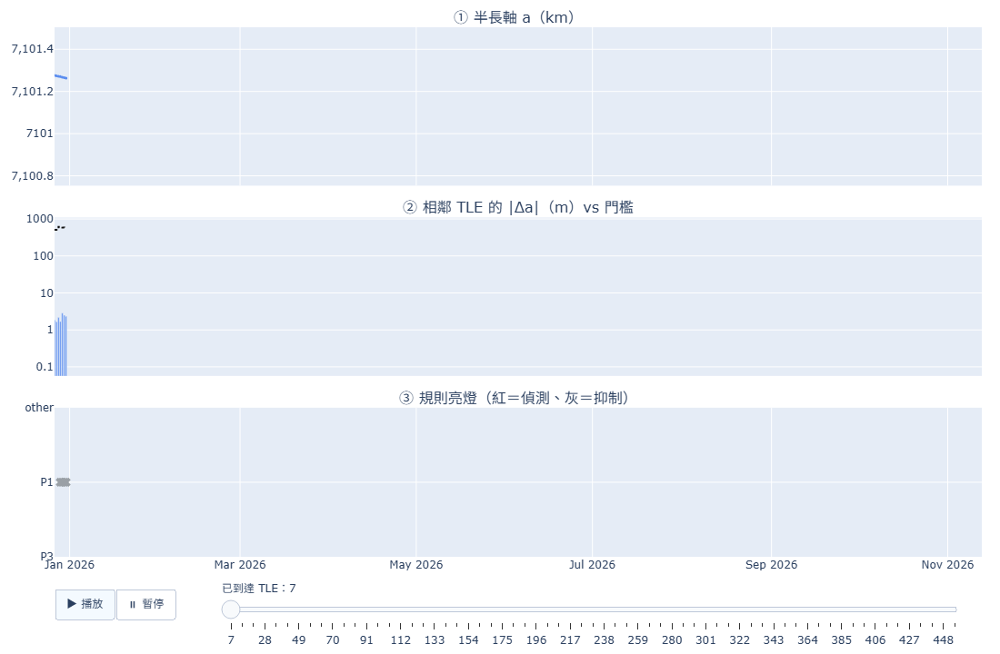

### ③ L2：統計通道——不看物理，只問「這條曲線的行為變了嗎」

四個通道各自獨立讀同一條半長軸序列：**CUSUM** 累積偏離量，均值悄悄偏移時緩緩爬升；**BOCPD** 給出「現在已進入新狀態」的機率；**SSA** 先扣掉阻力趨勢與週期成分，看殘差尖峰；**MAD 3σ** 單看這一步是否離群。紅星是該通道自己判定的事件。**各通道不必同時亮**——它們對不同型態的變化敏感，這正是後續 L3 要把它們融合的理由（三層同一擂台 L3 0.981 > L2 0.892 > L1）。

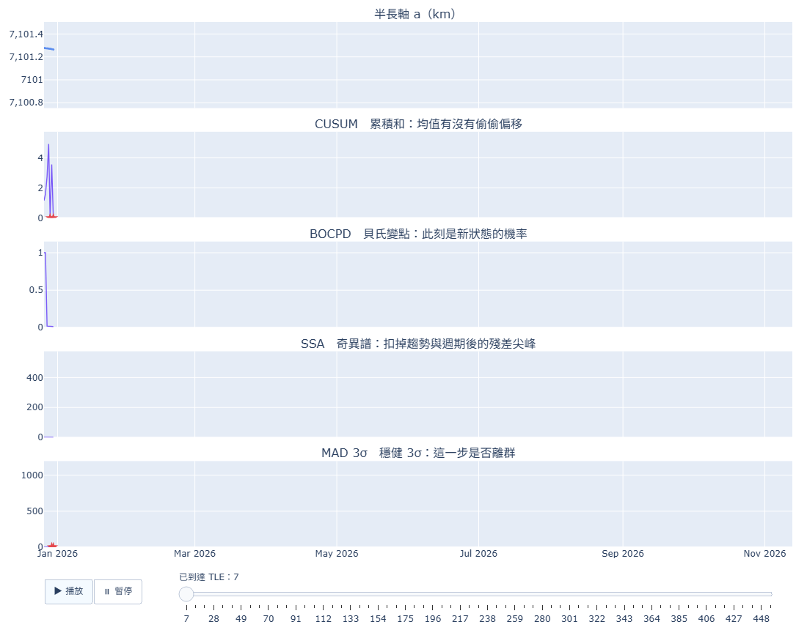

### ④ L3：對 L1／L2 類偵測器提出的候選，逐一「確認或否決」

**L3 怎麼運作**：L3 不是另一個偵測器，而是「確認者」。① 先由前段偵測器（iter2、pred 兩種曲線偵測，加上 L2 的 CUSUM／BOCPD／SSA／MAD 3σ）各自提出**候選機動時刻**，1 天內合併；② 對每個候選算 **10 個 σ 正規化特徵**（位準位移 SNR、預測誤差 SNR、單步 |Δa| SNR、L2 四通道分數、更新間隔、兩個強偵測器是否同意）；③ 分類器（HistGradientBoosting）輸出「這是真機動」的機率；④ 機率 ≥ 門檻 θ 就**確認**，否則**否決**（θ 依更新頻率分 dense／sparse 兩類事前設定，並在訓練衛星上以 F1 選定）。特徵都以該星自身的雜訊 σ 正規化，所以不同高度、不同雜訊底的衛星可以共用一個模型——這正是先前「Starlink 滑動窗 L3」對福衛五號失效的關鍵差別。L1 的 P1–P6 旗標**不是 L3 的輸入**，第⑤格只是把三者是否成立並排比較。

**依族群自動選模型**：本衛星使用 **非 Starlink 低軌模型（NASA/ILRS 認證機動窗，23 顆衛星訓練）**。

**怎麼看**：① 半長軸上，灰點是候選、紅星是 L3 確認、灰叉是否決，橘圈是目前正在處理的候選；② 該候選的 10 個特徵（長度取 log(1+值)，文字為原值）；③ 把某特徵歸零後機率掉多少，紅色＝該特徵在推高機率；④ 每個候選的機率與門檻；⑤ 同一候選 L1、L2、L3 是否成立。

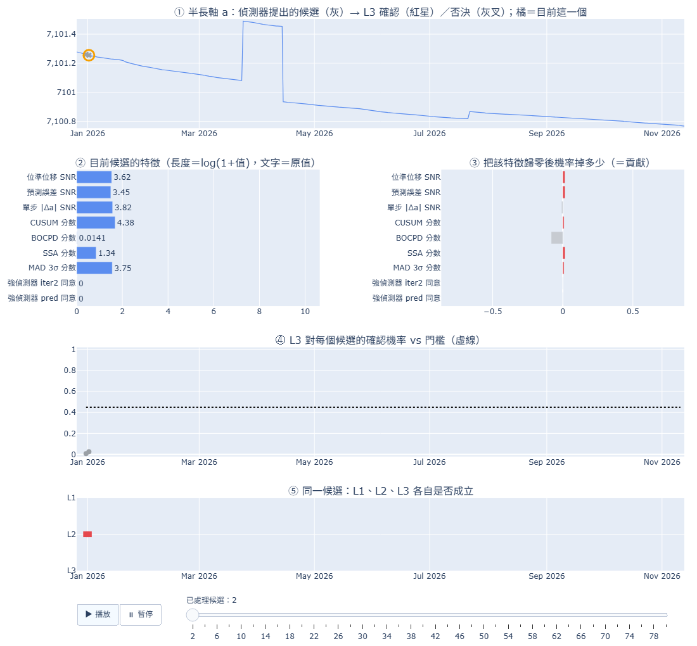

**此衛星（觀察窗內）**：候選 80 個；L3 確認 **9** 個（門檻 θ=0.45，dense 類）；其中 L1 成立 5 個、L2 成立 80 個；最高機率 0.87。

**如實成績**（事件級 P/R/F1，各衛星平均；同一批候選、同一套真值與容差）：

| 方法 | 精確率 | 召回率 | F1 |
|---|---|---|---|
| L1 規則 P1–P6 | 0.469 | 0.077 | 0.122 |
| L2 BOCPD | 0.412 | 0.36 | 0.372 |
| L2 CUSUM | 0.173 | 0.675 | 0.265 |
| L2 MAD3σ | 0.163 | 0.726 | 0.256 |
| L2 SSA | 0.158 | 0.735 | 0.254 |
| L2 聯集（任一通道） | 0.109 | 0.823 | 0.19 |
| L3 候選確認 | 0.414 | 0.562 | 0.428 |
| 候選全接受（無 L3） | 0.093 | 0.872 | 0.165 |

> ⚠️ **非 Starlink：L3 的確認有實質增益，但整體仍不算高**——相對於「候選全接受」，精確率大幅提高（約 0.09→0.41）、F1 由約 0.17 升到 0.43，也高於 L2 最佳單通道與 L1。逐星留一（LOSO）平均 F1 約 0.43，即使在同分布的測高衛星上，仍有相當比例的誤報與漏報。 **樣本外檢驗（福衛七號 6 顆，弱真值）**：L3 F1 = 0.19，但 **L1 規則反而較高（0.23）**——低軌約 550 km 的福衛七號比較接近 Starlink 的情境，泛化不如高軌測高衛星。

##### 〔分頁〕NORAD 48881 · 48881

共 **278** 筆 TLE（已稀釋近重複 epoch，最小間隔 12 h）；平均高度 **562 km**。L1 最終旗標 **15** / 277 個轉換（被 P1/P3 抑制 60 個）；L2 各通道事件數：CUSUM 58、BOCPD 2、SSA 59、MAD 3σ 75。

### ② L1：規則閘門——一道道關卡，全部通過才算機動

**怎麼看**：上圖是半長軸；中圖每根柱子是「相鄰兩筆 TLE 的 |Δa|」，黑色虛線是**該高度、該太陽活動下的門檻**（P2 依高度、P5 依 F10.7、P6 依星座族群調整）；柱子**越過虛線、且沒被抑制規則擋下**就變紅並在上圖打星號。下圖是各規則的亮燈紀錄：紅方塊＝偵測型規則（P2/P4/P5/P6/其他）觸發，灰叉＝抑制型規則（P1 純大氣衰減、P3 高 B\* 阻力）把誤報擋掉。

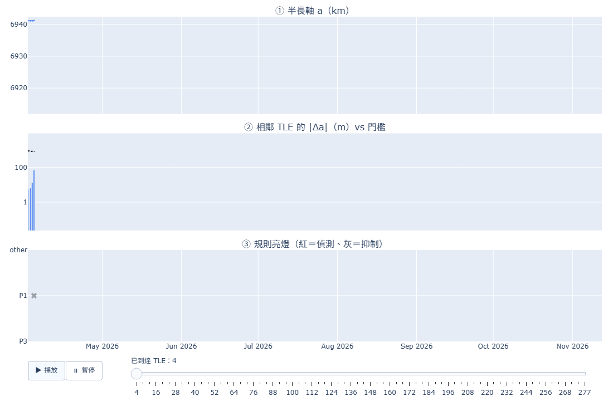

### ③ L2：統計通道——不看物理，只問「這條曲線的行為變了嗎」

四個通道各自獨立讀同一條半長軸序列：**CUSUM** 累積偏離量，均值悄悄偏移時緩緩爬升；**BOCPD** 給出「現在已進入新狀態」的機率；**SSA** 先扣掉阻力趨勢與週期成分，看殘差尖峰；**MAD 3σ** 單看這一步是否離群。紅星是該通道自己判定的事件。**各通道不必同時亮**——它們對不同型態的變化敏感，這正是後續 L3 要把它們融合的理由（三層同一擂台 L3 0.981 > L2 0.892 > L1）。

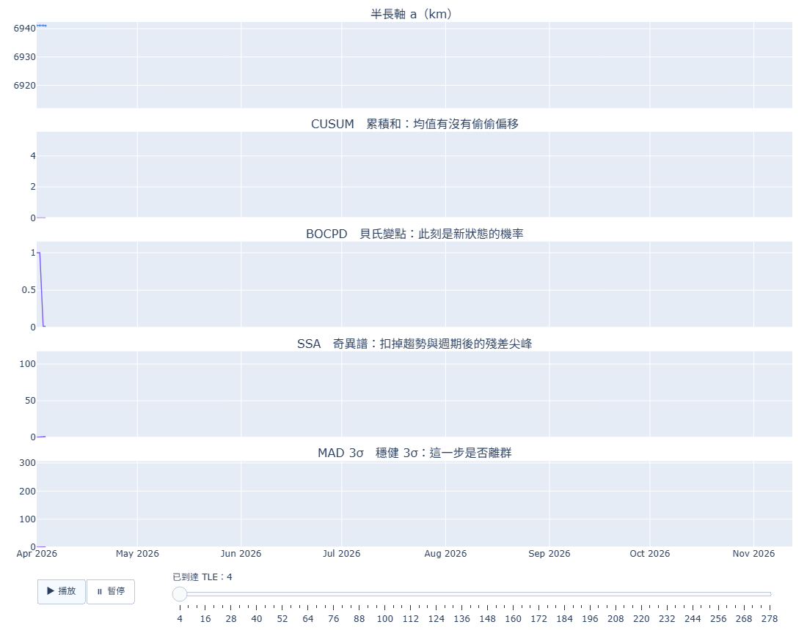

### ④ L3：對 L1／L2 類偵測器提出的候選，逐一「確認或否決」

**L3 怎麼運作**：L3 不是另一個偵測器，而是「確認者」。① 先由前段偵測器（iter2、pred 兩種曲線偵測，加上 L2 的 CUSUM／BOCPD／SSA／MAD 3σ）各自提出**候選機動時刻**，1 天內合併；② 對每個候選算 **10 個 σ 正規化特徵**（位準位移 SNR、預測誤差 SNR、單步 |Δa| SNR、L2 四通道分數、更新間隔、兩個強偵測器是否同意）；③ 分類器（HistGradientBoosting）輸出「這是真機動」的機率；④ 機率 ≥ 門檻 θ 就**確認**，否則**否決**（θ 依更新頻率分 dense／sparse 兩類事前設定，並在訓練衛星上以 F1 選定）。特徵都以該星自身的雜訊 σ 正規化，所以不同高度、不同雜訊底的衛星可以共用一個模型——這正是先前「Starlink 滑動窗 L3」對福衛五號失效的關鍵差別。L1 的 P1–P6 旗標**不是 L3 的輸入**，第⑤格只是把三者是否成立並排比較。

**依族群自動選模型**：本衛星使用 **非 Starlink 低軌模型（NASA/ILRS 認證機動窗，23 顆衛星訓練）**。

**怎麼看**：① 半長軸上，灰點是候選、紅星是 L3 確認、灰叉是否決，橘圈是目前正在處理的候選；② 該候選的 10 個特徵（長度取 log(1+值)，文字為原值）；③ 把某特徵歸零後機率掉多少，紅色＝該特徵在推高機率；④ 每個候選的機率與門檻；⑤ 同一候選 L1、L2、L3 是否成立。

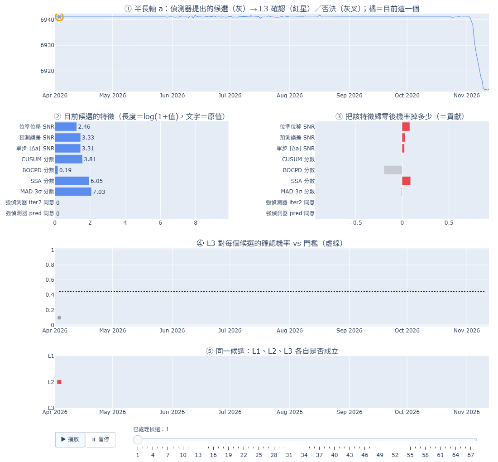

**此衛星（觀察窗內）**：候選 68 個；L3 確認 **8** 個（門檻 θ=0.45，dense 類）；其中 L1 成立 9 個、L2 成立 68 個；最高機率 0.92。

**如實成績**（事件級 P/R/F1，各衛星平均；同一批候選、同一套真值與容差）：

| 方法 | 精確率 | 召回率 | F1 |
|---|---|---|---|
| L1 規則 P1–P6 | 0.469 | 0.077 | 0.122 |
| L2 BOCPD | 0.412 | 0.36 | 0.372 |
| L2 CUSUM | 0.173 | 0.675 | 0.265 |
| L2 MAD3σ | 0.163 | 0.726 | 0.256 |
| L2 SSA | 0.158 | 0.735 | 0.254 |
| L2 聯集（任一通道） | 0.109 | 0.823 | 0.19 |
| L3 候選確認 | 0.414 | 0.562 | 0.428 |
| 候選全接受（無 L3） | 0.093 | 0.872 | 0.165 |

> ⚠️ **非 Starlink：L3 的確認有實質增益，但整體仍不算高**——相對於「候選全接受」，精確率大幅提高（約 0.09→0.41）、F1 由約 0.17 升到 0.43，也高於 L2 最佳單通道與 L1。逐星留一（LOSO）平均 F1 約 0.43，即使在同分布的測高衛星上，仍有相當比例的誤報與漏報。 **樣本外檢驗（福衛七號 6 顆，弱真值）**：L3 F1 = 0.19，但 **L1 規則反而較高（0.23）**——低軌約 550 km 的福衛七號比較接近 Starlink 的情境，泛化不如高軌測高衛星。

### ⑤ 用預設對照組看什麼

- **福衛五號（723 km）**：高軌、大氣擾動小，雜訊底約公尺級，機動的 |Δa| 遠高於門檻，L1 的柱子清楚越線；大量緩降的點被 P1 抑制（灰叉），不會被當成機動。
- **STARLINK-3005（563 km）**：低軌、電推與大氣阻力並存，雜訊底高（見案例三、二十四、二十五），|Δa| 常態性貼近門檻，L1 與 L2 的判定更容易分歧——這就是「低軌難例」。
- 若你輸入自己的 NORAD ID，可試著找出「L1 亮而 L2 不亮」或「L2 亮而 L1 不亮」的時刻，那正是各層的盲區。
- **已知案例：福衛五號 2026-04-14 的 −519 m 降軌**（查核於 2026-09-21）。當時 L2 有偵測，但 L1 與 L3 都沒有確認，這不是畫圖錯誤，而是兩個真實問題：(1) **L1 的抑制規則誤擋（已於 2026-09-21 修正）**——P1「衰減抑制」與 P3「B* 抑制」以「小幅負 Δa」判斷衰減，容許值（2 km／1.5 km）遠大於 P2 高度門檻，把向下的降軌機動當成大氣衰減擋掉；福衛五號超過門檻的 8 次轉換中被擋的正是這一次，Starlink 也有 3/9 個 −760～−930 m 的大幅下降被 P3 擋掉。修正為「本身已超過 P2 門檻的步階不得被 P1／P3 抑制」，現在 L1 會標記這一筆；擂台上整體 L1 召回 8.3%→8.6%、誤報率 5.4%→5.6%、精確率不變。(2) **L3 由「Starlink 滑動窗」改為「候選確認式、依族群選模型」後，這一筆被確認**——舊模型分數僅約 0.10（因為只用 Starlink 訓練，學到「大階躍不代表機動」），新的非 Starlink 模型以 σ 正規化特徵，這一筆機率約 0.84，被 L3 確認。

### ⑥ 誠實限制

1. 這裡展示的是**偵測法的行為**，不是準確度：頁面沒有疊上機動真值，因此**不能**由紅星數量判斷誰比較準。準確度請見報告 §13.2 三層同一擂台。
2. L1 逐筆只依賴相鄰兩筆與短窗，可線上運作；L2 的 SSA、MAD 使用整段序列統計量，動畫的「逐步揭露」是把已算好的分數依時間顯示，並非嚴格的逐筆重算。
3. 為控制網頁大小，序列已稀釋近重複 epoch（最小間隔 12 h）並最多取最近 450 筆；資料庫為滾動視窗，觀察窗實際長度依衛星而異。
4. 各通道的「事件」採用 statistical_detectors.py 之內建判定，未針對單一衛星調參；亮燈數量多不代表較好。
5. L3 為「候選確認式」，依族群自動選模型：非 Starlink 用 23 顆 NASA/ILRS 衛星訓練、Starlink 用 MEME 真值訓練。兩者的成績都不高（見上表）。在 Starlink 上「確認」的增益很小：2026-10-21 起 Starlink 模型加入 3 個 B\* 偏離特徵（見案例三十），L3 F1 0.373 對「候選全接受」0.366，增益主要來自精確率，召回率不變。模型檔為離線訓練後上傳，頁面上不會即時重訓。

> Code: `l1l2_explainer.py`, `maneuver_strategies_july.py`, `statistical_detectors.py`; common-arena numbers: `three_layer_common_eval.py`.

---

## 案例二十八：VCM 與傳統 TLE，在衛星碰撞預測上到底差在哪？

#### 一句話：TLE 描述的是名義軌道；VCM 同時描述名義軌道與它的不確定性

> 本頁的 Pc 數字由下方公式即時計算（極座標數值積分，非蒙地卡羅，同輸入必得同輸出）；文字結論引用 NASA CARA 與公開報導，來源列於頁尾。本專案本身只使用公開 TLE，**沒有** VCM 存取權——這正是本案例要說清楚的界線。

### ① 兩種資料，回答的是兩個不同的問題

- **TLE（Two-Line Element）**：一組*平均*軌道元素，必須搭配 SGP4／SDP4 這類分析模型才能傳播。格式簡單、公開、更新快，適合大規模目標篩選與一般態勢展示。它回答的是：**「依公開軌道模型，物體大概會在哪裡？」**
- **VCM（Vector Covariance Message）**：某個 epoch 的位置／速度狀態向量，**外加 covariance**——描述這個估計在各方向上的不確定程度，以及位置與速度誤差之間的相關性。它回答的是：**「物體預計會在哪裡，而這個預測有多不確定？」**

NASA 在 CARA 的建議中明確指出：TLE 不足以支援正式的 conjunction assessment（CA）。原因不是 TLE「不準」，而是它**缺少描述誤差分布的 covariance**，因此無法算出標準的碰撞機率 Pc。

| 項目 | TLE | VCM |
|---|---|---|
| 內容 | 平均軌道元素（需 SGP4／SDP4 傳播） | 狀態向量＋covariance |
| 不確定性 | 無（只有經驗誤差量級） | 有，逐方向、含相關性 |
| 典型誤差 | 約 1–2 km 量級，隨傳播時間、阻力與未通報機動放大 | 依定軌品質而定，並隨 covariance 一起傳播 |
| 能算 Pc 嗎 | 不能（只能算幾何最近距離） | 可以（標準 CA 流程） |
| 適用階段 | broad-phase：全目錄粗篩、態勢展示 | narrow-phase：正式風險評估與避碰決策 |

### ② 同樣的最近距離，Pc 可以差好幾個數量級

這是本案例最重要的一點，也是「為什麼 miss distance 不能直接當風險」的原因。下面的計算把兩物體的合成位置不確定性放在交會平面上，對半徑 HBR（兩物體半徑和）的圓積分。**你可以自己改參數**：

- **此組參數的 Pc**：5.419e-04

> 操作門檻參考（各任務自訂，非唯一標準）：Pc ≥ 1e-3 多數任務要求執行避碰機動；1e-4 ≤ Pc < 1e-3 需進一步評估與加密觀測。

| 不確定性情境 | 徑向 σ (m) | 沿跡 σ (m) | Pc |
|---|---|---|---|
| VCM 等級（精密定軌後） | 30 | 80 | 4.758e-22 |
| 新鮮 TLE 假想等級 | 300 | 1000 | 4.043e-04 |
| 數日前 TLE 假想等級 | 1000 | 3000 | 6.373e-05 |

> ⚠️ 注意這張表最違反直覺的地方：**不確定性變大，Pc 不一定變大，反而可能變小**（probability dilution，機率稀釋）——誤差橢球被攤得很開時，落在那個小圓內的機率反而下降。所以「用一個很大的保守 σ」並不是安全做法，它可能讓真正危險的交會看起來無害。這也是為什麼 VCM 的價值不只是「有 covariance」，而是 covariance 要有 realism。後面兩列是「假如 TLE 有 covariance 會如何」的假想值——TLE 實際上並不提供 covariance，這兩列只是用來說明量級效應。

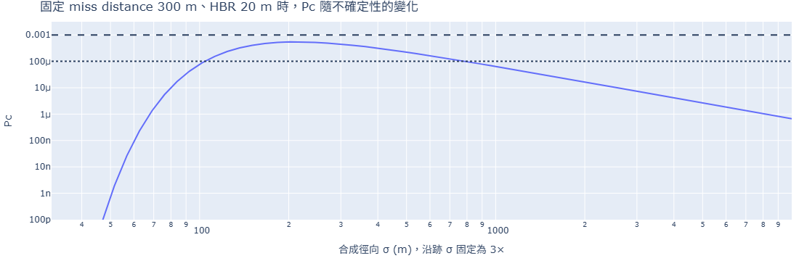

> 曲線先升後降：σ 遠小於 miss distance 時，兩者幾乎不可能相撞；σ 接近 miss distance 時 Pc 達到峰值；σ 再變大則進入稀釋區。只看最近距離無法知道自己落在這條曲線的哪一段——這就是 VCM 的用處。

### ③ 兩種流程：broad-phase 篩選 vs narrow-phase 評估

實務 SSA/SDA 系統不是二選一，而是分層使用：

1. **TLE（broad-phase）**：用 SGP4 對數萬個目錄物體做全域篩選，找出可能接近的候選對。快、便宜、可公開重現。
2. **VCM／精密星曆（narrow-phase）**：對候選對傳播狀態與 covariance 至 TCA，算出 Pc，再依任務門檻決定是否加密觀測、協調或執行避碰機動。
3. **新觀測／重新定軌**：對高風險交會補觀測、確認是否有未通報機動，收斂 covariance 後重算。

把 TLE 的角色說成「不準所以沒用」是錯的；正確的說法是「TLE 是 broad-phase 工具，不是 narrow-phase 依據」。

### ④ 為什麼這件事在 2026 年特別值得談

2026 年 9 月 23 日 Breaking Defense 的獨家報導指出：美國太空軍透過 Joint Commercial Operations（JCO）與 SpaceX 的協議，讓 SpaceX 取得原本限軍方使用的**高精度目錄（High Accuracy Catalog, HAC）**，其中包含帶 covariance（報導稱為「誤差泡泡」）的 **VCM**，交換條件是 SpaceX 提供其 Stargaze 星象追蹤系統的觀測資料；官方並稱有限制條款，資料僅供其內部使用、不得用於商業利益。報導同時提到 SpaceX 每天執行約 2 萬次衛星機動，其中約 1 千次是避碰；業界競爭者則擔心這種安排造成不公平優勢。

從本案例的角度，這則報導的技術意涵很清楚：**碰撞預測的關鍵差異不在「有沒有軌道資料」，而在「有沒有 covariance」**。公開 TLE 人人可得，但要做到可信的 Pc 與避碰決策，需要的是 VCM 這一級的資料——這也正是它會成為政策與商業爭議焦點的原因。

> ℹ️ 誠實標註：上述報導內容為媒體轉述，本專案無法獨立查證，也沒有 HAC／VCM 的存取權。此處引用是為了說明「covariance 存取權」在現實中的份量，不作為本專案任何技術宣稱的依據。

### ⑤ 這對本專案的界線意味著什麼

- 本專案全部使用**公開 TLE**（以及少數公開精密星曆），因此在碰撞議題上只能做到 **broad-phase 篩選與態勢展示**。
- 案例七（Pc／TCA）用的是簡化示範算法（`conjunction_pipeline.compute_pc_simplified`，二維、假設 covariance），**不是**正式 CA 產品，也不應作為避碰機動依據。
- 本專案真正的貢獻在另一件事：**從 TLE 偵測機動**。未通報機動正是讓 TLE 傳播誤差暴增、也讓他人 covariance 失真的主因之一；把「這顆衛星最近動過」標示出來，對 broad-phase 篩選的價值，比硬算一個不可信的 Pc 高。
- 若未來要進到 narrow-phase，需要的不是更好的模型，而是**資料等級的升級**：VCM 或 owner/operator 星曆。

### ⑥ 來源

- NASA CARA, *Conjunction Assessment Risk Analysis — Updated Recommendations*（TLE 不足以支援正式 CA）
- NASA, *Conjunction Assessment and NPR 8079.1*；NASA *National Standard for Space Safety and Orbital Debris* 相關文件
- AMOS, *Conjunction Assessment: NASA Best Practices and Lessons Learned*
- Space-Track.org, TLE 格式文件與說明
- Theresa Hitchens, "EXCLUSIVE: SpaceX given unique access to classified DoD space tracking data, sources say", *Breaking Defense*, 2026-09-23 — https://breakingdefense.com/2026/09/exclusive-spacex-given-unique-access-to-classified-dod-space-tracking-data-sources-say/

> 本頁 Pc 計算：`_pc_2d()`（極座標數值積分）；專案內既有的簡化 Pc：`conjunction_pipeline.compute_pc_simplified`。

---

## 案例二十九：一次真實的人工迴避機動——孟加拉衛星以自力計算躲過印度退役衛星碎片

#### 沒有 VCM、沒有商用避碰工具，一個小國團隊仍靠公開預警與人工計算躲過碰撞——這呼應案例二十八的資料落差，也呼應本專案的立場：公開資料加上正確方法，仍能做出有意義的判斷

> **誠實揭露**：本案例整理自 2026 年孟加拉及台灣媒體公開報導，屬**外部真實事件引用**，並非本專案偵測管線的分析對象——本專案資料庫未收錄孟加拉 BS-1（NORAD 43463）或印度 INSAT-1A（NORAD 13129）的 TLE，也未對此事件做任何重算、驗證或機動偵測。放進 StoryMap 的理由是它與案例二十八討論的 VCM/TLE 資料落差高度呼應的真實前例，不是本專案的驗證成果。

### ① 事件經過

- 2026-08-09 前後：孟加拉衛星公司（BSCL）地面站收到美國 Space-Track 太空監視網的預警，示警一塊碎片正快速接近其同步軌道衛星 BS-1（原名 Bangabandhu-1，NORAD 43463，位於東經 119.1°）。
- 工程團隊在加濟布爾（Gazipur）地面站自行計算可行的位移方向與幅度。
- 2026-08-13：BSCL 將 BS-1 向左小幅位移並維持至碎片通過，隨後移回原位；碎片最終與 BS-1 最近距離僅 852 公尺，衛星未受損。
- BSCL 董事總經理 Imadur Rahman 公開說明，全程計算與操作由孟加拉本土工程師獨立完成。

### ② 碎片來源

- 碎片來自印度 1982 年發射的 INSAT-1A（NORAD 13129），該衛星發射後數月即因姿態控制／推進劑問題失控，同年遭放棄，之後長期是軌道上的無控物體。
- 各報導對失控退役的確切時間點記載略有差異（有寫 1982 年 9 月，亦有寫推進劑耗盡於 1983 年 9 月），建議以 ISRO 官方紀錄為準，本案例不另行查證。

### ③ 為什麼這個案例放進本 StoryMap

- 案例二十八說明了 TLE 與 VCM 的根本落差：沒有 covariance，就算不出可信的碰撞機率 Pc。這起事件是一個真實世界的對照組——BSCL 同樣沒有 VCM，甚至沒有商用避碰軟體，仍靠公開預警＋人工計算做出避碰決策。
- 這正呼應本專案的立場：本專案從頭到尾只用公開 TLE，沒有任何特權資料來源，卻一路證明「公開資料＋正確方法＋誠實揭露限制」仍能產出有意義的機動偵測與態勢判斷。BSCL 的案例，是「資源有限的團隊靠對的方法做出正確決策」在真實世界的縮影。
- 換句話說：本專案與 BSCL 面對的是同一種結構性限制（缺乏私有／軍方級的精確資料），但都選擇在限制之內把能做的事做到最好，而不是因為拿不到最好的資料就放棄判斷。

### ④ 查證限制（誠實揭露）

- 本案例所有細節均來自孟加拉媒體（The Daily Star、TBS News）及台灣媒體（民生電子報）轉述 BSCL 高層的說法，查證時沒有找到印度官方或獨立第三方對「碎片確實來自 INSAT-1A」或「852 公尺」數字的佐證。
- 查證時發現部分報導的發布時間標記（如「1 天前」）與系統當前日期（2026-10-09）對不上，不排除是舊聞被重新轉載；因此「事件確切發生於 2026 年 8 月」這一點，本案例**無法百分之百確認**，僅依來源報導的敘述呈現。
- 原始敘述中「孟加拉官方強調全程未向衛星製造商（泰雷茲阿萊尼亞航太公司）尋求操作協助」一句，查證時沒有在任一篇報導中找到逐字對應的引述，比較接近是對「工程師自主完成」敘事的合理延伸；本案例採用時僅以「自主完成」呈現，不逐字複述未經證實的細節。

**判讀**：這起事件無法作為本專案偵測能力的證據（本專案完全沒有分析這兩顆衛星），但它是一個誠實、有紀律的對照：告訴我們「沒有最好的資料」不等於「做不出有意義的判斷」——只要方法對，而且願意誠實說清楚自己能做到哪裡、做不到哪裡。

### ⑤ 來源

- The Daily Star, "Bangladesh satellite saved from space debris by local engineers" — https://www.thedailystar.net/news/news/bangladesh-satellite-saved-space-debris-local-engineers-4293136
- TBS News, "US space tracking alert helps Bangladesh's satellite avoid Indian satellite debris" — https://www.tbsnews.net/tech/us-space-tracking-alert-helps-bangladeshs-satellite-avoid-indian-satellite-debris-1565871
- 民生電子報，〈國際太空碎片威脅升溫 美國示警助孟加拉衛星避險〉— https://lifenews.com.tw/594777
- Wikipedia, "INSAT-1A" — https://en.wikipedia.org/wiki/INSAT-1A
- Gunter's Space Page, "Bangabandhu 1 (BD 1)" — https://space.skyrocket.de/doc_sdat/bangabandhu-1.htm

---

## 案例三十：負的大氣阻力？——推力被藏進 TLE 的 B\* 參數

#### 大氣阻力只會讓衛星減速，B\* 照理永遠是正的。但推進中的星系常出現負 B\*——因為 SGP4 沒有推力項，推力只好被擬合進阻力參數。這件事有多普遍、是不是真的、對本專案的偵測規則又有什麼影響？

> **術語**：TLE（雙行根數）是美國太空監視網公開的軌道資料，用 SGP4 模型推算位置。**B\***（B-star）是 TLE 裡唯一描述大氣阻力的參數，單位為 1/地球半徑，越大代表阻力越強。**ndot** 是平均運動的一階變化率。**MEME** 是 SpaceX 公開的 Starlink 精密星曆，本專案以它作為真值。

### ① 為什麼負 B\* 不該存在

- 大氣阻力的方向永遠和速度相反，只會讓軌道降低，所以描述阻力強弱的 B\* 應該永遠為正。
- SGP4 的力模型只有地球重力（含扁率）、大氣阻力和日月擾動，**沒有推力項**。美方定軌時，會用一段時間的觀測擬合出一組 TLE；如果衛星在這段時間持續推進，模型裡又沒有推力，擬合只能把多出來的沿軌加速度塞進唯一能調的參數——B\*。
- 推力把軌道往上推 → 看起來像「負的阻力」→ **B\* 變成負值**；推力把軌道往下拉 → 看起來像「特別強的阻力」→ **B\* 異常偏大**。

### ② 普查：2.3 萬個低軌物件

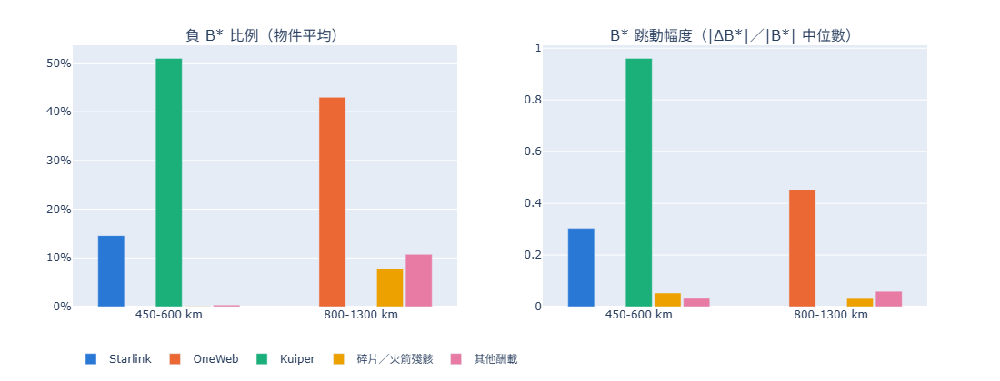

範圍：2026-08 以後、高度 1,300 km 以下的近圓軌道物件，共 **22,748** 個。

- **450–600 km（阻力強，B\* 測得準）**：碎片的負 B\* 只有 0.05%、一般酬載 0.33%，幾乎不存在；Starlink 是 **14.6%**、Kuiper 是 **50.9%**。這是最乾淨的對照。
- **800–1,300 km（阻力弱）**：碎片也有 7.8% 的負 B\*——高空大氣稀薄，B\* 本身就測不準，符號可能被雜訊翻轉。OneWeb 是 **42.9%**，仍明顯高出許多；B\* 跳動幅度更是碎片的約 **14 倍**。

**範例時序**：同高度的推進衛星與碎片，B\* 長什麼樣子

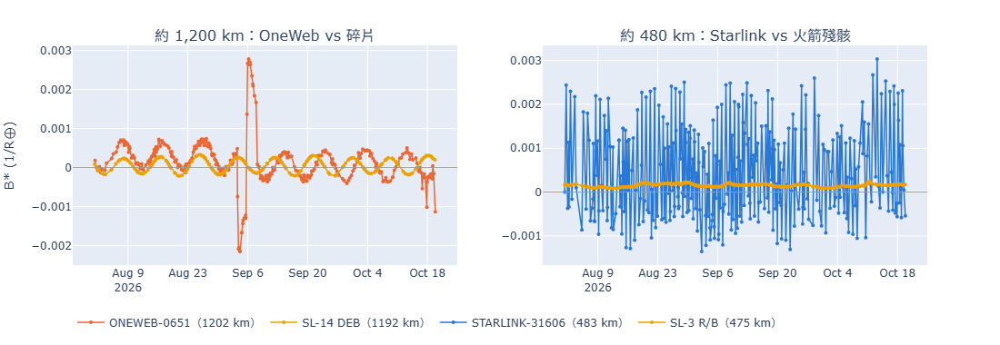

> 注意 1,200 km 那顆碎片也會跨過零線：高空 B\* 本來就不穩，所以高軌的負 B\* 不能單獨當推力證據，要和同高度碎片比較。

### ③ 用真值確認：負 B\* 真的對應推力嗎？

相關性不等於因果。所以我們用 Starlink 的 MEME 精密星曆當真值：對每一筆 TLE，計算它 epoch 之前 12 小時、MEME 一圈平均高度的實際變化率（km/天），看 B\* 是否跟著推力方向走。

| MEME 高度變化率（km/天） | TLE 筆數 | 負 B* 比例 | B* 中位數 |
|---|---|---|---|
| 降軌（< −1） | 84 | 0.03571 | 0.00207 |
| 緩降（−1 ~ −0.2） | 275 | 0.1491 | 0.0007583 |
| 持平（−0.2 ~ 0.05） | 4596 | 0.1501 | 0.0002448 |
| 緩升（0.05 ~ 0.5） | 1356 | 0.1409 | 0.000244 |
| 升軌（> 0.5） | 150 | 0.58 | -3.886e-05 |

樣本：283 顆 Starlink、6,461 筆 TLE（每份 MEME 只用前 24 小時，因為升軌期間 MEME 的預報超過 24 小時就會失準）。

- **升軌時**，負 B\* 比例從持平時的 15% 升到 **58%**。
- **降軌時**，B\* 中位數是持平時的 **8.5 倍**——反向推力被當成「特別強的阻力」。
- 只看單筆 TLE 的 B\*，判斷「是否正在降軌」的 AUC 是 **0.913**，判斷「是否正在升軌」是 **0.743**（0.5 = 瞎猜，1 = 完美）。

> 持平時仍有 15% 的負 B\*：Starlink 平時持續做補償阻力的站位保持，推力剛好抵銷阻力時高度看起來不變，但推力其實存在，B\* 會在零附近擺動。

### ④ 對本專案的意義：兩個推測被數據推翻

發現 B\* 吸收推力之後，我們最初的推測是：「B\* 和 ndot 的跳動，讓 L1 規則層對 Starlink 有效、對碎片會誤報」。實際檢查程式碼和數據之後，這個推測**兩半都不成立**。

#### 推測一：L1 靠 B\* 偵測機動？——不是

L1 規則層**完全沒用 ndot**；B\* 也**不是用來偵測**，而是用在兩條**抑制**規則上——P1「B\* 為正、而且連續小幅下降 → 判定為阻力衰減」，P3「B\* 偏高、而且小幅下降 → 判定為阻力造成」。兩條規則都假設「B\* = 大氣阻力」。

這個假設在推進星系上確實會失效：P3 觸發的 49 次裡，有 **22%** 是 MEME 顯示的真實機動（整體只有 4.3%）。但實際傷害很小——在 8,178 次轉換中，抑制規則只取消了 **12** 次偵測，其中 4 次是真實機動（3 次降軌）、6 次是正確擋掉的誤報；對 354 次真實機動的召回率只從 0.424 降到 0.412。原因是 2026-09-21 加的護欄：**超過 P2 高度門檻的步階不能被抑制**。

#### 推測二：碎片誤報來自 B\* 跳動？——不是

| group | 族群（450–600 km，各抽 300 個） | L1 旗標率（每次轉換） | 其中來自 P2（Δa 超過門檻） | P1 抑制作用比例 |
|---|---|---|---|---|
| Starlink | Starlink | 0.03599 | 0.02645 | 0.7115 |
| debris | 碎片／火箭殘骸 | 0.0133 | 0.009104 | 0.9652 |
| other_payload | 其他酬載 | 0.002595 | 0.001035 | 0.9699 |

碎片確實會被 L1 誤報（1.33%，約為一般酬載 0.26% 的數倍；碎片不會機動，所以全是誤報），但來源是 **Δa 的雜訊**（P2）——碎片形狀不規則、追蹤精度較差，TLE 本身就比較粗。B\* 在碎片上反而發揮**保護作用**：P1 抑制規則作用在 97% 的碎片轉換上。

#### 真正的意義：把「干擾」轉成「訊號」——已驗證

- L1 對 MEME 顯示的真實機動（單次轉換 > 300 m）召回率只有 **0.412**；而 B\* 單筆判斷降軌的 AUC 就有 **0.913**。
- L3 候選確認模型原本**沒有 B\* 和 ndot**。Plan B（LightGBM 單星分類器）則有一個 `bstar_f107_normalized` 特徵，但它的設計用意是把 B\* 當成**阻力的量測**（所以才對太陽通量正規化）——對推進星系，這個特徵其實也混入了推力。
- 反過來，這也是一個警訊：對推進星系，**不能把 B\* 當成大氣密度或阻力的量測**，凡是用 TLE B\* 反推熱層密度的研究，都要先排除推進中的衛星。

| 特徵組合 | 候選判別力（ROC-AUC） | 精確率 | 召回率 | F1 |
|---|---|---|---|---|
| 原 10 個特徵 | 0.6922 | 0.6936 | 0.2579 | 0.3688 |
| 加 3 個 B* 特徵（已採用） | 0.7245 | 0.7226 | 0.2579 | 0.3726 |
| 再加 ndot | 0.7283 | 0.7198 | 0.2584 | 0.3727 |

**實驗（2026-10-21）**：在 L3 Starlink 候選確認模型上做 A/B 比較。資料、模型參數、按衛星分組的 5 折交叉驗證和門檻選法完全相同，只差有沒有加入 3 個 B\* 偏離特徵（以候選時刻之前 30 天的中位數和 MAD 為基準，只用過去的資料，線上也能照做），並用 5 種不同分折各跑一次。

- **判別力確實提升**：候選判別力 0.692 → **0.724**，精確率 0.694 → **0.723**，每種分折的結果都一致。
- **但突破不了召回率上限**：召回率 0.258 → 0.258，F1 只從 0.369 到 0.373。確認模型只能否決 Δa 偵測器提出的候選，不能補出新的偵測。把 B\* 改當成**新的候選來源**也幫助不大：MEME 機動的涵蓋率只從 38.6% 提高到 43.9%，新增的候選只有 31% 是真機動。這和 TLE 時間解析度造成的召回天花板一致。
- **已納入正式模型**：2026-10-21 起，L3 Starlink 模型改用 10＋3 個特徵重新訓練（案例二十七的 L3 動畫即使用此模型）。非 Starlink 的模型不加——不推進的衛星，B\* 代表真實的大氣阻力，意義不同。

### ⑤ 誠實揭露

- **真值只有 Starlink**：OneWeb 和 Kuiper 沒有公開精密星曆，它們的負 B\* 只能從「遠高於同高度碎片」間接推論，沒有直接驗證。
- **高軌 B\* 本來就不穩**：800 km 以上，碎片也有可觀的負 B\*。高軌的推力證據要靠「和同高度碎片比較」，不能只看有沒有負值。
- **美方的定軌程序未公開**：B\* 如何被擬合、是否有約束，我們無從得知；本頁描述的是從結果反推的機制。
- **抽樣**：MEME 每顆衛星均勻抽 20 份、每份只用前 24 小時；L1 對照組每族群隨機抽 300 個物件（固定亂數種子）。

**判讀**：負 B\* 是 TLE 在說「這段時間有我解釋不了的推力」。它對本專案現有規則的干擾，已被護欄壓到很小；反過來把它當成特徵，確實讓 L3 更會分辨真假候選，但召回率的上限來自 TLE 本身的時間解析度，換特徵救不回來。

> 資料與程式：`bstar_thrust_analysis.py` → `data/benchmark/bstar_thrust_{population,tle_truth,transitions,l1_control,examples}_20261020.csv`；L1 規則：`maneuver_strategies_july.apply_strategies`；B\* 特徵實驗：`exp_l3_bstar_feature.py`、`exp_bstar_candidate_source.py`。

---

## 案例三十一：俄國軍事衛星 COSMOS 2612 逼近 ICEYE-X36——用公開 TLE 重建一次近距離交會

#### 2026 年 10 月，俄國衛星 COSMOS 2612 經過數週的軌道調整，接近 ICEYE 營運、美國註冊的雷達成像衛星 ICEYE-X36。只用公開 TLE，能看出多少？

> **術語**：**SAR**（合成孔徑雷達）可在夜間或雲雨天成像。**RPO**（交會與近距離操作）指一顆衛星刻意接近另一顆。**TLE** 是美國太空監視網公開的軌道根數，以 SGP4 模型推算位置，位置誤差約為公里級。**NMC**（自然運動繞飛）指兩星高度相同、軌道略有差異時，一星在另一星周圍畫出的橢圓相對軌跡，不需持續推進即可維持。

> ℹ️ **資料口徑**：本頁的高度、距離與機動時點全部由本專案以公開 TLE 自行計算（TLE 資料至 2026-10-22）。外部報導（LeoLabs、RUSI、ICEYE 聲明、CNN）另外標註為他方口徑，本專案未取得其原始資料。

### ① 事件經過

- **2026-05 中旬**：COSMOS 2612 與 2610、2611、2613、2614 同週將傾角由約 96.95° 調到 97.80–97.85°，進入 ICEYE-X36 的軌道面（本專案 TLE 判讀共 5 顆；英國智庫 RUSI 2026-06 報告則指出有四顆俄方衛星調整軌道對齊 X36，顆數與本專案判讀不同）。
- **9/30**：COSMOS 2612 升軌約 47 km，在較高軌道停留約 12 天。較高的軌道週期較長，藉此調整與 X36 的前後相位。
- **10/12**：降回 X36 同高度。
- **10/15–16**：先降約 2 km 由後方追上 X36，再升回同高度，進入以 X36 為中心的繞飛（NMC），橢圓中心落後 X36 約 2 km。
- **10/18**：本專案重建的最近距離出現在此日；當晚再升軌約 2.3 km，開始向 X36 後方漂離。
- **10/20**：降回同高度，相對漂移停止，此後停在 X36 後方約 475 km。
- **他方口徑**：LeoLabs 與獨立追蹤者報導 Kosmos 2612 自 9/30 起多次機動、10/15–19 接近 X36，最近約 500 m；追蹤者未見 X36 軌道有受撞擊或擾動的跡象。ICEYE 聲明「持續密切追蹤，星座架構具持續運作與韌性」，未證實任何攻擊或損害。

### ② 本專案重算：兩星平均高度

每一筆 TLE 都可換算成一個平均高度。X36 幾乎保持水平；COSMOS 2612 的每一次台階就是一次機動。表中時間是**第一筆反映機動後的 TLE 時間**，實際點火通常早數小時。

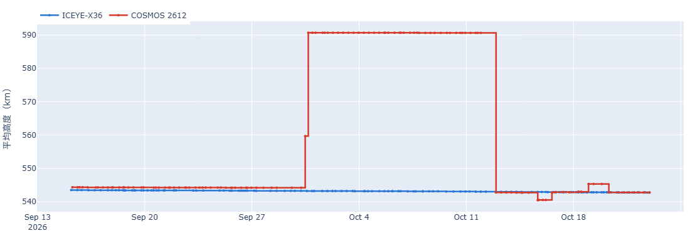

| TLE 時間（UTC） | 高度變化（km） | 變化後高度（km） | 傾角變化（°） |
|---|---|---|---|
| 2026-09-30 11:32 | 15.5 | 559.7 | -0.001 |
| 2026-09-30 16:22 | 31 | 590.7 | 0 |
| 2026-10-12 22:39 | -47.8 | 542.8 | -0.048 |
| 2026-10-15 15:56 | -2.3 | 540.4 | 0.001 |
| 2026-10-16 14:14 | 2.3 | 542.8 | 0 |
| 2026-10-18 23:34 | 2.3 | 545.3 | 0 |
| 2026-10-20 07:26 | -2.5 | 542.8 | 0 |

### ③ 本專案重算：兩星距離

- **重建最近距離**：0.16 km（10-18 01:10 UTC）

- **資料最後時刻距離**：478 km（10-23 05:08 UTC）

- **TLE 資料截至**：2026-10-22 23:08

> 最近距離 0.16 km 是 SGP4 重建值，低於公開 TLE 約 1 km 的精度，**不是量測值**；它與 LeoLabs 報導的約 500 m 屬同一量級，但不應拿來互相印證到百公尺。資料最後時刻 COSMOS 2612 在 X36 後方約 478 km（沿軌方向）。

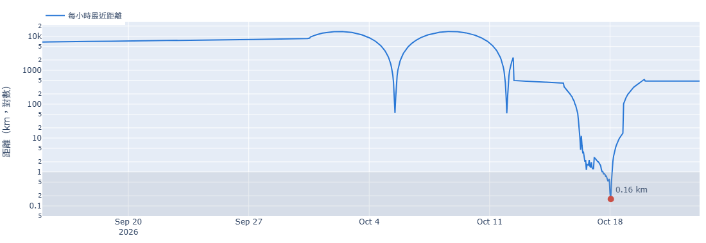

> 灰帶＝1 km 以下，低於公開 TLE 精度。

放大 10/15–10/20、改用線性刻度：繞飛期間距離每圈（約 96 分鐘）在 0 至數公里之間擺動，10/18 晚升軌後迅速拉開。

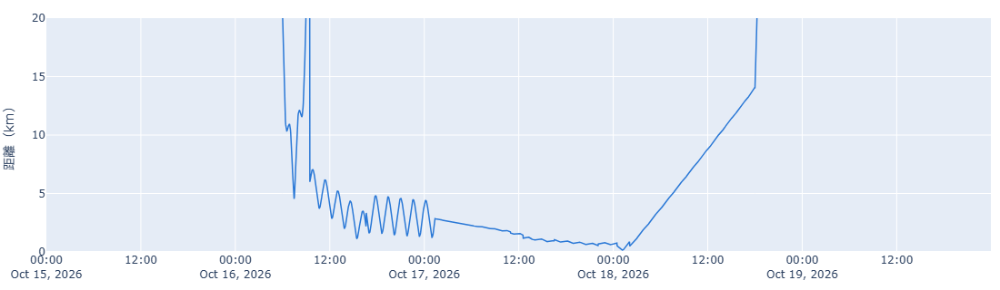

### ④ SatDashboard RPO 檢視器的輸出

同一配對也收錄在 SatDashboard 的 RPO 檢視器，可互動回放 3D 場景：[開啟 /rpo 檢視器](https://rhynowu-atrdc-satdashboard-i18n.hf.space/rpo?primary=59103&secondary=68762)。下面兩張是它的輸出。

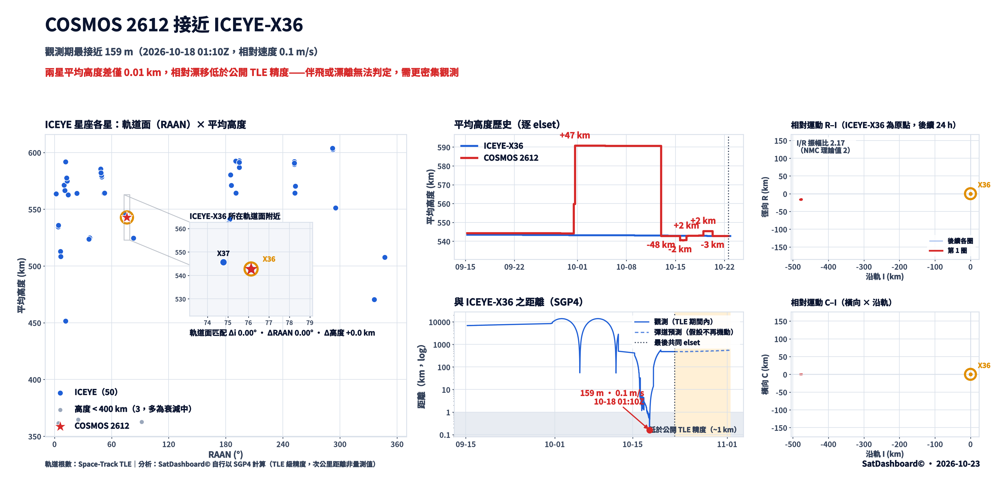

**怎麼讀這張報告**（2026-10-23 產生）：
- **左：ICEYE 星座 RAAN × 高度**——每個藍點是一顆 ICEYE 衛星的軌道面與高度；紅星（COSMOS 2612）與橘圈（X36）重疊，代表兩者在同一軌道面、同一高度。
- **中上：平均高度歷史**——與本頁 ② 相同的資料，標出 +47 km、−48 km 與 10 月中下旬的數次 ±2–3 km 小機動。
- **中下：距離**——實線為 TLE 期間內的 SGP4 距離，虛線為假設之後不再機動的彈道預測；灰帶為低於 TLE 精度的範圍。
- **右：相對運動 R–I 與 C–I**——以 X36 為原點，徑向／橫向對沿軌作圖；資料末段 COSMOS 2612 停在沿軌約 −475 km，已不在 X36 附近繞飛。
- 報告副標「高度差僅 0.01 km、伴飛或漂離無法判定」是自動判讀規則的保守措辭：兩星高度相同，代表**相對漂移已停止**，不代表仍在近距離伴飛——此時兩星相距約 475 km。

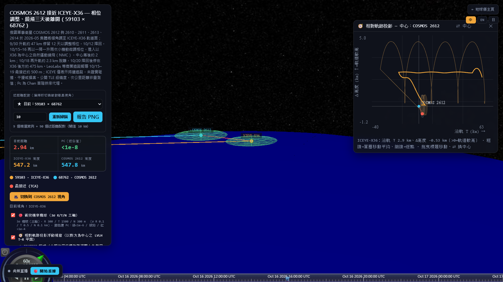

> 3D 回放截圖（中文介面，2026-10-16 繞飛期間）：橘點＝X36、藍點＝COSMOS 2612，兩星周圍的網格為 3σ 位置不確定性橢球；右上浮動視窗以 COSMOS 2612 為中心畫出相對軌跡，可見每圈的繞飛弧線。

### ⑤ 判讀與限制（誠實揭露）

- **看得出的**：軌道面匹配（5 月）、升軌停留調相位（9/30–10/12）、追趕與同步（10/15–16）、繞飛後離開（10/18–20）——這一串機動的順序與幅度，公開 TLE 都能清楚重建，並與外部報導的時間吻合。
- **看不出的**：次公里距離、繞飛橢圓的確切形狀、點火的確切時刻（TLE 晚於實際機動數小時），以及最重要的——**意圖**。公開資料只能描述衛星做了什麼，無法判斷它為什麼這樣做。
- **不下的結論**：兩星高度差小於公開 TLE 精度時，換用另一筆 elset，相對漂移的方向就可能反過來。因此 TLE 外推不能對「是否仍在伴飛」這類次公里尺度的問題下定論，需要雷達或光學的密集觀測。
- **為什麼重要**：即使沒有碰撞，極近距離的交會也可能迫使目標衛星做避讓、消耗燃料、打亂任務排程，或被視為展示反太空能力。對太空態勢感知而言，關鍵不只是最近距離，而是辨識**連續的機動序列**與相對軌道幾何——這正是本專案機動偵測方法的用途。

> 外部來源：CNN 2026-10-19 報導（https://edition.cnn.com/2026/10/19/science/russian-satellite-iceye-x36-approach）；LeoLabs 分析、RUSI 2026-06 報告與 ICEYE 聲明皆經該報導轉引，本專案未直接取得原文。

---

## 案例三十二：NOTSO、JCO、CIC 與 Space ISAC——美國太空軍如何與商業衛星業者共享威脅資訊

#### 商業衛星可能比軍方更早看到異常，也可能成為目標。從單向的非機密通知，到可交換機密資訊的協同圈，這幾個機制各自扮演什麼角色？

> **術語**：**SDA**（太空域感知）在追蹤物體位置之外，還涵蓋電磁頻譜、網路與意圖分析。**CSpOC** 是美國的聯合太空作戰中心。**RPO**（交會與近距離操作）指一顆衛星刻意接近另一顆。**SCIF** 是處理高機密資訊的安全隔離設施。**DD Form 254** 是證明公司與國防部有合約、需要接觸機密資訊的表單。

> ℹ️ **資料口徑**：本頁內容整理自 Elara Nova 的 Podcast「The Elara Edge」第 30 集〈Orbital Watch to Enable Sharing of Classified Threat Information〉（主持人 Scott King，來賓為退役上校 Charlie McGillis；https://elaranova.com/the-elara-edge-5/），屬他方口徑，本專案未獨立查證。節目頁面未標示刊登日期；Orbital Watch「今年四月」宣布的年份、「超過 900 家公司」的數字，以及對中國、俄羅斯能力與意圖的描述，皆為節目所述。

### ① 為什麼要和商業業者共享威脅資訊

- **威脅多元**：碰撞與碎片、網路攻擊、電子戰、GPS 干擾與欺騙、動能反衛星攻擊同時存在，商業衛星也可能成為目標。
- **軍民兩用**：許多國防任務依賴商業衛星與地面設施，太空軍認為必須與產業共享威脅資訊，才能維持國家太空能力的韌性。
- **商業端可能最早看到**：營運商往往最先遇到干擾、異常機動或網路事件，可以成為「指示與警告」的早期來源。

### ② Orbital Watch：從單向發布走向雙向交換

Orbital Watch 由太空系統司令部（SSC）宣布，目標是從單向發布非機密資訊，逐步發展到雙向交換，甚至分享機密威脅資訊。

| 階段 | 機制 | 資訊流向 | 重點 |
|---|---|---|---|
| 第一階段 | 透過 Space Force Front Door 基本註冊 | 單向 | 向已註冊廠商發送非機密威脅簡報；據來賓說法已超過 900 家公司。不需特殊訓練，但廠商無法追問或回報。 |
| 第二階段（規劃中） | 安全的商業入口網站 | 雙向 | 營運商可回報異常、提出問題，太空軍也能回傳觀察到的威脅；節目未確認已上線。 |

### ③ NOTSO、JCO、CIC、Space ISAC 是什麼

| 名詞 | 性質 | 參與門檻 | 資訊等級 | 主要功能 |
|---|---|---|---|---|
| NOTSO（太空營運商通知） | 通知／警示產品，不是組織 | 收到通知即可 | 非機密 | 告知衛星機動、發射等高關注太空事件 |
| JCO（聯合商業作業細胞） | 政府主導的商業資料整合機制 | 需訓練、遵循方法論並完成 onboarding | 非機密 | 整合商業感測器與分析，提供 24/7 非機密 SDA，並發布 NOTSO |
| CIC（商業整合細胞） | 邀請制的機密協同機制 | 受邀、訓練、具安全許可與合約基礎 | 可含機密 | 與 CSpOC 協同、參與演訓與軍事規劃 |
| Space ISAC（太空資訊共享與分析中心） | 會員制產業資訊共享組織 | 付費會員 | 以非機密為主，另涉網安 | 彙整會員回報、網安監測、24/7 營運中心、轉發 NOTSO |

**一句話區分**：NOTSO 告訴你「太空中發生了某件高關注事件」；JCO 整合商業資料看「正在發生什麼」並發出 NOTSO；CIC 邀請少數商業夥伴進入機密協同圈；Space ISAC 讓付費會員共享、回報與接收營運及網安威脅資訊。

### ④ JCO 與 CIC：開放的資料整合 vs 邀請制的機密協同

| 面向 | JCO | CIC |
|---|---|---|
| 主要目的 | 把商業感測器、資料與分析整合進「保護與防衛」任務 | 讓精選商業夥伴參與深度資訊共享、演訓與軍事規劃 |
| 運作重點 | 全球與區域細胞 24/7 運作，盟國也可參與 | 成員可派員進駐 CSpOC 作業現場 |
| 典型輸出 | 對衛星機動、發射等活動發布 NOTSO | 演訓參與、作戰司令部規劃支援、更深入的威脅與任務資訊 |
| 制度基礎 | 著重商業資料與分析能力的整合 | 早期以 CRADA（不涉金錢）贊助安全許可；成員多已持有 DD Form 254 |

節目以 **Viasat** 為例：它是 CIC 成員，俄烏戰爭開始時同時遭遇干擾與網路攻擊。若當時已有 Orbital Watch，CSpOC 可把這件事作為早期預警，告訴其他營運商類似攻擊可能是蓄意行為，而非偶發事故。

**參與深度大致排序**：Orbital Watch（廣泛非機密發布）→ JCO（商業資料整合、非機密 SDA）→ CIC（邀請制、機密協同）。

### ⑤ Space ISAC：產業端的彙整、網安監測與傳播

Space ISAC 不是政府作戰指揮單位，而是採「pay-to-play」付費會員制的產業資訊共享組織：
- **彙整與網安監測**：彙整會員回報的異常與網安事件，持續監測太空相關網路威脅——這是它與 JCO、CIC 最大的功能差異之一。
- **24/7 營運中心**：營運商遭遇異常或攻擊時可向其回報；資訊會在情報體系內上報，再嘗試傳播給其他營運商。
- **轉發 NOTSO**：轉發 JCO 的 NOTSO，並補充營運環境脈絡，協助會員理解事件的營運影響。
- **保護來源**：回報可能含專屬資訊，分享前需去識別化（whitewash）。
- **價值**：不需要政府合約或機密許可。對還沒有 DD Form 254、SCIF 或人員許可的公司，是最容易進入的資訊共享入口。

### ⑥ 威脅趨勢：RPO 不必然是敵意，關鍵是行為模式

以下為節目來賓與分析者的觀點：
- 近十年中國快速部署 ISR 衛星、衛星通信、大型星座與反太空能力，軌道機動也更積極。
- 實踐二十一號與實踐二十五號曾在 GEO 近距離操作，可能是衛星燃料補給實驗；TJS 系列被認為可能執行訊號情報、早期預警與衛星檢視任務，TJS-3 曾於 2018 年接近一顆美國 ISR 衛星。
- 來賓指出俄羅斯與中國擁有可照射成像衛星的雷射能力，並表示俄羅斯曾強調支援美軍的商業資產可能被視為合法目標（來賓的描述，非俄方原文）。

**RPO 本身不必然是敵意行為**：它可以用於燃料補給、檢查故障衛星或拍照，也可能用於監視、訊號偵察、干擾或反太空行動。判讀需要看**連續的機動序列與相對軌道幾何**。案例三十一以公開 TLE 重建 COSMOS 2612 接近 ICEYE-X36 的過程，就是這類分析的實例。

### ⑦ 機密共享的挑戰：不是「發 email」就好

- 機密共享需要設施安全等級、人員安全調查、need-to-know（知悉必要）、安全通訊線路與 SCIF。
- 許多商業公司沒有含 **DD Form 254** 的合約，缺乏取得機密資訊的正式管道——這是 Orbital Watch 第二階段最關鍵的制度難題。
- **DARPA BRIDGES** 曾讓 19 家公司在沒有合約的情況下取得安全許可（來賓說法），太空軍正與商業太空辦公室（COMSO）研議擴大。
- 取得人員許可後，公司仍可能沒有 SCIF；市場上已有可租用的 SCIF 空間。
- **可擴展性**：參與者超過 900 家時，誰優先取得機密資訊、如何避免「有許可者／無許可者」的落差，都是待解問題。

### ⑧ TraCSS 與 Orbital Watch：「它在哪裡」vs「它為什麼這樣做」

| 項目 | TraCSS | Orbital Watch |
|---|---|---|
| 主要目的 | 太空交通安全、避免碰撞 | 威脅感知、意圖判讀與風險因應 |
| 資訊性質 | 位置資料、軌道與碰撞風險 | 位置資料加上能力、行為與意圖評估 |
| 核心問題 | 「它在哪裡？」 | 「它為什麼這樣做？對我有什麼影響？」 |
| 主責定位 | 民用太空安全 | 太空軍的威脅資訊與國防任務支援 |

TraCSS 是美國的民用太空交通協調系統，類似太空版的空中交通管制。節目認為它未來可提供位置資料給太空軍作為威脅評估的輸入，但威脅判斷不是它的任務。

### ⑨ 對商業業者與台灣的意義

- **對業者**：政府可能更主動提供非機密威脅簡報；更深層的共享則可能要求安全許可與安全設施。具備異常偵測、RF 干擾／欺騙識別、軌道機動分析與網安通報能力的業者，最能成為早期預警來源。
- **四者對應不同參與深度**：廣播通知（NOTSO）→ 商業資料整合（JCO）→ 邀請制機密協同（CIC）→ 付費資安與情資社群（Space ISAC）。
- **對台灣或盟邦**：重點不在直接複製美國制度，而是建立「**非機密早期預警 + 商業資料整合 + 盟邦資訊共享**」的分層架構。
- **本專案的位置**：以公開 TLE 偵測軌道機動、重建 RPO 序列（見案例三十一），屬於「非機密早期預警」這一層能提供的能力。限制也要說清楚：TLE 位置誤差約為公里級、更新間隔為數小時，因此只能作為提示與篩選，不能取代精密定軌或機密情資。

> ✅ **判讀**：這幾個機制的差別，不在誰比較重要，而在**參與門檻與資訊等級**。對大多數商業業者而言，起點是非機密的通知與社群共享；能否走進機密協同圈，取決於合約、人員許可與設施，而不只是技術能力。

> 外部來源：Elara Nova「The Elara Edge」第 30 集（https://elaranova.com/the-elara-edge-5/）。同一份整理已加入 SSA-RAG 知識庫，可在分析工具頁「SSA-RAG 知識問答」詢問 NOTSO、JCO、CIC、Space ISAC 等問題。
