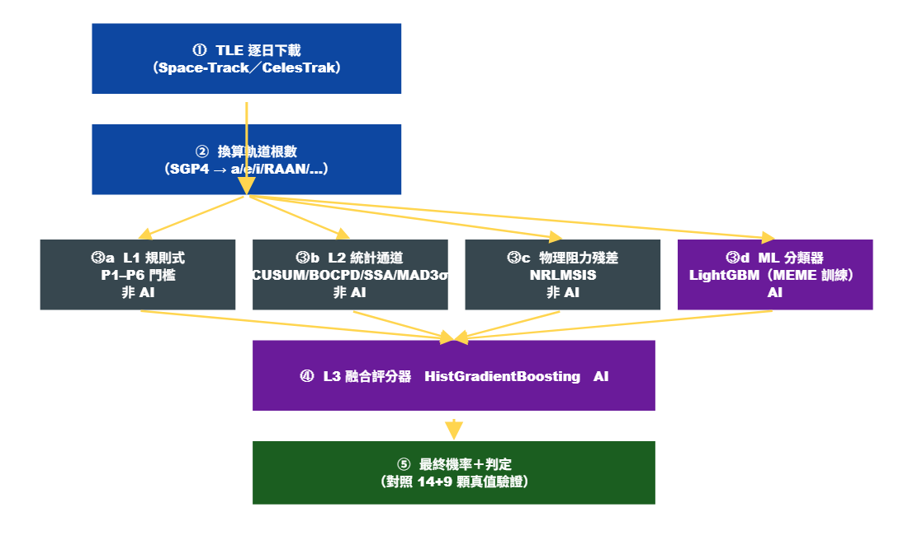
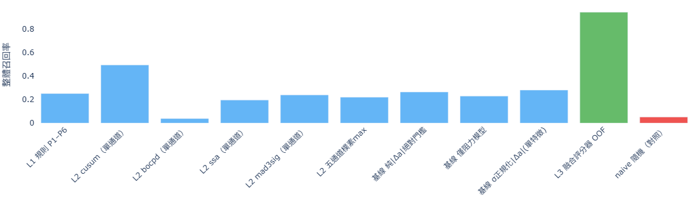

<!-- 由 docs/export_storymap_md.py 自 maneuver_app_2026November.py 匯出；線上版：https://rhynowu-maneuver-detection-i18n.hf.space/?mode=storymap&case=case1 -->

# 案例一：從 TLE 偵測機動，到底可不可行？

### 演算法架構與流程全貌（StoryMap 入口／總覽案例）

> 本頁為 StoryMap 的總覽案例：先看懂整體架構，後面每個案例都是這張圖裡某一塊的深入展開。

**核心問題**：公開、免費、每天更新一次、定位精度只有百公尺量級的 TLE，能不能拿來偵測衛星的軌道機動？（正因為它免費、覆蓋全球幾乎所有在軌衛星、歷史又長，才會讓人想拿它來做這件事——但它的設計初衷其實是「粗略軌道預報」，不是精密物理量測。）

**本專案的答案**：可以，但必須用對方法組合，而且一定要用獨立的機動真值（精密星曆或官方紀錄）反覆驗證，**不能只靠「看起來合理」就相信結果**。

## ① 整體流程

> 下方文字說明中，每個步驟前面的顏色標記對應流程圖中的色塊：　🔵 藍＝資料前處理　⬛ 灰＝非 AI（規則／統計／物理模型）　🟣 紫＝AI（機器學習）　🟢 綠＝最終驗證

**🔵 ①② 資料前處理**

每日從 Space-Track 或 CelesTrak 下載最新 TLE，利用 SGP4（一套標準化的軌道傳播演算法）換算成時間序列形式的軌道根數（描述軌道形狀與方位的一組數字），包括半長軸、離心率、傾角等。這些「軌道根數時序」就是後續所有偵測方法的共同輸入訊號。

**③ 四種平行偵測方法**（同一份軌道根數時序，同時送進四種原理完全不同的通道——詳細分類見案例二）

**⬛ L1 規則式 P1–P6**：人工訂定的硬門檻規則，例如「半長軸變化量 |Δa| 超過某個值」就標記為可能機動。優點是最容易理解、最容易解釋；缺點是誤報與漏報都偏高，單獨使用不夠可靠。

**⬛ L2 統計變點偵測**：CUSUM（累積偏離量）、BOCPD（貝葉斯變點偵測）、SSA（奇異譜分析）、MAD3σ（以中位數絕對偏差設門檻）四個經典統計通道，各自用不同的數學定義去捕捉「訊號突然改變」的時刻。

**⬛ 物理阻力殘差**：先用 NRLMSIS 大氣密度模型估算「這段時間單純由大氣阻力造成的軌道衰減應該是多少」，再從實際觀測的軌道變化中扣掉這部分——剩下的「殘差」才是真正需要由機動來解釋的訊號（詳細推導見案例五）。

**🟣 ML 分類器**：用 14 顆擁有精密星曆真值的衛星資料，訓練一個 LightGBM（一種梯度提升樹模型）分類器，直接學習「有機動 vs 無機動」在軌道根數時序上的特徵模式。

**🟣 ④ 融合**

L3 融合評分器把前面所有通道的分數（規則分數、統計變點分數、阻力殘差分數、ML 分類機率）當作特徵，訓練一個 HistGradientBoosting（一種能穩健處理大量特徵與缺值的梯度提升模型）模型來統一裁決——**不是隨便選一種方法的結果，而是讓模型學會在什麼情況下該相信哪一個通道**，綜合所有訊號做出最終判定。

**🟢 ⑤ 驗證**

最終判定結果會與兩組機動真值逐一核對：「原始 14 顆開發樣本」＋「9 顆完全沒參與開發的 hold-out 衛星」（用來測試模型是否真的學到可泛化的機動特徵，而不是背答案）。機動真值來源包括 IDS/DORIS（國際多普勒衛星定軌系統之精密軌道）、NASA PO.DAAC、TACC 等機構提供的精密星曆（詳細來源與處理見案例四）。**換句話說：本專案的績效不是自己說了算，而是用獨立、外部的高精度資料反覆驗證過。**

## ② 可行性驗證：這套組合方法，準不準？

> ✅ **答案是肯定的**：融合模型的整體召回率達 **94.6%**，對大型機動事件召回率更高達 **97.0%**，而且在完全沒參與訓練的 hold-out 衛星上，AUC 仍達 0.98（見案例九的 unseen-satellite 測試）——這代表模型不是「背下 14 顆衛星的答案」，而是真的學到可泛化的機動特徵，即使換到新的衛星上，依然能維持高水準的偵測能力。

> 方法逐一展開見：案例五（物理阻力殘差）、案例九（三層擂台公平比較）、案例四（真值資料從哪來）、案例二（哪些步驟用了 AI、哪些沒有）。

---

> ℹ️ **如何使用本 StoryMap**：若你是第一次接觸本系列，建議的閱讀順序是——
>
> **案例一**（本頁）：看懂整體架構與流程　→　**案例二**：了解哪些步驟用了 AI、哪些沒有　→　**案例三～八**：深入各個關鍵技術環節（觀測窗長度、真值資料、阻力模型、星系批量偵測、危險接近、資料庫本身）　→　**案例九**：看 hold-out 衛星上的泛化表現　→　**案例十**：看一個誠實的負面結果與方法上限。
>
> 你也可以直接從 StoryMap 首頁跳到自己感興趣的案例，再把本頁當作「地圖」隨時回來對照。

---
線上互動版：<https://rhynowu-maneuver-detection-i18n.hf.space/?mode=storymap&case=case1>
