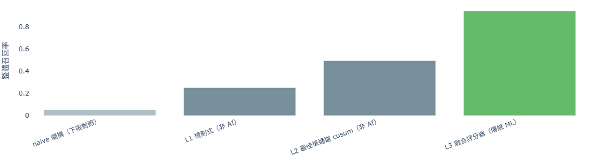

<!-- 由 docs/export_storymap_md.py 自 maneuver_app_2026November.py 匯出；線上版：https://rhynowu-maneuver-detection-i18n.hf.space/?mode=storymap&case=case2 -->

# 案例二：我們的方法，哪些用了 AI？哪些沒有？

### 分層混合架構：AI／非AI／已嘗試放棄的深度學習，邊界劃在哪裡

> 這一頁專門回答一個常見的疑問：前面案例展示的成果，到底是「AI 做的」還是「傳統方法做的」？

**先講結論**：這是一個**分層混合架構**，不是「全部都是 AI」也不是「完全沒有 AI」——每一層方法有沒有用 AI，取決於「這個問題有沒有足夠的真值資料可以學」以及「需不需要對任何衛星都成立的物理保證」。

## ① 三個分類：完全不是 AI／經典機器學習／深度學習（已放棄）

**🔧 完全不是 AI（寫死的規則／統計公式／物理模型）**

　L1 規則式 P1–P6　·　L2 統計變點偵測（CUSUM／BOCPD／SSA／MAD3σ）　·　NRLMSIS 大氣阻力物理模型

> 所有參數都是人工設定或物理常數，不從訓練資料學習權重；對任何衛星、任何時候都用同一套公式，**可以完全解釋每一個判定是怎麼算出來的**。

**🤖 經典機器學習（從真值資料學規則）**

　LightGBM 機動分類器（14 顆 MEME 精密星曆訓練）　·　L3 融合評分器 HistGradientBoosting　·　Model 2 Isolation Forest（無監督異常偵測）

> 這幾個模型的參數是從真實機動真值資料「學」出來的，能捕捉規則式方法寫不出來的複雜組合條件，犧牲一部分「人類可讀性」換取更高的準確率。

**🧠 深度學習（嘗試過，因負面結果而放棄）**

　bi-GRU 序列標註器（Model 3）

> 曾嘗試用遞迴神經網路直接對整段軌道時序做序列標註，但實測**沒有比傳統方法更好的判別力**、且在未訓練過的衛星上（OOD）表現崩潰——誠實記錄這個負面結果，繼續使用效果更好、更穩定的 Model 2。

## ② 加了 AI 到底差多少？用真實數字回答

| 方法 | 是否為 AI | 召回率 |
|---|---|---|
| naive 隨機（下限對照） | — | 0.05126 |
| L1 規則式（非 AI） | 否 | 0.2513 |
| L2 最佳單通道 cusum（非 AI） | 否 | 0.4958 |
| L3 融合評分器（傳統 ML） | 是（HistGradientBoosting） | 0.9464 |

> ✅ **沒有 AI（規則＋單一統計通道）最高只能到 49.6% 召回率；加上 AI（融合評分器）跳升到 94.6%**——差距主要來自融合模型能同時權衡多個弱訊號的組合，而不是只認一種模式。但非 AI 方法的價值在於：任何時候都能解釋「為什麼判定機動」，這也是為什麼系統把它們保留當作 L1/L2 的第一線，而不是直接跳過去只用 AI。

---

> ℹ️ **判讀**：「用不用 AI」不是單選題，而是**依任務需求分層選擇**——解釋性優先、資料稀疏、或需要對任何衛星（含從未見過的）都成立物理保證的環節，用非 AI 方法；有足夠真值資料、追求最高準確率的最終裁決環節，用傳統機器學習；深度學習則先誠實驗證過「有沒有真的帶來額外好處」，沒有就不勉強用。

> 完整方法清單見 `docs/期末報告_技術附錄_20260909.md`；bi-GRU 負面結果見 `ml_bigru_labeler.py`。

---
線上互動版：<https://rhynowu-maneuver-detection-i18n.hf.space/?mode=storymap&case=case2>
