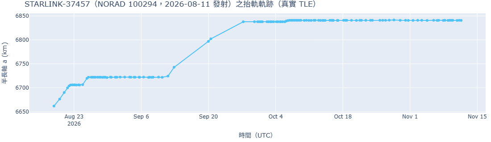
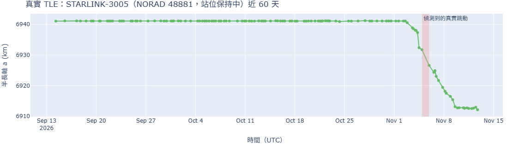
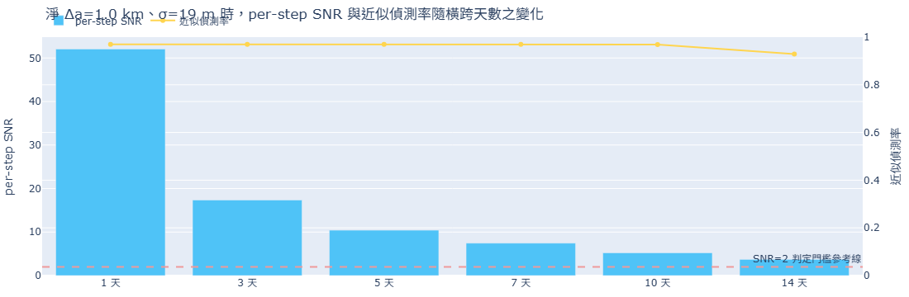

<!-- 由 docs/export_storymap_md.py 自 maneuver_app_2026November.py 匯出；線上版：https://rhynowu-maneuver-detection-i18n.hf.space/?mode=storymap&case=case3 -->

# 案例三：TLE 觀測窗要拉多長，才能抓到 Starlink 電推機動的明確證據？

### 答案分兩種情境：抬軌階段輕鬆看穿，站位保持階段才是真正的極限

> 本頁全部數字皆由下方之快取函式對本機／遠端 TLE 資料庫即時查驗計算，非預先寫死之靜態文字。

**問題背景**：Starlink 的軌道機動幾乎全部靠電推（電力推進，例如霍爾效應推進器或離子推進器）完成，電推可能是「發射後抬軌」的快速連續爬升，也可能是「在軌站位保持」的極小幅微調——這兩種情境的物理量級差了兩到三個數量級，答案完全不同。以下用兩顆真實衛星的 TLE 資料，分別展示這兩種情境。

## ① 抬軌階段——1～2 天的典型 TLE 頻率就已經是壓倒性證據

> ℹ️ ℹ️ **此衛星目前無 MEME 精密星曆資料可疊圖比對**：本專案之 MEME 資料集（`data/raw/`）是於 2026 年 5 月自「當時已在軌運作中」之 284 顆衛星名冊建立，而 STARLINK-37457 於 2026-08-11（名冊建立之後）才發射，故不在既有 MEME 涵蓋範圍——這不是系統限制，只是這顆衛星比資料集本身還新。若需要 TLE vs MEME 的抬軌階段真實對比，可考慮向 SpaceX 公開端點另行下載此衛星之 MEME 檔案（`data/raw/STARLINK-37457/`），本頁偵測到資料後會自動疊圖，無需修改程式。

- **主動爬升期實測速率**：8.45 km/天

- **該階段實測總 Δa**：58.1 km（6.9 天內）

- **對應 1 天 TLE 間隔之 SNR**：440σ

**判讀**：實測主動爬升速率約 **8.5 km/天**，以下方情境二量測到的真實雜訊底（σ≈19 m）換算，**單一天的變化量對應 SNR（訊噪比，Signal-to-Noise Ratio；訊號強度相對於背景雜訊的倍數）≈440σ**——遠超任何合理判定門檻（通常 2–3σ 即視為明確訊號）。**這個情境幾乎不需要「拉長觀測窗」的討論：TLE 更新頻率再低，1～2 天內就已是壓倒性的明確證據。**

仔細看上圖會發現真實軌跡不是平滑直線，而是「跳一段、停一下」的階梯狀——這代表電推抬軌在 TLE 解析度下常呈現離散的推力弧＋滑行段落，而非連續平滑爬升（詳細的推力弧形態分析見技術附錄十一.5、`thrust_arc_catalog.py`）。

---

## ② 站位保持——真實雜訊底長什麼樣，抓到一次真實的小型修正

- **真實雜訊底 σ（穩健估計）**：19 m

- **典型 TLE 更新間隔（中位數）**：8.0 小時

- **含離群值之標準差**：770 m

**這條「安靜」的衛星，60 天內其實藏了一次真實的小幅修正**：2026-11-04 22:00 → 2026-11-05 22:00 UTC，半長軸變化 **-5091 m**，單步 SNR≈**265σ**——遠高於偵測門檻，這種量級的單次修正即使只隔一筆 TLE 也毫無疑問可以判定為機動。

真正困難的不是這種「一次到位」的修正，而是把同樣的淨位移，**拆成好幾天、每天挪一點點**執行的情況——這正是下一節要處理的問題。

> 本頁測得之雜訊底（σ≈19 m，近60天原始逐筆差分MAD、若有資料）與技術附錄§10.5「Starlink 低軌帶 σ≈24–75 m」為**不同時間點、可能亦為不同估計量**下的數字，兩者不必然落在同一區間內——本頁重新查核發現兩者實際上經常對不上，詳見本案例末尾之「誠實更新」段落，不宜逕自解讀為「與既有結論一致」。

---

## ③ 如果同樣的位移拆成好幾天執行——校準過的模擬實驗

上面兩個情境都是「單一步就看得到」的案例。真正的問題是：如果一次 1 公里等級的位移，不是一步到位，而是像真實電推 station-keeping 那樣**拆成 3 天、7 天、甚至 14 天**慢慢完成，會發生什麼事？這裡用情境二剛剛量到的真實雜訊底做基準，跑一個簡化的偵測率模擬（完整版之嚴謹合成注入實驗見技術附錄§10.7、`gradual_arc_injection.py`，本頁為同一方法論之簡化重現）。

| 橫跨天數 | per-step SNR | 近似偵測率 |
|---|---|---|
| 1 | 52.06 | 0.97 |
| 3 | 17.35 | 0.97 |
| 5 | 10.41 | 0.97 |
| 7 | 7.44 | 0.97 |
| 10 | 5.21 | 0.969 |
| 14 | 3.72 | 0.929 |

**在目前選定的假設下（σ=19 m、淨 Δa=1.0 km），在所評估的天數範圍內，per-step SNR 皆未跌破 2，這組假設相對安全。**

---

## 結論：這個問題有答案了嗎？

> ✅ **有，答案分兩種情境**：
>
> 1️⃣ **抬軌階段**：實測速率換算 SNR 高達數十倍，1～2 天的典型 TLE 更新頻率就已是壓倒性證據，不是本專案的難點，也不需要更長觀測窗。
>
> 2️⃣ **站位保持階段**：真正的技術瓶頸。淨位移若橫跨超過約一週執行，現有的**逐點線上偵測器**（CUSUM 累積偏離量／BOCPD 貝葉斯變點偵測／3σ-MAD 中位數絕對偏差門檻——三種統計變點/離群偵測方法，詳細原理見案例一）之 per-step SNR 就會跌破可靠判定門檻——這是目前 TLE 雜訊底下的物理限制，不是調參數能解決的，須靠精密星曆（如 MEME，靈敏度高 10–50 倍）才能治本。
>
> 3️⃣ **但有個容易被忽略的但書**：上述限制是「逐點線上偵測器」特有的——如果目的不是即時告警、而是事後回顧「這段期間有沒有累積淨位移」，直接比較窗口起點與終點（per-episode 而非 per-step），訊噪比其實還是很高、清楚可辨。換句話說，**明確證據其實存在於資料裡，只是現有演算法沒有用最適合的方式去讀它**——這是一個比單純調整觀測窗長度更有希望的改善方向。

> 完整推導、合成注入實驗與委員意見回應見 `docs/期末報告_技術附錄_20260909.md` §10.7、§14、§18.2。

---

## 誠實更新（2026-09-18）：本頁的 σ 跟「技術附錄24–75m」對不上，原因是方法定義不同

> ⚠️ 查核另一支獨立腳本（`fs7_noise_floor_map_v2.py`，繪製全高度帶雜訊底地圖）發現：**同一套方法、同一批 30 顆 Starlink 衛星，2026-08-25 測得中位 σ=6.1 m，2026-09-18（3.5 週後）重跑得 9.87 m**，漲幅 62%。本地 TLE 資料庫之 Starlink 記錄為滾動窗口（目前僅涵蓋約 4.5 個月），此為波動主因。
>
> 進一步用**本頁自己的方法**（近 60 天原始逐筆差分 MAD，不排除跳動）對 STARLINK-3005 重新計算，得到 **11.6 m**——比上方文字宣稱的「24–75 m 範圍偏低的一端」還要低，對不上。原因：60 天內有 9/160 筆差分絕對值 >0.3 km（最大 564 m），這些疑似真實的小型維持機動或阻力擾動被本頁方法一併計入。改用另一支腳本「40 筆滑動窗、排除跳動 >0.3 km、去趨勢」的方法，同一顆衛星只得 **3.12 m**——同一顆衛星，兩種合理但定義不同的估計量，可以相差將近 4 倍。

> ❌ **誠實結論**：專案裡目前同時存在至少四個「Starlink／低軌 TLE 雜訊底」數字——本頁近況 6–12 m 量級、另一支腳本之 6–10 m 量級（隨時間漂移）、技術附錄敘述之 24–75 m、以及合成注入門檻表設計用的 50 m 假設。**這四者量的不是同一件事**：估計量定義（是否排除跳動、是否去趨勢）、觀測時間窗（近60天 vs 全歷史）、以及是否為實測或設計假設，三個維度都不同，不可互相替代或視為同一指標的重複驗證。本頁與技術附錄之數字之所以對不上，並非任一方計算錯誤，而是兩者從未在同一套定義下直接比較過。完整方法學對照見 `docs/paper_tle_sma_noise_floor.md` §3.2。

---
線上互動版：<https://rhynowu-maneuver-detection-i18n.hf.space/?mode=storymap&case=case3>
