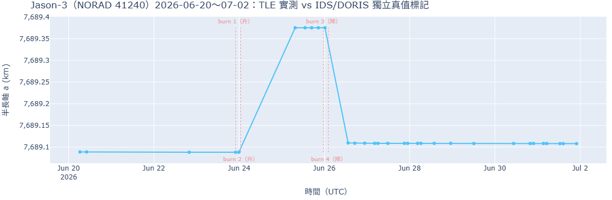

<!-- 由 docs/export_storymap_md.py 自 maneuver_app_2026November.py 匯出；線上版：https://rhynowu-maneuver-detection-i18n.hf.space/?mode=storymap&case=case4 -->

# 案例四：23 顆外部標竿衛星的機動真值，從哪裡來、怎麼處理？

### 三個公開、免帳號來源，用真實案例驗證 TLE 是否對得上獨立真值

> 本報告多處宣稱之「非自算、外部獨立真值」，具體是怎麼取得的？這裡完整交代「14 顆開發樣本」＋「9 顆從未參與開發的 hold-out 衛星」共 23 顆之機動真值來源，並用一組真實案例驗證：TLE 看到的變化，是否真的對得上這份獨立真值。

## ① 三個真值來源——這 23 顆星的真值不是同一個來源

| 來源 | 涵蓋衛星 | 顆數 | 資料型態 | 時間系統 | 下載點 |
|---|---|--:|---|---|---|
| **A. IDS/DORIS 機動歷史檔** | 14 顆開發用測高星 ＋ hold-out 之 SPOT-2/3/4/5、Sentinel-6B | **19** | operator 認證機動日誌（含逐次 ΔV） | **TAI** | `ids-doris.org` |
| **B. NASA PO.DAAC SOE 檔** | GRACE-A/B、GRACE-FO-C/D（全為 hold-out） | **4** | operator 認證推力事件（窗級） | **GPS 秒** | `archive.podaac.earthdata.nasa.gov` |
| **C. TACC 福衛七號 leoOrb** | 福衛七號 6 顆（非 23 顆之一，另作 TLE 誤差基準用） | 6 | SP3-c 精密定軌星曆 | **GPS 時** | `tacc.cwa.gov.tw` |

> ✅ **三個來源皆為公開、免帳號**——不需要 Earthdata、Space-Track 等任何登入即可直接下載，這正是「非自算」可信度的基礎：真值來自衛星操作方自己認證公布的紀錄，不是本專案自己算出來再拿來自我驗證。

## ② 14 顆開發 vs 9 顆 hold-out 的分組與來源歸屬

| 分組 | 衛星 | 來源 |
|---|---|---|
| **14 顆開發用** | Jason-1、Jason-2、Jason-3、Sentinel-6A、TOPEX/Poseidon、CryoSat-2、Envisat、Sentinel-3A、Sentinel-3B、SARAL、SWOT、HY-2A、HY-2C、HY-2D | 全部 **A. IDS** |
| **9 顆 hold-out** | SPOT-2、SPOT-3、SPOT-4、SPOT-5、Sentinel-6B | **A. IDS**（5 顆） |
| | GRACE-A、GRACE-B、GRACE-FO-C、GRACE-FO-D | **B. PO.DAAC**（4 顆） |

**這 9 顆 hold-out 怎麼選出來的**：具「LEO ＋ 公開機動真值」者共 18 顆 IDS/DORIS 測高星；扣掉 4 顆較老舊的 SPOT（成像任務、2010 年前 TLE 品質較差、姿態框架真值），得到現代乾淨的 14 顆做開發。**這 9 顆 hold-out 是「14 星之外全部剩餘可用者」，不是為了讓結果好看而挑選出來的**——把 4 顆 SPOT 放回來，加上原本就在 IDS 名單內、但未列入 14 顆開發集的 Sentinel-6B，再加上不在 IDS 名單、需另尋 PO.DAAC 來源的 GRACE 四姊妹。

## ③ 處理這些資料最容易出錯的地方

> ⚠️ **三個來源的時間系統各不相同，是最容易出錯之處**：IDS 用 **TAI**、PO.DAAC 的 SOE 檔用 **GPS 秒（自 J2000 起算）**、leoOrb 精密星曆用 **GPS 時**——三者與 UTC 皆有數十秒的固定差距。這個差距對「事件發生在哪一天」看似無傷大雅，但對接下來要比對的**機動時刻定位精度**（本報告中位數約 2.7 小時）而言，數十秒的系統性偏移若沒扣除，會讓每一次比對都固定偏移、稀釋掉真正的精度數字。本專案之解析器（`ids_man_parse.py`／`soe_build_truth_grace.py`）已內建對應換算，並各自留一條回歸測試防止未來改版時再次弄錯。

## ④ 真實案例：Jason-3 的一次「升軌又降回來」站位保持

**IDS/DORIS 真值記載**（`ids-doris.org` 公開機動日誌，operator 認證，非本專案自算）：

| 真值時刻（UTC） | 真值 Δa (km) | 說明 |
|---|---|---|
| 2026-06-23T22:02:47.763 | 0.1505 | burn 1（升） |
| 2026-06-24T00:50:35.701 | 0.1504 | burn 2（升） |
| 2026-06-25T23:27:24.730 | -0.14 | burn 3（降） |
| 2026-06-26T02:15:13.168 | -0.1399 | burn 4（降） |

> ✅ **判讀**：真值記載 06-23／06-24 有兩次共 **+0.301 km** 的升軌點火，06-25／06-26 又有兩次共 **-0.280 km** 的降軌點火——這是典型的「站位保持死區來回」操作（先讓軌道略升，衰減一段時間後再修正回來）。**上圖的真實 TLE 曲線精確重現了這個先升後降的形狀**，時間點與真值標記完全對齊，淨變化量級也與真值相符（約 0.28～0.30 km）——這是本報告一貫方法論的具體示範：**用完全獨立、operator 自己認證的第三方紀錄，驗證我方從公開 TLE 讀出的訊號是否可信，而非球員兼裁判。**

> 完整三來源之下載、篩選條件、例外處理與 23 顆完整清單，見 `docs/TASA_資料取得與處理_真值與精密星曆/`（README.md 及 01–04 號文件）；本節數字之可重現指令見該包 README §五。

---
線上互動版：<https://rhynowu-maneuver-detection-i18n.hf.space/?mode=storymap&case=case4>
