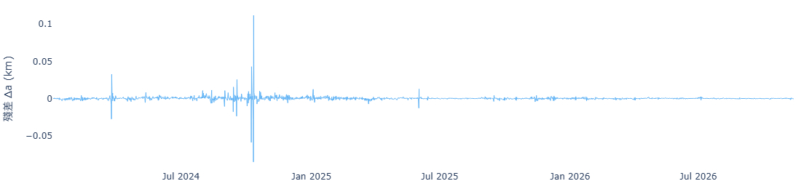
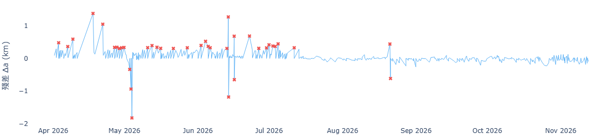
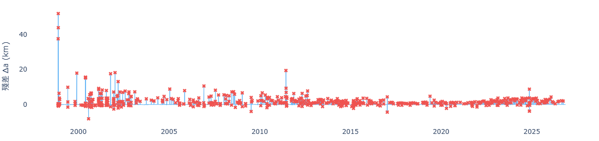
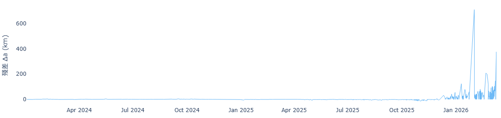
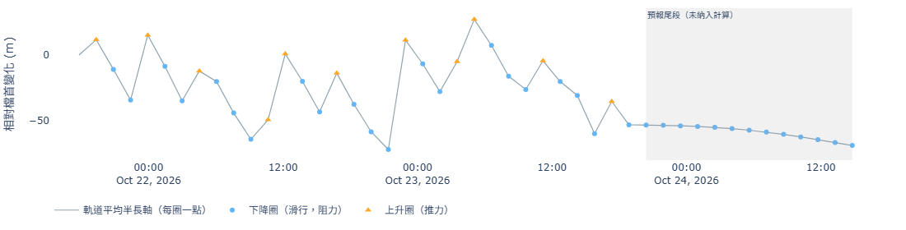
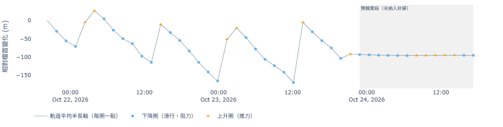

<!-- 由 docs/export_storymap_md.py 自 maneuver_app_2026November.py 匯出；線上版：https://rhynowu-maneuver-detection-i18n.hf.space/?mode=storymap&case=case5 -->

# 案例五：怎麼分辨「主動機動」跟「大氣阻力自然衰減」？

### 物理阻力殘差模型＋再入守門：四顆真實衛星的對照示範

> 本頁全部數字皆由下方之快取函式對本機／遠端 TLE 資料庫即時查驗計算，非預先寫死之靜態文字。

**問題背景**：低軌衛星的半長軸每天都在變小——這是大氣阻力造成的自然衰減，太陽活動越強（F10.7，10.7 公分波長太陽無線電通量，是最常用的太陽活動強度指標，越高代表太陽越活躍）衰減越快，跟「機動」完全無關。單看 |Δa| 沒辦法分辨兩者：一顆衛星今天掉了 50 公尺，可能是正常的阻力衰減，也可能是一次微幅機動。

本專案的作法是先用 **NRLMSIS-2.1 半經驗大氣密度模型**，逐衛星算出「這段時間阻力理論上應該讓軌道掉多少」（`da/dt = -B·ρ·√(μa)`，B 為逐衛星自我校準的等效彈道係數），再從實測 Δa 中扣掉這個理論值——**扣除後還剩下的殘差，才是真正需要解釋的訊號**（機動、或模型解釋不了的異常）。

## 四顆真實衛星對照：殘差長什麼樣子？

### FORMOSAT-3A（純大氣衰減）

- **資料筆數**：2,549

- **殘差中位數**：0.3 m

- **殘差最大值**：0.11 km

- **判定為機動**：0

### STARLINK-30273（電推機動）

- **資料筆數**：551

- **殘差中位數**：42.6 m

- **殘差最大值**：1.82 km

- **判定為機動**：38

### ISS 國際太空站（真實 reboost，剛回補之 1998–2026 全歷史）

- **資料筆數**：47,801

- **殘差中位數**：9.0 m

- **殘差最大值**：51.91 km

- **判定為機動**：569

### Van Allen A（HEO 再入衰減）

- **資料筆數**：1,124

- **殘差中位數**：568.1 m

- **殘差最大值**：708.58 km

- **判定為機動**：0

> ⚠️ **再入守門觸發**：此衛星近地點已降到再入判準範圍，原始阻力殘差模型（非 secular）在這裡會爆量到最高 **709 km**——如果沒有 `is_reentry_decay()` 這道守門，系統會誤判成一次前所未見的巨大機動。守門邏輯直接判定「自然再入，機動=0」，上圖標記為機動的點數因此正確地是 **0**。

---

## MEME 預報裡看得到推力：滑行被阻力拉低，推力再推回去

上面的殘差都是從 TLE 算出來的。TLE 大約每 8 小時才一筆，看到的只是兩筆之間的**淨變化**；如果推力和阻力在中間互相抵銷，TLE 就看不出來。

SpaceX 公開的 **MEME 星曆**不一樣：每份檔是他們對未來 3 天、每分鐘一筆的預報軌道，裡面包含他們預定的推力。我們把半長軸**每繞一圈取一次平均**，扣掉地球重力場（J2）造成的每圈數公里起伏。J2 不會讓平均半長軸長期升降，所以剩下的變化只可能有兩個來源：**阻力只會讓它下降，要上升就必須有推力。**

### STARLINK-40097（NORAD 100880，V3 新星，~350 km）

> MEME 檔：2026-10-21（3 天預報）

### STARLINK-11204（NORAD 60931，成熟星，~360 km）

> MEME 檔：2026-10-21（3 天預報）

10-20 之後的每份檔都出現一樣的**鋸齒**：滑行時被阻力拉低，推力再推回去，三天下來淨變化幾乎是 0（各星 −28～+13 m／日）。逐圈拆開後，滑行段的阻力衰減約 −289～−346 m／日：

| 衛星 | NORAD | 類型 | 高度 (km) | MEME 滑行段阻力 (m/日) | 本專案模型預測 (m/日) | MEME 淨變化 (m/日) | B_eff |
|---|---|---|---|---|---|---|---|
| STARLINK-40097 | 100880 | V3 新星 | 345.5 | -325 | -249.7 | -25.7 | 9.7 |
| STARLINK-40075 | 100862 | V3 新星 | 345.7 | -288.8 | -241.5 | -28 | 10.49 |
| STARLINK-40094 | 100857 | V3 新星 | 345.7 | -291 | -307.2 | -21.4 | 13.26 |
| STARLINK-11444 | 62409 | 低軌星 | 356.3 | -345.7 | -303 | 12.2 | 16.71 |
| STARLINK-11204 | 60931 | 成熟星 | 359.7 | -336.6 | -33.2 | 6.7 | 2.16 |
| STARLINK-11246 | 60932 | 成熟星 | 359.6 | -313.1 | -35.4 | 13.1 | 2.24 |

> ✅ **判讀**：
>
> - **V3 新星**：本專案的阻力模型預測 −242～−307 m／日，與 MEME 滑行段相差在 23% 以內。所以 TLE 上看到的殘差偏正，是推力在補償阻力，**物理模型是對的**。但 MEME 真值只把淨變化 ≥ 5 km 算成機動，這些時段被標成「安靜」，阻力殘差因此看起來像誤報。
> - **成熟星**（60931、60932）：真實阻力和 V3 差不多（−313～−337 m／日），我們的模型卻只預測 −33～−35 m／日，**低估約 9 倍**。原因是它們長期補償阻力，TLE 上的半長軸幾乎不變，逐衛星自我校準的 B 只抓到雜訊而被壓得很小。殘差剛好接近 0，是「錯得剛好」。
> - **本案例的啟示**：對持續以推力補償阻力的衛星，自我校準的 B 不是物理阻力係數，殘差代表的是「相對這顆星常態的偏離」，而不是推力大小。這和案例三十「推力被藏進 B*」是同一類現象：TLE 的阻力參數會把持續的推力吸收進去。

> 每份 MEME 檔約第 50 小時之後（圖中灰底）逐圈只變化數公尺，不像真實的阻力衰減，應是預報尾段改用了不同的外推方式，統計時已排除；若納入，滑行段阻力會被低估約 5～15%。MEME 是 SpaceX 自身的力模型與預報，不是量測真值，但與本專案模型彼此獨立。MEME 原始星曆未上傳到本站，本節使用預先計算的凍結資料（`data/benchmark/case5_meme_*_20261029.csv`；產生器 `research_202610/validation_20261029/scripts/case5_meme_sawtooth_data.py`）。10-06～10-20 MEME 無資料。

---

> ✅ **判讀**：FORMOSAT-3A（穩定低軌、無機動）的殘差幾乎全部貼著 0；STARLINK-30273 的殘差有明顯超過門檻的尖峰，對應真實電推站位保持；ISS 因為橫跨 1998–2026 近 28 年真實推進器 reboost 歷史（本次對話中才剛從只有 2026-03 之後的殘缺資料，回補到完整 1998 年至今），殘差尖峰數量遠高於前兩者；Van Allen A 展示的是「模型會出錯，但系統設計了守門」的真實案例——**沒有物理阻力模型會把正常衰減當機動，沒有再入守門則會把再入當成史上最大機動。三道防線缺一不可。**

> 方法完整推導見 `atmospheric_drag.py`（NRLMSIS 阻力殘差）與 `docs/期末報告_技術附錄_20260909.md` §六～六.5。

---
線上互動版：<https://rhynowu-maneuver-detection-i18n.hf.space/?mode=storymap&case=case5>
