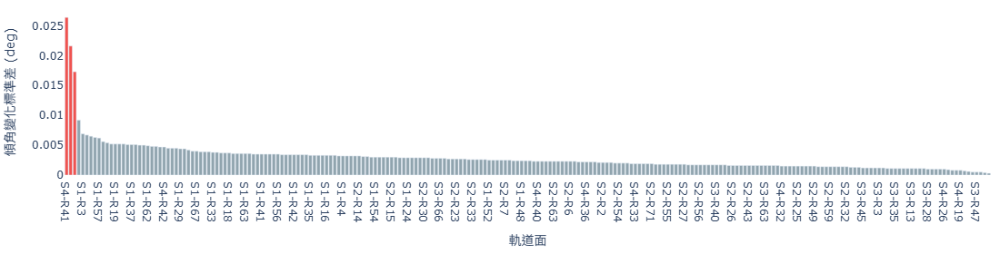
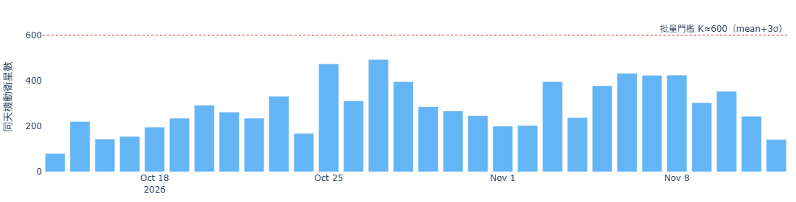
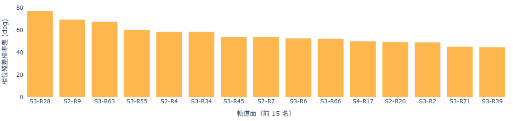

<!-- 由 docs/export_storymap_md.py 自 maneuver_app_2026November.py 匯出；線上版：https://rhynowu-maneuver-detection-i18n.hf.space/?mode=storymap&case=case6 -->

# 案例六：Starlink 這種巨型星系，抓得到「一次調整一整批衛星」嗎？

### 軌道面一致性、批量機動、隊形相位——三個角度即時檢驗上萬顆衛星

> 本頁對整個 Starlink 星系即時計算，資料量較大，首次載入可能需要數十秒。

**問題背景**：單顆衛星的機動偵測回答的是「這一顆有沒有動」；但 Starlink 有上萬顆衛星，有時候真正該問的是「有沒有一整批衛星同一天一起動」——這種集體行為（批次部署、軌道面重組）跟個別衛星的例行站位保持，代表完全不同的意義。以下用最近 30 天的真實資料，從三個角度檢驗：**軌道面是否一致**、**有沒有異常大量衛星同天機動**、**隊形相位有沒有跑掉**。

> ℹ️ 分析窗：**2026-10-13 ～ 2026-11-12**（11,234 顆衛星、828,374 筆 TLE）

## ① 軌道面一致性：同一個軌道面的衛星，傾角應該幾乎完全一樣

> 門檻＝中位數 + 3σ（自適應，非固定值）。紅色＝異常偏高的 3 個軌道面，共 228 個軌道面中。

## ② 批量機動識別：有沒有異常多顆衛星同一天一起機動？

> 觀測窗內單日最高 **494 顆**（2026-10-27），門檻 K≈600；判定為「批量事件日」共 **0 天**。

## ③ 隊形相位誤差：同一軌道面內的衛星間距，有沒有跑掉？

> 227 個軌道面中，相位離群衛星總數 **290 顆**。

---

> ✅ **判讀（誠實揭露）**：這 30 天真實資料裡，**沒有任何一天觸發批量機動門檻**（最高 494 顆 < K≈600 顆）——這本身就是一個有意義的負面結果：Starlink 的電推機動是持續性、分散式的個別衛星站位保持，不是集中式的全星系同步動作。但軌道面一致性上仍抓到 **3 個**傾角異常偏高的軌道面（可能是新一批尚未完全settle的衛星、或殼層間的協同傾角調整），值得後續追蹤。

> 方法完整推導見 `constellation_anomaly.py`；可用 `python constellation_anomaly.py --list` 查看其他已支援星系（OneWeb/Qianfan/Yaogan/Gaofen/Jilin）。

---
線上互動版：<https://rhynowu-maneuver-detection-i18n.hf.space/?mode=storymap&case=case6>
