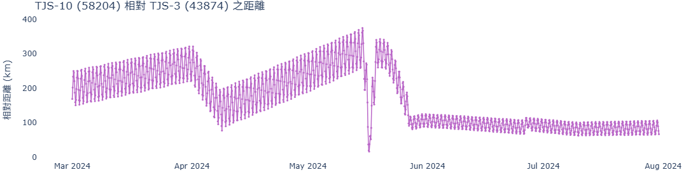
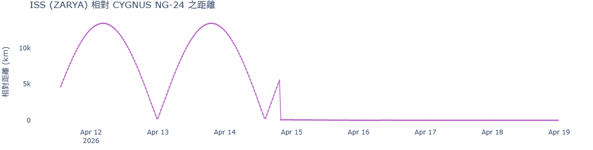

<!-- 由 docs/export_storymap_md.py 自 maneuver_app_2026November.py 匯出；線上版：https://rhynowu-maneuver-detection-i18n.hf.space/?mode=storymap&case=case7 -->

# 案例七：兩顆衛星多近才算「危險接近」？Pc／TCA 怎麼算出來的？

### 同樣的距離量級，非合作抵近與計畫內對接是完全不同的故事

> 本頁全部數字皆由下方之快取函式對本機／遠端 TLE 資料庫即時以 SGP4 重建相對軌跡計算。

**問題背景**：「兩顆衛星距離 15 公里」跟「兩顆衛星距離 15 公里」，可能代表完全不同的事情——取決於這兩顆衛星「打算不打算」靠近彼此。本案例對照兩個真實事件：一個是**非合作／意圖不明**的 GEO 抵近，一個是**合作／計畫內**的太空站貨運對接。兩者的最近距離量級接近，但意義天差地遠。

本案例會用到兩個核心指標：**TCA**（Time of Closest Approach，最接近時刻——兩顆衛星預測軌跡距離最短的那一刻）與 **Pc**（Probability of Collision，碰撞機率——綜合最近距離與雙方軌道不確定性算出的一個 0～1 數字，越接近 1 代表碰撞風險越高）。

## ① TJS-10 抵近 TJS-3（GEO，2024 年春）

- **起始距離**：169 km

- **最近距離 (TCA)**：15.8 km

- **結束距離**：67 km

TJS-10（中國「通信技術試驗衛星」系列，任務不公開）與同軌位的 TJS-3 共位在 173°E 附近。2024 年 5 月 15–16 日，TJS-10 兩次真實半長軸機動（各 +11 公里量級）啟動西移，15 日後在 **2024-05-16 20:50 UTC 以 15.8 km** 從 TJS-3 東側掠過到西側，隨即再兩次反向機動煞車，最終停在 TJS-3 西側 65–85 公里處——**這是需要主動推進才能完成的軌跡反轉**，不是自然漂移。此案例常被歸類為「共位檢視／抵近偵察」行為。

## ② ISS 對接 Cygnus NG-24 貨運飛船（LEO，2026 年 4 月）

- **剛入軌時距離**：4,664 km

- **最遠曾拉開到**：13,423 km

- **對接時距離**：≈0 km

Cygnus NG-24 貨運飛船發射入軌後，軌道相位尚未對齊 ISS，前兩天距離曾一度拉開到超過 **13,423 km**——這是正常的相位追趕過程（振幅逐漸收斂的靠近震盪），**不是異常軌跡**。到 4 月 17 日左右完成最終逼近，正式對接後兩者軌道基本重合。

> ⚠️ **耐人尋味的對照**：本專案的自動化 Pc 篩選管線（`conjunction_events.parquet`）對這一組真實接近事件（TCA 2026-05-13 14:42 UTC，最近距離僅 **3.8 公尺**）計算出 **Pc = 0.0005，風險等級 = MEDIUM**——單看這組數字，跟一次真正危險的抵近事件幾乎無法區分。但這其實是一次完全計畫內、雙方都知情配合的太空站貨運對接，安全等級最高。**這正是本案例要傳達的重點**：Pc/TCA 的距離幾何計算本身無法分辨「合作」與「非合作」，必須額外比對飛行計畫、發射任務資料庫，才能判斷一次近距接近究竟是操作正常還是真正的威脅。

---

> ✅ **判讀**：TJS-10×TJS-3 與 ISS×Cygnus 的最近距離都在「公里到公尺」量級，純粹看距離／Pc 數字本身無法分辨兩者的意圖差異——前者是非合作的抵近偵察（需要額外比對軌道機動特徵如反轉軌跡、共位歷史），後者是合作的計畫性對接（有公開發射任務資料佐證）。**這也是為什麼實務上的 SSA/SDA 分析從不能只看單一 Pc 數字，而要結合任務資料庫、機動歷史與外部情資。**

> 方法完整推導見 `conjunction_viz.py`（compute_pair_series，SGP4 相對運動重建）；TJS-10×TJS-3 案例另有互動版四視角 3D 視覺化於 `figs/rpo_tjs10_tjs3_2024.html`。

---
線上互動版：<https://rhynowu-maneuver-detection-i18n.hf.space/?mode=storymap&case=case7>
