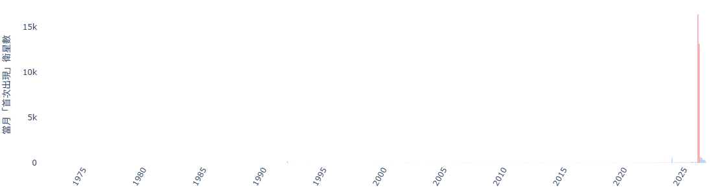

<!-- 由 docs/export_storymap_md.py 自 maneuver_app_2026November.py 匯出；線上版：https://rhynowu-maneuver-detection-i18n.hf.space/?mode=storymap&case=case8 -->

# 案例八：這個資料庫本身的故事——3.4 萬顆衛星、跨度 55 年、一次目錄大擴編

### 從一個真實的使用者提問出發的資料庫健檢

> 本頁全部數字皆由下方之快取函式對本機／遠端 TLE 資料庫即時查驗計算，非預先寫死之靜態文字。

**這個案例的起點是一個真實的使用者提問**：「目前 App 上看到的資料最早只到今年 3 月，當初設計的『分年 parquet』架構是不是沒有真正啟用？」——這個問題的調查過程本身，就是一次很好的資料庫健檢示範，所以把它原封不動做成一個案例。

## ① 全庫真實跨度：不是只有 3 月，是 55 年

- **衛星總數**：34,823

- **TLE 總筆數**：24,287,788

- **最早資料**：1971-04-30

- **最新資料**：2026-11-17

> 跨度約 **56 年**；其中 **534 顆衛星**在 2020 年以前就已有 TLE 紀錄（多為長期追蹤之標竿／既有衛星）。

## ② 逐月新收錄衛星數：3～4 月的斷崖式擴編

> ⚠️ **紅色兩根長條就是使用者觀察到的「3 月現象」的真正原因**：2026 年 3～4 月，單月就有 **29,494 顆衛星**是「首次」被收錄進追蹤管線——佔全庫 34,823 顆衛星的 **85%**。這是一次一次性的目錄擴編事件（追蹤範圍從幾百～兩千顆核心衛星，擴大到近乎全量的公開在軌目錄），**不是分年 parquet 沒啟用、也不是舊資料遺失**——新收錄物件的「歷史」本來就只能從收錄當下開始，無法回溯抓到收錄前的資料。

## ③ 具體案例：ISS（NORAD 25544）

- **目前最早 TLE**：1998-11-20

- **目前最新 TLE**：2026-11-12

- **目前筆數**：47,802

> ✅ ISS 目前資料已回補到 **1998-11-20**（完整歷史），本案例描述的「3 月斷點」問題已修復。

> 目前執行環境：資料後端 = `local`（local＝本機全庫 space_db.duckdb；hf＝遠端 httpfs 直查 HuggingFace Dataset）。

---

> ✅ **判讀**：「資料看起來從某個時間點才開始」幾乎都不代表資料遺失或架構沒生效，而是要先問「這顆衛星是什麼時候被納入追蹤範圍的」——這是所有長期累積型資料庫最容易被誤解的特徵。分年 parquet 分割邏輯確實寫在 `export_to_hf_parquet.py`（`PARTITION_BY (year)`），但只在單表超過 2,500 萬列時才觸發；本庫 `raw_tle_archive` 目前約 1,954 萬列，未達門檻，因此維持單檔——這與「3 月斷崖」是兩件完全獨立的事。

> 方法完整推導：本案例之調查對話記錄；相關程式見 `export_to_hf_parquet.py`、`backfill_tle_history.py`。

---
線上互動版：<https://rhynowu-maneuver-detection-i18n.hf.space/?mode=storymap&case=case8>
