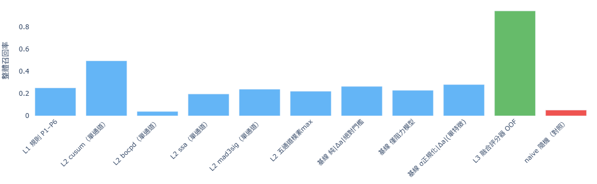

<!-- 由 docs/export_storymap_md.py 自 maneuver_app_2026November.py 匯出；線上版：https://rhynowu-maneuver-detection-i18n.hf.space/?mode=storymap&case=case9 -->

# 案例九：模型對「從沒看過的衛星」還準不準？三層擂台怎麼公平比較？

### Unseen-satellite hold-out：不讓模型背答案的誠實測試

> 本頁數字讀取自離線批次評測輸出（`data/benchmark/*_20260803.csv`）——這項評測本身涉及對全庫 284 顆衛星重跑 5 通道統計偵測器＋交叉驗證訓練，屬分鐘級批次工作，不適合在網頁點擊時即時重算，因此展示的是**凍結、可重現的評測結果**，而非即時查詢。

**問題背景**：機動偵測模型很容易「背answer」——如果訓練跟測試用到同一批衛星，模型可能只是記住了每顆衛星的個別特徵，而不是真的學會「機動長什麼樣子」。真正誠實的測試方法，是把一整批衛星**完全藏起來、從頭到尾不讓模型看過**，再拿訓練好的模型去猜這些陌生衛星的機動——這就是 unseen-satellite hold-out。

## ① Unseen-satellite hold-out 怎麼做的？

從全庫 **284** 顆有精密星曆真值的 Starlink 衛星中，用固定亂數種子（`np.random.default_rng(2026)`）隨機留出 **20%（56 顆）整組**，訓練另外 228 顆的模型後，直接套用到這 56 顆從沒見過的衛星身上——判定門檻也完全只用訓練折的資料決定，測試折的資料連「用來選門檻」都不准碰。（正樣本 unit **597** 個、負樣本 unit **6,636** 個）

| 情境 | AUC | 大型機動召回率 | 整體召回率 | 誤報率(FPR) | 測試 unit 數 |
|---|---|---|---|---|---|
| out-of-time（前60%訓/後40%盲測） | 0.9372 | 0.8 | 0.75 | 0.04402 | 2893 |
| unseen-satellite（保留 56 顆從未訓練） | 0.9802 | 1 | 0.9487 | 0.07015 | 1457 |

> 「out-of-time」是另一種嚴格測試：用前 60% 時間的資料訓練、後 40% 完全未來的資料盲測——兩者都比一般的隨機切分測試嚴格得多。

## ② 三層架構同一擂台：規則式 vs 傳統 ML（單通道）vs 融合模型

> 融合模型（L3）召回率 **94.6%**（大型機動 97.0%），遠高於純規則式 L1 的 25.1%，也遠高於隨機基準 naive 的 5.1%——naive 接近 0 正好證明這個測試集不是靠「亂猜也能矇對」的資料洩漏撐出來的高分。

## ③ 逐衛星戰績：哪些衛星模型表現最差？

| index | NORAD ID | 正樣本 unit 數 | 命中數 | 召回率 |
|---|---|---|---|---|
| 162 | 64038 | 3 | 1 | 0.3333 |
| 141 | 62600 | 2 | 1 | 0.5 |
| 276 | 68805 | 2 | 1 | 0.5 |
| 22 | 57676 | 2 | 1 | 0.5 |
| 93 | 59841 | 2 | 1 | 0.5 |

> （僅列出正樣本≥2 個之衛星以避免小樣本雜訊）另有 **252 顆**衛星的正樣本 unit 全數命中（召回率 100%）。沒有隱藏最差表現——這正是誠實揭露模型限制的一部分。

---

> ✅ **判讀**：AUC（Area Under Curve，ROC 曲線下面積——分類器整體判別力的常用指標，1.0 為完美、0.5 為隨機亂猜）達 0.98、大型機動召回率 100%（81 個大型事件全中，Wilson 95% CI [0.955, 1.000]）——在完全沒看過的衛星上依然成立，代表模型學到的是可泛化的機動特徵，不是死記個別衛星。out-of-time 測試的 AUC 略降到 0.94，是誠實的次要限制：時間越久，星系操作模式可能緩慢漂移，泛化力會比對「同時期陌生衛星」略打折扣，但仍遠優於任何單一規則或單通道方法。

> 完整推導與逐切片穩定度分析見 `three_layer_common_eval.py`、`docs/期末報告_技術附錄_20260909.md` §13.2、表 13-3／13-11。

---
線上互動版：<https://rhynowu-maneuver-detection-i18n.hf.space/?mode=storymap&case=case9>
