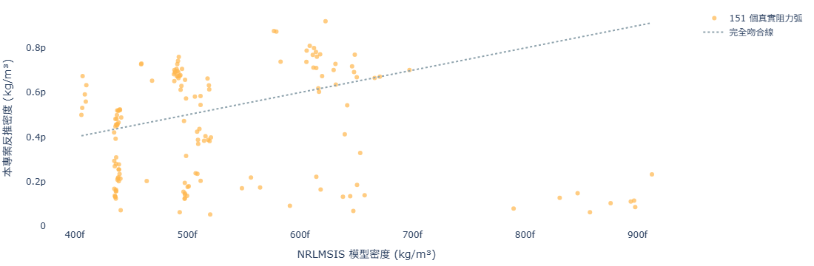

<!-- 由 docs/export_storymap_md.py 自 maneuver_app_2026November.py 匯出；線上版：https://rhynowu-maneuver-detection-i18n.hf.space/?mode=storymap&case=case10 -->

# 案例十：能不能只用 TLE 反推大氣密度？

### 一個誠實的負面結論與方法上限

> 本頁所有數字來自離線分析輸出檔 `thermosphere_kyoto_repro.csv`，記錄的是一次「未能成功複現目標結果」的真實嘗試。

**問題背景**：日本京都大學團隊（Yamamoto, 2026, *Earth, Planets and Space*, 78, Article 175）利用約 1,200 顆 Starlink 衛星的精密星曆，在約 482 公里高度反演出隨緯度與地方時變化的大氣密度 2D 分布圖——包括日側因太陽加熱而膨脹、夜側收縮的「密度鼓包」（地球大氣受陽光加熱後像被曬熱的氣球一樣局部膨脹，白天那一側的密度因此明顯高於夜晚那一側）。

**為什麼會有人期待 TLE 也能做到**：TLE 每天免費公開更新、涵蓋全球幾乎所有在軌衛星，如果能從中反推大氣密度，等於是拿到一份不花錢的全球太空天氣感測網。但 TLE 的設計初衷是「粗略軌道預報」，精度只有百公尺到公里級，遠低於精密星曆——**本案例要誠實回答的是：這個落差，最後會不會真的讓結果做不出來。**

本專案想問：如果只用免費、公開的 TLE（而非昂貴的精密星曆），有沒有機會做出類似等級的結果？本案例誠實展示結論：**做不到，並說明為什麼做不到**。

> 📄 原始論文：Yamamoto, T. (2026). *Earth, Planets and Space*, 78, Article 175. 京都大學團隊以約 1,200 顆 Starlink 衛星的精密星曆，反演熱層密度隨緯度與地方時變化的 2D 分布（本案例的參照基準）。本頁未直接附上全文連結——建議以上述書目資訊在期刊官網或 Google Scholar 搜尋全文，避免引用未經核對的第三方連結。

## ① 嘗試過程：四個版本，一次比一次更嚴謹

**版本 1｜純 TLE 版**

篩選軌道高度單調下降、處於衰變末期的衛星（共 **584 顆**），利用 NRLMSIS 大氣模型校準後，從衰減率反推密度隨高度的變化剖面。

**版本 2｜MEME 精密星曆版**

改用 **283 顆** Starlink 衛星的精密位置/速度資料（MEME），以「比能量法」（specific energy method——用軌道能量隨時間的損耗速率反推阻力大小）直接估算大氣密度，避開純 TLE 版本的擬合誤差。

**版本 3｜逐星自校準版**

將資料切成 **924 個**阻力弧段，對每顆衛星單獨校準「彈道係數」（ballistic coefficient——描述衛星形狀/質量對阻力有多敏感的一個係數），嘗試壓低因姿態與外形不確定造成的雜訊。

**版本 4｜忠實複現京大方法版（本頁資料來源）**

進一步改用 EGM96 12 階重力場（比一般簡化模型更精確的地球重力場模型）計算比能量，盡可能貼近京大團隊的方法設定，最終得到 **151 個**「乾淨」阻力弧段的密度比對結果。

## ② 真實比對：本專案反推密度 vs NRLMSIS 模型密度

- **比值中位數**：1.00

- **比值 IQR**：0.39～1.24

- **有效阻力弧數**：151

> 在理想情況下，如果反推結果完美，每個點應該緊貼圖中的灰色虛線（反推密度＝NRLMSIS 密度）。實際結果卻是點群散布極廣：中位數雖然落在 1.00（代表整體沒有系統性偏差），但四分位距 0.39～1.24 代表同一高度下，反推密度可能只有模型值的 4 成，也可能高達 1.2 倍——**這種大幅離散，就是「無法乾淨複現京大結果」的直接視覺證據，而不是文字上空泛地說『效果不好』。**

## ③ 三個根因：為什麼做不到

**根因 1｜樣本本身有偏差**

能篩選出「軌道高度單調下降、乾淨到適合反推」的衛星，幾乎都是壽命末期、姿態失控的離軌衛星。對這些衛星來說，軌道衰減主要由「翻滾姿態造成的有效阻力面積變化」主導，而不是真實大氣密度的變化。

結果是：反推出的「密度尺度高度」（scale height——大氣密度隨高度每增加這個距離就衰減為原本的約 37%，數值越貼近真實大氣模型代表反推越準）高達 **−120 公里**（負值代表密度隨高度上升反而增加，物理上不合理），對照 NRLMSIS 在該高度應有的約 **58 公里**。

**根因 2｜B\* 循環論證**

TLE 中的彈道係數 B\* 本身就是從軌道衰減率反推出來的參數。當我們再用 B\* 去除衰減率來推算密度時，等於是「用答案去除答案」，密度訊號在計算過程中被自己抵消掉一部分。

這會導致反推出的尺度高度被拉平到約 **212 公里**，遠大於真實大氣的 58 公里，代表密度隨高度的真實變化被嚴重低估、訊號被磨平了。

**根因 3｜軌道覆蓋太稀疏＋TLE 本身雜訊大**

Starlink 主力殼層集中在約 53° 傾角，極軌衛星只有約 13 顆。在「緯度×地方時」這張 2D 網格上，很多格子幾乎沒有資料，空間取樣嚴重不足；再加上 TLE 本身的位置/速度誤差通常達百公尺到公里級，最終反推出的密度場空間相關係數只有 **r = 0.42**（0 代表毫無關聯、1 代表完全一致，0.42 屬於低到中度相關）——完全沒有重現出京大版本清晰可見的日側密度鼓包。

> ℹ️ **後續 MEME 精密星曆版的追加診斷**：即使把輸入資料換成精密星曆、並逐星自校準彈道係數，每個阻力弧段的密度估計仍卡在約 **0.62 dex** 的離散度（dex 是以 10 為底的對數尺度單位，0.62 dex 代表上下浮動約 **4 倍**），校準前後幾乎沒有明顯改善——顯示真正的瓶頸不只是上面三個 TLE 特有的根因，而是更根本的：**單一比能量法**（只靠軌道能量變化這一個訊號反推阻力）**本身的精度上限**。即使輸入資料從 TLE 升級到精密星曆，這個方法能提取的資訊量依然不足以支撐京大等級的 2D 密度斷層重建。

---

> ⚠️ **可行的下一步**（誠實給出，而非假裝問題已解決）——若未來想繼續朝這個方向推進，建議路線：
>
> ① **改用 SpaceX 公開的精密星曆直接算加速度**：避開 TLE 中 B\* 的循環論證，直接從位置/速度時間序列估算阻力加速度（本專案已部分執行此路線）；
>
> ② **針對運作中衛星，擷取「純阻力空窗期」**：在兩次站位保持之間，選取幾乎無推力干擾的弧段重新校準彈道係數，減少姿態與推力造成的訊號混疊；
>
> ③ **降低目標，從 2D 斷層改為全球平均指標**：不強求重建京大等級的緯度×地方時 2D 密度斷層，先做「全球平均密度隨太陽活動變化」的定性指標，作為既有大氣模型的輔助校驗資料；
>
> ④ **若要真正重現京大等級結果**：需要 POD（精密定軌）等級的逐點阻力加速度反演法，配合更嚴謹的誤差模型與資料同化，這已超出本專案目前「簡化比能量法」路線的可及範圍。

> 完整技術推導見 `thermosphere_kyoto_repro.py`、`thermosphere_meme_bccal.py`、`docs/研究_Starlink熱層密度_TLE限制_20260807.md`。

---

> ✅ **本案例的啟示**：這個負面結果其實提供了兩個重要訊息——
>
> 1. **TLE 不適合用來做高精度大氣密度反演**：它的設計目標是提供粗略軌道預報，而非精密物理參數反演；
> 2. **方法本身也有資訊上限**：即使把輸入資料從 TLE 升級到精密星曆，單一比能量法仍不足以支撐 2D 密度斷層的重建，問題不只出在資料，也出在方法本身能萃取的資訊量。
>
> 對後續研究者來說，與其硬把 TLE 推到它設計範圍之外，不如把資源投入在取得更高品質的軌道資料（POD、精密星曆）、以及發展更完整的阻力反演框架（含誤差模型、資料同化、多源資料融合）——這才是更接近京大團隊成果的可持續路線。

---
線上互動版：<https://rhynowu-maneuver-detection-i18n.hf.space/?mode=storymap&case=case10>
