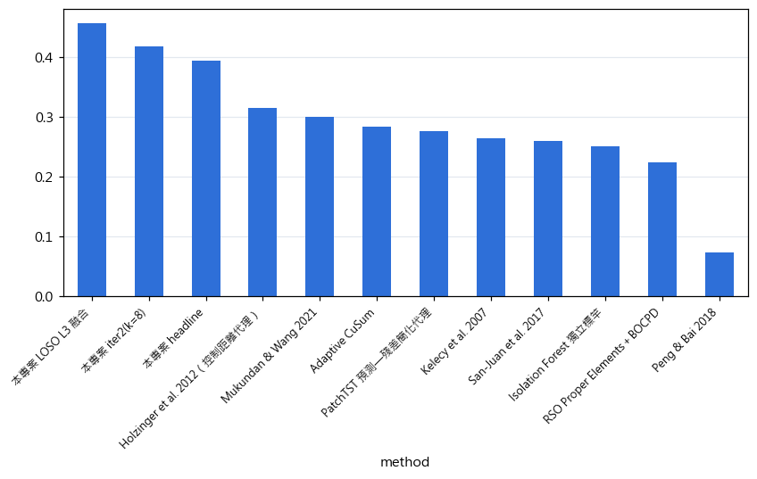
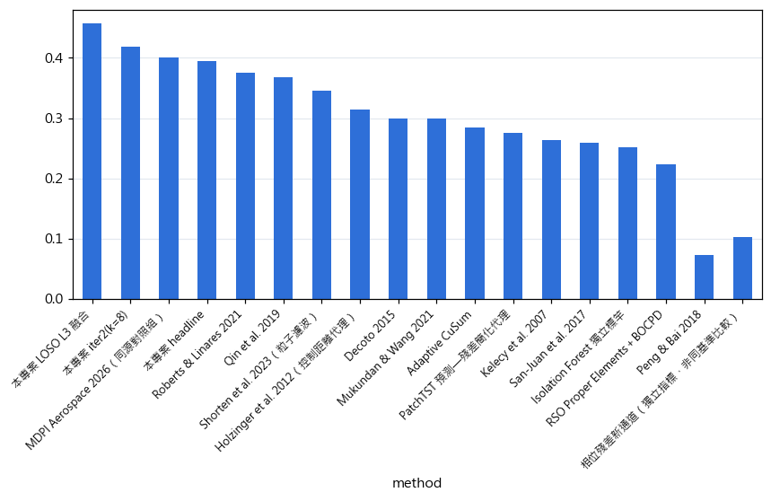

<!-- 由 docs/export_storymap_md.py 自 maneuver_app_2026November.py 匯出；線上版：https://rhynowu-maneuver-detection-i18n.hf.space/?mode=storymap&case=case11 -->

# 案例十一：本專案站在哪些巨人的肩膀上？

### 文獻整理與回顧（方法論的知識地圖）

> 本文獻整理自本專案技術報告之附錄與相關研究章節（`docs/期中報告_MEME_TLE_20260715_r10.md` 附錄 C、`docs/conf_ssa_maneuver_2026.md` §2），並非本頁新查找之文獻。本案例在整個 StoryMap 中扮演的角色，是幫每個技術案例標出它在既有研究地圖上的座標。

**為什麼要做文獻回顧？**

任何一個「這樣做應該可行」的方法，都可能已經有人做過、甚至已經證明行不通。文獻回顧的目的不是列一堆引用充版面，而是老實回答兩個問題：

- **別人已經做到哪裡了？**
- **本專案的方法，跟既有做法比起來，差異究竟在哪裡？**

對本專案而言，這份回顧幫助我們：**避免重複造輪子**、**清楚定位自己的創新點**、**理解既有方法的極限在哪裡**。

## ① 既有研究的四條路線

TLE 由 SGP4/SDP4（兩套標準化的軌道傳播演算法）攝動模型產生，其半長軸精度受大氣阻力建模與擬合誤差影響（Hoots & Roehrich, 1980；Vallado et al., 2006）。以 TLE 偵測機動的既有作法，大致可以歸成四條路線：

**路線 1｜軌道力學基礎**

研究 SGP4 傳播模型本身的誤差特性，是所有後續方法的地基——包括理解 TLE 在不同軌道區間、不同時間跨度下的系統誤差與隨機誤差。

**路線 2｜單一統計量門檻**

以半長軸變化量 |Δa| 門檻、多項式或 LOWESS（局部加權回歸）曲線擬合為主（Lemmens & Krag, 2014；Patera, 2008；Kelecy et al., 2007）。
- 優點：實作簡單、計算成本低
- 缺點：誤報與漏報難以兼顧，對小機動或雜訊大的情況特別敏感

**路線 3｜統計變點偵測**

CUSUM（累積偏離量，Page, 1954）、貝氏線上變點 BOCPD（Adams & MacKay, 2007）、奇異譜分析 SSA（Golyandina et al., 2001）、穩健 MAD（以中位數絕對偏差設門檻，Rousseeuw & Croux, 1993）等經典方法。
- 各方法對「訊號突然改變」有不同的數學定義
- 單獨使用時，召回率與誤報率難以同時優化

**路線 4｜物理阻力模型**

以 NRLMSISE-00（Picone et al., 2002）、NRLMSIS 2.0（Emmert et al., 2021）等半經驗大氣密度模型，作為扣除自然衰減的阻力殘差通道（詳見案例五）。
- 優點：有物理基礎，可解釋性高
- 缺點：依賴大氣模型的準確度，太陽活動劇烈時期誤差會放大

## ② 本專案與既有工作的差異

既有機動偵測文獻多半**以單一偵測器為終點**——選定一種統計量或門檻，調好參數就結案。本專案的做法不同，差異有兩點：

> ✅ **差異 1｜融合多通道，而非單一偵測器**
>
> 本專案不以單一偵測器為終點，而是用融合層整合物理模型與多個統計通道的訊號（詳見案例一的架構全貌、案例二的 AI/非AI 分類）——讓模型學會在什麼情況下該相信哪一個通道，綜合所有訊號做出最終判定，而非隨便選一種方法的結果。

> ✅ **差異 2｜嚴格的真值分級與泛化驗證**
>
> 在方法論上，本專案嚴格處理真值分級與泛化驗證——這一點在既有機動偵測文獻中**少有系統性報告**。多數既有研究要嘛沒有獨立真值（用自己的偵測結果驗證自己），要嘛沒有測試「模型對沒看過的目標還準不準」（詳見案例四的真值來源分級、案例九的 unseen-satellite hold-out）。
>
> **泛化驗證的重要性在於**：避免模型只是「背下特定衛星或時期的答案」，而是真的學到可遷移到新目標的機動特徵。

## ③ 完整分類文獻列表

#### ▸ 🧭 如果想從頭讀起：建議入門路線

若你是第一次接觸 TLE 機動偵測，建議的閱讀順序是：

1. **軌道力學基礎**：Hoots & Roehrich (1980)、Vallado et al. (2006)——理解 SGP4 與 TLE 的基本假設與誤差來源；
2. **單一門檻方法**：Kelecy et al. (2007)、Lemmens & Krag (2014)——看最直觀的做法及其限制；
3. **統計變點**：Page (1954, CUSUM)、Adams & MacKay (2007, BOCPD)——理解經典變點偵測的數學思想；
4. **物理模型**：Picone et al. (2002, NRLMSISE-00)、Emmert et al. (2021, NRLMSIS 2.0)——理解大氣密度建模如何用於阻力殘差；
5. **機器學習**：Ke et al. (2017, LightGBM)、Lundberg & Lee (2017, SHAP)——理解本專案使用的 ML 工具。

#### ▸ 📚 軌道力學與 TLE 機動偵測（13 篇）

1. T. M. Kelecy and M. Jah, "Detection and Orbit Determination of a Satellite Executing Low Thrust Maneuvers," *Acta Astronautica*, 66(5–6), pp. 798–809, 2010. [DOI](https://doi.org/10.1016/j.actaastro.2009.08.029)

2. T. Kelecy et al., "Satellite Maneuver Detection Using Two-line Element (TLE) Data," AMOS Conference, 2007. [PDF](https://amostech.com/TechnicalPapers/2007/Modeling_Analysis_Simulation/Kelecy.pdf)

3. T. Flohrer, H. Krag, and H. Klinkrad, "Assessment and Categorization of TLE Orbit Errors for the US SSN Catalogue," AMOS Conference, 2008. [PDF](https://amostech.com/TechnicalPapers/2008/Orbital_Debris/Flohrer.pdf)

4. J. M. Picone, A. E. Hedin, D. P. Drob, and A. C. Aikin, "NRLMSISE-00 Empirical Model of the Atmosphere," *J. Geophys. Res.: Space Physics*, 107(A12), 2002. [DOI](https://doi.org/10.1029/2002JA009430)

5. D. A. Vallado, *Fundamentals of Astrodynamics and Applications*, 4th ed., Microcosm Press, 2013. [Celestrak](https://celestrak.org/software/vallado-sw.php)

6. F. R. Hoots and R. L. Roehrich, "Models for Propagation of NORAD Element Sets," Spacetrack Report No. 3, 1980. [PDF](https://celestrak.org/NORAD/documentation/spacetrk.pdf)

7. D. A. Vallado et al., "Revisiting Spacetrack Report #3," AIAA 2006-6753, 2006. [DOI](https://doi.org/10.2514/6.2006-6753)

8. M. J. Holzinger, D. J. Scheeres, and K. T. Alfriend, "Object Correlation, Maneuver Detection, and Characterization Using Control Distance Metrics," *J. Guidance, Control, and Dynamics*, 35(4), pp. 1312–1325, 2012. [DOI](https://doi.org/10.2514/1.53245)

9. "Simplified Approach to Detect Satellite Maneuvers Using TLE Data and Simplified Perturbation Model Utilizing Orbital Element Variation," *Applied Sciences*, 11(21):10181, 2021. [DOI](https://doi.org/10.3390/app112110181)

10. "Space-Based Passive Orbital Maneuver Detection Algorithm for High-Altitude Situational Awareness," *Aerospace*, 11(7):563, 2024。 [MDPI](https://www.mdpi.com/2226-4310/11/7/563)

11. S. Lemmens and H. Krag, "Two-line-elements-based maneuver detection methods for satellites in low Earth orbit," *Journal of Guidance, Control, and Dynamics*, 37(3), pp. 860–868, 2014. [DOI](https://doi.org/10.2514/1.61300)

12. R. P. Patera, "Space event detection method," *Journal of Spacecraft and Rockets*, 45(3), pp. 554–559, 2008. [DOI](https://doi.org/10.2514/1.30348)

13. J. T. Emmert et al., "NRLMSIS 2.0: A Whole-Atmosphere Empirical Model of Temperature and Neutral Species Densities," *Earth and Space Science*, 8, e2020EA001321, 2021. [DOI](https://doi.org/10.1029/2020EA001321)

#### ▸ 📚 統計變化點方法（6 篇）

1. E. S. Page, "Continuous Inspection Schemes," *Biometrika*, 41(1/2), pp. 100–115, 1954（CUSUM 原始文獻）。 [DOI](https://doi.org/10.1093/biomet/41.1-2.100)

2. R. P. Adams and D. J. C. MacKay, "Bayesian Online Changepoint Detection," arXiv:0710.3742, 2007（BOCPD）。 [arXiv](https://arxiv.org/abs/0710.3742)

3. N. Golyandina, V. Nekrutkin, and A. Zhigljavsky, *Analysis of Time Series Structure: SSA and Related Techniques*, Chapman & Hall/CRC, 2001（SSA）。 [DOI](https://doi.org/10.1201/9781420035841)

4. "RSO Proper Elements: Concept, Methods, and Application to Maneuver Detection," *Advances in Space Research*, 2023（BOCPD 於 mean-/proper-element 空間之比較）。 [ScienceDirect](https://www.sciencedirect.com/science/article/abs/pii/S0273117723006865)

5. "Detection of Satellite Maneuvers in Earth and Cislunar Orbits using Adaptive CuSum Methods," EngrXiv / ION JNC（門檻—誤報—延遲權衡之量化）。 [EngrXiv](https://engrxiv.org/preprint/view/7254)

6. P. J. Rousseeuw and C. Croux, "Alternatives to the Median Absolute Deviation," *Journal of the American Statistical Association*, 88(424), pp. 1273–1283, 1993. [DOI](https://doi.org/10.1080/01621459.1993.10476408)

#### ▸ 📚 機器學習（12 篇）

1. G. Ke et al., "LightGBM: A Highly Efficient Gradient Boosting Decision Tree," NeurIPS 30, 2017. [NeurIPS](https://papers.nips.cc/paper_files/paper/2017/hash/6449f44a102fde848669bdd9eb6b76fa-Abstract.html)

2. F. T. Liu, K. M. Ting, and Z.-H. Zhou, "Isolation Forest," IEEE ICDM, pp. 413–422, 2008. [DOI](https://doi.org/10.1109/ICDM.2008.17)

3. S. M. Lundberg and S.-I. Lee, "A Unified Approach to Interpreting Model Predictions," NeurIPS 30, 2017（SHAP）。 [NeurIPS](https://papers.nips.cc/paper_files/paper/2017/hash/8a20a8621978632d76c43dfd28b67767-Abstract.html)

4. S. Hochreiter and J. Schmidhuber, "Long Short-Term Memory," *Neural Computation*, 9(8), pp. 1735–1780, 1997. [DOI](https://doi.org/10.1162/neco.1997.9.8.1735)

5. Y. Nie et al., "A Time Series is Worth 64 Words: Long-term Forecasting with Transformers," ICLR 2023（PatchTST）。 [arXiv](https://arxiv.org/abs/2211.14730)

6. H. Peng and X. Bai, "Improving Orbit Prediction Accuracy through Supervised Machine Learning," *Adv. Space Res.*, 61(10), pp. 2628–2646, 2018. [DOI](https://doi.org/10.1016/j.asr.2018.03.001)

7. "Spacecraft Orbital Maneuver Detection Using Adaptive Multi-Feature Criteria," *Aerospace*, 13(8):718, 2026（案例十一 TierA2「同源對照組」之完整書目確認）。 [MDPI](https://www.mdpi.com/2226-4310/13/8/718)

8. "Adaptive Spiking Gating Multi-Scale Liquid State Machine for Orbital Maneuver Detection," *Aerospace*, 13(5):417, 2026（脈衝神經網路／液態狀態機，神經型態運算）。 [MDPI](https://doi.org/10.3390/aerospace13050417)

9. "Multi-Level Firing with Spiking Neural Network for Orbital Maneuver Detection," *Aerospace*, 12(11):991, 2025（脈衝神經網路）。 [MDPI](https://www.mdpi.com/2226-4310/12/11/991)

10. "Masked and Clustered Pre-Training for Geosynchronous Satellite Maneuver Detection," *Remote Sensing*, 17(17):2994, 2025（自監督遮罩預訓練＋聚類）。 [MDPI](https://doi.org/10.3390/rs17172994)

11. "LSTM-based Maneuver Detection for Resident Space Object Catalog Maintenance," *Neural Computing and Applications*, 2025（Sentinel-3A，LSTM）。 [Springer](https://link.springer.com/article/10.1007/s00521-025-11177-7)

12. "TLE Prediction using Machine Learning for Satellite Maneuver Detection," AIAA 2025-98101（Bi-LSTM，僅25個標註樣本，本專案評估其樣本量過小、結果需謹慎看待）。 [AIAA](https://arc.aiaa.org/doi/10.2514/6.2025-98101)

#### ▸ 📚 SSA 領域與評估方法學（5 篇）

1. D. L. Oltrogge and S. Alfano, "The Technical Challenges of Better Space Situational Awareness," *J. Space Safety Eng.*, 6(3), pp. 164–172, 2019. [ScienceDirect](https://www.sciencedirect.com/org/science/article/pii/S2692765922000333)

2. "Real-Time Detection of LEO Satellite Orbit Maneuvers Based on Geometric Distance Difference," *Aerospace*, 12(10):925, 2025. [MDPI](https://www.mdpi.com/2226-4310/12/10/925)

3. "Comprehensive Analysis of Receiver Operating Characteristic (ROC) Curves for Anomaly Detection," IEEE, 2022. [IEEE Xplore](https://ieeexplore.ieee.org/document/9909988/)

4. 18th Space Defense Squadron, "Space-Track.org," U.S. Space Command（TLE 與事件資料來源）。 [space-track.org](https://www.space-track.org)

5. SpaceX, "Starlink Public Ephemerides（MEME 格式精密星曆）," 2026. [Starlink ephemerides](https://api.starlink.com/public-files/ephemerides/)

> 註：本小節標題中的「SSA」指 Space Situational Awareness（太空情境意識），與路線 3「統計變點偵測」中的 SSA（Singular Spectrum Analysis，奇異譜分析）為不同概念，兩者恰好同縮寫，本頁其餘位置提到 SSA 皆指後者（奇異譜分析）。

#### ▸ 📚 LEO-PNT 與應用（2 篇）

1. "Inside LEO: LEO-PNT — Why Now?," *Inside GNSS*, 2024（LEO-PNT 成熟動力與國家戰略性之產業評述）。 [Inside GNSS](https://insidegnss.com/inside-leo-leo-pnt-why-now/)

2. 「以低成本硬體接收 Starlink 訊號進行定位之學術實測」，*KOC*, 2025（TLE + SGP4 路線之定位可行性實證）。 [KOC](https://www.koc.com.tw/archives/648920)

#### ▸ 📚 機動偵測方法與外部真值（2 篇）

1. J. F. San-Juan, I. Pérez, M. San-Martín, et al., "Hybrid SGP4 Orbit Propagator," *Acta Astronautica*, 137, pp. 254–260, 2017（SGP4 半長軸預報誤差量化）。 [DOI](https://doi.org/10.1016/j.actaastro.2017.04.015)

2. ILRS/IDS, "Satellite Maneuver Histories（DORIS 測高衛星 operator 點火日誌）," International DORIS Service（本專案第二 hold-out 外部真值集來源）。 [IDS](https://ids-doris.org/documents/BC/satellites/)

#### ▸ 📚 機動偵測方法與外部真值（含一篇中國大陸署名政策適用文獻）

1. 李泽越, 杨震, 李海阳, 罗亚中.《航天器轨道机动自适应逆向移动滑窗检测方法》. 国防科技大学学报（中國大陸 NUDT，長沙）, 2024, 46(4): 45–53. [DOI](https://doi.org/10.11887/j.cn.202404005)

> 說明：此為**外部獨立文獻**，作者與本案執行單位無任何關聯，不構成同儕或合作關係——引用僅作為「事件級人工計數評估」之領域慣例佐證，以及 SGP4 半長軸誤差數量級之外部佐證。

## ④ 逐篇研究重點與本專案方法比較（三大類 29 篇）

> 逐篇查證每一份文獻的實際研究重點（優先讀取原文全文，查不到全文者誠實標註信心等級，不臆測未經證實的具體數字），再對照本專案方法。完整版另存 `docs/案例十一文獻延伸比較_20篇逐篇重點與本專案方法比較_20260913.md`。

#### ▸ 🔍 軌道力學與 TLE 機動偵測（9 篇）

**1. Kelecy & Jah, 2010**

**研究重點**：用批次最小平方（BLSQ）與擴展卡爾曼濾波（EKF）偵測並重建單次低推力機動，驗證資料為 AFRL 實際追蹤之低推力 LEO 衛星。

**與本專案比較**：他們需要特權級追蹤資料（雷達/光學觀測，非公開），本專案只用公開 TLE，不做狀態一致性檢驗，改以元素差分+統計/AI融合——適用範圍互補，本專案犧牲部分精度換取任何人都能重現的可及性。（僅摘要層級，原文遭付費牆阻擋）

---

**2. Kelecy et al., 2007 (AMOS)**

**研究重點**：滑動視窗多項式擬合能量/傾角，n-σ 門檻判定機動；Envisat 最佳案例 95% 偵測、誤報率約6%，偵測延遲約2-3天。

**與本專案比較**：本專案 Block1 規則式方法在方法論上最直接的前身（滑窗差分+n-σ門檻），差異在本專案用相鄰步階σ正規化差分；驗證規模差異極大——他們2顆衛星，本專案23顆外部標竿+284顆Starlink；±1.5天配對容差與其2-3天延遲量級相近，可視為TLE每日解析度下的共同天花板。（全文已讀）

---

**3. Flohrer, Krag & Klinkrad, 2008 (AMOS)**

**研究重點**：量化整個 US SSN 目錄（11,470顆物體）之TLE/SGP4軌道預測不確定性，LEO平均沿軌向不確定性σ_V≈0.47km，GTO/HEO最差可達≈3.9km。

**與本專案比較**：雜訊地板量化的奠基性文獻，與本專案案例十八（8顆被動測地球體雜訊地板）精神一致但對象不同——都指向「機動偵測門檻必須高於軌域相依的雜訊地板」，本專案的σ正規化（而非固定絕對門檻）正是對此的直接回應。（全文已讀）

---

**4. Picone et al., 2002 (NRLMSISE-00)**

**研究重點**：半經驗大氣密度模型，整合衛星加速度計/軌道衰減資料，新增「異常氧」項改善500km以上密度估計。

**與本專案比較**：非競爭方法，是本專案直接採用的工具——案例五之物理阻力殘差通道直接使用此模型；本專案繼承了其固有限制（太陽活動劇烈期誤差放大），為案例五已誠實揭露的已知邊界。（全文已讀）

---

**5. Vallado, *Fundamentals of Astrodynamics*, 2013**

**研究重點**：標準研究所級軌道力學教科書，涵蓋軌道決定、SGP4/SDP4理論（第9章）、大氣模型（附錄B）。

**與本專案比較**：基礎依賴，非比較對象——本專案與清單中幾乎所有其他文獻一樣，直接建立在此書對TLE/SGP4誤差特性與軌道決定演算法的標準論述之上。（章節結構已交叉查證）

---

**6. Hoots & Roehrich, Spacetrack Report No. 3, 1980**

**研究重點**：官方定義SGP4/SDP4/SGP8/SDP8五套相容傳播模型，提供完整FORTRAN原始碼；確立NORAD元素集是「平均元素」，必須用相容模型重新傳播。

**與本專案比較**：本專案不修改傳播器本身，把公開TLE當作輸入資料源，把機動偵測為「推導平均元素之偏離」——這篇論文是本專案方法論正當性的根本依據，前提是資料確實已用相容的SGP4/SDP4正確傳播。（全文已讀，94頁含原始碼）

---

**7. Vallado et al., "Revisiting Spacetrack Report #3," 2006**

**研究重點**：整合25年來各方對SGP4/SDP4程式碼的分歧修改，記錄多項具體臭蟲（Kepler方程收斂失敗、"Lyddane bug"等），發布重構後的標準參考碼。

**與本專案比較**：直接的風險提醒——未修正的舊版SGP4可自行產生數百至數千公尺量級的假殘差，與真實機動無關。建議本專案報告補充說明所用資料/函式庫的SGP4版本溯源，排除「假機動其實是舊版傳播器臭蟲」的可能性。（全文已讀，94頁含完整原始碼）

---

**8. Holzinger, Scheeres & Alfriend, 2012**

**研究重點**：定義「控制距離」（將標稱軌跡導向觀測軌跡所需的最優控制代價）作為統一度量，用於未關聯軌跡相關、機動偵測、機動特徵化，搭配不確定性量化做假設檢定。

**與本專案比較**：根本不同的典範——本專案的多通道統計+ML融合是經驗驅動、資料量取勝，此文是理論嚴謹、不確定性量化取勝的路線，兩者互補；若未來要為本專案偵測結果加上機率化信賴區間，此文框架值得參考。（僅摘要層級，原文遭付費牆阻擋）

---

**9. Mukundan & Wang, 2021 (Applied Sciences)**

**研究重點**：TLE觀測值vs SGP4傳播值之軌道要素差分，TOPEX與Envisat皆達100%偵測，TDRS-3（GEO）偵測18/19（94.7%）。

**與本專案比較**：需要特別誠實對照——其100%數字看似遠高於本專案headline方法的召回率（約45-60%），但其測試集僅3顆衛星且「妥善校準參數」隱含逐星調參，這與本專案技術報告已明確標記的「曲線法逐星oracle上界虛高但不代表真實泛化能力」現象完全同構——本專案14→23星擴充實驗已證明oracle上界隨樣本擴大不進反退（0.490→0.462），零調參方法卻維持顯著優勢。（全文已讀）

#### ▸ 🔍 統計變化點方法（5 篇）

**1. Page, 1954 (CUSUM 原始文獻)**

**研究重點**：累積和（CUSUM）序貫檢驗方案，偵測製程均值偏移，較Shewhart管制圖對小幅偏移更靈敏。

**與本專案比較**：非競爭文獻，是本專案L2統計層直接採用的四通道之一。比較意義在於：CUSUM是四通道中表現較弱的一個（平均F1約0.31-0.33，低於BOCPD的0.46），這與CUSUM原始設計針對「持續性均值偏移」而非「瞬時脈衝式機動」有關。（原文遭付費牆阻擋，以引用文獻轉述整理）

---

**2. Adams & MacKay, 2007 (BOCPD)**

**研究重點**：貝氏線上變點偵測，以「run length」後驗分布之遞迴訊息傳遞演算法逐點精確更新，跨金融/生物計量/機器人三個真實資料集示範模組化。

**與本專案比較**：本專案L2四通道中表現最佳的一個——多次彙總結果顯示BOCPD平均F1落在0.456-0.458，與本專案headline規則式方法（0.458）幾乎打平。未來優化空間可能更集中在如何讓融合層更好地利用BOCPD通道的訊號，而非再開發新的單通道方法。（摘要已讀）

---

**3. Golyandina, Nekrutkin & Zhigljavsky, 2001 (SSA 專書)**

**研究重點**：奇異譜分析方法論專書——嵌入、SVD、分組、對角平均四步驟，將序列分解為趨勢/週期/雜訊，並延伸至變點偵測演算法。

**與本專案比較**：本專案L2四通道之一（SSA），彙總結果顯示SSA召回率高但精確率低（高召回、多誤報），這與SSA對「結構性改變」的寬鬆定義有關。本專案的vote≥2融合機制正是為了用其他通道的一致性把SSA的高召回優點保留、高誤報缺點過濾掉。（原書無公開全文，以出版社簡介整理）

---

**4. 「RSO Proper Elements」，Adv. Space Res., 2023**

**研究重點**：提出「固有軌道要素」取代傳統平均要素，在「平均要素空間」與「固有要素空間」分別套用BOCPD比較機動偵測表現。

**與本專案比較**：本專案尚未實作的具體、可行改進方向——本專案所有偵測通道目前皆作用於半長軸此一「平均要素」，而非固有要素。這與本專案「零調參仍要提升泛化力」的目標方向一致，值得列為技術報告未來工作項目。（期刊原文摘要頁遭403/405阻擋，量化結果未查得）

---

**5. Adaptive CuSum for Earth/Cislunar Maneuver Detection**

**研究重點**：自適應多重CuSum（滑動視窗動態估計均值/變異數），作用於固有軌道要素；6顆LEO衛星偵測率>96%，2個cislunar任務偵測率>98%。

**與本專案比較**：需誠實對照的一篇——其偵測率遠高於本專案CUSUM通道實測F1（約0.31-0.33）。差異可能來自：(1)自適應門檻vs本專案固定門檻；(2)固有要素vs平均要素（與前一篇同一改進方向）；(3)只報告偵測率（類召回率），未報告精確率/F1，也未說明是否逐星調參——本專案採信前應先確認其口徑是否一致。（僅預印本頁面，非期刊正式版全文）

#### ▸ 🔍 機器學習（6 篇）

**1. Ke et al., 2017 (LightGBM)**

**研究重點**：GOSS（梯度單邊採樣）+ EFB（互斥特徵捆綁）兩項技術，維持GBDT準確度前提下訓練速度提升可達20倍以上。

**與本專案比較**：本專案直接採用的工具——L3融合分類器使用HistGradientBoosting（scikit-learn內建、與LightGBM同源之梯度提升樹實作）與LightGBM本身，非比較對象。（多來源交叉確認，未直接讀取PDF全文）

---

**2. Liu, Ting & Zhou, 2008 (Isolation Forest)**

**研究重點**：以隨機切分樹的「平均路徑長度」隔離異常點，不需為正常樣本建模，線性時間複雜度，適合大樣本高維資料。

**與本專案比較**：本專案已採用的無監督異常偵測工具，與L3監督式LightGBM形成互補——Isolation Forest不需要標註的機動真值即可運作，適合本專案真值稀少或未經驗證的軌道類型（案例十二④/⑤所述之驗證缺口場景）。（原文與延伸期刊版皆無法解析，方法描述以維基百科條目+多篇引用文獻轉述交叉確認）

---

**3. Lundberg & Lee, 2017 (SHAP)**

**研究重點**：以賽局理論Shapley值為基礎，提出唯一滿足局部準確性/一致性等公理的加性特徵歸因框架，統一LIME、DeepLIFT等既有解釋方法。

**與本專案比較**：本專案已採用的可解釋性工具，用於解釋L3分類器判斷依據，協助排除偽特徵（如已知的z_draan壞通道）。這是本專案回應「高準確度模型是否可信」質疑的具體工具，而非單純宣稱模型準確。（多來源交叉確認，未直接讀取PDF全文）

---

**4. Hochreiter & Schmidhuber, 1997 (LSTM)**

**研究重點**：常數誤差傳送帶（CEC）+乘法性閘門單元，解決RNN梯度消失/爆炸問題，可學習橋接超過1000個時間步的依賴關係。

**與本專案比較**：本專案已嘗試並得到誠實負面結果的路線——案例十六bi-GRU（LSTM同族之雙向閘控RNN）序列標註器實驗顯示逐點AUC天花板僅0.572，遠低於episode級融合的0.982，且OOD測試慘敗；根因是真值標籤解析度限制（MEME真值每8小時一格），非模型能力不足。（多來源交叉確認CEC機制描述，未直接讀取PDF全文）

---

**5. Nie et al., 2023 (PatchTST)**

**研究重點**：以「分塊」（patch，子序列級token）取代逐時間點輸入，搭配通道獨立性設計，降低長序列Transformer注意力機制計算量並提升長期預測準確度。

**與本專案比較**：本專案已嘗試並得到負面結果的三個深度模型之一（案例十六），同樣受限於真值解析度天花板。若未來重新嘗試，更適合的用法可能是「預測—殘差」路線（用PatchTST做軌道要素多步預測，把偏離預測值的殘差當機動訊號），而非直接拿它做逐點機動標註——這是本專案目前尚未嘗試的用法變體。（已讀摘要，量化結果未查得）

---

**6. Peng & Bai, 2018 (Adv. Space Res.)**

**研究重點**：物理軌道預測+監督式ML殘差修正（比較ANN/SVM/GP），測試同物體不同時段、外推未來、跨衛星遷移三種泛化情境；ANN擬合能力最佳但最易過擬合，SVM最穩健但效能較弱。

**與本專案比較**：目標互補而非重疊——此文用ML縮小物理模型殘差本身，本專案Line4阻力殘差通道則把殘差當作偵測特徵；若先用此文方法把「正常阻力衰減」殘差壓到更小，本專案偵測通道的訊噪比理論上會更好。此文已測試跨衛星遷移泛化，與本專案案例九unseen-satellite hold-out精神一致，可佐證泛化驗證是本領域漸受重視的共同趨勢。（摘要已讀，量化數字未查得）

#### ▸ 🔍 SSA 領域與評估方法學（5 篇）

**1. Oltrogge & Alfano, 2019**

**研究重點**：探討太空情報監視（SSA）與太空交通管理面臨的技術挑戰——碰撞風險估計方法、碰撞/爆炸事件連鎖影響，以及取得即時準確完整太空態勢資訊的障礙；結論指出碰撞風險持續上升，現行因應措施雖有益但仍不足。

**與本專案比較**：奠基性文獻，說明機動偵測技術在更廣泛太空安全治理架構中的必要性——本專案的偵測結果最終要服務的正是這類「碰撞風險估計」下游應用。**查證提醒**：查得正式卷期為 6(2), pp.72–79，完整標題含「...and Space Traffic Management」，與清單原文6(3), pp.164–172 不符，建議日後核對。（摘要層級，ScienceDirect遭403阻擋）

---

**2. Geometric Distance Difference, Aerospace 2025**

**研究重點**：不依賴TLE，直接用星上GNSS觀測+即時精密星曆，定義「簡化動力學」與「運動學」兩種軌道解之間的幾何RMS距離作為即時機動指標，搭配滑動視窗自適應門檻。GRACE-FO 8次機動偵測7次，Sentinel-3A 2次機動皆偵測成功。

**與本專案比較**：**替代技術路線的效能上限參照**——用精密星曆/GNSS觀測取代TLE作輸入，本質上跳過了TLE解析度限制，可視為「若本專案能取得精密星曆會有多好」的上界對照組（呼應本專案自身MEME vs TLE誤差研究）；差異在於此法需要衛星本體配合廣播GNSS觀測，適用對象受限，本專案的公開TLE路線適用對象遠廣（任何有編目的物體皆可）。（摘要與搜尋引擎交叉確認，原文遭403阻擋）

---

**3. ROC Curves for Anomaly Detection, IEEE 2022**

**研究重點**：**重要澄清**——正式標題其實是「...for Hyperspectral Anomaly Detection」，領域為高光譜影像異常偵測（遙測影像處理），非軌道/太空領域論文；探討2D ROC曲線在缺乏機率分布下如何繪製、如何評估背景抑制效果，並以隨機Neyman-Pearson偵測器重新推導其數學理論。

**與本專案比較**：價值在於**評估方法論的通用性**，而非機動偵測領域知識——ROC/PD-PF分析框架可直接遷移至衛星機動偵測（視為二元異常偵測問題）的效能評估；本專案案例十已使用ROC-AUC作核心驗收指標，此文可作為該指標選用之方法論嚴謹性佐證，但**引用時應註明其原始應用領域為高光譜影像而非軌道力學**，避免讀者誤以為是太空領域文獻。（摘要層級，IEEE Xplore遭403阻擋）

---

**4. Space-Track.org（資料來源）**

**性質**：資料來源，非研究論文。18th Space Defense Squadron（美國太空軍）官方公開之TLE、衛星目錄（SATCAT）、衰變/再入預測資料，官方公開追蹤逾16,000顆在軌衛星，美國太空監視網另追蹤約240,000個物件；免費註冊存取，API有流量限制。

**與本專案比較**：本專案（及絕大多數TLE-based機動偵測研究）最核心、最主要的公開資料來源——本專案的全部23顆外部標竿衛星與284顆Starlink衛星之TLE皆來自此處，是整個研究得以「任何人都能重現」的基礎建設。（官方文件頁面直接讀取確認）

---

**5. Starlink Public Ephemerides（資料來源）**

**性質**：資料來源，非研究論文。SpaceX公開發布之Starlink精密星曆（含位置/速度/協方差），MEME座標系（J2000.0），每次預報涵蓋未來72小時、每8小時更新；截至2026年Starlink在軌約11,000餘顆。相較TLE僅為平均軌道根數，MEME為業者內部精密軌道決定（POD）結果，精度顯著更高，可作地面真值。

**與本專案比較**：本專案機動偵測真值資料的核心來源——與本專案既有MEME vs TLE誤差研究直接呼應，284顆Starlink衛星之L3訓練與驗證真值即來自此處；**注意**：Space-Track已於2025年7月28日起不再代管此資料，須改至SpaceX官方網站下載，本專案下游腳本之資料源設定應確認已對應此變更。（官方文件直接確認）

#### ▸ 🔍 LEO-PNT 與應用（2 篇）

**1. "Inside LEO: LEO-PNT — Why Now?," 2024**

**研究重點**：產業媒體文章（非學術論文）。主張LEO-PNT受重視源於兩股驅動力：GNSS脆弱性（干擾與詐欺日益普遍）與自駕/無人系統需求；強調「韌性與去單一系統依賴」，LEO可在GNSS被降級/拒止時提供太空層級替代方案，國防應用與無人系統為早期採用領域。

**與本專案比較**：說明LEO星系（如Starlink）除本專案既有的通訊/機動偵測研究價值外，亦具備PNT應用戰略意義——呼應本專案對Starlink資料生態系的多面向運用，也提示：本專案累積的Starlink TLE/MEME機動偵測經驗，未來若延伸至「機動對PNT服務精度影響」的評估，有明確的產業與國防應用需求支撐。（原文全文已讀）

---

**2. 低成本硬體接收 Starlink 訊號定位實測, KOC 2025**

**研究重點**：中文科技媒體報導（原始研究為美國俄亥俄州立大學ASPIN實驗室）。用RTL-SDR+Ku頻段LNB+拋物面天線+樹莓派5，總成本低於200美元，「認知型軟體定義接收機」即時學習Starlink OFDM信標結構並追蹤都卜勒頻移；僅3顆衛星、20秒觀測即達約2公尺三維定位精度，測試涵蓋地面車輛/無人機/高空氣球/北極海域船隻四種環境。

**與本專案比較**：展示Starlink星系除機動偵測研究價值外，訊號本身亦可作低成本PNT替代方案的具體實證——本專案目前的Starlink研究聚焦於TLE/MEME軌道層級的機動偵測，與此文的訊號層級定位應用是同一星系資料生態系的兩個不同應用面，可作為本專案未來「延伸應用」章節（比照案例二十LEO-PNT應用延伸的誠實標示方式）的具體案例佐證。（原文全文已讀）

#### ▸ 🔍 機動偵測方法與外部真值（2 篇）

**1. San-Juan et al., "Hybrid SGP4 Orbit Propagator," 2017**

**研究重點**：解決SGP4傳播精度隨傳播時間拉長急遽下降、使TLE難以滿足現代SSA需求的問題；提出「混合TLE」（HTLE）概念——除標準TLE外，額外封裝一組傳播誤差模型，搭配「混合SGP4傳播器」（標準SGP4+誤差修正器），在最小改動現行TLE-SGP4系統前提下延長TLE有效期。

**與本專案比較**：與本專案核心方法論直接相關——說明TLE/SGP4固有誤差隨時間成長的特性，是機動偵測（尤其以半長軸/平均運動殘差為基礎的方法）必須處理的系統性雜訊來源；本專案目前用「TLE稀釋+3小時最小間隔」與σ正規化因應此問題，此文的「誤差模型封裝」路線是另一個可能的改進方向，但**具體量化改善數字未能查證，不宜引用其效果幅度**。（摘要層級，全文遭付費牆阻擋）

---

**2. ILRS/IDS, Satellite Maneuver Histories（資料來源）**

**性質**：資料來源，非研究論文。DORIS追蹤衛星之操作者發布機動歷史紀錄目錄，每顆衛星對應數個機動檔案（含2025年更新之新式含燃燒記錄格式），涵蓋Jason系列、HY-2系列、Sentinel系列、SWOT、SARAL、SPOT、CryoSat-2、Envisat等多任務衛星，時間跨度自2003年至2026年、持續更新中。

**與本專案比較**：本專案14+9星外部標竿之**核心真值來源**——由衛星操作單位第一手發布、獨立於TLE體系之外，是本專案「外部獨立真值」（非自我循環驗證）主張的直接依據；本文件第一部分（軌道力學9篇）已詳述本專案基於此資料源之逐星驗證結果與與TASA之數字核對過程。（目錄頁面直接讀取確認）

## ⑤ 更進一步：挑 10 篇文獻實際重現，與本專案方法正面對決

> 上方④僅整理文獻重點與定性比較。本區更進一步：從 29 篇中挑出 10 篇「方法明確、資料本專案已有」者，實際重現其演算法，用與本專案完全相同的驗證基準（同真值、同 ±1.5 天配對容差，23 星標竿）跑一次真正的頭對頭比較，而非只憑論文自報數字。完整報告：`docs/案例十一Tier1文獻實作比較_20260913.md`、`docs/案例十一Tier2文獻實作比較_20260913.md`。

| method | f1 | group |
|---|---|---|
| 本專案 LOSO L3 融合 | 0.457 | （本專案） |
| 本專案 iter2(k=8) | 0.418 | （本專案） |
| 本專案 headline | 0.394 | （本專案） |
| Holzinger et al. 2012（控制距離代理） | 0.314 | Tier2 |
| Mukundan & Wang 2021 | 0.3 | Tier1 |
| Adaptive CuSum | 0.284 | Tier1 |
| PatchTST 預測—殘差簡化代理 | 0.276 | Tier2 |
| Kelecy et al. 2007 | 0.264 | Tier1 |
| San-Juan et al. 2017 | 0.259 | Tier2 |
| Isolation Forest 獨立標竿 | 0.251 | Tier2 |
| RSO Proper Elements＋BOCPD | 0.223 | Tier1 |
| Peng & Bai 2018 | 0.073 | Tier1 |

> ✅ **結論**：本專案 headline（F1=0.394）與 LOSO L3 融合（0.457）**優於全部10 篇文獻重現版**，最接近的是 Holzinger 2012 之簡化重現版（0.314）。
>
> **兩個值得記錄的意外發現**：
>
> 1. **Holzinger 2012（控制距離代理）表現最好的關鍵設計**——把偵測門檻「除以距上次觀測的時間間隔平方根」做動態正規化，而非像本專案與其餘9 篇一樣，只用固定或經驗統計（MAD/標準差）門檻。這是本專案目前**沒有**採用的設計元素，值得列入未來改進方向。
>
> 2. **第 6 篇（Geometric Distance Difference）意外發現一種本專案與其餘9 篇方法在設計上絕對看不到的機動類型**——「相位調整」機動（衛星前後位置改變但半長軸幾乎不變）。本專案現有全部偵測通道都作用於半長軸，對此類機動是結構性盲區，此發現已列入技術報告待改進項目。

> 可重現腳本：`lit_tier1_reproductions.py`、`lit_tier2_reproductions.py`、`lit_geometric_distance_demo.py`、`lit_geometric_distance_sept910_case.py`；原始逐星結果：`data/benchmark/lit_tier1_persat_20260913.csv`、`lit_tier2_persat_20260913.csv`。

## ⑥ 再加 5 篇 Tier A 文獻，並回應「相位調整機動」盲區——新增偵測通道

> 延續上方⑤，再挑出 5 篇「有完整文本可查證」的候選文獻（Decoto 2015、Roberts & Linares 2021、Qin et al. 2019、MDPI Aerospace 2026、Shorten et al. 2023）以同一驗證基準重現比較；並針對⑤發現之「相位調整機動結構性盲區」，新增一條不依賴半長軸的 TLE 相位殘差偵測通道。完整報告：`docs/案例十一TierA2文獻實作比較_20260913.md`、`docs/相位殘差通道_新增偵測管道實作與驗證_20260913.md`。

| method | f1 | group |
|---|---|---|
| 本專案 LOSO L3 融合 | 0.457 | （本專案） |
| 本專案 iter2(k=8) | 0.418 | （本專案） |
| MDPI Aerospace 2026（同源對照組） | 0.4 | Tier A2 |
| 本專案 headline | 0.394 | （本專案） |
| Roberts & Linares 2021 | 0.376 | Tier A2 |
| Qin et al. 2019 | 0.368 | Tier A2 |
| Shorten et al. 2023（粒子濾波） | 0.345 | Tier A2 |
| Holzinger et al. 2012（控制距離代理） | 0.314 | Tier2 |
| Decoto 2015 | 0.3 | Tier A2 |
| Mukundan & Wang 2021 | 0.3 | Tier1 |
| Adaptive CuSum | 0.284 | Tier1 |
| PatchTST 預測—殘差簡化代理 | 0.276 | Tier2 |
| Kelecy et al. 2007 | 0.264 | Tier1 |
| San-Juan et al. 2017 | 0.259 | Tier2 |
| Isolation Forest 獨立標竿 | 0.251 | Tier2 |
| RSO Proper Elements＋BOCPD | 0.223 | Tier1 |
| Peng & Bai 2018 | 0.073 | Tier1 |
| 相位殘差新通道（獨立指標，非同基準比較） | 0.102 | 新通道 |

> ✅ **結論（2026-09-14 依內部審查意見修訂）**：本批（Tier A2）是三批概念代理實作中平均數字最高的一批——**MDPI Aerospace 2026（概念相近對照組）Macro F1=0.400，略高於本專案 headline（0.394）**。但**此門檻（k=20）是在 Jason-3（本 23 星評估集之成員）上調校選出，屬於以測試真值選擇超參數，比較結果帶有已知樂觀偏誤，應視為探索性結果**；且此篇方法設計（多特徵穩健統計＋疊代精煉）與本專案高度相近，**不能視為嚴格獨立之外部驗證**。另外，本批之 Decoto 2015 經審查後發現與 Tier1 之Mukundan 2021 為完全相同之偵測機制（詳見 `docs/案例十一TierA2文獻實作比較_20260913.md` §2.1），非獨立資料點。本專案較進階方法（iter2 0.418、LOSO 融合 0.457）Macro F1 仍高於本批全部代理實作。
>
> **相位調整機動盲區的初步回應**：新增之相位殘差通道（不依賴半長軸，直接從 TLE 外推）於 23 星標竿平均 F1=0.102，**明顯低於 sma 方法，但這不代表通道失敗**——既有真值集合本身以「同時改變 sma 之機動」為主，此通道鎖定的「相位調整但 sma 不變」場景（即 STARLINK-5367 案例）並不在此標竿內、無對應真值可配對評分，此處 F1 僅能驗證機制可於全標竿穩定運作，尚無法量化其對設計目標場景的實際命中率。定位為既有融合管線之候選新通道，而非獨立取代方案。
>
> **過程中自我發現並修正一個方法學錯誤**：初版直接用 TLE 之原始平均近點角 M，但對近圓軌道（e→0，絕大多數 Starlink/Kuiper/OneWeb 皆是）而言，M 與近地點幅角個別皆數值退化、易因定軌雜訊劇烈跳動，唯有兩者之和「緯度幅角」才穩定有物理意義——修正前對全 28,005 顆 LEO 編目物體做 15 天廣泛掃描找到 3,321 筆候選（多數殘差達半軌周長量級、物理上不合理），修正後降為 197 筆，其中約 15 筆為主動 Starlink 衛星（殘差數百至約 2,600km、sma 同步幾乎不變，符合設計目標訊號），其餘多為無法自主機動之太空碎片、更可能是碎片定軌雜訊而非機動——如實記錄此修正過程，完整報告：`docs/相位殘差通道_新增偵測管道實作與驗證_20260913.md`。

> 可重現腳本：`lit_tierA2_reproductions.py`、`phase_residual_detector.py`、`phase_residual_broad_scan.py`（全 LEO 廣泛掃描）；原始逐星結果：`data/benchmark/lit_tierA2_persat_20260913.csv`、`phase_residual_persat_20260913.csv`、`phase_residual_broad_scan_candidates_20260913.csv`（197 筆候選）。

---

> ℹ️ **本案例的啟示**：這份文獻回顧告訴我們三件事——
>
> 1. **TLE 機動偵測不是新問題**：從 2007 年 Kelecy 的 TLE 偵測研究，到 2020 年代的統計變點與 ML 方法，領域已經累積近 20 年的經驗；
> 2. **單一方法有本質限制**：無論是單一門檻、單一統計變點方法，或單一物理模型，都難以同時兼顧召回率與誤報率；
> 3. **本專案的創新點在於融合與驗證**：透過多通道融合與嚴格的真值分級、泛化驗證，本專案在方法論上補足了既有文獻中較少系統性處理的環節。
>
> 換句話說：**本專案不是從零開始，而是站在這些巨人的肩膀上，往「更可靠、更可解釋、更可泛化」的方向再推一步。**

> 完整書目（含全部 30 筆條目與名詞縮寫對照表）見 `docs/期中報告_MEME_TLE_20260715_r10.md` 附錄 C／附錄 D；本專案方法定位之完整論述見 `docs/conf_ssa_maneuver_2026.md` §2「相關研究」。

---
線上互動版：<https://rhynowu-maneuver-detection-i18n.hf.space/?mode=storymap&case=case11>
