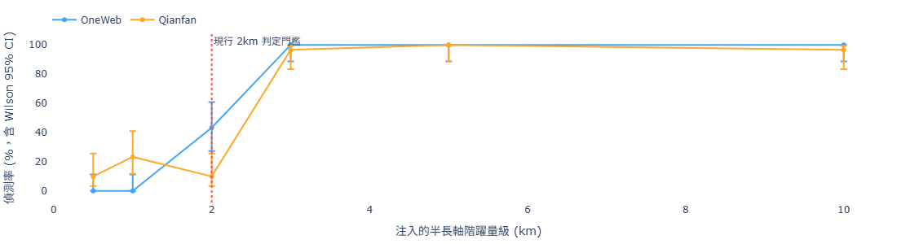
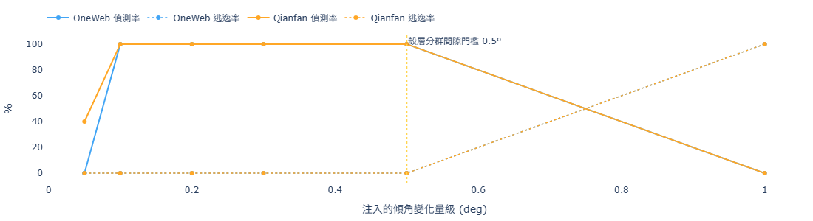
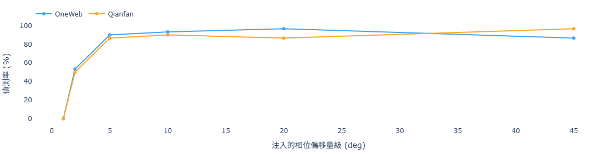

<!-- 由 docs/export_storymap_md.py 自 maneuver_app_2026November.py 匯出；線上版：https://rhynowu-maneuver-detection-i18n.hf.space/?mode=storymap&case=case12 -->

# 案例十二：這套系統，在哪些軌道類型上能信？哪些還不能？

### 適合、不適合與尚待測試的軌道類型整理

> 整理自技術附錄之量化驗收章節與各程式模組之實際邏輯——本頁目的是誠實劃出「量化驗證過」跟「程式碼可以跑、但沒有真值可以核對」之間的界線，兩者不能混為一談。

**為什麼要做這個整理**：一套偵測系統公布的召回率、AUC 這些數字，只有在「跟訓練/驗證時同一種母體」的資料上才可信。把在 Starlink 上驗證出的準確率，直接套用到從沒驗證過的 GEO 衛星、拿來做宣稱，是常見但不誠實的做法。本頁把系統對每一種軌道類型的把握程度，如實分成四級。

## ① 已驗證、有信心

> ✅ **LEO 星座級站台保持（以 Starlink 為主）**
>
> 融合評分器（L3）在 284 顆有 MEME 精密星曆真值的 Starlink 衛星上，ROC-AUC 達 **0.982**，大型機動事件召回率 **97.3%**（n=405 個事件）；在 **56 顆完全沒參與訓練**的 hold-out 衛星上，AUC 仍達 **0.980**，大型機動召回率 **100%**（81/81，詳見案例九）。
>
> **但要老實說清楚驗證的邊界**：這組數字的驗證母體僅止於「284 顆有精密星曆真值可核對的 Starlink 衛星」，技術附錄本身也明白寫著**不可外推到非 Starlink 的衛星**。

## ② 有特殊處理機制、部分驗證

> ⚠️ **LEO 自然再入／衰減 vs 站台保持維持（含 HEO 末期再入段）**
>
> 系統用 `is_reentry_decay()` 這道守門邏輯，依「近地點高度」＋「45 天窗衰減斜率」區分「正在自然再入」與「靠推進器維持軌道」（例如 ISS／天宮）：近地點極低（如 Van Allen A 衛星末期）或近地點低且快速下降者，直接判定「自然再入、機動＝0」，避免物理阻力模型對這類劇烈非線性衰減爆量誤報（詳見案例五、案例十）。
>
> **2026-09-10 反思本案例後已擴大驗證樣本**：原本只用 4 個手選案例做邏輯正確性檢查，樣本太小。改用客觀、不依賴人工標籤的真值定義重新驗證——**真陽性**＝近地點高度曾跌破 120 km、且此後 14 天以上再無任何 TLE（追蹤徹底中止，代表已真實燒毀）；**真陰性**＝ISS、天宮核心艙，加上隨機抽樣的長期追蹤 Starlink（全程近地點 >300 km，靠站位保持維持）。

- **確認再入衛星**：16 顆（recall 16/16）

- **確認安靜衛星**：42 顆（specificity 42/42）

- **總樣本數**：58 顆

> ✅ **擴大後的結果**：58 顆真實衛星（16 顆確認再入，涵蓋 Cluster-II、多型火箭殘骸、Van Allen A 等；42 顆確認安靜，含 ISS／天宮／40 顆隨機 Starlink）——再入 recall **16/16 = 100%**（Wilson 95% CI [80.6%, 100%]），安靜 specificity **42/42 = 100%**（Wilson 95% CI [91.6%, 100%]）。
>
> **老實補充兩點**：① n=16 的正類樣本，Wilson 下界僅 80.6%，還稱不上大樣本統計驗證，只是比原本 4 案例扎實一倍以上；② 真值定義是本頁自建的物理判準（近地點崩潰＋追蹤中止），不是像案例四那樣的第三方獨立真值（IDS/DORIS 等）——**這一層仍應標示為「部分驗證」，但已經是有實際數字支撐的部分驗證，不再是純邏輯煙霧測試**。

## ③ 有程式路徑、但缺乏量化驗證

> ℹ️ **GEO／MEO（地球同步軌道／中軌道）**
>
> 系統的路由機制會把非 Starlink 域的目標導向 Model 2（無監督 Isolation Forest 異常偵測）＋ NRLMSIS 物理殘差。技術附錄記載「已以 GEO/HEO 實例驗證路由正確」——**但這只證明了「路由邏輯能把 GEO 目標正確導向 Model 2」，並不等同於「在 GEO 軌道上的機動偵測召回率／誤報率已經被量化驗證」**，兩者是完全不同層次的驗證。換句話說：**目前只驗證了「路走對了」，還沒驗證「走到終點後準不準」**。
>
> **GEO 近距接近／RPO 案例**（TJS-10×TJS-3、Shenlong——詳見案例七）：屬於 SGP4/TLE 幾何重建的**描述性、調查性視覺化**，程式本身就註明「精度為 SGP4/TLE 等級（GEO 上約公里級）」——這是把真實事件的軌跡重建出來給人看，並不是一套本專案獨立驗證過召回率的機動偵測器。

- **路由至 Model 2 的 GEO/MEO/GEO+ 目標**：3,422 顆

- **其中 GEO／GEO+**：1,726 顆

- **做過個案軌跡核對**：2 顆（TJS-10×TJS-3、Shenlong）

> **2026-09-10 反思本案例後補上的規模量化**：資料庫最新快照中，被 `classify_orbit()` 分類為 GEO／MEO／GEO+ 的目標共 **3,422 顆**（GEO 1,502、MEO 1,696、GEO+ 224），依規則全數路由到 Model 2。這不是偵測準確率驗證——只是把「目前完全沒有個案核對過的範圍」量到多大：**3,422 顆之中，只有 2 顆做過個案軌跡重建，其餘 3,420 顆從未被人核對過**。規模越大，越不該用 2 個案例去暗示涵蓋全體。

#### ▸ 🧭 若要把這一級升等，可行的下一步驗證路線

1. **建立 GEO/MEO 的最小可行真值集**：精密星曆稀缺、機動真值多為操作機密，但可先整理已知公開機動事件（TJS 系列、Shenlong、GEO 通訊衛星站位調整）——以新聞稿、追蹤網站公開軌跡、學術論文中的案例，建立一份「事件級真值」清單；
2. **半真值（proxy ground truth）交叉比對**：無官方紀錄的 GEO 衛星，可用「軌道要素突變 ＋ 操作者公告 ＋ 新聞報導」三方交叉比對，標記為「高機率機動事件」，作為初步（非嚴格）驗證集；
3. **在 StoryMap 中持續更新分級**：等真的跑出量化召回率/誤報率數字，再把這一級從「有程式路徑、缺乏量化驗證」正式升級到「部分驗證」或更高——在那之前，誠實維持現在的分級，比提前宣稱更重要。

## ④ 獨立研究支線，尚未整合進主管線

> ℹ️ **Galileo MEO 精密星曆比對**：`mgex_galileo/` 是一條獨立的 SP3 精密星曆比對管線，用來量化 TLE/SGP4 對 Galileo 衛星的預報誤差量級。**2026-09-10 反思本案例後訂正規模**：這組數字並非抽查——現有輸出（`data/galileo_comparison/summary_2026-06-23.csv`）**已涵蓋全部 30 顆 Galileo 衛星、120 天時間窗**：切線方向誤差 RMS 落在 **2.1～21.4 公里**，法線方向落在 **76.5～128.6 公里**。
>
> **但要老實補上一個方法論警語**：法線方向這組數字可能**被「微分假影」污染**——MGEX 的 Galileo SP3 檔案本身沒有速度紀錄，管線用數值微分從位置反推速度來建立RTN 座標系，而本專案在另一批已知真速度的精密測高衛星（Jason-3）上做過對照實驗：同樣的差分處理手法，量出峰對峰 **131.9 公里**，但真值只有 **14.4 公里**——純粹是處理方式造成的假訊號，比真訊號大了近 10 倍。也就是說，Galileo 這組法線方向 76～129 公里的數字，**上限可能主要來自微分假影，而非 SGP4 真實物理誤差**，應保守解讀，不宜直接引用為「SGP4 對MEO 的法向誤差」。
>
> 無論如何，這條支線**目前只在 App 裡有一個獨立分頁展示這些誤差數字，尚未接入 L1/L2/L3 融合偵測管線**，不能算是「機動偵測已驗證涵蓋 MEO」——擴大到全量 30 顆，補強的是「誤差量級的樣本規模」，不是「機動偵測準確率」，這兩者仍是案例十二一貫要區分清楚的兩件事。

## ⑤ 有掃描、但無法判斷是否真的有效

> ⚠️ **非 Starlink 的 LEO 星系（OneWeb、千帆、遙感等）**
>
> 星系級批量分析（詳見案例六）支援 19 個星系型號的軌道面/批量機動/隊形掃描，OneWeb、千帆等星系目前回報「零異常」——**但這組零異常沒辦法區分是「這個星系真的很安靜」，還是「模型對非 Starlink 域本來就不敏感、抓不到」**，因為這些星系沒有精密星曆真值可以逐一核對。零異常是一個誠實但曖昧的結果，不能直接當作「系統在這些星系上表現良好」的證據。

**2026-09-10 反思本案例後補上的注入式合成真值測試**：既然沒有外部真值，改用「已知的真實機動量級」疊加到「真實的 OneWeb／千帆 TLE 雜訊背景」上，看現行邏輯能不能在真實雜訊底下抓到它。**同日再擴充為四個方向**：單顆衛星 Δa（改用多次隨機注入時刻的 Monte Carlo，取代原本單一時間點的估計）、軌道面 Δi 注入、陣型相位注入，以及最關鍵的——直接端到端驗證「一整批衛星同時機動」是否真的會被標記。

**A. 單顆衛星 Δa（Monte Carlo，每個量級 30 次隨機試驗）**

> 0.5～1km 幾乎測不到，**3km 以上兩個星系皆達 97～100% 偵測率**。千帆的曲線在 1～2km 附近不單調（1km 反而比 2km 偵測率高），這正呼應下面的老實補充——千帆的真實背景雜訊本身就不乾淨，30 次隨機試驗撞到的真實雜訊有時會抵銷、有時會疊加注入訊號，不是程式錯誤。

**B. 軌道面 Δi 注入——意外發現：「盲區甜甜圈」**

> ❌ **這是本次擴充最重要的意外發現**：注入 0.05° 太小，偵測率 0%（低於雜訊地板，合理）；**注入 0.1°～0.5° 之間，兩個星系偵測率都是 100%**；但**一旦注入量級達到 1°（超過 `assign_planes()` 用來分群軌道面的 0.5° 傾角間隙門檻），偵測率直接摔回 0%，逃逸率 100%**——不是訊號太小看不到，而是**注入的傾角變化大到把這顆衛星直接甩出了原本的軌道面分組**，變成一顆孤立的「新軌道面」（因為少於 3 顆同組門檻而被整個過濾掉），根本沒有機會被 Δi 標準差邏輯檢查到。**換句話說：機動量級越大，反而越容易被系統的分群前處理本身「看不見」**——這是一個只有做注入測試才會發現的方法論陷阱，純粹看歷史「零異常」紀錄完全不會意識到這個盲區存在。

**C. 陣型相位注入**

> 1° 幾乎測不到、2° 附近約 50%、5° 以上穩定在 87～97%——但**從未真正摸到 100%**：因為被注入的那一顆衛星自己會拉高該軌道面的殘差標準差（判定門檻用 3×標準差），等於機動量級越大，門檻也跟著自己被墊高一些，形成一個溫和的自我遮蔽效應。

**D. 批量機動端到端驗證（直接回答「抓得到一整批衛星嗎」）**

| 星系 | 同時注入顆數 | 測試日 | 觸發批量旗標比例 | 當天平均機動顆數 | 注入前基線K | 注入後K(含當天) | 注入後K(排除當天) |
|---|---|---|---|---|---|---|---|
| OneWeb | 2 | 2026-08-16 | 1 | 2 | 1 | 1.844 | 1 |
| OneWeb | 4 | 2026-08-16 | 1 | 4 | 1 | 3.532 | 1 |
| Qianfan | 2 | 2026-07-28 | 0 | 55.6 | 126.2 | 126.2 | 126.8 |
| Qianfan | 126 | 2026-07-28 | 1 | 150.4 | 126.2 | 136.7 | 126.9 |
| Qianfan | 128 | 2026-07-28 | 1 | 154 | 126.2 | 137.4 | 126.9 |
| Qianfan | 130 | 2026-07-28 | 1 | 153.4 | 126.2 | 137.3 | 126.8 |
| Qianfan | 254 | 2026-07-28 | 1 | 235 | 126.2 | 157.8 | 126.9 |

> ❌ **第二個重要意外發現：兩個星系的「批量」判定門檻天差地遠**。OneWeb 的背景基線極安靜，K≈**1.0** 顆／天——只要同時注入 2 顆衛星就立刻超標、100% 被標記為批量事件；但千帆目前的背景本身變動就很劇烈，K≈**126** 顆／天——同時注入 2 顆完全不會被標記（正確的陰性對照），但這也代表**如果千帆真的發生一次涉及數十顆衛星的協同機動，只要沒超過這個上百顆的自適應門檻，系統一樣會判定「正常」**。門檻用 mean+3σ 自適應設計的立意是避開誤報，但代價是：**背景越不安分的星系，批量偵測的『警覺線』反而被自己的雜訊墊得越高**——這也解釋了為什麼千帆的日常監控會持續回報「零異常」：不是系統看不到明顯的機動，而是它預設的『正常背景』範圍本身很寬。

> 測試方法：把同一個真實可偵測量級（5km，依上方 A 測試已知≥3km幾乎必被逐星邏輯抓到）同時疊加到 N 顆真實衛星的同一天，重跑完整 `analyze()`，檢查該天是否觸發 `flag_batch`。這是刻意理想化的合成情境（真實批量事件各衛星量級/時間點會有分散度），測出的偵測率可能比真實批量事件更樂觀，用途是刻劃系統的敏感度地圖，不是宣稱這就是真實批量事件的偵測率。

> ✅ **四項測試合起來的判讀**：「零異常」在單顆衛星機動夠大（≥3km）時是可信的——確實抓得到。但兩個新發現讓誠實的分級更精確：**機動量級太大反而可能逃過軌道面一致性檢查**（分群前處理的盲區），以及**批量偵測的『多大算異常』門檻，會被該星系自己的背景雜訊高低自動撐大或縮小**——千帆目前的門檻高到數十顆衛星同時異常都可能被判定為正常。這一級維持「有掃描、但無法判斷是否真的有效」的分級不變，但現在對「哪裡有效、哪裡有盲區」已經有具體數字可以指認，而不是含糊地說『不確定』。

## ⑥ 已知不適用的情境

> ❌ **HEO 非末期再入段（正常橢圓軌道運行階段）**
>
> 物理阻力殘差模型（NRLMSIS）在真正的高橢圓軌道上**不適用**——遠地點階段的軌道變化主要由月球/太陽等第三體攝動主導，而不是大氣阻力，用阻力模型硬套會得出完全不合理的結果（詳見案例十的 −120 公里尺度高度案例）。`is_reentry_decay()` 自己的程式註解也寫明：「Cluster 類 HEO 的近地點早年很高，只有末期才俯衝，全期 median 會漏判」——目前的再入守門只是末期低近地點階段的安全網，**不是涵蓋 HEO 全生命週期的解法**。

> **2026-09-10 反思本案例後補上的量級佐證**：對真實 Cluster II（FM7、FM8）非末期俯衝段跑既有的 `drag_residual()`，與同一函式在 ISS（站台保持 LEO 圓軌，模型原始設計目標）上的殘差量級比較：

| 衛星 | 類型 | 採用筆數 | 殘差中位數(km) | 殘差P95(km) | 殘差最大值(km) |
|---|---|---|---|---|---|
| CLUSTER II-FM8 | HEO | 668 | 0.027 | 12.63 | 131.4 |
| CLUSTER II-FM7 | HEO | 667 | 1.643 | 173.1 | 570.1 |
| ISS (ZARYA) | LEO 對照組 | 47589 | 0.009637 | 0.0916 | 51.99 |

ISS 的殘差中位數僅 **0.0096 km**（約 10 公尺，符合模型設計時的乾淨雜訊地板）；**Cluster II-FM7 的殘差中位數飆到 1.64 km（約 ISS 的 170 倍）、尾端最大值達 570 km**，FM8 的中位數雖仍算小（0.027 km，約 ISS 的 3 倍），但尾端 P95 也衝到 12.6 km、最大值 131 km——**兩顆衛星的共同特徵是「多數時候還算合理、但尾端會出現物理上說不通的巨大跳動」**，這正是第三體攝動偶爾主導、阻力模型硬套上去就會失真的具體樣貌，把原本純文字的「不適用」換成了看得到的數字反差。

**老實補充**：Van Allen A／B（38752／38753）本可作為第三個對照案例，但兩者在本地封存的 TLE 歷史窗內，近地點高度全程已 <250 km——代表這兩份封存資料本身就落在末期俯衝階段，找不到「非末期正常運行段」可用，因此本表未納入，而非刻意排除不利樣本。

---

**尚待測試的缺口 → 2026-09-10 已補上嚴謹分類與初步數字**

**太陽同步軌道（SSO）**：原本的缺口是「從未把太陽同步單獨設為一條測試分層」。改進思路不是重新收案例，而是先問一個更嚴謹的問題：**傾角接近 96–99° 不等於真的是太陽同步軌道**——太陽同步的嚴格定義是「節線進動速率跟太陽視運動同步」（≈0.9856°/day），高傾角只是達成這個條件的必要不充分手段。

**方法**：直接對案例四 23 顆外部真值衛星的真實 RAAN（升交點赤經）時序做線性回歸，算出每顆的**實際節線進動速率**，跟理論太陽同步值比對——這比只看傾角嚴謹得多。例如 **CryoSat-2 傾角 92°、外觀像 SSO，但實測進動速率只有 0.24°/day，明確不是**；**SARAL 傾角 98.5°、實測進動速率 0.985°/day，幾乎完美吻合，是嚴格 SSO**。

- **確認嚴格太陽同步**：9 顆（加權召回率 54.5%）

- **確認非太陽同步**：14 顆（加權召回率 56.3%）

- **樣本來源**：既有23星外部標竿（無需新收資料）

#### ▸ 看逐衛星的真實節線進動速率與分類結果

| index | 衛星 | 平均傾角(°) | 實測進動速率(°/day) | 與太陽同步值之差 | 判定為SSO | 真值事件數 | 個別召回率 |
|---|---|---|---|---|---|---|---|
| 11 | SPOT 2 | 98.7 | 1.025 | 0.0392 | True | 129 | 0.4419 |
| 14 | SPOT 4 | 98.53 | 0.9881 | 0.0024 | True | 122 | 0.6311 |
| 1 | SENTINEL 3B | 98.63 | 0.9858 | 0.0001 | True | 146 | 0.7192 |
| 2 | SENTINEL 3A | 98.63 | 0.9857 | 0 | True | 148 | 0.9122 |
| 13 | SARAL | 98.55 | 0.9852 | -0.0005 | True | 68 | 0.75 |
| 21 | HAIYANG 2A | 99.33 | 0.984 | -0.0016 | True | 58 | 0.1207 |
| 15 | SPOT 3 | 98.7 | 0.9835 | -0.0022 | True | 24 | 0.4167 |
| 9 | SPOT 5 | 98.49 | 0.9831 | -0.0026 | True | 116 | 0.5603 |
| 19 | ENVISAT | 98.38 | 0.9714 | -0.0142 | True | 177 | 0.1751 |
| 0 | CRYOSAT 2 | 92.03 | 0.2419 | -0.7438 | False | 241 | 0.722 |
| 22 | GRACE 2 | 89.01 | -0.1351 | -1.121 | False | 45 | 0.04444 |
| 17 | GRACE 1 | 89.01 | -0.1352 | -1.121 | False | 20 | 0.4 |
| 10 | GRACE-FO 1 | 88.99 | -0.1364 | -1.122 | False | 16 | 0.4375 |
| 16 | GRACE-FO 2 | 88.99 | -0.1364 | -1.122 | False | 36 | 0.25 |
| 4 | SWOT | 77.61 | -1.351 | -2.336 | False | 86 | 0.6163 |
| 12 | SENTINEL-6A | 66.04 | -2.077 | -3.063 | False | 32 | 0.6875 |
| 20 | TOPEX/POSEIDON | 66.04 | -2.077 | -3.063 | False | 43 | 0.4884 |
| 3 | SENTINEL-6B | 66.04 | -2.077 | -3.063 | False | 8 | 0.75 |
| 6 | JASON 3 | 66.04 | -2.079 | -3.064 | False | 85 | 0.8824 |
| 18 | JASON | 66.04 | -2.085 | -3.07 | False | 119 | 0.1681 |
| 5 | JASON 2 | 66.04 | -2.091 | -3.077 | False | 109 | 0.5688 |
| 7 | HAIYANG 2D | 66 | -2.49 | -3.475 | False | 45 | 0.7556 |
| 8 | HAIYANG 2C | 66 | -2.49 | -3.475 | False | 47 | 0.6809 |

> ✅ **結果**：嚴格 SSO（**9 顆**：SPOT-2/3/4/5、Sentinel-3A/3B、SARAL、HY-2A、Envisat）加權召回率 **54.5%**，非 SSO（**14 顆**）加權召回率 **56.3%**——**兩者只差不到 2 個百分點，沒有看到太陽同步軌道特有的系統性弱點**。兩組數字都遠低於 Starlink 域內驗證的 97%+，但那是既有已知的跨域泛化落差（見案例四、案例九），不是太陽同步這個軌道類型本身造成的額外扣分。**老實補充**：這組數字沿用既有 23 星外部標竿本來就偏少的事件數（SSO 組合計 988 個事件），子分組後樣本更小，波動仍偏大（例如 Envisat 單顆召回率僅 17.5%、Sentinel-3A 高達 91.2%，同屬 SSO 組內差異就很大）——這足以**填補「完全沒有數字」的缺口**，但還稱不上「太陽同步軌道已被嚴謹分層驗證過」，仍建議標示為初步佐證而非最終結論。

> 可重跑腳本：`analyze_sso_classification.py`（節線進動速率回歸＋既有23星L3召回率切片，資料源 `docs/report_tasa_ilrs_benchmark.md` 之23星逐星總表）。

---

> ✅ **判讀**：這套系統目前唯一有嚴謹量化驗證（獨立真值＋泛化測試）的範圍，是 **Starlink 這一類 LEO 星座級站台保持衛星**。往外延伸一圈——LEO 再入判定、GEO/MEO 路由——有清楚的處理邏輯，但驗證強度遞減；再往外——非 Starlink 星系的零異常、HEO 全生命週期——則是誠實標示為「還不知道」或「已知不適用」，而不是含糊地宣稱「通用於所有軌道」。**這種分級揭露，本身就是本專案方法論嚴謹度的一部分**（呼應案例十一：既有文獻少見系統性報告驗證邊界）。

> 完整量化驗收數字見 `docs/期末報告_技術附錄_20260909.md`；再入守門邏輯見 `atmospheric_drag.py::is_reentry_decay()`；星系級掃描見 `constellation_anomaly.py`；Galileo MEO 比對見 `mgex_galileo/`。

---
線上互動版：<https://rhynowu-maneuver-detection-i18n.hf.space/?mode=storymap&case=case12>
