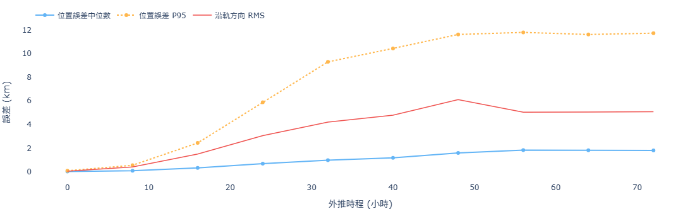
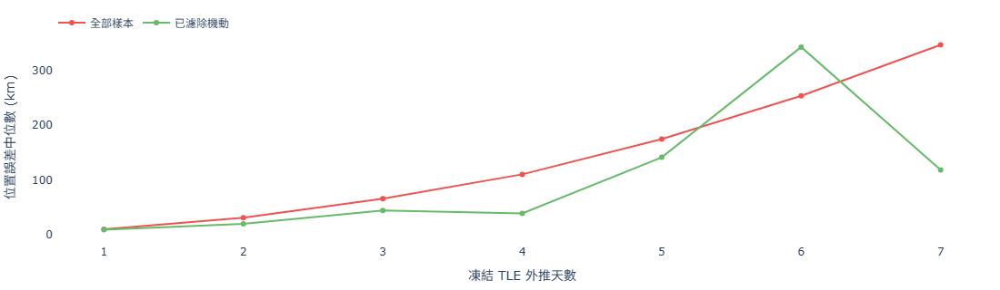

<!-- 由 docs/export_storymap_md.py 自 maneuver_app_2026November.py 匯出；線上版：https://rhynowu-maneuver-detection-i18n.hf.space/?mode=storymap&case=case13 -->

# 案例十三：對幾十顆到上百顆 Starlink 跑 MEME 軌道外推，算出了什麼？

### 大規模計算的結果與意外發現

> 本頁數字讀取自離線批次分析輸出（`data/study1/`、`data/study2/`、`data/study3/`），皆為對真實 Starlink MEME 精密星曆逐顆計算之結果，非模擬數字。

**問題背景**：軌道預報的誤差，理論上應該隨著「預測多久以後」單調變大——但實際數字長什麼樣子？多久之後誤差會大到不能用？大規模跑過幾十到上百顆真實衛星之後，除了驗證這個直覺，還意外挖到兩個一開始沒想到的方法論陷阱。

## ① 最乾淨的量尺：MEME 對 MEME 自我預測

SpaceX 的 MEME 精密星曆每份涵蓋 72 小時、每分鐘一筆，且每 ~8 小時重新發布一次、彼此重疊 ~88%。這代表對同一個未來時刻，會同時存在「較新、外推齡幾乎為 0」的檔案（當作真值）和「較舊、外推齡 8～72 小時」的檔案（當作預測）——兩者相減就是精密星曆自己的外推誤差，**完全不需要外部傳播器，不會混進 SGP4 的誤差**，是樣本量最大、最乾淨的量測方式。

> 50 顆安靜（無機動）衛星、共 62,833 筆樣本：位置誤差中位數從 8 小時的 **0.09 km** 成長到 72 小時的 **1.81 km**，且在 48 小時左右就開始飽和，不再持續倍增——**幾乎全部誤差來自沿軌方向**（紅線遠高於徑向/法向），符合軌道力學上「沿軌相位誤差是主導項」的預期。

## ② 意外發現一：用「瞬時半長軸」抓機動，99.5% 都抓錯

> ❌ MEME 檔案裡的瞬時（osculating）半長軸，其實會因為地球扁率造成的 J2 短週期攝動而上下振盪（振幅可達數公里），跟真正的機動訊號長得很像。第一版方法直接比較相鄰快照的瞬時半長軸差異，**結果把 99.5% 的正常樣本都誤判成機動**——這不是資料問題，是方法本身的系統性錯誤。
>
> **修正方式**：不比較單一時刻的瞬時值，而是把整份 72 小時星曆檔（約 10 個軌道週期）的半長軸取平均，讓 J2 短週期振盪自然抵消，只留下真正的長期趨勢——修正後，已知靜止衛星的雜訊地板才降到合理範圍（低於 0.2 km 的判定門檻）。**這個教訓後來變成 `study3` 機動過濾邏輯的核心方法**。

## ③ 意外發現二：SpaceX 把計畫機動「預先寫好」進星曆檔

> ⚠️ 對 STARLINK-5846 做逐檔比對時發現：點火前發布的檔案，跟點火後發布的檔案，在重疊時間範圍內的軌跡幾乎完全一致（差距僅 100～250 公尺，屬於定軌更新雜訊等級）——**兩份檔案裡都已經包含完全相同的未來半長軸變化曲線**。這代表：**跨檔案比較法根本定位不到點火時刻**，因為 SpaceX 是把「計畫要做的機動」預先計算好、寫進了尚未執行的星曆檔案裡。
>
> 真正能定位點火的方法是**檔案內部**逐點用 vis-viva 方程式（依軌道能量守恆推導、從瞬時位置與速度直接反算瞬時半長軸的公式）算瞬時半長軸——推力弧會在單一檔案內直接顯現。本案例最後抓到一次 30 分鐘內半長軸階躍 6.59 公里的真實推力弧，時間點與兩份不同檔案的讀值完全一致。

## ④ 機動污染的量級反差：純外推 vs 含機動，差了 14 倍

> ℹ️ 對 50 顆衛星做「凍結一筆 TLE、放著讓它自然老化 7 天」的實測（跨越一次真實 ~6.7 天的資料下載斷點）：
>
> - **38 顆純外推（無機動）**：7 天後位置誤差中位數 **246.2 km**
> - **12 顆期間曾機動**：7 天後位置誤差中位數飆升到 **3473 km**（約 **14 倍**）
>
> 最乾淨的幾顆純外推衛星，7 天後誤差甚至可以低到個位數公里——**這代表 TLE 老化本身不是主要問題，「有沒有在外推期間機動」才是決定 TLE 還能不能用的關鍵**。

## ⑤ 放大到全星系的意義：TLE vs MEME，差了三個數量級

> ✅ 把同樣的比對邏輯放大到全部 **284 顆 Starlink、約 2,600 萬個資料點**：新鮮 TLE（epoch 未滿 3 小時）的位置誤差中位數約 **1.5 km**（沿軌方向 1,524 m 主導，徑向僅 143 m、法向 181 m）；6～12 小時後成長到約 3 km，24～48 小時到 13 km，48～72 小時到 32 km——對照 MEME 精密星曆全程維持在**公尺級（約 5 m）**，兩者差了**三個數量級**。
>
> 這個落差對實務有具體意義：機動偵測可以反過來當作「星曆可信度即時把關」機制——剛做完機動的衛星，其 TLE 在數十公里等級內完全失準，若能即時標記出來，就能在需要高精度定位（例如評估 Starlink 訊號能否替代 GPS 做 LEO-PNT 定位）的應用中先行剔除。

---

**判讀**：這次大規模計算最重要的不是「證實了誤差會隨時間變大」（這是預期中的結果），而是兩個計算前沒想到的方法論陷阱——**瞬時半長軸的短週期振盪陷阱**與**星曆檔已預先編入計畫機動**——如果沒有先跑過幾十顆衛星的真實資料去對照檢查，這兩個陷阱很容易被忽略，後續所有基於「相鄰快照差分找機動」的分析都會建立在錯誤的地基上。

> 完整方法與程式見 `study1_tle_error_distribution.py`、`study2_meme_self_prediction.py`、`study3_tle_frozen_and_gap.py`；期中報告圖文見 `docs/meme_tle_report/`。

---
線上互動版：<https://rhynowu-maneuver-detection-i18n.hf.space/?mode=storymap&case=case13>
