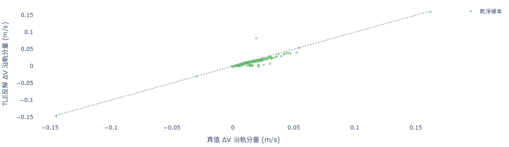

<!-- 由 docs/export_storymap_md.py 自 maneuver_app_2026November.py 匯出；線上版：https://rhynowu-maneuver-detection-i18n.hf.space/?mode=storymap&case=case15 -->

# 案例十五：從 TLE 反解機動的推力向量，能做到多準？

### 一個方法適用邊界被完整量化的誠實案例

> 本頁數字讀取自 `ids_truth_set/ids_dv_vector_validate.py` 之離線分析輸出，真值來自 IDS/DORIS operator 認證機動日誌，非本專案自算。

**問題背景**：知道「有沒有機動」是一回事，知道「這次機動的推力方向與大小」是更進一步的問題——沿軌道方向（along-track，加速或減速）跟垂直軌道面方向（cross-track，改變軌道面）在 TLE 精度下，反解的難度完全不同。本案例用 IDS/DORIS 的官方認證機動日誌（含逐次真實 ΔV 向量）逐一核對，誠實劃出這個方法能做到哪裡、做不到哪裡。

## ① 沿軌方向：脈衝式化學推進，幾乎完美

> ✅ 對乾淨、不受鄰近機動污染的樣本子集（n=207）：沿軌 ΔV 反解值與真值相關係數 **r=0.942**，中位誤差僅 **2.4 mm/s**。**CryoSat-2（化學推進、脈衝式點火，n=166）單獨拿出來看，r 高達 0.975**——對這種「單一時刻瞬間點火」的機動型態，TLE 反解的推力向量已經逼近真值。

## ② 但有三個誠實的失效邊界

> ❌ **(a) 鄰近機動污染**：SWOT（n=41，同為乾淨子集）相關係數只有 **r=0.512**——因為 41% 的事件間隔小於 7 天，前後兩次點火的訊號在 TLE 解析度下互相污染，無法乾淨分離。
>
> **(b) 垂直軌道面分量（cross-track）幾乎完全無法反解**：全樣本 n=246，相關係數 **r≈0.00**，中位誤差高達 **39.1 mm/s**——因為本案例涉及的凍結太陽同步軌道，其真實傾角變化中位數僅 **0.2 mm/s**，**遠低於 TLE 本身的傾角雜訊底**，物理上就不可能從 TLE 反解出這麼小的訊號，不是演算法不夠好。
>
> **(c) 電推連續推力，單步反解系統性失效**：這套方法假設機動是「單一瞬間脈衝」（化學推進的典型樣貌），但 Starlink 這類電推衛星的推力是**攤開在數十圈軌道上連續施加**，沒有單一階躍可以反解，套用單步假設會系統性低估——這正是為什麼案例十三要改用「檔案內逐點 vis-viva」而非「單步反解」來抓 Starlink 電推弧段。

---

**判讀**：這不是一個「這個方法有多好」的案例，而是一個「這個方法的適用邊界被完整量化」的案例——對脈衝式化學推進、乾淨無鄰近污染的沿軌機動，TLE 反解可以逼近真值（r=0.975）；但垂直軌道面分量、鄰近事件污染、連續電推三種情境下，方法會誠實地失效，而且失效的原因都能具體指出（物理雜訊底、事件間隔、推力型態假設）。**知道一個方法在哪裡會失效，跟知道它在哪裡有效一樣重要**。

> 完整推導見 `docs/期末_IDS三應用_20260805.md` §7.x.3；程式與原始資料 `ids_truth_set/ids_dv_vector_validate.py`。

---
線上互動版：<https://rhynowu-maneuver-detection-i18n.hf.space/?mode=storymap&case=case15>
