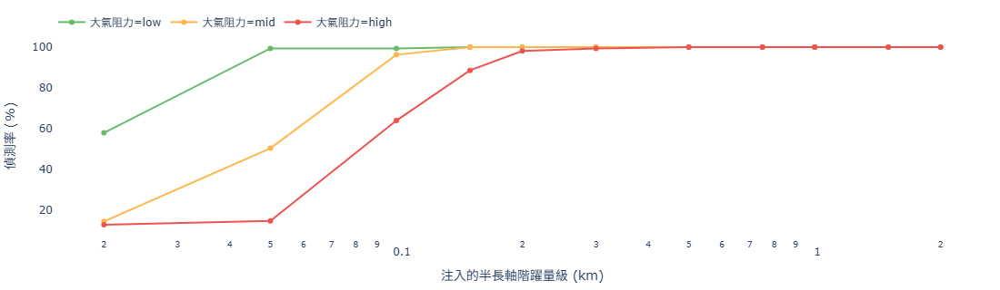
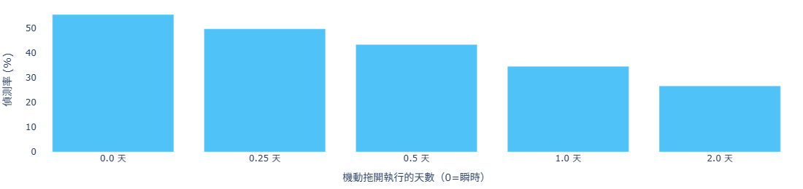

<!-- 由 docs/export_storymap_md.py 自 maneuver_app_2026November.py 匯出；線上版：https://rhynowu-maneuver-detection-i18n.hf.space/?mode=storymap&case=case17 -->

# 案例十七：機動小到什麼程度，系統還抓得到？

### FORMOSAT-7 合成注入實驗：把「最小可偵測量級」變成一條有信賴區間的法則

> 本頁數字讀取自 `fs7_injection_sweep_v4.py` 系列之離線分析輸出，皆為對真實 FORMOSAT-7（COSMIC-2）TLE 資料注入已知量級後之實測結果。

**問題背景**：與其講一個單一的「最小可偵測 X 公里」的門檻數字，不如問一個更誠實的問題——**這個門檻本身會隨著什麼條件變化**？本案例把已知大小的半長軸階躍，注入到真實 FORMOSAT-7 的 TLE 雜訊與大氣阻力背景中（**15,775 次個別試驗、478 個衛星×時間窗組合**），量測偵測率如何隨機動量級、取樣頻率、大氣阻力強度三個維度變化。

## ① 大氣阻力強度主宰了偵測門檻，不是機動量級本身

> （圖為原始更新頻率）低阻力環境下，注入 **20 公尺**已有約 58% 偵測率、**50 公尺**即達 99%；高阻力環境下，50 公尺僅約 15%，100 公尺約 64%，要到 **150～200 公尺**才達 89～98%——**要達到約 90% 偵測率，高阻力所需的機動量約為低阻力的 3～4 倍**。若再把 TLE 更新間隔拉長為 4 倍，高阻力下要約 **500 公尺**才達 92%，與低阻力、原始頻率相比差距擴大到約 10 倍。門檻高低取決於當下的大氣阻力狀態與資料更新頻率，而非機動量級本身。（2026-11-14 依 v4 輸出 `fs7_injection_sweep.csv` 更正：舊版「10～70 倍、1～1.5 公里」無法由 v4 數據重現。）

## ② 機動拖得越久，越難抓——瞬時 vs 攤開執行

> 同樣 50 公尺的淨位移，瞬時完成的偵測率 55.4%；**拖開半天執行，掉到 43.3%**——呼應案例三「站位保持階段真正的技術瓶頸」的結論：不是機動太小看不到，而是拖得越久、被拆得越細，偵測率就越低。

## ③ 把偵測門檻寫成一條可驗證的法則

- **SNR50（50%偵測率門檻）**：3.767（95% CI [3.583, 3.961]）

- **SNR90（90%偵測率門檻）**：9.868

- **阻力耦合常數 c_hat**：0.32（95% CI [0.28, 0.4]）

用**有效訊噪比**（同時考慮量級與阻力雜訊耦合，非單純的 |Δa|）去擬合一條邏輯斯迴歸曲線（cluster-aware bootstrap、2,000次重抽樣、time-split held-out驗證 **AUC=0.9773**）——這比宣稱一個單一的「最小可偵測 X 公里」更誠實，也更可驗證：任何人都可以拿新資料重新檢驗這條曲線準不準，而不是只能相信一個孤立的數字。

> 老實補充：早期版本（v1）曾把這條法則換算成具體公尺數（平靜期約61公尺、2024年5月Gannon磁暴主相期間約217公尺），量級可信，但該換算用的是較早期未經cluster-aware bootstrap修正的參數，尚未用本頁v4版本的嚴謹參數重新換算，此處僅呈現v4版本本身驗證過的SNR門檻與held-out AUC，不重複引用v1的公尺數字。

---

> ℹ️ **判讀**：「這套系統能抓到多小的機動」沒有單一答案，誠實的答案是一條隨大氣阻力狀態與執行時間拉長而變動的曲線，且這條曲線本身經過 held-out 驗證（AUC≈0.98）。把「最小可偵測量級」講成一個固定數字，是常見但不誠實的簡化；講成一條可驗證的法則，才經得起別人拿新資料來踢館。

> 完整方法與程式見 `fs7_injection_sweep_v4.py`；原始資料 `data/benchmark/fs7_injection_{sweep,trials,smear}.csv`、`fs7_law_fit_v4.json`。

---
線上互動版：<https://rhynowu-maneuver-detection-i18n.hf.space/?mode=storymap&case=case17>
