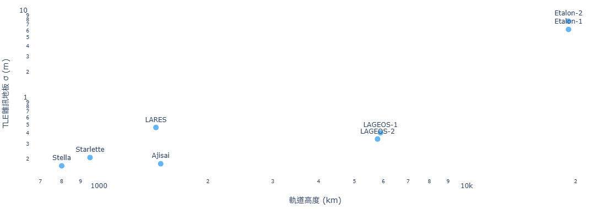

<!-- 由 docs/export_storymap_md.py 自 maneuver_app_2026November.py 匯出；線上版：https://rhynowu-maneuver-detection-i18n.hf.space/?mode=storymap&case=case18 -->

# 案例十八：TLE 的雜訊地板，在不同高度長什麼樣？

### 8顆從不機動的被動測地球體，加上一次差點被誤讀的月球攝動假訊號

> 本頁數字讀取自 `passive_sphere_noise_floor.py` 之離線分析輸出，與 `docs/進度月報_202608_TASA比較_詳版.md` §3.6、§3.7 之敘述一致。

**問題背景**：要知道「這個訊號是不是機動」，得先知道「什麼都沒發生時，雜訊本身有多大」。被動測地球體（表面覆滿雷射反射鏡、完全沒有推進器、永遠不會主動機動的衛星）是天生最乾淨的對照組——不需要像案例四那樣排除已知機動窗，本身就是「保證安靜」的樣本。本案例用 8 顆這樣的衛星，橫跨 800～19,126 公里，畫出 TLE 雜訊地板隨高度變化的全景圖。

> LEO帶（Stella、Starlette、Ajisai、LARES，800～1,488km）：σ = **0.17～0.46公尺**，與 DORIS 認證安靜期實測（中位≈0.2公尺）高度吻合——用完全不同的衛星類別，獨立驗證了同一個雜訊地板數字。LAGEOS-1/2（~5,800km）：σ = 0.34～0.40公尺。Etalon-1/2（~19,100km）：σ 一度看起來高達 **6.2～7.7公尺**——約為 LEO 帶中位值的 30～40 倍。（本段 σ 皆為同一口徑：90 天視窗內多項式去趨勢後的殘差 σ_resid。）

## 差點被誤讀的發現：那 30～40 倍的落差，其實大半是月球假訊號

> ❌ 跨 800～19,126 公里，原始 σ_resid 隨高度上升（Spearman ρ=+0.79，p=0.02）——**方向跟 LEO 帶內部「高度越高、大氣阻力越小、雜訊越乾淨」（ρ=−0.79）正好相反**，第一眼看很像是「MEO/高軌本質上就是比較雜」。但把 Etalon 的殘差拿去對月球第三體攝動建模（主週期 27.49～27.59 天，**精準對上恆星月週期 27.32 天**）之後——**Etalon-1 的 σ 從 7.42 公尺，扣除主週期後降到 1.16 公尺，再扣除次諧波週期後降到 0.89 公尺；Etalon-2 從 8.80 公尺降到 0.50 公尺、再到 0.35 公尺**（此處起點是月球建模用的口徑：整段序列去線性趨勢後的 σ，因未分視窗，略高於上段的 6.2／7.7 公尺）——大部分原本以為的「MEO雜訊」，其實是**可預測、可建模的月球攝動訊號，不是隨機雜訊**。

> ✅ **修正後的真實結論**：TLE 雜訊地板從 LEO（~0.2公尺）到 MEO（~0.5～1公尺）**只是溫和上升，不是原始數字暗示的30～40倍暴增**——那個看似戲劇性的落差，大半是處理方式（沒扣除已知的月球攝動）造成的假象。這跟案例十的「微分假影」是同一種教訓的不同版本：**看起來異常大的訊號，第一步永遠該先問「這是不是已知物理效應沒被扣除，而不是急著宣稱發現了新的雜訊源」**。

---

**判讀**：被動測地球體給了一個獨立於 DORIS 之外、完全不同衛星類別的雜訊地板驗證，本身就有價值；但更重要的教訓在於 Etalon 那段——**同一份資料，扣不扣除已知的物理攝動效應，結論可以天差地遠**。跨軌道域比較雜訊地板時，永遠要先確認有沒有把可預測的物理效應（月球/太陽第三體攝動、大氣阻力）處理乾淨，才能誠實地談「剩下的雜訊有多大」。

> 完整推導見 `docs/進度月報_202608_TASA比較_詳版.md` §3.6～3.7；程式 `passive_sphere_noise_floor.py`、`etalon_lunisolar_model.py`。

---
線上互動版：<https://rhynowu-maneuver-detection-i18n.hf.space/?mode=storymap&case=case18>
