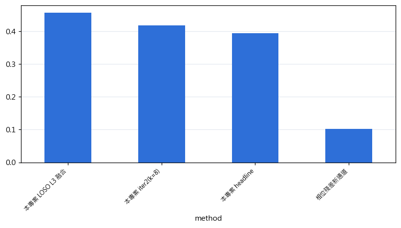

<!-- 由 docs/export_storymap_md.py 自 maneuver_app_2026November.py 匯出；線上版：https://rhynowu-maneuver-detection-i18n.hf.space/?mode=storymap&case=case21 -->

# 案例二十一：半長軸看不到的機動——相位殘差新通道

### 從一次意外發現，到一條新偵測通道，再到一次自我發現並修正的方法學錯誤

> 本案例延伸自案例十一⑤／⑥之發現，完整說明新通道之偵測原理、23 星驗證結果、兩次全 LEO 編目廣泛掃描結果，以及「這是否為刻意規避偵測而設計」之評估。

## ① 意外的起點：一種本專案結構性看不到的機動

案例十一⑤重現文獻第 6 篇（Geometric Distance Difference）時，用 Starlink 之精密星曆（MEME）與 TLE 交叉比對，意外發現一顆衛星（STARLINK-5367）發生「衛星前後位置改變，但半長軸幾乎不變」的機動——這是一種**相位調整（phasing）機動**：短暫改變軌道週期以累積或消除沿軌位置偏移，事後又恢復原週期。本專案（與另外重現過的全部 15 篇文獻方法）之偵測通道全部作用於半長軸（sma）——對此類機動是**結構性盲區**，不是調參能解決的問題，而是「這個訊號根本不在被監看的變數裡」。

## ② 偵測原理：緯度幅角相位殘差

**核心構想**：sma 由 TLE 之平均運動（軌道週期）反推；若機動只是「暫時改變週期、事後恢復」，sma 前後幾乎相同，但過程中累積的沿軌相位偏移不會自動消失——這個偏移是可以獨立追蹤的。做法：用前一筆 TLE 之平均運動外推「理應在下一筆時刻之角位置」，與實際值相減（wrap 至 ±180°）、乘以半長軸換算成沿軌弧長（km），即為「相位殘差」；對此殘差序列做疊代穩健 z 分數偵測，並與同一時刻 sma 是否同步異常做交叉比對——**唯有「相位異常但 sma 正常」才算候選**，這正是既有方法看不到、而此通道專門補位之處。

#### ▸ 🔧 一次自我發現並修正的方法學錯誤（近圓軌道的角位置退化問題）

初版直接用 TLE 之原始平均近點角 M 追蹤角位置。但對**近圓軌道**（離心率 e→0，絕大多數 Starlink/Kuiper/OneWeb 皆屬此類）而言，近地點在幾何上已無明確定義，因此「近地點幅角 argp」與「平均近點角 M」個別皆是**數值退化**的量——同一個真實物理位置，可被任意分配成不同的 argp/M 組合，微小定軌雜訊即可讓 M 在數十至上百度內劇烈跳動。唯有兩者之和「**緯度幅角** u=argp+M」（衛星相對於升交點的實際角位置）才是穩定、有物理意義的量。

**發現過程**：對全 LEO 編目做廣泛掃描時，發現大量候選之殘差量級逼近「半軌周長」理論上限（約 21,556km，即 wrap 之上限），物理上完全不合理；追查單顆衛星（STARLINK-3659）原始 TLE 後，證實其 M 在四筆相鄰 TLE 間跳動 271°→277°→240°→103°，但同一組資料算出之 u=argp+M 穩定維持在0.09-0.11°——確診為 M 之退化問題。修正後：

- 23 星標竿 F1 由虛高的 0.174 修正為誠實的 **0.102**（召回率大跌，證實先前部分「命中」其實是退化雜訊造成的假陽性）；
- 15 天全 LEO 廣泛掃描候選數由 3,321 筆（多數殘差達物理不合理量級）降為 **197 筆**。

如實記錄此修正過程，而非只呈現修正後的乾淨數字。

## ③ 23 星標竿驗證：誠實的低分數，以及為何低分不代表失敗

| method | f1 | group |
|---|---|---|
| 本專案 LOSO L3 融合 | 0.457 | （本專案既有方法） |
| 本專案 iter2(k=8) | 0.418 | （本專案既有方法） |
| 本專案 headline | 0.394 | （本專案既有方法） |
| 相位殘差新通道 | 0.102 | 新通道（本案例主角） |

平均 F1=0.102（P=0.171, R=0.105），明顯低於既有 sma 方法。**這不代表通道無效**：既有 23 星真值本身以「沿軌位置也隨之改變的傳統軌道維持/碰撞迴避機動」為主，本通道鎖定的「相位調整、sma 不變」場景（即 STARLINK-5367 案例）根本不在此真值集合內、無對應真值可配對評分——此處 F1 衡量的是「此通道對一般機動的敏感度」，而非其設計目標場景的偵測力。

## ④ 兩次全 LEO 廣泛掃描：15 天短窗 vs 20 個月長窗

| item | short_window | long_window |
|---|---|---|
| 掃描範圍 | 最近15天 | 2025-01-01迄今（約20個月） |
| 衛星/TLE數 | 28,005 / 722,209 | 29,128 / 12,509,231 |
| 候選數 | 197 | 4,633 |
| 穩定殼層之合理候選 | 約15顆（多為Starlink） | 1,162顆（以CN/NASA/俄對地觀測衛星為主） |

**兩次掃描結果不矛盾，只是「異常」的基準不同**：短窗以該衛星最近幾週的噪聲為基準，對「近期新發生的事件」敏感；長窗以該衛星 20 個月的全域噪聲為基準，對「該衛星有史以來相對罕見的大幅事件」敏感。Starlink 式持續、頻繁但單次幅度較小的例行相位調整，在長窗基準下已被納入其自身噪聲的一部分，故長窗結果中 Starlink 候選僅剩 4 筆（且皆判定為仍在軌道轉移中）；而長窗掃描找到的 1,162 顆穩定殼層候選，出乎意料地**以中國遙感衛星（實踐系列、風雲三號、高分多模、資源一號等）、NASA/NOAA 極軌對地觀測衛星（AQUA、NPP）、俄羅斯衛星（COSMOS、METEOR）為主**——此組成型態與太陽同步軌道對地觀測任務之標準「相位保持」維護假說相容（僅依衛星名稱手動歸類，尚待正式物體目錄與任務紀錄佐證，詳見完整報告）。

## ⑤ 評估：這是刻意規避半長軸式偵測而設計的嗎？

> ✅ **結論（2026-09-14 依內部審查意見調整為推論層級）：依任務動機推論，不支持刻意規避偵測之假說；但無論操作意圖為何，客觀上確實構成真實的偵測盲區。**
>
> 1. 從任務設計動機看，此類「相位保持」修正之目的與維持太陽同步軌道對地觀測任務所需之降交點地方時精度相容（確保每次通過同一地點時光照角度一致，攸關成像品質與科學資料可比性）——這是數十年來對地觀測衛星操作的慣常做法，遠早於任何以 TLE 為基礎的機動偵測系統存在，不太可能是刻意針對偵測系統設計的規避手法。**此為推論性論證，尚需獨立任務文件或操作紀錄佐證，非直接證據。**
> 2. sma 幾乎不變是此類修正之**物理必然結果**，而非刻意掩護：只調整沿軌相位、不改變軌道高度的修正方式，本身就決定了 sma 前後幾乎相同。
> 3. **但無論操作意圖為何，對任何僅依賴半長軸變化的太空態勢感知（SSA）監測系統而言，這確實構成一個真實、系統性的偵測盲區**——這對本專案與同類 SSA 監測系統而言，是值得正式記錄的方法論限制，與是否為「規避意圖」無關。

## ⑥ 意外的意外：這個盲區通道對磁暴特別敏感（2026-09-18 新增）

把驗證樣本擴大到 FS7/COSMIC-2 星系（8 顆）時，意外發現 7 顆衛星幾乎同時（2026-04-17～18 約 6 小時內）觸發候選異常、殘差量級也高度一致——這種跨衛星一致性統計上不太可能是巧合。交叉比對 SpaceWeather 專案之 OMNI2/CelesTrak 資料，確認 2026-04-18 UTC 確實發生一次真實中度地磁暴（Dst -95nT、Kp 5.33，CME/激波驅動訊號），F10.7 太陽通量則全程平靜——排除單純太陽 EUV 通量驅動的解釋，指向磁暴造成的熱層密度擾動。

**但初步比較方式有瑕疵，須誠實記錄修正過程**：第一次嘗試用「磁暴週75.0% 觸發率」對照「另一批非 Starlink 衛星、另一個時間窗口的 83.9% 基線」，比較對象根本不同，得出「磁暴未明顯提升觸發率」的誤導性負向結論。發現此瑕疵後，改用**同一批 140 顆 Starlink 衛星、同一套方法**，僅將觀測窗口換成一段經確認的平靜對照週（2026-05-06～05-13）重新掃描——這才是有效的對照實驗設計。

| 觀測窗口 | 地磁狀態 | 觸發率 |
|---|---|---|
| 2026-04-15～04-21（磁暴週） | Dst 最低 -95nT，Kp 最高 5.33 | 75.0%（105/140） |
| 2026-05-06～05-13（平靜對照週） | Dst -1～-16nT，Kp 多數≤1.5 | 6.4%（9/140） |

> ✅ **卡方檢定 χ²=133.5，p=6.9×10⁻³¹，差異極端顯著**——這次乾淨對照強烈支持磁暴假說，推翻了初版比較基準錯誤所得的負向結論。**應以此對照實驗結果為準**：本通道在磁暴期間對 Starlink 確實會產生大量候選觸發，代表使用這個「補充觀察指標」時，若近期有地磁擾動，候選數量會系統性大增，絕大多數應為磁暴驅動的熱層密度訊號而非真實機動——這進一步強化（而非削弱）本案例一貫的定位：此通道只適合當補充參考，不適合當獨立判定通道。仍待後續驗證：本次僅為單一磁暴事件與單一平靜週之比較，尚未涵蓋多場磁暴之重複驗證。

## ⑦ 重大更正：擴大到 6 場磁暴後，劑量效應完全不成立

> ⚠️ 上一節的疑慮成真了。用 6 顆 COSMIC2 衛星（TLE 全歷史涵蓋 2024 年起）對另外 6 場強度不同的磁暴重新檢驗——包含 2024-05-11 之 Gannon 極端磁暴（Dst -406nT、Kp 9.0，近 20 年最強磁暴之一，強度為原案例 4 倍以上）。**結果與劑量效應假說完全相反**：6 場更強（甚至強得多）的磁暴，COSMIC2 觸發率全數為 0/6；唯獨強度最弱的原始 2026-04-18 事件（Dst 僅 -95）觸發全部 6 顆。若真為磁暴因果，不可能對更強的磁暴反而完全不敏感。
>
> **修正後的誠實結論**：COSMIC2 對 2026-04-18 的全數觸發，較可能是該特定日期／該特定星系的個案巧合（例如共同 TLE 定軌批次處理），而非磁暴之因果結果。⑥ 節 Starlink 部分（140 顆、p=6.9×10⁻³¹）的統計證據本身仍然成立，不受本節結果推翻；但兩個星系呈現截然不同的行為模式——顯示這個通道的候選觸發，可能高度依賴特定衛星族群或特定時間點的未知因素，而不是磁暴強度本身的穩定函數。⑥ 節「應以對照實驗為準」之結論，範圍應限縮為「該特定磁暴對 Starlink 的影響」，不可推廣為「本通道普遍對磁暴敏感」的通則。

## ⑧ 追加驗證：換 Starlink 大樣本測同一場磁暴，結果與 COSMIC2 完全一致

> ⚠️ ⑦節結尾留了一個問題：Starlink 只驗證過原始那一場磁暴，還不知道換一場磁暴後 Starlink 是否也一樣沒反應。用完全相同的 140 顆 Starlink 衛星清單，補測 **2026-07-04（G2，Kp=7.33、Dst=-150nT，強度明顯高於原始事件）**——受限於本地 TLE 資料庫為滾動窗口（目前僅涵蓋 2026-04-29～09-17），另外 5 場磁暴（含 Gannon G5）與原始 04-18 事件本身，Starlink 端現皆已無資料可查，只能補測這一場。
>
> **結果**：磁暴週觸發率從原始事件的 75.0%（105/140）**驟降至 1.4%（2/138）**，平靜對照週 0%，卡方檢定 p=0.478，統計上完全不顯著——跟平靜週沒有差別。磁暴強度明明更強，觸發率卻幾乎歸零。

> ❌ **再次修正的誠實結論**：Starlink 跟 COSMIC2 呈現同一種模式——**兩個獨立星系、兩種樣本規模（138–140 顆 vs 6 顆），都只對 2026-04-18 那一場特定磁暴有反應，換一場磁暴（甚至更強的）就完全沒反應**。這已經很難再用「COSMIC2 樣本太小、碰巧巧合」解釋——因為 Starlink 138 顆的大樣本結果方向完全一致。本案例對磁暴假說的立場，必須從「⑥節Starlink部分證據依然成立」，進一步修正為：**兩個星系的證據合在一起看，更支持「2026-04-18當天存在某種資料處理或編目層面的特殊事件」，而非「磁暴會系統性地讓這個通道大量誤觸發」**。是否真是共同 TLE 定軌批次處理所致，仍待直接查證（尚未執行），在此之前，磁暴敏感性的說法應視為存疑，不應寫入正式結論。

---

**判讀**：這個案例串起了三件事——一次意外發現（案例十一）、一條新偵測通道的誠實驗證（含自我修正一次方法學錯誤）、以及一次跨兩種時間尺度的全編目普查。它沒有宣稱解決了問題（新通道獨立使用之 F1 仍遠低於既有方法），而是誠實記錄了「既有系統看不到什麼」「為什麼看不到」「這在真實編目中有多普遍」三個層次的答案，並明確區分了「客觀盲區」與「主觀規避意圖」——這是本專案一貫的方法論：不誇大發現、不隱藏限制、不把相關性當成因果。

> 完整報告：`docs/相位殘差通道_新增偵測管道實作與驗證_20260913.md`；可重現腳本：`phase_residual_detector.py`（23星驗證）、`phase_residual_broad_scan.py --since=YYYY-MM-DD`（全LEO廣泛掃描）；原始資料：`data/benchmark/phase_residual_persat_20260913.csv`、`phase_residual_broad_scan_candidates_20260913.csv`、`phase_residual_broad_scan_candidates_2025-01-01_20260913.csv`、`phase_residual_broad_scan_summary_2025-01-01_20260913.csv`。

---
線上互動版：<https://rhynowu-maneuver-detection-i18n.hf.space/?mode=storymap&case=case21>
