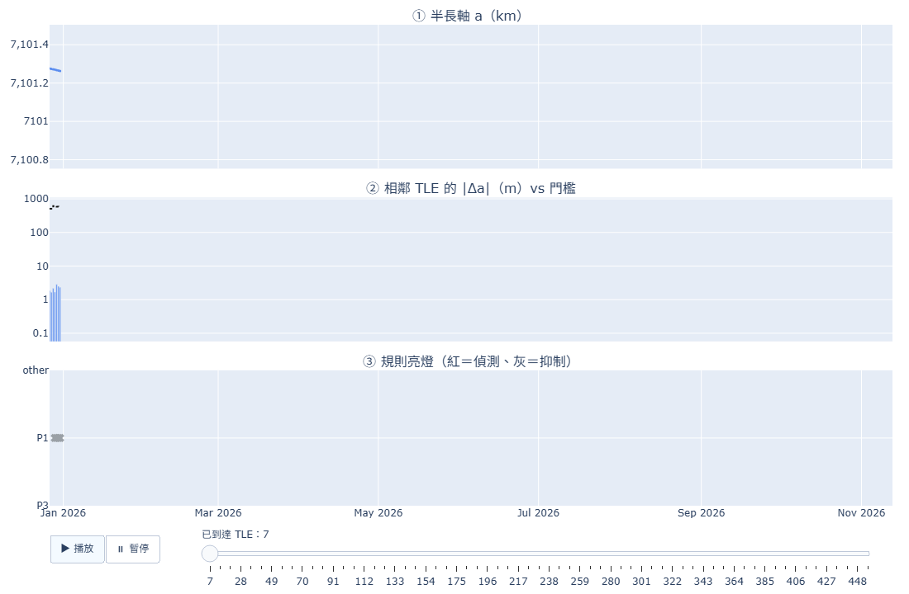
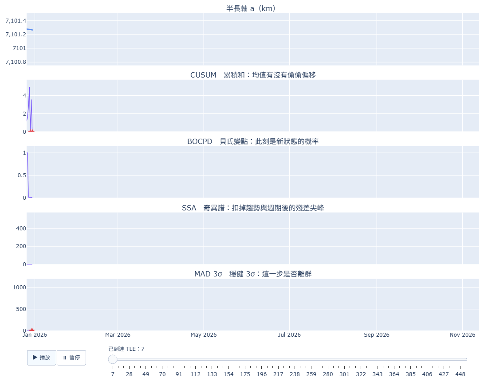
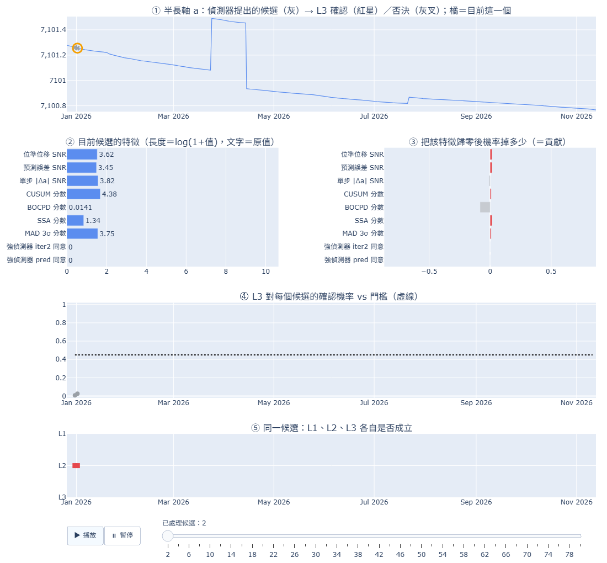
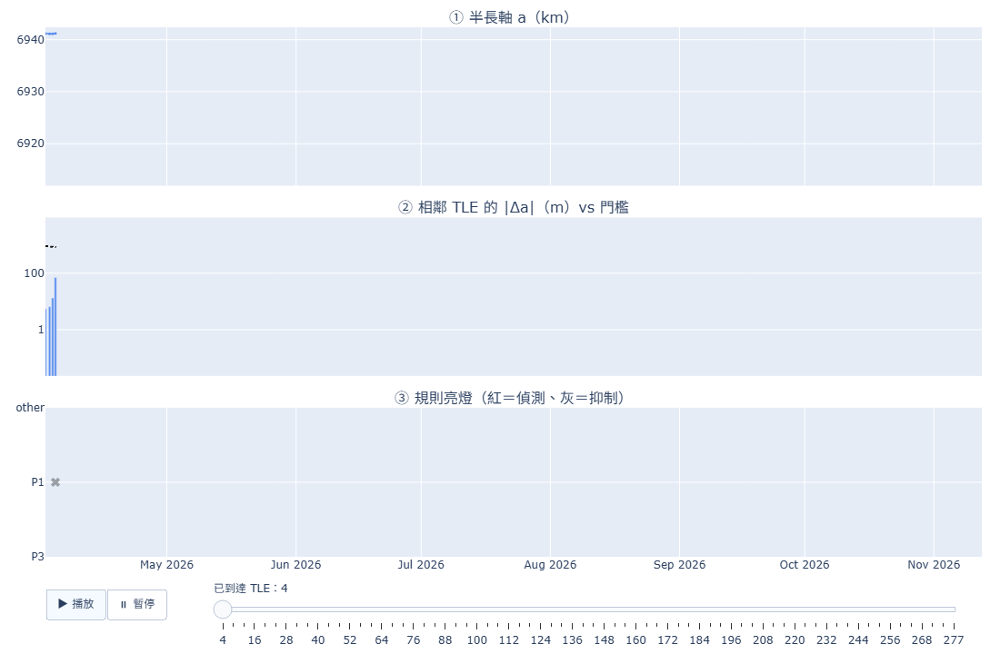
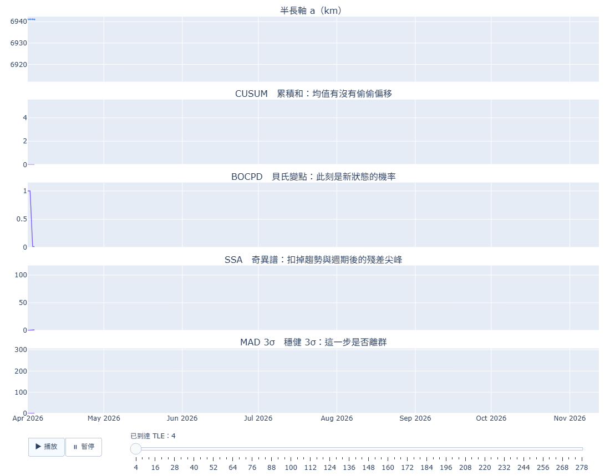
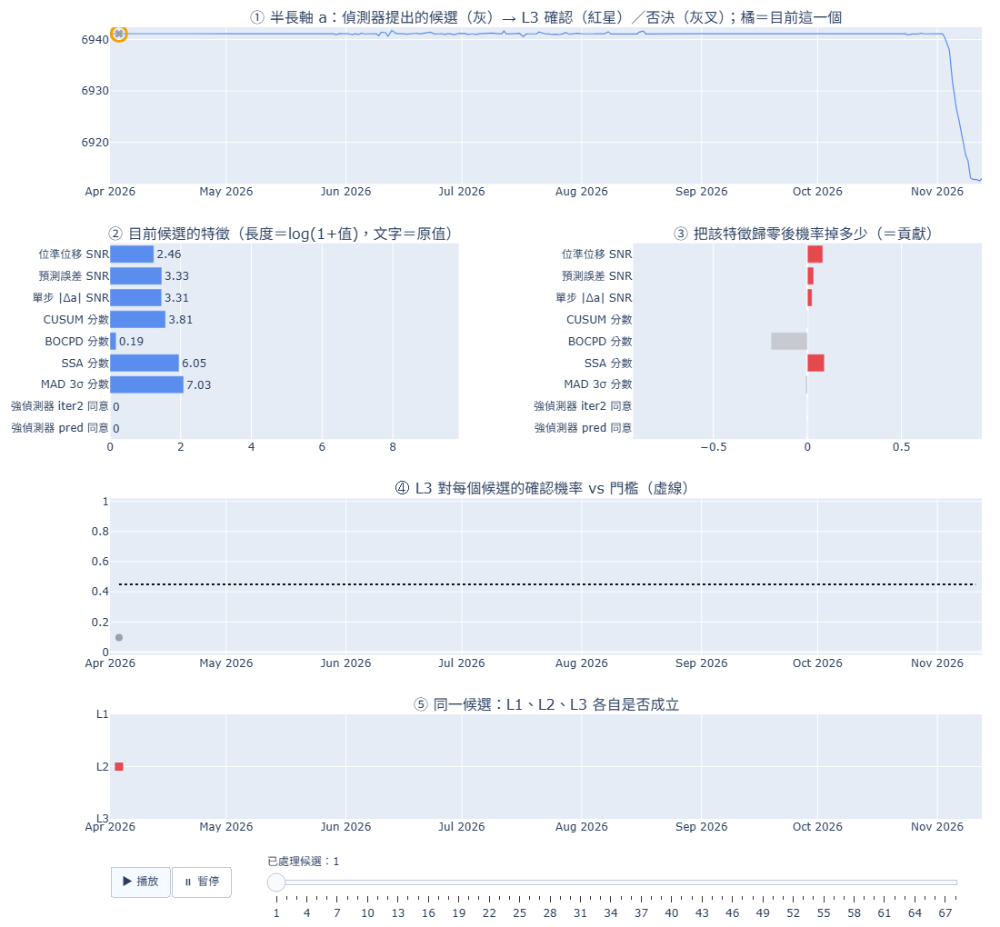

<!-- 由 docs/export_storymap_md.py 自 maneuver_app_2026November.py 匯出；線上版：https://rhynowu-maneuver-detection-i18n.hf.space/?mode=storymap&case=case27 -->

# 案例二十七：讓偵測法動起來——L1 規則閘門與 L2 統計通道的逐筆動畫

> L1、L2 的原理過去都以文字說明。本案例把它們畫成動畫：按下播放，TLE 一筆一筆到來，你可以親眼看到每一道規則、每一個統計通道在什麼時候、為什麼亮燈。所有曲線都是用本專案實際的偵測程式（maneuver_strategies_july.py、statistical_detectors.py）對真實 TLE 算出來的，不是示意圖。

## ① 選擇衛星

> ℹ️ 未輸入 → 使用預設對照組：**福衛五號（NORAD 42920，約 723 km，訊噪比高、機動一目了然）** 與 **STARLINK-3005（NORAD 48881，約 563 km，低軌難例，雜訊底高）**。

> 拖動 L1 門檻倍率，再播放一次：門檻降低會抓到更多、也更容易把雜訊當機動；升高則相反——這就是 L1「只有單一操作點」的直觀意義。

#### 〔分頁〕NORAD 42920 · 42920

共 **450** 筆 TLE（已稀釋近重複 epoch，最小間隔 12 h）；平均高度 **723 km**。L1 最終旗標 **4** / 449 個轉換（被 P1/P3 抑制 440 個）；L2 各通道事件數：CUSUM 28、BOCPD 4、SSA 99、MAD 3σ 23。

## ② L1：規則閘門——一道道關卡，全部通過才算機動

**怎麼看**：上圖是半長軸；中圖每根柱子是「相鄰兩筆 TLE 的 |Δa|」，黑色虛線是**該高度、該太陽活動下的門檻**（P2 依高度、P5 依 F10.7、P6 依星座族群調整）；柱子**越過虛線、且沒被抑制規則擋下**就變紅並在上圖打星號。下圖是各規則的亮燈紀錄：紅方塊＝偵測型規則（P2/P4/P5/P6/其他）觸發，灰叉＝抑制型規則（P1 純大氣衰減、P3 高 B\* 阻力）把誤報擋掉。

## ③ L2：統計通道——不看物理，只問「這條曲線的行為變了嗎」

四個通道各自獨立讀同一條半長軸序列：**CUSUM** 累積偏離量，均值悄悄偏移時緩緩爬升；**BOCPD** 給出「現在已進入新狀態」的機率；**SSA** 先扣掉阻力趨勢與週期成分，看殘差尖峰；**MAD 3σ** 單看這一步是否離群。紅星是該通道自己判定的事件。**各通道不必同時亮**——它們對不同型態的變化敏感，這正是後續 L3 要把它們融合的理由（三層同一擂台 L3 0.981 > L2 0.892 > L1）。

## ④ L3：對 L1／L2 類偵測器提出的候選，逐一「確認或否決」

**L3 怎麼運作**：L3 不是另一個偵測器，而是「確認者」。① 先由前段偵測器（iter2、pred 兩種曲線偵測，加上 L2 的 CUSUM／BOCPD／SSA／MAD 3σ）各自提出**候選機動時刻**，1 天內合併；② 對每個候選算 **10 個 σ 正規化特徵**（位準位移 SNR、預測誤差 SNR、單步 |Δa| SNR、L2 四通道分數、更新間隔、兩個強偵測器是否同意）；③ 分類器（HistGradientBoosting）輸出「這是真機動」的機率；④ 機率 ≥ 門檻 θ 就**確認**，否則**否決**（θ 依更新頻率分 dense／sparse 兩類事前設定，並在訓練衛星上以 F1 選定）。特徵都以該星自身的雜訊 σ 正規化，所以不同高度、不同雜訊底的衛星可以共用一個模型——這正是先前「Starlink 滑動窗 L3」對福衛五號失效的關鍵差別。L1 的 P1–P6 旗標**不是 L3 的輸入**，第⑤格只是把三者是否成立並排比較。

**依族群自動選模型**：本衛星使用 **非 Starlink 低軌模型（NASA/ILRS 認證機動窗，23 顆衛星訓練）**。

**怎麼看**：① 半長軸上，灰點是候選、紅星是 L3 確認、灰叉是否決，橘圈是目前正在處理的候選；② 該候選的 10 個特徵（長度取 log(1+值)，文字為原值）；③ 把某特徵歸零後機率掉多少，紅色＝該特徵在推高機率；④ 每個候選的機率與門檻；⑤ 同一候選 L1、L2、L3 是否成立。

**此衛星（觀察窗內）**：候選 80 個；L3 確認 **9** 個（門檻 θ=0.45，dense 類）；其中 L1 成立 5 個、L2 成立 80 個；最高機率 0.87。

**如實成績**（事件級 P/R/F1，各衛星平均；同一批候選、同一套真值與容差）：

| 方法 | 精確率 | 召回率 | F1 |
|---|---|---|---|
| L1 規則 P1–P6 | 0.469 | 0.077 | 0.122 |
| L2 BOCPD | 0.412 | 0.36 | 0.372 |
| L2 CUSUM | 0.173 | 0.675 | 0.265 |
| L2 MAD3σ | 0.163 | 0.726 | 0.256 |
| L2 SSA | 0.158 | 0.735 | 0.254 |
| L2 聯集（任一通道） | 0.109 | 0.823 | 0.19 |
| L3 候選確認 | 0.414 | 0.562 | 0.428 |
| 候選全接受（無 L3） | 0.093 | 0.872 | 0.165 |

> ⚠️ **非 Starlink：L3 的確認有實質增益，但整體仍不算高**——相對於「候選全接受」，精確率大幅提高（約 0.09→0.41）、F1 由約 0.17 升到 0.43，也高於 L2 最佳單通道與 L1。逐星留一（LOSO）平均 F1 約 0.43，即使在同分布的測高衛星上，仍有相當比例的誤報與漏報。 **樣本外檢驗（福衛七號 6 顆，弱真值）**：L3 F1 = 0.19，但 **L1 規則反而較高（0.23）**——低軌約 550 km 的福衛七號比較接近 Starlink 的情境，泛化不如高軌測高衛星。

#### 〔分頁〕NORAD 48881 · 48881

共 **278** 筆 TLE（已稀釋近重複 epoch，最小間隔 12 h）；平均高度 **562 km**。L1 最終旗標 **15** / 277 個轉換（被 P1/P3 抑制 60 個）；L2 各通道事件數：CUSUM 58、BOCPD 2、SSA 59、MAD 3σ 75。

## ② L1：規則閘門——一道道關卡，全部通過才算機動

**怎麼看**：上圖是半長軸；中圖每根柱子是「相鄰兩筆 TLE 的 |Δa|」，黑色虛線是**該高度、該太陽活動下的門檻**（P2 依高度、P5 依 F10.7、P6 依星座族群調整）；柱子**越過虛線、且沒被抑制規則擋下**就變紅並在上圖打星號。下圖是各規則的亮燈紀錄：紅方塊＝偵測型規則（P2/P4/P5/P6/其他）觸發，灰叉＝抑制型規則（P1 純大氣衰減、P3 高 B\* 阻力）把誤報擋掉。

## ③ L2：統計通道——不看物理，只問「這條曲線的行為變了嗎」

四個通道各自獨立讀同一條半長軸序列：**CUSUM** 累積偏離量，均值悄悄偏移時緩緩爬升；**BOCPD** 給出「現在已進入新狀態」的機率；**SSA** 先扣掉阻力趨勢與週期成分，看殘差尖峰；**MAD 3σ** 單看這一步是否離群。紅星是該通道自己判定的事件。**各通道不必同時亮**——它們對不同型態的變化敏感，這正是後續 L3 要把它們融合的理由（三層同一擂台 L3 0.981 > L2 0.892 > L1）。

## ④ L3：對 L1／L2 類偵測器提出的候選，逐一「確認或否決」

**L3 怎麼運作**：L3 不是另一個偵測器，而是「確認者」。① 先由前段偵測器（iter2、pred 兩種曲線偵測，加上 L2 的 CUSUM／BOCPD／SSA／MAD 3σ）各自提出**候選機動時刻**，1 天內合併；② 對每個候選算 **10 個 σ 正規化特徵**（位準位移 SNR、預測誤差 SNR、單步 |Δa| SNR、L2 四通道分數、更新間隔、兩個強偵測器是否同意）；③ 分類器（HistGradientBoosting）輸出「這是真機動」的機率；④ 機率 ≥ 門檻 θ 就**確認**，否則**否決**（θ 依更新頻率分 dense／sparse 兩類事前設定，並在訓練衛星上以 F1 選定）。特徵都以該星自身的雜訊 σ 正規化，所以不同高度、不同雜訊底的衛星可以共用一個模型——這正是先前「Starlink 滑動窗 L3」對福衛五號失效的關鍵差別。L1 的 P1–P6 旗標**不是 L3 的輸入**，第⑤格只是把三者是否成立並排比較。

**依族群自動選模型**：本衛星使用 **非 Starlink 低軌模型（NASA/ILRS 認證機動窗，23 顆衛星訓練）**。

**怎麼看**：① 半長軸上，灰點是候選、紅星是 L3 確認、灰叉是否決，橘圈是目前正在處理的候選；② 該候選的 10 個特徵（長度取 log(1+值)，文字為原值）；③ 把某特徵歸零後機率掉多少，紅色＝該特徵在推高機率；④ 每個候選的機率與門檻；⑤ 同一候選 L1、L2、L3 是否成立。

**此衛星（觀察窗內）**：候選 68 個；L3 確認 **8** 個（門檻 θ=0.45，dense 類）；其中 L1 成立 9 個、L2 成立 68 個；最高機率 0.92。

**如實成績**（事件級 P/R/F1，各衛星平均；同一批候選、同一套真值與容差）：

| 方法 | 精確率 | 召回率 | F1 |
|---|---|---|---|
| L1 規則 P1–P6 | 0.469 | 0.077 | 0.122 |
| L2 BOCPD | 0.412 | 0.36 | 0.372 |
| L2 CUSUM | 0.173 | 0.675 | 0.265 |
| L2 MAD3σ | 0.163 | 0.726 | 0.256 |
| L2 SSA | 0.158 | 0.735 | 0.254 |
| L2 聯集（任一通道） | 0.109 | 0.823 | 0.19 |
| L3 候選確認 | 0.414 | 0.562 | 0.428 |
| 候選全接受（無 L3） | 0.093 | 0.872 | 0.165 |

> ⚠️ **非 Starlink：L3 的確認有實質增益，但整體仍不算高**——相對於「候選全接受」，精確率大幅提高（約 0.09→0.41）、F1 由約 0.17 升到 0.43，也高於 L2 最佳單通道與 L1。逐星留一（LOSO）平均 F1 約 0.43，即使在同分布的測高衛星上，仍有相當比例的誤報與漏報。 **樣本外檢驗（福衛七號 6 顆，弱真值）**：L3 F1 = 0.19，但 **L1 規則反而較高（0.23）**——低軌約 550 km 的福衛七號比較接近 Starlink 的情境，泛化不如高軌測高衛星。

## ⑤ 用預設對照組看什麼

- **福衛五號（723 km）**：高軌、大氣擾動小，雜訊底約公尺級，機動的 |Δa| 遠高於門檻，L1 的柱子清楚越線；大量緩降的點被 P1 抑制（灰叉），不會被當成機動。
- **STARLINK-3005（563 km）**：低軌、電推與大氣阻力並存，雜訊底高（見案例三、二十四、二十五），|Δa| 常態性貼近門檻，L1 與 L2 的判定更容易分歧——這就是「低軌難例」。
- 若你輸入自己的 NORAD ID，可試著找出「L1 亮而 L2 不亮」或「L2 亮而 L1 不亮」的時刻，那正是各層的盲區。
- **已知案例：福衛五號 2026-04-14 的 −519 m 降軌**（查核於 2026-09-21）。當時 L2 有偵測，但 L1 與 L3 都沒有確認，這不是畫圖錯誤，而是兩個真實問題：(1) **L1 的抑制規則誤擋（已於 2026-09-21 修正）**——P1「衰減抑制」與 P3「B* 抑制」以「小幅負 Δa」判斷衰減，容許值（2 km／1.5 km）遠大於 P2 高度門檻，把向下的降軌機動當成大氣衰減擋掉；福衛五號超過門檻的 8 次轉換中被擋的正是這一次，Starlink 也有 3/9 個 −760～−930 m 的大幅下降被 P3 擋掉。修正為「本身已超過 P2 門檻的步階不得被 P1／P3 抑制」，現在 L1 會標記這一筆；擂台上整體 L1 召回 8.3%→8.6%、誤報率 5.4%→5.6%、精確率不變。(2) **L3 由「Starlink 滑動窗」改為「候選確認式、依族群選模型」後，這一筆被確認**——舊模型分數僅約 0.10（因為只用 Starlink 訓練，學到「大階躍不代表機動」），新的非 Starlink 模型以 σ 正規化特徵，這一筆機率約 0.84，被 L3 確認。

## ⑥ 誠實限制

1. 這裡展示的是**偵測法的行為**，不是準確度：頁面沒有疊上機動真值，因此**不能**由紅星數量判斷誰比較準。準確度請見報告 §13.2 三層同一擂台。
2. L1 逐筆只依賴相鄰兩筆與短窗，可線上運作；L2 的 SSA、MAD 使用整段序列統計量，動畫的「逐步揭露」是把已算好的分數依時間顯示，並非嚴格的逐筆重算。
3. 為控制網頁大小，序列已稀釋近重複 epoch（最小間隔 12 h）並最多取最近 450 筆；資料庫為滾動視窗，觀察窗實際長度依衛星而異。
4. 各通道的「事件」採用 statistical_detectors.py 之內建判定，未針對單一衛星調參；亮燈數量多不代表較好。
5. L3 為「候選確認式」，依族群自動選模型：非 Starlink 用 23 顆 NASA/ILRS 衛星訓練、Starlink 用 MEME 真值訓練。兩者的成績都不高（見上表）。在 Starlink 上「確認」的增益很小：2026-10-21 起 Starlink 模型加入 3 個 B\* 偏離特徵（見案例三十），L3 F1 0.373 對「候選全接受」0.366，增益主要來自精確率，召回率不變。模型檔為離線訓練後上傳，頁面上不會即時重訓。

> Code: `l1l2_explainer.py`, `maneuver_strategies_july.py`, `statistical_detectors.py`; common-arena numbers: `three_layer_common_eval.py`.

---
線上互動版：<https://rhynowu-maneuver-detection-i18n.hf.space/?mode=storymap&case=case27>
