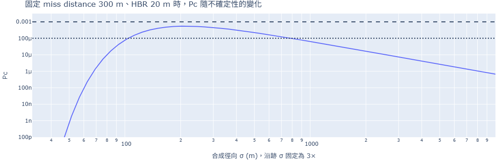

<!-- 由 docs/export_storymap_md.py 自 maneuver_app_2026November.py 匯出；線上版：https://rhynowu-maneuver-detection-i18n.hf.space/?mode=storymap&case=case28 -->

# 案例二十八：VCM 與傳統 TLE，在衛星碰撞預測上到底差在哪？

### 一句話：TLE 描述的是名義軌道；VCM 同時描述名義軌道與它的不確定性

> 本頁的 Pc 數字由下方公式即時計算（極座標數值積分，非蒙地卡羅，同輸入必得同輸出）；文字結論引用 NASA CARA 與公開報導，來源列於頁尾。本專案本身只使用公開 TLE，**沒有** VCM 存取權——這正是本案例要說清楚的界線。

## ① 兩種資料，回答的是兩個不同的問題

- **TLE（Two-Line Element）**：一組*平均*軌道元素，必須搭配 SGP4／SDP4 這類分析模型才能傳播。格式簡單、公開、更新快，適合大規模目標篩選與一般態勢展示。它回答的是：**「依公開軌道模型，物體大概會在哪裡？」**
- **VCM（Vector Covariance Message）**：某個 epoch 的位置／速度狀態向量，**外加 covariance**——描述這個估計在各方向上的不確定程度，以及位置與速度誤差之間的相關性。它回答的是：**「物體預計會在哪裡，而這個預測有多不確定？」**

NASA 在 CARA 的建議中明確指出：TLE 不足以支援正式的 conjunction assessment（CA）。原因不是 TLE「不準」，而是它**缺少描述誤差分布的 covariance**，因此無法算出標準的碰撞機率 Pc。

| 項目 | TLE | VCM |
|---|---|---|
| 內容 | 平均軌道元素（需 SGP4／SDP4 傳播） | 狀態向量＋covariance |
| 不確定性 | 無（只有經驗誤差量級） | 有，逐方向、含相關性 |
| 典型誤差 | 約 1–2 km 量級，隨傳播時間、阻力與未通報機動放大 | 依定軌品質而定，並隨 covariance 一起傳播 |
| 能算 Pc 嗎 | 不能（只能算幾何最近距離） | 可以（標準 CA 流程） |
| 適用階段 | broad-phase：全目錄粗篩、態勢展示 | narrow-phase：正式風險評估與避碰決策 |

## ② 同樣的最近距離，Pc 可以差好幾個數量級

這是本案例最重要的一點，也是「為什麼 miss distance 不能直接當風險」的原因。下面的計算把兩物體的合成位置不確定性放在交會平面上，對半徑 HBR（兩物體半徑和）的圓積分。**你可以自己改參數**：

- **此組參數的 Pc**：5.419e-04

> 操作門檻參考（各任務自訂，非唯一標準）：Pc ≥ 1e-3 多數任務要求執行避碰機動；1e-4 ≤ Pc < 1e-3 需進一步評估與加密觀測。

| 不確定性情境 | 徑向 σ (m) | 沿跡 σ (m) | Pc |
|---|---|---|---|
| VCM 等級（精密定軌後） | 30 | 80 | 4.758e-22 |
| 新鮮 TLE 假想等級 | 300 | 1000 | 4.043e-04 |
| 數日前 TLE 假想等級 | 1000 | 3000 | 6.373e-05 |

> ⚠️ 注意這張表最違反直覺的地方：**不確定性變大，Pc 不一定變大，反而可能變小**（probability dilution，機率稀釋）——誤差橢球被攤得很開時，落在那個小圓內的機率反而下降。所以「用一個很大的保守 σ」並不是安全做法，它可能讓真正危險的交會看起來無害。這也是為什麼 VCM 的價值不只是「有 covariance」，而是 covariance 要有 realism。後面兩列是「假如 TLE 有 covariance 會如何」的假想值——TLE 實際上並不提供 covariance，這兩列只是用來說明量級效應。

> 曲線先升後降：σ 遠小於 miss distance 時，兩者幾乎不可能相撞；σ 接近 miss distance 時 Pc 達到峰值；σ 再變大則進入稀釋區。只看最近距離無法知道自己落在這條曲線的哪一段——這就是 VCM 的用處。

## ③ 兩種流程：broad-phase 篩選 vs narrow-phase 評估

實務 SSA/SDA 系統不是二選一，而是分層使用：

1. **TLE（broad-phase）**：用 SGP4 對數萬個目錄物體做全域篩選，找出可能接近的候選對。快、便宜、可公開重現。
2. **VCM／精密星曆（narrow-phase）**：對候選對傳播狀態與 covariance 至 TCA，算出 Pc，再依任務門檻決定是否加密觀測、協調或執行避碰機動。
3. **新觀測／重新定軌**：對高風險交會補觀測、確認是否有未通報機動，收斂 covariance 後重算。

把 TLE 的角色說成「不準所以沒用」是錯的；正確的說法是「TLE 是 broad-phase 工具，不是 narrow-phase 依據」。

## ④ 為什麼這件事在 2026 年特別值得談

2026 年 9 月 23 日 Breaking Defense 的獨家報導指出：美國太空軍透過 Joint Commercial Operations（JCO）與 SpaceX 的協議，讓 SpaceX 取得原本限軍方使用的**高精度目錄（High Accuracy Catalog, HAC）**，其中包含帶 covariance（報導稱為「誤差泡泡」）的 **VCM**，交換條件是 SpaceX 提供其 Stargaze 星象追蹤系統的觀測資料；官方並稱有限制條款，資料僅供其內部使用、不得用於商業利益。報導同時提到 SpaceX 每天執行約 2 萬次衛星機動，其中約 1 千次是避碰；業界競爭者則擔心這種安排造成不公平優勢。

從本案例的角度，這則報導的技術意涵很清楚：**碰撞預測的關鍵差異不在「有沒有軌道資料」，而在「有沒有 covariance」**。公開 TLE 人人可得，但要做到可信的 Pc 與避碰決策，需要的是 VCM 這一級的資料——這也正是它會成為政策與商業爭議焦點的原因。

> ℹ️ 誠實標註：上述報導內容為媒體轉述，本專案無法獨立查證，也沒有 HAC／VCM 的存取權。此處引用是為了說明「covariance 存取權」在現實中的份量，不作為本專案任何技術宣稱的依據。

## ⑤ 這對本專案的界線意味著什麼

- 本專案全部使用**公開 TLE**（以及少數公開精密星曆），因此在碰撞議題上只能做到 **broad-phase 篩選與態勢展示**。
- 案例七（Pc／TCA）用的是簡化示範算法（`conjunction_pipeline.compute_pc_simplified`，二維、假設 covariance），**不是**正式 CA 產品，也不應作為避碰機動依據。
- 本專案真正的貢獻在另一件事：**從 TLE 偵測機動**。未通報機動正是讓 TLE 傳播誤差暴增、也讓他人 covariance 失真的主因之一；把「這顆衛星最近動過」標示出來，對 broad-phase 篩選的價值，比硬算一個不可信的 Pc 高。
- 若未來要進到 narrow-phase，需要的不是更好的模型，而是**資料等級的升級**：VCM 或 owner/operator 星曆。

## ⑥ 來源

- NASA CARA, *Conjunction Assessment Risk Analysis — Updated Recommendations*（TLE 不足以支援正式 CA）
- NASA, *Conjunction Assessment and NPR 8079.1*；NASA *National Standard for Space Safety and Orbital Debris* 相關文件
- AMOS, *Conjunction Assessment: NASA Best Practices and Lessons Learned*
- Space-Track.org, TLE 格式文件與說明
- Theresa Hitchens, "EXCLUSIVE: SpaceX given unique access to classified DoD space tracking data, sources say", *Breaking Defense*, 2026-09-23 — https://breakingdefense.com/2026/09/exclusive-spacex-given-unique-access-to-classified-dod-space-tracking-data-sources-say/

> 本頁 Pc 計算：`_pc_2d()`（極座標數值積分）；專案內既有的簡化 Pc：`conjunction_pipeline.compute_pc_simplified`。

---
線上互動版：<https://rhynowu-maneuver-detection-i18n.hf.space/?mode=storymap&case=case28>
