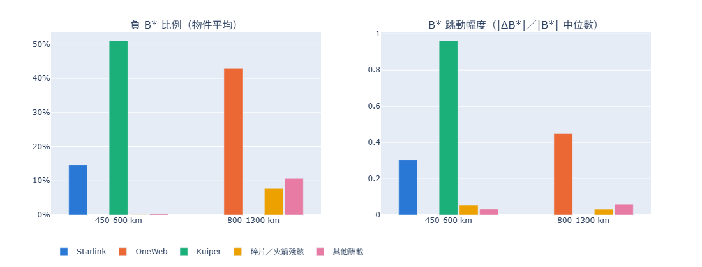
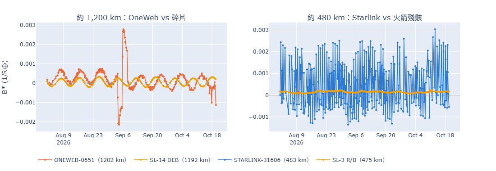

<!-- 由 docs/export_storymap_md.py 自 maneuver_app_2026November.py 匯出；線上版：https://rhynowu-maneuver-detection-i18n.hf.space/?mode=storymap&case=case30 -->

# 案例三十：負的大氣阻力？——推力被藏進 TLE 的 B\* 參數

### 大氣阻力只會讓衛星減速，B\* 照理永遠是正的。但推進中的星系常出現負 B\*——因為 SGP4 沒有推力項，推力只好被擬合進阻力參數。這件事有多普遍、是不是真的、對本專案的偵測規則又有什麼影響？

> **術語**：TLE（雙行根數）是美國太空監視網公開的軌道資料，用 SGP4 模型推算位置。**B\***（B-star）是 TLE 裡唯一描述大氣阻力的參數，單位為 1/地球半徑，越大代表阻力越強。**ndot** 是平均運動的一階變化率。**MEME** 是 SpaceX 公開的 Starlink 精密星曆，本專案以它作為真值。

## ① 為什麼負 B\* 不該存在

- 大氣阻力的方向永遠和速度相反，只會讓軌道降低，所以描述阻力強弱的 B\* 應該永遠為正。
- SGP4 的力模型只有地球重力（含扁率）、大氣阻力和日月擾動，**沒有推力項**。美方定軌時，會用一段時間的觀測擬合出一組 TLE；如果衛星在這段時間持續推進，模型裡又沒有推力，擬合只能把多出來的沿軌加速度塞進唯一能調的參數——B\*。
- 推力把軌道往上推 → 看起來像「負的阻力」→ **B\* 變成負值**；推力把軌道往下拉 → 看起來像「特別強的阻力」→ **B\* 異常偏大**。

## ② 普查：2.3 萬個低軌物件

範圍：2026-08 以後、高度 1,300 km 以下的近圓軌道物件，共 **22,748** 個。

- **450–600 km（阻力強，B\* 測得準）**：碎片的負 B\* 只有 0.05%、一般酬載 0.33%，幾乎不存在；Starlink 是 **14.6%**、Kuiper 是 **50.9%**。這是最乾淨的對照。
- **800–1,300 km（阻力弱）**：碎片也有 7.8% 的負 B\*——高空大氣稀薄，B\* 本身就測不準，符號可能被雜訊翻轉。OneWeb 是 **42.9%**，仍明顯高出許多；B\* 跳動幅度更是碎片的約 **14 倍**。

**範例時序**：同高度的推進衛星與碎片，B\* 長什麼樣子

> 注意 1,200 km 那顆碎片也會跨過零線：高空 B\* 本來就不穩，所以高軌的負 B\* 不能單獨當推力證據，要和同高度碎片比較。

## ③ 用真值確認：負 B\* 真的對應推力嗎？

相關性不等於因果。所以我們用 Starlink 的 MEME 精密星曆當真值：對每一筆 TLE，計算它 epoch 之前 12 小時、MEME 一圈平均高度的實際變化率（km/天），看 B\* 是否跟著推力方向走。

| MEME 高度變化率（km/天） | TLE 筆數 | 負 B* 比例 | B* 中位數 |
|---|---|---|---|
| 降軌（< −1） | 84 | 0.03571 | 0.00207 |
| 緩降（−1 ~ −0.2） | 275 | 0.1491 | 0.0007583 |
| 持平（−0.2 ~ 0.05） | 4596 | 0.1501 | 0.0002448 |
| 緩升（0.05 ~ 0.5） | 1356 | 0.1409 | 0.000244 |
| 升軌（> 0.5） | 150 | 0.58 | -3.886e-05 |

樣本：283 顆 Starlink、6,461 筆 TLE（每份 MEME 只用前 24 小時，因為升軌期間 MEME 的預報超過 24 小時就會失準）。

- **升軌時**，負 B\* 比例從持平時的 15% 升到 **58%**。
- **降軌時**，B\* 中位數是持平時的 **8.5 倍**——反向推力被當成「特別強的阻力」。
- 只看單筆 TLE 的 B\*，判斷「是否正在降軌」的 AUC 是 **0.913**，判斷「是否正在升軌」是 **0.743**（0.5 = 瞎猜，1 = 完美）。

> 持平時仍有 15% 的負 B\*：Starlink 平時持續做補償阻力的站位保持，推力剛好抵銷阻力時高度看起來不變，但推力其實存在，B\* 會在零附近擺動。

## ④ 對本專案的意義：兩個推測被數據推翻

發現 B\* 吸收推力之後，我們最初的推測是：「B\* 和 ndot 的跳動，讓 L1 規則層對 Starlink 有效、對碎片會誤報」。實際檢查程式碼和數據之後，這個推測**兩半都不成立**。

### 推測一：L1 靠 B\* 偵測機動？——不是

L1 規則層**完全沒用 ndot**；B\* 也**不是用來偵測**，而是用在兩條**抑制**規則上——P1「B\* 為正、而且連續小幅下降 → 判定為阻力衰減」，P3「B\* 偏高、而且小幅下降 → 判定為阻力造成」。兩條規則都假設「B\* = 大氣阻力」。

這個假設在推進星系上確實會失效：P3 觸發的 49 次裡，有 **22%** 是 MEME 顯示的真實機動（整體只有 4.3%）。但實際傷害很小——在 8,178 次轉換中，抑制規則只取消了 **12** 次偵測，其中 4 次是真實機動（3 次降軌）、6 次是正確擋掉的誤報；對 354 次真實機動的召回率只從 0.424 降到 0.412。原因是 2026-09-21 加的護欄：**超過 P2 高度門檻的步階不能被抑制**。

### 推測二：碎片誤報來自 B\* 跳動？——不是

| group | 族群（450–600 km，各抽 300 個） | L1 旗標率（每次轉換） | 其中來自 P2（Δa 超過門檻） | P1 抑制作用比例 |
|---|---|---|---|---|
| Starlink | Starlink | 0.03599 | 0.02645 | 0.7115 |
| debris | 碎片／火箭殘骸 | 0.0133 | 0.009104 | 0.9652 |
| other_payload | 其他酬載 | 0.002595 | 0.001035 | 0.9699 |

碎片確實會被 L1 誤報（1.33%，約為一般酬載 0.26% 的數倍；碎片不會機動，所以全是誤報），但來源是 **Δa 的雜訊**（P2）——碎片形狀不規則、追蹤精度較差，TLE 本身就比較粗。B\* 在碎片上反而發揮**保護作用**：P1 抑制規則作用在 97% 的碎片轉換上。

### 真正的意義：把「干擾」轉成「訊號」——已驗證

- L1 對 MEME 顯示的真實機動（單次轉換 > 300 m）召回率只有 **0.412**；而 B\* 單筆判斷降軌的 AUC 就有 **0.913**。
- L3 候選確認模型原本**沒有 B\* 和 ndot**。Plan B（LightGBM 單星分類器）則有一個 `bstar_f107_normalized` 特徵，但它的設計用意是把 B\* 當成**阻力的量測**（所以才對太陽通量正規化）——對推進星系，這個特徵其實也混入了推力。
- 反過來，這也是一個警訊：對推進星系，**不能把 B\* 當成大氣密度或阻力的量測**，凡是用 TLE B\* 反推熱層密度的研究，都要先排除推進中的衛星。

| 特徵組合 | 候選判別力（ROC-AUC） | 精確率 | 召回率 | F1 |
|---|---|---|---|---|
| 原 10 個特徵 | 0.6922 | 0.6936 | 0.2579 | 0.3688 |
| 加 3 個 B* 特徵（已採用） | 0.7245 | 0.7226 | 0.2579 | 0.3726 |
| 再加 ndot | 0.7283 | 0.7198 | 0.2584 | 0.3727 |

**實驗（2026-10-21）**：在 L3 Starlink 候選確認模型上做 A/B 比較。資料、模型參數、按衛星分組的 5 折交叉驗證和門檻選法完全相同，只差有沒有加入 3 個 B\* 偏離特徵（以候選時刻之前 30 天的中位數和 MAD 為基準，只用過去的資料，線上也能照做），並用 5 種不同分折各跑一次。

- **判別力確實提升**：候選判別力 0.692 → **0.724**，精確率 0.694 → **0.723**，每種分折的結果都一致。
- **但突破不了召回率上限**：召回率 0.258 → 0.258，F1 只從 0.369 到 0.373。確認模型只能否決 Δa 偵測器提出的候選，不能補出新的偵測。把 B\* 改當成**新的候選來源**也幫助不大：MEME 機動的涵蓋率只從 38.6% 提高到 43.9%，新增的候選只有 31% 是真機動。這和 TLE 時間解析度造成的召回天花板一致。
- **已納入正式模型**：2026-10-21 起，L3 Starlink 模型改用 10＋3 個特徵重新訓練（案例二十七的 L3 動畫即使用此模型）。非 Starlink 的模型不加——不推進的衛星，B\* 代表真實的大氣阻力，意義不同。

## ⑤ 誠實揭露

- **真值只有 Starlink**：OneWeb 和 Kuiper 沒有公開精密星曆，它們的負 B\* 只能從「遠高於同高度碎片」間接推論，沒有直接驗證。
- **高軌 B\* 本來就不穩**：800 km 以上，碎片也有可觀的負 B\*。高軌的推力證據要靠「和同高度碎片比較」，不能只看有沒有負值。
- **美方的定軌程序未公開**：B\* 如何被擬合、是否有約束，我們無從得知；本頁描述的是從結果反推的機制。
- **抽樣**：MEME 每顆衛星均勻抽 20 份、每份只用前 24 小時；L1 對照組每族群隨機抽 300 個物件（固定亂數種子）。

**判讀**：負 B\* 是 TLE 在說「這段時間有我解釋不了的推力」。它對本專案現有規則的干擾，已被護欄壓到很小；反過來把它當成特徵，確實讓 L3 更會分辨真假候選，但召回率的上限來自 TLE 本身的時間解析度，換特徵救不回來。

> 資料與程式：`bstar_thrust_analysis.py` → `data/benchmark/bstar_thrust_{population,tle_truth,transitions,l1_control,examples}_20261020.csv`；L1 規則：`maneuver_strategies_july.apply_strategies`；B\* 特徵實驗：`exp_l3_bstar_feature.py`、`exp_bstar_candidate_source.py`。

---
線上互動版：<https://rhynowu-maneuver-detection-i18n.hf.space/?mode=storymap&case=case30>
