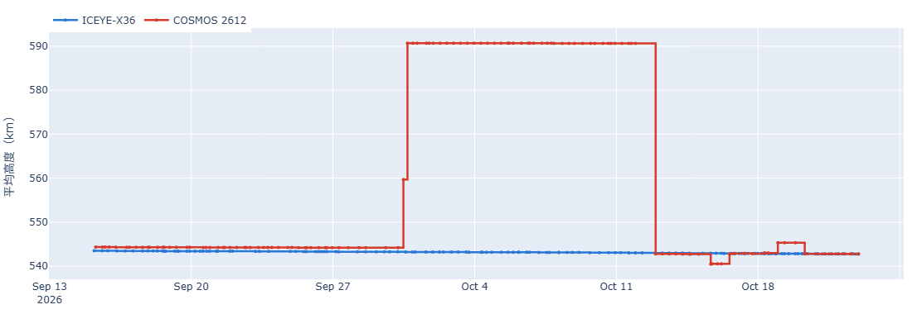
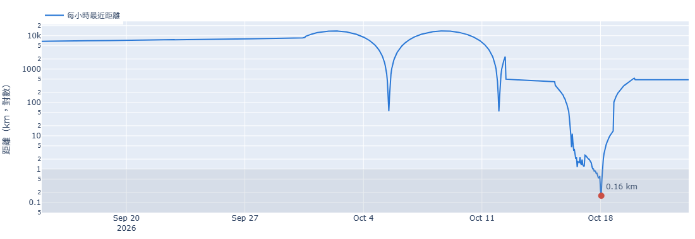
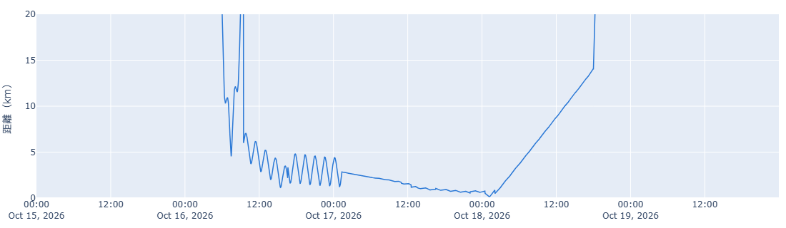
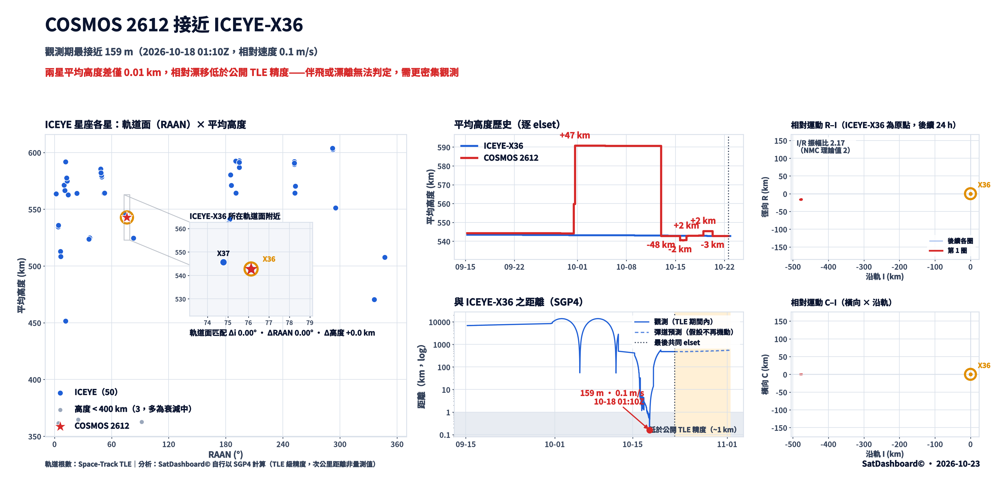
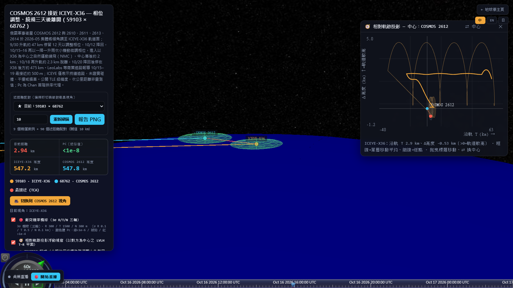

<!-- 由 docs/export_storymap_md.py 自 maneuver_app_2026November.py 匯出；線上版：https://rhynowu-maneuver-detection-i18n.hf.space/?mode=storymap&case=case31 -->

# 案例三十一：俄國軍事衛星 COSMOS 2612 逼近 ICEYE-X36——用公開 TLE 重建一次近距離交會

### 2026 年 10 月，俄國衛星 COSMOS 2612 經過數週的軌道調整，接近 ICEYE 營運、美國註冊的雷達成像衛星 ICEYE-X36。只用公開 TLE，能看出多少？

> **術語**：**SAR**（合成孔徑雷達）可在夜間或雲雨天成像。**RPO**（交會與近距離操作）指一顆衛星刻意接近另一顆。**TLE** 是美國太空監視網公開的軌道根數，以 SGP4 模型推算位置，位置誤差約為公里級。**NMC**（自然運動繞飛）指兩星高度相同、軌道略有差異時，一星在另一星周圍畫出的橢圓相對軌跡，不需持續推進即可維持。

> ℹ️ **資料口徑**：本頁的高度、距離與機動時點全部由本專案以公開 TLE 自行計算（TLE 資料至 2026-10-22）。外部報導（LeoLabs、RUSI、ICEYE 聲明、CNN）另外標註為他方口徑，本專案未取得其原始資料。

## ① 事件經過

- **2026-05 中旬**：COSMOS 2612 與 2610、2611、2613、2614 同週將傾角由約 96.95° 調到 97.80–97.85°，進入 ICEYE-X36 的軌道面（本專案 TLE 判讀共 5 顆；英國智庫 RUSI 2026-06 報告則指出有四顆俄方衛星調整軌道對齊 X36，顆數與本專案判讀不同）。
- **9/30**：COSMOS 2612 升軌約 47 km，在較高軌道停留約 12 天。較高的軌道週期較長，藉此調整與 X36 的前後相位。
- **10/12**：降回 X36 同高度。
- **10/15–16**：先降約 2 km 由後方追上 X36，再升回同高度，進入以 X36 為中心的繞飛（NMC），橢圓中心落後 X36 約 2 km。
- **10/18**：本專案重建的最近距離出現在此日；當晚再升軌約 2.3 km，開始向 X36 後方漂離。
- **10/20**：降回同高度，相對漂移停止，此後停在 X36 後方約 475 km。
- **他方口徑**：LeoLabs 與獨立追蹤者報導 Kosmos 2612 自 9/30 起多次機動、10/15–19 接近 X36，最近約 500 m；追蹤者未見 X36 軌道有受撞擊或擾動的跡象。ICEYE 聲明「持續密切追蹤，星座架構具持續運作與韌性」，未證實任何攻擊或損害。

## ② 本專案重算：兩星平均高度

每一筆 TLE 都可換算成一個平均高度。X36 幾乎保持水平；COSMOS 2612 的每一次台階就是一次機動。表中時間是**第一筆反映機動後的 TLE 時間**，實際點火通常早數小時。

| TLE 時間（UTC） | 高度變化（km） | 變化後高度（km） | 傾角變化（°） |
|---|---|---|---|
| 2026-09-30 11:32 | 15.5 | 559.7 | -0.001 |
| 2026-09-30 16:22 | 31 | 590.7 | 0 |
| 2026-10-12 22:39 | -47.8 | 542.8 | -0.048 |
| 2026-10-15 15:56 | -2.3 | 540.4 | 0.001 |
| 2026-10-16 14:14 | 2.3 | 542.8 | 0 |
| 2026-10-18 23:34 | 2.3 | 545.3 | 0 |
| 2026-10-20 07:26 | -2.5 | 542.8 | 0 |

## ③ 本專案重算：兩星距離

- **重建最近距離**：0.16 km（10-18 01:10 UTC）

- **資料最後時刻距離**：478 km（10-23 05:08 UTC）

- **TLE 資料截至**：2026-10-22 23:08

> 最近距離 0.16 km 是 SGP4 重建值，低於公開 TLE 約 1 km 的精度，**不是量測值**；它與 LeoLabs 報導的約 500 m 屬同一量級，但不應拿來互相印證到百公尺。資料最後時刻 COSMOS 2612 在 X36 後方約 478 km（沿軌方向）。

> 灰帶＝1 km 以下，低於公開 TLE 精度。

放大 10/15–10/20、改用線性刻度：繞飛期間距離每圈（約 96 分鐘）在 0 至數公里之間擺動，10/18 晚升軌後迅速拉開。

## ④ SatDashboard RPO 檢視器的輸出

同一配對也收錄在 SatDashboard 的 RPO 檢視器，可互動回放 3D 場景：[開啟 /rpo 檢視器](https://rhynowu-atrdc-satdashboard-i18n.hf.space/rpo?primary=59103&secondary=68762)。下面兩張是它的輸出。

**怎麼讀這張報告**（2026-10-23 產生）：
- **左：ICEYE 星座 RAAN × 高度**——每個藍點是一顆 ICEYE 衛星的軌道面與高度；紅星（COSMOS 2612）與橘圈（X36）重疊，代表兩者在同一軌道面、同一高度。
- **中上：平均高度歷史**——與本頁 ② 相同的資料，標出 +47 km、−48 km 與 10 月中下旬的數次 ±2–3 km 小機動。
- **中下：距離**——實線為 TLE 期間內的 SGP4 距離，虛線為假設之後不再機動的彈道預測；灰帶為低於 TLE 精度的範圍。
- **右：相對運動 R–I 與 C–I**——以 X36 為原點，徑向／橫向對沿軌作圖；資料末段 COSMOS 2612 停在沿軌約 −475 km，已不在 X36 附近繞飛。
- 報告副標「高度差僅 0.01 km、伴飛或漂離無法判定」是自動判讀規則的保守措辭：兩星高度相同，代表**相對漂移已停止**，不代表仍在近距離伴飛——此時兩星相距約 475 km。

> 3D 回放截圖（中文介面，2026-10-16 繞飛期間）：橘點＝X36、藍點＝COSMOS 2612，兩星周圍的網格為 3σ 位置不確定性橢球；右上浮動視窗以 COSMOS 2612 為中心畫出相對軌跡，可見每圈的繞飛弧線。

## ⑤ 判讀與限制（誠實揭露）

- **看得出的**：軌道面匹配（5 月）、升軌停留調相位（9/30–10/12）、追趕與同步（10/15–16）、繞飛後離開（10/18–20）——這一串機動的順序與幅度，公開 TLE 都能清楚重建，並與外部報導的時間吻合。
- **看不出的**：次公里距離、繞飛橢圓的確切形狀、點火的確切時刻（TLE 晚於實際機動數小時），以及最重要的——**意圖**。公開資料只能描述衛星做了什麼，無法判斷它為什麼這樣做。
- **不下的結論**：兩星高度差小於公開 TLE 精度時，換用另一筆 elset，相對漂移的方向就可能反過來。因此 TLE 外推不能對「是否仍在伴飛」這類次公里尺度的問題下定論，需要雷達或光學的密集觀測。
- **為什麼重要**：即使沒有碰撞，極近距離的交會也可能迫使目標衛星做避讓、消耗燃料、打亂任務排程，或被視為展示反太空能力。對太空態勢感知而言，關鍵不只是最近距離，而是辨識**連續的機動序列**與相對軌道幾何——這正是本專案機動偵測方法的用途。

> 外部來源：CNN 2026-10-19 報導（https://edition.cnn.com/2026/10/19/science/russian-satellite-iceye-x36-approach）；LeoLabs 分析、RUSI 2026-06 報告與 ICEYE 聲明皆經該報導轉引，本專案未直接取得原文。

---
線上互動版：<https://rhynowu-maneuver-detection-i18n.hf.space/?mode=storymap&case=case31>
