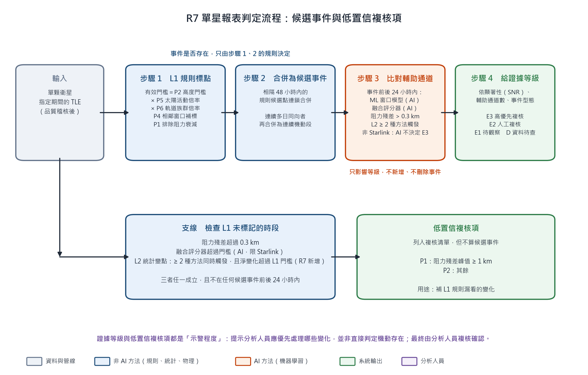
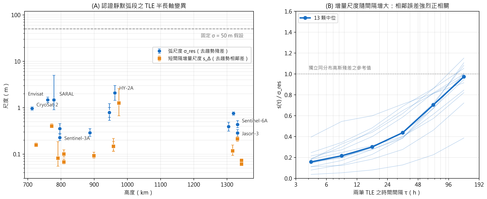
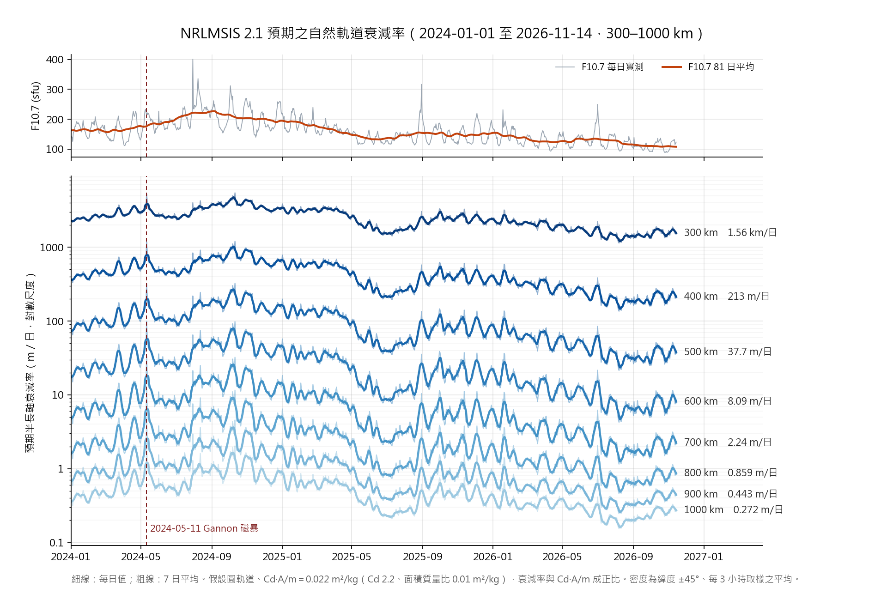

# 智慧化低軌通訊衛星軌道異常及太空事件偵測演算法研究
## 期末報告

**計畫案號**：TASA-S-1150268　｜　**執行單位**：社團法人中華民國國防科技學術研究學會
**報告日期**：中華民國 115 年（2026）11 月　｜　**系統版本**：機動偵測儀表板 2026 年 11 月版，單星報表 R7

---

### 摘要

本計畫以公開兩行軌道根數（TLE）為輸入，建置一套低軌衛星軌道機動偵測系統，並交付線上儀表板、單星偵測報表（PDF）與敘事式案例導覽（StoryMap）三項成果。系統可對任一顆有 TLE 的衛星，找出軌道變化異常的時段，依證據強弱標示優先順序，供分析人員複核。

**系統架構**分為四個部分（第二章）：

1. **資料管線**：每日自 Space-Track 下載 TLE，經資料品質稽核後入庫，並同步至線上資料集。
2. **偵測方法**：L1 規則（P1–P6）、L2 統計變點（CUSUM、BOCPD、SSA、MAD 3σ）、NRLMSIS 大氣阻力殘差，以及三個機器學習模型（Model 1、融合評分器、Model 2）。
3. **輸出**：App 頁面之主結果與 PDF 單星報表皆採 R7 流程（同一份計算），對所有衛星以 L1 規則決定候選事件，其他方法只影響證據等級。App 另於附錄 D 提供依衛星類型選擇主判方法之統一偵測摘要，作為各層偵測器之參考檢視，不決定候選事件。
4. **分析人員複核**：系統輸出的證據等級（E3、E2、E1、D）是**示警程度**，用來提示分析人員應優先處理哪些事件，並非直接判定機動存在。此概念與碰撞預警以碰撞機率作為判斷參考相同：碰撞機率高代表應優先處理，不等於必然碰撞。

**預估訓練樣本效能評估值**（第七章）：專案起始會議工作計畫書（2026-05-10 版）表 8 列出兩種情境共 14 項預估效能評估值，屬計畫預期目標，不等同於契約驗收項目。12 項以原始操作點達到預估值，2 項未達。①#2 為 Model 1 於外部 MEME 驗證之召回，實測 0.383，未達 0.85；系統層之融合評分器為 0.973，但驗證的是融合評分器，並非 Model 1（表 12）。②#7（small 事件召回）實測 0.091，未達 0.65，根因為 TLE 雜訊底限制（訊噪比小於 2）。融合評分器於 284 顆 Starlink、4,891 個評估單元之 ROC-AUC 為 0.982、large 事件召回 0.973。若負樣本只取各星真值涵蓋期間（7.4 節口徑二），ROC-AUC 為 0.814、large 事件召回 0.643；表 11 以前者計算，後者作為方法限制揭露。

**外部交付測試**（第八章）：國家太空中心指定之 15 顆衛星（美國 8 顆、中國 7 顆），以 R7 流程完成偵測與報表產製；方法相關之釐清整理於第十章。

**Starlink V3 軌道行為**（第九章）：第一批 26 顆（傾角 30.5°）入軌後於 7–12 天內由約 270 km 爬升至 316 km 暫駐高度，再於中位 17 天抵達約 345 km 運作高度，於運作高度以推進持續抵銷約每天 300 m 之阻力衰減。R7 偵測 74 件候選事件（E3 45 件，其中 40 件依規則成立）；入軌爬升段之 L1 涵蓋率約四成，未涵蓋部分由 L2 低置信複核項補列。第二批 26 顆（2026-11-18 起編目）以同一程式分析：至 11-23 共 30 件候選事件（E3 20 件，全數依規則成立），觀測僅 6 天，為初步結果（9.6 節）。

**阻力模型驗證**（7.9 節）：以近地點 300–1000 km 之 425 顆衛星（2024-01 迄今）驗證，TLE 實測衰減率與 NRLMSIS 預期之相關係數 0.976；全期被動衛星衰減率隨太陽活動起伏之逐星時間相關中位 0.923。以福衛七號精密軌道驗證，相關係數 0.962，TLE 與精密軌道之衰減率相關 0.996。另以被動衛星殘差分布研討阻力殘差門檻，建議後續研究依高度調整（11.6 節）。

**交付限制聲明**：

1. 系統以公開 TLE 為唯一日常輸入，不含推進紀錄。所有輸出皆為候選事件，須經分析人員複核，不構成機動確認。
2. 機器學習模型（Model 1、融合評分器）只以 Starlink 資料訓練。用於非 Starlink 衛星時只作輔助證據，不決定 E3：非 Starlink 衛星之 E3 只能依規則條件成立（屬連續機動段，或 |淨 Δa| ≥ 10 km），與機器學習、阻力殘差、L2 統計變點皆無關；只因機器學習輔助才達 E3 條件者，列 E2 並標註「ML 輔助」（5.2 節）。
3. 「無候選事件」表示期間內無單步變化超過 L1 門檻（依高度約 0.4–2.7 km，表 6），也未形成連續機動段；不表示沒有超過 5σ 之變化，也不排除較小或長時間低推力之機動。5σ、20σ 為 TLE 雜訊可分辨之量級，用於候選事件之顯著性分級，不是產生候選事件之門檻（5.4 節）。
4. L1 規則召回有限，R7 以低置信複核項補列 L1 未標記之變化。真值評估（7.5 節）顯示：在 Starlink 衛星上，複核項可補回約三分之二 L1 漏偵（281／426），但融合評分器項之複核負擔高；在非 Starlink 衛星上，融合評分器項全為誤報，因此不列入；阻力殘差項有補漏價值。低置信複核項不計入候選事件，須由分析人員判讀。

---

### 一、計畫目標與交付範圍

#### 1.1　計畫目標

低軌通訊巨型星系（如 Starlink、OneWeb、千帆）數量快速成長，衛星機動頻率與軌道複雜度隨之上升，以人工逐顆判讀軌道資料已不可行。本計畫目標為：

1. 以公開 TLE 建立單一衛星與整個星系的機動偵測方法。
2. 以精密星曆（SpaceX MEME）與國際雷射測距／DORIS 服務（ILRS／IDS）公開之點火紀錄作為真值，量化系統偵測能力與適用範圍。
3. 將偵測方法整合為可操作的線上系統，並可輸出供審閱與存檔的報表。

招標規範工作內容三要求同時識別微小或緩慢的軌道變化與約 20 公里量級之劇烈變化。微小機動原列「約 100 公尺以下機動（TBD）」，雙方於期末會議前，同意進行修約，並改為 2 公里量級機動。對照結果見 10.5 節。

#### 1.2　交付成果

**表 1　交付成果清單**

| 項目 | 內容 | 形式 |
|---|---|---|
| 機動偵測儀表板 | 輸入 NORAD 編號或衛星名稱，即時顯示偵測結果、證據等級、軌道根數時序與各方法原始輸出；中、英、日三語 | 線上系統（HuggingFace Space） |
| 單星偵測報表 R7 | F1 摘要版（一頁）與 F2 技術完整版（摘要＋附錄 A–F），另附 CSV 與 Markdown 明細 | PDF，由儀表板一鍵產製 |
| StoryMap 案例導覽 | 32 個案例，以實際資料說明系統方法、適用範圍與應用情境 | 線上系統、Markdown 匯出版 |
| 資料管線 | 每日 TLE 下載、品質稽核、入庫與線上資料集同步 | 程式與排程批次檔 |
| 偵測程式與模型 | L1／L2 偵測程式、NRLMSIS 阻力殘差、Model 1、融合評分器、Model 2 | 程式碼、模型檔 |
| 外部交付測試 | TASA 指定 15 顆衛星之偵測簡報與逐星報表 | 簡報、PDF |

#### 1.3　預估訓練樣本效能評估值

專案起始會議工作計畫書（2026-05-10 版）表 8 訂定兩種情境共 14 項預估效能評估值：情境①以 TLE 偵測單一衛星，情境②以 MEME 精密星曆評估星系級偵測。這些數值為計畫預期目標，不等同於契約驗收項目。逐項結果見第七章表 11。

---

### 二、系統架構

#### 2.1　總架構

系統由資料來源、資料管線、偵測方法、輸出與人工複核五個部分組成（圖 1）。

公開 TLE 是日常偵測的唯一輸入。太空天氣指數（F10.7、Ap）用於門檻調整與大氣密度計算。精密星曆真值（MEME、ILRS／IDS）只用於模型訓練與效能驗證，不參與日常偵測。TLE 經資料管線每日下載、稽核、入庫與同步（第三章）後，交由四類偵測方法分析（第四章）：L1 規則、L2 統計變點與 NRLMSIS 阻力殘差不使用機器學習；Model 1、融合評分器與 Model 2 為機器學習模型。

偵測結果以 R7 單星報表為主結果，App 頁面與 PDF 報表呈現同一份計算；App 另提供統一偵測摘要作為參考檢視。兩者使用相同的偵測方法，組合方式不同（2.2 節）。系統輸出只提示優先順序，是否為機動由分析人員複核確認。

#### 2.2　R7 單星報表與統一偵測摘要

App 查詢後即以 R7 流程計算單星報表：頁面上方之「結果摘要」與附錄 A、B、C、F 即為 R7 之結果。「產出 PDF 報告」以同一函式、相同衛星與期間重新計算並排版為 F1／F2 PDF，結果與頁面相同，差別只在 PDF 另含 SSA 知識庫之自動解說（頁面上由側欄開關另行觸發）。App 附錄 D 之統一偵測摘要依衛星類型選擇主判方法，用於檢視各層偵測器之原始反應，不決定候選事件。

**表 2　R7 單星報表與統一偵測摘要之比較**

| 項目 | R7 單星報表 | 統一偵測摘要 |
|---|---|---|
| 呈現位置 | App 結果摘要與附錄 A、B、C、F；PDF（F1／F2） | App 附錄 D「各層偵測器原始輸出」 |
| 地位 | 主結果；正式交付、審閱與存檔 | 參考檢視，不決定候選事件 |
| 資料期間 | 使用者選定之期間 | 該衛星資料庫內全部 TLE，不受期間設定影響 |
| 門檻 | 預設 P2／P5 門檻，不受側欄滑桿影響 | 各偵測器之預設設定 |
| 是否依衛星類型分流 | 否，所有衛星同一流程（圖 3） | 是（圖 2） |
| 由誰決定結果 | L1 規則決定候選事件；其他方法只影響證據等級 | Starlink：Model 1＋融合評分器；非 Starlink：NRLMSIS 阻力殘差 |
| 機器學習的角色 | 輔助通道，不新增、不刪除事件；非 Starlink 衛星不決定 E3 | Starlink 主判；非 Starlink 僅佐證 |
| 輸出單位 | 候選事件、證據等級、低置信複核項 | 各方法的旗標數與時刻 |

兩者之資料期間不同，同一衛星之數字可能不一致；比對時應以 R7 單星報表為準。

統一偵測摘要依衛星類型分流（圖 2），原因是 Model 1 與融合評分器只以 Starlink 資料訓練，只有 Starlink 在其適用範圍內。判斷是否為 Starlink 採固定規則（編目名稱以「STARLINK」開頭），不使用機器學習。非 Starlink 衛星的主判為 NRLMSIS 大氣阻力殘差，屬物理模型；Model 2（Isolation Forest）為非監督式機器學習，只作佐證，不決定結果。

R7 單星報表對所有衛星採同一流程（圖 3），原因有二：

1. 正式報表須對任何衛星都能逐筆重現與解釋。L1 規則對每顆衛星的判定依據相同，可逐筆說明觸發原因。
2. 機器學習模型以 Starlink 資料訓練，用於其他衛星時無法驗證其判定，因此只作輔助通道。

#### 2.3　R7 單星報表判定流程

R7 流程分為主線四個步驟與一條支線（圖 3）。

**表 3　R7 判定步驟**

| 步驟 | 作用 | 方法 | 是否使用機器學習 |
|---|---|---|---|
| 1　L1 規則標點 | 找出軌道變化超出該衛星平常範圍的相鄰 TLE 轉換 | P1–P6 規則（4.2 節） | 否 |
| 2　合併為候選事件 | 將同一次機動留下的多個標記合併為一件 | 相隔 48 小時內連鎖合併；連續多日同向者再合併為連續機動段 | 否 |
| 3　比對輔助通道 | 檢查其他方法在事件前後 24 小時內是否也有反應 | ML 窗口模型、融合評分器、阻力殘差、L2 統計變點 | ML 窗口模型與融合評分器為機器學習 |
| 4　給證據等級 | 依證據強弱標示複核優先順序 | 固定規則（第五章） | 否 |
| 支線　低置信複核項 | 補 L1 規則未標記的變化 | 阻力殘差、融合評分器（限 Starlink）、L2 統計變點（≥2 種方法同時觸發，且扣除背景衰減後之淨變化超過 L1 單步門檻） | 融合評分器為機器學習 |

**事件是否存在，只由步驟 1、2 的規則決定。** 步驟 3 的輔助通道只影響步驟 4 的等級，不新增、不刪除事件。

#### 2.4　支線：L1 未標記時段之補漏檢查

**為何需要支線**：主線只以 L1 規則產生候選事件，好處是每件事件都能說明由哪一條規則、哪一筆 TLE 觸發；限制是 L1 逐筆比較相鄰兩筆 TLE，只看單步變化量。一次機動若分散在數天內完成，每一步都可能低於門檻，L1 便不會標記。三層方法比較（7.4 節）顯示，部分機動只在 L2 統計變點或融合評分器中出現。支線的作用是把這類變化找出來，列入複核清單，避免因 L1 未標記而完全不被看到。

**支線檢查的範圍**：支線只檢查 L1 未標記的時段。步驟 2 產生之候選事件，其起訖前後 24 小時內之時點已由主線涵蓋，支線不重複列出（圖 3 之虛線箭頭）。

**三個列出條件**：符合下列任一條件之時點，即列為低置信複核項。三個條件各自對應 L1 容易漏看的一種變化（表 4）。

**表 4　支線之列出條件**

| 條件 | 判定方式 | 對應之漏看情形 | 實例 |
|---|---|---|---|
| ① 阻力殘差 | 實測 Δa 與 NRLMSIS 預期 Δa 之差超過 0.3 km（4.5 節） | 單步變化未達 L1 門檻，但無法以大氣阻力解釋 | 9.4 節 Starlink V3 於運作高度之阻力補償推進 |
| ② 融合評分器 | 分數 ≥ 0.659；只用於 Starlink 衛星 | 多個單獨看來不明顯的統計訊號同時升高 | 7.5 節 Starlink 真值評估中補回 29 件 L1 未涵蓋之機動 |
| ③ L2 統計變點 | 2 種以上 L2 方法在 48 小時內同時觸發，且該段（最長 3 天）扣除背景衰減後之淨變化，超過 L1 單步門檻與該星 20σ 高顯著下限兩者之較大值 | 每一步都未達 L1 門檻、數天合計已超過 | 8.6 節 HAISHAO 1 於 2025-04-04 起 3 天淨變化 +3.5 km；9.3 節 Starlink V3 入軌爬升 |

條件 ② 不用於非 Starlink 衛星：融合評分器只以 Starlink 資料訓練，真值評估（7.5 節）顯示其在非 Starlink 衛星上之超門檻時點全數落在營運方認證之安靜期。條件 ③ 之背景衰減率，以該段前、後各 7 天（不跨越候選事件）之線性斜率估計，用以排除高阻力衛星衰減率本身之變動。

**支線的輸出**：低置信複核項列入複核清單，依阻力殘差峰值分為「立即複核」（峰值 ≥ 1 km）與「排程複核」（其餘）。相隔 72 小時內之項目合併為一個複核案件，並標註資料缺口、高阻力、太陽活躍、連續段等診斷標記，供分析人員判斷觸發原因。

**支線與主線之差異**：低置信複核項不計入候選事件、不給證據等級，也不改變任何候選事件之等級。其意義是「L1 未標記、但其他方法有反應，值得人工看一眼」，證據強度低於候選事件，須由分析人員判讀是否為機動。

---

### 三、資料管線

#### 3.1　資料來源

**表 5　資料來源**

| 資料 | 來源 | 用途 |
|---|---|---|
| TLE | Space-Track.org（美國太空軍） | 日常偵測之唯一輸入 |
| 太空天氣指數 F10.7、Ap | CelesTrak（SW-Last5Years） | P5 門檻調整、NRLMSIS 大氣密度計算 |
| MEME 精密星曆 | SpaceX 公開星曆 | Model 1 與融合評分器之訓練真值、效能驗證 |
| ILRS／IDS 點火紀錄 | 國際雷射測距服務、國際 DORIS 服務 | 非 Starlink 衛星之外部驗證真值 |

TLE 為 SGP4 平均根數，公開資料無推進紀錄，同樣的軌道變化也可能來自定軌更新、TLE 擬合異常或編目交叉標記。因此系統輸出一律稱為「候選事件」，不稱為已確認之機動。

#### 3.2　每日處理流程

每日排程依序執行：

1. 更新太空天氣指數。
2. 自 Space-Track 下載前一日 TLE，寫入本機資料庫（DuckDB）。
3. 資料品質稽核：逐筆標記 good、suspect、rejected。rejected 為檢查碼錯誤或物理上不可能之數值；suspect 主要為相鄰 TLE 間隔超過 48 小時之缺口後首筆，或傾角異常跳變。偵測層對 suspect 資料降低權重。
4. 重建輕量資料庫與 Parquet 檔，同步至線上資料集，供儀表板讀取。Space-Track 會補發較晚發布的 TLE，同步程式每次回頭比對近 30 天，以（NORAD 編號、曆元）比對補上缺漏。

任一步驟失敗時，流程即停止，不推進處理日期，也不對外發佈資料，避免以過期資料對外服務。

#### 3.3　儲存與部署

本機資料庫保存全編目 TLE 歷史資料；線上儀表板部署於 HuggingFace Space，讀取同步後之線上資料集，查詢單顆衛星時才載入該衛星之資料。

---

### 四、偵測方法

#### 4.1　偵測訊號

TLE 不直接提供高度，但由平均運動 n 可導出半長軸 a：

$$a=\left(\frac{\mu}{n^{2}}\right)^{1/3}\tag{1}$$

μ 為地球重力常數（398,600.4418 km³/s²），n 以 rad/s 代入。相鄰兩筆 TLE 的根數差為偵測的基本訊號：

$$\Delta a_{k}=a_{k+1}-a_{k},\quad \Delta i_{k}=i_{k+1}-i_{k},\quad \Delta e_{k}=e_{k+1}-e_{k}\tag{2}$$

無機動時，各差值在 TLE 雜訊範圍內起伏；機動時，差值明顯超出雜訊範圍。升交點赤經（RAAN）受地球扁率影響而規律進動，須先扣除 J2 理論漂移才能比較：

$$\Delta\Omega_{k}^{\mathrm{res}}=\left(\Omega_{k+1}-\Omega_{k}\right)-\dot{\Omega}_{J_{2}}\,\Delta t_{k},\qquad \dot{\Omega}_{J_{2}}=-\frac{3}{2}\,n\,J_{2}\left(\frac{R_{E}}{p}\right)^{2}\cos i\tag{3}$$

以 550 km、傾角 53° 的衛星為例，J2 漂移約每天 −4.49°。RAAN 殘差（門檻 0.10°）經大樣本消融與福衛七號真值驗證，只增加誤報而不提高召回（表 15），因此不作為 L1 標記。

#### 4.2　L1 規則（P1–P6）

L1 規則逐筆檢查相鄰兩筆 TLE 的變化，超過門檻即標記為規則候選點。六項規則分為偵測、抑制與調整三類。半長軸之判定門檻為 P2 高度門檻依序乘上 P5（F10.7）與 P6（軌道族群）倍率之有效門檻：

**表 6　P1–P6 規則**

| 規則 | 類型 | 觸發條件 | 作用 |
|---|---|---|---|
| P1 | 抑制 | 連續 5 筆 Δa 皆小於 0.1 km、窗內無 2 km 以上跳變，且 B*>0 | 排除大氣阻力造成的單調小步衰減 |
| P2 | 偵測 | \|Δa\| 超過高度自適應門檻：400 km 約 2.0 km，隨高度遞減，700 km 以上取 0.4 km | 低軌大氣稠密、TLE 雜訊大，須用較高門檻 |
| P3 | 不使用 | B* 輔助抑制：B* 高於全星系中位數＋2σ（且不低於 5×10⁻⁴），Δa<0 且 \|Δa\|<1.5 km 時抑制 | 消融與福衛七號真值驗證顯示對召回與誤報皆無作用（表 15），不納入判定 |
| P4 | 補標 | 超過有效門檻或其他根數門檻之轉換，連同其後 2 筆轉換一併標記 | 延長事件邊界、連接相鄰標記；補標之轉換本身未必超過門檻 |
| P5 | 調整 | 依 F10.7 調整 P2 門檻：倍率為拋物線，70 sfu 以下 ×1.0、200 sfu 為 ×1.6，上限 ×1.8；F10.7 取轉換後一筆 TLE 曆元 UTC 當日之觀測值 | 太陽活躍時大氣擾動大，門檻同步上調 |
| P6 | 調整 | 依傾角族群調整倍率（53° 帶 ×1.0、太陽同步 ×1.2、中傾角 ×1.1）；MEO／GEO／HEO 門檻改為 0.05 km | 反映不同星系的營運習慣與高軌低雜訊特性 |
| 其他 | 偵測 | \|Δi\|>0.02° 或 \|Δe\|>0.001 | 半長軸以外的獨立訊號 |

最終標記為「有效門檻標記 ∪ 其他根數標記 ∪ P4 相鄰補標」，再扣除 P1 抑制；超過有效門檻之轉換不受 P1 抑制。

L1 規則的特性是每個標記都能說明觸發原因，可逐筆稽核；限制是只看單步變化量，對分散在多日的緩慢變化較不敏感。

#### 4.3　事件合併與連續機動段

一次機動常在相鄰數筆 TLE 上留下多個規則候選點。R7 將相隔 48 小時內的候選點連鎖合併為一件**候選事件**，記錄起訖時間、淨 Δa、主要變化時點與規則候選點數。

時間相鄰、淨 Δa 同向，且各自屬多日連續變化或 \|淨 Δa\| ≥ 10 km 的事件，再合併為**連續機動段**，以整段（起訖、累計 Δa、平均速率）判讀。電力推進衛星推力小、持續多日改變軌道，其機動常以連續機動段呈現。

#### 4.4　L2 統計變點

L2 對半長軸時間序列計算四種變化點分數，不預設機動的形態，只衡量資料偏離自身行為的程度。

**表 7　L2 四種方法**

| 方法 | 原理 | 擅長偵測 |
|---|---|---|
| CUSUM（累積和） | 累加每筆與期望值的差，超過警戒線即報警 | 小而持續的位移 |
| BOCPD（貝氏線上變化點偵測） | 隨時估計目前資料仍屬原行為的機率 | 突發的斷點 |
| SSA（奇異譜分析） | 將序列分解為趨勢與雜訊，檢視趨勢無法解釋的殘差 | 緩慢漂移背景中的突兀點 |
| MAD 3σ | 以中位數絕對偏差計算穩健 z 分數，超過 3 即標記 | 相對自身分布的離群值 |

CUSUM 與穩健 z 分數之定義如下，κ 為容忍正常漂移的扣減量，x̃ 為中位數：

$$S_{k}=\max\left(0,\;S_{k-1}+z_{k}-\kappa\right),\qquad z_{\mathrm{rob}}=0.6745\,\frac{x-\tilde{x}}{\mathrm{MAD}}\tag{4}$$

單一 L2 方法容易受雜訊觸發，因此 R7 以「2 種以上方法同時觸發」作為一類輔助通道。用於低置信複核項時，另加淨變化量條件（2.4 節），以排除高阻力衛星衰減率變動造成的觸發。

#### 4.5　NRLMSIS 大氣阻力殘差

大氣阻力是低軌衛星半長軸變化的最大干擾來源。系統以 NRLMSIS 大氣密度模型，依太陽與地磁活動計算大氣密度，並以每顆衛星自身歷史資料校準等效彈道係數，算出「僅受阻力時」應有的半長軸變化。實測變化與模型預期之差即為阻力殘差：

$$r_{\mathrm{drag}}=\Delta a_{\mathrm{obs}}-\Delta a_{\mathrm{model}},\qquad \Delta a_{\mathrm{model}}=-B_{\mathrm{eff}}\,\rho\,\sqrt{\mu a}\,\Delta t\tag{5}$$

ρ 為 NRLMSIS 密度，B_eff 為等效彈道係數。殘差接近 0 表示變化可由阻力解釋；\|r_drag\| 超過 0.3 km 表示有阻力以外的因素，列為機動候選依據。以福衛三號（792 km，無推進）為例，全期最大殘差 0.105 km；一顆執行升軌的 Starlink 殘差達 1.91 km。

模型輸入如下：

- **F10.7**：每日觀測值與 81 日中心平均值（CelesTrak SW 檔之 F10.7_OBS 與 F10.7_OBS_CENTER81），取 TLE 曆元 UTC 當日之值，不做日內插值；缺值時以 120 sfu 代入。
- **Ap**：3 小時解析度之 ap(7) 陣列，以 NRLMSIS 2.1 之暴時 ap 模式（geomagnetic_activity＝−1）使用；3 小時值不存在時改用每日平均 Ap。
- **位置**：以 SGP4 由 TLE 解出星下點經緯度。近圓軌道（中位偏心率 < 0.01）且有 TLE 原文時，密度改以每小時之軌道平均值積分；跨越 7 天以上空窗之轉換仍用近地點單點值。
- **等效彈道係數 B_eff**：以分析期間內全部相鄰轉換之「實測 Δa ÷ 模型阻力形狀項」比值取中位數校準，校準窗口即為該次查詢之完整期間；期間內之機動以中位數之穩健性抵抗其影響。TLE 差分同時包含定軌批次與擬合策略的變動，阻力係數、姿態與密度模型誤差亦無法完全分離，因此阻力殘差的判定結果為「可由阻力解釋」或「阻力無法解釋」，不直接等同推進燃燒。

**再入守門**：壽命末期衛星急速下墜時，阻力模型會產生大量殘差。系統取最近 45 天資料，近地點低於 150 km，或低於 350 km 且下降率超過每天 2 km 時，判定為自然再入，機動數輸出為 0。實測 6 個案例全數判定正確（Van Allen 探測器、Cluster Samba 與 Tango 判為再入；國際太空站、天宮、福衛三號判為非再入）。

#### 4.6　機器學習模型

系統使用三個機器學習模型，皆屬傳統機器學習（梯度提升樹、孤立森林），不使用深度學習。

**表 8　機器學習模型**

| 模型 | 方法 | 學習方式與訓練資料 | 在系統中的角色 |
|---|---|---|---|
| Model 1 | LightGBM 梯度提升樹 | 監督式；現行版本以 Starlink MEME 精密星曆之機動真值重新訓練（表 11 ①#2 評估之原版本以規則判定標籤訓練），輸入 40 項 TLE 軌道變化特徵 | 統一偵測摘要：Starlink 主判。R7：「ML 窗口」輔助通道（機率 ≥ 0.478，且軌道變化超過物理門檻） |
| 融合評分器 | HistGradientBoosting 梯度提升樹 | 監督式；以 284 顆 Starlink MEME 真值訓練，輸入 CUSUM、BOCPD、SSA、MAD 3σ 與阻力殘差五個通道在 ±24 小時窗內的統計量 | 統一偵測摘要：Starlink 主判。R7：輔助通道與低置信複核項來源（分數 ≥ 0.659） |
| Model 2 | Isolation Forest 孤立森林 | 非監督式；不需機動標籤，輸入扣除阻力後之物理殘差，找出與平常不同的時點 | 統一偵測摘要：非 Starlink 之佐證。R7：未使用 |

Model 1 與融合評分器只以 Starlink 資料訓練（283–284 顆，高度 324–588 km）。用於非 Starlink 衛星時，其判定在訓練範圍外，無法以真值驗證，因此在統一偵測摘要中改由物理模型主判，在 R7 中只作輔助通道。

融合評分器可同時權衡多個單獨看來不明顯的訊號，在三層方法比較中召回最高（7.4 節）。機器學習判定須同時通過「模型機率過門檻」與「阻力殘差夠大」兩項條件，磁暴期間全體衛星同步下降時，阻力殘差顯示變化可由阻力解釋，不會誤判為機動。

---

### 五、證據等級與複核優先順序

#### 5.1　證據等級的意義

系統自動為每個候選事件標上證據等級，用來提示分析人員應優先處理哪些事件。**證據等級表示示警程度，用於排定複核順序；機動是否存在，須經分析人員複核確認。** 等級也不代表機動發生的機率。

此概念與碰撞預警相同。碰撞預警以碰撞機率作為判斷參考：機率高表示應優先評估與處置，但不表示必然碰撞。證據等級亦然：E3 表示證據較強、應優先複核，但仍須經分析人員核對原始 TLE、營運商公告或其他觀測來源後，才能確認是否為機動。

#### 5.2　等級判定規則

證據等級依兩項依據判定：

1. **顯著性**：事件變化量相對該衛星平常 TLE 雜訊的倍數（訊噪比 SNR）。SNR ≥ 20 為高，5–20 為中，小於 5 為低。雜訊為該衛星未標記之相鄰 TLE 轉換，逐月計算穩健標準差後取中位數。
2. **輔助通道**：事件前後 24 小時內，ML 窗口模型、融合評分器、阻力殘差、L2 統計變點（≥2 種方法同時觸發）四類通道中，有幾類也出現反應。

**表 9　證據等級**

| 等級 | 名稱 | 判定條件 | 建議處置 |
|---|---|---|---|
| E3 | 高優先複核 | 顯著性高，且符合任一項：（a）至少 3 類輔助通道一致，其中包含 ML 窗口模型或融合評分器（限 Starlink）；（b）屬連續機動段；（c）\|淨 Δa\| ≥ 10 km | 立即複核；經人工確認後，再評估是否更新碰撞風險產品 |
| E2 | 人工複核 | 顯著性中以上，且至少 2 類輔助通道一致，未達 E3 | 排程人工複核 |
| E1 | 待觀察 | 其餘事件，包括顯著性低、變化量接近 TLE 雜訊或輔助通道不足 | 持續觀察 |
| D | 資料品質待查 | 呈「升了又降回」的回跳型態，可能是 TLE 擬合異常、編目交叉標記，也可能是真實的劇烈變化 | 先核對原始 TLE 與編目，再重算等級 |

跨越 7 天以上 TLE 空窗的事件，因無法定位機動時間，最高列為 E2。

**非 Starlink 衛星之機器學習輔助**：ML 窗口模型與融合評分器只以 Starlink 資料訓練，對非 Starlink 衛星無法以真值驗證。非 Starlink 衛星之事件若只因條件（a）達 E3，列為 E2，等級欄標註「E2（ML 輔助）」，建議處置為「優先人工複核」。每件事件另記錄 E3 判定依據：「規則」表示依條件（b）或（c）成立，與機器學習無關；「ML 輔助」表示依條件（a）成立。

上述規則有三點補充說明：

1. **「只因」條件（a）才改列**：同時符合條件（b）或（c）之事件，仍列 E3，判定依據記為「規則」；只有完全依條件（a）達到 E3 者，才改列「E2（ML 輔助）」。
2. **阻力殘差與 L2 統計變點不能使非 Starlink 衛星之事件達到 E3**：兩者與機器學習同屬輔助通道，可使事件達到 E2（至少 2 類通道一致），但條件（a）須含機器學習通道；輔助通道只有四類，不含機器學習時最多 2 類，達不到條件（a）之 3 類。因此非 Starlink 衛星之 E3 只來自條件（b）或（c）。
3. **機器學習通道仍計入 E2**：非 Starlink 衛星上，ML 窗口模型與融合評分器仍計為輔助通道，可與阻力殘差或 L2 合計為 2 類而達 E2。候選事件本身一律由 L1 規則產生，任何輔助通道都不新增、不刪除事件。

**表 9-1　非 Starlink 衛星之等級判定路徑**（由上而下，符合即停）

| 事件情形 | 等級 | E3 判定依據 |
|---|---|---|
| 回跳型態 | D | — |
| 顯著性低 | E1 | — |
| 顯著性高，且屬連續機動段或 \|淨 Δa\| ≥ 10 km | E3 | 規則 |
| 顯著性高，至少 3 類輔助通道一致且含機器學習通道 | E2（ML 輔助） | — |
| 顯著性中以上，至少 2 類輔助通道一致（阻力殘差、L2、機器學習之任意組合） | E2 | — |
| 其餘 | E1 | — |

跨越 7 天以上 TLE 空窗之事件，依前述規定最高列 E2。

8.6 節 15 顆衛星之 E2 12 件中，9 件為「E2（ML 輔助）」。

#### 5.3　複核優先順序

報表將候選事件與低置信複核項整合為一份複核清單，依優先順序排列。報表以 P1、P2 標示複核優先序，此編號與 L1 規則 P1–P6 無關：

- **D**：先確認資料，再重算等級。
- **P1 立即複核**：E3、\|淨 Δa\| ≥ 10 km、有編目疑點的事件，以及阻力殘差峰值 ≥ 1 km 的低置信複核項。
- **P2 排程複核**：E2、\|淨 Δa\| ≥ 1 km 的事件，以及其餘低置信複核項。

每一項附複核期限與狀態（初始為「待複核」），形成可追蹤的複核紀錄。

#### 5.4　偵測下限

每顆衛星的 TLE 雜訊水準不同，可偵測的最小機動也不同。報表為每顆衛星估計兩個下限：

- **候選下限（5σ）**：單次變化超過此值，在統計上可與 TLE 雜訊區分；候選事件之顯著性達「中」，為 E2 之必要條件。
- **高顯著下限（20σ）**：單次變化超過此值，即具高顯著性，為 E3 之必要條件。

兩者都不是產生候選事件之門檻。候選事件只由 L1 規則產生：單步變化須超過依高度設定之門檻（400 km 約 2 km、700 km 以上 0.4 km，太陽活躍期最多上調約 1.8 倍；表 6），或多筆同向累積形成連續機動段。L1 門檻遠高於多數衛星之 5σ，因此超過 5σ、甚至超過 20σ 但未達 L1 門檻之單步變化，不會成為候選事件（例如 ICEYE-X33 之平緩維持機動，11.7 節）。

期間內無候選事件時，報表列出 σ、20σ 可辨識量級與本期最大未列入之單筆 Δa（註明未達規則門檻），並陳述「未偵測到不代表未機動」，不寫為「沒有機動」。半長軸變化與切向速度增量之換算約為每 1 km 對應 0.55 m/s。

---

### 六、系統功能與操作

#### 6.1　機動偵測儀表板

儀表板部署於 HuggingFace Space，以瀏覽器操作，支援中文、英文、日文介面。輸入 NORAD 編號、衛星名稱或萬用字元即可查詢，頁面區塊順序與 F2 報表一致：

**表 10　儀表板主要區塊**

| 區塊 | 內容 |
|---|---|
| 結果摘要 | 候選事件數與等級分布、最大事件、期間首末差、半長軸時序、複核清單、衛星基本資料 |
| A　候選事件與規則候選點 | 每件事件之起訖、淨 Δa、等級、輔助通道、建議行動；可展開 L1 逐筆候選點 |
| B　阻力殘差與融合評分器 | NRLMSIS 阻力殘差與融合機率時序，並標出候選事件 |
| C　計數口徑與判定流程 | 各計數之定義、偵測下限、抑制統計 |
| D　各層原始輸出 | 統一偵測摘要（依衛星類型路由，參考檢視，讀全部 TLE）、P1–P6（受側欄滑桿影響）、CUSUM／BOCPD／SSA、ML |
| E　軌道根數 | 根數與差值時序圖 |
| F　分析註記 | 可直接觀察之事實、待驗證之可能解釋、建議複核事項 |
| 其他分析工具 | MEME 與 TLE 比對、資料品質稽核、星系級分析、合成 TLE 生成、SSA 知識問答 |

頁首另顯示全艦隊指標：近 30 天機動事件數、資料品質 good 比例、疑似離軌顆數。

#### 6.2　單星偵測報表

於儀表板選擇報表格式後按「產生 PDF」，約數十秒完成：

- **F1 摘要版**：一頁，含候選事件、等級分布、複核清單與偵測下限，適合主管與簡報使用。
- **F2 技術完整版**：摘要加附錄 A–F，適合分析與稽核。
- 另可下載 CSV（事件、低置信複核項、規則候選點明細）與 Markdown。

PDF 內附 QR code 可回到儀表板對應頁面。每份報表記錄報表版本與分析流程版本（程式與模型檔之雜湊值），同一程式與模型產出之結果可對應查核。報表亦可由網址參數直接產製，例如：

`?mode=tool&norad=64199&report=F2&lang=zh`

#### 6.3　StoryMap 案例導覽

StoryMap 以 32 個案例，用實際資料說明系統的方法、適用範圍與應用情境，例如「哪些方法使用 AI、哪些沒有」「系統在哪些軌道類型上可信」「NOTSO 通報與太空事件」。案例內容由系統即時計算，亦已匯出為 Markdown 版本供離線閱讀。

---

### 七、驗證結果

#### 7.1　評估方式

效能評估只以嚴格真值為依據：SpaceX MEME 精密星曆（位置精度公尺級）與 ILRS／IDS 營運方點火紀錄。TLE 是偵測輸入，不作為真值。

主要指標以「事件」為評估單元：一次機動在 TLE 上會留下多筆痕跡，事件窗內任一筆被標記即算偵測到。評估採衛星分組交叉驗證，訓練與測試不使用同一顆衛星。嚴重度依單次半長軸變化分級：small 為 1–5 km、medium 為 5–10 km、large 為 10 km 以上。

#### 7.2　預估訓練樣本效能評估值

資料來源：專案起始會議工作計畫書（2026-05-10 版）表 8「預估訓練樣本效能評估值」。該表為計畫預期之效能目標，不等同於契約驗收項目。工作計畫書情境①之 TPR 只列一項，本表依評估資料分為內部測試集（#1）與外部 MEME 驗證（#2），故共 14 項。

**表 11　預估訓練樣本效能評估值逐項結果**

| 情境 | # | 指標 | 預估值 | 實測 | 判定 |
|---|---|---|---|---:|---|
| ① TLE 單衛星 | 1 | TPR（內部測試集） | ≥0.85 | 0.975 | 達標 |
| ① TLE 單衛星 | 2 | TPR（外部 MEME 驗證） | ≥0.85 | Model 1：0.383 | 未達；系統層之融合評分器為 0.973（表 12） |
| ① TLE 單衛星 | 3 | FPR | ≤0.15 | 0.0012 | 達標 |
| ① TLE 單衛星 | 4 | ROC-AUC | ≥0.90 | 0.996 | 達標 |
| ① TLE 單衛星 | 5 | Average Precision | ≥0.85 | 0.996 | 達標 |
| ① TLE 單衛星 | 6 | F1-macro | ≥0.80 | 0.991 | 達標 |
| ② MEME 星系級 | 1 | ROC-AUC | ≥0.90 | 0.982 | 達標 |
| ② MEME 星系級 | 2 | Average Precision | ≥0.85 | 0.958 | 達標 |
| ② MEME 星系級 | 3 | F1-macro | ≥0.80 | 0.896 | 達標 |
| ② MEME 星系級 | 4 | FPR | ≤0.05 | 0.0498 | 達標 |
| ② MEME 星系級 | 5 | 召回（large 事件） | ≥0.90 | 0.973 | 達標 |
| ② MEME 星系級 | 6 | 召回（medium 事件） | ≥0.80 | 0.945 | 達標 |
| ② MEME 星系級 | 7 | 召回（small 事件） | ≥0.65 | 0.091（1/11） | 未達；根因為 TLE 雜訊底（見下） |
| ② MEME 星系級 | 8 | 偵測延遲 | ≤24 小時 | 中位 0.1 小時 | 達標 |

- **①#2**：原指標驗證的是 Model 1，其外部 MEME 事件級召回為 0.383，未達 0.85。系統層另以融合評分器評估，召回 0.973。替代指標驗證的是融合評分器，兩者之模型、輸入與評估單元不同（表 12），不得表述為「Model 1 達到預估值」。

**表 12　①#2 原指標與替代指標對照**

| 項目 | 原指標 | 替代指標 |
|---|---|---|
| 驗證對象 | Model 1（LightGBM） | 融合評分器（HistGradientBoosting） |
| 輸入 | 40 項 TLE 軌道變化特徵（逐筆） | CUSUM、BOCPD、SSA、MAD 3σ、阻力殘差五通道於 ±24 小時窗內之統計量 |
| 訓練標籤 | 規則判定之標籤（期中評估之版本） | MEME 精密星曆真值 |
| 評估單元 | 外部 MEME 真值事件 | MEME 機動事件窗與等寬安靜窗（284 顆 Starlink、4,891 單元） |
| 門檻 | 召回 ≥ 0.85 | 同左，於 FPR ≤ 0.05 操作點 |
| 實測 | 0.383 | 0.973 |
| 適用範圍 | Starlink | Starlink |
| 呈現依據 | — | 2026-09-09 與國家太空中心溝通取得共識；書面紀錄（會議紀錄或往來信件）待補附 |
- **②#7**：small 事件於 FPR ≤ 0.05 之召回為 0.091（11 件中偵測 1 件）。small 機動之訊噪比小於 2，已低於 TLE 雜訊底，即使放寬誤報率至 50% 召回亦僅 0.636。本項以量化根因分析說明，此處理方式已於 2026-09-09 與國家太空中心溝通取得共識；書面紀錄待補附。
- ②1、②5、②6 之計算基準為 284 顆 Starlink、4,891 個評估單元（597 個機動事件、4,294 個安靜窗），FPR 0.0498 對應 214／4,294（95% 信賴區間 0.044–0.057）。

#### 7.3　泛化能力

以 56 顆從未參與訓練之 Starlink 測試，AUC 為 0.980，large 事件召回 1.000（81／81）。依傾角殼層、高度帶與資料品質分層，AUC 分別為 0.970–0.984、0.968–0.989、0.978–0.986。以前段時間訓練、後段時間測試，AUC 為 0.945，large 召回 0.783；時間外推之表現低於同期測試，部署時須定期重新訓練（11.2 節）。

#### 7.4　三層方法比較

三層方法以同一組評估單元、同一操作點（FPR ≤ 0.05）比較。評估母體有兩種口徑，結果並列於表 13：

- **口徑一（期中評估階段）**：2026-07-21 之評估，284 顆 Starlink，正樣本為 MEME 中、大型機動事件單元 597 個，負樣本為機動事件以外之等寬時窗 5,138 個。表 11 之預估值評估（7.2 節）採同一負樣本定義（2026-08-03 快照，4,891 個評估單元）。
- **口徑二（真值涵蓋限定）**：2026-11-18 資料庫，負樣本只取各星 MEME 真值涵蓋期間內之時窗，完全無真值之衛星不納入，共 283 顆、正樣本 2,929 個（含 small 428 個）、負樣本 4,209 個。

兩者差異來自三項：（1）資料庫為滾動視窗，口徑二之期間與事件數不同；（2）口徑一之負樣本包含沒有真值支撐之時段（尚無真值之新衛星、真值整理日之後之時段），此類時段多為平靜運行、容易判對；（3）口徑二之正樣本含 small 事件。L1 規則版本之影響很小：同一資料上改用現行 L1，召回變化在 0.004 以內（表 14）。

**表 13　三層方法比較（兩種評估口徑，操作點 FPR ≤ 0.05）**

| 方法 | 是否使用機器學習 | 口徑一 召回 | 口徑一 large 召回 | 口徑二 召回 | 口徑二 large 召回 | 口徑二 AUC |
|---|---|--:|--:|--:|--:|--:|
| 隨機基準 | — | 0.044 | 0.043 | 0.049 | 0.048 | — |
| L1 規則 | 否 | 0.251＊ | 0.333 | 0.085 | 0.161 | — |
| L2 最佳單一方法（CUSUM） | 否 | 0.444 | 0.437 | 0.235 | 0.292 | 0.710 |
| 融合評分器（現行系統） | 是 | 0.948 | 0.970 | 0.472 | 0.643 | 0.814 |
| 融合評分器 v2（研究版，未接上線上系統） | 是 | — | — | 0.579 | 0.741 | 0.864 |

＊L1 為二元規則，操作點不可調：口徑一之 FPR 為 0.062，口徑二為 0.037。口徑一之融合評分器 AUC 為 0.981。融合評分器皆以衛星分組交叉驗證（GroupKFold）之樣本外分數評估。

兩種口徑之排序相同：融合評分器 > L2 最佳單一方法 > L1 規則 > 隨機基準。絕對數值則相差甚大：在只以真值涵蓋期間為負樣本之口徑二下，融合評分器之召回為 0.472、AUC 0.814，低於口徑一之 0.948、0.981。表 11 以口徑一計算，不因口徑二而變更；口徑二較接近系統在新資料上之表現，作為方法限制揭露（11.2 節）。

融合評分器相對前兩層之增量，在兩種口徑下皆成立：口徑一中，融合評分器偵測到 L1 與 L2 命中的全部 331 件，另偵測到兩者皆漏的 235 件；在無機動的評估單元上，排除前兩層 502 件誤報，自身新增 204 件。口徑二中，融合評分器補回前兩層漏偵 712 件，前兩層偵測到而融合評分器漏偵 142 件；排除前兩層誤報 289 件，自身新增 148 件。

此結果說明兩件事：

1. L1 規則召回有限，其優點是每個標記可逐筆解釋。R7 以 L1 決定候選事件，可確保正式報表的每件事件都能說明觸發原因。
2. 部分機動只在 L2 或融合評分器中出現。R7 以低置信複核項列出這類變化（2.4 節），使其進入複核清單。

數值與程式：`three_layer_common_eval.py`（口徑一輸出 `data/benchmark/three_layer_common_eval_20260721.csv`；口徑二為現行預設，輸出 `three_layer_common_eval_20261118.csv`）。

**L1 判定規則之大樣本比較**：為確認 L1 之組合方式，以三組樣本比較五種判定規則（表 14）。負對照為 300 顆 LEO 火箭箭體（近地點 250–1,200 km、離心率 < 0.02、近 365 天），無推進能力，偵測到之事件即為誤報。

**表 14　L1 判定規則之大樣本比較**

| 規則 | Starlink 真值召回（MEME 283 顆） | Starlink 規則候選點 | IDS 安靜期誤報（每千星日） | IDS 可見點火召回 | 火箭箭體誤報（每千星日） |
|---|--:|--:|--:|--:|--:|
| A P2∪P5∪P6 聯集（等同 P2）＋P4 | 0.326 | 2,652 | 0.91 | 68／102 | 0.18 |
| **B 採用：P2×P5×P6 有效門檻＋P4** | **0.322** | **2,481** | **0.85** | **68／102** | **0.16** |
| C P2×P5×P6，不含 P4 | 0.314 | 1,458 | 0.51 | 63／102 | 0.16 |
| D P2×P5×P6＋P4 改為 3 筆累積 | 0.322 | 1,745 | 0.64 | 66／102 | 0.22 |
| E 僅 P2，不含 P4 | 0.318 | 1,610 | 0.55 | 64／102 | 0.17 |

五種規則皆含 Δi／Δe 標記與 P1 抑制，不含 ΔΩ 標記與 P3 抑制（表 15）。樣本：Starlink 38,891 星日（真值事件 628 件）、IDS 15 顆安靜期 47,025 星日（TLE 可見點火 102 次）、火箭箭體 76,915 星日。

**星日與每千星日**：1 顆衛星觀測 1 天為 1 星日，例如 40 顆衛星各觀測 100 天為 4,000 星日。「每千星日 N 件」表示每觀測 1,000 星日平均出現 N 件，用於比較不同衛星數與期間之樣本；例如每千星日 0.85 件，相當於監看 100 顆衛星時約每 12 天 1 件。「每千安靜星日」只計營運方認證之安靜期（無點火之期間），該期間內之偵測即為誤報。本報告以此單位表示誤報率與複核負擔。

結果顯示：（1）五種規則之 Starlink 召回皆在 0.31–0.33，L1 召回偏低之主因在門檻與小幅機動，與組合方式無關；（2）P5、P6 之倍率（A→B）使三組樣本之誤報皆下降，召回幾乎不變；（3）不含 P4（C）可使 IDS 安靜期誤報減少約四成、候選點減少約四成，但 IDS 可見點火召回由 68 降為 63，部分誤報差異來自 P4 延長事件邊界而跨入點火後之安靜期；（4）P4 改為累積判定（D）使火箭箭體誤報增加約四成。R7 採用規則 B。評估程式為 `docs/eval_l1_combination.py`。

**L1 規則逐條消融與福衛七號精密真值驗證**：以規則 B 加上 ΔΩ 標記與 P3 抑制為基準，逐條移除各規則，以同三組樣本量測影響（`docs/eval_rule_ablation.py`），並以福衛七號 leoOrb 精密定軌（2024-01 至 2026-11，1,047 天）偵測之 784 次經一致性驗證之機動為真值，再驗證一次（`docs/validate_fs7_rules.py`）。

**表 15　L1 規則逐條消融**

| 移除之規則 | Starlink 召回（基準 0.322） | IDS 安靜期誤報（基準每千星日 0.87） | 火箭箭體誤報（基準每千星日 0.26） | 福衛七號：召回／無對應真值之事件（基準 29／35） | 判定 |
|---|--:|--:|--:|--:|---|
| Δi | 0.298 | 0.79 | 0.26 | — | 有效，保留 |
| Δe | 0.314 | 0.87 | 0.26 | — | 有效，保留 |
| P4 | 0.314 | 0.49 | 0.26 | — | 保留（見上） |
| P1 | 0.328 | 0.91 | 0.31 | — | 抑制誤報，保留 |
| P5 | 0.325 | 0.91 | 0.26 | — | 作用小，保留 |
| P6 | 0.325 | 0.89 | 0.26 | — | 作用小，保留 |
| **ΔΩ** | 0.322 | 0.87 | **0.16** | 29／**30** | **只增誤報，移除** |
| **P3** | 0.322 | 0.85 | 0.26 | 29／35 | **無作用，移除** |

福衛七號欄之召回為 20σ 以上真值機動 56 次中之涵蓋數。ΔΩ 標記只增加火箭箭體誤報與福衛七號無對應真值之事件，P3 抑制對各樣本皆無作用，R7 因此不納入兩者；表 14、表 16、表 17 與 8.6 節皆以不含兩者之規則計算。

同一驗證亦檢查證據等級：福衛七號 55 件 L1 事件中，E3 22 件有 59% 對應真值機動、E2 28 件 25%、E1 5 件 0%，等級高低與真機動比例一致。將機器學習與 L2 改為獨立證據計票之三種替代方案，皆未提高 E3 之真機動比例，故證據等級規則維持不變。惟 55 件中 35 件無對應之真值，可能為 L1 誤報，亦可能為真值之一致性檢查過嚴而漏列，尚無法區分。

#### 7.5　低置信複核項之真值評估

低置信複核項以兩組真值評估：MEME 精密星曆（Starlink）與 IDS 營運方點火紀錄及認證安靜期（非 Starlink 精密定軌衛星）。表 16 只評估 L2 統計變點項目，只需 TLE，可涵蓋全部衛星與完整歷史；表 17 以完整 R7 流程（含 NRLMSIS 阻力殘差與融合評分器）評估全部來源，涵蓋 MEME 全部 283 顆與 IDS 全部 15 顆之完整歷史。2021 年以前之太空天氣（F10.7、Ap）以 CelesTrak 完整歷史檔補齊，2021 年以後沿用系統既有檔。

**表 16　L2 低置信複核項之真值評估**

| 項目 | MEME（Starlink） | IDS（非 Starlink 精密定軌衛星） |
|---|---|---|
| 衛星數與期間 | 283 顆，2026-05-02 至 09-13，38,891 星日 | 15 顆，營運方認證安靜期 47,025 星日（各星完整 TLE 歷史） |
| 真值 | MEME 機動轉換（\|Δa\| ≥ 1 km），相隔 48 小時內合併為一件，共 628 件 | 營運方點火紀錄，同一視窗合併為一件，共 1,444 件，其中 TLE 可見 102 件 |
| L1 候選事件涵蓋真值 | 202／628（0.322） | 可見點火 68／102（0.667） |
| L2 補列 L1 未涵蓋之真值 | 3／426 | 可見點火 1／34 |
| L2 項數 | 41 項（每千星日 1.05） | 14 項 |
| L2 誤報 | 無法評估（見下） | 安靜期內 3 項，每千安靜星日 0.06 |
| 對照：L1 候選事件誤報 | — | 安靜期內 40 件，每千安靜星日 0.85 |

**解讀**：

1. **複核負擔低**：L2 項在兩組資料中皆少，每千星日約 1 項，在非 Starlink 安靜期之誤報率不到 L1 候選事件的十分之一。
2. **L2 項單獨之補漏效果有限**：L2 項補回的 L1 漏偵在兩組資料中皆不到 3%。L1 未涵蓋之真值主要是單步變化小、或分散於數筆 TLE 之機動，現行 L2 條件（淨變化須超過 L1 單步門檻）大多無法列出。L1 漏偵主要由融合評分器與阻力殘差項補回（表 17）。
3. **Starlink 之精確度無法評估**：Starlink 機動頻繁，合併後之真值事件前後 24 小時涵蓋覆蓋期間 96.5% 的時間，隨機時點即有 0.965 之機率「命中」。41 項全數落在真值事件附近，但不具鑑別意義。

**表 17　全部來源低置信複核項之真值評估（完整 R7 流程）**

| 項目 | MEME（Starlink） | IDS（非 Starlink 精密定軌衛星） |
|---|---|---|
| 衛星數與期間 | 283 顆（全部），2026-05-02 至 09-13，39,110 星日 | 15 顆（全部），各星完整歷史（1992–2026），營運方認證安靜期 47,025 星日 |
| 真值 | MEME 機動事件 628 件，L1 涵蓋 202 件，未涵蓋 426 件 | 點火 1,444 次，其中 TLE 可見 102 次；L1 偵測 89 次（可見者 67 次） |
| 阻力殘差項 | 425 項（每千星日 10.9）；補回 L1 未涵蓋者 104 件 | 15 項；安靜期內 4 項（每千安靜星日 0.09，95% 信賴區間 0.02–0.22）；補回 L1 未偵測之點火 12 次 |
| 融合評分器項 | 1,638 項（每千星日 41.9）；補回 256 件 | 不列入。列入時之評估（9 顆、2021-02 以後，L1 以 P2 單獨門檻計算）：38 項，**全數落在安靜期內**（每千安靜星日 2.35）；補回 0 次 |
| L2 統計變點項 | 43 項（每千星日 1.1）；補回 5 件 | 8 項；安靜期內 4 項（每千安靜星日 0.09）；補回 4 次 |
| 任一來源補回 | 281／426（0.66） | 阻力殘差 12 次、L2 4 次 |
| 複核項／案件 | 2,106 項／1,854 案件 | 23 項／19 案件（不含融合評分器項） |
| 對照：L1 候選事件誤報 | — | 安靜期內 40 件，每千安靜星日 0.85（95% 信賴區間 0.61–1.16） |

**解讀（表 17）**：

1. **Starlink 衛星上，低置信複核項可補回多數 L1 漏偵**：L1 未涵蓋之 426 件真值事件中，281 件（66%）在複核項中出現，主要來自融合評分器（256 件）與阻力殘差（104 件）。代價為融合評分器項每千星日 41.9 項（283 顆、39,110 星日共 1,638 項），複核負擔高：平均每顆衛星約 24 天 1 項，同時監看 100 顆 Starlink 約每天 4 項。此數字是需人工判讀之項目數，不是誤報率；精確度如前述無法評估：全部複核項 97.5% 落在真值事件前後 24 小時內，與隨機時點之命中機率 96.5% 相近（表 16 解讀第 3 點）。
2. **非 Starlink 衛星上，融合評分器項全為誤報**：列入時之評估（9 顆、2021-02 以後）38 項全數落在營運方認證之安靜期，未補回任何點火。融合評分器只以 Starlink 訓練，此結果與其適用範圍一致。
3. **阻力殘差項在非 Starlink 衛星上有補漏價值**：擴大至 15 顆完整歷史後，補回 L1 未偵測之點火 12 次，安靜期誤報 4 項（每千安靜星日 0.09，95% 信賴區間 0.02–0.22），約為 L1 候選事件誤報率（0.85）之十分之一。原 9 顆、2021-02 以後之評估為 3 項（0.19，信賴區間 0.04–0.54），兩者區間重疊，結論一致；惟誤報僅 4 項，信賴區間仍寬。
4. **處置**：依此結果，R7 不將非 Starlink 衛星之融合評分器超門檻時點列入低置信複核項，與 5.2 節「機器學習不決定非 Starlink 之 E3」之原則一致；報表附錄記載略去之筆數。8.6 節 15 顆衛星因此略去 86 筆（最終結果見 8.6 節）。

IDS 評估之點火多為公分每秒級之例行維持，1,444 次中僅 102 次超過 TLE 可見門檻，因此補漏之絕對次數少。評估程式為 `docs/validate_l2_lowconf_meme.py`、`docs/validate_lowconf_ids.py` 與 `docs/validate_lowconf_full.py`（表 17 為 `meme_all`、`ids_all` 模式；結果 `data/benchmark/lowconf_full_meme_all.csv`、`lowconf_full_ids_all.csv`）。

#### 7.6　外部標竿

**NASA／ILRS 標竿（23 顆）**：以海洋測高與重力任務衛星（CryoSat-2、Jason 系列、HY-2 系列、Sentinel-3 系列、GRACE 系列、SPOT 系列等）之營運方點火紀錄為真值，比較本系統與曲線法：

- 與 TASA 自行執行之曲線法結果比較（14 顆，±1.5 天容差）：本系統平均 F1 0.496，TASA 全域最佳組態 0.330，逐星 11 勝 3 敗（p＝0.020）。此結論依賴容差設定，±1.0 天時兩者相當。
- 9 顆參數凍結、從未參與開發之衛星：本系統單星 F1 皆高於曲線法全域最佳（符號檢定 p≈0.0039）。

**IDS 非 Starlink 誤報率**：14 顆精密定軌衛星之營運方認證安靜期（1,138 個安靜窗、104,338 個轉換），逐轉換誤報率 0.00089，每千星日 2.03 次。

#### 7.7　偵測下限

TLE 雜訊隨高度升高而變小：400 km 附近需數百公尺之半長軸變化才能偵測，800 km 以上可達公尺級。以 13 顆 DORIS 測高衛星營運方紀錄之無機動弧段實測（719–1338 km），TLE 半長軸之弧尺度變異（弧內去趨勢殘差之穩健尺度）中位 0.75 m（0.23–2.08 m）；相鄰 TLE 之殘差高度相依（相鄰秩相關中位 0.81），相鄰 TLE 差值之尺度（中位 0.12 m）只反映數小時內之變化，不代表單筆 TLE 之誤差，也不是絕對軌道精度。門檻須以實際判定量校準：以前後括號中位差判定時，3 倍弧尺度之門檻在無機動窗之誤報機率中位達 24%（3–96%），以 61,923 個虛擬事件窗量得之 99 百分位經驗門檻為 2–57 m（Jason-3 為 2.0 m，仍檢出 68 個 SMA 真值非零之記錄機動窗中之 67 個）。以隨機留出弧段驗證時，12 顆衛星之超越率接近名目之 1%（SARAL 為 3.2%）；但依時間切分，CryoSat-2、Sentinel-3A／3B 之後期弧段超越率達 15–20%，門檻須監測其隨任務時間之變化。以速度增量表示，TLE 偵測下限約 0.1–0.57 m/s；MEME 精密星曆下限約 0.011 m/s。IDS 點火紀錄之例行維持機動中位量級為 0.010–0.011 m/s，與 MEME 下限同一量級。

#### 7.8　機動時刻與星系級分析

以逐分鐘 MEME 星曆比對，TLE 判定之機動時刻中位誤差為 2.74 小時，86.9% 落在 8 小時內。

契約指定之三項星系級分析（軌道面一致性、批量機動識別、陣型誤差）已全數建置，並用於 Starlink（10,802 顆、215 個軌道面）、OneWeb（654 顆）、千帆（238 顆），以及中國遙感（Yaogan 178 顆）、高分（52 顆）、吉林（30 顆）星系。案例見 8.2 節。

#### 7.9　NRLMSIS 阻力模型驗證

阻力殘差能否區分自然衰減與阻力以外之變化，取決於 NRLMSIS 能否正確描述自然衰減。本節以三組資料驗證：各高度之預期衰減率、近地點 300–1000 km 之 425 顆衛星 TLE，以及福衛七號精密軌道。本節只驗證模型，不改變 R7 之判定規則。

**7.9.1　預期自然衰減率**

以 NRLMSIS 2.1（實測 F10.7、81 日平均 F10.7、3 小時 Ap）每日計算 300–1000 km（每 100 km）之軌道平均密度，再以近圓軌道阻力公式換算半長軸衰減率，彈道係數 Cd·A/m 取代表值 0.022 m²/kg（圖 7）。2024-01 至 2026-11 之中位數：300 km 約 2.4 km／日、400 km 約 410 m／日、600 km 約 21 m／日、1000 km 約 0.44 m／日，相差約 4 個數量級；以最近 7 日（2026-11-08 至 11-14）計，400 km 降為約 237 m／日，反映 2024 年太陽活動高峰後之衰減率下降。衰減率與 Cd·A/m 成正比，系統實際使用之彈道係數逐星自我校準，此圖為代表值。

**7.9.2　近地點分檔：425 顆衛星之相關分析**

依最新 TLE 之近地點，每 50 km 一檔（300、350 … 1000 km），各選至多 30 顆衛星，共 425 顆。選星條件：近地點與檔位相差 5 km 以內（不足時依序放寬至 10 km、20 km）、近圓軌道（e < 0.005，放寬時 < 0.01）、酬載；排除碎片、火箭殘骸，以及 Starlink、OneWeb、Kuiper、千帆、國網、Iridium 等以推力維持高度之星系；近 120 天無抬升跡象；同系列每檔至多 3 顆。300、1000 km 檔之候選僅 17、18 顆。本機資料庫缺 2024-01 至 2026-04 之 248 顆，以 Space-Track 歷史 TLE 補齊（約 54.7 萬筆，另存，未寫入本機總庫），補齊後 335 顆涵蓋 2024-01 起。

逐星以系統之阻力殘差計算（NRLMSIS 2.1、軌道平均密度、逐星中位數校準 B_eff）求得每筆相鄰 TLE 之實測與預期 Δa，彙整為 7 日窗之衰減率；窗內涵蓋不足 4 日、任一轉換跨 3 日以上，或任一轉換殘差超過 1 km 者排除。期間內出現相鄰 TLE Δa > +0.3 km 者視為有抬升紀錄，不列入「全期被動」（圖 8、表 18）。

**表 18　近地點分檔之相關係數**

| 相關分析 | 係數 | 說明 |
|---|--:|---|
| TLE 實測衰減率 vs NRLMSIS 預期（55,879 個 7 日窗，取對數） | Pearson r = 0.976 | 模型可解釋各高度之自然衰減 |
| 高度 vs 衰減率（逐星，取對數；實測／NRLMSIS） | Spearman ρ = −0.926／−0.959 | 高度越高衰減越慢；300 km 檔中位約 167 m／日，1000 km 檔約 0.49 m／日 |
| 逐星時間相關中位（全期被動 309 顆／有抬升紀錄 116 顆） | r = 0.923／0.215 | 主動控制軌道之衛星不適用阻力模型，須先排除 |
| 高度 vs 阻力殘差 RMS／相對殘差（殘差 RMS ÷ 預期衰減） | ρ = −0.701／+0.473 | 殘差絕對值隨高度下降，占預期衰減之比例隨高度上升 |

衰減率與 NRLMSIS 預期呈正相關，高度與衰減率呈負相關，兩者方向分開判讀。因 B_eff 逐星以全期中位數校準，各星衰減率量級吻合是校準之結果；檢驗模型應看下一小節之時間相關。

**7.9.3　衰減率隨太陽活動起伏之時間相關**

取全期被動、TLE 自 2024-01 起完整之 270 顆衛星，將每顆衛星之實測與預期衰減率皆除以該星預期衰減之中位數，消去高度與面積質量比之差異，依高度帶逐週取各星中位數（圖 9、表 19）。B_eff 為逐星全期單一常數，曲線之起伏完全來自模型大氣密度，非逐段擬合。

**表 19　各高度帶之時間相關**

| 高度帶 | 衛星數 | 週數 | 週中位數序列 r | 逐星 r 中位 |
|---|--:|--:|--:|--:|
| 350–550 km | 79 | 148 | 0.931 | 0.929 |
| 600–700 km | 58 | 148 | 0.953 | 0.946 |
| 750–850 km | 82 | 149 | 0.947 | 0.923 |
| 900–1000 km | 51 | 148 | 0.945 | 0.893 |

2024-09 前後太陽活動高峰（F10.7 81 日平均最高 227 sfu）時，衰減率約為中位數之 2–3 倍；2025-07 低點約 0.5 倍。四個高度帶中，NRLMSIS 皆重現此起伏與約 27 日之太陽自轉週期擾動。

**7.9.4　福衛七號精密軌道驗證**

TLE 本身有誤差，前兩小節之「實測」仍為 TLE。福衛七號有 leoOrb 精密軌道，可作為不依賴 TLE 之衰減實測。取 FORMOSAT7-1、7-2、7-4、7-5、7-6（不含 7-3），2024-01 至 2026-11 之精密軌道：瞬時半長軸以一個軌道週期滑動平均消去 J2 短週期項後取日中位數，再算 7 日窗線性斜率；含推進抬升（日變化率 > +20 m／日）或擬合殘差 > 40 m 之窗排除。五顆衛星期間高度約 538–585 km（圖 10、表 20）。

**表 20　福衛七號精密軌道之時間相關（7 日窗）**

| 衛星 | 7 日窗 | 精密 vs NRLMSIS r | TLE vs NRLMSIS r | TLE vs 精密 r | 校準 B (m²/kg) | 衰減中位 (m／日) |
|---|--:|--:|--:|--:|--:|--:|
| FORMOSAT7-1 | 122 | 0.966 | 0.963 | 0.996 | 0.0217 | 36.4 |
| FORMOSAT7-2 | 129 | 0.958 | 0.959 | 0.997 | 0.0219 | 31.2 |
| FORMOSAT7-4 | 121 | 0.958 | 0.942 | 0.994 | 0.0218 | 35.2 |
| FORMOSAT7-5 | 115 | 0.967 | 0.965 | 0.997 | 0.0217 | 30.0 |
| FORMOSAT7-6 | 129 | 0.963 | 0.962 | 0.998 | 0.0216 | 32.3 |
| 合併 | 616 | 0.962 | 0.958 | 0.996 | | |

精密軌道與 NRLMSIS 之時間相關 r = 0.962，與 TLE 版本（0.958）相近；TLE 與精密軌道之 7 日窗衰減率 r = 0.996、差異 RMS 約 2 m／日。在福衛七號之高度，TLE 之 7 日窗衰減率可代表真實衰減，7.9.2、7.9.3 以 TLE 為實測之結論成立。五顆衛星校準所得 B 一致（0.0216–0.0219 m²/kg）。2024-11 前後太陽活動高峰期，NRLMSIS 預期約 145 m／日、精密軌道實測約 120 m／日，模型偏高約 20%；2025-07 以後之低活動期兩者幾乎重合。此現象並非福衛七號特有：在 265 顆有足夠資料之全期被動衛星中，81 日平均 F10.7 高於 160 sfu 時之「預期／實測」比，相對低於 120 sfu 時之比值中位為 1.17（95% 信賴區間 1.16–1.19），235 顆（89%）同方向，福衛七號精密軌道之對應比值為 1.18–1.32。由於每星只校準一個彈道係數，此結果反映 NRLMSIS 2.1 預測隨太陽活動之相對偏差，不涉及絕對密度精度；面積質量比隨姿態改變等衛星端因素仍無法完全排除。FORMOSAT7-4 之精密軌道於 2026-10-16 後停止更新，之後無資料。

**7.9.5　驗證之限制**

- 衰減率低於約 1 m／日時（約 850 km 以上），7 日窗內之實測變化僅數公尺，接近 TLE 半長軸雜訊，逐星相關係數下降不代表 NRLMSIS 失準。
- 選星依據為 2026-11 之近地點；低檔位衛星於 2024 年時多半較高，圖 8 (c) 以期間平均高度表示。
- 「全期被動」以相鄰 TLE Δa > +0.3 km 判定，低軌電力推進立方衛星之小推力可能未被排除。

數值與程式：`data/benchmark/perigee_drag_corr_*_x30.csv`、`nrlmsis_solar_tracking_bands_x30.csv`、`fs7_precise_nrlmsis_corr.csv`；`docs/select_perigee_bins.py`、`docs/backfill_perigee_tle.py`、`docs/analyze_perigee_drag_corr.py`、`docs/gen_fig_nrlmsis_solar_tracking.py`、`docs/gen_fig_fs7_precise_nrlmsis.py`。

---

### 八、案例與成果

本章以六個案例說明系統的實際輸出。各案例之偵測結果皆為候選，「升軌」「降軌」等描述指 TLE 半長軸之變化，除經 MEME 或營運方資料確認者外，不代表已確認之推進機動。8.1 至 8.5 節取自計畫執行期間之分析，8.6 節為國家太空中心指定之 15 顆衛星交付測試。

#### 8.1　STARLINK-37471 大型升軌：偵測、型態與時刻

STARLINK-37471（NORAD 68802）於 2026-06-21 09:38:42Z 執行半長軸 +50.3 km 的升軌，經 MEME 精密星曆確認。同日同批之 STARLINK-37460（+44.5 km）、STARLINK-37366（+41.6 km）亦執行升軌，屬新批次衛星入軌後的集體爬升。

圖 11 為儀表板之軌道根數聯合圖。上幅為平均高度，升軌呈現一階清楚的台階；下幅為逐筆 Δa，升軌呈現一根明顯的正向突刺，與 MEME 真值時刻對齊。真值時刻前一天的 TLE 已出現連續小幅正向 Δa，對應衛星離開巡航、開始爬升的過渡段，L1 規則在真值時刻前約一天即累積出標記。

以逐分鐘 MEME 星曆分析推力弧，此次升軌為橫跨 151.7 小時、含 35 段點火的連續電力推進作業，峰值單步 Δa 為 42.5 km（ΔV 23.3 m/s），弧起點可定位至約 1.5 小時。比對相鄰兩份 MEME 發布檔之首 10 分鐘位置差，平日站位維持期間穩定在 250 公尺以內；該星機動計畫上傳當下，位置差升至 1,892 公尺（圖 12）。此特徵可在機動實際發生前，提示星曆已納入新的機動計畫。

此案例使用 MEME 精密星曆，僅適用於 Starlink。其他衛星只有 TLE 可用，推力弧分析與機動計畫上傳偵測無法套用。

#### 8.2　星系級分析：Starlink 軌道面與千帆入軌爬升

星系級分析檢查整個星系的群體行為，與單星偵測互補。系統依傾角殼層與 RAAN（每 5° 一箱）將衛星分為軌道面，計算每個軌道面內的傾角變化標準差；超過「中位數＋3σ」者判定為異常軌道面。

對 Starlink 10,802 顆、215 個軌道面分析，標記 7 個異常軌道面（圖 13），經核對皆對應新批次部署後之軌道面調整期。同期 OneWeb（654 顆）與千帆（238 顆）無異常軌道面。

批量機動識別以各星系自身 30 天滾動平均＋3σ 為門檻。千帆於 2026-07-04、05 發射 38 顆衛星，TLE 自 07-13 起發布；07-14、15 分別有 17、26 顆新衛星單日 \|Δa\| 超過 2 km，全星系每日顯著機動顆數由 65–72 升至 82、91。千帆門檻為 113，未觸發。千帆處於部署期，平日即有數十顆衛星在機動，門檻依其自身基線設定；同樣規模的事件若發生在基線接近零的星系，即會超過門檻。

#### 8.3　福衛系列：自然衰減、入軌調升與星群同步維持

福衛系列全數屬非 Starlink，統一偵測摘要依路由以 NRLMSIS 阻力殘差主判，未針對福衛調整任何參數。分析資料為 2024-01 至 2026-07 之 TLE，共 16 個目標、30,584 筆。

**福衛三號**（6 顆，已除役，無推進）：兩年半高度單調下降 3–5 km，阻力殘差接近 0，無機動誤報。FS-3D 軌道較低（入軌約 688 km，現約 671 km），衰減率明顯高於其他 5 顆，與大氣密度隨高度變化之物理模型一致。

**福衛五號、獵風者、福衛八號 A**：福衛五號兩年半高度維持在 722.3–723.6 km，期間一次 1.31 km 單步跳動隨即回到原高度，系統判為 TLE 品質事件；獵風者高度維持在 594.2–594.9 km；福衛八號 A（2025-11-28 發射）入庫後呈階梯上升 559→566 km，系統標記為機動，時序與入軌調適期一致（圖 14）。

**福衛七號**（6 顆）：兩年半共偵測到 64 個機動事件（\|Δa\|>1 km），其中 61 個（95%）在前後 5 天內有其他福衛七號衛星同步機動，顯示軌道維持以星群為單位進行（圖 15）。FS7-3 最後一次機動在 2025-05，此後 14 個月無軌道維持，高度由 549 km 降至 536.5 km，與其他 5 顆相差 41 km。系統由公開 TLE 觀測到的事實是「停止軌道維持」，成因（推進系統異常、推進劑耗盡或除役規劃）須以營運方遙測核對。

福衛系列之判讀全部只使用公開 TLE。國家太空中心持有福衛之遙測與精密定軌資料，可據以核對上述判讀。

#### 8.4　疑似近距離接近與相對運動事件：神龍太空梭

本案例以公開 TLE 與 SGP4 推算中國可重複使用試驗航天器與其釋放物體之相對距離，不使用任何非公開資料。**以下結果為 TLE／SGP4 重建，不是高精度定軌；所述相對運動特徵須以更高精度軌道資料或雷達、光學觀測複核，不足以單獨證明受控之近距離操作（RPO）。**

**2024 年第 3 次任務**：CSSHQ-1（NORAD 58573）於 2024-05-24 前後在約 605 km 高度釋放物體 G（NORAD 59884）。重建之相對運動序列如下（圖 16、圖 17）：

1. 釋放後物體 G 之平均高度比太空梭高約 1.00 km，依軌道力學預期以每天約 140 km 向後漂移。
2. 05-27 至 28，太空梭平均高度上升、物體 G 下降，兩者高低互換；SGP4 推算之最近距離約 0.2 km（05-28 05:43Z）。
3. 高低互換後漂移方向反轉，06-06 前後相對距離由約 1,700 km 縮小至數十公里。此變化與兩物體各自自然漂移之預期不一致，屬須以更高精度資料複核之相對運動特徵。

兩物體同源、軌道相近，SGP4 誤差高度相關，相減時大部分抵消，相對距離之誤差小於各自之絕對位置誤差，殘餘誤差保守估計為數百公尺。「約 0.2 km」應理解為 SGP4 推算兩者曾接近至 1 km 以內，不宜逐位解讀；0.01 km 層級之高度差亦低於該高度帶之半長軸雜訊（約 0.05 km）。

**2026 年第 4 次任務**：太空梭（NORAD 67689）於 2026-06-22 部署 Object H（NORAD 69673）。依 SGP4 推算之每日最小相對距離，Object H 於 07-03 至 04 接近物體 G（約 1 km 量級），07-08 遠離物體 G（722 km）並接近太空梭（12.5 km），07-12 至 14 與太空梭之推算距離接近 0。

此結果與 LeoLabs（2026）公開報告之 5 項時序節點對照。「相符」之定義為：在同一日期（每日最小距離，日解析度），本計畫推算結果出現與報告描述一致之接近或分離；比對僅及日期與距離量級，未取得 LeoLabs 之原始觀測資料，未進行位置層級之比對。LeoLabs 報告為公開網頁發布之商業分析，其資料授權與觀測解析度未於報告中揭露。

#### 8.5　再入守門：避免把自然再入誤判為機動

Van Allen 探測器（NORAD 38752）為已結束任務之高橢圓軌道衛星，近地點由 2024-01 之 180.0 km 降至 2026-03 之 109.4 km。若不經再入守門，其非線性衰減會使阻力殘差大量超出門檻，被誤判為連續機動。系統依近地點低於 150 km 之條件判定為自然再入，機動數輸出為 0。同期一顆執行降軌處置的 Starlink，近地點呈階梯狀下降，再入守門未觸發，機動正常被偵測。

#### 8.6　外部交付測試：TASA 指定 15 顆衛星

國家太空中心於 2026-10-30 指定 15 顆衛星作為外部交付測試，包括美國 8 顆、中國 7 顆，任務涵蓋通訊、光學、合成孔徑雷達、射頻偵測、高光譜、技術試驗與遙感。本節以 R7 流程、各星可取得之完整 TLE 期間執行，阻力殘差通道已計入。

**表 21　15 顆衛星 R7 偵測結果**

| NORAD | 衛星 | 高度 km | TLE 期間 | 候選事件 E3／E2〔ML〕／E1／D | 複核項／案件（P1 立即複核案件） | 下限 5σ／20σ（m） |
|---|---|--:|---|---|---|--:|
| 64199 | SJ-26 | 496 | 2025-05～2026-11 | 4（1／3〔1〕／0／0） | 0／0（0） | 39／157 |
| 62190 | HAISHAO 1 | 379 | 2024-12～2026-11 | 8（1／4〔3〕／3／0） | 92／85（28） | 217／869 |
| 58651 | SHIYAN 24C 02 | 575 | 2024-01～2026-10 | 4（1／2〔2〕／1／0） | 8／6（0） | 27／107 |
| 53056 | STARLINK-4314 | 521 | 2026-03～2026-11 | 3（2／0／0／1） | 18／16（0） | 132／527 |
| 59711 | STARLINK-11082 | 360 | 2026-04～2026-11 | 0＊ | 3／3（0） | 161／646 |
| 69018 | PELICAN-8 300F | 490 | 2026-05～2026-11 | 2（0／2〔2〕／0／0） | 13／10（0） | 185／742 |
| 60548 | ICEYE-X33 | 564 | 2026-03～2026-11 | 1（0／1〔1〕／0／0） | 1／1（0） | 31／123 |
| 41634 | SJ 16-02 | 593 | 2024-01～2026-11 | 0＊ | 2／2（0） | 13／51 |
| 68831 | HJS-9A | 508 | 2026-04～2026-11 | 1（0／0／0／1） | 8／7（0） | 66／265 |
| 61871 | OBJECT C | 503 | 2024-11～2026-11 | 0＊ | 6／5（0） | 54／218 |
| 43081 | YAOGAN-30 G | 570 | 2024-01～2026-11 | 0＊ | 6／6（0） | 27／110 |
| 43797 | SKYSAT C12 | 417 | 2026-03～2026-11 | 0＊ | 0／0（0） | 107／427 |
| 56193 | HAWK-7B | 483 | 2026-04～2026-11 | 0＊ | 0／0（0） | 37／147 |
| 60507 | TANAGER-1 | 433 | 2026-04～2026-11 | 0＊ | 4／4（2） | 129／517 |
| 65316 | PELICAN-4 300B | 444 | 2026-03～2026-11 | 0＊ | 5／4（0） | 100／400 |

各星最後有效 TLE 日期不同：多數為 2026-11-14，HAISHAO 1 與 TANAGER-1 為 11-13，PELICAN-4 300B 為 11-10，SHIYAN 24C 02 為 10-15（其後無新 TLE）。「0＊」表示無候選事件，即期間內無單步變化超過 L1 門檻，也未形成連續機動段；不表示沒有超過 5σ 之變化（11.7 節），也不排除較小或長時間低推力之機動。

15 顆共有 131 個規則候選點，合併為 23 件候選事件：E3 5 件、E2 12 件（其中 9 件為 ML 輔助）、E1 4 件、D 2 件。8 顆在整段期間內無候選事件。

**主要觀察**：

1. **半長軸大幅變化**：SJ-26 於 2025-05-29 下降 −38.7 km（E3；此件在發射當天，是否為機動無法證實或否定，見下方說明），2026-01-16、2026-11-09 各上升約 +9.9、+9.8 km（E2）；SHIYAN 24C 02 於 2024-03-15 至 20 上升 +39.8 km（E3），為 15 顆中最大之單一事件；HAISHAO 1 於 2025-04-11 至 04-22 分三件上升，合計 +25.1 km，最後一件 +14.5 km 列 E3；其前之 04-04 另有一項 L2 低置信複核項（第 5 點）。
2. **連續變化**：STARLINK-4314 之兩件 E3 合併為一段 26 天、累計 −83.8 km 之連續機動段（2026-08-15 至 09-09）。STARLINK-11082 於 7 個月間首末差僅 −0.08 km，期間無超過下限之候選事件，推定以低於偵測下限之小推力持續補償阻力。
3. **資料品質**：HJS-9A 於 2026-06-15、STARLINK-4314 於 2026-06-04 之變化呈回跳型態，列為 D。
4. **TLE 空窗**：SJ-26 之 2026-11-09 事件落於 5.3 天之 TLE 空窗內（11-04 06:51 至 11-09 14:42），變化時間只能確定落在空窗內。SHIYAN 24C 02 於 2026-09-18 之事件前有 93 天空窗。
5. **L2 補列**：L2 低置信複核項共 3 項。SHIYAN 24C 02 於 2024-05-08 單步上升 +0.55 km，離心率同時由 0.00010 升至 0.00017，單步變化未達該高度之 L1 門檻，L1 未標記；HAISHAO 1 於 2025-04-04 起之 3 天內，扣除背景衰減後之淨變化為 +3.5 km，位於該星 4 月逐步上升之前，各單步未達 L1 有效門檻；HAISHAO 1 於 2025-12-03 起之 3 天內，扣除背景衰減後之淨變化為 −2.5 km。三項皆列 P2（排程複核）。

**證據等級與機器學習的關係**：23 件事件全部由 L1 規則產生，機器學習通道未新增或刪除任何事件。5 件 E3 皆依規則成立，與機器學習無關：STARLINK-4314 之 2 件屬連續機動段；SHIYAN 24C 02（+39.8 km）、SJ-26（−38.7 km）、HAISHAO 1（+14.5 km）各 1 件之淨變化 ≥ 10 km。

另有 9 件事件符合「至少 3 類輔助通道一致，且含 ML 窗口模型或融合評分器」，皆為非 Starlink 衛星，依 5.2 節規則列為「E2（ML 輔助）」：SJ-26 1 件、HAISHAO 1 3 件、SHIYAN 24C 02 2 件、PELICAN-8 300F 2 件、ICEYE-X33 1 件。若不設此上限，E3 將為 14 件；機器學習模型對非 Starlink 衛星未經真值驗證，此 9 件之等級不宜視為高置信。

**9 件 E2（ML 輔助）事件之事後核對**：逐件查找營運商公告、新聞與公開資料庫（2026-11-18，表 22）。9 件皆未查得營運商針對該次軌道變化之公告，亦無獨立觀測資料，**無法證實，也無法否定**；其中 7 件之背景與機動相容（衛星具推進能力或處於入軌調整期），2 件查無背景資料。

**表 22　9 件 E2（ML 輔助）事件之事後核對**

| 衛星 | 事件（淨 Δa） | 查到的背景 | 判定 |
|---|---|---|---|
| SJ-26 | 2025-06-11（+4.8 km） | 2025-05-29 04:12 UTC 發射 [21]，事件在發射後第 13 天，屬入軌初期；官方未公布軌道調整 | 背景相符；無法證實或否定 |
| HAISHAO 1 | 2025-04-11（+5.4 km）、04-15（+5.2 km）、2026-02-13（+3.6 km） | 2024-12-04 發射之超低軌 SAR 衛星，設計高度 350 km、傾角 43° [22]；本計畫 TLE 平均高度 379 km，此高度帶維持高度須定期抬升；前兩件位於 2025-04 三段上升（合計 +25.1 km）中；營運方未公布軌道操作 | 背景相符；無法證實或否定 |
| SHIYAN 24C 02 | 2024-04-08（−0.7 km）、2026-09-20（+1.8 km） | 2023-12-26 發射之技術試驗衛星 [23]，查不到推進系統或軌道操作資料；前者接近該星偵測下限，後者在 93 天 TLE 空窗結束後第 2 天，TLE 重新收斂可能影響判讀 | 查無資料；無法證實或否定 |
| PELICAN-8 300F | 2026-05-09（+3.3 km）、2026-10-19（−1.6 km） | 2026-05-03 發射，搭載霍爾推進器 [24]，營運方表示發射後進入調試階段 [25]；前者距發射 6 天、為本地資料庫首筆 TLE 之次日，入軌調整與編目定軌收斂皆可能造成此變化；後者為單筆 TLE 步階 | 背景相符；無法證實或否定 |
| ICEYE-X33 | 2026-04-17（+1.3 km） | ICEYE 星系曾搭載場發射電推進器，用途包括抵銷大氣阻力以維持軌道 [26]；X33 是否搭載查不到；事件內含 5.9 天 TLE 空窗 | 背景相符；無法證實或否定 |

「背景相符」指衛星具推進能力或處於入軌調整期，與機動相容，不代表已證實為機動。

**SJ-26 發射當天之 E3 事件**：SJ-26 於 2025-05-29 04:12 UTC 發射 [21]，−38.7 km 之 E3 事件自同日 12:06 UTC 起算，依「|淨 Δa| ≥ 10 km」規則列 E3，為 15 顆中淨變化第二大之事件。本地資料庫該星最初 6 筆 TLE（05-29 10:28 至 05-30 17:50）之平均高度在約 535 km 與約 497 km 之間交替，05-30 22:15 以後穩定於約 497 km。此型態與發射初期編目定軌尚未收斂、或編目交叉標記（不同物件之 TLE 掛於同一編號）相容，不一定為推進機動；公開資料中亦無營運方對入軌後軌道調整之說明。**此件是否為機動無法證實，也無法否定**，判讀時應優先核對發射初期之編目紀錄。

**核對結論**：公開資料不足以判定 9 件之真偽，無法據以決定保留或移除機器學習輔助通道。處置維持不變：機器學習只作輔助通道，不新增、不刪除事件，非 Starlink 衛星不因機器學習而列 E3。Planet 之營運方星曆可由 CelesTrak SupGP 取得 [27]，但僅提供當期資料，建議比照 OneWeb、Kuiper 開始每日封存，日後可逐件核對 Planet 衛星之事件；ICEYE 與中國衛星目前無公開營運方星曆。

**低置信複核項**：15 顆共 166 項，其中阻力殘差 145 項、融合評分器 18 項（皆為 Starlink 衛星）、L2 統計變點 3 項；相隔 72 小時內之項目合併後為 149 個複核案件，其中含 P1 項之案件 30 個（HAISHAO 1 28 個、TANAGER-1 2 個）。非 Starlink 衛星之融合評分器超門檻時點依真值驗證（7.5 節）不列入，共略去 86 筆，各星略去筆數記載於 F2 報表附錄 C。各項之診斷標記為：太陽活躍（F10.7 ≥ 150 sfu）51 項、資料缺口（與前一筆 TLE 間隔 ≥ 2 天）35 項、高阻力（B* ≥ 5×10⁻⁴）33 項、連續段 3 項，無任何標記者 81 項；一項可有多個標記。

HAISHAO 1 單星 92 項（阻力殘差 90、L2 統計變點 2），合併為 85 個案件。阻力殘差項逐月分布為每月 1 至 7 項，平均分布於 2024-12 至 2026-11，未集中於特定磁暴期；項目時點之 F10.7 中位數約 145 sfu，B* 中位數約 3.1×10⁻⁴。該星平均高度 379 km，為 15 顆中最低者之一，20σ 高顯著下限為 869 m，而阻力殘差門檻固定為 0.3 km，約為其 7σ。高頻觸發之主因較可能是固定之阻力殘差門檻未依各星雜訊水準調整，低軌衛星之阻力模型誤差常超過 0.3 km。28 個 P1 案件（殘差峰值 ≥ 1 km）是否包含該星之小幅軌道維持，尚未逐件核對。阻力殘差門檻改依各星雜訊水準設定，列為後續工作（11.2 節）。

**交付物**：R7 版型簡報（`期末_TASA15星機動偵測_R7_20261115.pptx／.pdf`）、逐星 F1、F2 PDF 報表 30 份（`output/pdf_1030test_15sats_R7/`）與書面說明（`TASA回覆_15星報告與10月案例QA_R7_20261115.docx`）。線上儀表板部署同版 R7（阻力殘差模型與 L1 規則相同），簡報內之線上 F2 連結產出之結果與本節同一流程；線上資料庫持續更新，日後結果可能略有差異。

---

### 九、Starlink V3 軌道行為分析

Starlink V3 為 SpaceX 新一代衛星，入軌傾角 30.5°，與既有 Starlink 殼層（43°、53°、70°、97.6°）不同，入軌高度約 270 km，亦低於 Model 1 與融合評分器之訓練範圍（324–588 km）。本章以公開 TLE 分析其入軌後之軌道行為，並以 R7 流程偵測，檢視系統在訓練範圍外之新型衛星上的輸出。

#### 9.1　分析對象與資料

**第一批（26 顆）**：STARLINK-40075 至 40103（NORAD 100855–100880），Space-Track 首筆 TLE 為 2026-09-30，分析資料至 2026-11-18，每顆 82–101 筆 TLE。

**第二批（26 顆）**：STARSHIP-15 任務，NORAD 101358–101383，Space-Track 首筆 TLE 為 2026-11-18，分析資料至 2026-11-23，每顆 18 筆。以同一程式分析，初步結果見 9.6 節。

軌道階段以 TLE 日中位高度切分：日中位高度首次達 314 km 之日為抵達暫駐高度，首次達 344 km 之日為抵達運作高度。

#### 9.2　入軌後之軌道階段

26 顆衛星依相同程序爬升至運作高度（圖 20、表 23）：

1. **入軌至暫駐高度**：首日中位高度 267–274 km，以每天約 6 km 之速率連續爬升約 46 km，7–12 天抵達約 316 km。
2. **暫駐**：於 316 km 停留，中位 9 天（7–21 天）。STARLINK-40099（100858）與 STARLINK-40080（100870）停留 21 天、14 天，其餘 24 顆為 7–13 天。
3. **暫駐高度至運作高度**：再爬升約 29 km 至約 345 km；自首筆 TLE 起算，中位 17 天（14–29 天）抵達。
4. **運作高度**：抵達後日中位高度之標準差中位 259 m，全期起伏約 1 km 以內。

26 顆衛星位於同一軌道面：各星 2026-11-18 最後一筆 TLE 之 RAAN 為 332.0°–341.5°（中位 333.9°；RAAN 每天退行約 8°，各星最後一筆之時刻不同），傾角 30.50°。

**表 23　Starlink V3 第一批之軌道階段（26 顆）**

| 階段 | 高度變化 | 期間 | R7 偵測情形 |
|---|---|---|---|
| 入軌至暫駐高度 | 267–274 → 316 km（+42.4 至 +48.7 km） | 7–12 天 | L1 候選事件 43 件；事件淨 Δa 合計占實際爬升之中位 40%（23%–101%）；6 顆另有 L2 或阻力殘差低置信複核項 |
| 暫駐 | 約 316 km | 中位 9 天（7–21 天） | — |
| 暫駐高度至運作高度 | 316 → 345 km（+24.8 至 +30.6 km） | 數天 | 每顆 1 件候選事件涵蓋，淨 Δa 占實際爬升之中位 100%；E3 24 顆、E2 2 顆 |
| 運作高度 | 約 345 km，日中位高度標準差中位 259 m | 抵達後至 11-18，合計 766 星日 | 候選事件 4 件（E1 2 件、D 2 件）；阻力殘差低置信複核項 100 項 |

#### 9.3　R7 偵測結果

26 顆共 74 件候選事件：E3 45 件、E2 25 件、E1 2 件、D 2 件（表 24）。E3 中 40 件依規則成立（連續機動段或 \|淨 Δa\| ≥ 10 km）；另 5 件為含 AI 通道之至少 3 類通道一致（入軌爬升段之單次跳變），若不計 AI 通道則為 E2；每顆衛星之兩段爬升皆合併為 1 段連續機動段，共 26 段。

**表 24　Starlink V3 第一批之 R7 偵測結果**

| 項目 | 結果 |
|---|---|
| 候選事件 | 74 件（E3 45、E2 25、E1 2、D 2）；E3 淨 Δa 中位 +28.3 km，E2 中位 +8.9 km |
| 事件型態 | 單次跳變 35 件、連續機動段 30 件、多筆變化 9 件 |
| 低置信複核項 | 130 項：阻力殘差 124 項（實測有變化 104 項、預期累積 20 項）、L2 統計變點 5 項、融合評分器 1 項；立即複核（阻力殘差峰值 ≥ 1 km）40 項 |
| TLE 雜訊（σ） | 各星中位 266 m（184–454 m）；5σ 候選下限約 1.3 km |

**L1 對緩慢爬升之涵蓋**：入軌至暫駐高度之爬升分散於數天、每步數公里，L1 只標記其中超過有效門檻之轉換，事件淨 Δa 合計中位只占實際爬升之 40%。此段之 5 項 L2 低置信複核項（100858、100859、100870、100871、100872，各段扣除背景後淨變化 +11.0 至 +26.4 km），即為支線（2.3 節）補列之「每步未達門檻、合計已超過」之變化；100870 另有 1 項融合評分器低置信複核項（10-08）。暫駐高度至運作高度之爬升速率較高，L1 以單一事件完整涵蓋。

**運作高度之候選事件**：抵達 345 km 後只有 4 件候選事件，皆非升降軌：E1 2 件（淨 Δa −0.44、−2.03 km）、D 2 件（回跳型態，淨 Δa 約 0）。

#### 9.4　運作高度之阻力補償

在 345 km，NRLMSIS 預期之自然衰減為每天 182–430 m（各星中位 323 m／日，依各星校準之彈道係數計算），TLE 實測之高度變化中位為每天 −6 m。衛星以推進持續抵銷阻力，補償量約每天 300 m（切向速度增量約每天 0.17 m/s）。此估計之彈道係數以含爬升段之全期資料校準，主動控制軌道之衛星不適用阻力模型之逐星校準（7.9.2 節），只作量級參考；與 7.9.1 節以代表彈道係數估計之 300–400 km 衰減率同為每天數百公尺之量級。

此補償作業使阻力殘差在運作高度上頻繁超過 0.3 km：766 星日內 100 項（每千星日 131 項，每顆 1–6 項），其中 87 項帶「高阻力」診斷標記，37 項峰值 ≥ 1 km 列立即複核。這些項目反映的是常態之阻力補償推進，不是異常機動。11.6 節之高度公式門檻在 350 km 為 1.1 km，若採用，運作高度上之此類項目可望減少，實際減少幅度尚未以 V3 資料量測。

#### 9.5　對偵測方法之意涵

1. **證據等級主要依規則成立**：V3 之傾角與入軌高度皆在 Model 1 與融合評分器之訓練範圍外。E3 45 件中 40 件依規則成立；另 5 件因 AI 通道參與多通道一致而列 E3，若不計 AI 通道仍為 E2，系統輸出不因模型適用範圍而失效。融合評分器在 26 顆上只產生 1 項低置信複核項。
2. **緩慢爬升須由支線補列**：入軌爬升段之 L1 涵蓋率約四成，L2 低置信複核項補列其中 5 顆之未涵蓋部分；分析人員判讀新批次衛星時，應合併檢視候選事件與低置信複核項。
3. **低軌連續補償衛星之阻力殘差門檻**：固定 0.3 km 門檻在 345 km 之連續補償衛星上，每顆每週約產生 1 項低置信複核項，支持 11.6 節依高度調整門檻之建議。
4. **星系級分析**：26 顆同一軌道面、同一程序爬升，暫駐時間不同之 2 顆可由星系級比對直接辨識，適合以 8.2 節之批量機動識別常態監測。

數值與程式：`data/benchmark/starlink_v3_batch1/`（sats.csv、events.csv、lowconf.csv、fleet.json）；`docs/analyze_starlink_v3.py`。

#### 9.6　第二批（初步結果）

第二批 26 顆於本報告初稿完成後公開編目，以第一批之同一程式分析（`docs/analyze_starlink_v3.py --norads 101358-101383 --tag batch2`）。觀測期間僅 6 天，以下為初步結果。

**表 24-1　Starlink V3 第二批之 R7 偵測結果（初步）**

| 項目 | 結果 |
|---|---|
| 對象 | NORAD 101358–101383，傾角 30.5°，STARSHIP-15 任務；首筆 TLE 2026-11-18，至 11-23 每顆 18 筆 |
| 首筆 TLE 高度 | 275–305 km（第一批為 267–274 km） |
| 軌道階段 | 24 顆於首筆 TLE 後 1–4 天（中位 2 天）抵達約 316 km 暫駐高度；至 11-23，11 顆仍在暫駐高度，5 顆已升至 340 km 以上 |
| 候選事件 | 30 件（E3 20、E2 10）；E3 淨 Δa 中位 +27.5 km，E2 中位 +13.6 km |
| 事件型態 | 連續機動段 20 件、單次跳變 7 件、多筆變化 3 件 |
| 低置信複核項 | 4 項，皆為阻力殘差（0.45–0.58 km），皆排程複核 |

**與第一批之比較**：

1. **E3 全數依規則成立**：E3 20 件皆依連續機動段成立，與機器學習無關；融合評分器未產生低置信複核項。
2. **入軌爬升之 L1 涵蓋**：24 顆入軌至暫駐高度之爬升，皆有 L1 候選事件涵蓋；第一批之 L1 只涵蓋約四成（9.3 節）。
3. **兩者之爬升天數不宜直接比較**：第二批之首筆 TLE 出現時已在 275–305 km，入軌初段之爬升未被編目涵蓋，第二批「1–4 天抵達暫駐高度」不代表爬升較快。上述 L1 涵蓋差異也可能部分來自此觀測起點不同。
4. **未爬升之 2 顆**：101378、101379 停留約 272–275 km 並緩慢下降，101378 有 1 件 E2（單次跳變）。原因未查證。

**限制**：觀測僅 6 天、每顆 18 筆，TLE 雜訊（σ）與 5σ 下限無法可靠估計，未列入；運作高度之阻力補償（9.4 節）尚無資料。結果待資料累積後更新。

數值與程式：`data/benchmark/starlink_v3_batch2/`（sats.csv、events.csv、lowconf.csv、fleet.json）。

---

### 十、方法釐清

本章依主題說明報表名詞、機器學習之使用方式、R7 判定流程、L1 未標記之變化與偵測能力。各節數字以 8.6 節之 R7 結果為準。

#### 10.1　報表名詞

**候選事件與機動**：候選事件是系統找出、值得人工複核的一段軌道變化，不等於偵測到機動。公開 TLE 不含推進紀錄，同樣的變化也可能來自定軌更新、TLE 擬合異常或編目交叉標記，因此報表稱為「候選事件」，與「候選機動事件」同義。

**規則候選點與候選事件**：L1 規則逐筆檢查相鄰兩筆 TLE，超過門檻即標記一個規則候選點。一次機動常留下多個候選點，相隔 48 小時內者合併為一件候選事件。15 顆衛星共 131 個候選點，合併為 23 件。

**複核**：複核指分析人員再檢視一次，核對原始 TLE、營運商公告、其他觀測來源或任務背景，最後由人確認是否為機動。E3、E2、E1、D 為系統自動標上的優先順序標籤，提示分析人員應先處理哪些事件，並非四種檢查方法。流程為：系統以規則找出候選事件，依證據強度自動標上等級，分析人員再依等級順序逐件複核。

**作業界線**：僅靠 TLE，系統無法確認機動，只能提示可能性與複核順序（第五章）。若需一條作業界線，建議以 E2 以上作為「系統判定可能為機動」，其中 E3 把握較高；E1 為證據不足，D 須先查資料。15 顆衛星中 E3 5 件、E2 12 件，其中 9 件 E2 為非 Starlink 衛星之「ML 輔助」，應保守看待（8.6 節）。

#### 10.2　機器學習的使用方式

**Starlink 之判斷**：系統以固定規則判斷是否為 Starlink：Space-Track 編目名稱以「STARLINK」開頭即屬 Starlink，不使用機器學習。

**統一偵測摘要（App 附錄 D）之主判與佐證**：

- Starlink 衛星：主判為 Model 1（LightGBM，監督式）與融合評分器，皆為機器學習。
- 非 Starlink 衛星：主判為 NRLMSIS 大氣阻力殘差，屬物理模型加門檻，不使用機器學習；Model 2（Isolation Forest，非監督式機器學習）只作佐證，不決定結果。

因此「非 Starlink 衛星之判定不使用 AI」指的是統一偵測摘要之主判。上述為統一偵測摘要之路由（圖 2）；App 頁面主結果與 PDF 報表皆為 R7 單星報表，採統一流程（10.3 節）。

**「機器學習不決定非 Starlink 衛星之 E3」之意義**：此句指 R7 證據等級。機器學習模型只以 Starlink 訓練，在非 Starlink 衛星上無真值可驗證，因此只作輔助證據：可與阻力殘差或 L2 統計變點合計使事件達到 E2，但不能使事件達到 E3。非 Starlink 衛星之 E3 只依規則條件成立（屬連續機動段，或 |淨 Δa| ≥ 10 km），阻力殘差與 L2 統計變點亦不能單獨使事件達到 E3；只因機器學習輔助才符合 E3 條件者，列「E2（ML 輔助）」，建議優先人工複核（5.2 節表 9-1）。

#### 10.3　R7 單星報表流程

**報表版本代號**：R7 之 R 指報表程式之版本（Revision），R7 為第 7 版，不是偵測模型或規則的名稱，與 L1 規則之 P1–P6 編號亦無關。各版之變更見附錄 C 表 C-3。若需為方法命名，建議稱為「L1 規則主判、多通道證據分級」，報表版本另行標示，避免規則名稱與版本號混用。

**L1 為主判**：候選事件只由 L1 規則產生；阻力殘差、L2 統計變點、ML 窗口模型與融合評分器只影響證據等級。L1 未標記、但其他方法有反應的時點，由支線列為低置信複核項（2.4 節）。

**15 顆衛星之偵測方式**：15 顆皆採 R7 流程（圖 3），不依衛星型態採用不同方法：以 L1 規則找出軌道變化超出該星平常範圍的時點，合併為候選事件，比對其他方法是否也有反應，再依固定規則給證據等級。機器學習只出現在比對輔助通道的步驟，未使用 Model 2。15 顆中 2 顆為 Starlink，其餘 13 顆不是；系統內的機器學習模型只以 Starlink 資料訓練，若由機器學習主判，13 顆非 Starlink 衛星之結果無法驗證，因此正式報表對所有衛星採用一致、可逐筆重現之規則主判。

**電力推進衛星**：Starlink 為電力推進衛星，推力小、持續多日改變軌道。連續機動段規則將連續多日同向之變化合併為一段判讀，STARLINK-4314 之 26 天、累計 −83.8 km 降軌即以此規則列為 E3。此規則對所有衛星一體適用，並非 Starlink 專用。其餘 13 顆是否為電力推進衛星，目前無可靠資料，未列顆數。

#### 10.4　L1 未標記之變化

三層方法比較顯示，部分機動 L1 未標記、只在 L2 或融合評分器中出現（7.4 節）：口徑一下 L1 規則召回 0.251、L2 最佳單一方法 0.444、融合評分器 0.948；只以真值涵蓋期間為負樣本之口徑二下依序為 0.085、0.235、0.472，排序相同。

這類變化由支線列為低置信複核項（2.4 節），來源有三：阻力殘差、融合評分器（限 Starlink）與 L2 統計變點。融合評分器之輸入含 L2 分數，L2 之訊號可藉此間接列出；L2 條件則直接對應「每一步都未達 L1 門檻、合計已超過」的變化。

真值評估（7.5 節）顯示，L2 項本身誤報少，但補回之 L1 漏偵不到 3%。連同阻力殘差與融合評分器項目，Starlink 衛星之 L1 漏偵約三分之二（281／426）可在低置信複核項中出現，主要來自融合評分器；非 Starlink 衛星之融合評分器項全為誤報，因此不列入；阻力殘差項補回 L1 未偵測之點火 12 次，L2 項補回 4 次。非 Starlink 衛星之 L1 漏偵仍為已知限制（11.2 節）。

15 顆衛星共有 3 項 L2 低置信複核項。SHIYAN 24C 02 於 2024-05-08 半長軸單步上升 +0.55 km，離心率同時由 0.00010 升至 0.00017，符合小幅升軌之特徵；該步變化未達 575 km 高度之 L1 門檻，L1 未標記，由 CUSUM、SSA、MAD 3σ 三種 L2 方法同時觸發而列出。HAISHAO 1 於 2025-04-04 起之上升，各單步未達 L1 有效門檻，由三種 L2 方法同時觸發列出，扣除背景衰減後之淨變化為 +3.5 km。Starlink V3 入軌爬升段另有 4 項（9.3 節）。

低置信複核項不計入候選事件，也不給證據等級，須由分析人員判讀。

#### 10.5　偵測能力

**軌道高度與可偵測機動大小之關係**：高度愈高，大氣阻力愈小，TLE 雜訊愈小，可偵測的機動愈小：400 km 附近需數百公尺，800 km 以上可達公尺級（圖 22）。同一高度帶內各星仍可相差 5 倍以上，差異來自面積質量比、姿態與 TLE 更新頻率。

**表 25　15 顆衛星可偵測下限（σ 為未標記相鄰 TLE 轉換逐月穩健標準差之中位數）**

| NORAD | 衛星 | 高度 km | 5σ 候選下限 | 20σ 高顯著下限 | Δv（20σ） |
|---|---|--:|--:|--:|--:|
| 41634 | SJ 16-02 | 593 | 13 m | 51 m | 2.7 cm/s |
| 58651 | SHIYAN 24C 02 | 575 | 27 m | 107 m | 5.8 cm/s |
| 43081 | YAOGAN-30 G | 570 | 27 m | 110 m | 6.0 cm/s |
| 60548 | ICEYE-X33 | 564 | 31 m | 123 m | 6.7 cm/s |
| 56193 | HAWK-7B | 483 | 37 m | 147 m | 8.2 cm/s |
| 64199 | SJ-26 | 496 | 39 m | 157 m | 8.7 cm/s |
| 61871 | OBJECT C | 503 | 54 m | 218 m | 12.0 cm/s |
| 68831 | HJS-9A | 508 | 66 m | 265 m | 14.7 cm/s |
| 65316 | PELICAN-4 300B | 444 | 100 m | 400 m | 22.4 cm/s |
| 43797 | SKYSAT C12 | 417 | 107 m | 427 m | 24.1 cm/s |
| 60507 | TANAGER-1 | 433 | 129 m | 517 m | 29.0 cm/s |
| 53056 | STARLINK-4314 | 521 | 132 m | 527 m | 29.0 cm/s |
| 59711 | STARLINK-11082 | 360 | 161 m | 646 m | 36.9 cm/s |
| 69018 | PELICAN-8 300F | 490 | 185 m | 742 m | 41.1 cm/s |
| 62190 | HAISHAO 1 | 379 | 217 m | 869 m | 49.4 cm/s |

5σ 為候選下限，單次變化超過即可在統計上與 TLE 雜訊區分；20σ 為高顯著下限，單次變化超過即具高顯著性。兩者用於候選事件之顯著性分級，產生候選事件仍須超過 L1 門檻（5.4 節）。Δv 為 20σ 換算之切向速度增量。下限值會隨太陽活動、大氣阻力與 TLE 品質變動，不是固定常數。

**對照修約後之 2 公里量級機動**：招標規範原列「約 100 公尺以下機動（TBD）」，雙方於期末會議前，同意進行修約，並改為 2 公里量級機動。以 2 km 對照，有利與不利之證據並列如下：

- **可偵測之依據**：2 km 高於 15 顆指定衛星之 5σ 候選下限（13–217 m，表 25）；高度 400 km 以上之衛星，於太陽活動平靜時單次 2 km 之變化即超過 L1 有效門檻（400 km 約 2.0 km、700 km 以上 0.4 km，表 6）。
- **限制一　低軌 Starlink**：small 事件（單次 1–5 km）在 MEME 真值上之召回為 0.091（表 11 ②#7），根因為低軌 Starlink 之 TLE 雜訊底（訊噪比小於 2）。
- **限制二　太陽活躍期**：L1 門檻依 P5 上調，400 km 最多約 ×1.8（約 3.6 km），此時單步 2 km 之變化可能不被標記，須靠連續機動段、阻力殘差或 L2 統計變點補列。

**偵測上限**：變化量本身沒有偵測上限，變化愈大愈容易偵測。本期最大為 STARLINK-4314 連續降軌累計 −83.8 km，單一事件最大為 SHIYAN 24C 02 之 +39.8 km。實務限制來自三種情況：

1. 單筆跳變 ≥ 50 km：仍會偵測，但先提示核對原始 TLE 與編目。
2. TLE 空窗 ≥ 7 天：可測得淨變化，但無法定位機動時間，最高列 E2。
3. 長時間微小推力：逐筆變化低於下限，須靠連續機動段判定或阻力殘差累積發現。

#### 10.6　App 逐顆查詢與交付報表之一致性

App 之頁面與 PDF 報表皆呼叫同一報表程式（`maneuver_report_builder.build_report_data`），8.6 節 15 顆衛星之交付報表亦由此產生；分析流程版本（程式與模型檔之雜湊值）同為 4778df6。兩者結果之差異只可能來自資料與期間。以 15 顆衛星分四種情境重跑，與交付結果比對（表 26）。

**表 26　15 顆衛星以 App 相同程式重跑之一致性**

| 情境 | 資料來源 | 期間 | 候選事件與證據等級一致 | 低置信複核項一致 |
|---|---|---|--:|--:|
| A　交付當時之資料 | 本機資料庫，只含 2026-11-15 13:50 UTC 前下載之 TLE | 同交付（至 2026-11-14） | 15／15 | 14／15 |
| B　本機現況 | 本機資料庫（含交付後補發之 TLE） | 同交付 | 15／15 | 13／15 |
| C　線上 App，結束日設為 2026-11-14 | 線上資料集（2026-11-18） | 同交付 | 15／15 | 12／15 |
| D　線上 App，預設期間 | 線上資料集（2026-11-18） | 各星全部 TLE（多數至 2026-11-17） | 14／15 | 10／15 |

在相同期間下（情境 A–C），15 顆衛星之候選事件、淨 Δa 與證據等級全部一致；差異只出現在低置信複核項，每顆相差 1–3 項。差異來源有四：

1. **期間**：App 預設之結束日為該星最新 TLE 日期，不是交付時之 2026-11-14。情境 D 中，PELICAN-8 300F 於 2026-11-16 出現一件新的候選事件（−2.09 km，E2），屬交付後之新資料。
2. **TLE 補發**：Space-Track 於交付後補發曆元在 2026-11-15 以前之 TLE，每顆 0–8 筆。TANAGER-1 之低置信複核項因此由 4 項變為 5 項（情境 A 一致、情境 B 不一致）。
3. **太空天氣資料更新**：NRLMSIS 使用之 F10.7 81 日中心平均須用到其後 40 天之值，交付時最後約 40 天為預測值，其後逐日改為實測值，10–11 月之阻力殘差因此略有變動。STARLINK-4314 於 2026-10-18 之阻力殘差為 0.302 km，恰在 0.30 km 門檻邊緣，於情境 A 即多出此 1 項。交付時之太空天氣檔未另行保存，無法完全還原。
4. **重複收錄之取捨**：同一曆元常有毫秒級差異之重複收錄。線上資料集於同步時去除重複，本機資料庫於計算時去除，少數重複收錄之軌道解不同，使 STARLINK-11082 之低置信複核項於情境 C 多 1 項。

L2 統計變點來源之低置信複核項（SHIYAN 24C 02、HAISHAO 1 共 3 項），在情境 A–C 皆與交付結果相同。

**重現方式**：以 App 重現交付結果時，結束日應設為 2026-11-14，例如 `?mode=tool&norad=64199&d0=2025-05-29&d1=2026-11-14&report=F2&lang=zh`，並以報表頁尾之分析流程版本確認為同一程式。低置信複核項仍可能因上述資料更新而相差 1–3 項，候選事件與等級不受影響。比對程式為 `docs/compare_app_vs_delivery.py`，結果見 `data/benchmark/app_vs_delivery/`。

---

### 十一、限制與後續建議

#### 11.1　資料限制

公開 TLE 為 SGP4 平均根數，精度為公里級，且不含推進紀錄。相鄰 TLE 之差分同時包含追蹤資料、定軌批次與擬合策略之變動，系統輸出因此一律為候選事件，是否為機動須經人工複核確認。

TLE 更新間隔不規則。相鄰 TLE 間隔超過 7 天時，系統可測得空窗前後之淨變化，但無法定位機動時間，此類事件最高列為 E2。單筆跳變達 50 km 以上時，系統仍會偵測，但會先提示核對原始 TLE 與編目，以排除編目交叉標記。

#### 11.2　方法限制

**小幅機動**：small 事件（\|Δa\| 1–5 km）之訊噪比常小於 2，已低於 TLE 雜訊底，表 11 ②#7 因此未達預估值（7.2 節）。長時間低推力機動之逐筆變化低於偵測下限，須靠連續機動段判定或阻力殘差累積才能發現；同一淨 Δa 下，跨數日之漸進變化偵測率遠低於單次階躍。改善須仰賴精密星曆等更高精度之軌道資料。招標規範之微小機動原列「約 100 公尺以下（TBD）」，雙方於期末會議前，同意進行修約，並改為 2 公里量級機動；以 2 km 對照之結果見 10.5 節。

**機器學習適用範圍**：Model 1 與融合評分器只以 Starlink 資料訓練，量化效能僅在 Starlink 低軌範圍內成立。用於非 Starlink 衛星時，統一偵測摘要改以物理模型主判，R7 只作輔助通道，且不決定 E3（5.2 節）。機器學習通道仍可使非 Starlink 衛星之事件由 E1 升為 E2，或標註「E2（ML 輔助）」，此類等級應保守看待。

**評估口徑**：7.2 節預估效能評估值與 7.4 節口徑一之負樣本，包含沒有真值支撐之時段。只以各星 MEME 真值涵蓋期間為負樣本時（7.4 節口徑二），融合評分器之召回為 0.472、AUC 0.814，large 召回 0.643，明顯低於表 11 之數字。表 11 不因此變更，但部署後之實際表現應以口徑二之量級預估。

**時間漂移**：以前段時間訓練、後段時間測試，融合評分器之表現低於同期測試（7.3 節）。Starlink 之營運方式會隨時間改變，部署時須定期以新的 MEME 真值重新訓練。

**L1 規則召回**：R7 以 L1 規則決定候選事件，L1 召回有限（7.4 節）。L1 漏偵主要為單步變化小或分散於數筆 TLE 之機動。真值評估（7.5 節）顯示，Starlink 衛星之 L1 漏偵約三分之二可由低置信複核項（主要為融合評分器）補回；非 Starlink 衛星只能依賴阻力殘差項，補漏有限。低置信複核項不給證據等級，正式報表應於首頁標明 L1 之已知漏偵型態。

**低置信複核項數量**：阻力殘差與融合評分器之低置信複核項，在低軌高阻力衛星上數量偏多（8.6 節），會增加複核負擔。融合評分器項在 Starlink 衛星上每千星日 41.9 項；在非 Starlink 衛星上全為誤報，因此不列入（7.5 節）。R7 將相隔 72 小時內之項目合併為複核案件，並標註資料缺口、高阻力、太陽活躍、連續段等診斷標記；門檻是否依衛星高度與彈道係數分別設定，須以真值評估與營運試行結果決定；以被動衛星殘差分布之初步研討見 11.6 節。

**L1 規則設定與各節數字之對應**：表 14 至表 17、8.6 節與第九章以現行 L1（P2 × P5 × P6 有效門檻，不含 ΔΩ 標記與 P3 抑制）計算；表 13、7.2 節預估效能評估值與 8.1–8.5 節案例之 L1 以 P2 單獨門檻（含 ΔΩ 標記與 P3 抑制）計算。依表 14、表 15，兩種設定之 Starlink 召回相差在 0.004 以內，現行設定之誤報較低（IDS 安靜期每千星日 0.85、火箭箭體 0.16）。

**太空天氣輸入之時間對齊**：F10.7 以 TLE 曆元 UTC 當日之觀測值代入 P5 與 NRLMSIS，未做日內插值；NRLMSIS 慣例使用前一日之 F10.7，此差異之影響尚未評估。P5 未採用曆元前 24–72 小時之滾動平均，太陽活動指數之單日尖峰可能使門檻跳動。

**阻力殘差之歸因**：阻力係數、姿態、彈道係數與密度模型誤差無法完全分離，阻力殘差之判定只區分「可由阻力解釋」與「阻力無法解釋」，不直接歸因為推進燃燒。NRLMSIS 之 3 小時 ap 與星下點座標輸入於磁暴期依設計生效，其對密度與殘差精度之量化影響尚未驗證。

#### 11.3　交付前驗證之辦理結果

原列交付前須完成之兩項驗證，已於 2026-11-18 辦理：

1. **低置信複核項真值評估之樣本已擴大**：MEME 由 40 顆抽樣擴大為全部 283 顆，IDS 由 2021-02 以後之 9 顆擴大為全部 15 顆之完整歷史（表 17）。阻力殘差項於非 Starlink 安靜期之誤報率為每千安靜星日 0.09（95% 信賴區間 0.02–0.22），約為 L1 候選事件之十分之一，與原評估結論一致；誤報僅 4 項，信賴區間仍寬。Starlink 之精確度因機動頻繁仍無法評估。非 Starlink 衛星融合評分器項之評估仍為原 9 顆樣本。
2. **9 件 E2（ML 輔助）事件已逐件核對**（8.6 節表 22）：皆查無營運商公告或獨立觀測資料，**無法證實或否定**，因此無法據以決定機器學習輔助通道之存廢，維持現行處置（只作輔助、不新增或刪除事件、非 Starlink 衛星不因機器學習列 E3）。建議開始封存 Planet 之營運方星曆（CelesTrak SupGP），日後逐件核對。

#### 11.4　維運限制

資料管線已改為任一步驟失敗即停止、不對外發佈。本機總庫目前無自動外部備份，建議優先完成備份程式並固定執行環境之 Python 與套件版本。推力弧分析之每日排程入口已備妥，尚未掛上系統排程。

#### 11.5　後續建議

1. 對重點監測目標爭取精密星曆或其他高精度追蹤資料，以改善小幅機動之偵測。
2. 以福衛系列之 GNSS 精密定位資料擴展機器學習之訓練範圍，使非 Starlink 衛星也有可驗證之模型。
3. 以 4–8 週營運試行，由分析人員實際使用複核清單，累積複核結果，作為調整證據等級規則之依據。
4. 非合作星系以 NRLMSIS 阻力殘差與 L1 規則為主軸常態監測。
5. 完成資料治理規範之自動化備份。
6. 正式交付報表時，一併封存當次使用之 TLE 與太空天氣資料快照，並於報表記錄快照之雜湊值，使交付結果可完整重現（10.6 節）。
7. 研究阻力殘差門檻依高度調整（11.6 節）。
8. 研究 L1 門檻依各星雜訊調整，提升低雜訊衛星對平緩維持機動之靈敏度（11.7 節）。

#### 11.6　後續研究議題建議：阻力殘差門檻依高度調整

現行阻力殘差以固定 0.3 km 為門檻（大氣阻力殘差輔助通道、低置信複核項）。以 7.9.2 節 425 顆中 309 顆全期被動衛星、87.8 萬筆相鄰 TLE（間隔不超過 3 日、約 30.4 萬星日）檢查其誤報率：被動衛星不應有推進，殘差超過門檻者視為誤報，48 小時內合併為一次。本節只做分析與建議，未改正式偵測程式（現行門檻見 `maneuver_report_builder.py` 之 `DRAG_EVENT_KM = 0.30`）。

比較三種門檻：A 現行固定 0.3 km；B 各高度檔取使誤報率不超過每千星日 0.43 件（與 L1 候選事件於 IDS 安靜期之誤報率相同；此值為 9 顆、2021-02 以後之評估，15 顆完整歷史為 0.85）之最小門檻；C 將 B 之結果擬合為高度公式 log10（門檻 km）= 0.82 − 2.22 × 高度 km／1000，下限 0.03 km（圖 23、表 27）。另以 D 方案（B 門檻沿高度取單調不遞增之上包絡）作樣本外比較。被動衛星之「誤報」包含可能之真實小幅機動，因被動標籤為推定，以下誤報率不是經驗證之偽陽性率。

**表 27　各高度之誤報率與門檻（樣本內）**

| 高度 | 現行 0.3 km 誤報（每千星日） | B 等誤報率門檻 (km) | C 高度公式門檻 (km) | 90% 可偵測下限：現行／C (km) |
|---|--:|--:|--:|--:|
| 300 km | 44 | > 3 | 1.43 | 0.39／1.52 |
| 350 km | 8.8 | 1.35 | 1.11 | 0.33／1.18 |
| 400 km | 3.6 | 1.10 | 0.86 | 0.32／0.93 |
| 450–550 km | 0.8–1.5 | 0.45–0.70 | 0.40–0.66 | 0.31／0.44–0.73 |
| 600–650 km | 0.0–0.09 | 0.10–0.17 | 0.24–0.31 | 0.31／0.25–0.33 |
| 700–1000 km | 0.0–0.34 | 0.03–0.27 | 0.04–0.19 | 0.31／0.05–0.20 |

固定 0.3 km 在 400 km 以下誤報偏多：低軌每筆預期阻力 Δa 本身達數十至數百公尺（300 km 中位 0.27 km），不大之相對模型誤差即可能超過門檻，與 8.6 節 HAISHAO 1 等低軌衛星之低置信複核項偏多一致。600 km 以上則過於保守：被動衛星殘差 P99 僅數公尺至數十公尺，可偵測下限卻固定在約 0.31 km。依高度調整之效果與代價如下：（1）B 方案在 350–1000 km 各檔之誤報皆在每千星日 0.43 以下，300 km 檔仍為 2.93（候選衛星僅 14 顆）；（2）C 公式使 700 km 以上可偵測下限降至 0.05–0.20 km，但 300、350、400 km 檔之誤報為 5.85、1.22、0.64，仍高於 0.43 之目標，700–800 km 與 950 km 檔之誤報（0.74–1.22）反而高於現行門檻，全體誤報 0.52；（3）兩方案在 400 km 以下皆只能偵測約 1 km 以上之變化。B 方案於 650、900、1000 km 檔之門檻由少數衛星決定、起伏較大；C 公式形式簡單，但單一指數式無法同時兼顧低軌誤報與高軌靈敏度，須加入逐星雜訊項（表 28 項目 1）。以上為樣本內結果。

樣本外驗證（以衛星分組之 5 折與 2 折交叉驗證各重複 20 次，以及以 2025-07-01 為界之前後時間切分）顯示，沒有任何方案在所有可評估高度檔都達到每千星日 0.43 之目標：B 方案於 5 折驗證之全體誤報升至 0.58、C 為 0.55，且 C 在 700、750、800、950 km 檔於各設計中皆超標（0.45–1.69），反而比現行門檻差。D 方案最接近目標：5 折與 2 折皆為 0.44，時間切分 0.36–0.45，但最差高度檔 0.74–1.48，依驗證設計有 3–8 檔超標；其 90% 可偵測下限只在 750 km 以上優於現行之 0.31 km。以訓練期重新校準彈道係數會使誤報率升高 15–30%，顯示全期校準會把測試期資訊帶入樣本內結果。超標誤報集中於少數衛星：750 km 檔 C 方案 33 件中，20 件來自 SMOS、13 件來自 KazEOSat-1；800 km 檔 24 件中 16 件來自 GCOM-C。這些衛星具推進能力，可能有低於「Δa > +0.3 km」被動判定門檻之小幅維持機動，但未以獨立紀錄確認。因此依高度調整之門檻目前只能作為方向性建議，被動參考群受小推力污染是門檻校準之主要限制。

**表 28　後續研究規劃（建議）**

| 項目 | 內容 |
|---|---|
| 研究目標 | 建立依高度與太陽活動調整之阻力殘差門檻，兼顧低軌誤報與高軌靈敏度，作為報表 R8 之候選規則 |
| 項目 1　門檻模型 | 以樣本外表現最接近目標之 D 方案（單調包絡）為起點，加入逐星雜訊自適應與 TLE 間隔正規化，取代固定 0.3 km；C 公式於 700 km 以上之樣本外誤報偏高，不宜直接採用 |
| 項目 2　動態彈道係數 | 以滾動窗校準彈道係數，處理 NRLMSIS「預期／實測」比於高太陽活動期約高 17% 之系統性偏差（265 顆被動衛星中 89% 同方向，7.9.4 節）；校準時須只用訓練期資料，避免資訊洩漏 |
| 項目 3　被動判定精進 | 以精密軌道、營運者公告標記低軌電力推進衛星之小推力，避免低估誤報門檻 |
| 項目 4　真值驗證 | 以福衛七號精密軌道、IDS 點火紀錄、Starlink MEME 星曆量測新門檻之召回率與誤報率 |
| 資料基礎 | 7.9 節 425 顆近地點分檔基準集（含補齊之 2024-01 起 TLE）、福衛七號 leoOrb 精密軌道 |
| 交付成果 | 門檻模型與參數表、驗證報告、報表 R8 試行版（與 R7 並行比較，不直接取代） |
| 預期效益（目標） | 700 km 以上可偵測下限由約 0.31 km 降至約 0.05–0.2 km；各高度檔誤報皆不超過每千星日 0.43 件（現行 400 km 以下為 3.6–44 件）。現有 B、C 方案尚未同時達成兩項目標 |
| 建議期程 | 第一季：門檻模型與動態彈道係數；第二季：真值驗證；第三季：R8 並行試行；第四季：評估報告與建議 |

門檻調整後，阻力殘差仍只作為輔助通道與低置信複核項來源，不單獨產生候選事件；證據等級仍代表複核優先順序。數值與程式：`data/benchmark/drag_thr_by_alt_x30.csv`、`drag_thr_summary_x30.csv`；`docs/study_drag_resid_threshold.py`。

#### 11.7　後續研究議題建議：L1 門檻依各星雜訊調整

現行 L1 單步門檻依高度設定（表 6），不隨各星 TLE 雜訊改變。對 TLE 雜訊低之衛星，門檻遠高於雜訊可分辨之量級，平緩之軌道維持因此不列為候選事件。

**案例**：ICEYE-X33（NORAD 60548，TASA 指定 15 顆之一，約 564 km）於 2026-05-18 至 08-16 之 TLE 高度呈緩降後抬升之鋸齒，可見 6 次 86–189 m 之抬升。同期 TLE 雜訊（σ）約 8.1 m（5σ 41 m、20σ 163 m；表 21 以全期計算為 6.1 m），6 次抬升皆超過 5σ，1 次超過 20σ；L1 門檻約 0.73 km，R7 候選事件 0 件。

**同高度層比較**：540–590 km、同期 1,808 個物件之 σ 中位 7.6 m（Starlink 8.9 m、其他酬載 4.0 m、碎片／火箭體 24 m），約九成低於 36 m，即 20σ 等於 0.73 km 時之 σ。表 21 中無候選事件之 8 顆，候選事件以外超過 5σ 之單步各有 10–160 筆，其中 6 顆有超過 20σ 者；這些單步含雜訊尾端與阻力變動，不全為機動。

**建議研究項目**：

1. 依各星 σ 設定單步門檻（例如 k 倍 σ，k 以真值驗證決定），與現行高度門檻並行比較。
2. 相對衰減趨勢之正向跳升偵測：低軌衛星之維持機動多為抬升，而 P1 抑制規則只移除小幅下降。
3. 以 IDS 營運方點火紀錄與 Starlink MEME 星曆量測召回與誤報。門檻降低後誤報必然增加：ICEYE-X33 同期 L2 統計方法各觸發 3–28 次，多於實際之 6 次抬升。

與 11.6 節相同，以報表 R8 試行版與 R7 並行比較，不直接取代。數值與程式：`docs/tasa_reply_20261126/`（sk_cases.json、sigma_band.json、sigma_band_540_590km.csv）；`docs/gen_tasa_reply_20261126_sk_figs.py`。

---

### 十二、深度學習應用檢討

本計畫曾以三種深度序列模型進行完整訓練與評估，與融合評分器在同一組評估單元比較。三者效能皆低於融合評分器，未納入交付系統。

**表 29　深度序列模型與融合評分器之比較**

| 模型 | 原理 | ROC-AUC | large 召回 | 結論 |
|---|---|---:|---:|---|
| 融合評分器（梯度提升樹） | 各通道統計量在窗內的最大值、平均值、90 百分位數直接作為特徵 | 0.982 | 0.973 | 採用 |
| LSTM 自編碼器 | 學習正常軌道演化，重構誤差大的片段視為異常；不需標籤 | 0.704 | 0.225 | 不採用 |
| PatchTST | 將序列切塊，以注意力機制找跨時段關聯；監督式 | 0.676 | 0.198 | 不採用 |
| bi-GRU 序列標註器 | 雙向循環網路逐筆標註是否為機動；監督式 | 無穩定判別力 | — | 不採用 |

**效能較低的原因**：

1. **正樣本少**：訓練資料僅有 597 個機動事件，深度模型無法從中學到比聚合特徵更多的資訊。
2. **訊號被稀釋**：一次 medium 機動在 16 筆 TLE 窗內常只有 1–2 筆異常。LSTM 自編碼器以整段序列之重構誤差評分，少數異常被多數正常資料稀釋；融合評分器取窗內最大值作為特徵，只要有一筆統計分數升高即可反映。
3. **分布外失效**：bi-GRU 以 Starlink 訓練後，對福衛衰減衛星大量誤報，所學為 Starlink 殘差之特性，換成不同高度與雜訊特性之衛星即失效。
4. **逐點標籤錯位**：逐筆標註須精確對齊機動時刻，TLE 更新間隔與機動時刻不一致，標籤本身即有錯位。

**評估方法學的影響**：同一批控制實驗中，large 召回由 0.397 提高至 0.973，主要來自改用 MEME 真值標籤與以事件為評估單元，未增加特徵，也未改用更大的模型。

**後續可評估之方向**：深度模型目前受限於資料量。若正樣本增加，可考慮在數萬顆衛星之未標註 TLE 上以遮罩重建方式自監督預訓練，再以真值微調；MEME 已有 47,349 個窗級真值，IDS 另有 14 顆衛星共 1,651 次營運方點火紀錄。逐分鐘 MEME 星曆之推力弧資料序列豐富，可作為深度模型之試驗資料。三個深度模型之程式與訓練紀錄保留於版本庫。

---

### 附錄 A：名詞與縮寫

**表 A-1　縮寫**

| 縮寫 | 全名 | 說明 |
|---|---|---|
| AP | Average Precision（平均精確率） | 依分數排序後之平均精確率 |
| B* | B-star 阻力項係數 | TLE 中表示阻力影響的參數，非直接量測之阻力 |
| BOCPD | Bayesian Online Changepoint Detection（貝氏線上變化點偵測） | L2 方法之一 |
| CUSUM | Cumulative Sum（累積和） | L2 方法之一 |
| F10.7／Ap | 太陽 10.7 公分電波通量／地磁活動指數 | 太空天氣指數 |
| FPR | False Positive Rate（誤報率） | 無機動時段被誤標之比例 |
| IDS／ILRS | International DORIS Service／International Laser Ranging Service | 公開精密定軌衛星點火紀錄之來源 |
| LVLH | Local Vertical Local Horizontal | 以主星為原點之隨體座標（沿軌、徑向、法向） |
| MAD | Median Absolute Deviation（中位數絕對偏差） | 抗離群值之離散程度量度 |
| MEME | SpaceX 精密星曆格式 | 位置精度公尺級，本計畫真值來源 |
| NRLMSIS | 美國海軍研究實驗室大氣密度經驗模型 | 用於計算阻力殘差 |
| RAAN | Right Ascension of Ascending Node（升交點赤經） | 軌道面在空間中的方位 |
| ROC-AUC | Receiver Operating Characteristic 曲線下面積 | 排序能力指標，0.5 為隨機，1.0 為完美 |
| RPO | Rendezvous and Proximity Operations（交會與近距離操作） | 兩物體受控接近或伴飛；本報告以 TLE 推算者稱「疑似近距離接近」 |
| SGP4 | Simplified General Perturbations 4 | TLE 之標準軌道傳播模型 |
| SNR | Signal-to-Noise Ratio（訊噪比） | 事件變化量相對該衛星 TLE 雜訊之倍數 |
| SSA（方法） | Singular Spectrum Analysis（奇異譜分析） | L2 方法之一 |
| SSO | Sun-Synchronous Orbit（太陽同步軌道） | — |
| TLE | Two-Line Element（兩行軌道根數） | 公開之標準軌道資料格式 |
| TPR | True Positive Rate（召回率） | 有機動時被偵測到之比例 |

**表 A-2　報表名詞**

| 名詞 | 定義 |
|---|---|
| 規則候選點 | L1 規則標記之相鄰 TLE 轉換 |
| 候選事件 | 相隔 48 小時內之規則候選點連鎖合併而成，值得人工複核之軌道變化；不等於已確認之機動 |
| 連續機動段 | 時間相鄰、淨 Δa 同向之候選事件合併而成之一段持續作業 |
| 輔助通道 | ML 窗口模型、融合評分器、阻力殘差、L2 統計變點（≥2 種方法）四類；只影響證據等級 |
| 證據等級 | E3／E2／E1／D，表示複核優先順序之示警程度 |
| E2（ML 輔助） | 非 Starlink 衛星之事件只因「至少 3 類輔助通道一致且含機器學習通道」符合 E3 條件，改列 E2 並加註；建議優先人工複核 |
| 星日、每千星日 | 1 顆衛星觀測 1 天為 1 星日；「每千星日 N 件」為每 1,000 星日之平均件數，用於表示誤報率與複核負擔。「每千安靜星日」只計營運方認證之安靜期 |
| 低置信複核項 | L1 未標記，但阻力殘差、融合評分器或 L2 統計變點有反應之時點；列入複核清單，不計入候選事件 |
| 偵測下限 | 依該衛星 TLE 雜訊估計之最小可辨識變化量（5σ 候選下限、20σ 高顯著下限） |
| R7 | 單星報表程式之第 7 版（R 為 Revision），非偵測模型名稱 |

---

### 附錄 B：關鍵參數

**表 B-1　關鍵參數**

| 參數 | 值 | 用途 |
|---|---|---|
| P2 Δa 門檻 | 400 km 約 2.0 km；700 km 以上 0.4 km | 高度自適應機動門檻 |
| P5 F10.7 倍率 | 拋物線，70 sfu 以下 ×1.0、200 sfu ×1.6，上限 ×1.8 | 太陽活躍時上調門檻 |
| P6 族群倍率 | 53° ×1.0、SSO ×1.2、中傾角 ×1.1；MEO／GEO 門檻 0.05 km | 依軌道族群調整門檻 |
| L1 有效門檻 | P2 × P5 × P6 | 半長軸判定門檻 |
| F10.7 時間解析度 | 每日（TLE 曆元 UTC 當日），不內插；NRLMSIS 另用 81 日中心平均 | P5、NRLMSIS |
| Ap 時間解析度 | 3 小時 ap(7)，NRLMSIS 2.1 暴時模式 | NRLMSIS |
| B_eff 校準 | 查詢期間全部轉換之比值中位數 | 阻力殘差 |
| Δi／Δe 門檻 | 0.02°／0.001 | 半長軸以外之機動標記 |
| 事件合併間隔 | 48 小時 | 規則候選點合併為候選事件 |
| 輔助通道時間窗 | 事件起訖前後 24 小時 | 判定輔助通道是否一致 |
| 阻力殘差門檻 | 0.3 km | 阻力無法解釋之變化 |
| ML 窗口模型門檻 | 機率 ≥ 0.478，且軌道變化超過物理門檻 | 輔助通道 |
| 融合評分器門檻 | 0.659 | 輔助通道、低置信複核項 |
| L2 通道條件 | 2 種以上方法在 48 小時內同時觸發 | 輔助通道 |
| L2 低置信複核項條件 | 上列條件，且該段（最長 3 天）扣除背景衰減後之淨變化 ≥ max（L1 單步門檻，20σ）；背景以前、後各 7 天之線性斜率估計 | 低置信複核項 |
| 顯著性分級 | SNR ≥ 20 高；5–20 中；< 5 低 | 證據等級 |
| 長空窗 | 7 天 | 跨空窗事件最高列 E2 |
| 再入判定 | 近地點 < 150 km；或 < 350 km 且下降率超過每天 2 km | 再入守門 |
| 嚴重度分級 | small 1–5 km；medium 5–10 km；large ≥ 10 km | 效能評估 |

---

### 附錄 C：程式與資料對照

**表 C-1　主要程式**

| 功能 | 程式 |
|---|---|
| 儀表板 | maneuver_app_2026November.py |
| R7 單星報表（候選事件、證據等級、低置信複核項、PDF） | maneuver_report_builder.py |
| L1 規則 P1–P6 | maneuver_strategies_july.py |
| L2 統計變點 | statistical_detectors.py |
| NRLMSIS 阻力殘差、再入守門 | atmospheric_drag.py |
| Model 1 | Orbital_Maneuver_V2/models_meme/lgbm_maneuver_v1.pkl |
| 融合評分器 | fusion_scorer.py、models_fusion/fusion_scorer.pkl |
| Model 2 | ml_model2_anomaly.py、Orbital_Maneuver_V2/models_meme_anomaly/model2.pkl |
| 資料品質稽核 | data_quality_audit.py |
| 星系級分析 | constellation_anomaly.py |
| 每日 TLE 更新與發佈 | download_tle_unified.bat、ci/sync_maneuver_dataset.py |
| 低置信複核項真值評估 | docs/validate_l2_lowconf_meme.py、docs/validate_lowconf_ids.py、docs/validate_lowconf_full.py |
| NRLMSIS 阻力模型驗證（7.9 節） | docs/select_perigee_bins.py、docs/backfill_perigee_tle.py、docs/analyze_perigee_drag_corr.py、docs/gen_fig_nrlmsis_decay_expect.py、docs/gen_fig_nrlmsis_solar_tracking.py、docs/gen_fig_fs7_precise_nrlmsis.py |
| 阻力殘差門檻研討（11.6 節） | docs/study_drag_resid_threshold.py（樣本內）、docs/paperC_numbers.py、docs/gen_fig_paperC_threshold_oos.py（樣本外） |
| L1 門檻依各星雜訊調整（11.7 節） | docs/gen_tasa_reply_20261126_sk_figs.py |
| TLE 半長軸變異與經驗門檻（7.7 節、圖 6） | docs/paperA_reviewV1_analysis.py、docs/gen_fig_paperA_rv1.py |
| L1 判定規則比較（表 14） | docs/eval_l1_combination.py |
| Starlink V3 軌道行為（第九章） | docs/analyze_starlink_v3.py |

**表 C-2　版本追溯（本報告 8.6 節結果）**

| 項目 | 內容 |
|---|---|
| 報表版本 | R7（2026-11-15） |
| 分析流程版本 | 4778df6（偵測程式與模型檔內容之雜湊值，同一值之程式與模型產出相同結果）；8.6 節數字、逐星 PDF 與線上儀表板（2026-11-15 部署，Space commit 12c7fec）皆為此版 |
| Model 1 模型檔 | Orbital_Maneuver_V2/models_meme/lgbm_maneuver_v1.pkl（SHA-1 前 10 碼 5552ae2de8）；門檻 0.478（F0.5 最佳化）；訓練資料截止日待補 |
| 融合評分器模型檔 | models_fusion/fusion_scorer.pkl（d3a88a5bda）；訓練真值 transitions_full_20260714（MEME，284 顆 Starlink）；隨機種子 42；模型檔日期 2026-09-29 |
| Model 2 模型檔 | Orbital_Maneuver_V2/models_meme_anomaly/model2.pkl（9bf0761f12）；隨機種子 42；訓練資料截止日待補 |
| 執行環境 | Python 3.13.17（Windows ARM64）、pandas 3.1.1、numpy 2.4.6、scikit-learn 1.8.0、LightGBM 4.6.0、pymsis 0.13.0（原始碼編譯） |
| TLE 資料 | Space-Track，本機資料庫資料至 2026-11-14 |
| 重跑指令 | 儀表板：`streamlit run maneuver_app_2026November.py`；單星報表：`maneuver_report_builder.build_report_data(norad, d0, d1)` 後以 `render_pdf(r, "F2")` 輸出 |

**表 C-3　報表版本沿革**

報表版本以 R 加序號標示（R 為 Revision），與偵測規則 P1–P6 之編號無關。R1 早於版本紀錄，內容未記載。

| 版本 | 日期 | 主要變更 |
|---|---|---|
| R2 | 2026-10-29 | 事件清單只由 L1 規則產生，其他方法改為輔助通道 |
| R3 | 2026-10-30 | 新增證據等級、顯著性（SNR）、連續機動段、CSV 與 Markdown 匯出 |
| R4 | 2026-10-30 | \|淨 Δa\| ≥ 10 km 列 E3；新增重點複核項目 |
| R5 | 2026-10-30 | 新增 D 級、偵測能力、低置信複核項、複核優先順序 |
| R6 | 2026-10-31 | ML 窗口通道全數評分；跨長空窗之事件不列 E3；事件密度改以每月件數表示 |
| R7 | 2026-11-15 | 低置信複核項新增 L2 統計變點來源，並合併為複核案件、加註診斷標記；非 Starlink 衛星之融合評分器項不列入；非 Starlink 衛星之 ML 輔助 E3 列為 E2；E3 建議處置改為經人工確認後再評估碰撞風險 |

---

### 附錄 D：參考文獻

[1] T. M. Kelecy and M. Jah, "Detection and Orbit Determination of a Satellite Executing Low Thrust Maneuvers," *Acta Astronautica*, vol. 66, no. 5–6, pp. 798–809, 2010.
[2] T. Kelecy et al., "Satellite Maneuver Detection Using Two-line Element (TLE) Data," AMOS Conference, 2007.
[3] T. Flohrer, H. Krag, and H. Klinkrad, "Assessment and Categorization of TLE Orbit Errors for the US SSN Catalogue," AMOS Conference, 2008.
[4] J. M. Picone, A. E. Hedin, D. P. Drob, and A. C. Aikin, "NRLMSISE-00 Empirical Model of the Atmosphere," *J. Geophys. Res.: Space Physics*, vol. 107, no. A12, 2002.
[5] D. A. Vallado, *Fundamentals of Astrodynamics and Applications*, 4th ed., Microcosm Press, 2013.
[6] F. R. Hoots and R. L. Roehrich, "Models for Propagation of NORAD Element Sets," Spacetrack Report No. 3, 1980.
[7] D. A. Vallado et al., "Revisiting Spacetrack Report #3," AIAA 2006-6753, 2006.
[8] M. J. Holzinger, D. J. Scheeres, and K. T. Alfriend, "Object Correlation, Maneuver Detection, and Characterization Using Control Distance Metrics," *J. Guidance, Control, and Dynamics*, vol. 35, no. 4, pp. 1312–1325, 2012.
[9] E. S. Page, "Continuous Inspection Schemes," *Biometrika*, vol. 41, no. 1/2, pp. 100–115, 1954.
[10] R. P. Adams and D. J. C. MacKay, "Bayesian Online Changepoint Detection," arXiv:0710.3742, 2007.
[11] N. Golyandina, V. Nekrutkin, and A. Zhigljavsky, *Analysis of Time Series Structure: SSA and Related Techniques*, Chapman & Hall/CRC, 2001.
[12] G. Ke et al., "LightGBM: A Highly Efficient Gradient Boosting Decision Tree," NeurIPS 30, 2017.
[13] F. T. Liu, K. M. Ting, and Z.-H. Zhou, "Isolation Forest," IEEE ICDM, pp. 413–422, 2008.
[14] S. Hochreiter and J. Schmidhuber, "Long Short-Term Memory," *Neural Computation*, vol. 9, no. 8, pp. 1735–1780, 1997.
[15] Y. Nie et al., "A Time Series is Worth 64 Words: Long-term Forecasting with Transformers," ICLR 2023.
[16] D. L. Oltrogge and S. Alfano, "The Technical Challenges of Better Space Situational Awareness," *J. Space Safety Eng.*, vol. 6, no. 3, pp. 164–172, 2019.
[17] 18th Space Defense Squadron, "Space-Track.org," U.S. Space Command.
[18] SpaceX, "Starlink Public Ephemerides," 2026.
[19] International DORIS Service, "Satellite Maneuver Histories."
[20] LeoLabs, 神龍太空梭第 4 次任務近距離操作之公開報告, 2026.
[21] China in Space, "Shijian-26 Reaches Orbit With Successful Launch [Long March 4B Y62]," 2025-05-29. https://www.china-in-space.com/p/shijian-26-reaches-orbit-with-successful
[22] Aerospace Information Research Institute, CAS, "Haishao-1 Satellite Ushers in New Era of Low-Latitude Earth Observation," 2025-06-30. https://english.aircas.ac.cn/newsroom/re/202506/t20250630_1046457.html
[23] Xinhua／The State Council of the PRC, "China launches 3 satellites from sea," 2023-12-26. https://english.www.gov.cn/news/202312/26/content_WS658a6c39c6d0868f4e8e287d.html
[24] G. D. Krebs, "Pelican," Gunter's Space Page. https://space.skyrocket.de/doc_sdat/pelican.htm
[25] Planet Labs, "Planet Launches Three Additional High-Resolution Pelican Satellites," Business Wire, 2026-05. https://www.businesswire.com/news/home/20260503216574/en/
[26] ESA, "Tiny crown at heart of miniature space thruster," 2020-05-26. https://www.esa.int/Enabling_Support/Space_Engineering_Technology/Tiny_crown_at_heart_of_miniature_space_thruster
[27] CelesTrak, "Supplemental GP Element Sets." https://celestrak.org/NORAD/elements/supplemental/
