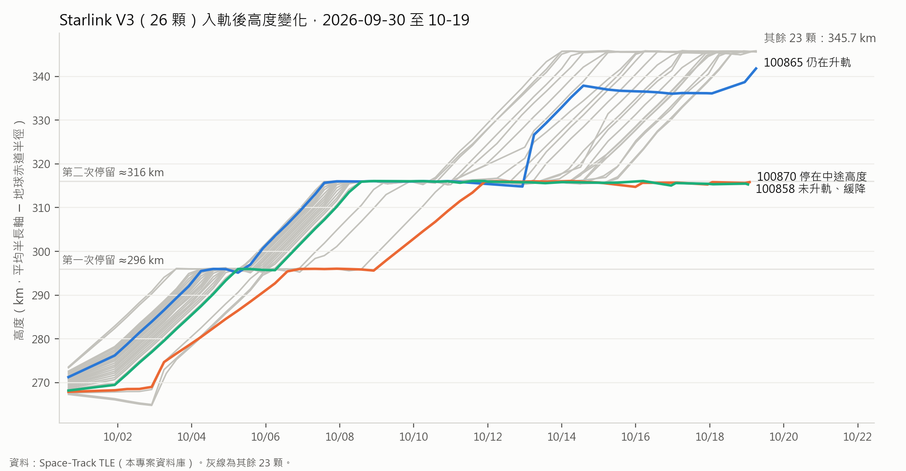

# 2026 年 10 月進度月報

> 契約：TASA-S-1150268
> 資料截至：2026-10-20（TLE）／2026-10-21（文件）
> 本月重點：① 期末報告準備情況；② Starlink V3（26 顆）入軌後軌道機動觀察；③ L3 融合評分器：評估口徑修正與 v2 改進。

---

## 一、期末報告準備情況

**結論：招標規範要求的四項期末交付物都已經有完整版本。目前進入「補入新成果、處理少數待定項目、定稿」階段，沒有尚未動工的交付項目。**

### 1.1 交付物現況

| 招標規範交付項目 | 對應文件 | 狀態 |
|---|---|---|
| 1. 期末報告電子檔 | 期末報告（決策版）＋技術附錄 | ✅ 主體完成，本月持續更新 |
| 2. 完整原始程式碼 | 程式庫＋精簡可交付包＋可重跑封包說明 | ✅ |
| 3. 技術說明文件 | 技術附錄（演算法流程、使用技術、測試基準、驗證結果、參考資料） | ✅ |
| 4. 教育訓練文件 | App 操作手冊（完整版＋精簡版） | ✅ |
| （附帶）結案簡報 | 期末結案簡報 | 🟡 待與報告最新內容同步 |

### 1.2 本月完成

- **NASA/ILRS 標竿章節更新**：納入 TASA 系統工程組 10/14 提供的逐星結果，在相同真值（14 星、1,420 個機動事件、雙方事件數一致）上直接對照。在 TASA 確認的 ±1.5 天容差下，本法平均 F1 為 0.496。TASA 全域最佳組態為 0.330（此平均值由本計畫依 TASA 逐星表計算）。由於結論會隨容差改變，且 TASA 偵測區間的寬度尚待核對，報告中列為**暫定**。報告中也把三種數字分開標註：TASA 7/31 版、本計畫依 TASA 方法重做的版本、TASA 10/14 版。
- **案例研究擴充**：單星逐層解析由 10 顆擴充至 30 顆，並列出每顆研判為機動的日期，方便委員逐筆核對。
- **文獻探討獨立成冊**：分類整理 34 筆參考文獻，並更正其中的 DOI 與期刊名稱。
- **App 操作手冊精簡版**：以淺白文字撰寫，供非專業背景人員使用。

### 1.3 定稿前待辦

| 項目 | 說明 | 是否需 TASA 協助 |
|---|---|---|
| TASA 原始偵測清單重算 | 取得清單後，以同一支評分程式重算雙方結果並回傳核對，再更新報告中的暫定結論 | **是**（等待 TASA 提供） |
| Starlink V3 評估母體處理 | 26 顆新星入軌初期的升軌被誤計為誤報，處理方式見第二節 | 否 |
| 部分指標重新驗算 | Average Precision、F1-macro 依最新資料庫重算核對（契約附表 8 判定數字不受影響） | 否 |
| 論文措辭同步 | 論文一的相關段落依 CDM 弱監督除列決議調整，需先確認投稿狀態 | 否 |
| 定稿與版本凍結 | 報告、簡報、操作手冊統一轉檔並鎖定版本，確保審查時可以依版本重現 | 否 |

---

## 二、Starlink V3（26 顆）入軌後軌道機動觀察

**結論：26 顆中有 23 顆已分三段升軌到約 345.7 km，但在這個高度只觀察到約 2–3 天，還不能確認是最終運行高度。另外 3 顆明顯落後，其中 100858 已經約 10 天沒有升軌，值得持續追蹤。**

### 2.1 基本資料

- 2026-09-30 入軌，共 26 顆，NORAD 100855–100880（6 位數編號，本系統已支援）。
- 軌道傾角約 30.5°，入軌高度約 270 km。

### 2.2 升軌過程：三段式，中間兩次停留

| 階段 | 主隊 23 顆到達時間 | 高度 |
|---|---|---|
| 入軌 | 09-30 | 約 270 km |
| 第一次停留 | 10-03 至 10-05 陸續到達 | 約 296 km |
| 第二次停留 | 10-07 至 10-10 陸續到達 | 約 316 km |
| 目前高度 | 10-14 至 10-18 陸續到達 | 約 345.7 km |

主隊在 10/18 以後的高度變化中位數只有 0.21 km，看起來已經停止升軌。不過前兩段停留也都維持了好幾天，345.7 km 可能仍是中途停留。建議再觀察 1–2 週後再判定。

### 2.3 三顆落後星

| NORAD | 目前高度 | 觀察 |
|---|---|---|
| 100865 | 341.8 km | 10/14 升到約 337 km 後停留，10/18 又開始升軌，可能在追趕主隊 |
| 100870 | 315.8 km | 從入軌起就比主隊慢，目前停在第二次停留高度，還沒開始最後一段升軌 |
| 100858 | 315.3 km | 10/9 前後到達第二次停留高度後就沒有再升軌；10/10 以後由 316.0 km 緩降到 315.3 km，符合不推進、只受大氣阻力的特徵 |

100858 的情況可能是暫時延後升軌，也可能是異常或準備退役。僅憑 TLE 無法分辨，需要持續觀察。如果之後持續下降，就可以作為本系統「異常衰減」偵測的實際驗證案例。

### 2.4 對系統評估的影響與處理建議

10/7 的評估重跑中，這 26 顆在規則層（L1）的誤報率是 43.6%，其餘負樣本只有 5.2%。從上面的觀察可以看出，這段期間被標記的事件大多是**真實的升軌機動**，不是誤報。原因在於這 26 顆還沒有真值，評估時預設把「沒有真值」當作「沒有機動」，才把真實機動算成了誤報。

建議處理方式：

1. **評估時排除升軌期**：入軌到確認穩定之前的資料不納入誤報率計算；穩定滿 1–2 週後，再當作安靜樣本納入。
2. **之後補登真值**：本計畫已取得 V3 的 SpaceX 精密星曆（MEME），可以從中標出升軌期間的機動，把這 26 顆變成真正的正樣本。

採用第 1 種方式時，契約附表 8 的判定數字不受影響（判定以已通過期中審查的 08-03 快照為準）。

*可重現性：圖 1 由 `docs/gen_fig_starlink_v3_raising.py` 從本專案資料庫產生。*

---

## 三、L3 融合評分器：評估口徑修正與 v2 改進

**結論：本月發現「安靜樣本」的定義有問題，修正後 L3 融合評分器的 AUC 由 0.855 降為 0.813。經改進特徵與模型，新版 L3 v2 回升到 0.859，並在召回率上明顯優於舊版；但「換到未來時段」的表現仍弱，是下一步要處理的問題。**

> 數字口徑說明：本節的 0.855、0.813、0.859 都是 **2026-10-21 同一份資料庫**上的同條件比較（283 顆 Starlink，以 MEME 精密星曆為真值，衛星分組交叉驗證）。期末報告中契約附表 8 的正式判定數字以已通過期中審查的 08-03 快照為準，不受本節影響。

### 3.1 發現的問題：「沒有真值」被當成「沒有機動」

評估偵測能力時，需要「機動」（正樣本）與「安靜」（負樣本）兩類時段。原本的做法是：**凡是沒有被機動事件涵蓋的時段，一律當成安靜**。本月比對時發現，其中有兩類時段其實沒有任何真值：

1. **還沒有真值的衛星**：例如 9 月底入軌的 Starlink V3 26 顆（第二節）。它們正在大幅升軌，卻被當成「安靜」，造成規則層（L1）在這 26 顆上的誤報率高達 43.6%。
2. **真值範圍以外的時段**：MEME 真值目前只整理到 09-17，但 TLE 已更新到 10 月。**所有衛星**在 09-17 之後的時段，都被預設成安靜。

修正方式：每顆衛星只在自己的真值涵蓋期間內取安靜樣本；完全沒有真值的衛星（27 顆）不納入評估。這也就是第二節 2.4 建議的處理方式，本月已實作。

| 項目（同一份資料庫） | 原本的定義 | 修正後 |
|---|--:|--:|
| 納入評估的衛星 | 310 顆 | 283 顆 |
| 安靜樣本（負樣本） | 11,373 | 4,209 |
| L1 規則層誤報率 | 0.054 | 0.037 |
| L2 統計層最佳單通道 AUC | 0.659 | 0.707 |
| **L3 融合評分器 AUC** | **0.855** | **0.813** |

**為什麼修正後 L3 的 AUC 反而下降？** 被剔除的 7,000 多個「安靜」樣本，大多是衛星平靜運行、模型很容易判對的時段。舊的評估把這些未經驗證的時段都算成答對，AUC 因此偏高。修正後的 0.813 雖然較低，卻是有真值支撐的數字。

### 3.2 為挽回 AUC 所做的努力

所有嘗試都在**同一份資料**上比較，並用 5 種不同的衛星分組各做一次交叉驗證，以確認提升是穩定的。

| 步驟 | 內容 | AUC（5 次平均） |
|---|---|--:|
| 基準 | 原 L3：15 個特徵（5 個偵測通道的最大值、平均值、90 百分位），HistGradientBoosting | 0.813 |
| ① | 加入評估程式早已算好、但 L3 從未使用的特徵：訊號的時間結構、統計證據與物理阻力的對比、窗內訊噪比 | 0.840 |
| ② | 再加入本月新增特徵：機動前後高度的位準差、窗內淨高度變化、傾角與離心率的變化、B\* 偏離 | 0.847 |
| ③ | 調整模型參數 | 0.850 |
| ④ | 改用 LightGBM | 0.853 |
| ⑤ | 加入 4 個衛星背景常數：高度、傾角、TLE 更新頻率、雜訊大小 | **0.858** |

測試過但**沒有採用**的做法：兩個模型取平均（只多 0.001，不值得增加複雜度）。另外刻意**不用**「時間窗長度」「窗內 TLE 筆數」這類特徵——機動與安靜樣本的時間窗長度本來就不同，用了等於偷看答案。

### 3.3 L3 v2 的特點

**特徵**：共 46 個，全部只從 TLE 推得。B\* 的比較基準只用該時刻之前 30 天的資料，線上運作時也能照做。

**正式評估結果**（三層同一擂台）：

| 指標 | 原 L3 | **L3 v2** |
|---|--:|--:|
| AUC | 0.813 | **0.859** |
| 誤報率 ≤ 5% 時的召回率 | 0.462 | **0.574** |
| 大型機動召回率 | 0.618 | **0.727** |
| 中型機動召回率 | 0.423 | **0.563** |

**可信度檢查**：

- **提升來自偵測能力，不是背景資訊。** 四個傾角族群（43°、53°、70°、97°）各自的 AUC 都提升（0.848–0.886）；只用 4 個背景常數時 AUC 僅 0.56，接近亂猜。
- **換一批衛星也能用。** 以從未參與訓練的衛星測試，AUC 為 0.858（原版 0.808）。

**限制（如實揭露）**：

- **換到未來的時段仍表現不佳。** 以前段時間訓練、後段時間測試，AUC 只有 0.600（原版 0.593），新舊版都一樣。這是原本就存在的時間漂移問題，v2 沒有解決。也就是說，0.859 代表「換一批衛星仍可用」，不代表「未來時段也能維持」。
- **尚未接上線上系統。** v2 的部分特徵（如機動前後位準差）需要事件之後 48 小時的資料，接上線上後判定會延遲約 2 天；即時計算的部分尚待實作。

### 3.4 下一步

1. **研究時間漂移**：找出前後時段表現落差的原因（例如 2026 年多個軌道殼層整體降低高度、太陽活動變化），再決定是否需要定期重新訓練。
2. **延長真值範圍**：以 10 月新下載的 MEME 精密星曆更新真值，讓 09-17 之後的時段也能納入評估。
3. **接上線上系統**：實作 v2 特徵的即時計算，並在介面標示約 2 天的判定延遲。

*可重現性：評估 `three_layer_common_eval.py`（舊定義加 `--legacy-quiet`）；改進實驗 `exp_l3_v2.py`；模型 `models_fusion/fusion_scorer_v2.pkl`。*
